> UC Berkeley · CS184/284A · Fall 2026 · 文件标识 `L01-introduction.pdf`。
> 本文的 **pN 一律是 PDF 的第 N 页**，不是封面讲次或页脚旧编号。文件名与封面可能不同，以下均按文件和页码回查。

## 0. 先抓住这一条推理链

```text
场景如何表示
    ↓
谁覆盖像素
    ↓
像素应当多亮
    ↓
怎样减少采样误差
    ↓
物体如何运动
    ↓
相机与人眼怎样看见
```

这篇笔记的阅读顺序是：先理解输入和输出，再确认公式的条件，最后用小数值检查。
正文将课件概念、补充推导和教学例子分开；示意图中的理想几何与数字不冒充真实实验测量。

| 内容 | 本文提供什么 |
|---|---|
| 来源 | Fall 2026，PDF 共 157 页；正文选择 22 张关键页 |
| 图解 | 12 张概念关系图 + 8 张几何或数值图，均有原生可编辑 PPTX |
| 手算 | 12 个带输入、结果和回代检查的教学例子 |
| 复习 | 26 道自测及答案，末尾保留全页索引 |
| 运行证据 | 数值核对脚本覆盖解析小模型，不代表完整渲染器或模拟器已经实现 |

[下载本篇 20 张可编辑图解（PPTX 与操作 JSON）](/notes/cs184/figures/01-editable.zip)

### 课件与推导的使用边界

课件截图用于对照原始定义与几何；正文用中文解释关系，并提供必要的修正与推导。
后续专题按本地文件的学期和编号组织，不假定它们与秋季一一对应。
若只做第一遍学习，先读每节前两段和数值例子，再展开原页核对。

### 从已经做过的小练习出发

渐变图检查坐标与 RGB；第一个三角形检查覆盖；超采样检查像素面积平均。后面所有大算法都可以拆回这种“固定输入、改变一个因素、预测结果、再运行”的小实验。

## 1. 图形学究竟在计算什么？

一张图像是计算结果，场景则是产生结果的描述：几何说明物体在哪里，材质说明它怎样响应入射光，灯光提供能量，相机决定从哪里观察。相同几何换一种灯光就能得到完全不同的像素。

课件把合成与操纵视觉信息都纳入图形学。这里先学正向问题：给场景求图像；重建则从图像推测场景，往往有多解。理解两者方向，能避免把“渲染得像”误当成“恢复的几何必然正确”。

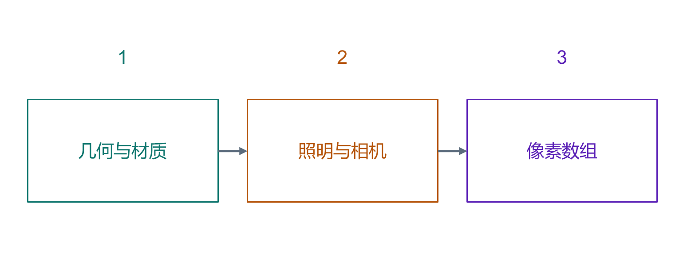

*读图：几何与材质 → 照明与相机 → 像素数组。箭头表示本节的推理或处理顺序，具体条件见正文。*

### 先读符号与条件

| 符号 / 条件 | 含义 |
| --- | --- |
| G | 几何 |
| M | 材质 |
| L | 照明 |
| C | 相机 |
| R | 渲染过程 |

### 核心关系与推导入口

以下关系使用上述条件；标为教学简化或补充的内容是为理解而推导，不是逐字转录课件。

$$
I=R(G,M,L,C)
$$

### 🔧 手算 1：把关系落到数字上

设图像宽 4、高 3、每像素 3 通道，每通道 1 字节。存储量为 4×3×3=36 字节。反算 36/3/4=3 行；这只是像素数组，不含文件头。

| 检查步骤 | 操作 |
| --- | --- |
| 输入 | 先从例子中抄下给定量及单位，不引入未给定的数值。 |
| 计算 | 按本节关系求中间量，再得到结果；不要在第一步就做显示裁剪或整数舍入。 |
| 回查 | 反算 36/3/4=3 行；这只是像素数组，不含文件头。 |
| 适用边界 | 把模型文件当成完整场景会漏掉光源与相机；黑图先检查光照和相机，而不是立即重建网格。 |

### ⚠️ 易错点：先识别症状与假设

把模型文件当成完整场景会漏掉光源与相机；黑图先检查光照和相机，而不是立即重建网格。

### 停下来解释一次

**问题：固定几何后，像素还能变化吗？**

<details>
<summary>展开参考回答</summary>

能。材质、光照、相机、曝光和运动都能改变图像；几何只是输入的一部分。

</details>

<details>
<summary>展开原课件关键页，对照术语与图形</summary>

#### What is Computer Graphics?

*PDF p8 · 对应本节：图形学究竟在计算什么？*

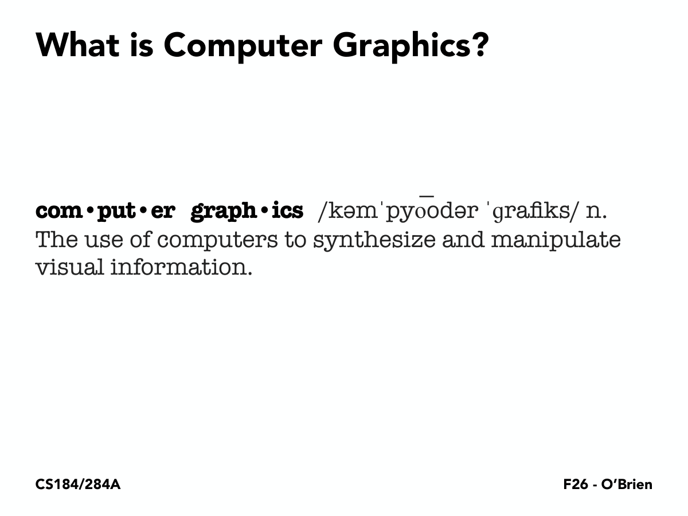

#### Course Goals

*PDF p83 · 对应本节：图形学究竟在计算什么？*

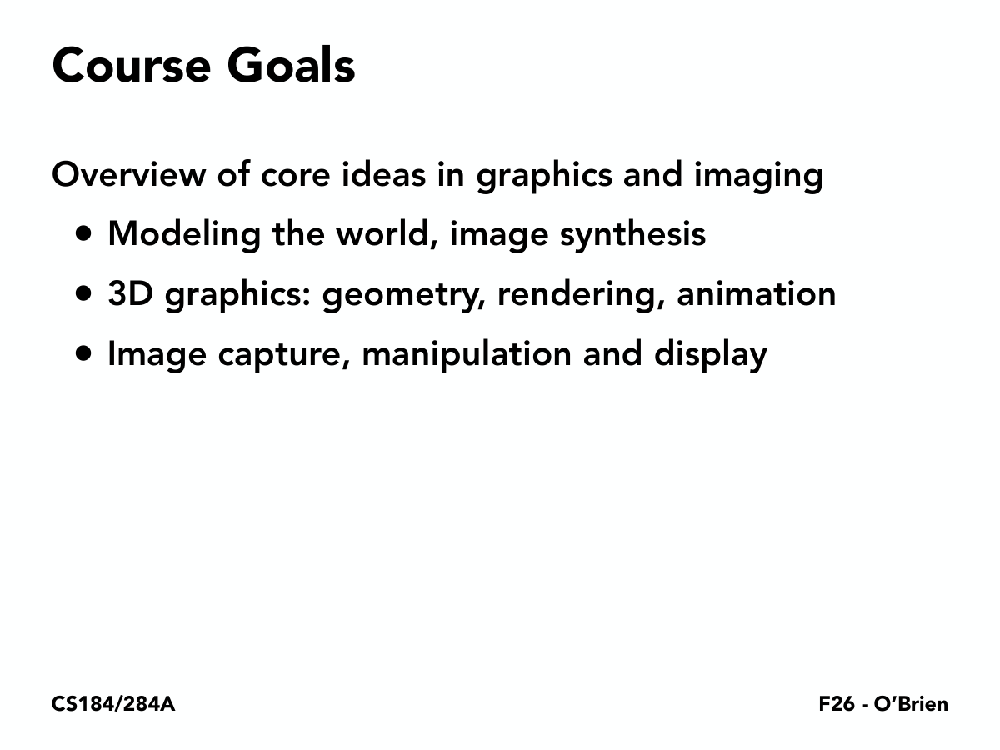

</details>

## 2. 为何先从离散像素开始？

屏幕只能存有限个数，而三角形边界和光照在空间中可以连续变化。把连续函数变成有限数组，必须决定采样位置以及一个像素代表多大的区域。

像素并不天然等于一个小正方形常色面片；那只是显示或重建方式之一。第一课输出的渐变图，是用最少变量检查坐标、通道和文件输出的实验，不需要先装完整 GPU 渲染框架。

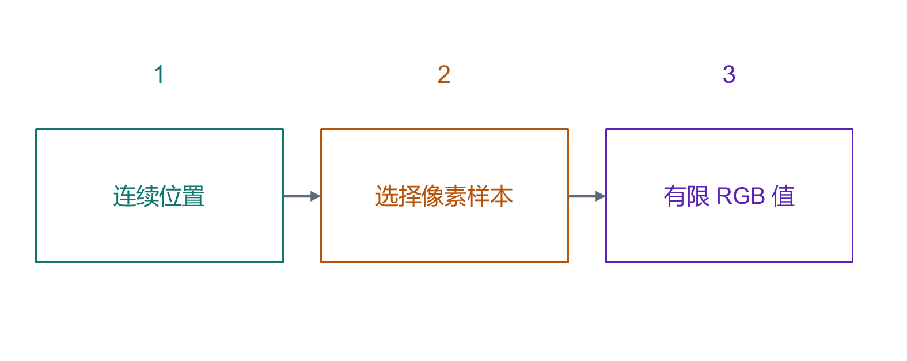

*读图：连续位置 → 选择像素样本 → 有限 RGB 值。箭头表示本节的推理或处理顺序，具体条件见正文。*

### 先读符号与条件

| 符号 / 条件 | 含义 |
| --- | --- |
| x,y | 整数像素索引 |
| W,H | 宽高且均大于 1 |
| u,v | 归一化坐标 |

### 核心关系与推导入口

以下关系使用上述条件；标为教学简化或补充的内容是为理解而推导，不是逐字转录课件。

$$
u=\frac{x}{W-1},\qquad v=\frac{y}{H-1},\qquad C=(u,v,0)
$$

### 🔧 手算 2：把关系落到数字上

取 W=5、H=3。左上 (0,0) 得 (0,0,0)；右下 (4,2) 得 (1,1,0)。转为 8 位是 (0,0,0) 和 (255,255,0)。代回右上 (4,0) 应为红色。

| 检查步骤 | 操作 |
| --- | --- |
| 输入 | 先从例子中抄下给定量及单位，不引入未给定的数值。 |
| 计算 | 按本节关系求中间量，再得到结果；不要在第一步就做显示裁剪或整数舍入。 |
| 回查 | 代回右上 (4,0) 应为红色。 |
| 适用边界 | 只有 y 从上向下增大且颜色是 (u,v,0) 时，左上黑、右下黄才成立；不能脱离坐标和颜色定义判断。 |

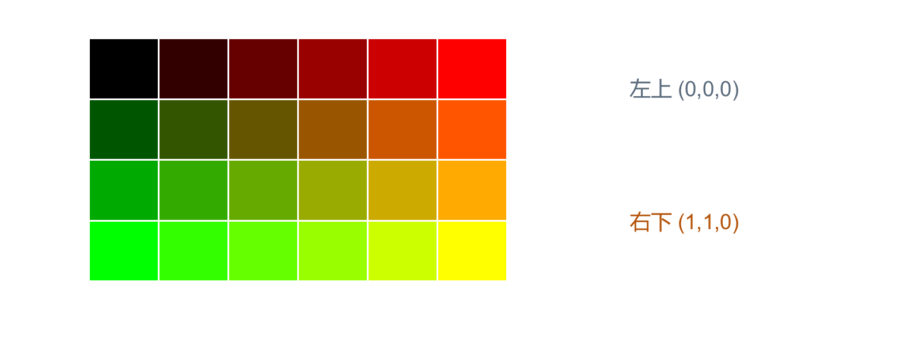

*屏幕 y 向下，颜色定义为 (u,v,0) 时，左上为黑、右下为黄。*

### ⚠️ 易错点：先识别症状与假设

只有 y 从上向下增大且颜色是 (u,v,0) 时，左上黑、右下黄才成立；不能脱离坐标和颜色定义判断。

### 停下来解释一次

**问题：若把绿色改成 1-v，哪个角变黄？**

<details>
<summary>展开参考回答</summary>

右上角。横向红色不变，绿色的上下方向翻转。

</details>

<details>
<summary>展开原课件关键页，对照术语与图形</summary>

#### Drawing Digital Images (Rasterization)

*PDF p86 · 对应本节：为何先从离散像素开始？*

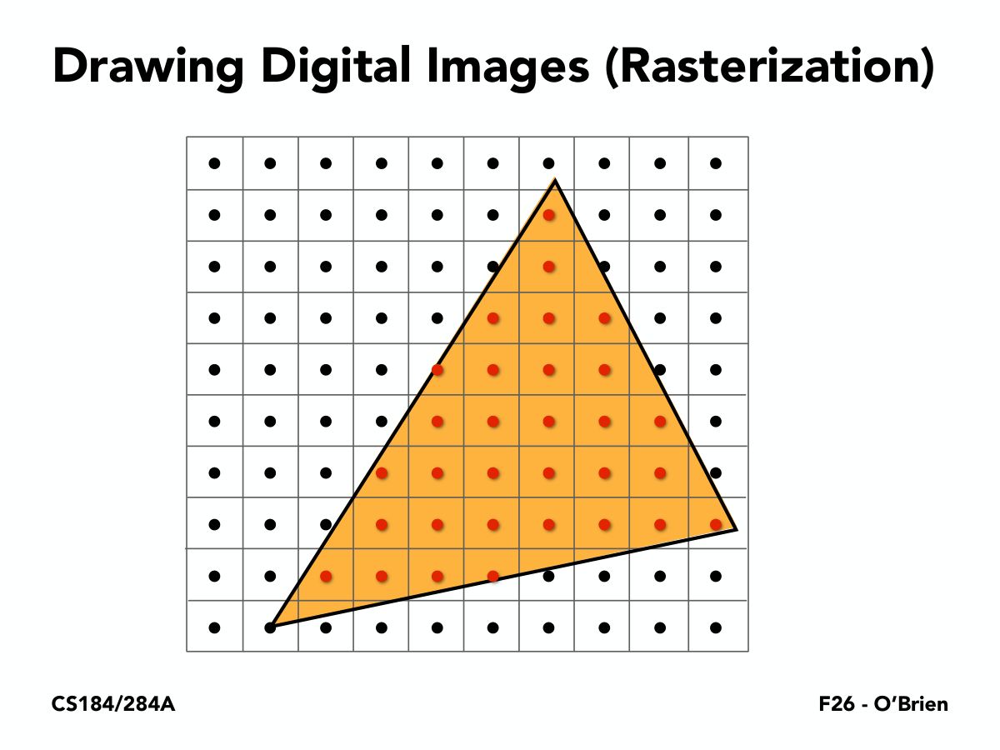

#### Filtering and Sampling

*PDF p87 · 对应本节：为何先从离散像素开始？*

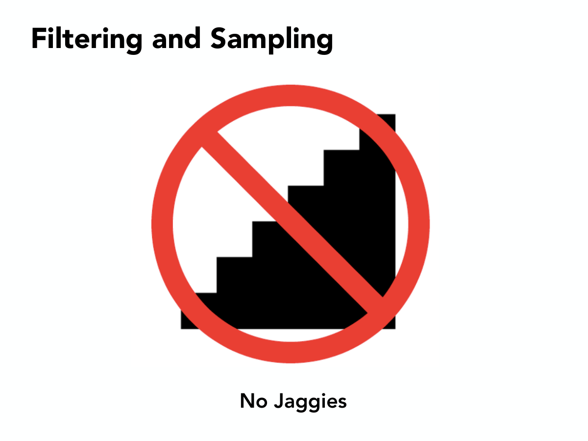

</details>

## 3. 三角形为什么是第一块积木？

三个不共线点唯一确定一个平面片。复杂曲面可以由许多小三角形近似，每个片都有简单的覆盖判定和插值规则，因此三角形连接了几何建模与屏幕绘制。

光栅化先问像素样本是否落在投影三角形内，再处理颜色与深度。把覆盖、插值、遮挡混成一个条件，往往造成“边是对的，颜色却错了”的代码。

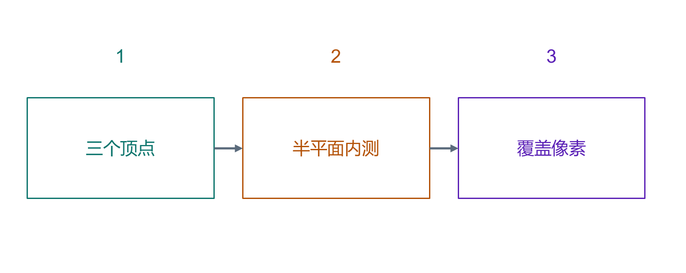

*读图：三个顶点 → 半平面内测 → 覆盖像素。箭头表示本节的推理或处理顺序，具体条件见正文。*

### 先读符号与条件

| 符号 / 条件 | 含义 |
| --- | --- |
| A,B,C | 顶点 |
| 左侧 A | 面积，正文中写作面积值以免混淆 |
| 坐标单位 | 像素 |

### 核心关系与推导入口

以下关系使用上述条件；标为教学简化或补充的内容是为理解而推导，不是逐字转录课件。

$$
A=\frac12\left\lvert (B_x-A_x)(C_y-A_y)-(B_y-A_y)(C_x-A_x)\right\rvert
$$

### 🔧 手算 3：把关系落到数字上

顶点 (0,0)、(4,0)、(0,3) 的面积是 6；把第三点改成 (0,2) 得 4。用底×高/2 再算仍为 4。

| 检查步骤 | 操作 |
| --- | --- |
| 输入 | 先从例子中抄下给定量及单位，不引入未给定的数值。 |
| 计算 | 按本节关系求中间量，再得到结果；不要在第一步就做显示裁剪或整数舍入。 |
| 回查 | 用底×高/2 再算仍为 4。 |
| 适用边界 | 屏幕 y 向下时，增加顶点 y 是向下移动；是否“变矮”取决于它相对底边的位置。 |

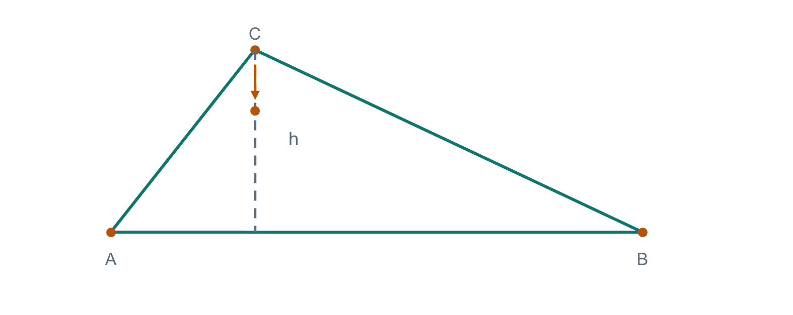

*C 向底边移动使高减小；超过底边后需重新判断高度。*

### ⚠️ 易错点：先识别症状与假设

屏幕 y 向下时，增加顶点 y 是向下移动；是否“变矮”取决于它相对底边的位置。

### 停下来解释一次

**问题：顶点 C 向下移，三角形总会变矮吗？**

<details>
<summary>展开参考回答</summary>

不会。如果底边在 C 下方且 C 向底边靠近才变矮；越过底边之后高度又会增加。

</details>

<details>
<summary>展开原课件关键页，对照术语与图形</summary>

#### Drawing Digital Images (Rasterization)

*PDF p86 · 对应本节：三角形为什么是第一块积木？*


#### (Stanislav Orekhov)

*PDF p88 · 对应本节：三角形为什么是第一块积木？*

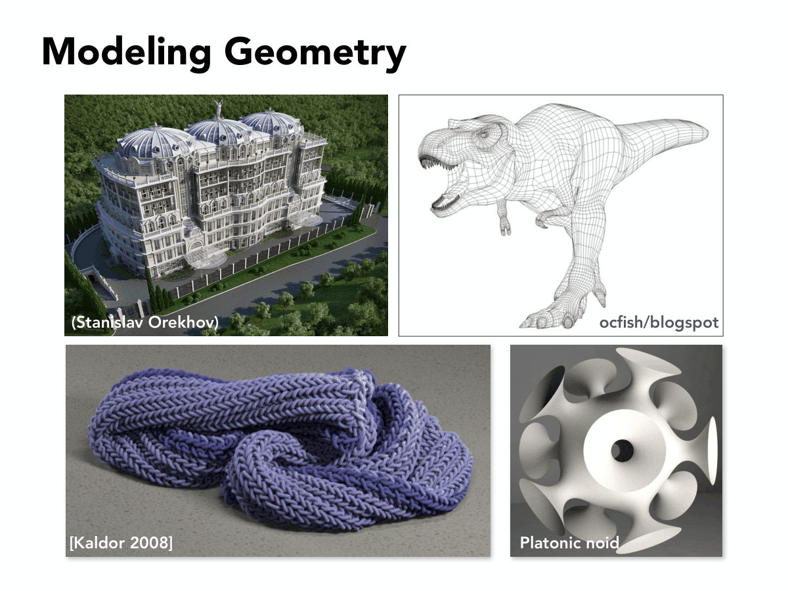

</details>

## 4. 坐标变换在改变什么？

建模坐标描述物体自身，世界坐标摆放物体，相机坐标把观察者放在统一参考系。投影将三维位置映射到二维成像平面，视口变换再映射到像素。

区分“换坐标描述”和“真的移动物体”尤其重要。相机向右运动时，静止物体通常在画面中向左移动，这不是矩阵出错，而是观察参考系发生了变化。

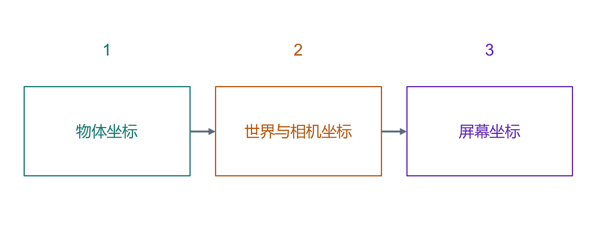

*读图：物体坐标 → 世界与相机坐标 → 屏幕坐标。箭头表示本节的推理或处理顺序，具体条件见正文。*

### 先读符号与条件

| 符号 / 条件 | 含义 |
| --- | --- |
| M | 模型矩阵 |
| V | 观察矩阵 |
| P | 投影矩阵 |
| 列向量约定 | 右侧先作用 |

### 核心关系与推导入口

以下关系使用上述条件；标为教学简化或补充的内容是为理解而推导，不是逐字转录课件。

$$
p_{clip}=PVMp_{local}
$$

### 🔧 手算 4：把关系落到数字上

一维教学例：局部 x=1，模型平移 +3 得世界 x=4，相机在 x=2，观察坐标 x=4-2=2。代回世界坐标 2+2=4。

| 检查步骤 | 操作 |
| --- | --- |
| 输入 | 先从例子中抄下给定量及单位，不引入未给定的数值。 |
| 计算 | 按本节关系求中间量，再得到结果；不要在第一步就做显示裁剪或整数舍入。 |
| 回查 | 代回世界坐标 2+2=4。 |
| 适用边界 | 矩阵乘法一般不交换；不要把代码中行向量库的乘法顺序直接抄进列向量推导。 |

### ⚠️ 易错点：先识别症状与假设

矩阵乘法一般不交换；不要把代码中行向量库的乘法顺序直接抄进列向量推导。

### 停下来解释一次

**问题：相机向右走与物体向左走完全一样吗？**

<details>
<summary>展开参考回答</summary>

对单个静态相对位置可有相同效果，但多物体运动、灯光和世界约束不一定等价。

</details>

<details>
<summary>展开原课件关键页，对照术语与图形</summary>

#### (Stanislav Orekhov)

*PDF p88 · 对应本节：坐标变换在改变什么？*


#### How Do Cameras Work?

*PDF p93 · 对应本节：坐标变换在改变什么？*

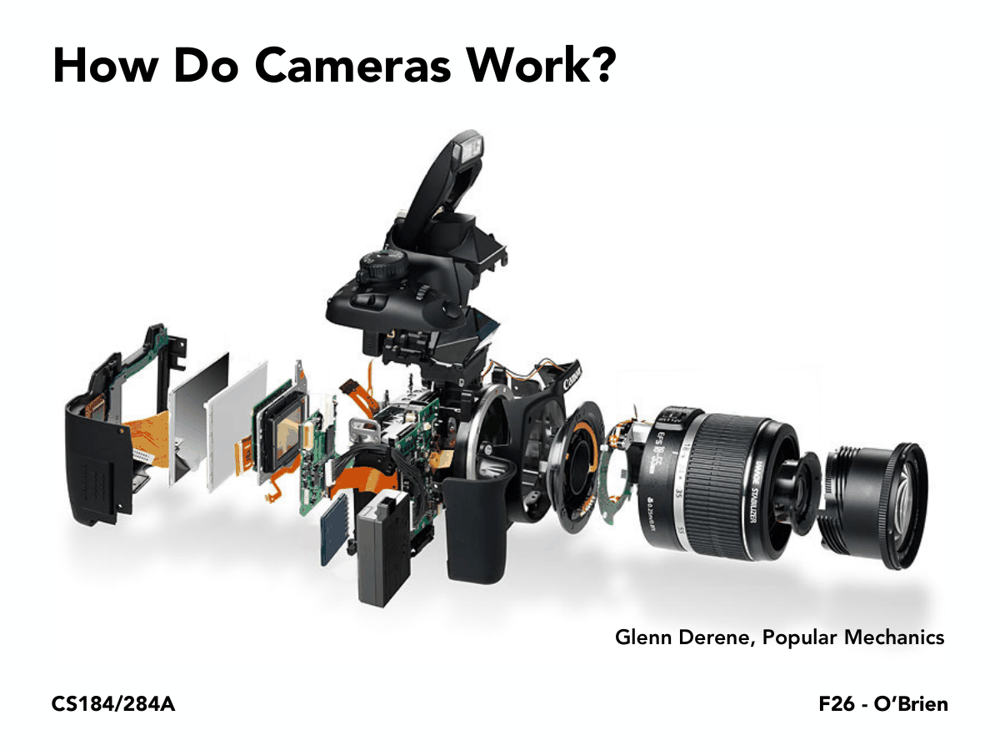

</details>

## 5. 看得见与看起来亮是两件事

可见性回答最近交点是谁，着色回答从该点沿观察方向离开的光有多少。一个像素首先需要找到表面，之后才能查询材质和光照。

Z-buffer 与光线求交是两种求可见性的办法；它们并不自动产生真实光照。简单的局部着色没有求解墙壁反弹的间接光，后续辐射度量与路径追踪才会补上这部分。

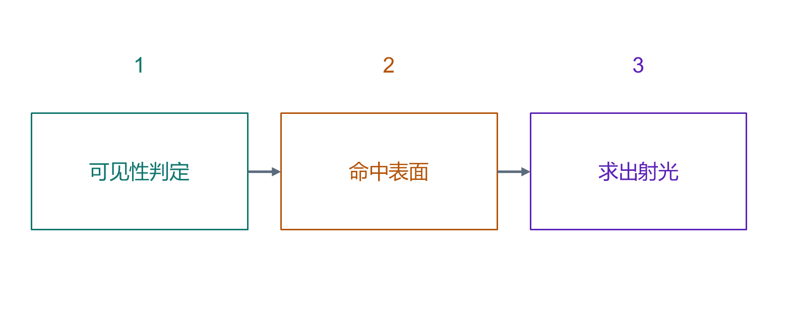

*读图：可见性判定 → 命中表面 → 求出射光。箭头表示本节的推理或处理顺序，具体条件见正文。*

### 先读符号与条件

| 符号 / 条件 | 含义 |
| --- | --- |
| z | 沿约定深度方向的距离 |
| 前提 | 这里假定较小深度更近 |
| 颜色 | 独立于最近深度的后续计算 |

### 核心关系与推导入口

以下关系使用上述条件；标为教学简化或补充的内容是为理解而推导，不是逐字转录课件。

$$
z_{visible}=\min(z_1,z_2,\ldots)
$$

### 🔧 手算 5：把关系落到数字上

两个片段深度为 2 和 5，保留 2。若近处片段颜色为黑，结果仍是黑，不会因为远处更亮就选 5。检验：遮挡比较只读取深度。

| 检查步骤 | 操作 |
| --- | --- |
| 输入 | 先从例子中抄下给定量及单位，不引入未给定的数值。 |
| 计算 | 按本节关系求中间量，再得到结果；不要在第一步就做显示裁剪或整数舍入。 |
| 回查 | 检验：遮挡比较只读取深度。 |
| 适用边界 | 把“最亮的片段”当成“可见的片段”会产生穿墙发光；透明表面需要另外的合成规则。 |

### ⚠️ 易错点：先识别症状与假设

把“最亮的片段”当成“可见的片段”会产生穿墙发光；透明表面需要另外的合成规则。

### 停下来解释一次

**问题：最近表面一定是像素贡献最大的物体吗？**

<details>
<summary>展开参考回答</summary>

不一定。透明、反射和间接照明都可能让其他物体贡献能量；最近表面只是路径的首个交互点。

</details>

<details>
<summary>展开原课件关键页，对照术语与图形</summary>

#### Modeling Material Properties

*PDF p89 · 对应本节：看得见与看起来亮是两件事*

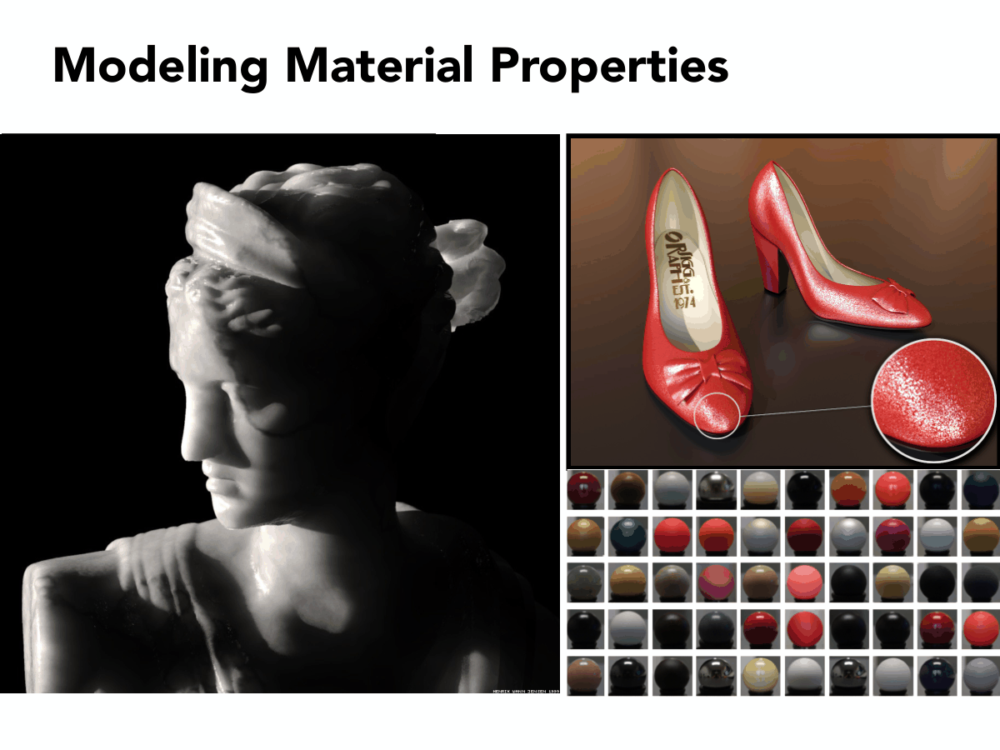

#### Modeling Lighting

*PDF p90 · 对应本节：看得见与看起来亮是两件事*

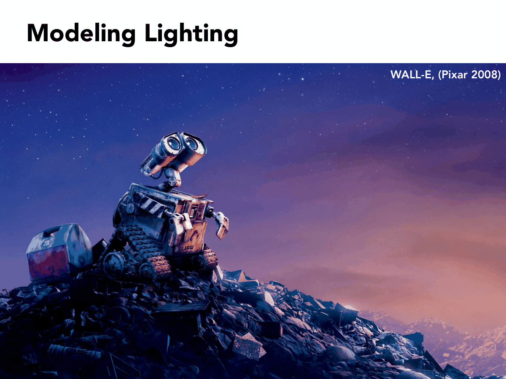

</details>

## 6. 光栅化与光线追踪怎样衔接？

光栅化把图元向屏幕投影，适合批量处理可见表面。光线追踪从像素向场景查询，方便继续追踪反射、折射与阴影。两者共享三角形、矩阵、纹理与材质，差别主要在查询组织方式。

真实系统可以混用两条路线。本课程先学光栅化再学追踪，是先建立离散图像与几何的基本工具，而不是宣布前者被后者替代。

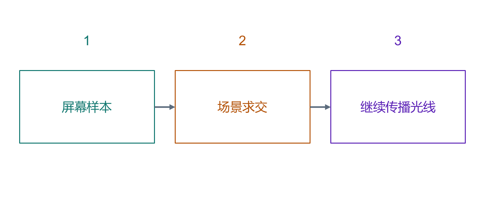

*读图：屏幕样本 → 场景求交 → 继续传播光线。箭头表示本节的推理或处理顺序，具体条件见正文。*

### 先读符号与条件

| 符号 / 条件 | 含义 |
| --- | --- |
| W,H | 分辨率 |
| S | 每像素光线样本数 |
| T | 三角形数 |
| 假设 | 逐光线暴力测试全部三角形 |

### 核心关系与推导入口

以下关系使用上述条件；标为教学简化或补充的内容是为理解而推导，不是逐字转录课件。

$$
N_{tests}=W H S T
$$

### 🔧 手算 6：把关系落到数字上

100×100 像素、4 样本、1000 三角形，需要 4×10^7 次候选测试。T 增至 2000，代回变成 8×10^7。

| 检查步骤 | 操作 |
| --- | --- |
| 输入 | 先从例子中抄下给定量及单位，不引入未给定的数值。 |
| 计算 | 按本节关系求中间量，再得到结果；不要在第一步就做显示裁剪或整数舍入。 |
| 回查 | T 增至 2000，代回变成 8×10^7。 |
| 适用边界 | 这只是暴力复杂度估算，不是实际运行时间；BVH、遮挡早停和 GPU 并行都会改变耗时。 |

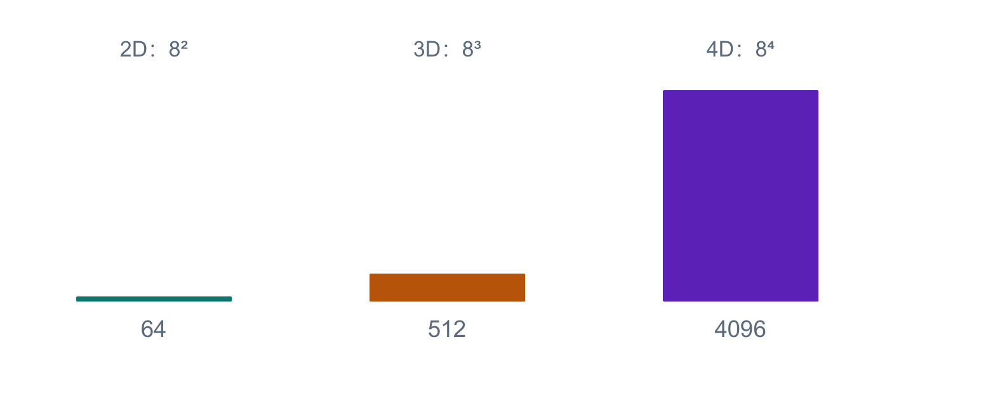

*规则网格每维八点，积分维数增加使总样本数指数增长。*

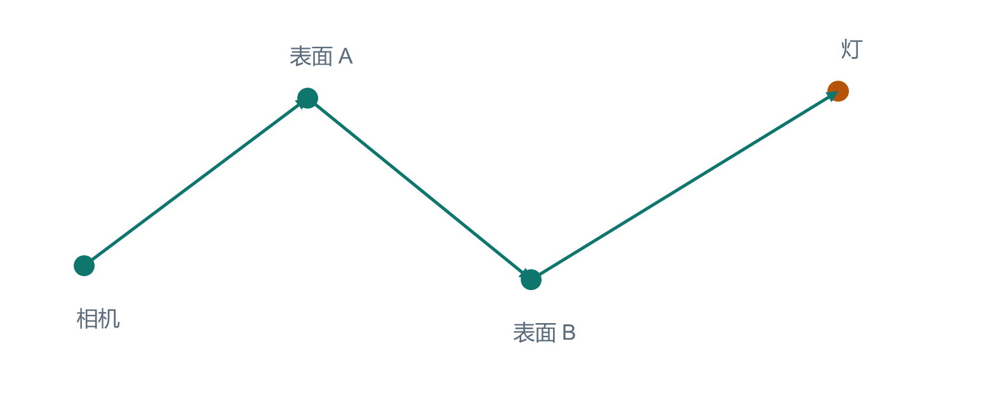

*像素可以接收经过多个表面散射后到达相机的光。*

### ⚠️ 易错点：先识别症状与假设

这只是暴力复杂度估算，不是实际运行时间；BVH、遮挡早停和 GPU 并行都会改变耗时。

### 停下来解释一次

**问题：只提高 GPU 并行度就不需要 BVH 吗？**

<details>
<summary>展开参考回答</summary>

不。并行与减少工作量是不同手段；高场景复杂度下，加速结构仍然重要。

</details>

<details>
<summary>展开原课件关键页，对照术语与图形</summary>

#### Realistic Lighting Simulation

*PDF p91 · 对应本节：光栅化与光线追踪怎样衔接？*

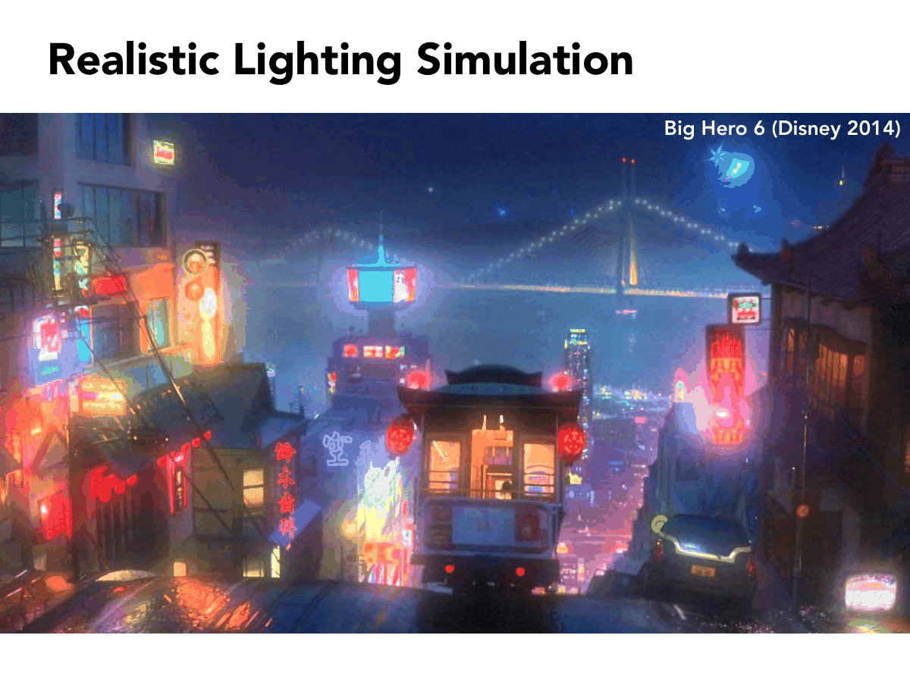

#### Light Transport and Image Synthesis

*PDF p92 · 对应本节：光栅化与光线追踪怎样衔接？*

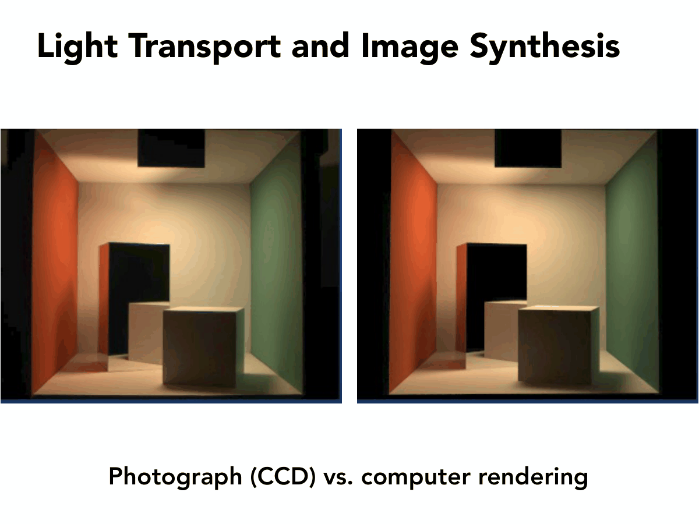

</details>

## 7. 锯齿为什么不是美术问题？

一条斜边经过像素时，中心样本只给出“里面或外面”。边缘随微小移动跳跃，连续几何因此产生不连续像素变化。抗锯齿的目标是估计像素区域内的平均贡献。

超采样把一个像素分成多个采样位置，再平均颜色。样本数增加通常改善近似，但规则采样仍可能与高频图案形成结构性混叠；这会在采样课和 Monte Carlo 课中分别展开。

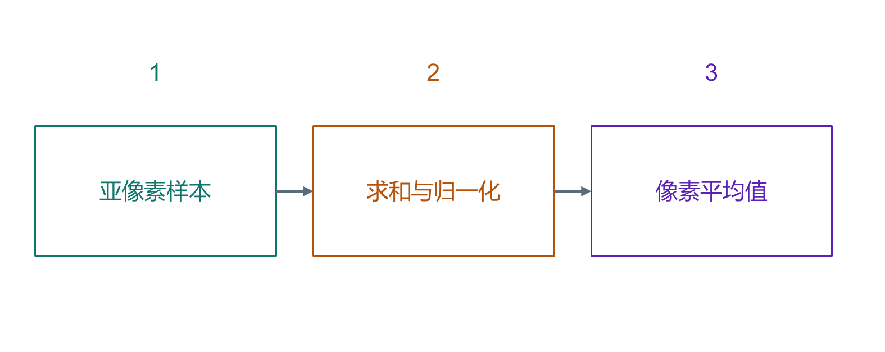

*读图：亚像素样本 → 求和与归一化 → 像素平均值。箭头表示本节的推理或处理顺序，具体条件见正文。*

### 先读符号与条件

| 符号 / 条件 | 含义 |
| --- | --- |
| N | 子样本数 |
| C_i | 线性颜色 |
| 前提 | 等权均匀区域样本 |

### 核心关系与推导入口

以下关系使用上述条件；标为教学简化或补充的内容是为理解而推导，不是逐字转录课件。

$$
\widehat C=\frac1N\sum_{i=1}^{N} C_i
$$

### 🔧 手算 7：把关系落到数字上

四个子样本中三个是白色、一个黑色，线性结果为 0.75。求和 3 再除以 4；用覆盖率 3/4 验算相同。

| 检查步骤 | 操作 |
| --- | --- |
| 输入 | 先从例子中抄下给定量及单位，不引入未给定的数值。 |
| 计算 | 按本节关系求中间量，再得到结果；不要在第一步就做显示裁剪或整数舍入。 |
| 回查 | 求和 3 再除以 4；用覆盖率 3/4 验算相同。 |
| 适用边界 | 平均应在适当的线性量上完成；直接平均 gamma 编码值可能让边缘偏暗。 |

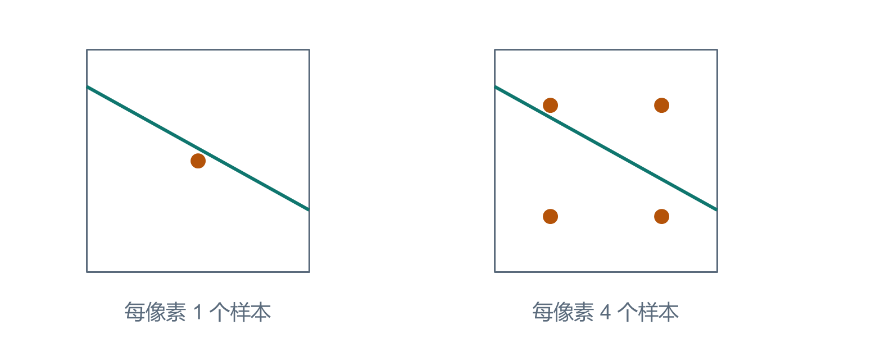

*相同边界下增加子样本，能估计部分覆盖而非只有二元判断。*

### ⚠️ 易错点：先识别症状与假设

平均应在适当的线性量上完成；直接平均 gamma 编码值可能让边缘偏暗。

### 停下来解释一次

**问题：四个样本就能消除所有锯齿吗？**

<details>
<summary>展开参考回答</summary>

不能。它只是有限预算近似，细小几何、频繁变化纹理和时间采样仍会混叠。

</details>

<details>
<summary>展开原课件关键页，对照术语与图形</summary>

#### Filtering and Sampling

*PDF p87 · 对应本节：锯齿为什么不是美术问题？*


</details>

## 8. 模型、材质与纹理怎样分工？

几何决定形状，材质决定散射规律，纹理让参数随位置变化。同一个球，换成镜面、粗糙金属、透明玻璃会产生截然不同的外观。

纹理中存的也不一定是颜色，还可以是粗糙度、法线和位移。颜色纹理与数值参数纹理在读取时需要不同的解释，不能统一加一次 gamma 变换。

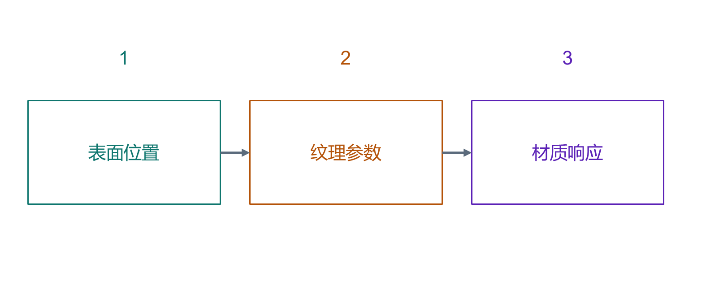

*读图：表面位置 → 纹理参数 → 材质响应。箭头表示本节的推理或处理顺序，具体条件见正文。*

### 先读符号与条件

| 符号 / 条件 | 含义 |
| --- | --- |
| u,v | 纹理坐标 |
| w | 双线性权重 |
| c | 颜色或其他连续参数 |

### 核心关系与推导入口

以下关系使用上述条件；标为教学简化或补充的内容是为理解而推导，不是逐字转录课件。

$$
c(u,v)=\sum_{i,j\in\{0,1\}}w_{ij}c_{ij},\qquad \sum w_{ij}=1
$$

### 🔧 手算 8：把关系落到数字上

四角标量为 0、1、1、0，中心权重各 1/4，结果 0.5。权重总和为 1，所以常数纹理也能保持不变。

| 检查步骤 | 操作 |
| --- | --- |
| 输入 | 先从例子中抄下给定量及单位，不引入未给定的数值。 |
| 计算 | 按本节关系求中间量，再得到结果；不要在第一步就做显示裁剪或整数舍入。 |
| 回查 | 权重总和为 1，所以常数纹理也能保持不变。 |
| 适用边界 | 法线纹理插值后常需重新归一化；位置插值公式不能不加区分地用于所有数据。 |

### ⚠️ 易错点：先识别症状与假设

法线纹理插值后常需重新归一化；位置插值公式不能不加区分地用于所有数据。

### 停下来解释一次

**问题：给模型贴照片就一定真实了吗？**

<details>
<summary>展开参考回答</summary>

不。照片已经混有光照，直接当反射率可能把阴影重复计算；形状、照明与相机仍然影响结果。

</details>

<details>
<summary>展开原课件关键页，对照术语与图形</summary>

#### (Stanislav Orekhov)

*PDF p88 · 对应本节：模型、材质与纹理怎样分工？*


#### Modeling Material Properties

*PDF p89 · 对应本节：模型、材质与纹理怎样分工？*


</details>

## 9. 为什么还要学动画与物理？

静态图像只描述一个时刻。动画需要规定参数如何随时间变化，物理模拟则从力、质量与约束求运动。二者服务不同控制目标，可以由关键帧驱动骨架，再用模拟产生衣服和头发运动。

时间也需要采样。每帧一个瞬间会让快速物体跳动；曝光期间积分才能生成运动模糊。这里与第三讲的空间抗锯齿是同一类问题，只是积分变量换成了时间。

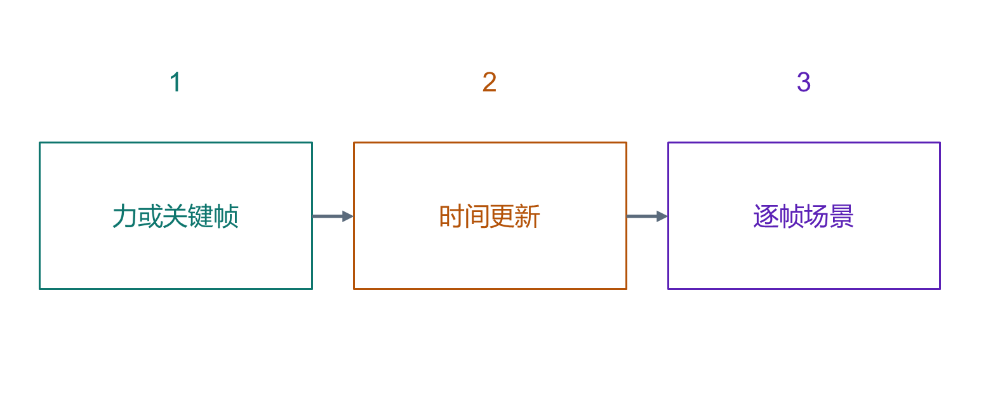

*读图：力或关键帧 → 时间更新 → 逐帧场景。箭头表示本节的推理或处理顺序，具体条件见正文。*

### 先读符号与条件

| 符号 / 条件 | 含义 |
| --- | --- |
| x | 位置 |
| v | 速度 |
| Delta t | 时间步长 |
| 假设 | 一步内用旧速度近似 |

### 核心关系与推导入口

以下关系使用上述条件；标为教学简化或补充的内容是为理解而推导，不是逐字转录课件。

$$
x(t+\Delta t)\approx x(t)+v(t)\Delta t
$$

### 🔧 手算 9：把关系落到数字上

x=2 米、v=3 米/秒、步长 0.1 秒，得到 2.3 米。位移 0.3 米除以 0.1 秒仍为 3 米/秒。

| 检查步骤 | 操作 |
| --- | --- |
| 输入 | 先从例子中抄下给定量及单位，不引入未给定的数值。 |
| 计算 | 按本节关系求中间量，再得到结果；不要在第一步就做显示裁剪或整数舍入。 |
| 回查 | 位移 0.3 米除以 0.1 秒仍为 3 米/秒。 |
| 适用边界 | 把每帧移动量写成常数会导致帧率改变后速度改变；应把秒作为时间单位。 |

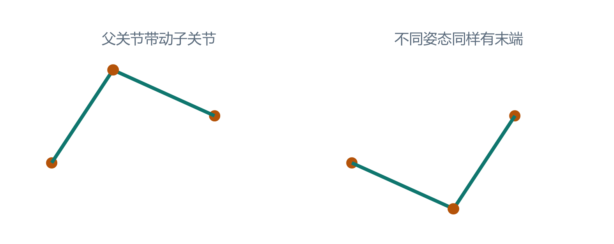

*骨架由层级控制，表面运动需要另外的蒙皮阶段。*

### ⚠️ 易错点：先识别症状与假设

把每帧移动量写成常数会导致帧率改变后速度改变；应把秒作为时间单位。

### 停下来解释一次

**问题：动画帧率与物理步长必须相同吗？**

<details>
<summary>展开参考回答</summary>

不必。物理可以每帧进行多个子步，显示再读取或插值状态。

</details>

<details>
<summary>展开原课件关键页，对照术语与图形</summary>

#### Motion Capture

*PDF p95 · 对应本节：为什么还要学动画与物理？*

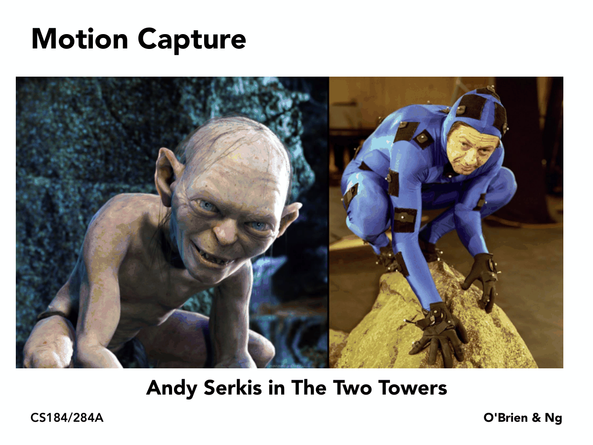

#### Animation and Physical Simulation

*PDF p97 · 对应本节：为什么还要学动画与物理？*

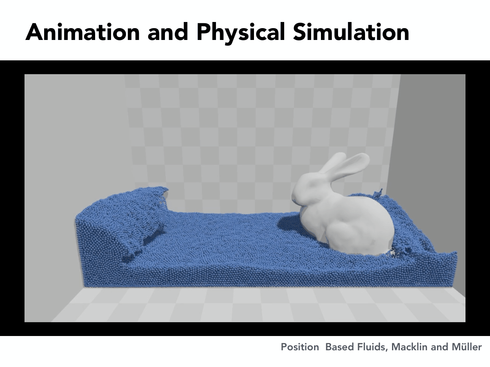

#### Animation and Physical Simulation

*PDF p98 · 对应本节：为什么还要学动画与物理？*


</details>

## 10. 相机、人眼和显示器在哪一环？

渲染器得到的线性光量还不是最终屏幕编码。相机涉及投影、镜头、曝光与传感器；显示涉及色域、传递函数和观看条件。RGB 不是完整光谱，三通道能够有效表示颜色，与人的三类视锥响应有关。

VR 进一步要求左右眼视图以及随头部运动及时更新。即使每张静态图都很漂亮，延迟过高仍会破坏空间稳定感。

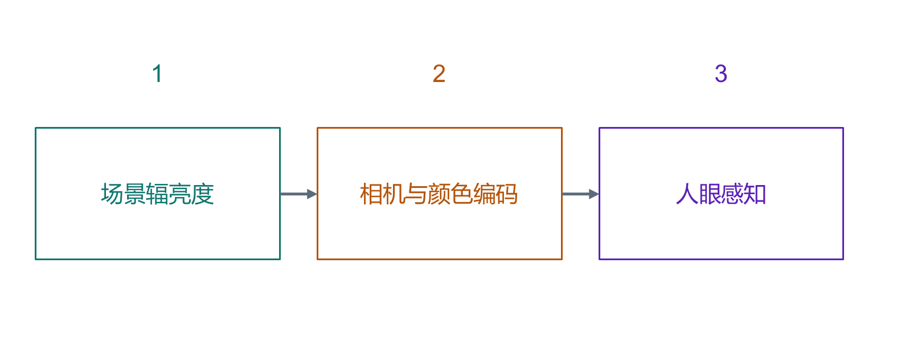

*读图：场景辐亮度 → 相机与颜色编码 → 人眼感知。箭头表示本节的推理或处理顺序，具体条件见正文。*

### 先读符号与条件

| 符号 / 条件 | 含义 |
| --- | --- |
| omega | 头部角速度 |
| tau | 端到端延迟 |
| Delta theta | 近似角度误差 |

### 核心关系与推导入口

以下关系使用上述条件；标为教学简化或补充的内容是为理解而推导，不是逐字转录课件。

$$
\Delta\theta=\omega\tau
$$

### 🔧 手算 10：把关系落到数字上

教学设定角速度 90 度/秒、延迟 0.02 秒，误差为 1.8 度；若 20 像素/度，则约 36 像素。用 36/20 验算为 1.8 度。

| 检查步骤 | 操作 |
| --- | --- |
| 输入 | 先从例子中抄下给定量及单位，不引入未给定的数值。 |
| 计算 | 按本节关系求中间量，再得到结果；不要在第一步就做显示裁剪或整数舍入。 |
| 回查 | 用 36/20 验算为 1.8 度。 |
| 适用边界 | 这里是恒定角速度近似，不是特定头显的实测；不能把历史课件设备当作当前购买建议。 |

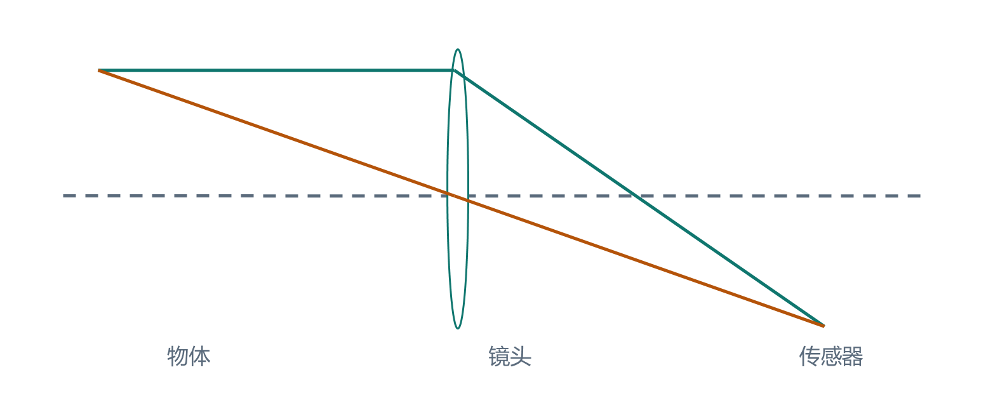

*有限镜头汇聚光线，传感器并非直接等同投影矩阵。*

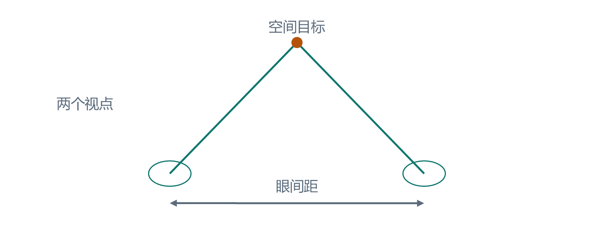

*左右眼分别从自己的视点成像，产生双目视差。*

### ⚠️ 易错点：先识别症状与假设

这里是恒定角速度近似，不是特定头显的实测；不能把历史课件设备当作当前购买建议。

### 停下来解释一次

**问题：图像帧率高就一定延迟低吗？**

<details>
<summary>展开参考回答</summary>

不。排队、传输、扫描显示和追踪都可能增加延迟，吞吐率与单次延迟要分开测。

</details>

<details>
<summary>展开原课件关键页，对照术语与图形</summary>

#### How Do Cameras Work?

*PDF p93 · 对应本节：相机、人眼和显示器在哪一环？*


#### Opto-perceptual Effects

*PDF p94 · 对应本节：相机、人眼和显示器在哪一环？*

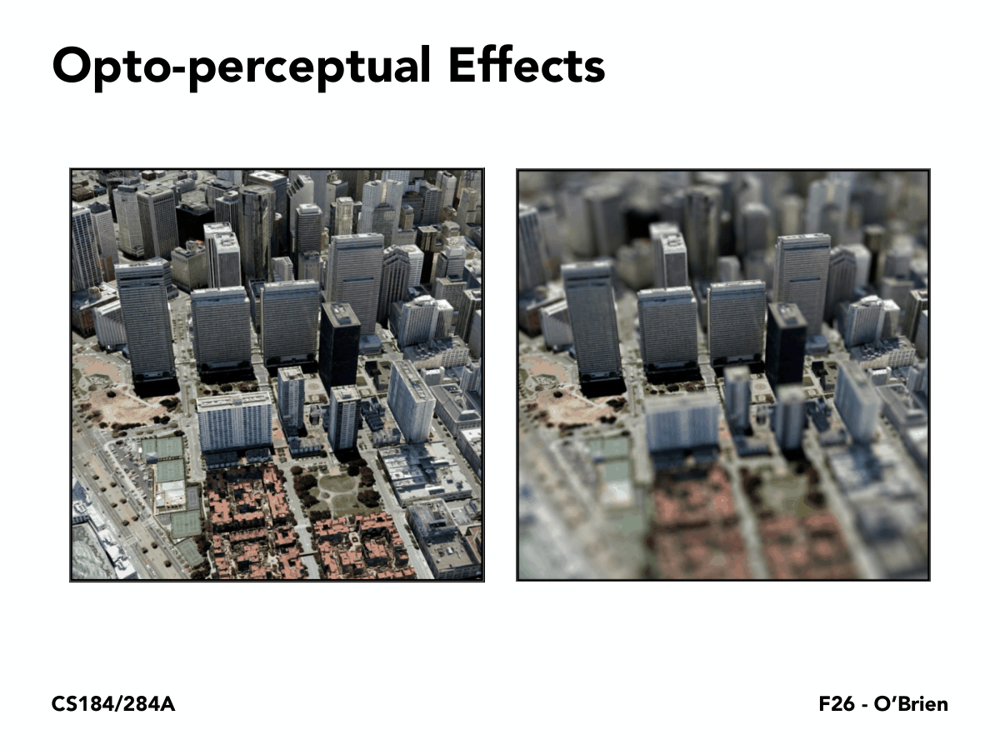

#### Virtual Reality

*PDF p99 · 对应本节：相机、人眼和显示器在哪一环？*

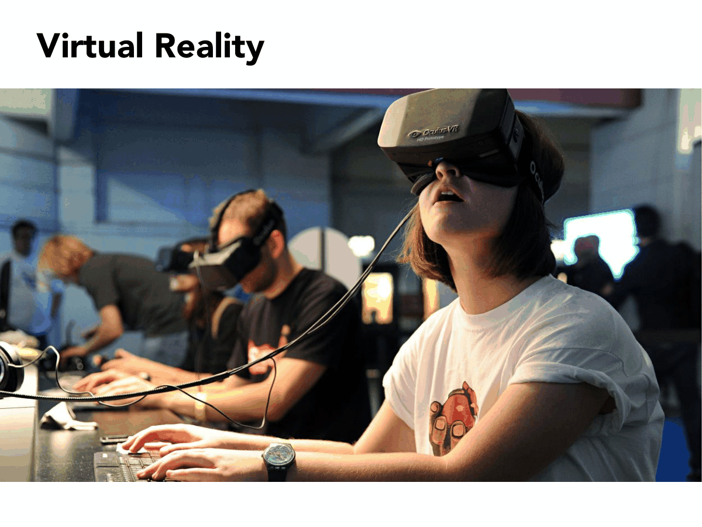

</details>

## 11. 怎样用一个最小项目串起全课？

以已有图片输出程序为起点，每一步只增加一个可观察能力：渐变检查坐标，三角形检查覆盖，超采样检查积分，纹理检查插值，球体与 BVH 检查求交，路径追踪检查能量传播。

保留每一步的对照图和固定参数。看到结果变化后，应能指出改了哪个数学对象，而不只是“画面更好了”。这条练习线是本笔记的自学安排，不代表课件正式作业提交要求。

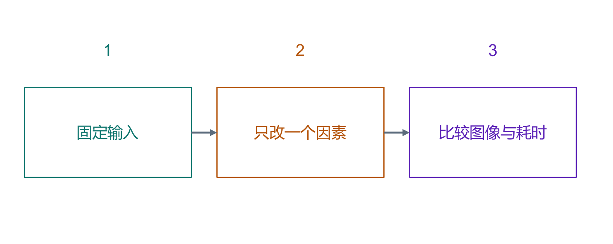

*读图：固定输入 → 只改一个因素 → 比较图像与耗时。箭头表示本节的推理或处理顺序，具体条件见正文。*

### 先读符号与条件

| 符号 / 条件 | 含义 |
| --- | --- |
| t | 相同输入和质量设置下的耗时 |
| speedup | 加速比 |
| 对照 | 只改变一个实现因素 |

### 核心关系与推导入口

以下关系使用上述条件；标为教学简化或补充的内容是为理解而推导，不是逐字转录课件。

$$
\text{speedup}=\frac{t_{before}}{t_{after}}
$$

### 🔧 手算 11：把关系落到数字上

相同场景从 12 秒变成 3 秒，加速比为 4。反算 3×4=12；若样本数也从 64 改成 16，则不能把全部提升归因于算法。

| 检查步骤 | 操作 |
| --- | --- |
| 输入 | 先从例子中抄下给定量及单位，不引入未给定的数值。 |
| 计算 | 按本节关系求中间量，再得到结果；不要在第一步就做显示裁剪或整数舍入。 |
| 回查 | 反算 3×4=12；若样本数也从 64 改成 16，则不能把全部提升归因于算法。 |
| 适用边界 | 优化前先锁定图像尺寸、样本数、场景和编译模式；否则比较没有共同基准。 |

### ⚠️ 易错点：先识别症状与假设

优化前先锁定图像尺寸、样本数、场景和编译模式；否则比较没有共同基准。

### 停下来解释一次

**问题：怎样判断一次优化没有破坏正确性？**

<details>
<summary>展开参考回答</summary>

先对照同参数输出及误差，再比较耗时；随机渲染要比较统计误差而非要求逐像素完全相等。

</details>

<details>
<summary>展开原课件关键页，对照术语与图形</summary>

#### Hands-On Learning

*PDF p100 · 对应本节：怎样用一个最小项目串起全课？*

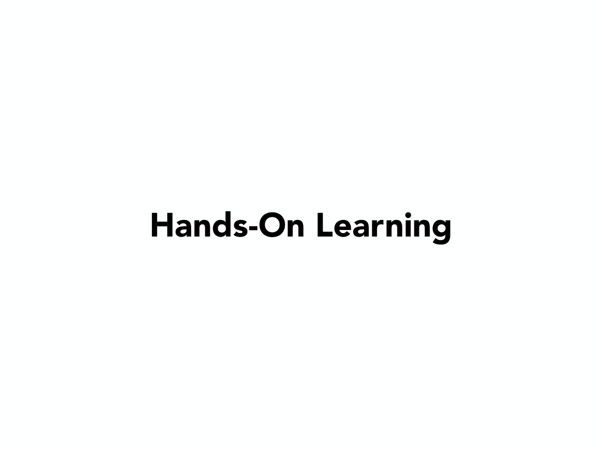

#### Course Assignments

*PDF p101 · 对应本节：怎样用一个最小项目串起全课？*

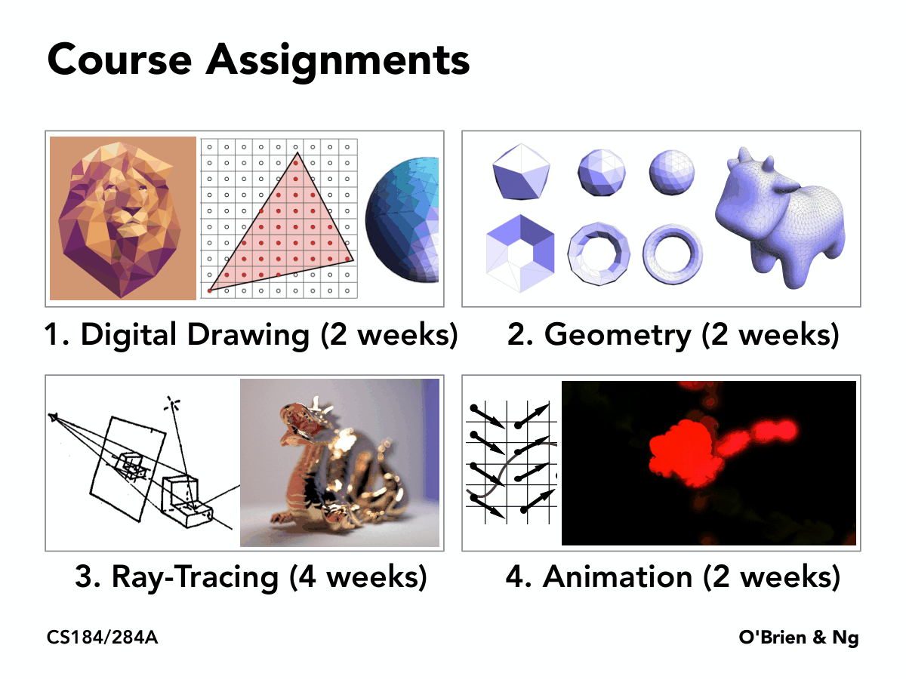

#### Course Assignments

*PDF p102 · 对应本节：怎样用一个最小项目串起全课？*


</details>

## 12. 如何读课件而不是背名词？

每个概念都回答四个问题：输入是什么、输出是什么、用了什么假设、哪个例子能让它失败。公式先看单位和变量，再看推导，最后写一个可以手算的小程序。

导论里的电影、游戏、科研图像说明应用范围；课程行政信息则属于当时班级安排。本笔记把这些页面放进索引保留出处，学习路线以知识依赖为准，并在后续用春季与夏季专题补齐本地秋季材料之后的内容。

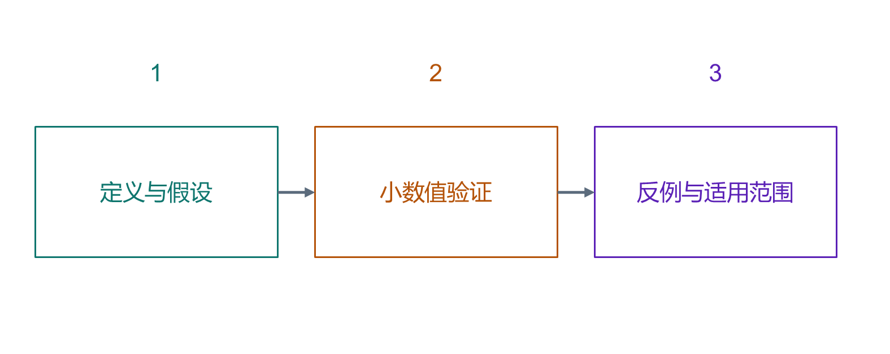

*读图：定义与假设 → 小数值验证 → 反例与适用范围。箭头表示本节的推理或处理顺序，具体条件见正文。*

### 先读符号与条件

| 符号 / 条件 | 含义 |
| --- | --- |
| epsilon | 绝对误差 |
| reference | 可解析结果或可信高精度参考 |
| 注意 | 参考本身可能有误差 |

### 核心关系与推导入口

以下关系使用上述条件；标为教学简化或补充的内容是为理解而推导，不是逐字转录课件。

$$
\epsilon=\left\lvert x_{computed}-x_{reference}\right\rvert
$$

### 🔧 手算 12：把关系落到数字上

程序算得 0.333，解析值 1/3，绝对误差约 0.000333333。代回 0.333+误差约等于 1/3；相对误差约 0.1%。

| 检查步骤 | 操作 |
| --- | --- |
| 输入 | 先从例子中抄下给定量及单位，不引入未给定的数值。 |
| 计算 | 按本节关系求中间量，再得到结果；不要在第一步就做显示裁剪或整数舍入。 |
| 回查 | 代回 0.333+误差约等于 1/3；相对误差约 0.1%。 |
| 适用边界 | 一次例子通过不代表算法普遍正确；要补边界、尺度变化和反例。 |

### ⚠️ 易错点：先识别症状与假设

一次例子通过不代表算法普遍正确；要补边界、尺度变化和反例。

### 停下来解释一次

**问题：本课程最终是否只有一个万能渲染算法？**

<details>
<summary>展开参考回答</summary>

没有。可控性、物理准确性、效率与感知质量之间存在取舍；课程教的是分析这些取舍的工具。

</details>

<details>
<summary>展开原课件关键页，对照术语与图形</summary>

#### Prerequisites

*PDF p6 · 对应本节：如何读课件而不是背名词？*

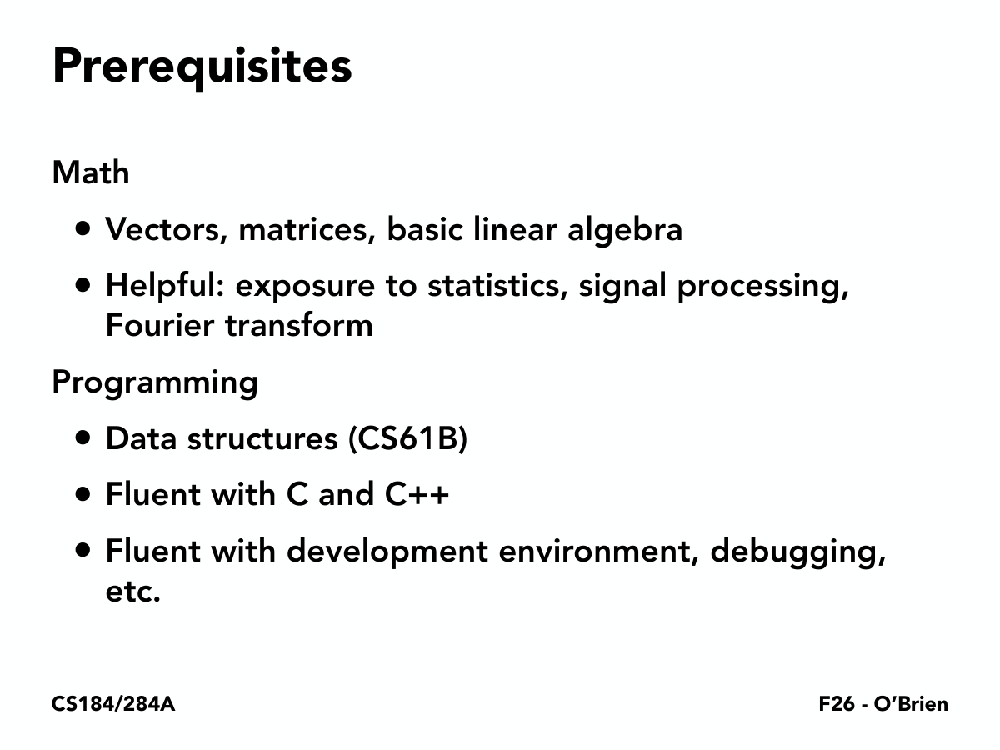

#### Resources

*PDF p119 · 对应本节：如何读课件而不是背名词？*

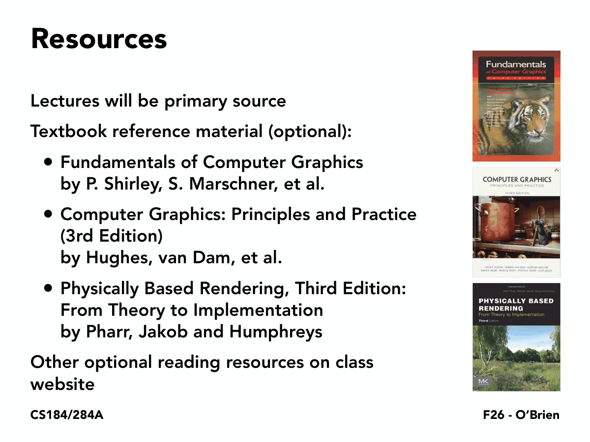

#### What We Are Looking For In Slide Comments

*PDF p131 · 对应本节：如何读课件而不是背名词？*

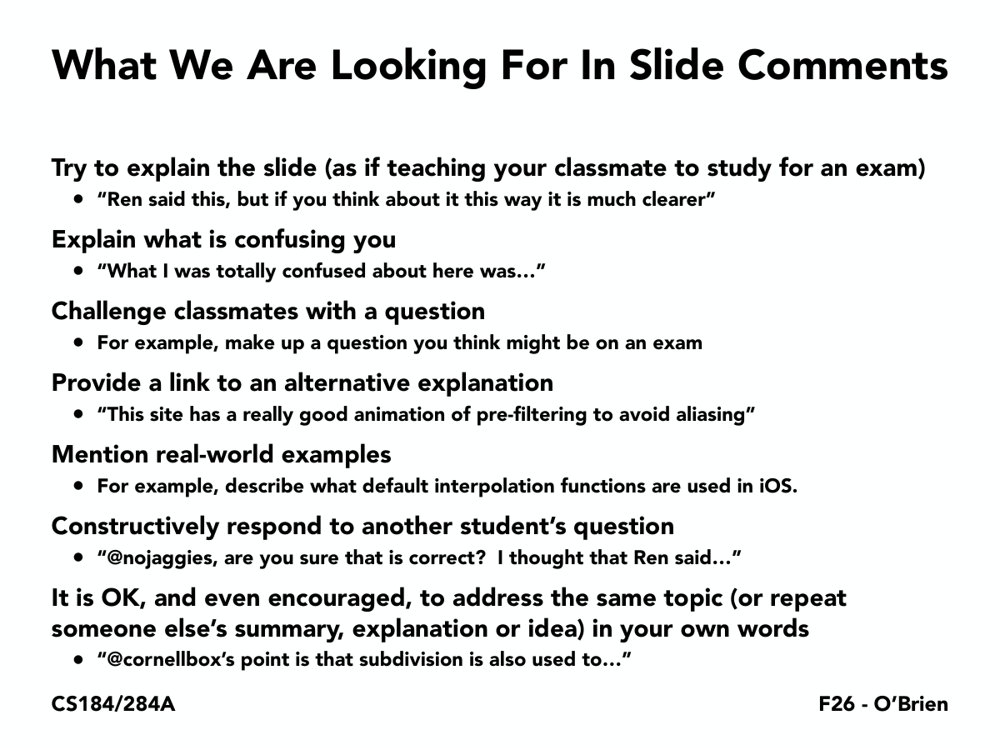

#### Radiometry & Photometry

*PDF p135 · 对应本节：如何读课件而不是背名词？*

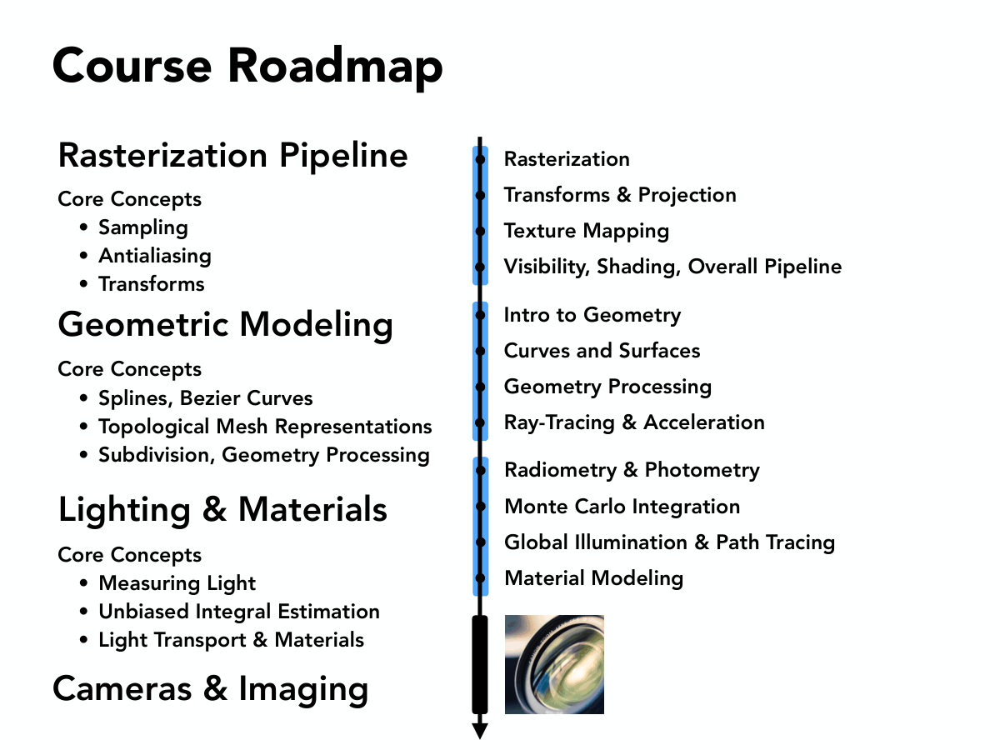

</details>

## 13. 把十二个数值例子连成检查顺序

先手算再运行。随仓库提供的 `scripts/cs184-numerical-checks.py` 是小模型验证，不依赖 GPU，也不修改服务器配置。它不能替代完整渲染场景或模拟系统的验证。

| 顺序 | 本节关系 | 最容易漏掉的约定 |
| --- | --- | --- |
| 1 | 图形学究竟在计算什么？ | R：渲染过程 |
| 2 | 为何先从离散像素开始？ | u,v：归一化坐标 |
| 3 | 三角形为什么是第一块积木？ | 坐标单位：像素 |
| 4 | 坐标变换在改变什么？ | 列向量约定：右侧先作用 |
| 5 | 看得见与看起来亮是两件事 | 颜色：独立于最近深度的后续计算 |
| 6 | 光栅化与光线追踪怎样衔接？ | 假设：逐光线暴力测试全部三角形 |
| 7 | 锯齿为什么不是美术问题？ | 前提：等权均匀区域样本 |
| 8 | 模型、材质与纹理怎样分工？ | c：颜色或其他连续参数 |
| 9 | 为什么还要学动画与物理？ | 假设：一步内用旧速度近似 |
| 10 | 相机、人眼和显示器在哪一环？ | Delta theta：近似角度误差 |
| 11 | 怎样用一个最小项目串起全课？ | 对照：只改变一个实现因素 |
| 12 | 如何读课件而不是背名词？ | 注意：参考本身可能有误差 |

### 复现实验的最小记录

| 记录项 | 用途 |
| --- | --- |
| 固定输入 | 相同几何、材质、网格或信号，避免一次改变多个因素。 |
| 参数与单位 | 包括采样数、步长、分辨率、角度单位、颜色空间。 |
| 输出量 | 保留线性值、误差或状态，再生成展示图。 |
| 参考 | 解析解、手算或高精度结果必须说明来源。 |
| 失败样例 | 边界和极端条件是检查假设的入口。 |

## 14. 实现排查：把公式错误与系统错误分开

本节列出由模型和手算能够判断的排查方向；没有把尚未写出的完整应用测试说成已完成。最小数值检查的真实执行结果见本次发布核对报告。

### 阶段 1：第 1–4 节

| 涉及关系 | 错误机制 / 修正方向 |
| --- | --- |
| 图形学究竟在计算什么？ | 把模型文件当成完整场景会漏掉光源与相机；黑图先检查光照和相机，而不是立即重建网格。 |
| 为何先从离散像素开始？ | 只有 y 从上向下增大且颜色是 (u,v,0) 时，左上黑、右下黄才成立；不能脱离坐标和颜色定义判断。 |
| 三角形为什么是第一块积木？ | 屏幕 y 向下时，增加顶点 y 是向下移动；是否“变矮”取决于它相对底边的位置。 |
| 坐标变换在改变什么？ | 矩阵乘法一般不交换；不要把代码中行向量库的乘法顺序直接抄进列向量推导。 |

### 阶段 2：第 5–8 节

| 涉及关系 | 错误机制 / 修正方向 |
| --- | --- |
| 看得见与看起来亮是两件事 | 把“最亮的片段”当成“可见的片段”会产生穿墙发光；透明表面需要另外的合成规则。 |
| 光栅化与光线追踪怎样衔接？ | 这只是暴力复杂度估算，不是实际运行时间；BVH、遮挡早停和 GPU 并行都会改变耗时。 |
| 锯齿为什么不是美术问题？ | 平均应在适当的线性量上完成；直接平均 gamma 编码值可能让边缘偏暗。 |
| 模型、材质与纹理怎样分工？ | 法线纹理插值后常需重新归一化；位置插值公式不能不加区分地用于所有数据。 |

### 阶段 3：第 9–12 节

| 涉及关系 | 错误机制 / 修正方向 |
| --- | --- |
| 为什么还要学动画与物理？ | 把每帧移动量写成常数会导致帧率改变后速度改变；应把秒作为时间单位。 |
| 相机、人眼和显示器在哪一环？ | 这里是恒定角速度近似，不是特定头显的实测；不能把历史课件设备当作当前购买建议。 |
| 怎样用一个最小项目串起全课？ | 优化前先锁定图像尺寸、样本数、场景和编译模式；否则比较没有共同基准。 |
| 如何读课件而不是背名词？ | 一次例子通过不代表算法普遍正确；要补边界、尺度变化和反例。 |

## 15. 跨讲连接：同一工具在哪些尺度重复出现？

| 前置工具 | 在整门课里的用途 | 回查 |
| --- | --- | --- |
| 采样与积分 | 像素、光源、孔径、时间、方向都需要有限样本估计连续量。 | [L03](/notes/cs184-03-sampling-aliasing/) / [L15](/notes/cs184-15-monte-carlo-integration/) |
| 坐标与线性代数 | 相机、法线、骨架与局部速度都需要一致的参考系。 | [L04–05](/notes/cs184-04-05-transforms/) |
| 几何表示 | 可见性、接触、遮挡与网格邻域依赖可靠的几何关系。 | [L11–12](/notes/cs184-11-12-meshes-geometry/) |
| 物理量与单位 | 把颜色值、概率密度、力和能量区别开，防止错误补偿。 | [L14](/notes/cs184-14-radiometry/) |
| 颜色与显示 | 展示图不等于线性数据；显示变换会改变视觉比较。 | [L19–20](/notes/cs184-19-20-color-science/) |

回头看，许多错误并非来自复杂公式，而是来自“同一个词指了不同的量”：方向密度与概率、位置与方向、线性颜色与编码颜色、稳定与准确。先说清对象，再选择算法。

## 16. 自测：能否不看公式说清楚？

### 自测 1. 固定几何后，像素还能变化吗？

<details>
<summary>参考答案</summary>

能。材质、光照、相机、曝光和运动都能改变图像；几何只是输入的一部分。

</details>

### 自测 2. 若把绿色改成 1-v，哪个角变黄？

<details>
<summary>参考答案</summary>

右上角。横向红色不变，绿色的上下方向翻转。

</details>

### 自测 3. 顶点 C 向下移，三角形总会变矮吗？

<details>
<summary>参考答案</summary>

不会。如果底边在 C 下方且 C 向底边靠近才变矮；越过底边之后高度又会增加。

</details>

### 自测 4. 相机向右走与物体向左走完全一样吗？

<details>
<summary>参考答案</summary>

对单个静态相对位置可有相同效果，但多物体运动、灯光和世界约束不一定等价。

</details>

### 自测 5. 最近表面一定是像素贡献最大的物体吗？

<details>
<summary>参考答案</summary>

不一定。透明、反射和间接照明都可能让其他物体贡献能量；最近表面只是路径的首个交互点。

</details>

### 自测 6. 只提高 GPU 并行度就不需要 BVH 吗？

<details>
<summary>参考答案</summary>

不。并行与减少工作量是不同手段；高场景复杂度下，加速结构仍然重要。

</details>

### 自测 7. 四个样本就能消除所有锯齿吗？

<details>
<summary>参考答案</summary>

不能。它只是有限预算近似，细小几何、频繁变化纹理和时间采样仍会混叠。

</details>

### 自测 8. 给模型贴照片就一定真实了吗？

<details>
<summary>参考答案</summary>

不。照片已经混有光照，直接当反射率可能把阴影重复计算；形状、照明与相机仍然影响结果。

</details>

### 自测 9. 动画帧率与物理步长必须相同吗？

<details>
<summary>参考答案</summary>

不必。物理可以每帧进行多个子步，显示再读取或插值状态。

</details>

### 自测 10. 图像帧率高就一定延迟低吗？

<details>
<summary>参考答案</summary>

不。排队、传输、扫描显示和追踪都可能增加延迟，吞吐率与单次延迟要分开测。

</details>

### 自测 11. 怎样判断一次优化没有破坏正确性？

<details>
<summary>参考答案</summary>

先对照同参数输出及误差，再比较耗时；随机渲染要比较统计误差而非要求逐像素完全相等。

</details>

### 自测 12. 本课程最终是否只有一个万能渲染算法？

<details>
<summary>参考答案</summary>

没有。可控性、物理准确性、效率与感知质量之间存在取舍；课程教的是分析这些取舍的工具。

</details>

### 自测 13. 第 1 节的数值例子，哪一项假设不能悄悄删掉？

<details>
<summary>参考答案与反例入口</summary>

把模型文件当成完整场景会漏掉光源与相机；黑图先检查光照和相机，而不是立即重建网格。

再复算本节的例子：设图像宽 4、高 3、每像素 3 通道，每通道 1 字节。存储量为 4×3×3=36 字节。反算 36/3/4=3 行；这只是像素数组，不含文件头。

</details>

### 自测 14. 第 2 节的数值例子，哪一项假设不能悄悄删掉？

<details>
<summary>参考答案与反例入口</summary>

只有 y 从上向下增大且颜色是 (u,v,0) 时，左上黑、右下黄才成立；不能脱离坐标和颜色定义判断。

再复算本节的例子：取 W=5、H=3。左上 (0,0) 得 (0,0,0)；右下 (4,2) 得 (1,1,0)。转为 8 位是 (0,0,0) 和 (255,255,0)。代回右上 (4,0) 应为红色。

</details>

### 自测 15. 第 3 节的数值例子，哪一项假设不能悄悄删掉？

<details>
<summary>参考答案与反例入口</summary>

屏幕 y 向下时，增加顶点 y 是向下移动；是否“变矮”取决于它相对底边的位置。

再复算本节的例子：顶点 (0,0)、(4,0)、(0,3) 的面积是 6；把第三点改成 (0,2) 得 4。用底×高/2 再算仍为 4。

</details>

### 自测 16. 第 4 节的数值例子，哪一项假设不能悄悄删掉？

<details>
<summary>参考答案与反例入口</summary>

矩阵乘法一般不交换；不要把代码中行向量库的乘法顺序直接抄进列向量推导。

再复算本节的例子：一维教学例：局部 x=1，模型平移 +3 得世界 x=4，相机在 x=2，观察坐标 x=4-2=2。代回世界坐标 2+2=4。

</details>

### 自测 17. 第 5 节的数值例子，哪一项假设不能悄悄删掉？

<details>
<summary>参考答案与反例入口</summary>

把“最亮的片段”当成“可见的片段”会产生穿墙发光；透明表面需要另外的合成规则。

再复算本节的例子：两个片段深度为 2 和 5，保留 2。若近处片段颜色为黑，结果仍是黑，不会因为远处更亮就选 5。检验：遮挡比较只读取深度。

</details>

### 自测 18. 第 6 节的数值例子，哪一项假设不能悄悄删掉？

<details>
<summary>参考答案与反例入口</summary>

这只是暴力复杂度估算，不是实际运行时间；BVH、遮挡早停和 GPU 并行都会改变耗时。

再复算本节的例子：100×100 像素、4 样本、1000 三角形，需要 4×10^7 次候选测试。T 增至 2000，代回变成 8×10^7。

</details>

### 自测 19. 第 7 节的数值例子，哪一项假设不能悄悄删掉？

<details>
<summary>参考答案与反例入口</summary>

平均应在适当的线性量上完成；直接平均 gamma 编码值可能让边缘偏暗。

再复算本节的例子：四个子样本中三个是白色、一个黑色，线性结果为 0.75。求和 3 再除以 4；用覆盖率 3/4 验算相同。

</details>

### 自测 20. 第 8 节的数值例子，哪一项假设不能悄悄删掉？

<details>
<summary>参考答案与反例入口</summary>

法线纹理插值后常需重新归一化；位置插值公式不能不加区分地用于所有数据。

再复算本节的例子：四角标量为 0、1、1、0，中心权重各 1/4，结果 0.5。权重总和为 1，所以常数纹理也能保持不变。

</details>

### 自测 21. 第 9 节的数值例子，哪一项假设不能悄悄删掉？

<details>
<summary>参考答案与反例入口</summary>

把每帧移动量写成常数会导致帧率改变后速度改变；应把秒作为时间单位。

再复算本节的例子：x=2 米、v=3 米/秒、步长 0.1 秒，得到 2.3 米。位移 0.3 米除以 0.1 秒仍为 3 米/秒。

</details>

### 自测 22. 第 10 节的数值例子，哪一项假设不能悄悄删掉？

<details>
<summary>参考答案与反例入口</summary>

这里是恒定角速度近似，不是特定头显的实测；不能把历史课件设备当作当前购买建议。

再复算本节的例子：教学设定角速度 90 度/秒、延迟 0.02 秒，误差为 1.8 度；若 20 像素/度，则约 36 像素。用 36/20 验算为 1.8 度。

</details>

### 自测 23. 第 11 节的数值例子，哪一项假设不能悄悄删掉？

<details>
<summary>参考答案与反例入口</summary>

优化前先锁定图像尺寸、样本数、场景和编译模式；否则比较没有共同基准。

再复算本节的例子：相同场景从 12 秒变成 3 秒，加速比为 4。反算 3×4=12；若样本数也从 64 改成 16，则不能把全部提升归因于算法。

</details>

### 自测 24. 第 12 节的数值例子，哪一项假设不能悄悄删掉？

<details>
<summary>参考答案与反例入口</summary>

一次例子通过不代表算法普遍正确；要补边界、尺度变化和反例。

再复算本节的例子：程序算得 0.333，解析值 1/3，绝对误差约 0.000333333。代回 0.333+误差约等于 1/3；相对误差约 0.1%。

</details>

### 自测 25. 本讲的输入、输出和中间表示各是什么？

<details>
<summary>参考答案</summary>

场景如何表示 → 谁覆盖像素 → 像素应当多亮 → 怎样减少采样误差 → 物体如何运动 → 相机与人眼怎样看见。请沿箭头逐项解释，尤其说清中间表示的单位、坐标或概率测度；只复述名词不算掌握。

</details>

### 自测 26. 能否只用一张“看起来正确”的图片证明实现正确？

<details>
<summary>参考答案</summary>

不能。需要将关键关系拆成可预测的小输入，检查数值、边界与对照；随机方法还要区分一次结果与统计期望，显示图还需区分编码与原始数据。

</details>

## 17. 带走的结论与仍需练习的内容

- 能。材质、光照、相机、曝光和运动都能改变图像；几何只是输入的一部分。
- 右上角。横向红色不变，绿色的上下方向翻转。
- 不会。如果底边在 C 下方且 C 向底边靠近才变矮；越过底边之后高度又会增加。
- 对单个静态相对位置可有相同效果，但多物体运动、灯光和世界约束不一定等价。
- 不一定。透明、反射和间接照明都可能让其他物体贡献能量；最近表面只是路径的首个交互点。
- 不。并行与减少工作量是不同手段；高场景复杂度下，加速结构仍然重要。
- 不能。它只是有限预算近似，细小几何、频繁变化纹理和时间采样仍会混叠。
- 不。照片已经混有光照，直接当反射率可能把阴影重复计算；形状、照明与相机仍然影响结果。
- 不必。物理可以每帧进行多个子步，显示再读取或插值状态。
- 不。排队、传输、扫描显示和追踪都可能增加延迟，吞吐率与单次延迟要分开测。
- 先对照同参数输出及误差，再比较耗时；随机渲染要比较统计误差而非要求逐像素完全相等。
- 没有。可控性、物理准确性、效率与感知质量之间存在取舍；课程教的是分析这些取舍的工具。

| 层次 | 已经说明 | 还需动手验证 |
| --- | --- | --- |
| 概念 | 本篇十二个问题、公式与原页对应。 | 用自己的话重新解释，并给出一个反例。 |
| 数值 | 正文手算与解析小模型。 | 改变一个输入，预测再运行。 |
| 系统 | 指出实现条件和典型错误。 | 完整应用需另外检查场景、性能和边界。 |

## 18. 整门课闭环与继续阅读

| 讲义 | 起点问题 | 得到的工具或终点 |
| --- | --- | --- |
| [L01 · 导论](/notes/cs184-01-introduction/) | 这门课在求什么？ | 从场景到像素与感知 |
| [L02 · 三角形与覆盖](/notes/cs184-02-drawing-triangles/) | 像素由哪些图元覆盖？ | 半平面判定与插值 |
| [L03 · 采样与抗锯齿](/notes/cs184-03-sampling-aliasing/) | 离散图像为何锯齿？ | 区域积分、过滤与采样 |
| [L04–05 · 变换](/notes/cs184-04-05-transforms/) | 怎样放置物体和相机？ | 坐标系、矩阵与投影 |
| [L06–07 · 纹理](/notes/cs184-06-07-texture-mapping/) | 表面参数如何随位置变化？ | UV、过滤与像素足迹 |
| [L08–09 · 着色](/notes/cs184-08-09-rasterization-shading/) | 看见哪个表面、怎样着色？ | 深度、管线与局部照明 |
| [L10 · 曲线曲面](/notes/cs184-10-bezier-curves-surfaces/) | 怎样控制连续形状？ | 插值、逼近与连续性 |
| [L11–12 · 几何](/notes/cs184-11-12-meshes-geometry/) | 复杂表面如何表示和操作？ | 网格、拓扑与几何处理 |
| [L13 · 光线追踪](/notes/cs184-13-ray-tracing-acceleration/) | 光线怎样快速找到最近表面？ | 求交与 BVH |
| [第 14 讲](/notes/cs184-14-radiometry/) | 能量 | 半球积分 |
| [第 15 讲](/notes/cs184-15-monte-carlo-integration/) | 像素是积分 | 降低方差 |
| [第 16–17 讲](/notes/cs184-16-17-global-illumination/) | 命中表面 | 加权累积与终止 |
| [春季 L18](/notes/cs184-18-material-modeling/) | 材质是散射规律 | 更细结构与体积传播 |
| [春季 L19–20](/notes/cs184-19-20-color-science/) | 光谱进入眼睛 | 线性运算与显示 |
| [春季 L21–23](/notes/cs184-21-23-animation/) | 表达运动意图 | 从末端目标反求关节 |
| [春季 L24](/notes/cs184-24-physical-simulation/) | 选择状态 | 施加碰撞和约束 |
| [春季 L25](/notes/cs184-25-fluid-simulation/) | 粒子或网格表示 | 边界与数值误差 |
| [春季 L26–27](/notes/cs184-26-27-virtual-reality/) | 人眼需要哪些线索 | 全景与光场 |
| [补充 A](/notes/cs184-supplement-cameras-lenses/) | 视场与透视 | 真实镜头与传感器 |
| [补充 B](/notes/cs184-supplement-image-processing/) | 图像是离散信号 | 频率量化与压缩 |

春季 L18–27 与夏季补充专题保留本地文件标识，**不冒充不存在的秋季同编号讲次**。可以按上表顺序学习，也可在相机、颜色、采样之间按依赖往返。

## 19. 原课件全页索引与来源

[原课件文件与版本记录](https://github.com/Teddy-Yangjiale/CS184/blob/main/CS184_2026/fa26/lectures/L01-introduction.pdf) · [课程官网](https://cs184.eecs.berkeley.edu/fa26/)

文件：`L01-introduction.pdf`；PDF 页数：157；SHA-256：`3ac20951c742749d4a1f665e23fb5adfe31681717fb7b1ebdc8dc1fab07edaa0`。

“正文核对”表示本篇实际引用该页截图；“索引保留”包括演示、行政信息、补充、致谢与重复构建页，不表示逐页都有独立讲解。原视频的运动过程不能由静态 PDF 截图完整复现。

| PDF 页 | 原页可提取标题 | 本篇使用 |
| --- | --- | --- |
| 1 | Computer Graphics and Imaging | 索引保留 |
| 2 | Welcome to CS184 / 284A! | 索引保留 |
| 3 | Welcome to CS184 / 284A! | 索引保留 |
| 4 | Your Names: An Important Request | 索引保留 |
| 5 | Why Study Computer Graphics? | 索引保留 |
| 6 | Prerequisites | 正文核对 |
| 7 | Use of AI | 索引保留 |
| 8 | What is Computer Graphics? | 正文核对 |
| 9 | Why Visual Information? | 索引保留 |
| 10 | We Humans Are Visual Animals | 索引保留 |
| 11 | Why Study Computer Graphics and Imaging? | 索引保留 |
| 12 | Movies | 索引保留 |
| 13 | Moments That Changed The Movies: Jurassic Park | 索引保留 |
| 14 | Moments That Changed The Movies: Jurassic Park | 索引保留 |
| 15 | Toy Story (1995) | 索引保留 |
| 16 | Movies | 索引保留 |
| 17 | Movies | 索引保留 |
| 18 | Movies | 索引保留 |
| 19 | The Campanile | 索引保留 |
| 20 | The Campanile | 索引保留 |
| 21 | Sucker Punch (2009) | 索引保留 |
| 22 | Sucker Punch (2009) | 索引保留 |
| 23 | Motion Capture | 索引保留 |
| 24 | Avatar (2009) | 索引保留 |
| 25 | Interstellar (2014) | 索引保留 |
| 26 | Interstellar (2014) | 索引保留 |
| 27 | Event Horizon Telescope collaboration et al. | 索引保留 |
| 28 | Event Horizon Telescope collaboration et al. | 索引保留 |
| 29 | Event Horizon Telescope collaboration et al. | 索引保留 |
| 30 | Movies | 索引保留 |
| 31 | Halo 5 (2015) | 索引保留 |
| 32 | Games | 索引保留 |
| 33 | Games | 索引保留 |
| 34 | Games | 索引保留 |
| 35 | Battlefield 5 (2018) | 索引保留 |
| 36 | Battlefield 5 (2018) | 索引保留 |
| 37 | Games | 索引保留 |
| 38 | Games | 索引保留 |
| 39 | Games | 索引保留 |
| 40 | Games | 索引保留 |
| 41 | Games | 索引保留 |
| 42 | Ōkami (2006) | 索引保留 |
| 43 | Training Simulations | 索引保留 |
| 44 | Visual Simulation | 索引保留 |
| 45 | Virtual Reality | 索引保留 |
| 46 | Virtual Reality | 索引保留 |
| 47 | Virtual Reality | 索引保留 |
| 48 | Augmented Reality | 索引保留 |
| 49 | Augmented Reality | 索引保留 |
| 50 | Stereo Vison | 索引保留 |
| 51 | Product Design and Visualization | 索引保留 |
| 52 | Product Design and Visualization | 索引保留 |
| 53 | Product Design and Visualization | 索引保留 |
| 54 | Product Design and Visualization | 索引保留 |
| 55 | Product Design and Visualization | 索引保留 |
| 56 | Architectural Design | 索引保留 |
| 57 | Architectural Design | 索引保留 |
| 58 | Visualization | 索引保留 |
| 59 | Typography | 索引保留 |
| 60 | Desktop metaphor | 索引保留 |
| 61 | Graphical User Interfaces | 索引保留 |
| 62 | Graphical User Interfaces | 索引保留 |
| 63 | Graphical User Interfaces | 索引保留 |
| 64 | Graphical User Interfaces | 索引保留 |
| 65 | Digital Illustration | 索引保留 |
| 66 | Computer-Aided Design | 索引保留 |
| 67 | Fabrication | 索引保留 |
| 68 | Fabrication | 索引保留 |
| 69 | Photography | 索引保留 |
| 70 | Digital and Computational Cameras | 索引保留 |
| 71 | Ubiquitous Imaging | 索引保留 |
| 72 | Imaging in Mapping | 索引保留 |
| 73 | Imaging in Mapping | 索引保留 |
| 74 | Imaging for Computer Vision | 索引保留 |
| 75 | Imaging for Robotics | 索引保留 |
| 76 | Imaging for Robotics | 索引保留 |
| 77 | Foundations of Graphics and Imaging | 索引保留 |
| 78 | Foundations of Graphics and Imaging | 索引保留 |
| 79 | Foundations of Graphics and Imaging | 索引保留 |
| 80 | Foundations of Graphics and Imaging | 索引保留 |
| 81 | Foundations of Graphics and Imaging | 索引保留 |
| 82 | Course Goals | 索引保留 |
| 83 | Course Goals | 正文核对 |
| 84 | Course Goals | 索引保留 |
| 85 | Course Topics | 索引保留 |
| 86 | Drawing Digital Images (Rasterization) | 正文核对 |
| 87 | Filtering and Sampling | 正文核对 |
| 88 | (Stanislav Orekhov) | 正文核对 |
| 89 | Modeling Material Properties | 正文核对 |
| 90 | Modeling Lighting | 正文核对 |
| 91 | Realistic Lighting Simulation | 正文核对 |
| 92 | Light Transport and Image Synthesis | 正文核对 |
| 93 | How Do Cameras Work? | 正文核对 |
| 94 | Opto-perceptual Effects | 正文核对 |
| 95 | Motion Capture | 正文核对 |
| 96 | Avatar (2009) | 索引保留 |
| 97 | Animation and Physical Simulation | 正文核对 |
| 98 | Animation and Physical Simulation | 正文核对 |
| 99 | Virtual Reality | 正文核对 |
| 100 | Hands-On Learning | 正文核对 |
| 101 | Course Assignments | 正文核对 |
| 102 | Course Assignments | 正文核对 |
| 103 | Final Project | 索引保留 |
| 104 | Credit: Pixar, Up | 索引保留 |
| 105 | Credit: Pixar, Up | 索引保留 |
| 106 | Credit: Pixar, Up | 索引保留 |
| 107 | Credit: Pixar, Up | 索引保留 |
| 108 | Credit: Pixar, Up | 索引保留 |
| 109 | Credit: Pixar, Up | 索引保留 |
| 110 | Credit: Pixar, Up | 索引保留 |
| 111 | Credit: Pixar, Up | 索引保留 |
| 112 | Course Logistics | 索引保留 |
| 113 | Zoom | 索引保留 |
| 114 | Enrollment | 索引保留 |
| 115 | Course Schedule | 索引保留 |
| 116 | Lecture Slides | 索引保留 |
| 117 | edstem.org | 索引保留 |
| 118 | Section | 索引保留 |
| 119 | Resources | 正文核对 |
| 120 | Learning, Grading, Collaboration & Culture | 索引保留 |
| 121 | Learning, Grading, Collaboration & Culture | 索引保留 |
| 122 | Learning, Grading, Collaboration & Culture | 索引保留 |
| 123 | Learning, Grading, Collaboration & Culture | 索引保留 |
| 124 | Course Deliverables and Assessment | 索引保留 |
| 125 | Course Deliverables and Assessment | 索引保留 |
| 126 | Course Deliverables and Assessment | 索引保留 |
| 127 | Course Deliverables and Assessment | 索引保留 |
| 128 | Course Deliverables and Assessment | 索引保留 |
| 129 | Course Deliverables and Assessment | 索引保留 |
| 130 | Course Deliverables and Assessment | 索引保留 |
| 131 | What We Are Looking For In Slide Comments | 正文核对 |
| 132 | Late Days Policy | 索引保留 |
| 133 | Class Philosophy | 索引保留 |
| 134 | Inclusive Classroom | 索引保留 |
| 135 | Radiometry & Photometry | 正文核对 |
| 136 | My research | 索引保留 |
| 137 | My research | 索引保留 |
| 138 | My research | 索引保留 |
| 139 | My research | 索引保留 |
| 140 | My research | 索引保留 |
| 141 | My research | 索引保留 |
| 142 | My research | 索引保留 |
| 143 | My research | 索引保留 |
| 144 | My research | 索引保留 |
| 145 | My research | 索引保留 |
| 146 | My research | 索引保留 |
| 147 | My research | 索引保留 |
| 148 | My research | 索引保留 |
| 149 | My research | 索引保留 |
| 150 | My research | 索引保留 |
| 151 | My research | 索引保留 |
| 152 | My research | 索引保留 |
| 153 | My research | 索引保留 |
| 154 | Beat Saber | 索引保留 |
| 155 | Beat Saber | 索引保留 |
| 156 | See my webpage for more information and other projects... | 索引保留 |
| 157 | Acknowledgments | 索引保留 |
