> UC Berkeley · CS184/284A Computer Graphics and Imaging · Fall 2026 · Lecture 2

98 页讲义，只有一句话在真正推进：**把三角形画到屏幕上，本质是对一个二维指示函数在像素中心做采样。** 其余 90 页分别是「屏幕为什么必须离散」「为什么用三角形」「这套采样怎么算得快」以及「它为什么会失败」。

先把整讲压成一张图。橙色那一格是本讲的全部职责——**只决定覆盖，不决定颜色**：

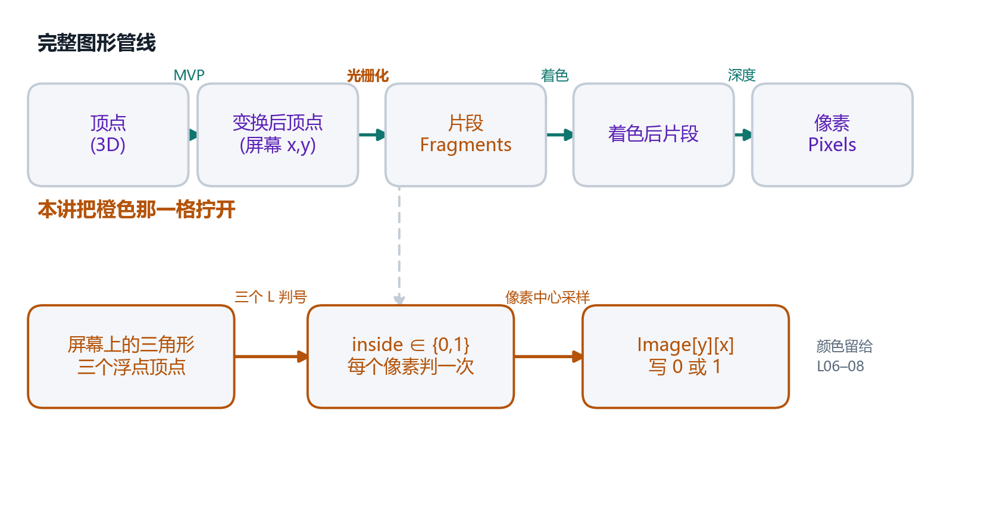

*上排是完整管线，下排是本讲把橙色那格拧开之后的样子。右下那行小字是关键：颜色不归 L02 管，那是 L06–08 的事。所以「光栅化」这个听起来无所不能的词，实际只回答一个问题：**这个像素归不归这个三角形。***

> **💡 怎么读这份笔记**
>
> 讲义是按「先看设备、再看图元、再推算法、最后承认失败」组织的，这个顺序不能乱——但如果你已经知道光栅化是什么，可以直接跳到第 4 节看推导（那里是全讲唯一的数学），再回来看第 1 节补直觉。
>
> 每个 `####` 小节对应一张课件原页，页号就是 PDF 页序。带 🖼 的图是我按关系重画的示意图，正文里会解释每个元素是什么；课件截图则保留原始内容，用于对照。

*98 页 · 76 张关键页截图 · 14 张原创图解 · 6 个手算 · 18 道自测*

## 1. 屏幕为什么是离散的

矢量设备可以让笔（或电子束）沿任意曲线走，那里没有「像素」。光栅设备只能一行行扫，于是图像被迫装进一张网格。

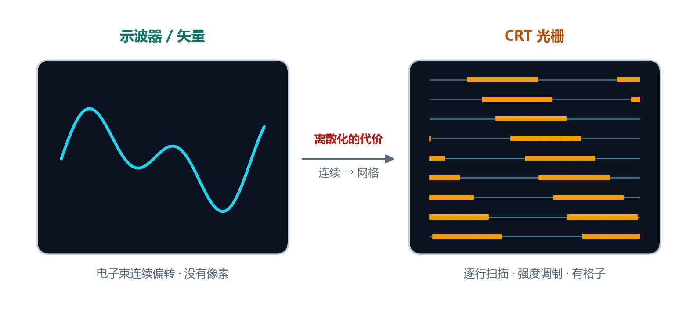

*左边示波器的光点是连续偏转的，屏幕上任何位置都能落点，画出来是真曲线；右边电视的电子束被锁死在水平扫描线上，只能通过「这一格亮多亮」来表达图像。**「离散」不是显示器的缺陷，而是逐行扫描这个选择的直接后果。***

讲义用 20 页（P3–P23）铺这件事。看起来是设备科普，实际在建立两个概念：「连续表达」和「离散表达」各自的代价。这一节按时间顺序讲完，最后会得到一张谱系表。

### 1.1 矢量时代：会画图的机器

#### P3　Drawing Machines

*章节点*


分节页，只有标题。它承担转折：前面还没进图形学，先看人类造过哪些会自动画图的机器。后面会看到，这些机器恰好分成两类——**沿轨迹连续走**和**按网格扫点**，正好对应图形学的两条路线。

#### P4　CNC Sharpie Drawing Machine

*Aaron Panone with Matt W. Moore · 44rn.com*

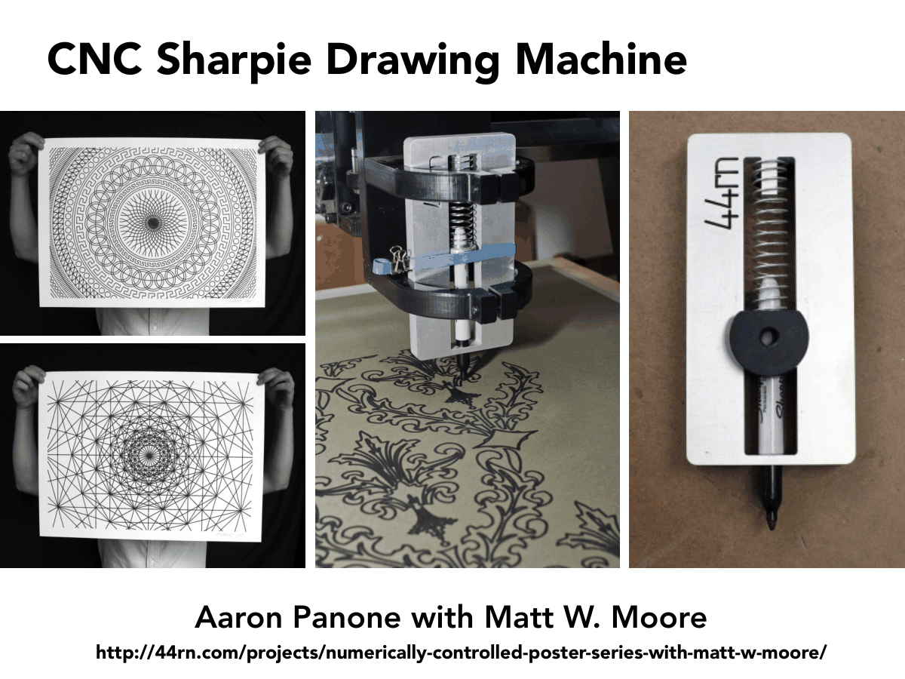

三张图：左边是画出来的同心花纹海报，中间是机器本体（一支记号笔被夹在 XY 移动平台上），右边是笔尖特写。

**工作流程**：矢量图案 → 分解成笔的移动轨迹 → 两个步进电机驱动 X、Y 轴 → 笔按轨迹连续移动、按需抬落。

**要点：这是矢量（vector）设备。** 输出的是连续曲线，笔可以落在任何位置，没有「格子」这回事。SVG、PostScript、字体轮廓都属于这一路——它们存储的是**几何描述**，不是像素。

#### P5　Laser Cutters

*Jacob Hall 的墙板概念竞赛作品 / Universal Laser Systems*


左边激光头正在切钢板（火花四溅），右边是台式切割机。

同样是矢量逻辑：激光头沿路径走，走到哪切到哪，切出的轮廓是连续的。**注意它和打印机的区别**：打印机必须把图像转成点阵才能喷墨，而切割机只关心路径——这正好说明「离散化」不是所有绘图都必须的，它只在**需要存成二维数组**时才必须。

#### P6　Oscilloscope

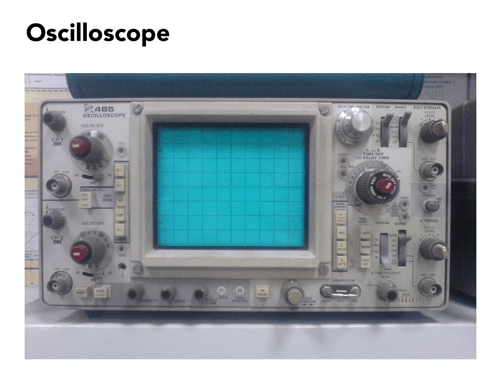

一台 Tektronix 模拟示波器。

**原理**：电子束从电子枪射出，经过一对垂直偏转板和一对水平偏转板；偏转板上的电压让电子束偏转。X 板接时间扫描电压、Y 板接被测信号，于是电子束在荧光屏上画出 `y = f(t)`。

> **关键区别**：示波器**没有像素**。电子束是一条连续移动的光斑轨迹，屏幕上的荧光连续亮起。它属于**随机扫描（random-scan）**设备——光点想飞哪就飞哪，不像电视那样被限制在扫描行上。

#### P7　Cathode Ray Tube

*真空管结构*

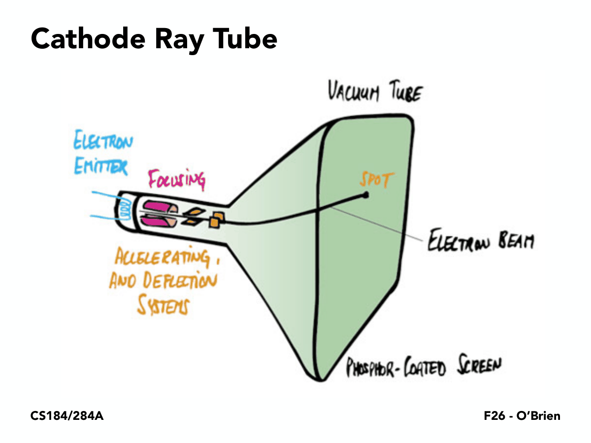

讲义手绘了一张 CRT 剖面图，标了六样东西。这张图值得记住，它是后面所有显示技术的祖先：

| 标注 | 作用 |
|---|---|
| **Electron Gun**（电子枪） | 发射电子 |
| **Focusing**（聚焦） | 把电子束收细成一个点 |
| **Accelerating and Deflection System** | 加速，并用电磁场让电子束偏转、指向屏幕目标位置 |
| **Vacuum Tube**（真空管） | 抽真空，避免电子被空气分子散射 |
| **Phosphor-Coated Screen**（荧光屏） | 电子打上去发光 |
| **Electron Beam**（电子束） | 电子流本身 |

**这一页要看出的是「没有网格」。** 偏转电压是连续的模拟量，所以光斑能落在屏幕上任何位置。正因如此，下一节的「光栅扫描」才是一次**主动放弃**：为了让电路简单、信号可编码，我们把连续的两个自由度锁成了「行 + 列」。

#### P10　Oscilloscope Art

*Jerobeam Fenderson · [youtube.com/watch?v=rtR63-ecUNo](https://www.youtube.com/watch?v=rtR63-ecUNo)*

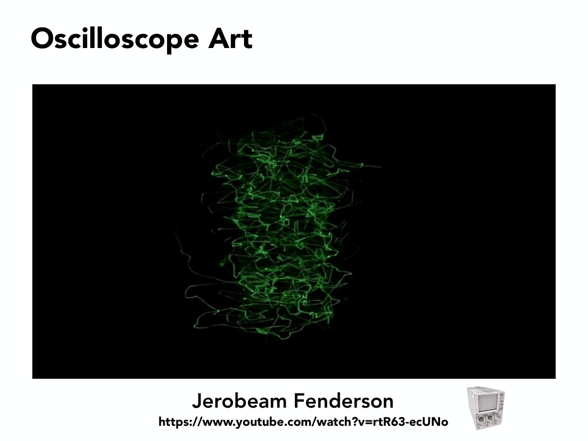

把**音频信号**直接接到示波器的 X、Y 偏转板上：因为声音本身就是随时间变化的电压，所以接上去之后电子束的轨迹就是声音波形本身。P8–P11 四页是这个视频的四帧，从黑底一个绿点逐渐长成复杂的立体曲线，最后变成四朵"郁金香"。

**这四页在证明矢量显示的极限**：光滑、连续、任意曲线，完全不需要「分辨率」这个概念。

**但它也暴露了致命问题**：电子束一次只能画一个点。要画复杂图形，就得让电子束飞快地跑、还要不停重画（荧光会衰减）。所以示波器只能画简单图案，而电视机必须换一种思路——这就是下一节。

### 1.2 转折：光栅扫描

#### P12　Television - Raster Display CRT

*Raster Scan (modulate intensity)*

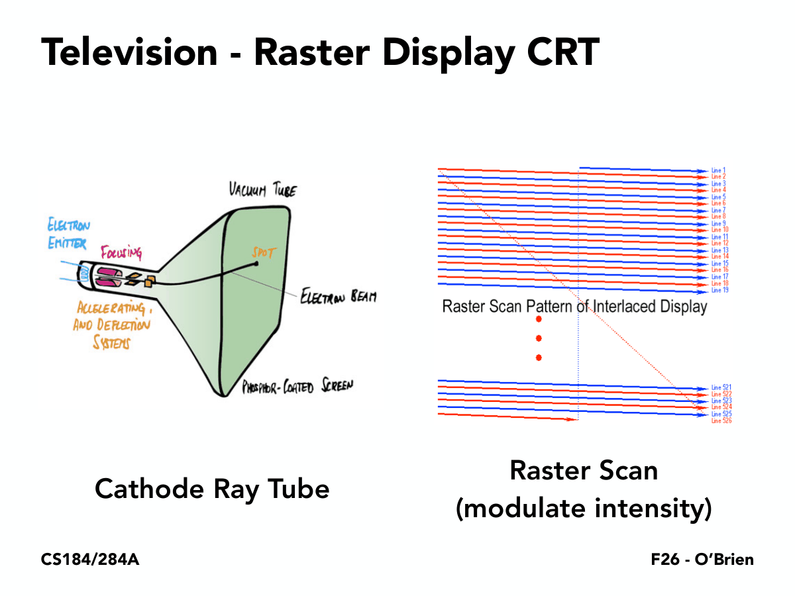

左边还是那张 CRT 结构图，右边多了一张扫描模式图：一组水平细线（左端蓝、右端红），标注 *Raster Scan Pattern of Interlaced Display*。

**这是全讲的转折点。** 电视机的做法不是「让电子束沿曲线走」，而是：

1. 电子束从左上角开始，**从左到右水平扫一行**
2. 扫完快速回扫（retrace）到下一行左端
3. 逐行向下，扫完整个画面
4. 每个位置靠**调制电子束强度**（modulate intensity）决定明暗

**一旦选择逐行扫，图像就被强制离散化了**：屏幕变成固定行列的网格，每个格子的亮度是一个数。这就是 **raster**（光栅）的字面来源——拉丁语 *rastrum*，耙子，形容扫描线像耙地一样一行行犁过去。

> **⚠️ 图上标的是 interlaced（隔行扫描）**
>
> 它把一帧拆成两场（奇数行、偶数行），先扫奇数场再扫偶数场。这样 60 Hz 刷新只需 30 次完整扫描，**省一半带宽**——这是模拟电视时代的带宽妥协。
>
> 代价是**运动物体边缘出现梳齿状撕裂**（interlacing artifacts）。今天 LCD 早已不需要它，但视频编码里的 `interlaced` 字段还留着这个历史包袱。

### 1.3 帧缓冲：图变成二维数组

#### P13　Frame Buffer: Memory for a Raster Display

*Image = 2D array of colors*

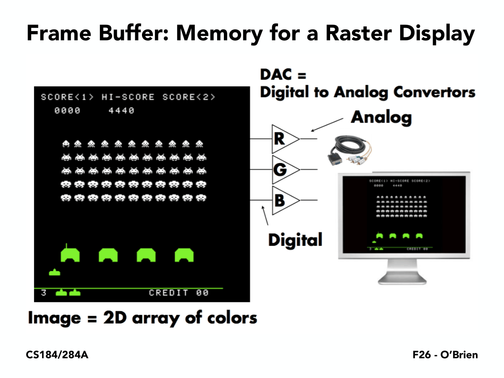

这一页有三块内容，都要看懂。

**左边**：一个 8×8 的彩色点阵图，旁边标着 `SCORE`、`HI-SCORE 0000`、`CREDIT 00`，下方是一串 16 位十六进制数字（`0000 0000 0000 0000`…）。

**这是最关键的一处**：左边那些数字就是**帧缓冲的内容**（每格一个颜色编号），右边是对应的**屏幕画面**。两者是同一件事的两种表示——一个是内存里的数，一个是眼睛看到的图。

**中间**：`DAC = Digital to Analog Converters`，三个箭头分别标 `R`、`G`、`B`，指向 Analog 和 Digital 两端。

> **为什么需要 DAC**：帧缓冲里存的是**数字**（比如每通道 8 bit），而 CRT 电子枪需要**模拟电压**控制强度。所以逐行读出帧缓冲 → 送 DAC → 变模拟电压 → 调制电子束。
>
> 今天的 HDMI / DisplayPort 也是同一套逻辑，只是把 DAC 挪到了显示器内部。

**右下**：一台显示器上显示着那个 8×8 的彩色图案。

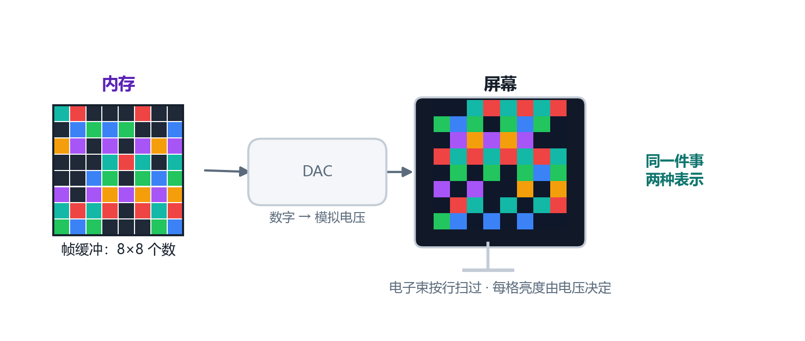

*左边内存里的 8×8 个数，右边同一批数在屏幕上变成的光。中间那步是纯工程（DAC），但它说明了「数」和「图」之间只差一层电压转换。*

> **记住 P13 的加粗结论**：`Image = 2D array of colors`。
>
> 这句话是整个图形学的输出约定。后面所有算法——光栅化、纹理映射、着色、抗锯齿——最终都在往这个二维数组里写值。**「画」这个动词，从此有了一份精确的数学定义：往 `Image[y][x]` 里填数。**

### 1.4 光栅设备的谱系

#### P15　LED Array Display

*Light emitting diode array*

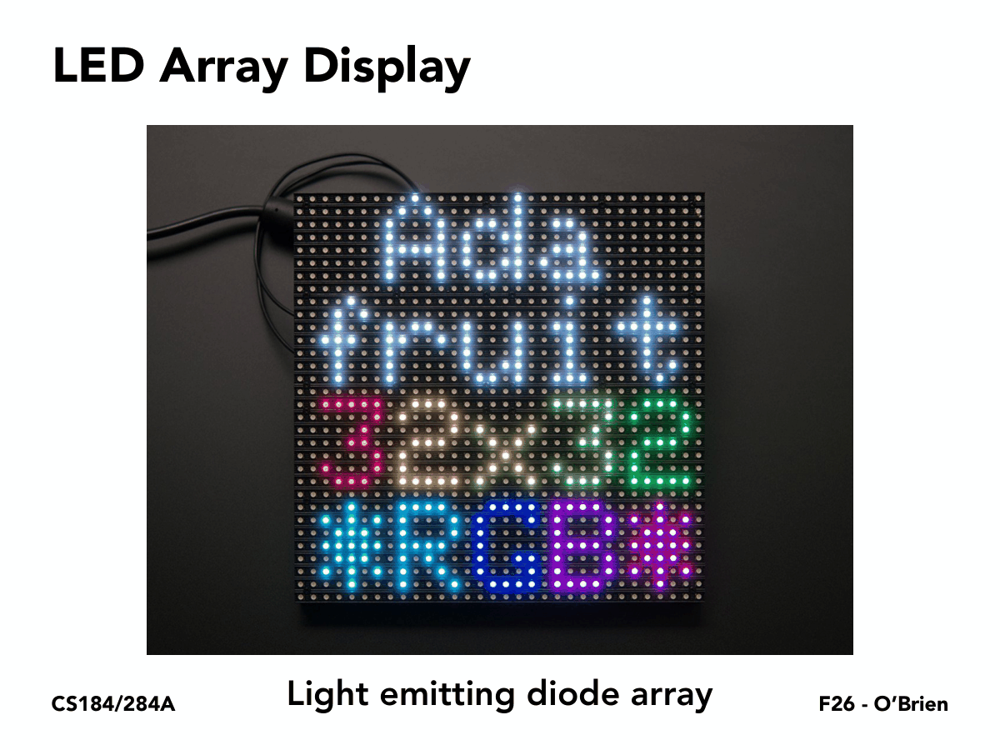

一块 8×8 的 RGB LED 点阵正在显示 "ALFA BANK" 字样，底部还有彩色渐变带。

**和 CRT 的区别**：LED 是**主动发光**的离散元件，每个点就是一组独立的红/绿/蓝灯泡。**「像素」在这里是物理实体**，不是扫描出来的假象。

#### P17　Flat Panel Displays

*Low-Res LCD Display / Color LCD, OLED, …*

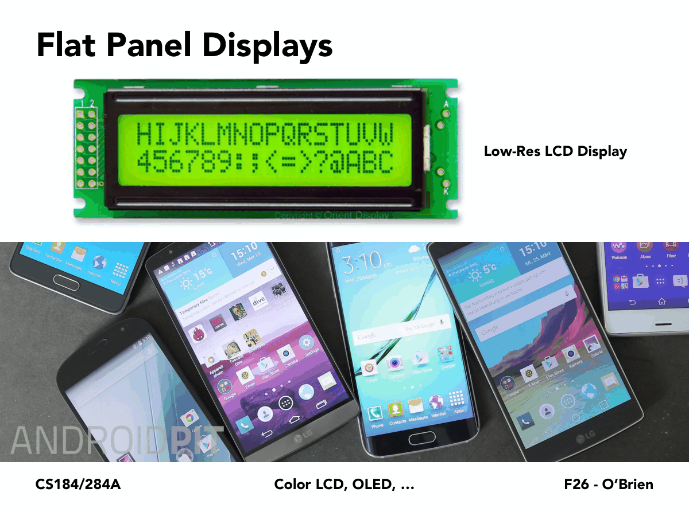

上：一块低分辨率液晶（绿色字，显示 `HIJKLMNOPQRSTUVW` / `456789:;<=>?@ABC`），能清楚看到每个字符由**方块**拼成。
下：一排手机屏幕。

上下对比就在讲**分辨率的含义**：同一块屏幕，格子越密，能表达的细节越多。上面那块屏每个字符只用 5×7 个格子，所以字形有「积木感」——这就是为什么早期的点阵字体那么丑，也是为什么抗锯齿（第 6 节）是刚需。

#### P18　Flat Panel Displays

*Smartphone screen pixels under microscope*

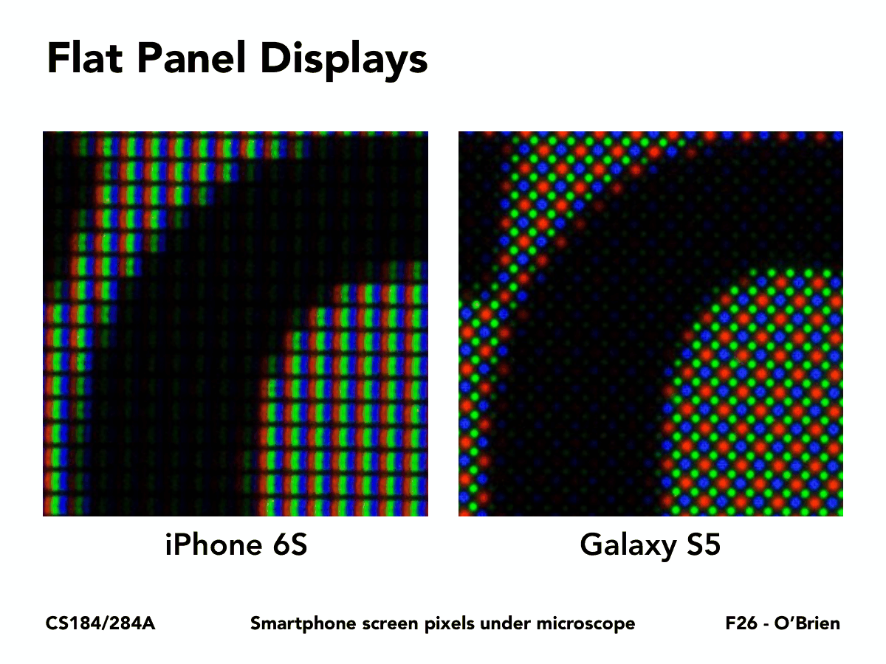

两张显微照片：iPhone 6S 与 Galaxy S5。

**要看三件事**：

1. 真实像素**不是正方形**。iPhone 6S 是**竖条纹**（R/G/B 三条竖带一组），Galaxy S5 是**菱形/钻石**排列。
2. 每个「像素」其实是**三个子像素**（subpixel），各自只发一种颜色。
3. 你看到的白色，是三个子像素靠得太近、眼睛分辨不出时**混**出来的。

> **💡 课件的简化声明（第一次）**
>
> 右下角写着：*"But in this class, we will assume a colored square full-color pixel."*
>
> **整门课都用「像素 = 能显示任意 RGB 颜色的正方形」这个理想模型。** 子像素排布、子像素渲染（subpixel rendering）一律不管。
>
> 不是偷懒，是**必要的抽象**：不然后面每一页的采样理论都要背着硬件细节走。知道边界在哪，才用得放心。

#### P19　LCD vs OLED Displays

*LCD pixels filter (block) light from uniform backlight; OLED pixels emit light*

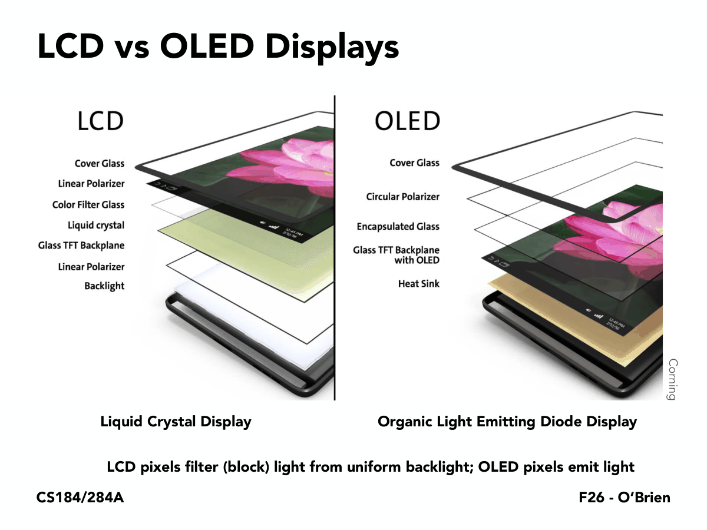

两张分层示意图，逐层标注：

**LCD（左）**，从外到内：

| 层 | 作用 |
|---|---|
| Cover Glass | 保护 |
| Linear Polarizer | 只让特定偏振方向的光通过 |
| Color Filter Glass | 把白光滤成 R/G/B |
| Liquid Crystal | **电压控制液晶分子扭转，从而控制通过多少光**（光阀） |
| Glass TFT Substrate | 薄膜晶体管阵列，逐像素加电压 |
| Linear Polarizer | 第二片偏振片，与第一片正交 |
| **Backlight** | 统一白色背光 |

**OLED（右）**，从外到内：

| 层 | 作用 |
|---|---|
| Cover Glass | 保护 |
| Circular Polarizer | 抗环境光反射（否则黑屏像镜子） |
| Encapsulated Glass | 封装，隔绝水氧（OLED 材料怕水氧） |
| Glass TFT Backplane + Organic LED | **有机发光层 + 驱动电路，自己发光** |
| Heat Sink | 散热 |

> **一句话记住区别（讲义原文）**：**LCD 像素是「滤光/挡光」，OLED 像素是「自己发光」。**
>
> 直接后果：
> - **黑位**：LCD 背光永远开着，黑只能靠液晶挡，会漏光（黑发灰）；OLED 可以直接关像素，黑是真黑。
> - **对比度**：OLED 理论无限。
> - **寿命**：OLED 有机材料老化，蓝色衰减最快 → 烧屏。

#### P20　Digital Micromirror Device (DMD/DLP)

*Texas Instruments · Larry Hornbeck*

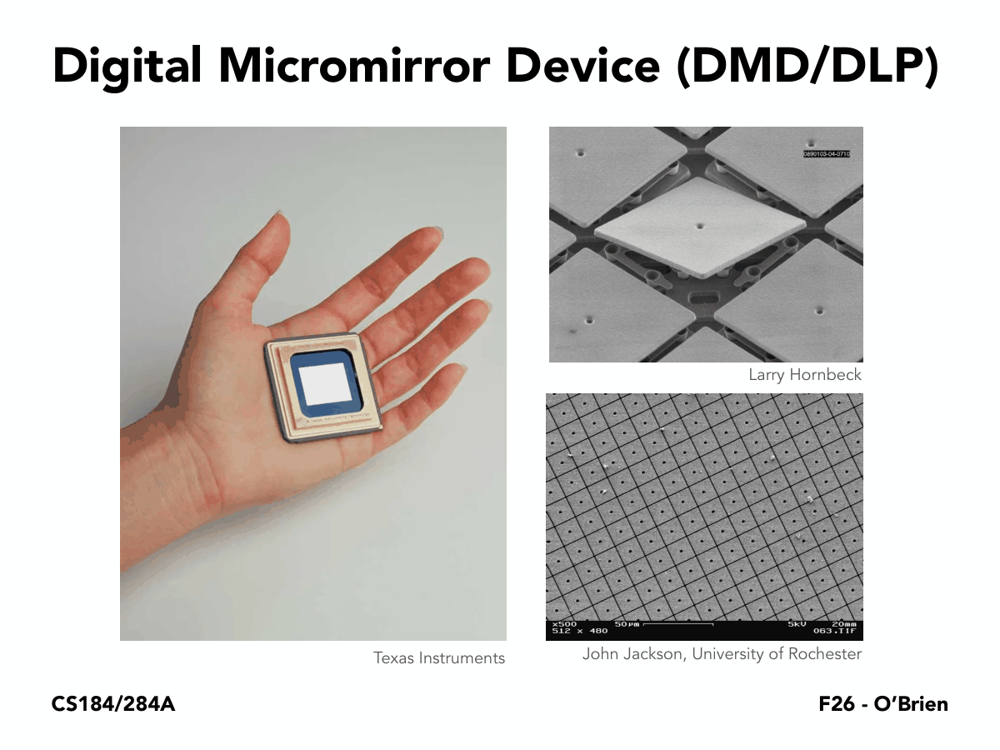

三张图：手心里一枚指甲盖大的芯片；显微镜下的**微镜阵列**（Larry Hornbeck，University of Rochester / Texas Instruments）；一张倾斜的镜片阵列照片。

**原理**：芯片上有几百万个**微小铝制镜片**，每个可绕轴翻转 ±10°～12°。

| 镜片状态 | 效果 |
|---|---|
| 转到 +θ | 把光**反射进投影镜头** → 该像素**亮** |
| 转到 −θ | 把光**反射到吸光板** → 该像素**暗** |

> **关键洞察**：DMD 是**二值（binary）**设备——任何瞬间每个像素只有「开」或「关」，**没有中间灰度**。
>
> 灰度靠**时间调制**（time dithering）：一帧内快速开关，开的时间占比（占空比）决定观感亮度。这也是为什么 DLP 投影仪能听到轻微嗡声、拍摄时能看到彩虹效应。
>
> **这一点和第 6 节正好呼应**：离散化不只发生在空间上，也发生在时间上。前面讲空间采样，这里顺手埋了「时间采样」的伏笔。

#### P21–P22　Digital Micromirror Device（结构渲染）


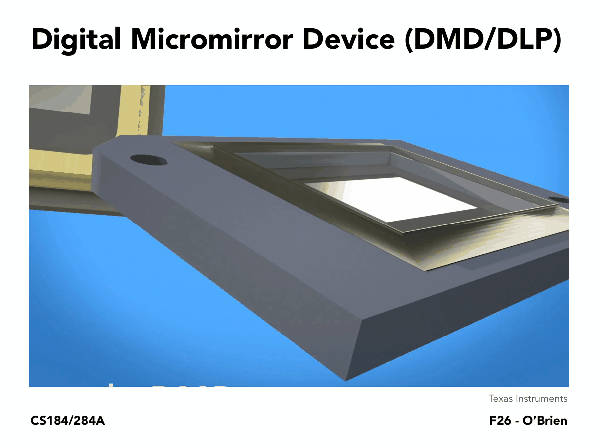

两页是同一组 3D 渲染，把上一页的显微镜照片「画清楚」：基座、铰链、镜片，以及下方控制电极。和 P20 对照着看，就能理解「镜片为什么会翻」——靠下面电极的静电吸引。

（这两页纯展示，没有额外公式，看个结构即可。）

#### P23　Electrophoretic (Electronic Ink) Display

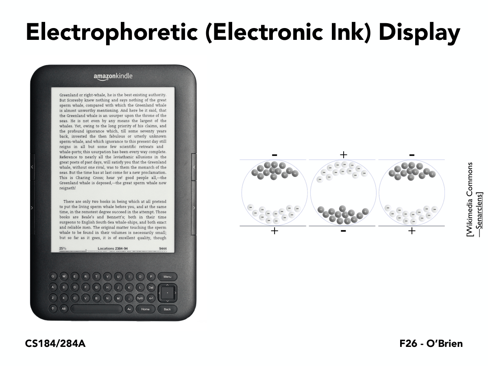

左边一台 Kindle 显示文字；右边是**微胶囊（microcapsule）**原理图，画了三个状态。

**原理**：每个像素是一个装满透明液体的微胶囊，里面悬浮着**带正电的白色颗粒**和**带负电的黑色颗粒**。

| 电场方向 | 结果 |
|---|---|
| 上极板负、下极板正 | 白粒被吸到上面 → 像素**白** |
| 上极板正、下极板负 | 黑粒被吸到上面 → 像素**黑** |

**两个独有性质**：

1. **双稳态（bistable）**：断电后颗粒位置不变，图像**保持不耗电**。所以 Kindle 只在翻页时耗电。
2. **刷新慢**：颗粒在液体里游动，物理上就慢，所以有那种「闪一下」的翻页动画。

### 1.5 这一节的结论

| 设备 | 光栅化方式 | 像素是物理实体吗 | 有中间灰度吗 |
|---|---|---|---|
| 示波器 | 连续偏转 | ❌ 无像素概念 | ✅ 模拟连续 |
| CRT 电视 | 逐行扫描 + 强度调制 | ❌ 扫描出来的 | ✅ 模拟连续 |
| LED 点阵 | 每点独立驱动 | ✅ | ✅ |
| LCD | 背光 + 逐像素光阀 | ✅ | ✅ |
| OLED | 逐像素自发光 | ✅ | ✅ |
| DMD / DLP | 微镜翻转 + **时间**调制 | ✅ | ⚠️ 二值，靠时间抖动 |
| E-Ink | 带电颗粒电泳 | ✅ | ⚠️ 灰阶有限 |

除了示波器那一路，**其余全是光栅设备**——共同点是：图像必须先被离散成一张二维数组。这就是为什么我们必须学采样。

## 2. 为什么只画三角形

#### P24　Drawing to Raster Displays

*章节点*

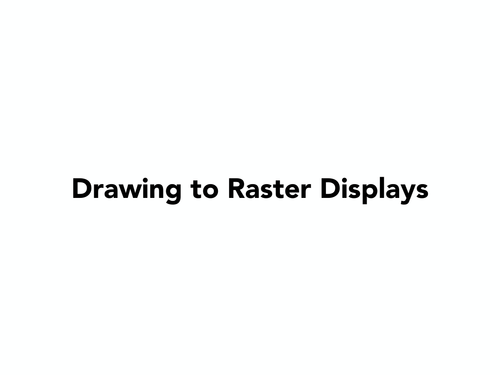

分节页。从「显示器怎么造」转到「怎么往显示器上画」。

#### P25　Polygon Meshes

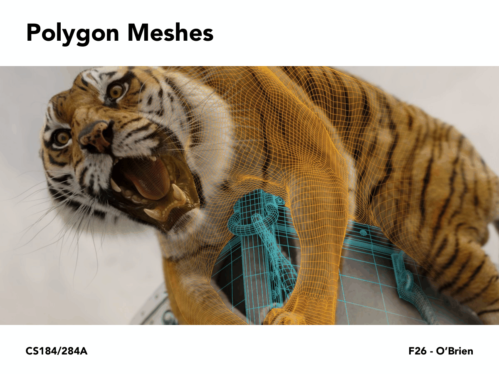

一只老虎的渲染图，表面**叠加青色线框**，能看见密密麻麻的网格线。

**这一页演示「网格表示」（mesh representation）**：复杂曲面（动物皮毛轮廓）被拆成大量多边形片，每片由顶点定义。线框越密，曲面越光滑。

注意线框是**画在表面上的**——这是课件常用的可视化手法：既让你看到成品（带毛的老虎），又让你看到它的几何骨架。

#### P26　Triangle Meshes

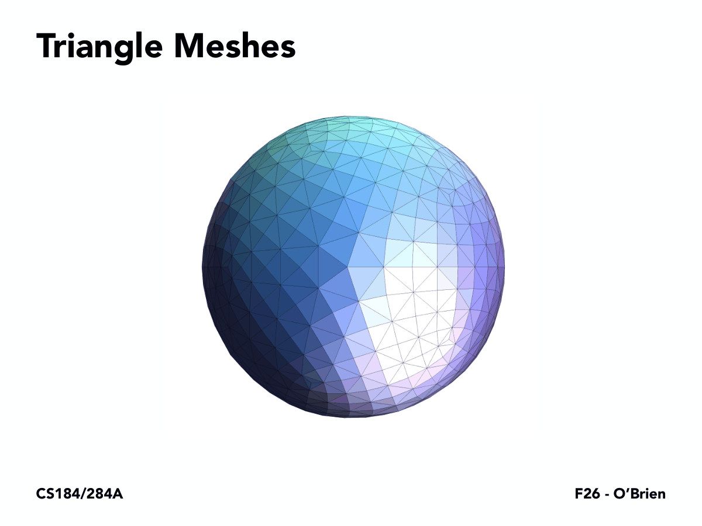

一个球，用**三角形**拼成。表面能看到清晰的三角面片边界和逐面片的明暗差异。

**和上一页对比**：老虎那张是「多边形」泛称，这一页明确是**三角形**。

注意球面上的三角形大小**并不均匀**：极点附近密集、赤道附近稀疏。这是球面参数化的必然结果（经线在极点汇聚），也是后面很多网格处理问题的来源。

#### P27　Triangle Meshes

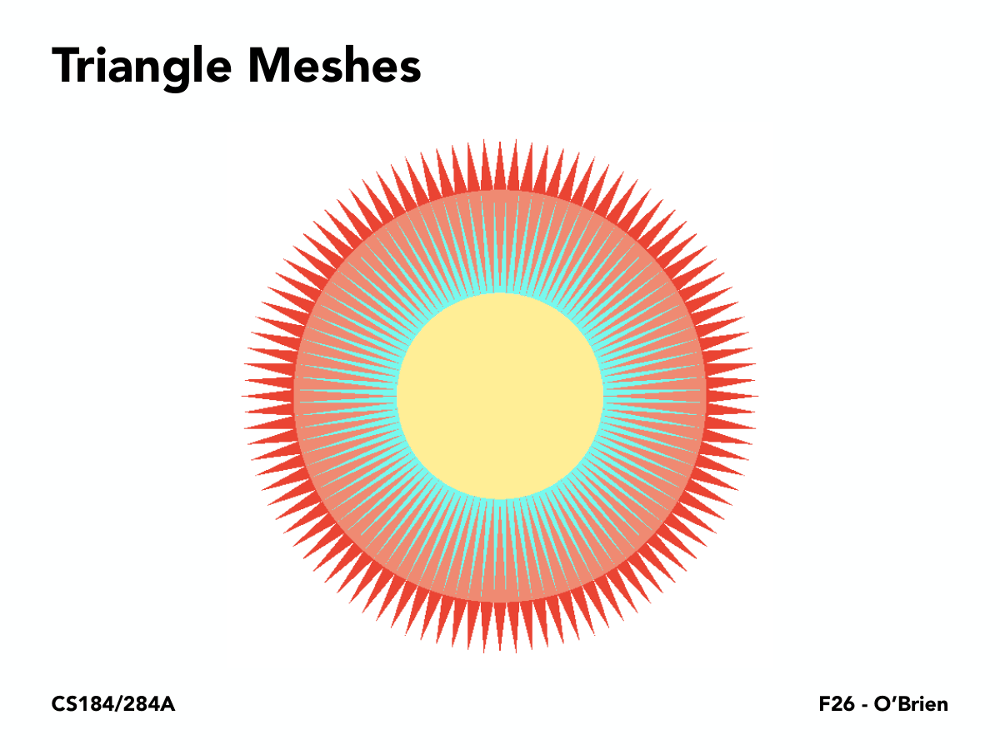

一个**圆盘**，用径向扇状（triangle fan）三角形拼成。中间淡黄色实心区，外围一圈红橙色的「辐条」状三角形。

**这张图是个伏笔。** 讲义在末尾 P95 会把**完全相同的这张图**重新拿出来，标题换成 *Jaggies (Staircase Pattern)*——同一张图，一次当「三角网格的例子」，一次当「走样的例子」。

> **🔭 为什么同一张图能干两件事**
>
> 因为图里同时藏着两个信息：
> 1. **网格结构**：辐条状三角形确实是一个合法三角网格（`GL_TRIANGLE_FAN`，见 P28）。
> 2. **走样痕迹**：边缘那圈**长短不一的尖刺不是网格本身的样子**，而是光栅化后的伪影——细密三角形在高频区域被欠采样，产生了放射状条纹。
>
> 所以 P27 已经在暗示：**这套「把三角形变成像素」的流程会出错**。只是现在还不是讲它的时候（第 6 节会回来）。

#### P28　Shape Primitives

*Example shape primitives (OpenGL)*

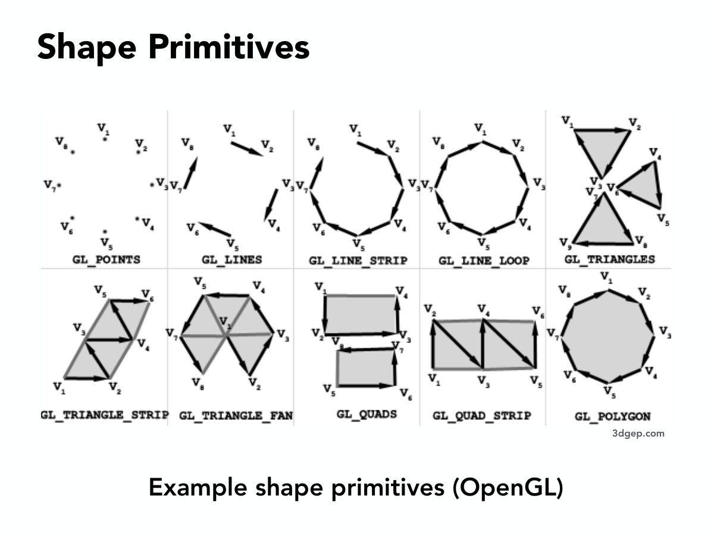

一张 10 宫格，列出 OpenGL 的**图元（primitive）**类型，每格左上画顶点、右下写常量名：

| 常量 | 含义 | 顶点如何连 |
|---|---|---|
| `GL_POINTS` | 独立点 | 每顶点一个点 |
| `GL_LINES` | 独立线段 | 每 2 顶点一段 |
| `GL_LINE_STRIP` | 折线 | 首尾相接，不闭合 |
| `GL_LINE_LOOP` | 闭合折线 | 首尾相接并闭合 |
| `GL_TRIANGLES` | 独立三角形 | 每 3 顶点一个 |
| `GL_TRIANGLE_STRIP` | 三角带 | 相邻三角形共享一条边，N 个顶点出 N−2 个三角形 |
| `GL_TRIANGLE_FAN` | 三角扇 | 所有三角形共享一个中心顶点（**P27 那张圆盘就是它**） |
| `GL_QUADS` | 独立四边形 | 每 4 顶点一个 |
| `GL_QUAD_STRIP` | 四边形带 | 相邻四边形共享边 |
| `GL_POLYGON` | 任意凸多边形 | 一个顶点序列 |

> **💡 为什么会有 STRIP / FAN**
>
> 纯粹为了**省顶点数据**。`GL_TRIANGLES` 画 N 个三角形要 3N 个顶点；`GL_TRIANGLE_STRIP` 只要 N+2 个——内存几乎降到 1/3。
>
> 代价：STRIP 必须首尾相连成一条带，FAN 必须共享一个中心点。所以它适合特定拓扑（圆盘天然适合 FAN）。
>
> 现代 GPU 已很少用 STRIP/FAN——**索引缓冲（index buffer）+ 顶点复用**更灵活。但常量还留在 API 里。

#### P29　Graphics Pipeline = Abstract Drawing Machine

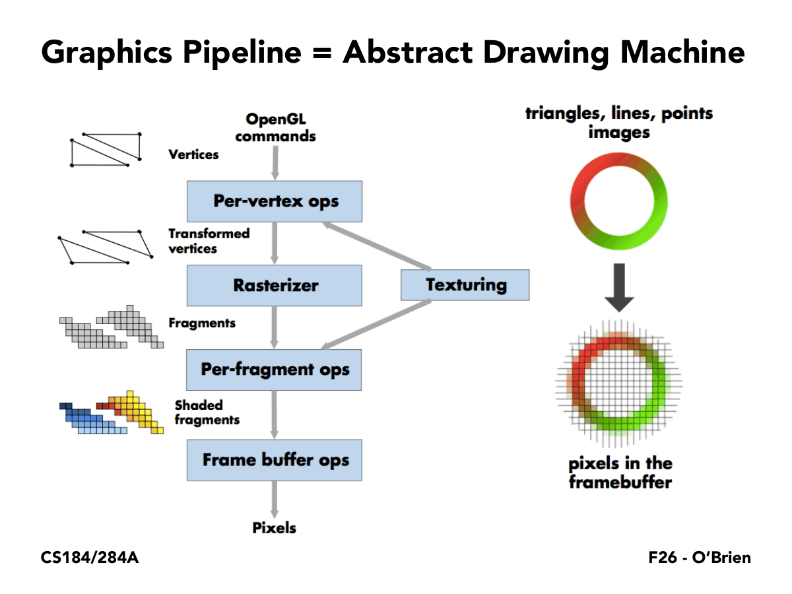

全讲的**地图页**，必须逐元素读懂。

**🖼 逐元素图解：管线怎么走**

左侧一列是**数据形态**，中间是**处理阶段**，箭头表示流向：

| 阶段（蓝方块） | 输入（左侧小图） | 输出 | 说明 |
|---|---|---|---|
| **Per-vertex ops** | 顶点（`Vertices`）——几个点 | 变换后顶点（`Transformed vertices`） | 做模型 / 观察 / 投影变换 |
| **Rasterizer** | 变换后的顶点 | **片段**（`Fragments`）——一小片一小片的网格 | **本讲主角** |
| **Per-fragment ops** | 片段 | 着色后的片段（`Shaded fragments`） | 逐片段算颜色（Blinn-Phong 等） |
| **Framebuffer ops** | 着色后的片段 | **像素**（`Pixels`） | 深度测试、混合、写帧缓冲 |

**两处容易看漏**：

1. **`Texturing` 那个独立方块**挂在 Rasterizer 与 Per-fragment ops 中间，有箭头连向两边。含义：纹理采样发生在**片段着色阶段**，但它需要 rasterizer 提供的**插值参数**（重心坐标）。L06 专门讲。
2. **右侧圆环对照图**。上半是光滑彩色环（`triangles, lines, points` → `images`），下半是**同一张图在帧缓冲里的样子**——被剖成格子（`pixels in the framebuffer`）。中间粗箭头就是在说：**上一步的连续几何，被栅格化成了离散格点**。

> **📌 本讲在地图上的位置**
>
> 98 页只处理中间橙色那格：**Rasterizer**。也就是说，本讲**完全不管颜色**（L07–L08）和**纹理**（L06），只回答：
>
> **给定屏幕上三个顶点的位置，哪些像素应该被填上？**
>
> 先把「覆盖关系」算清楚，是光栅化的全部职责。颜色是后面的事。

再给一张把「每阶段吃什么、吐什么」标出来的管线视图：


```text
    顶点 (x,y,z) ×3
         │
         ▼
  ┌─────────────────┐
  │ Per-vertex ops  │  ← MVP 矩阵相乘（L04–05）
  └─────────────────┘
         │ 屏幕空间顶点 (x,y)
         ▼
  ┌─────────────────┐
  │  Rasterizer     │  ← ★ L02：只决定「覆盖」，不决定颜色
  │  逐像素判 inside │
  └─────────────────┘
         │ 片段：像素下标 + 重心坐标 + 深度
         ▼
  ┌─────────────────┐
  │ Per-fragment ops │  ← 着色（L07–08）、纹理（L06）
  └─────────────────┘
         │
         ▼
  ┌─────────────────┐
  │ Framebuffer ops │  ← 深度测试、alpha 混合
  └─────────────────┘
         │
         ▼
      Image[y][x]
```

### 2.1 三角形的五条理由（P30–P38）

这九页是**同一张图 + 逐条累加的 bullet**，典型的动画分页（build）。九张截图里唯一的区别是左侧列表的长度，右侧那条**海豚的三角网格**始终不变。所以不逐页贴九张，只给首尾两张，中间用表说清。

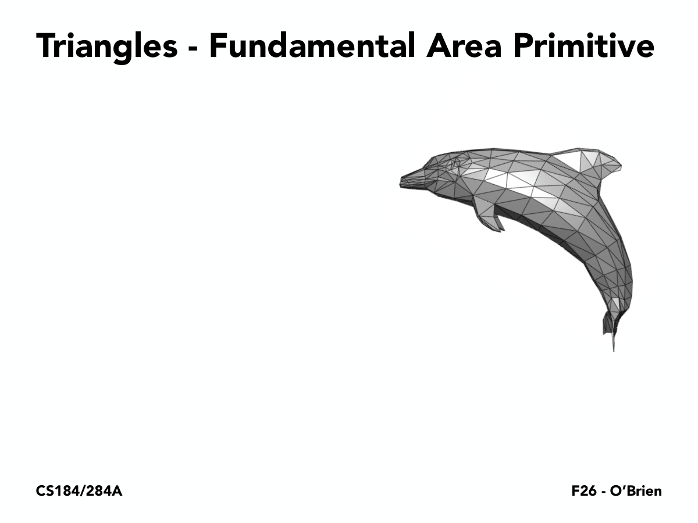

*P30 只有标题和鲸豚图，一条 bullet 都没有。它的作用是把「三角形」和「面积图元」（area primitive）绑定——点是 0 维、线是 1 维，**要填充面积，最小单位就是三角形**。*

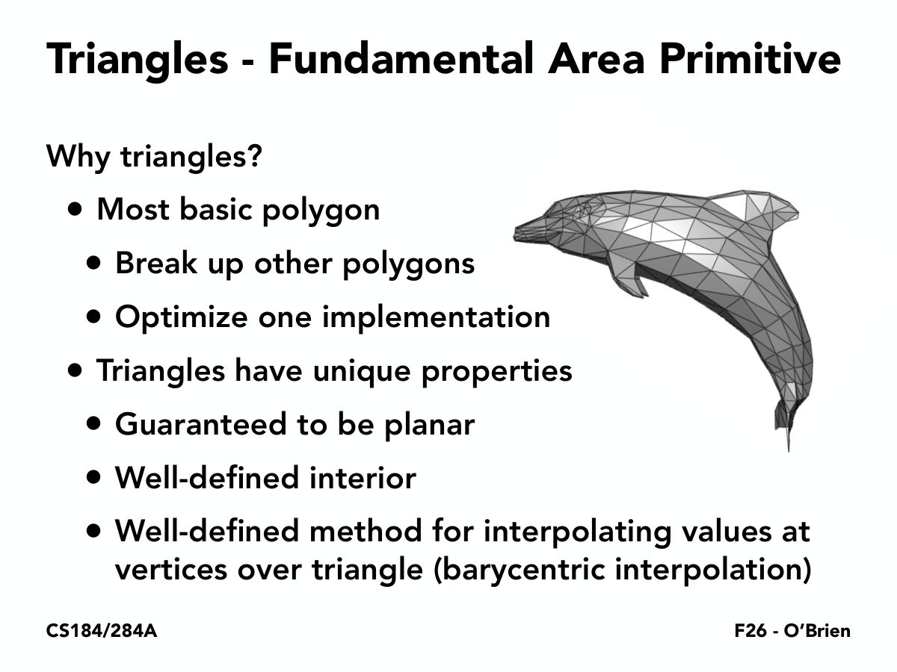

*P38 是累加完成的样子，六条全在。注意右侧海豚始终是同一个模型——它在提醒：这些理由都不依赖具体模型，是三角形本身的属性。*

逐条展开（P31 抛出问题，P32–P37 各加一条，P38 收尾）：

| 页 | 理由 | 它在说什么 |
|---|---|---|
| P32 | **Most basic polygon** | 顶点数下限。2 个顶点只能确定一条线，围不出面积 |
| P33 | **Break up other polygons** | 任何多边形都能三角化，所以「只用三角形」**不损失表达力** |
| P34 | **Optimize one implementation** | 只需优化一份实现。GPU 里那颗三角形光栅化单元是**硬件电路**，投多少人力都只针对一种图元 |
| P35 | *（过渡）* Triangles have unique properties | 前三条是「方便」，后三条是**几何必然** |
| P36 | **Guaranteed to be planar** | 三点必共面 |
| P37 | **Well-defined interior** | 三角形永远凸，「内部」无歧义 |
| P38 | **Well-defined method for interpolating values at vertices over triangle (barycentric interpolation)** | 顶点属性怎么插到内部，有唯一答案 |

后三条值得单独解释，因为它们常被当成废话跳过：

**P36「必共面」为什么不是废话？** 四个点在 3D 里**不一定共面**——可以扭成折纸。这时「这个面朝哪边」没有答案，光照和背面剔除都会算错，必须先拆成两个三角形。三个点没有这个自由度。

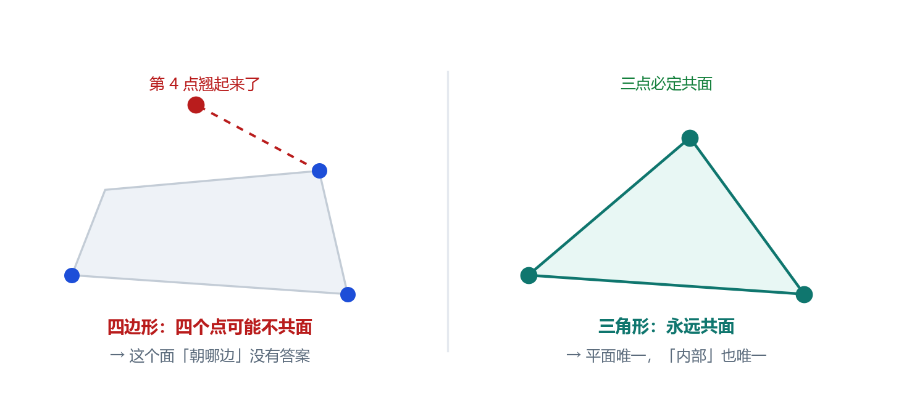

*左：第 4 点翘出平面，法向无定义。右：三点唯一确定平面，法向和内部都唯一。*

**P37「内部无歧义」为什么重要？** 三角形永远凸，所以「内部」就是三个半平面的交（第 4 节会正式用这个定义）。非凸多边形的「内部」需要奇偶规则（even-odd）或非零环绕规则才能定义，光栅化时要做逐边计数，复杂度完全不同。

**P38「重心插值唯一」是全讲最容易被低估的一条。** 三个顶点各带一个颜色（红、绿、蓝），中间像素该是什么颜色？三角形的答案是重心坐标 `(α, β, γ)`，满足 `α+β+γ=1`，插值就是 `α·v₀ + β·v₁ + γ·v₂`。

> **💡 顺手记住重心坐标怎么算**
>
> 设顶点 `A, B, C`，点 `P`：
> `α = Area(PBC)/Area(ABC)`，`β = Area(APC)/Area(ABC)`，`γ = Area(ABP)/Area(ABC)`。
> 三个比值自动 `α+β+γ=1`，且都在 `[0,1]` 内 ⟺ `P` 在三角形内。
>
> **巧的是，P74 那三个 `L_i(x,y)` 的值正比于这三个面积**（`L_0` 对应 `α`）。所以光栅化时算出来的半平面函数值，**可以直接拿去插值**——一份计算两个用途。这正是 HW1 里 `inside()` 和重心坐标能用同一批数的原因。

## 3. 把「画」改写成「采样」

#### P39　Drawing a Triangle To The Framebuffer ("Rasterization")

*章节点*

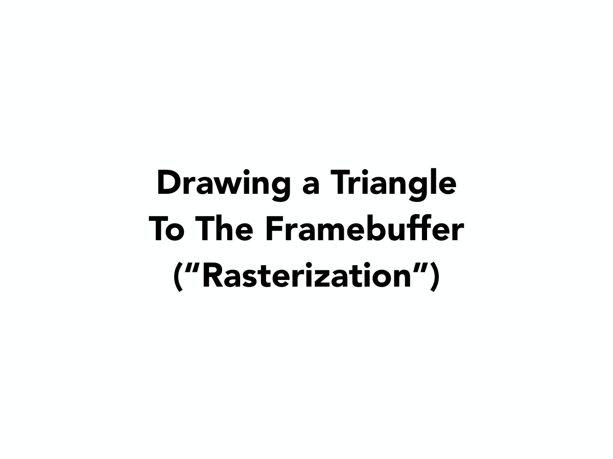

分节页，把「画三角形到帧缓冲」和 **rasterization** 正式划等号。

#### P40　What Pixel Values Approximate a Triangle?

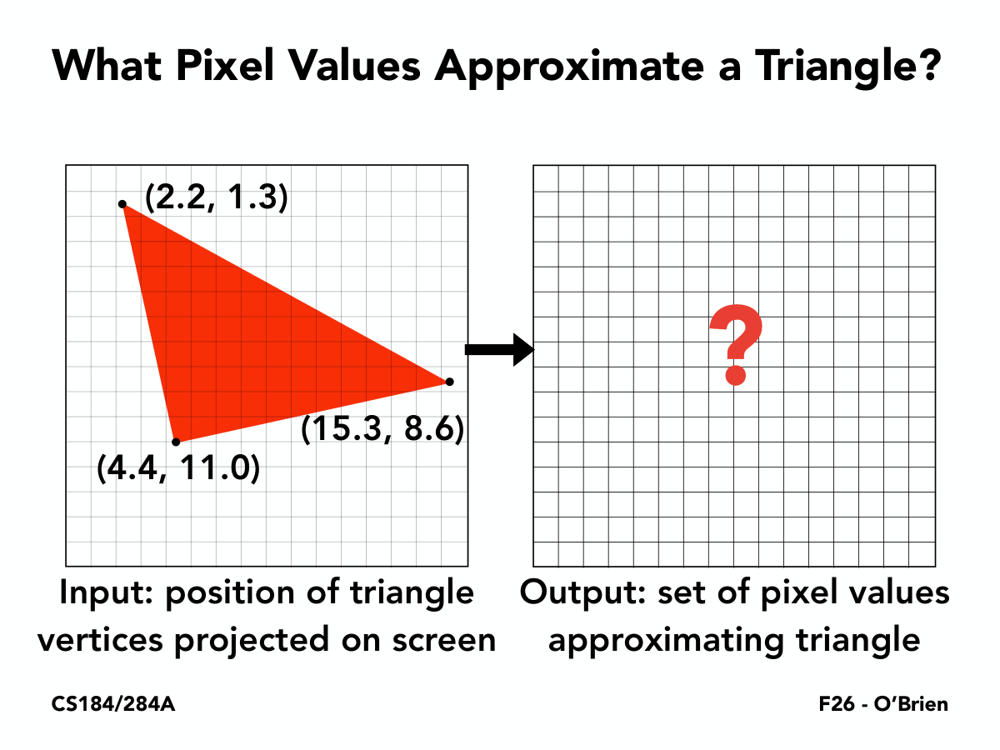

这一页摆出了全讲要解的题，左边是它的**精确陈述**：

**输入**：三角形三个顶点投影到屏幕后的坐标 `(2.2, 1.3)`、`(4.4, 11.0)`、`(15.3, 8.6)`
**输出**：一组像素值，用来**逼近**这个三角形

中间是三角形画在网格上的样子（红色填充 + 黑框），右边格子里一个孤零零的红色 `?`。

> **🔭 这道题为什么值得停一下**
>
> 注意三点：
> 1. **顶点坐标是浮点数**。三角形活在连续平面上。
> 2. **像素是整数格子**。输出活在离散网格上。
> 3. **「逼近」这个词**。讲义没说「精确表示」——因为**不可能精确**。连续三角形没法被有限格子精确表示。
>
> 所以这道题从一开始就承认：我们要做**近似**。剩下的全部工作，就是设计一个好的近似，并搞清楚它什么时候会坏。

#### P41　Today, Let's Start With A Simple Approach: Sampling

*章节点*


分节页。「最简单的办法」就是下面这套：每个像素问一句「你在三角形里吗」。

### 3.1 先把一维采样看清楚（P42–P48）

这七页是同一段话逐条累加，只给两页代表，中间用表补全。

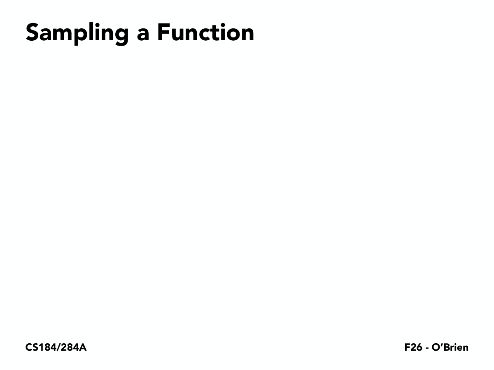

*P42 只有标题。讲义习惯先把标题摆出来，再往上加内容——这样讲的时候听众知道「接下来要讲采样」。*

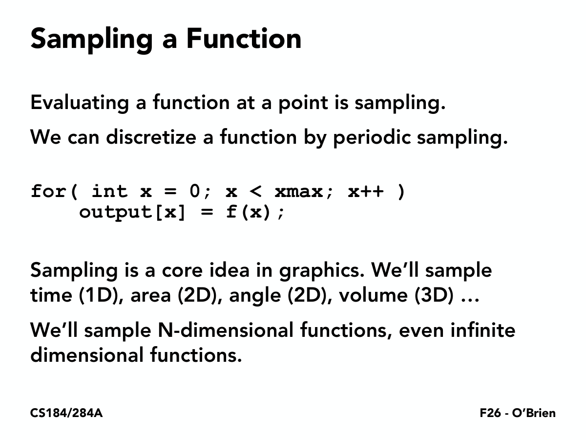

*P48 是累加完成的样子。五句话全在这里，后面逐句解释。*

五句话逐条说：

**① `Evaluating a function at a point is sampling.`（P43）**

这是全讲的**第一个定义**，也是最容易被跳过的：**在某个点上求函数的值，就叫采样。**

听起来像废话，但它把「采样」从「数字化」这种模糊说法，变成了一个精确、可讨论误差的操作——**求值本身没有损失，损失发生在「只取有限个点」这件事上**。

**② `We can discretize a function by periodic sampling.`（P44）**

用**周期性**采样把函数离散化。注意「周期」这个词：采样点等间距排列。这是最简单也最常用的方案，代价是它假设了「函数各处变化速度差不多」——而真实图像恰恰不是（P95 的锯齿就是这么来的）。

**③ + ④ 代码骨架（P45、P46）**

```c
for( int x = 0; x < xmax; x++ )
    output[x] = f(x);
```

**三行代码，就是「采样」的全部。** 后面所有花哨的东西——2D 采样、抗锯齿、蒙特卡洛——都是在这三行上做加法。

**⑤ `Sampling is a core idea in graphics.`（P47）**

原句：*"We'll sample time (1D), area (2D), angle (2D), volume (3D) …"* 这是在给整门课画坐标轴：

| 采样维度 | 采样对象 | 出现在哪 |
|---|---|---|
| **1D（时间）** | 时间 | 动画（L21–23）、运动模糊 |
| **2D（面积）** | 屏幕平面 | **光栅化（本讲）**、抗锯齿 |
| **2D（角度）** | 方向 | BRDF、环境光、光场（L24） |
| **3D（体积）** | 空间 | 体积渲染、物理模拟（L24–25） |

**P48 的最后一句话最难**：*"We'll sample N-dimensional functions, even infinite dimensional functions."*

无穷维听起来抽象，但 L16–17 的路径追踪就在做这件事：一条光线在场景里不断弹射，整条路径是一个**无穷维**的随机变量，路径追踪就是在无穷维空间里采样。

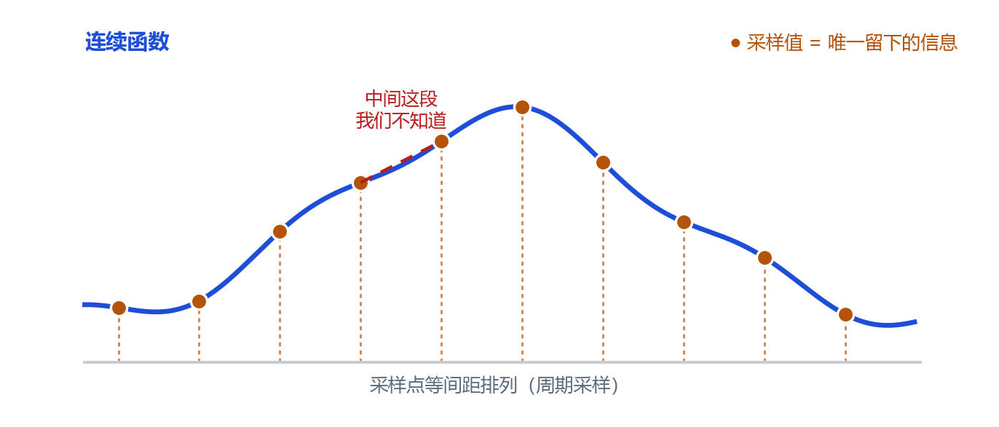

*蓝色是原来的连续函数，橙点是唯一留下来的信息。红色虚线那段就是全部问题的根源：**点与点之间发生了什么，采样完全不知道**。*

### 3.2 从一维升到二维（P49–P52）

#### P49　Let's Try Rasterization As 2D Sampling

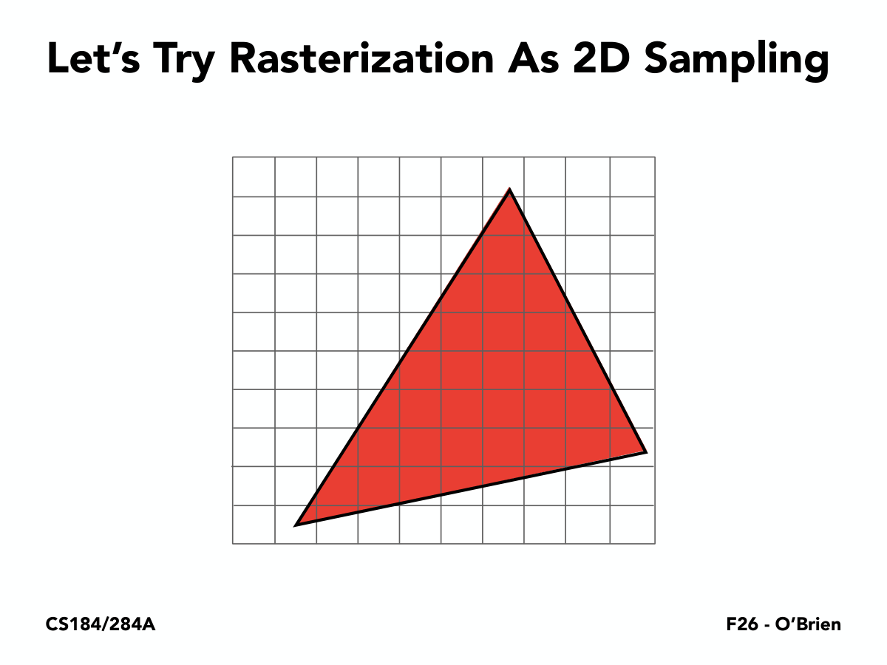

一张 12×9 的格子，里面画着红色三角形、黑框描边。

注意这一页**还没有采样点**——它先把「几何 + 网格」摆好，下一张才加采样。这是讲义一贯的节奏：先给舞台，再放演员。

#### P50　Sample If Each Pixel Center Is Inside Triangle

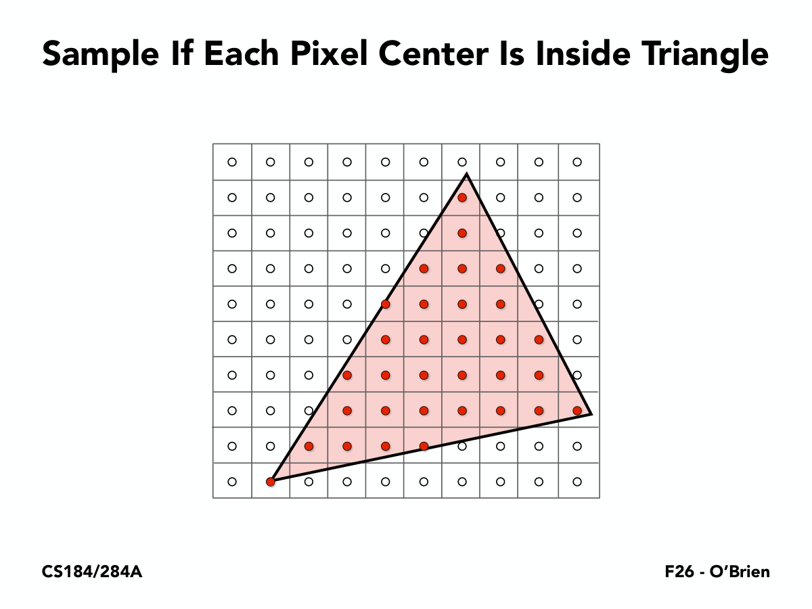

加上采样点：每格中心一个**空心小圆**；落在三角形内部的变成**红色实心点**。

**这一页要看两件事**：

1. 采样点固定在**格子正中心**，不是角、不是随机位置。P58 会正式写成 `(x+1/2, y+1/2)`。
2. 判定结果只有两种：**在内（红）/ 在外（白）**。这就是「指示函数」的取值。

#### P51　Sample If Each Pixel Center Is Inside Triangle

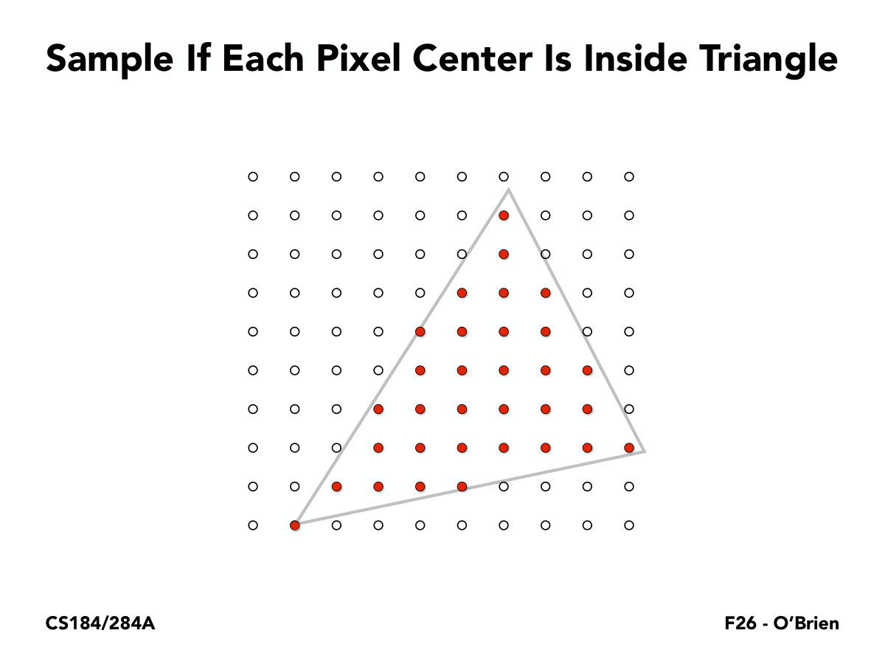

**同一批采样点，但网格线被去掉了**，三角形描边也变浅。

这是动画分页第二步：**先强调「格子」，再强调「点」**。看过这两张就明白——光栅化真正产生的是**一张采样点的布尔图**，格子只是为了说明「这些点属于哪个像素」。

#### P52　Define Binary Function: inside(tri,x,y)

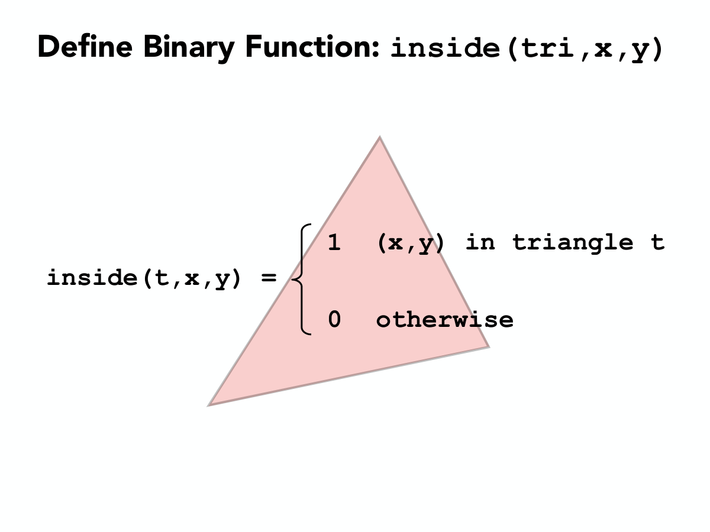

把上面那件事写成函数：

$$\text{inside}(t,x,y)=\begin{cases}1 & (x,y)\in \text{triangle } t\\ 0 & \text{otherwise}\end{cases}$$

> **📌 这个函数是整讲的枢纽**
>
> 它是一个**指示函数（indicator function）**，值域只有 `{0,1}`。
>
> 关键在于：一旦把「画三角形」写成「这个函数」，后面的数学就能直接搬过来——函数可以采样、可以积分、可以做频率分析。**图像处理的所有工具，从此都能作用于光栅化。** P97 的讨论题（「这像素该取什么值」）其实就是在问「要不要换一个函数」。

### 3.3 代码落地（P53–P58）

五页是同一段代码逐行累加，只给首尾。

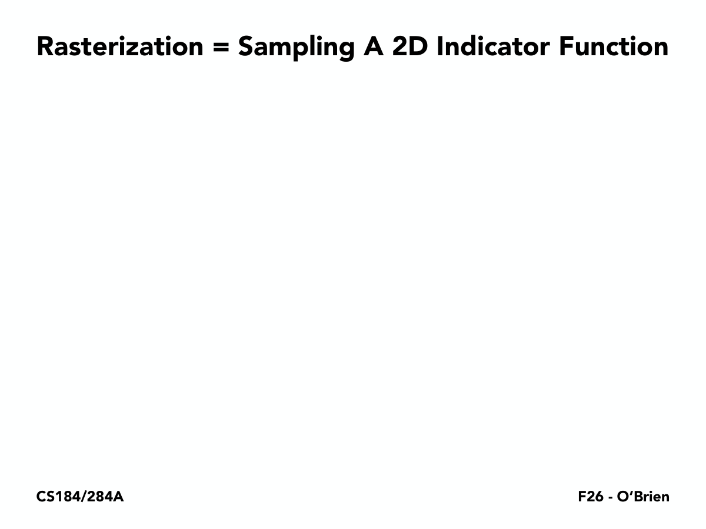

*P53 只有标题，**一行代码都没有**。标题本身已经把结论说完：光栅化 = 采样一个二维指示函数。*

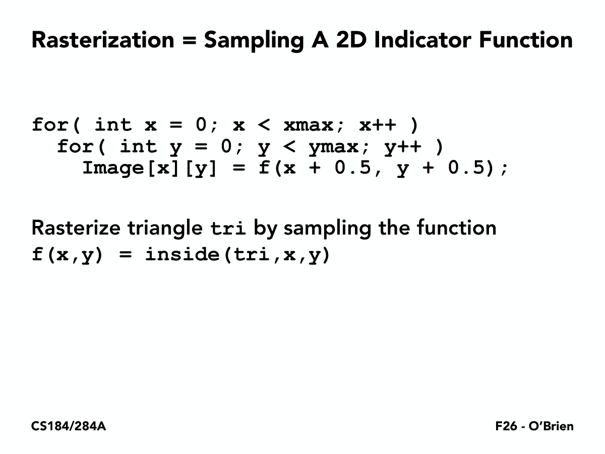

*P57 是补完的样子，最后两行把 `f` 到底是什么点明。*

中间三页的累加过程（P54–P56）：

| 页 | 加了什么 |
|---|---|
| P54 | `for (int x = 0; x < xmax; x++)` |
| P55 | 再加 `for (int y = 0; y < ymax; y++)` |
| P56 | 再加 `Image[x][y] = f(x + 0.5, y + 0.5);` |

完整版：

```c
for( int x = 0; x < xmax; x++ )
  for( int y = 0; y < ymax; y++ )
    Image[x][y] = f(x + 0.5, y + 0.5);
// Rasterize triangle tri by sampling the function
// f(x, y) = inside(tri, x, y)
```

> **⚠️ 这里藏着两个具体的坑，HW1 最常翻车**
>
> **坑 1：`+0.5` 不能省。** 像素 `(x,y)` 覆盖 `[x, x+1) × [y, y+1)`，几何中心在 `(x+0.5, y+0.5)`。用 `(x,y)` 采样等于整体偏移半个像素——低分辨率下肉眼可见，高分辨率下会被验收脚本抓到。
>
> **坑 2：`Image[x][y]` 的索引顺序。** 屏幕坐标 `x` 向右、`y` 向下；但 C 数组第一个下标是**行**。若 `Image` 按行优先存储，正确写法是 `Image[y][x]`。讲义这里写 `[x][y]` 是按数学习惯，**照抄进代码就会把图转置 90°**。

#### P58　Implementation Detail: Sample Locations

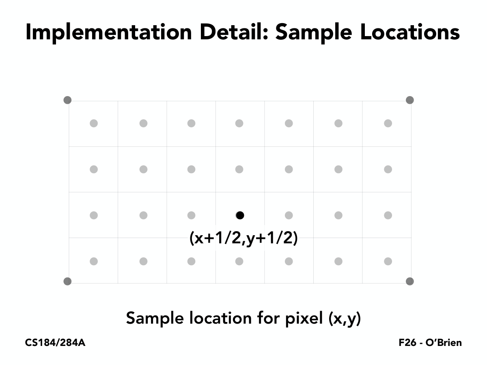

一页很朴素但关键的图：4×4 格子阵列，每格中心一个灰点，左上与右下格点特别标出，中间一格标着 `(x+1/2, y+1/2)`，下方一行 `Sample location for pixel (x,y)`。

**它在确认一个约定**：像素 `(x,y)` 的采样点就是它的中心 `(x+1/2, y+1/2)`。格子边界画成细线，采样点压在正中间——**边界不参与采样，只有中心参与**。

> **💡 为什么一定要用中心**
>
> 因为中心是**对称的**。用角点会引入系统性的半像素偏移，导致：
> - 相邻三角形之间的覆盖判定不一致
> - 整幅图相对窗口平移
> - 抗锯齿时覆盖率算错
>
> 更一般地，采样点位置可以是任意图案（P83 的分块样本、L03 的超采样网格、抖动采样），但**必须全局一致**，否则同一张图的不同部分会有不同偏移量。

#### P59　Attendance

*Word of the day: pixels*


亮黄色的签到页：二维码、`https://tinyurl.com/184fall26`、左下 `Word of the day: pixels`，页码 37，左上角标 `S26 - O'Brien`。

这页是从另一学期直接复用的（角标 S26，整副却是 F26），但它传递的信息有用：**今天的「每日一词」就是 pixel**。老师用这种方式强调——**像素是这一讲唯一的新概念**，其余都是推导。

顺带一提：这页也说明 CS184 课件是跨学期累积演化的，同一套素材在多个学期复用。P59 之后所有页码角标都回到 `F26 - O'Brien`。

## 4. `inside` 怎么算：三个半平面

#### P60　Evaluating inside(tri, x, y)

*章节点*

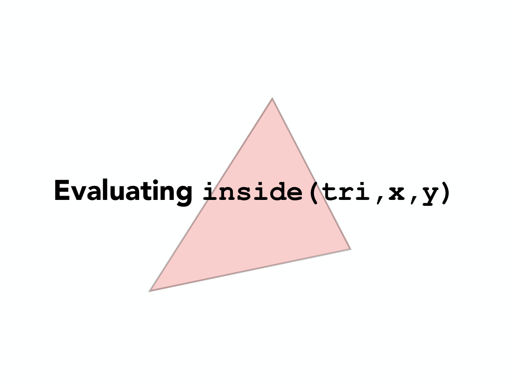

分节页。框架已经搭好（`Image[x][y] = inside(x+0.5, y+0.5)`），只剩一个问题：**`inside` 具体怎么算？**

### 4.1 从三条边到三个半平面（P61–P65）

#### P61　Triangle = Intersection of Three Half Planes

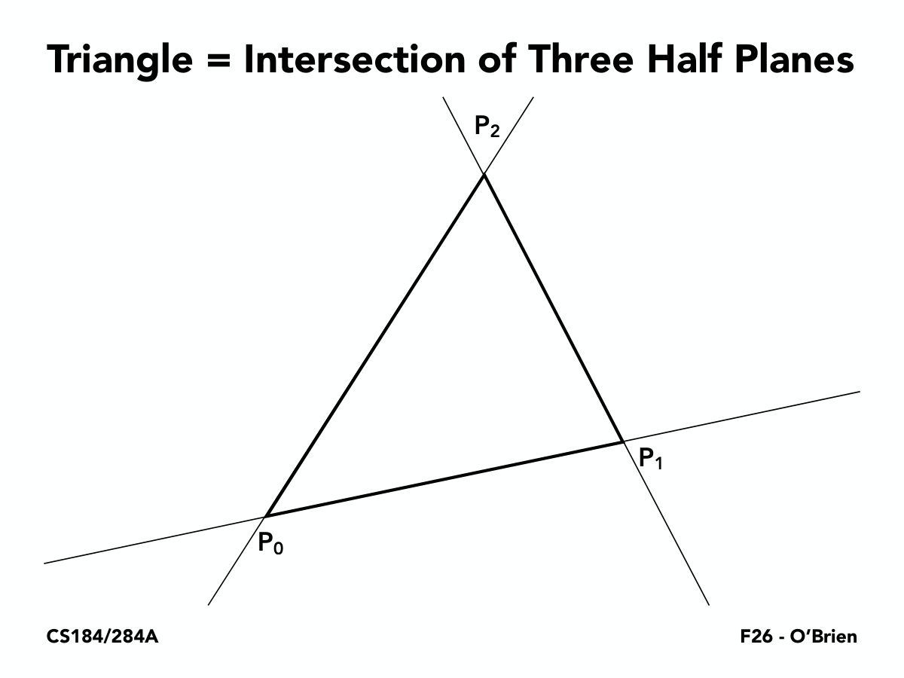

一个黑三角形，三条边都**向两侧延长**成直线，顶点标 `P0`（左下）、`P1`（右）、`P2`（上）。

**注意边长出的那几条线**——不是装饰。延长出去在暗示：每条边都定义了一整条**无限长直线**，而这条直线把平面切成两半。

#### P62–P64　逐半平面着色

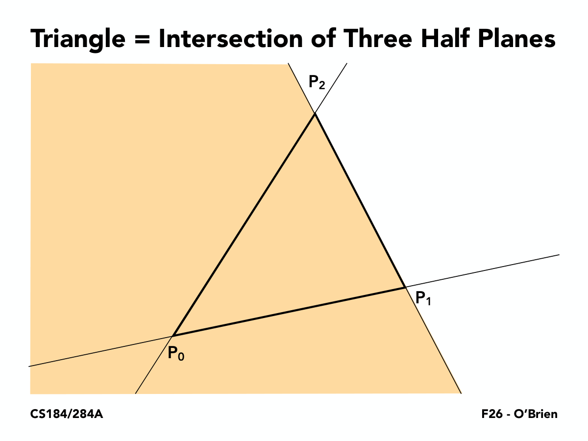

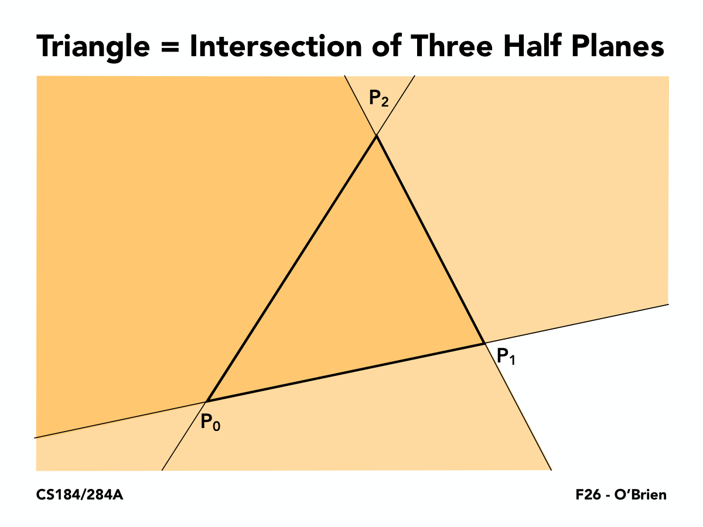

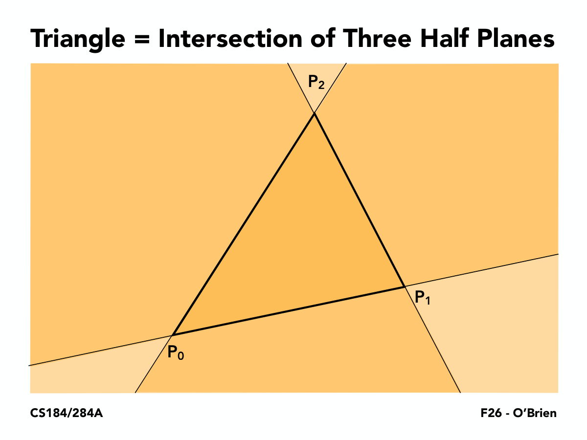

三页同图，橙色区域逐次收缩：

| 页 | 加的约束 | 橙色区域 |
|---|---|---|
| P62 | 底边内侧 | 底边以上半个平面 |
| P63 | 再加右边内侧 | 两块半平面的交 |
| P64 | 再加左边内侧 | **恰好收缩成三角形本身** |

> **🖼 为什么是「三个」**
>
> 每加一条边，区域就切掉一块。三条边加完，剩下的正是三角形——不是巧合：**三角形的定义就是「同时位于三条边内侧的点集」**。
>
> 推广：任何**凸多边形**都能写成「n 个半平面的交」。凸性是关键——非凸的需要「并集」，那就复杂了。三角形是最小的凸多边形，只需 3 个约束，这是所有图元里最省的。

#### P65　Each Line Defines Two Half-Planes

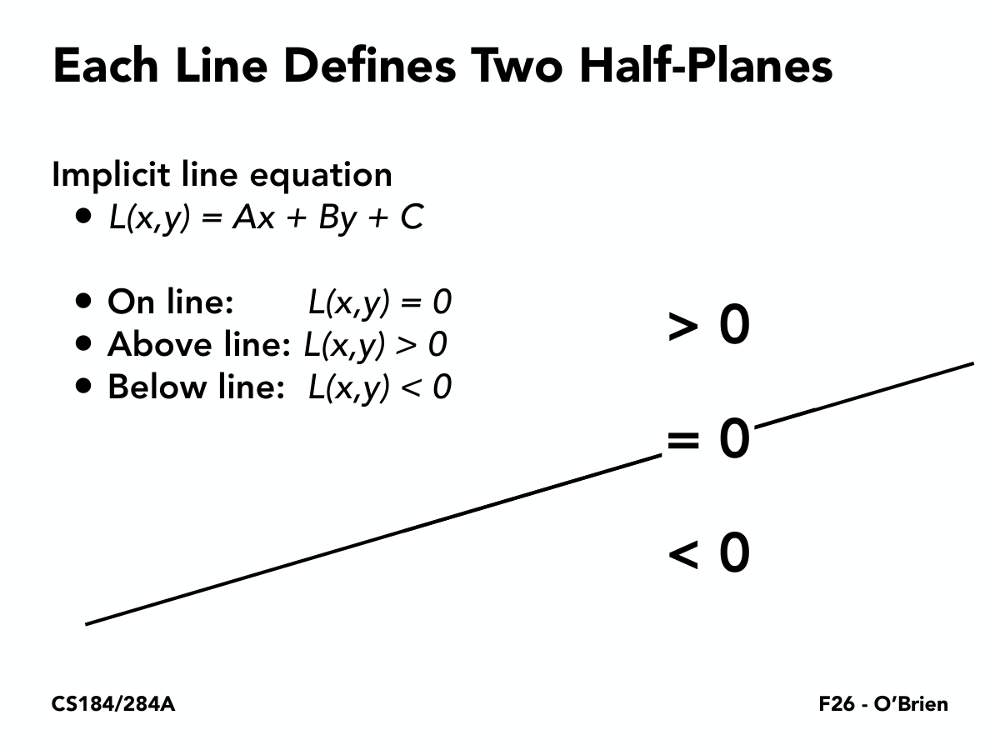

这一页给出**判据的数学形式**，是接下来所有推导的起点：

**隐式直线方程**（implicit line equation）：`L(x,y) = Ax + By + C`

| 位置 | 值 |
|---|---|
| 在直线上 | `L(x,y) = 0` |
| 直线一侧 | `L(x,y) > 0` |
| 另一侧 | `L(x,y) < 0` |

> **📌 为什么叫「隐式」**
>
> 因为它不告诉你点在哪，只告诉你**点相对直线的符号**。求具体位置要解方程；判断「在左还是右」只需要看符号——正好是分类问题需要的。
>
> 对比**参数式**直线 `P = P₀ + t·T`：那说的是「怎么走到线上」，需要参数 `t`。隐式更适合**分类**。三维里同样的东西叫**隐式平面方程** `Ax+By+Cz+D = 0`，L13 求光线与平面交点用的就是它。

### 4.2 直线方程怎么来的（P66–P70）

这五页是全讲推导最漂亮的一段：**四步把 `L(x,y)` 从几何直觉变成代数公式**。

#### P66　Line Tangent Vector

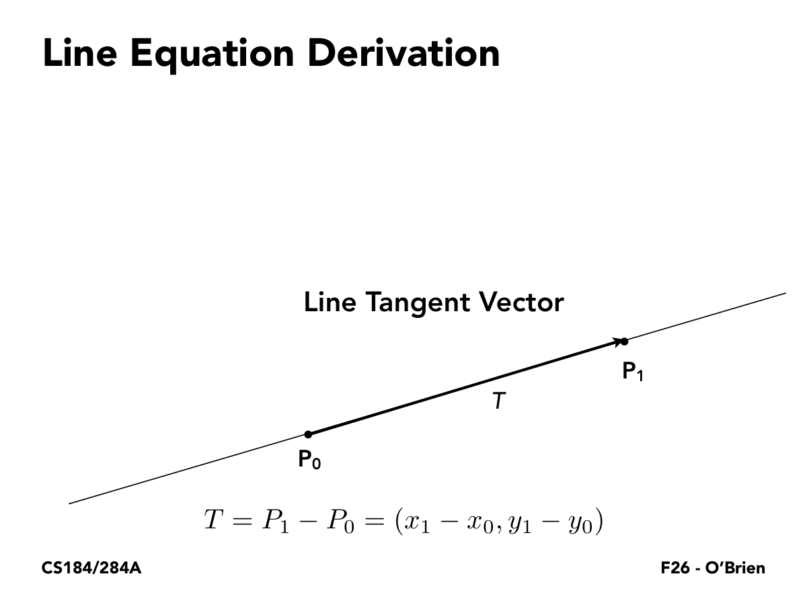

第一步：取边上的**方向向量**。

$$\mathbf{T} = P_1 - P_0 = (x_1 - x_0,\; y_1 - y_0)$$

图上是从 `P0` 出发、指向 `P1` 的箭头，标 `T`。

#### P67　Perp(x, y) = (−y, x)

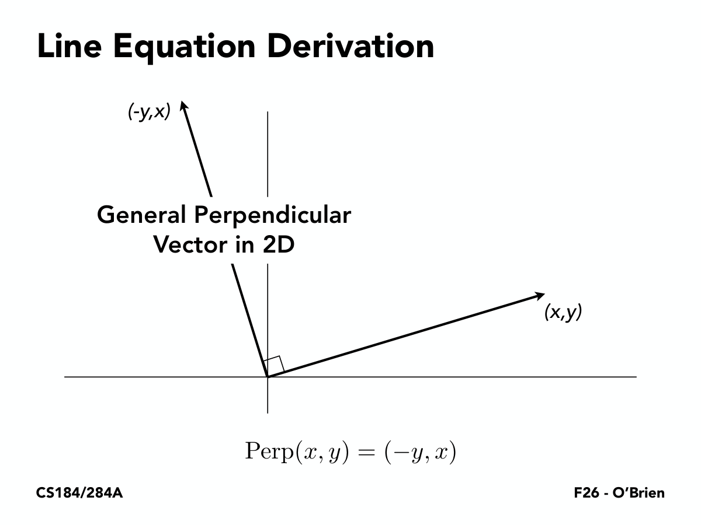

第二步：需要一个**垂直于 T 的向量**。二维里有个不用三角函数的廉价办法：

$$\text{Perp}(x,y) = (-y,\; x)$$

即「**交换两个分量，第一个取负**」。图上 `(x,y)` 在第四象限，`(-y,x)` 在第二象限，中间标直角。

> **💡 验算**
>
> `(1,0)` → `(0,1)`，点积 `1·0 + 0·1 = 0` ✓
> `(3,4)` → `(-4,3)`，点积 `3·(-4) + 4·3 = 0` ✓
>
> **注意**：`(y,-x)` 也是垂直的，方向相反。选哪个只影响符号约定，不影响「同号/异号」的判定——**只要三条边用同一约定**就行。

#### P68　Line Normal Vector

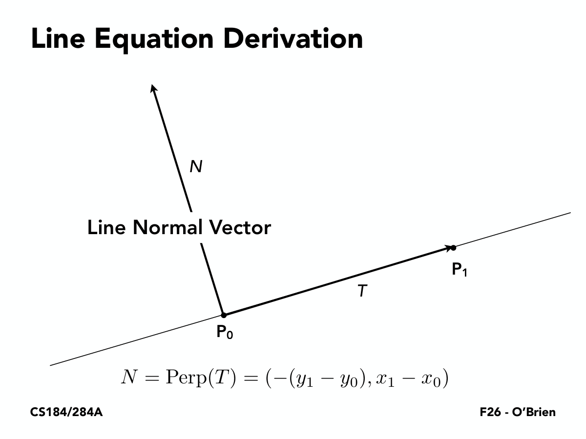

第三步：接起来。

$$\mathbf{N} = \text{Perp}(\mathbf{T}) = \bigl(-(y_1-y_0),\; x_1-x_0\bigr)$$

图上 `N` 垂直于 `T`，都从 `P0` 出发。

**`N` 就是这条边的法向量**（normal）。注意它**从两个顶点就算出来了**，完全不需要知道这条边属于哪个三角形。

#### P69　V = P − P0

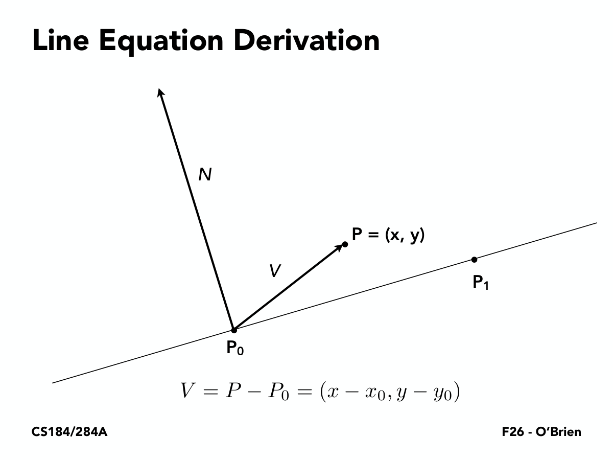

第四步：任取待判定点 `P = (x,y)`，从 `P0` 指向它：

$$\mathbf{V} = P - P_0 = (x - x_0,\; y - y_0)$$

#### P70　Line Equation

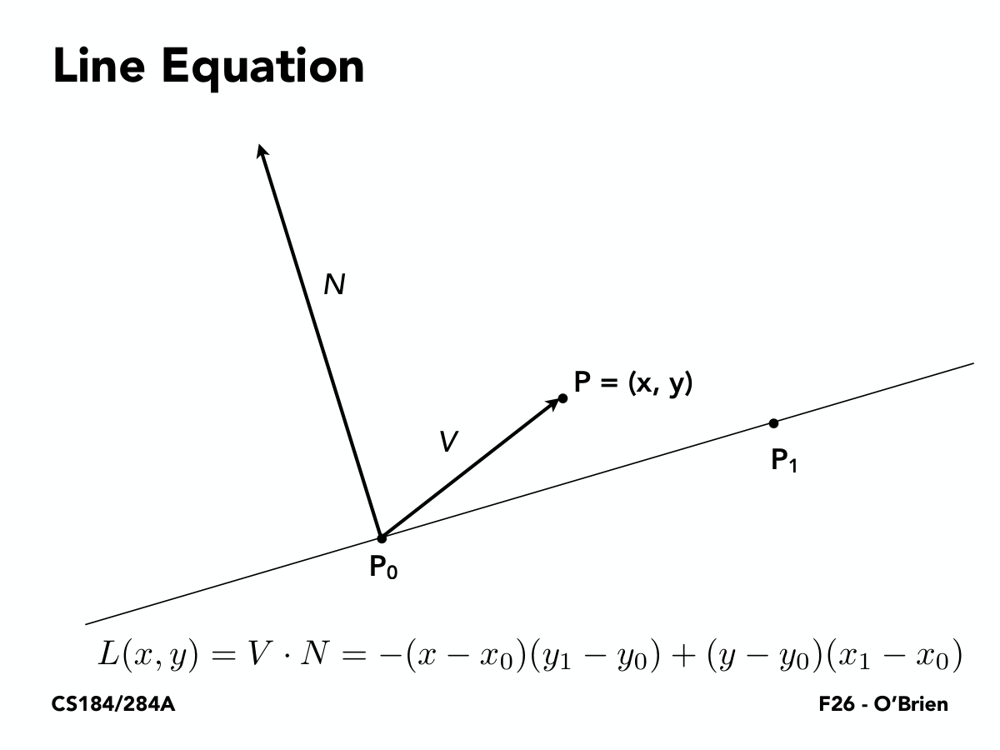

最后一步：**点积**。

$$L(x,y) = \mathbf{V}\cdot\mathbf{N} = -(x-x_0)(y_1-y_0) + (y-y_0)(x_1-x_0)$$

**为什么能判内外？** `V·N` 是 `V` 在 `N` 方向上的**投影长度 × |N|**：

| 情况 | `V·N` | 几何含义 |
|---|---|---|
| `P` 在直线上 | `0` | `V` 与 `N` 垂直，投影为 0 |
| `P` 偏 `N` 所指那侧 | `> 0` | 投影沿 `N` 正方向 |
| `P` 偏另一侧 | `< 0` | 投影沿 `N` 反方向 |

**符号 = 哪一侧**，这就是判据。

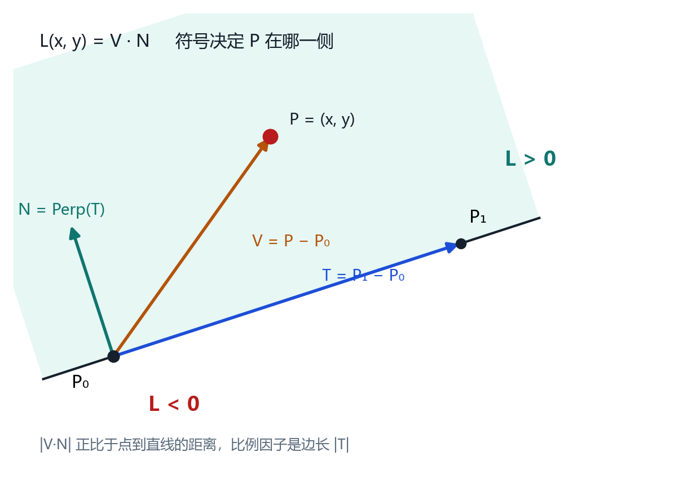

**🖼 逐元素图解**

| 元素 | 数学 | 含义 |
|---|---|---|
| 浅色直线 | `(p−P₀)·N = 0` | 边的延长线 |
| 蓝箭头 `T` | `P₁ − P₀` | 沿边的方向 |
| 绿箭头 `N` | `Perp(T)` | 垂直于边 |
| 橙箭头 `V` | `P − P₀` | 从边的一端指向测试点 |
| 红点 `P` | `(x,y)` | 待判定的采样点 |

**最容易被忽略的一点：`N` 的长度不是 1。**
`|N| = |T|`，等于这条边的长度。所以 `L(x,y)` 的值**正比于**点到直线的**有符号距离**，但比例因子是边长——**不同边的 `L` 值不能直接比大小**，「离哪条边更近」要除以边长才算得准。

### 4.3 三种符号测试（P71–P73）

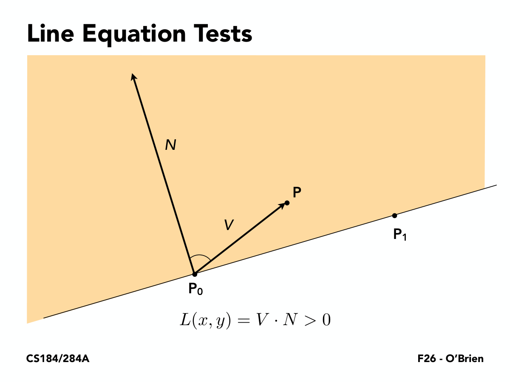

*橙色把 `N` 所指那侧涂满，`P` 落在橙色区里：`L(x,y) = V·N > 0`。*


*`P` 正好在直线上，`V` 与直线重合、与 `N` 垂直：`L(x,y) = 0`。**这就是 P80 要处理的边界情况。***


*`P` 落在 `N` 的反侧：`L(x,y) = V·N < 0`。*

> **⚠️ 一个符号约定的坑**
>
> 三张图里 `> 0` 那侧都是 `N` 指向的一侧。但**三角形的「内侧」是 `> 0` 还是 `< 0`，取决于顶点是顺时针还是逆时针排列**。
>
> P74 直接用「`> 0` = inside edge」，隐含假设**顶点逆时针（CCW）**。如果顶点顺序反了，三条 `L` 的符号**全部翻转**，判据要改成 `< 0`。
>
> **实用写法**：先算三个 `L`，若三个**同号**（同正或同负）就在内部——与顶点顺序无关。HW1 推荐这种，更不容易错。

### 4.4 三条边一起测（P74–P78）

#### P74　Point-in-Triangle Test: Three Line Tests


**这是全讲最重要的一页**，把前面所有推导归纳成一套可执行公式。

设 `P_i = (X_i, Y_i)`，下标按 `0→1→2→0` 循环：

$$dX_i = X_{i+1} - X_i,\qquad dY_i = Y_{i+1} - Y_i$$

$$L_i(x,y) = -(x-X_i)\,dY_i + (y-Y_i)\,dX_i = A_i x + B_i y + C_i$$

三个系数**只需算一次**（每个三角形一遍，所有像素共用）：

$$\boxed{A_i=-dY_i,\qquad B_i=dX_i,\qquad C_i=X_i\,dY_i-Y_i\,dX_i}$$

判据（讲义原文）：

| `L_i(x,y)` | 含义 |
|---|---|
| `= 0` | 点在**边上**（point on edge） |
| `< 0` | 点在**边外**（outside edge） |
| `> 0` | 点在**边内**（inside edge） |


*每条边延成无限长直线；`+` 号侧是「这条边判为在内」的那一半，`−` 号侧在外。三条边的内侧交集正好是三角形。*

**🔧 手算 1：完整跑一个三角形**

取 `P0=(0,0)`、`P1=(4,0)`、`P2=(0,4)`。先算三条边系数：

| `i` | `P_i → P_{i+1}` | `dX, dY` | `A = −dY` | `B = dX` | `C = X_i·dY − Y_i·dX` |
|---|---|---|---|---|---|
| 0 | (0,0)→(4,0) | `4, 0` | `0` | `4` | `0·0 − 0·4 = 0` |
| 1 | (4,0)→(0,4) | `−4, 4` | `−4` | `−4` | `4·4 − 0·(−4) = 16` |
| 2 | (0,4)→(0,0) | `0, −4` | `4` | `0` | `0·(−4) − 4·0 = 0` |

于是：

$$L_0 = 4y,\qquad L_1 = -4x - 4y + 16,\qquad L_2 = 4x$$

测四个点：

| 点 | `L₀` | `L₁` | `L₂` | 结论 |
|---|---|---|---|---|
| `(1,1)` | `4` | `8` | `4` | 三个都 `>0` → **在内** ✓ |
| `(3,3)` | `12` | `−8` | `12` | `L₁<0` → **在外** ✓ |
| `(2,2)` | `8` | `0` | `8` | `L₁=0` → **正好在斜边上** ⚠️ |
| `(0,2)` | `8` | `8` | `0` | `L₂=0` → **正好在左边上** ⚠️ |

后两行就是第 5 节要处理的边界情况。

#### P75　L0(x, y) > 0


橙色区域只是**底边内侧**那半个平面——和 P62 一样，但这次图上叠了采样点网格，红点是被这条边判为「在内」的像素。

**注意这批红点连成的是「一个半平面」，不是一个三角形。** 单条边的测试不够。

#### P76　L1(x, y) > 0


叠上第二条边。橙色区域收缩（右上角被切掉），红点形状跟着变。

#### P77　L2(x, y) > 0


三条边齐了，橙色区域正好是三角形，红点正好形成三角形。

#### P78　Sample point s = (sx, sy) is inside the triangle if it is inside all three lines.


最终判据，直接给代码：

```c
inside(sx, sy) =
    L0(sx, sy) > 0 &&
    L1(sx, sy) > 0 &&
    L2(sx, sy) > 0;
```

**黄框里那句小字极其重要**：

> *"Note: actual implementation of `inside(sx,sy)` involves `≤` checks based on edge rules"*
>
> 实际实现用的是 `≤`（或 `>=`），取决于边缘规则。

也就是说：**`> 0` 是数学判据，`>= 0` 才是工程判据**。差的那个 `=` 就是 P81 的内容。

> **🔧 手算 2：像素中心与半像素偏移**
>
> 接着手算 1 的三角形，屏幕 5×5，像素 `(x,y)` 中心在 `(x+0.5, y+0.5)`。
>
> 判像素 `(0,0)`：采样点 `(0.5, 0.5)`
> `L₀ = 4×0.5 = 2 > 0` ✓　`L₁ = −2−2+16 = 12 > 0` ✓　`L₂ = 2 > 0` ✓ → **在内**
>
> 若忘了 `+0.5`、直接用 `(0,0)`：`L₀ = 0`、`L₂ = 0`，落进边界情况，可能被判「在外」。
>
> 一个像素的差别；放大到整幅图就是整体错位。


**🖼 逐元素图解**

| 元素 | 含义 |
|---|---|
| 浅灰格子 | 像素区域 `[x,x+1)×[y,y+1)` |
| 格心圆点 | 采样位置 `(x+0.5, y+0.5)` |
| 红色实心点 | `inside = 1`，该像素写 1 |
| 空心圆点 | `inside = 0`，该像素写 0 |
| 半透明红色多边形 | 真实的连续三角形 |

**这张图最能说明「逼近」的含义**：红点拼出来的形状和光滑三角形**并不相同**——边缘是台阶状的。这就是 P93 的 jaggies 提前显形。

## 5. 细节：边界归谁，怎么遍历

#### P79　Some Details

*章节点*


分节页。标题很随意（「一些细节」），但这几页恰恰是 HW1 最容易翻车的地方。数学已经完备了（三个 `L_i` 同号即在内），剩下两个真问题：

1. **`L_i = 0` 时算不算在内？**（边界归属）
2. **这么多像素，怎么遍历才快？**（性能）

### 5.1 共享边上归谁（P80–P81）

#### P80　Edge Cases (Literally)


一张四边形被对角线切成两个三角形，标 `1` 和 `2`。中间蓝点**正好压在对角线上**。上方一行字：*"Is this sample point covered by triangle 1, triangle 2, or both?"*

**三种处理，两种都是错的**：

| 处理 | 后果 |
|---|---|
| **都算在内** | 该像素被画两遍。不透明时看不出，但**半透明（alpha 混合）会变深**，深度测试也会重复写 |
| **都不算在内** | 相邻三角形之间出现**一条缝**，背景漏出来（cracks） |
| **有规则地只算一次** | ✅ 正确 |

> **💡 这个问题有多严重**
>
> 想象一个由几万个小三角形拼成的曲面。若每条共享边都漏一个像素，整个模型会布满**蛛网状裂缝**。反过来若每条边都画两遍，半透明物体（玻璃、烟雾、毛发）会沿所有三角形边界出现**亮线**。
>
> 这不是理论洁癖，是**渲染里最常见的视觉 bug 之一**。

#### P81　OpenGL/Direct3D Edge Rules


标准答案。**加粗原句**：

> *"When sample point falls on an edge, the sample is classified as within triangle if the edge is a **"top edge"** or **"left edge"**."*

两个定义（右下还有一张 Direct3D 示意图，灰色 = 判为在内，白色 = 在外）：

| 术语 | 定义 |
|---|---|
| **Top edge** | **水平的**边，且**位于三角形所有其他边之上** |
| **Left edge** | **不是水平**的边，且**在三角形左侧**（可有 1 条或 2 条） |

> **⚠️「Top edge」的定义反直觉**
>
> 判的是「这条边**比其他所有边都高**」，不是「这条边在屏幕上方」。
>
> 倒三角形（顶点朝下）：底边在屏幕上方，那条边**是** top edge。
> 正三角形（顶点朝上）：底边在屏幕下方，那条边**不是** top edge。
>
> 一句话：**top edge 是「三角形在这个方向上的最高边界」**。严格说与 `y` 轴朝向有关——在 OpenGL/D3D 的窗口坐标里 `y` 向下，所以「最上面的边」是 `y` 值最小的那条。


**🖼 逐元素图解：为什么这套规则能保证不重不漏**

三角形 A 在下方（顶点朝下），B 在上方（顶点朝上），两者**共享一条水平边**。一个采样点正好落在这条共享边上：

| 对谁而言 | 这条边是什么 | 判定 |
|---|---|---|
| 三角形 A | 水平、且在 A 的所有边**之上** → **top edge** | **算在内** ✅ |
| 三角形 B | 水平、但在 B 的**最下方**，且水平边不是 left edge | **算在外** ❌ |

**结论：恰好一个算在内。** 既没画两遍，也没留缝。

**🔧 手算 3：一个三角形有几条 top/left edge**

取手算 1 的三角形 `P0=(0,0)`、`P1=(4,0)`、`P2=(0,4)`：

| 边 | 方向 | 水平？ | 判定 |
|---|---|---|---|
| `P0→P1` | (0,0)→(4,0) | **是** | `y=0` 是三条边里最小的 → **top edge** ✅ |
| `P1→P2` | (4,0)→(0,4) | 否 | 在右侧 → 既非 top 也非 left |
| `P2→P0` | (0,4)→(0,0) | 否 | `x=0` 是三条边里最小的 → **left edge** ✅ |

**这个三角形有 1 条 top edge、1 条 left edge。** 两条边上的采样点都算在内。

再验证手算 1 的 `(0,2)`：它落在 `L₂ = 0`，即 `x = 0` 这条边上——这条边是 **left edge**，所以 `(0,2)` **算在内**。同时 `L₀>0`、`L₁>0`，最终判为在内 ✓。

### 5.2 怎么遍历得快（P82–P85）

#### P82　Incremental Triangle Traversal (Faster?)


同一张「三角形 + 采样点」的图，标题后加了个**带黄底的 `(Faster?)`**——那个问号是在拷问你：这样真的更快吗？

**核心技巧**：`L_i(x,y)` 对 `x`、`y` 都**线性**，所以同一行相邻像素只差一个常数：

$$L_i(x+1,y) = L_i(x,y) + A_i \qquad L_i(x,y+1) = L_i(x,y) + B_i$$

于是一行只需**算一次完整值**，之后不断加常数——**每像素 3 次加法，0 次乘法**。


*六个格子只因 `A` 而等差。红色在内、灰色在外，跨过 0 的那格就是边界。*

**🔧 手算 4：一行上的增量**

用手算 1 的 `L₁(x,y) = −4x −4y +16`，`A₁ = −4`。在 `y = 1` 这一行从 `x = 0` 扫：

| `x` | 计算过程 | 值 | 判定 |
|---|---|---|---|
| 0 | 初值 `0−4+16` | `12` | 在内 |
| 1 | `12 + A₁ = 8` | `8` | 在内 |
| 2 | `8−4` | `4` | 在内 |
| 3 | `4−4` | **`0`** | **边上** |
| 4 | `0−4` | `−4` | 在外 |

5 个像素只做了 **1 次乘法 + 4 次减法**，而不是 5 次乘法。这就是「增量」的全部收益。

> **🔭 标题后那个问号**
>
> `(Faster?)` 的答案是：**单线程 CPU 上确实快**，但现代 GPU 上**不再是主要手段**。
>
> 因为增量遍历本质是**串行**的——必须做完 `x` 才能做 `x+1`。而 GPU 想的是把几千个像素**同时**算完。所以真实硬件走 P83 那条路。

#### P83　Modern Approach: Tiled Triangle Traversal


**现代 GPU 的做法**，图上两句话概括：*"Traverse triangle in blocks. Test all samples in block in parallel."* —— 按块（block / tile）遍历，块内所有采样点并行测试。

颜色开始有含义：

| 颜色 | 含义 |
|---|---|
| **橙色格子** | 整块都**在三角形内** |
| **灰色格子** | 整块都**在三角形外** |
| **白色格子** | 含边界，需逐点测 |

#### P84　Modern Approach: Tiled Triangle Traversal


加上两条优势（原文）：

> **Advantages:**
> - *Simplicity of wide parallel execution overcomes cost of extra point-in-triangle tests (most triangles cover many samples, especially when super-sampling)*
> - *Can skip sample testing work: entire block not in triangle ("early out"), entire block entirely within triangle ("early in")*

**① 宽并行的简洁性，压过了「多做点内测试」的开销**

注意这里承认了：分块**会多算**。块是矩形的，三角形边缘必然把很多块切开，那些块里有些采样点其实在外，但并行处理时「一刀切」地都算一遍。

**为什么还是更快？** 因为
- 大多数三角形覆盖**大量**采样点（一个三角形动辄几百上千像素），多算一点微不足道
- 更关键：开抗锯齿后每像素有 4、16 个样本，**块内并行**的收益放大 4–16 倍

**② 可以跳过整块的工作**

| 术语 | 条件 | 省掉什么 |
|---|---|---|
| **early out** | 整块完全在外 | 块内**所有**点内测试 |
| **early in** | 整块完全在内 | 块内逐点测试（直接全填） |

#### P85　Modern Approach: Tiled Triangle Traversal


最后一行加粗的**关键事实**：

> *"**All modern GPUs have special-purpose hardware for efficient point-in-triangle tests.**"*

**这句解释了软件光栅器为什么慢几百倍**：你在 CPU 上写的 `for` 循环，在 GPU 上对应的是**固定功能电路**——几百个测试单元同时工作，一个周期出几十个像素的结果。


**🖼 逐元素图解**

| 元素 | 含义 |
|---|---|
| 浅蓝灰块 | **early out**：整块在外，整个跳过 |
| 橙色块 | **early in**：整块在内，直接全填 |
| 白块 | 跨越边界，需逐点测（块内浅灰点） |
| 红框 | 三角形真实边界 |

**🔧 手算 5：分块能省多少**

16×16 屏幕（256 像素）切成 8×8 的块（每块 64 像素，共 4 块）：

| 块 | 状态 | 逐点测试次数 |
|---|---|---|
| A | 完全在外 | **0**（整块跳过） |
| B | 完全在内 | **1**（一次判整块） |
| C | 含边界 | **64** |
| D | 含边界 | **64** |

**合计 129 次**，暴力要 256 次 —— 省 **50%**。三角形越方正、越贴合块边界省得越多；越细长歪斜省得越少。

> **📌 P82–P85 的趋势**
>
> 优化方向从「**少算几个像素**」（增量递推）转向「**让所有像素同时算**」（分块并行 + 专用硬件）。
>
> 这不是 CS184 独有的，是整个 GPU 时代的设计哲学：**并行度比单线程效率更重要**。

## 6. 采样之后：锯齿从哪来

#### P86　Signal Reconstruction on Real Displays

*章节点*


分节页。注意用词：**reconstruction（重建）**。

前面做的是**采样**（连续 → 离散）；现在要把离散的**变回视觉上的连续图像**，这是**重建**。两者是一对——**采样定理管「多密才够」，重建管「怎么把点连回面」**。

#### P87　Real LCD Screen Pixels (Closeup)


和 P18 同样的两张显微照片，但这一页的**加粗小字**才是重点：

> *"Notice R,G,B pixel geometry! But in this class, we will assume a colored square full-color pixel."*

**第二次强调这个简化。** 在 P18 说过一次，这里再说，是因为接下来要谈**重建质量**——而重建质量恰恰高度依赖真实像素几何。所以必须先声明讨论的是理想化模型。

#### P88　Aside: What About Other Display Methods?

*Color print: observe half-tone pattern*


左边一个灰色雕塑，右边是放大后的**印刷网点（halftone）**：青色与洋红圆点按不同密度排列，靠**人眼的空间混色**产生中间色。

**为什么插这一页**：印刷只有「有墨」和「没墨」两种状态（和 DMD 的二值性质一样），却要表现连续色调。它的解法不是增加灰度级，而是**用空间密度换灰度**——点密看起来深、点疏看起来浅。

> **💡 这和光栅化是同一思路的两种用法**
>
> | 场景 | 手段 | 类比 |
> |---|---|---|
> | 半调印刷 | 墨点密度 → 灰度 | 空间换色调 |
> | 光栅化 | 像素覆盖 → 颜色 | 每像素只有 0/1 |
> | **抗锯齿** | **像素内覆盖率 → 灰度** | 就是「在像素内部做半调」 |
>
> 第 6 节末尾讲的抗锯齿，本质就是把半调印刷的思想搬进像素内部。

#### P89　Assume Display Pixels Emit Square of Light


左半边文字是重建模型的核心假设：

> *"Each image sample sent to the display is converted into a little square of light of the appropriate color: (a pixel = picture element)"*

右边是一张模糊的 `ISP` 字样照片，中间箭头指向一个**方块轮廓**，标 `LCD pixel on laptop`。下方灰字是免责声明：*"LCD pixels do not actually emit light in a square of uniform color, but this approximation suffices for our current discussion."*

**这一步建立了「重建核」（reconstruction kernel）**：每个样本被展成一个**盒式函数（box function）**——只在 `[x,x+1)×[y,y+1)` 内为常数，外面为 0。

> **📌 为什么这件事决定了锯齿的样子**
>
> 采样用点（P58 的像素中心），重建用方块（P89 的盒函数）。**两者形状不匹配**，这个不匹配正是锯齿的数学来源。
>
> 若重建核是光滑的（高斯、sinc），边缘会柔和渐隐；用硬边盒子，只能得到**硬的台阶**。

### 6.1 三页对照与命名（P90–P94）


*采样结果的准确形态：一组格心上的布尔值。注意**还没有方块**，只有点。*


*同一批点，红色实心那些变成了**整格填满**的方块。这一步就是重建：零维的点 → 二维的方块。*


*应该长成的样子。斜边是直的。*

**对比 P90 与 P91，就完成了「重建」这一步**：

$$\text{采样点（零维）} \xrightarrow{\text{盒式重建}} \text{方块（二维）}$$

**这三页连着看是理解锯齿的关键**：真实连续三角形（P92）是斜着切过像素的，但重建只能给「整格红」或「整格白」（P91），于是斜边变成**阶梯**。

#### P93　What's Wrong With This Picture?


回到 P91 那张「方块图」，同标题第二次出现——这次是**设问**。

讲义故意把 P91 原样再放一遍，让你盯着看。这个教学手法（先展示、再追问）比直接给答案有效得多。

#### P94　What's Wrong With This Picture? → Jaggies!


同一张图，底部多了一个词：**Jaggies！**

**锯齿（jaggies）** 的定义：由点采样 + 硬边重建导致的**边缘阶梯状伪影**。

**🔧 手算 6：一条斜边会产生多少级台阶**

考虑斜率 1 的边（45°），从 `(0,0)` 到 `(10,10)`，像素中心在 `(x+0.5, y+0.5)`，判定条件 `y < x`（线下侧为内）：

| `x` | 采样点 `x+0.5` | 内条件 | 最内的像素 `y` |
|---|---|---|---|
| 0 | 0.5 | `y < 0` → 无 | — |
| 1 | 1.5 | `y < 1` | `y=0` |
| 2 | 2.5 | `y < 2` | `y=0,1` |
| 3 | 3.5 | `y < 3` | `y=0,1,2` |

**每前进 1 个像素，台阶升 1 层** —— 45° 边产生「每列 +1」的阶梯，看起来像楼梯。

**关键观察**：台阶的**阶梯数 = 斜率**。接近水平或垂直的边（斜率接近 0 或 ∞）台阶会非常长、非常明显；45° 边台阶均匀，反而「看起来还行」。**这就是为什么近水平的边缘锯齿最刺眼。**

### 6.2 「Is this the best we can do?」（P95–P96）

#### P95　Jaggies (Staircase Pattern)

*Is this the best we can do?*


左边一张「太阳」图（黄心、青环、红色放射线），右边是它的**局部放大**——红色放射线变成长短不一的尖刺。

**这张图就是 P27 那张圆盘的同一张图。** 现在它被正式命名为 **Staircase Pattern（台阶图案）**。

**局部放大在展示什么**：放大后能看到放射线「长度」并不均匀——有些尖刺明显更长。这是**摩尔纹（moiré）** 的一种表现：细密的径向三角形网格在光栅化时发生空间混叠，产生了一个**原本不存在**的低频图案（长短交替）。


*左：64 条等角度辐条，真实图案是均匀的。右：低分辨率采样后，辐条长度忽长忽短——**尖刺的长短原本不存在**，是欠采样凭空造出的低频图案。*

> **🔭 「Is this the best we can do?」**
>
> 这是全讲最重的一个问句，也是通往 L03 的门。答案分三层：
>
> **① 点采样是最优解吗？** 不是。一个像素不只有「中心在不在里面」，还有「**被覆盖了多少**」。点采样把这块信息整个丢了。
> **② 能不能不丢？** 能——**在一个像素里多取几个样本**（超采样），用「落在内部的样本比例」近似覆盖率。
> **③ 代价是什么？** 采样数 ×4、×16，或用更聪明的自适应策略。于是问题变成「**用多少采样换多少质量**」，而 L03 会用**频率分析**做定量回答。

#### P96　Jaggies (Staircase Pattern)


同一张图，右下多了那句问话：*"Is this the best we can do?"*

讲义把这个问题**单独占一页**，说明它重要。注意它**没有在这一页给答案**——整讲到此结束，答案留给第 3 讲。

### 6.3 台阶的粗细只取决于采样密度


*采样从 4×4 提到 16×16，台阶数跟着从 4 变成 16——**台阶变细了，但台阶这件事不会消失**。「为什么不会消失」正是第 3 讲要回答的。*

### 6.4 消掉它的办法：覆盖率

能。一个像素本来就不止「中心在不在里面」这一条信息，它有「**被覆盖了多少**」：


*4×4 = 16 个子样本，7 个落在内部 → 覆盖率 7/16 = 0.4375 → 像素取中间灰。灰度从 2 级变成 17 级，硬台阶变渐变。代价是采样数 ×16。*

**这里就是 L03 的入口**：把 `inside ∈ {0,1}` 换成「覆盖率 ∈ [0,1]」，锯齿立刻缓解。但随之而来的是「多少个样本才够」「样本怎么放」「边界方向要不要考虑」——这些都需要采样理论。

#### P97　Discussion: What Value Should a Pixel Have?


一张淡黄色讨论页，左侧「三角形 + 稀疏采样点」小图，右侧四个问题：

> **Potential topics for your pair discussion:**
> - *Ideas for "higher quality" pixel formula?*
> - *What are all the relevant factors?*
> - *What's right/wrong about point sampling?*
> - *Why do jaggies look "wrong"?*

**这四个问题其实是一份完整的抗锯齿设计提纲**：

| 问题 | 它在追问什么 |
|---|---|
| 更高质量的像素公式？ | 别再用 `inside ∈ {0,1}`，换成什么函数？ |
| 相关因素都有哪些？ | 覆盖比例、边缘方向、相邻像素、子像素结构、人眼敏感度 |
| 点采样哪里对、哪里错？ | 对：无偏、简单；错：欠采样 → 混叠 |
| 为什么 jaggies「看起来错」？ | 因为**自然界没有无限锐利的边缘**，人眼习惯了带柔化的过渡 |

> **💡 最后一问值得多想**
>
> 「为什么 jaggies 看起来不对」——不是因为它「不够精确」（它其实是该采样率下的最优解），而是因为它**引入了一个不存在的频率**。真实世界的边缘在成像过程中必然被光学系统模糊过（镜头有衍射极限），所以边缘总是有几个像素宽的过渡带。而点采样产生**零宽度**硬边，人眼的边缘检测机制立刻把这个异常放大成「台阶感」。
>
> L03 会把这件事说得更准确：**采样率不足时，高频信号被「折叠」成低频**——那个假的低频图案，就是人眼看到的锯齿。

## 7. 这一讲留下了什么

#### P98　Acknowledgments


课件由 **Ren Ng** 与 **James O'Brien** 开发，另有 Kayvon Fatahalian、David Forsyth、Pat Hanrahan、Angjoo Kanazawa、Steve Marschner、Ben Mildenhall、Mark Pauly、Weilun Sun、Lingqi Yan 贡献。CS184 的课件是二十年累积的产物，同一套素材在多个学期演化复用（P59 那个 S26 角标就是证据）。

**带走的四句话：**

1. **光栅化 = 采样。** 在像素中心 `(x+0.5, y+0.5)` 上对 `inside(tri,x,y)` 求值。
2. **三角形内点 = 三个半平面同号。** `L_i(x,y) = A_i x + B_i y + C_i`，系数每三角形算一次。
3. **`= 0` 要按 top/left edge 规则仲裁**，否则要么重画要么留缝。
4. **锯齿不是 bug，是欠采样。** 补它的办法是「在像素内多问几次」，而「问几次才够」是第 3 讲。

**还差什么：**

| 这一讲没解决 | 谁来解决 |
|---|---|
| 一个像素该取什么值（覆盖率 vs 点采样） | L03 采样与走样 |
| 三角形怎么从 3D 顶点变成屏幕 2D 顶点 | L04–05 变换 |
| 像素上该涂什么颜色 | L06 纹理、L07–08 着色 |
| 多个三角形重叠时谁在前 | L08 深度测试 |
| 中心点落在细长三角形外怎么办 | L03 超采样；工业界另有 MSAA |

> **📌 下次课的第一句话**
>
> 「Is this the best we can do?」的正式回答是：**不是**。把 `inside ∈ {0,1}` 换成「覆盖率 ∈ [0,1]」，锯齿就消失——但随之而来的是采样率、频率、混叠这一整套理论。第 3 讲从这里接着走。

---

## 附录 A · 98 页索引

| 页码 | 主题 | 为什么在这儿 |
|---|---|---|
| P1–P2 | 封面 / 今日主题 | 「Drawing Triangles to the Screen by Sampling」 |
| P3 | Drawing Machines | 分节：先看会画图的机器 |
| P4 | CNC Sharpie 绘图机 | 矢量：笔沿轨迹连续走 |
| P5 | 激光切割机 | 矢量：激光沿路径切 |
| P6 | 示波器 | 连续偏转，无像素概念 |
| P7 | 阴极射线管结构 | 电子枪 / 聚焦 / 偏转 / 荧光屏 |
| P8–P11 | 示波器艺术（四帧） | 矢量显示的极限 |
| P12 | **Raster Scan** | 全讲转折：逐行扫 → 被迫离散 |
| P13 | **帧缓冲 = 二维数组** | 「画」= 往数组填数 |
| P14 | A Sampling of Different Raster Displays | 分节，标题双关「抽样」 |
| P15–P16 | LED 点阵 / BAMPFA | 像素是物理实体 |
| P17 | 平板显示 | 分辨率的含义 |
| P18 | 显微镜下的像素 | 子像素结构；简化声明（第一次） |
| P19 | LCD vs OLED | 滤光 vs 自发光 |
| P20–P22 | DMD / DLP | 微镜 + **时间**调制 |
| P23 | 电子墨水 | 电泳 + 双稳态 |
| P24 | Drawing to Raster Displays | 分节：怎么往屏上画 |
| P25 | 多边形网格（老虎） | 复杂曲面拆成多边形片 |
| P26 | 三角形网格（球） | 收到三角形 |
| P27 | 径向扇网格（圆盘） | 伏笔：末尾当作 jaggies |
| P28 | OpenGL 图元 | STRIP/FAN 为什么存在 |
| P29 | **图形管线五阶段** | 本讲只负责 Rasterizer 一格 |
| P30–P38 | 「Why triangles?」九页累加 | 六条理由，后三条是三角形独有 |
| P39 | Drawing a Triangle → Framebuffer | 分节：定义光栅化 |
| P40 | 哪些像素值能逼近三角形 | 输入浮点顶点，输出像素值，「逼近」 |
| P41 | 先从最简单的办法入手 | 分节：采样 |
| P42–P48 | 采样一维函数 | 「求值就是采样」，1D/2D/3D/∞ 维 |
| P49–P51 | 2D 采样：格心是否在内 | 采样点固定在像素中心 |
| P52 | **`inside(t,x,y)` 二元函数** | 被采样的对象正式定义 |
| P53–P57 | 代码逐行累加 → 完整光栅化 | `Image[x][y] = f(x+0.5, y+0.5)` |
| P58 | 采样点位置 `(x+½, y+½)` | 确认半像素约定 |
| P59 | 签到页 | "Word of the day: pixels" |
| P60 | Evaluating inside | 分节：怎么算 inside |
| P61–P64 | 三角形 = 三个半平面（四页动画） | 每加一条边，区域收缩一次 |
| P65 | **隐式直线方程 `Ax+By+C`** | 符号判据的代数起点 |
| P66–P70 | T → Perp → N → V → `L=V·N` | 五步推导，无三角函数 |
| P71–P73 | `<0 / =0 / >0` 三种测试 | 符号 = 哪一侧 |
| P74 | **三条边统一公式** | `A_i,B_i,C_i` 一次算好，全屏复用 |
| P75–P77 | 逐边叠加采样结果 | 单条边只给出半个平面 |
| P78 | `inside = L0&&L1&&L2` | 判据落地成代码；`≤` 的注解 |
| P79 | Some Details | 分节：两个工程问题 |
| P80 | 边界情况：归谁？ | 都算→重复；都不算→留缝 |
| P81 | **top/left edge 规则** | 恰好画一次的仲裁方式 |
| P82 | 增量遍历 `(Faster?)` | 每步加法；但串行 |
| P83–P85 | 分块遍历 + GPU 专用硬件 | 并行度优先于单线程效率 |
| P86 | Signal Reconstruction | 分节：从离散回到连续 |
| P87 | 真实像素特写 | 简化声明（第二次） |
| P88 | 半调印刷 | 空间密度换灰度 |
| P89 | 像素发一方块光 | 重建核 = 盒式函数 |
| P90–P92 | 采样结果 / 实际发出 / 连续对照 | 三张对比图，问题显形 |
| P93–P94 | 「哪里不对？」→ **Jaggies** | 命名并定性 |
| P95–P96 | 太阳图放大、「Is this the best we can do?」 | 引出第 3 讲 |
| P97 | 课堂讨论四问 | 抗锯齿的设计提纲 |
| P98 | 致谢 | Ren Ng / James O'Brien 等 |

## 附录 B · 自测 18 题

1. 像素 `(3,7)` 的中心坐标是什么？覆盖的区域是哪个半开区间？
2. 为什么「采样」这个动作本身没有误差，误差却必然存在？
3. 光栅设备比矢量设备多了哪样东西，又多付了什么代价？
4. 为什么 DMD 投影仪明明只有开关两种状态，却能显示灰度？
5. 四边形为什么不能直接光栅化？说出两条三角形独有的理由。
6. 用 `P0=(0,0)`、`P1=(4,0)`、`P2=(0,4)` 写出三个 `L_i`，判断 `(1,1)`、`(2,2)`、`(3,3)`。
7. 承上：`(0,2)` 落在哪条边上？该边是 top edge 还是 left edge？最终判在内还是在外？
8. `A_i`、`B_i`、`C_i` 分别由什么算出？为什么它们能对所有像素复用？
9. 若把顶点顺序反过来写，三个 `L_i` 的符号会怎样变？判据要怎么改？
10. 增量遍历里，`L_i` 沿 `+x` 每步加多少？沿 `+y` 呢？
11. `|V·N|` 能直接当作「点到边的距离」来比较三条边吗？为什么不能？
12. 8×8 的块、屏幕 16×16、三角形覆盖 3 个块（1 个全外、1 个全内、1 个含边界），逐点测试一共几次？比暴力省多少？
13. 分块遍历明明会「多算」一些不在三角形内的采样点，为什么还是更快？
14. 为什么 `top edge` 不能简单说成「屏幕上方的边」？
15. 4×4 超采样能把边缘灰度从几级提到几级？为什么不是无限级？
16. 用一句话解释：为什么 P27 的「太阳」和 P95 的「锯齿」是同一张图？
17. 若重建核不是方块而是高斯，锯齿会变成什么样子？为什么讲义仍然用方块？
18. 一条斜率 0.1 的边和一条斜率 1 的边，哪条锯齿更刺眼？用「阶梯数 = 斜率」解释。

## 附录 C · 术语表

| English | 中文 | 一句话 |
|---|---|---|
| raster / rasterization | 光栅 / 光栅化 | 把连续几何变成像素格 |
| raster scan | 光栅扫描 | 电子束逐行扫，离散化的起点 |
| interlaced | 隔行扫描 | 一场奇数行一场偶数行，省带宽 |
| frame buffer | 帧缓冲 | 存每个像素值的二维数组 |
| DAC | 数模转换器 | 把数字像素值变成电子枪的模拟电压 |
| sampling / periodic sampling | 采样 / 周期采样 | 在有限个点上求函数值 |
| indicator function | 指示函数 | 值域只有 {0,1} |
| half plane | 半平面 | 一条直线切出的一侧 |
| implicit line equation | 隐式直线方程 | `Ax+By+C`，用符号判侧 |
| edge rule (top / left) | 边缘规则 | 解决共享边归属 |
| incremental traversal | 增量遍历 | 相邻像素只差一个常数 |
| tiled traversal | 分块遍历 | 整块判一次，块内并行 |
| early out / early in | 提前跳过 / 提前接受 | 整块在外 / 在内 |
| reconstruction kernel | 重建核 | 一个样本铺回多大区域 |
| box function | 盒式函数 | 方块状重建核 |
| jaggies / staircase | 锯齿 / 台阶 | 点采样 + 硬边重建的产物 |
| aliasing / moiré | 走样 / 摩尔纹 | 欠采样把高频折成低频 |
| antialiasing | 抗锯齿 | 用覆盖率代替 0/1 |
| supersampling | 超采样 | 一个像素取多个样本 |
| barycentric interpolation | 重心插值 | 顶点属性插到内部 |
| tangent / normal (2D) | 切向 / 法向 | `T` 与 `Perp(T)` |

## 附录 D · 待生成图（提示词占位）

以下两张需要照片级质感，matplotlib 做不好，留提示词：

> **〔P1〕`diagrams/d15-aa-compare.png`**
> 用途：第 6 节「锯齿」的真实渲染对照
> 提示词：*A side-by-side comparison of the same 3D rendered scene (a thin diagonal metal railing against a bright sky, plus a distant tiled roof), left half rendered with 1 sample per pixel showing hard staircase aliasing on every edge, right half rendered with 64 samples per pixel showing smooth antialiased edges. Clean studio layout, no text, neutral gray background, 1600×900.*
> 建议：左右各标注 `1 spp` / `64 spp`，字体与正文一致。

> **〔P2〕`diagrams/d16-screen-moire.png`**
> 用途：第 6 节说明「对着屏幕拍照为什么会出彩色条纹」
> 提示词：*Macro photograph of a smartphone LCD screen photographed at a slight angle, showing visible colorful moiré interference bands across a white web page, shallow depth of field, realistic phone bezel in frame, 1600×900.*
> 建议：与 `d13-moire.png` 并排，形成「理论图 vs 实拍图」的对照。
