> UC Berkeley · CS184/284A Computer Graphics and Imaging · Fall 2026 · Lecture 3

上一讲的最后一句话是 **"Is this the best we can do?"**。这一讲回答它，而且答案比"多取几个样本"更硬：

**采样本身就是会出错的运算 —— 只要信号里有超过采样率一半的频率，它就会被"折"成一个不存在的低频。抗锯齿不是把边缘画糊，而是在采样之前，把所有会折叠的高频先丢掉。**

整讲的逻辑链只有一条：

```
采样无处不在（时间/位置/方向/角度）
   ↓ 采样会错
错的样子：锯齿、车轮倒转、摩尔纹  ← 都是同一个病
   ↓ 为什么错
频域视角：采样 = 频谱被复制；超过 fs/2 的部分折回来
   ↓ 怎么判断
Nyquist：信号最高频率 < fs/2 才无走样
   ↓ 怎么修
抗锯齿 = 采样前先把高频滤掉（先滤后采，不是先采后滤）
   ↓ 怎么实现得便宜
超采样 = 用像素内平均，近似 1 像素盒式滤波
```

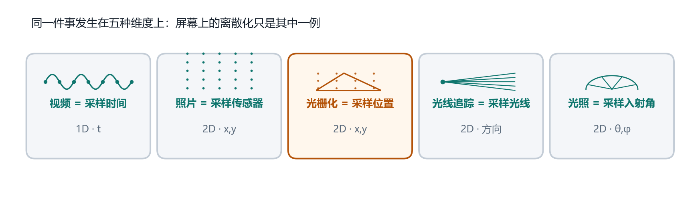

*五种维度、同一件事：把连续的量记成有限个样本。第 2 讲处理的是第三格（屏幕位置），这一讲处理的是**所有格子的共同规律**。*

*151 页 · 111 张关键页截图 · 16 张原创图解 · 7 个手算 · 20 道自测*

> **💡 与第 2 讲的衔接**
>
> 第 2 讲讲的是"怎么把像素填上"（光栅化算法），这一讲讲的是"填上去为什么难看"（采样理论）。
> 如果你只想记住一件事：**上一讲的 `inside ∈ {0,1}` 之所以粗，是因为它把像素内所有信息压成了一个布尔值；这一讲要把它换成"覆盖率"。**

## 1. 采样比你以为的更普遍

#### P1　Section 3: Intro to Signal Processing

*Sampling, Aliasing, Antialiasing*

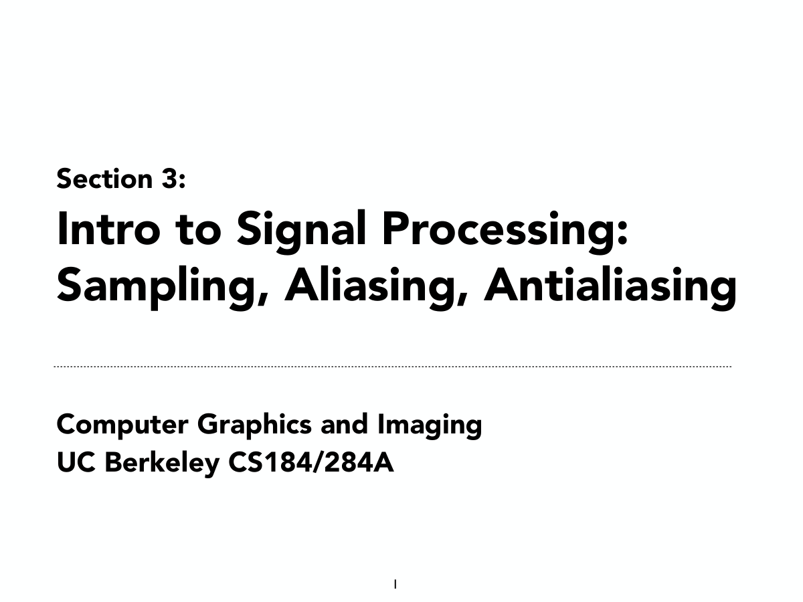

注意标题的自我定位：**Intro to Signal Processing**（信号处理导论），副标题才是三个具体话题。这一讲其实是把信号处理的核心结论搬进图形学，而图形学的例子只是它的应用场景。

#### P2　Sampling is Ubiquitous in Computer Graphics and Imaging

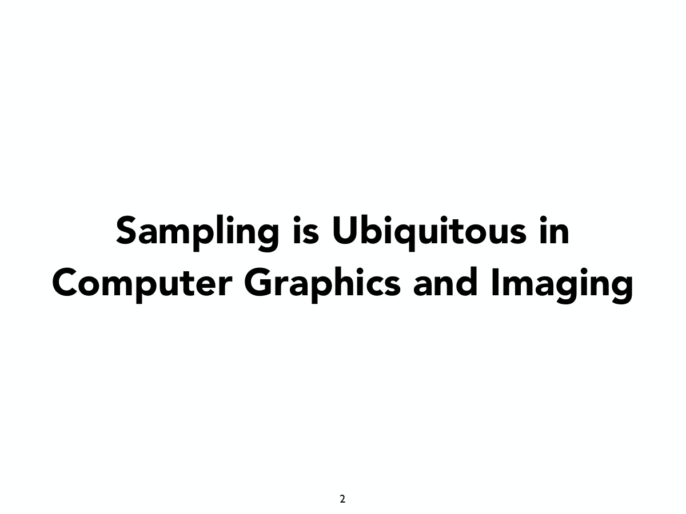

一句话标题。后面五页各举一个例子，对应五种不同的"被采样的量"。

#### P3　Video = Sample Time

*Harold Edgerton Archive, MIT*

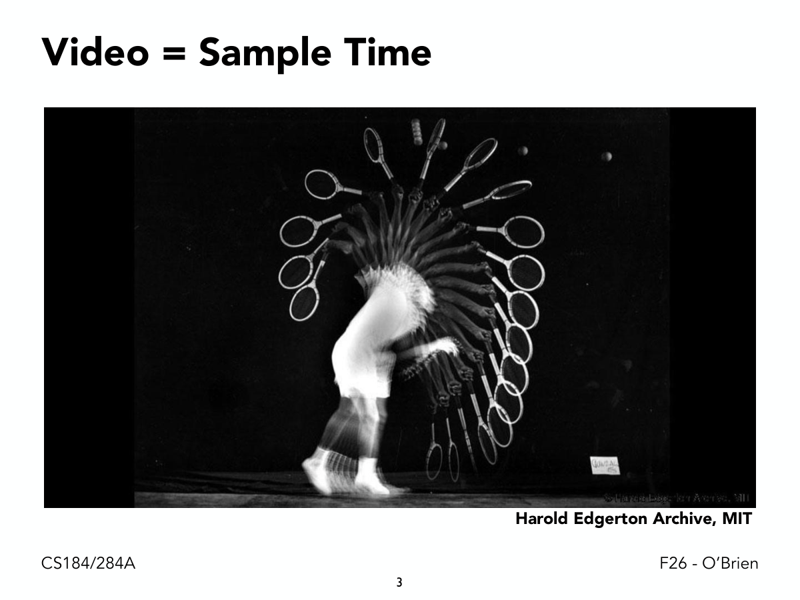

MIT 的 Edgerton 用高速闪光拍下的子弹穿苹果照片。

**这一页要说的事**：视频不是"连续的影像"，而是**每隔 1/30 秒（或 1/60）拍一张**。时间轴上被采样了。而快门时间决定了"一张照片积分了多长时间"——这正是后面 P18 讲的"点采样 vs 运动模糊"的物理根源。

#### P4　Photograph = Sample Image Sensor Plane

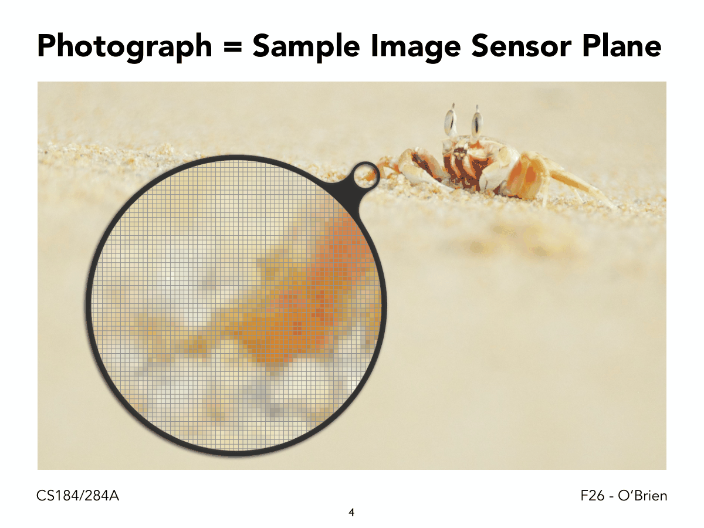

一颗沙粒在图中央，旁边一个放大镜，镜中能看到**像素格**。

**这一页的对照很妙**：右图放大后露出传感器的网格 —— 一张"连续"的照片，本质是二维网格上的一堆数。

#### P5　Rasterization = Sample 2D Positions

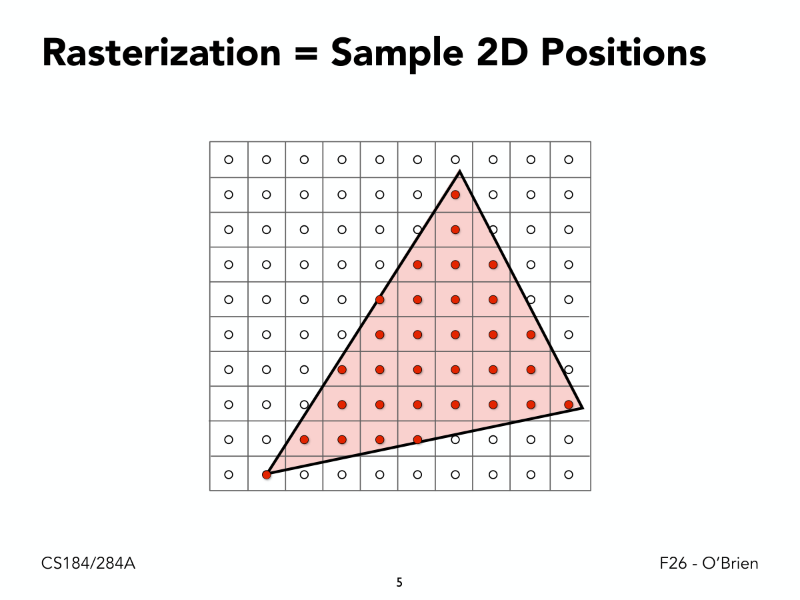

第 2 讲那张图：网格 + 三角形 + 格心采样点。

**这是本讲与上一讲的接口**：光栅化就是在这个二维平面上采样 `inside()`。所以上一讲的所有锯齿，都是本讲要解释的现象。

#### P6　Ray Tracing = Sample Rays

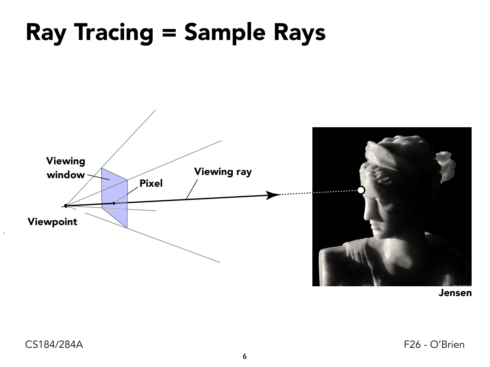

一张示意图：viewpoint（视点）、viewing window（视窗）、pixel（像素）、viewing ray（视线），右边是 Jensen 的雕塑渲染图。

**光线追踪在采样「方向」**：每个像素只发**一条**光线，相当于在二维方向空间里取了一个样本。所以光线追踪也有锯齿 —— 一条光线做出的"是/否"判断，和点采样的布尔判断是同一个毛病。

#### P7　Lighting Integrals: Sample Incident Angles

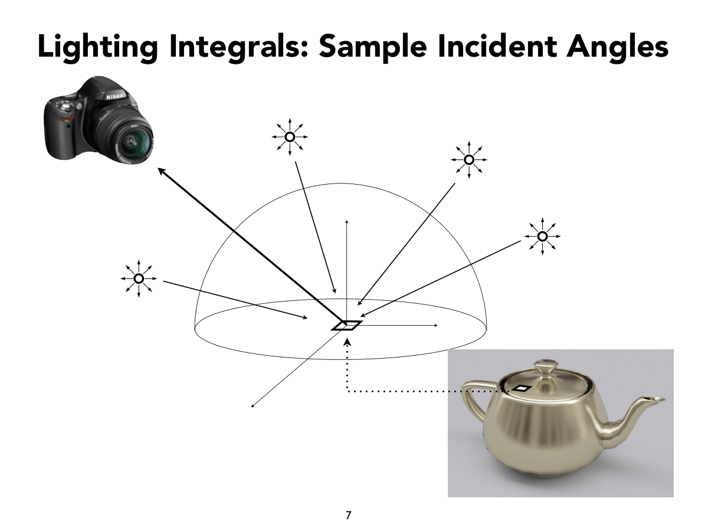

相机、茶壶、以及一个**半球**上散布的光源方向箭头。

**渲染方程是一个积分**：某点的出射光是所有入射方向贡献的积分。计算机算不出解析积分，只能**采样若干方向**求和。

> **📌 四页的递进关系**
>
> | 页 | 采样什么 | 维度 | 采样不足的后果 |
> |---|---|---|---|
> | P3 | 时间 | 1D | 车轮倒转（P9） |
> | P4 | 传感器平面 | 2D | 摩尔纹（P11） |
> | P5 | 屏幕位置 | 2D | 锯齿（P14） |
> | P6 | 光线方向 | 2D | 边缘噪点/锯齿 |
> | P7 | 入射角 | 2D | 光照噪点（路径追踪里那种颗粒感） |
>
> **同一个病，五种症状。** 这一讲就是要找出这个共同的病根。

## 2. 采样错了会怎样

#### P8　Sampling Artifacts in Graphics and Imaging

*章节点*

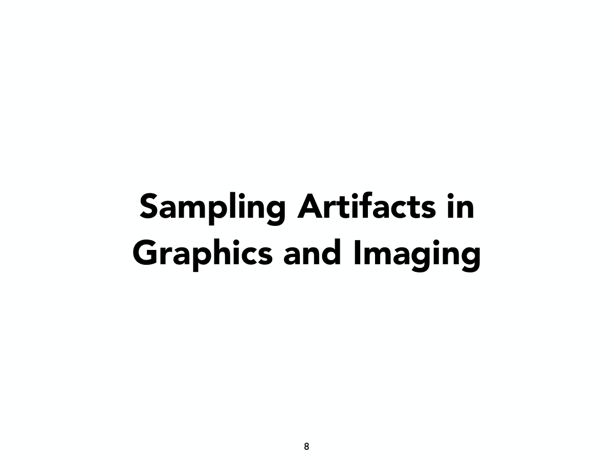

分节页。下面三页分别展示三种伪影，第四页归纳。

#### P9　Wagon Wheel Illusion (False Motion)

*Created by Jesse Mason · [youtube.com/watch?v=QOwzkND_ooU](https://www.youtube.com/watch?v=QOwzkND_ooU)*

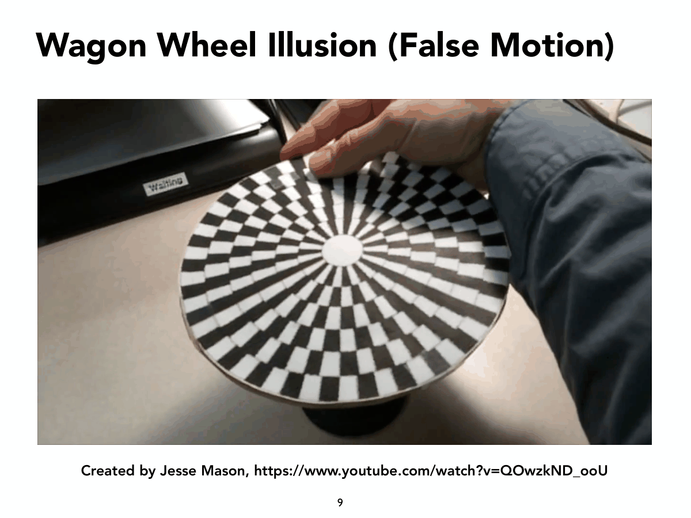

一个黑白**放射状扇形**的转盘在旋转。

**现象**：转速超过某个值后，看起来**在倒转**，而且转得比实际慢。电影里马车轮子倒转就是这么来的。

**病因**（提前说，第 4 节会正式推）：
- 转盘每转 1/8 圈，图案和自己重合一次
- 摄影机每 1/30 秒拍一帧
- 如果这 1/30 秒里转盘转了 **7/8 圈**，下一帧的图案和"转了 −1/8 圈"完全一样
- 于是眼睛看到的是"慢慢倒转"

**关键**：这不是眼睛的错觉，是**采样把两个不同的运动混成了同一个**。

#### P11　Moiré Patterns in Imaging

*lystit.com*

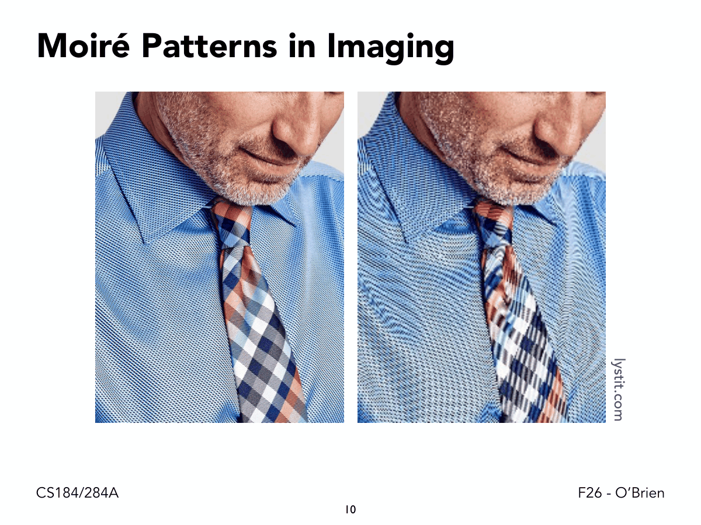

同一个人的两张照片：左边"Read every sensor pixel"（每个传感器像素都读），右边"Skip odd rows and columns"（隔行隔列丢一半）。

**右图出现了完全虚假的波纹** —— 衬衫上原本没有那种纹理。

**病因**：衬衫的编织纹理本身是高频的（每几毫米重复一次），当采样间距和纹理周期接近整数比时，两者"打拍子"，产生一个低频的拍频图案。

> **⚠️ 值得注意的一点**
>
> 摩尔纹不是"丢失细节"，而是**凭空产生了一个图案**。这是走样最反直觉的地方：你会看到**不存在的东西**，而不只是"看不清原本的东西"。

#### P14　Jaggies (Staircase Pattern)

*This is also an example of "aliasing" – a sampling error*

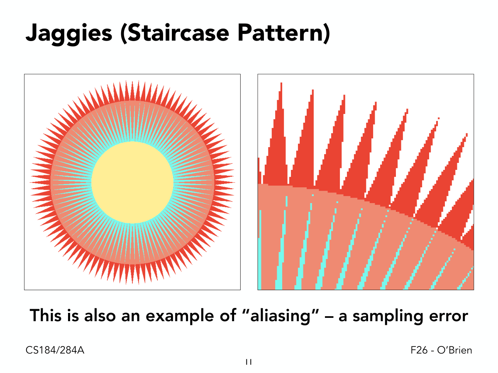

又是那颗"太阳"——**第 2 讲 P27 用过的那张图**。

现在讲义给了它正式身份：**"This is also an example of 'aliasing' – a sampling error"**（这也是走样的一个例子 —— 一种采样误差）。

#### P15　Jaggies (Staircase Pattern)

*Retort by Don Mitchell*

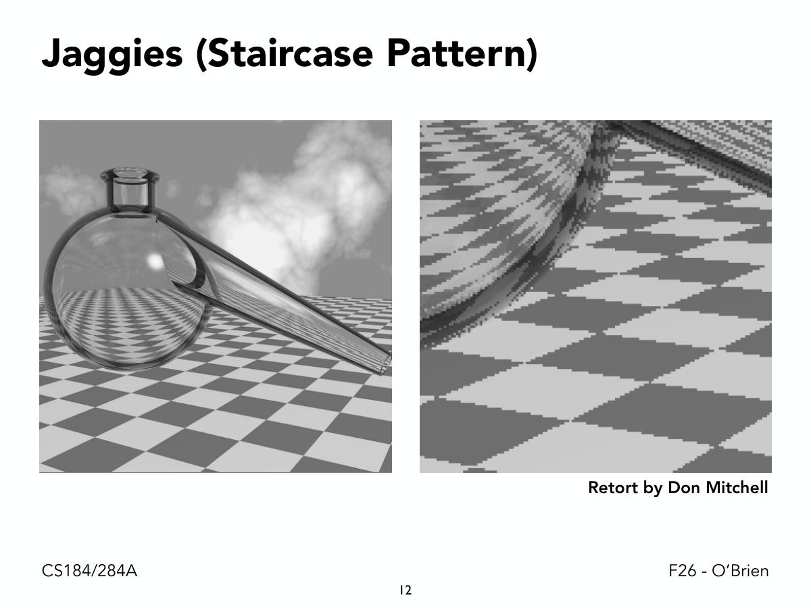

同一张图，加了一行小字 **"Retort by Don Mitchell"**（Don Mitchell 的反驳）。

> **🔭 这里藏了个彩蛋**
>
> Don Mitchell 是图形学里做**抗锯齿与采样**的资深研究者（他还提出过著名的 Mitchell 重建滤波器）。讲义写"Retort"（反驳），是在指一个学术争论：**"台阶"到底是不是采样理论能完全解释的现象？**
>
> 一种看法是：锯齿是采样误差，按采样定理处理就完了。另一种看法（Mitchell 的立场）是：**人眼对边缘的感知不是简单的频率分析**，所谓"看起来错"还涉及视觉系统的边缘检测机制，所以"数学上最优"的重建不一定"看起来最好"。
>
> 这个分歧在 P97 那张"你更喜欢哪张"的选择题里会再次出现 —— 讲义在第 6 节末尾让学生投票，正好说明"最优"是个有争议的判据。

#### P16　Sampling Artifacts in Computer Graphics

*Artifacts due to sampling - "Aliasing"*

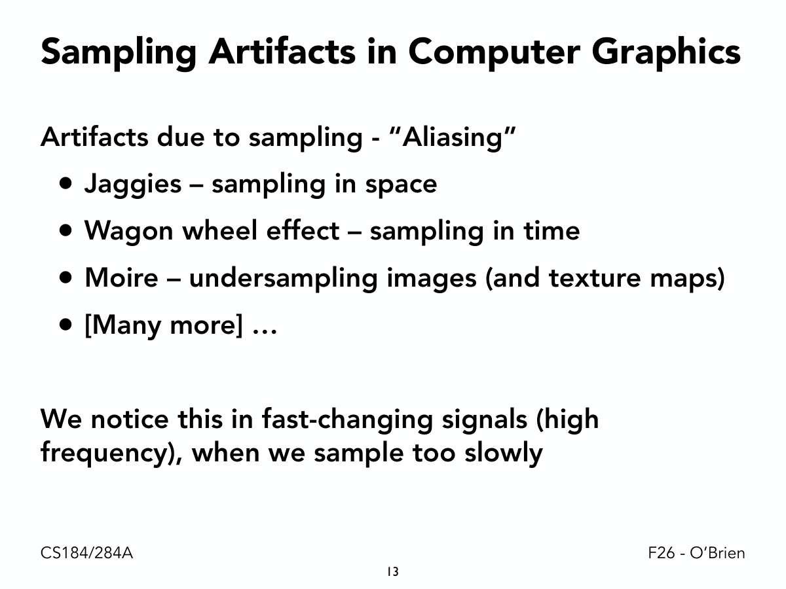

讲义把三类伪影列成表，并给出统一解释：

| 伪影 | 采样维度 | 表现 |
|---|---|---|
| **Jaggies** | 空间（位置） | 边缘台阶 |
| **Wagon wheel effect** | 时间 | 假运动 / 倒转 |
| **Moiré** | 空间（图像 / 纹理） | 假波纹 |
| *[Many more]* | — | … |

**加粗的两句结论**：

> *"We notice this in fast-changing signals (high frequency), when we sample too slowly"*
>
> 我们**在高频信号变化快的地方**才注意到这个问题 —— 也就是**采样太慢**的时候。

这句话把三类伪影统一了：**它们不是三种病，是同一种病（采样不足）的三次发作**。所以修法也只需一套。

## 3. 修法：先滤后采，还是先采后滤

#### P17　Antialiasing Idea: Filter Out High Frequencies Before Sampling

*章节点*

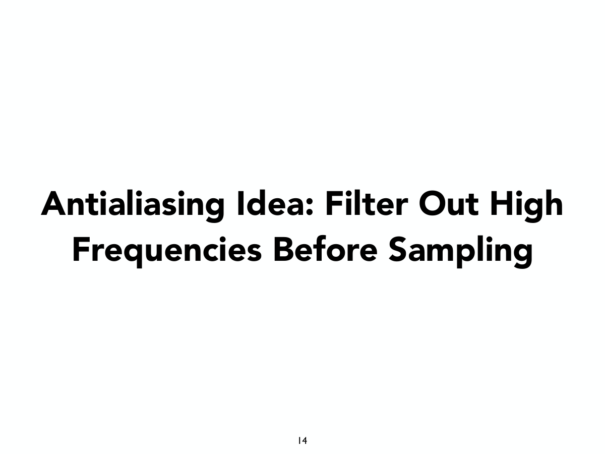

分节页，但标题就是结论，值得原样记住：**在采样之前把高频滤掉**。

注意它说的是"**before sampling**"。这个顺序是本讲最重要的一句话，后面 P28 会用两张图把它钉死。

### 3.1 时间维度上的对照实验（P18–P22）

#### P18　Video: Point Sampling vs Antialiased Sampling in Time

*Thin stream of water from kitchen tap*

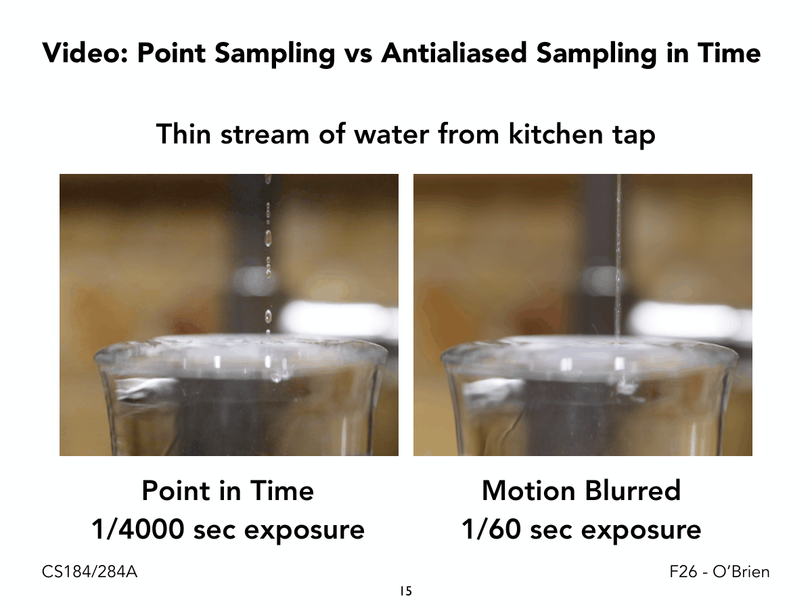

水龙头流下的一道细水柱，两种曝光：

| 曝光 | 结果 |
|---|---|
| **1/4000 秒** | Point in Time —— 瞬间冻结，水柱是清晰的水滴链 |
| **1/60 秒** | Motion Blurred —— 曝光时间内水在动，被积成一条连续的水柱 |

**关键**：1/60 秒那张不是"更糊所以更好看"，而是**它才是物理上正确的**。真实的眼睛在一段时间内积分光，所以快速运动的东西本来就该拖影。

#### P19　Video: Point Sampling in Time

*60 fps video. 1/4000 second exposure is sharp in time, causes time aliasing.*

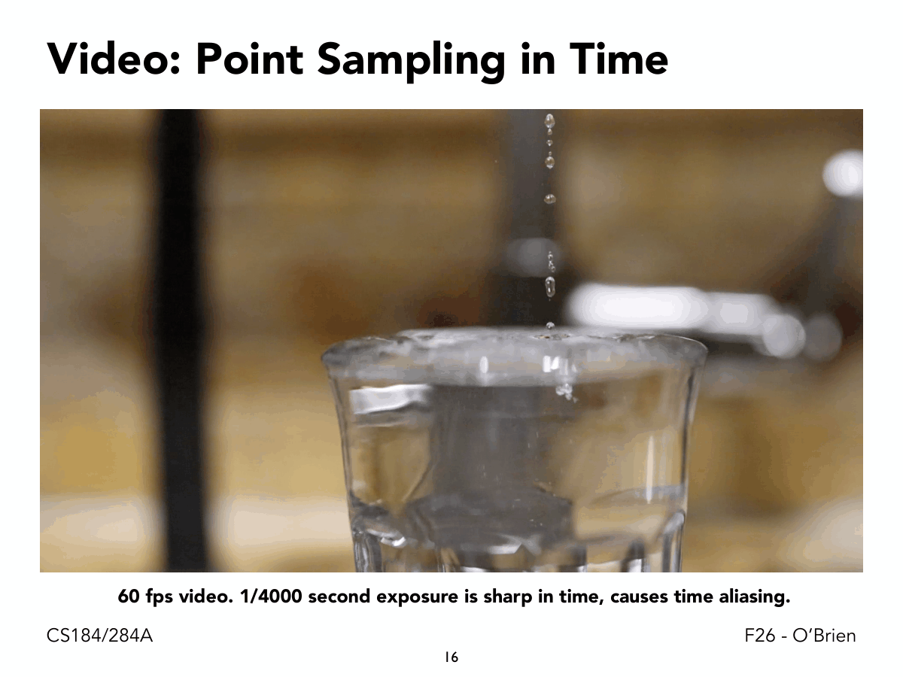

**加粗小字是结论**：60 fps、1/4000 秒曝光 → **在时间上是"点采样"**，于是产生 **time aliasing**（时间走样）。

下落的**水滴**在某一帧出现在这里、下一帧出现在那里，帧与帧之间跳跃 —— 眼睛看到的不是"下落"，而是"闪烁/跳变"。

#### P21　Video: Motion-Blurred (Antialiased) Sampling in Time

*60 fps video. 1/60 second exposure is motion-blurred in time, no aliasing.*

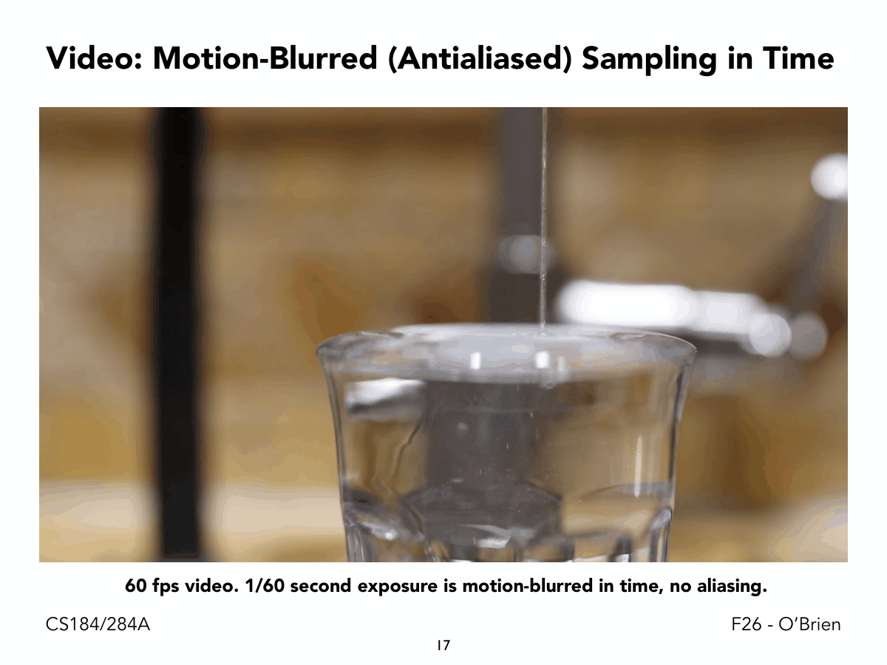

同样的 60 fps，但曝光拉长到 1/60 秒 —— **每帧积分了整个 1/60 秒**，于是水柱变成连续的一条，**no aliasing**。

> **📌 这就是"先滤后采"的时间版本**
>
> 曝光过程本身就是一次**积分滤波**（把 1/60 秒内的光加起来），它发生在"采样"（把这一帧存成一个像素值）**之前**。
>
> 所以：
> - **1/4000 秒** = 采样前几乎不滤波 = 点采样 → 走样
> - **1/60 秒** = 采样前做了 1/60 秒的积分滤波 → 无走样
>
> **注意代价**：曝光越长，运动物体越模糊。抗锯齿从来不是免费的，它用"变糊"换"不出假图案"。

### 3.2 空间维度上的对照（P23–P28）

#### P23　Rasterization: Point Sampling in Space

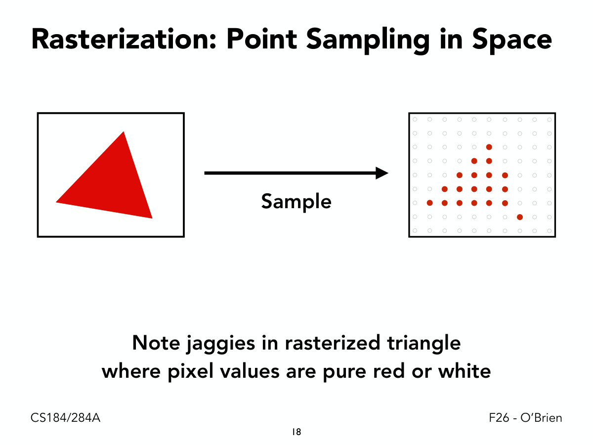

三角形 + 采样点，标注 *"Note jaggies in rasterized triangle where pixel values are pure red or white"* —— 像素值**只有纯红或纯白**。

#### P24　Rasterization: Antialiased Sampling

*Pre-Filter (remove frequencies above Nyquist) → Sample*

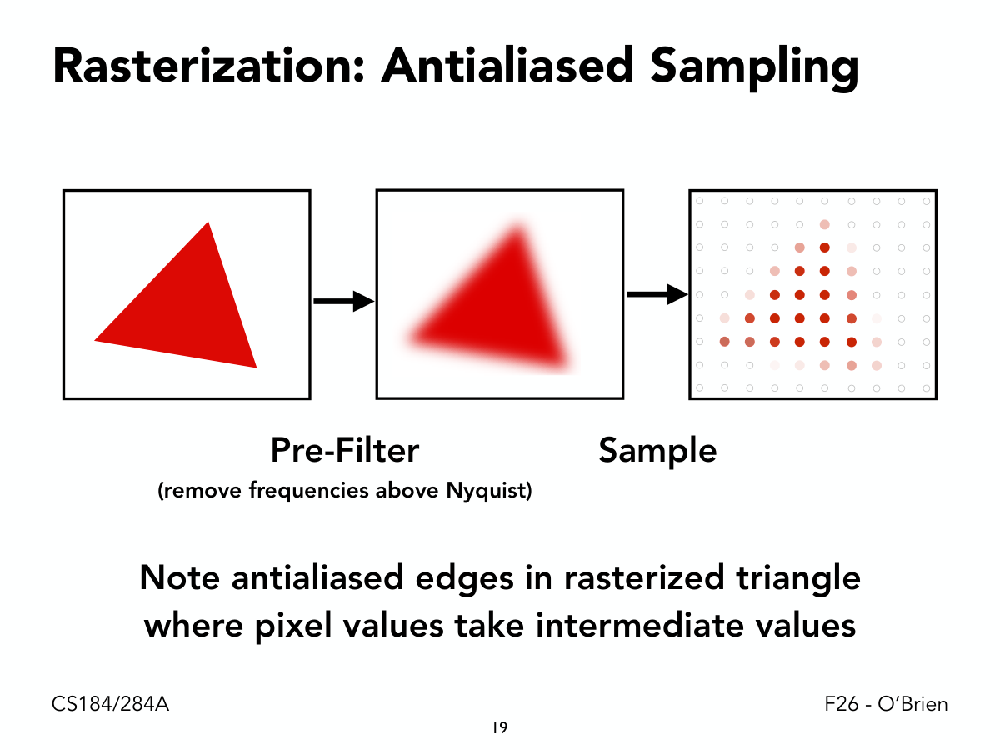

流程图变成三步：**原三角形 → Pre-Filter（把超过 Nyquist 的频率滤掉）→ Sample**。

标注：*"Note antialiased edges in rasterized triangle where pixel values take intermediate values"* —— 边缘像素取**中间值**。

#### P25　Point Sampling

*One sample per pixel*

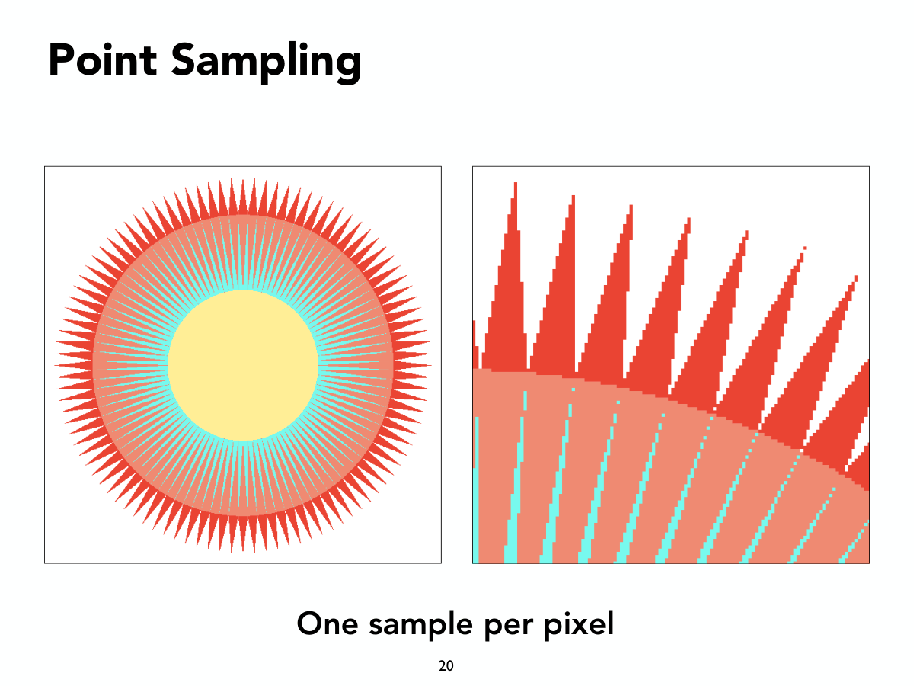

太阳图 + 局部放大。**放大图是关键**：红色辐条是**纯红**，背景是白色，中间没有过渡。

#### P26　Antialiasing

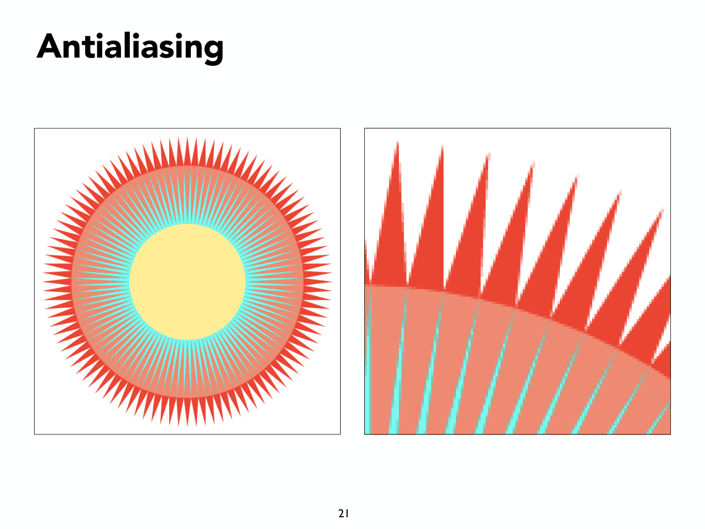

同一张图、同一个放大区域，但辐条之间出现了**淡红色的过渡**。

**对比这两张放大图**：点采样的每一根辐条都是"一刀切"，抗锯齿的辐条边缘有渐变。**这就是"intermediate values"的直观含义。**

#### P27　Point Sampling vs Antialiasing

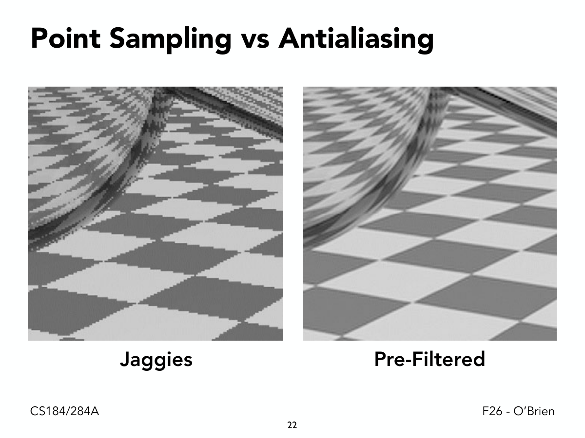

一张贴了棋盘格纹理的球：左边 **Jaggies**（棋盘格边缘碎成锯齿），右边 **Pre-Filtered**（边缘平滑）。

**为什么用棋盘格**：它的频率极高（黑白交替，每个格子只有几个像素），而且**随曲面倾斜，频率在画面里连续变化** —— 这是最严苛的测试图案之一。远处的棋盘格是走样的重灾区。

#### P28　Antialiasing vs Blurred Aliasing

*（Sample then filter）vs（Filter then sample）*

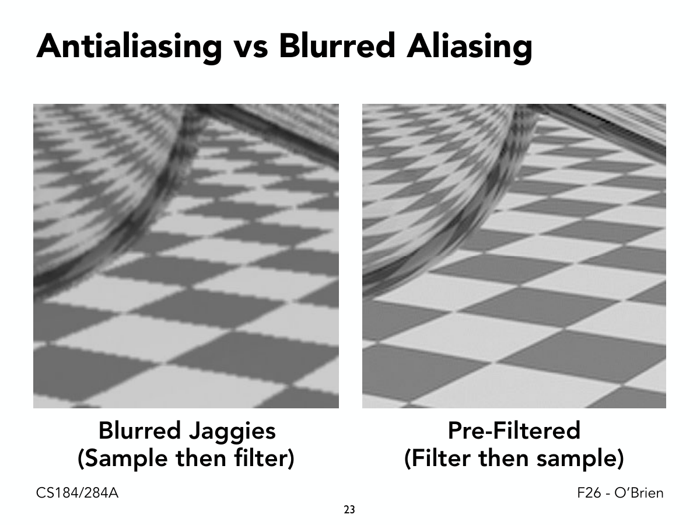

**这一页是全讲的判决书**。两张图看起来都是"模糊的棋盘格"，但底下的小字完全不同：

| 图 | 标注 | 做法 |
|---|---|---|
| 左 | **Blurred Jaggies**（Sample then filter） | 先点采样，再对结果做模糊 |
| 右 | **Pre-Filtered**（Filter then sample） | 先模糊（滤掉高频），再采样 |

**两者视觉上非常像，但只有右边是对的。**

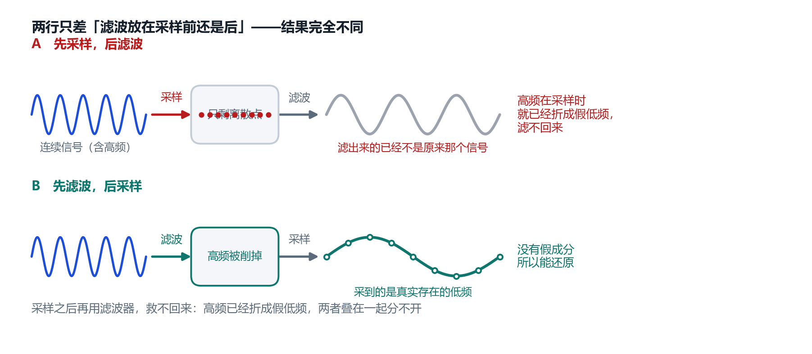

*上行：信号 → 采样（只剩离散点）→ 滤波。高频在采样那一步就已经折成了假低频，后面的滤波只能把它和真低频一起抹掉 —— 你得到的是"模糊的**错误内容**"。*
*下行：信号 → 滤波（削掉高频）→ 采样。采到的是真实存在的低频，所以能还原。*

> **⚠️ 这个区别为什么必须记住**
>
> 「先采样后模糊」在视觉上和「先模糊后采样」很像，所以很多实现偷懒：**先按 1 spp 光栅化，再对帧缓冲做 blur**。这在**单帧、静态**情况下几乎看不出来（P28 就是故意让你看不出来），但：
>
> - **运动时**：blur 会把上一帧的错误内容也糊进来，产生拖尾状的假图案
> - **多次采样（如 TAA）时**：错误的样本已经被平均进去了，无法撤销
> - **放大的时候**：两张图的差异会明显暴露 —— 左边是"锯齿＋模糊"，右边是"干净的低频"
>
> 一句话：**抗锯齿是"采样前"的操作，不是"采样后"的补救。**

## 4. 频域：为什么采样会出错

#### P29　This Lecture

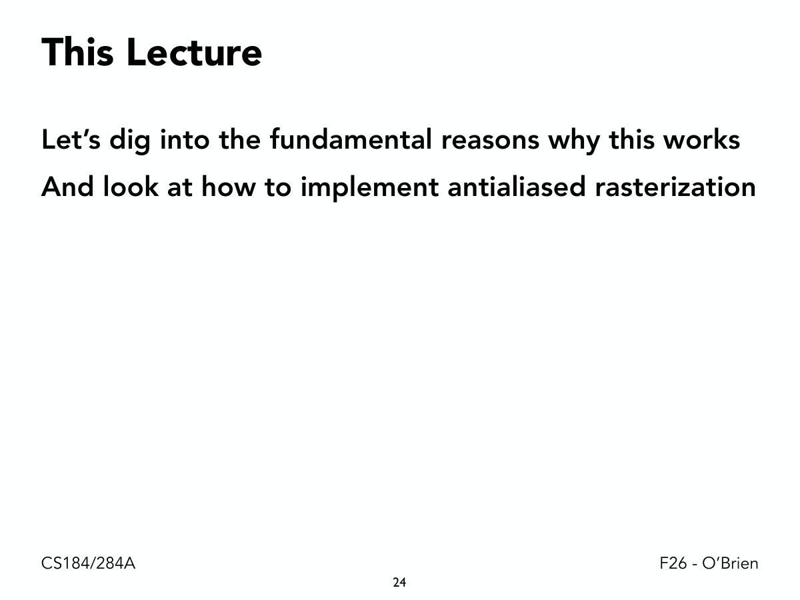

两句话交代任务：*"Let's dig into the fundamental reasons why this works. And look at how to implement antialiased rasterization."* —— **先讲清为什么有效，再讲怎么实现**。

#### P30　Frequency Space

*章节点*

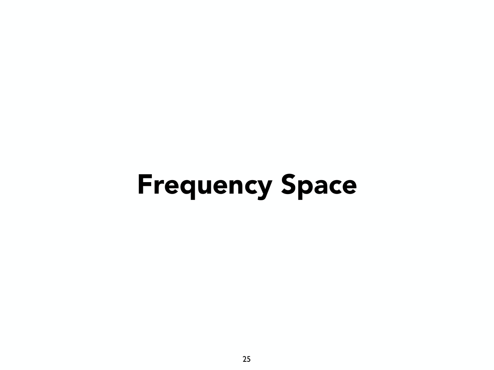

分节页。从这里开始进入数学部分。**核心思想**：不要直接看波形，而要看它由哪些频率组成。

### 4.1 从正弦说起（P31–P32）

#### P31　Sines and Cosines

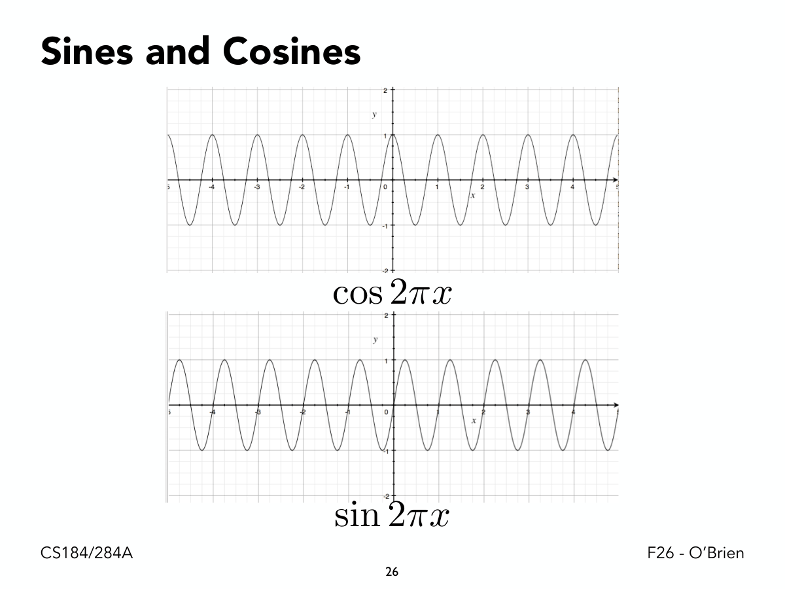

两条曲线：`cos 2πx` 和 `sin 2πx`，横轴是 x，纵轴是振幅。

**为什么从正弦开始**：因为正弦是"纯净的频率"—— 它只有一个频率成分，没有别的。所以后面任何信号都可以拆成一堆正弦，而"频率"这个词也才有精确含义。

#### P32　Frequencies

*cos 2πfx*

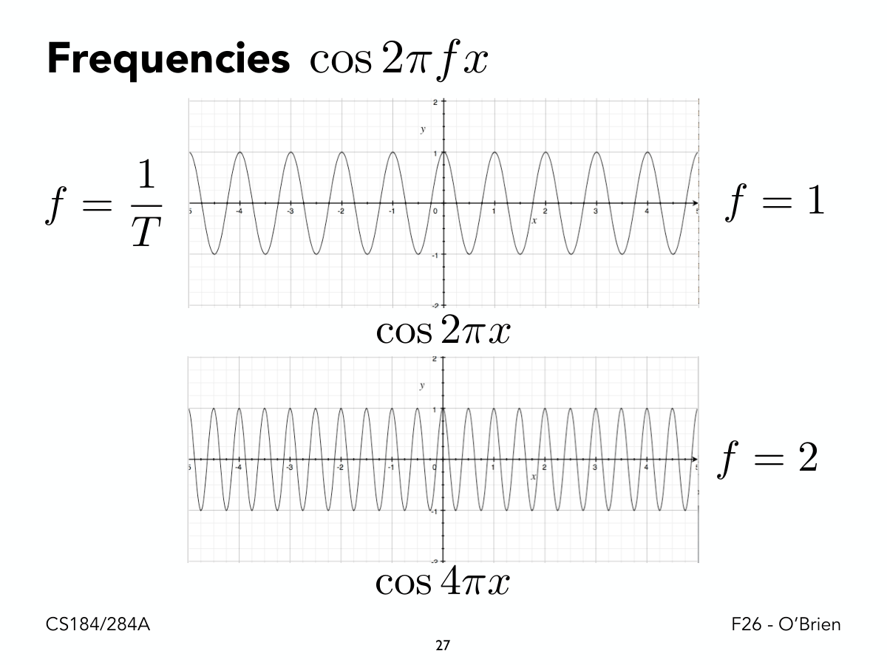

两张图：`cos 2πx`（标注 `f = 1`）和 `cos 4πx`（标注 `f = 2`），并给出定义：

$$f = \frac{1}{T}$$

`T` 是周期（一个完整波形占多长）。

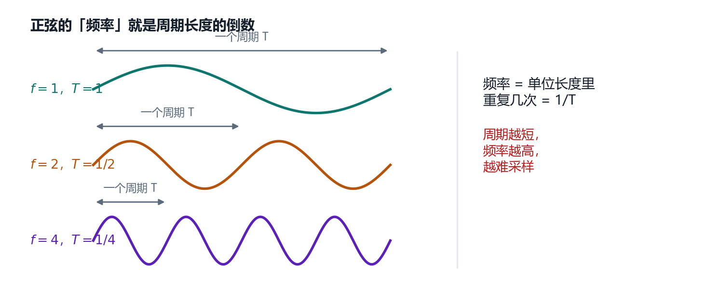

*`f` 越大，周期 `T` 越短，波形挤得越密。**"高频"就是"挤得密"**，这是全讲最直观的一句话。*

### 4.2 傅里叶：任何信号都是正弦的叠加（P33–P39）

#### P36　Fourier Transform

*Represent a function as a weighted sum of sines and cosines*

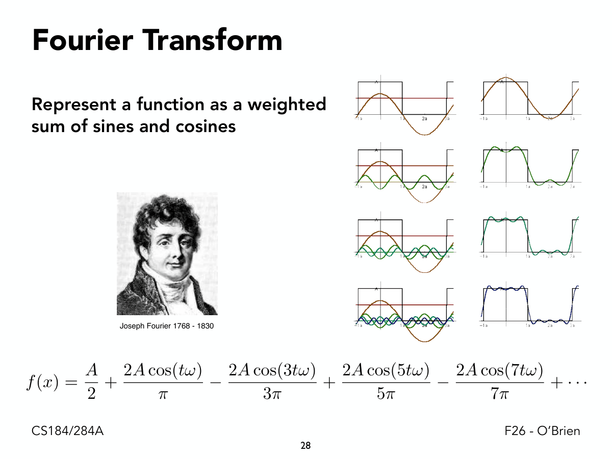

讲义用四页（P33–P36）做动画：先画一个目标方波，然后一项一项往上叠加傅里叶级数的项。P36 是加完的样子，公式：

$$f(x) = \frac{A}{2} + \frac{2A\cos(\omega t)}{\pi} - \frac{2A\cos(3\omega t)}{3\pi} + \frac{2A\cos(5\omega t)}{5\pi} - \frac{2A\cos(7\omega t)}{7\pi} + \cdots$$

左下是 **Jean Baptiste Joseph Fourier（1768–1830）** 的画像。

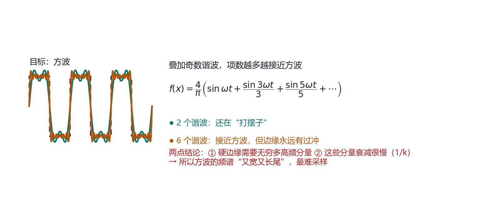

*虚线是目标方波，两条实线分别是只取 2 个谐波和 6 个谐波的结果。**两条结论**：① 硬边缘需要无穷多高频分量；② 这些分量衰减很慢（1/k），所以方波的频谱"又宽又长尾"。*

> **🔭 这解释了锯齿为什么难缠**
>
> 三角形的边是**硬边缘**，它的频谱和方波一样：无限宽、衰减慢。
>
> 所以只要你用**有限**的采样率去采一条**硬边**，就必然丢掉一部分高频 —— 而丢掉的这些高频就会折叠回来变成假的图案。
>
> **结论：锯齿不是"没画准"，而是"硬边的频谱本质上超出任何有限采样率"。** 这是 P16 那句"sampling too slowly"的真正含义。

#### P37–P39　Fourier Transform Decomposes A Signal Into Frequencies

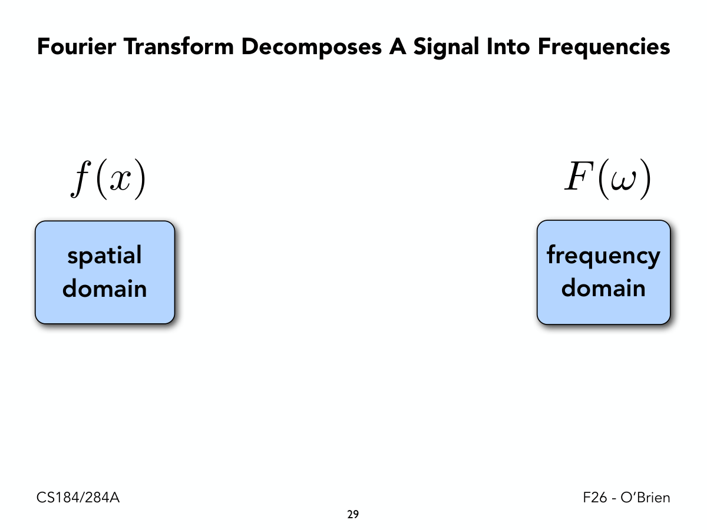

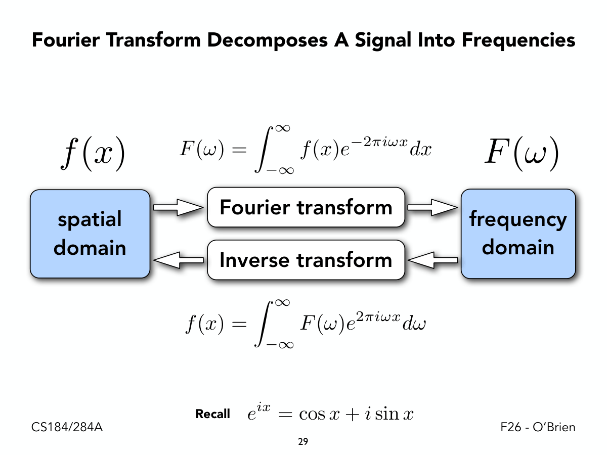

两页是同一个框图的两个状态：左边 `f(x)`（spatial domain）、右边 `F(ω)`（frequency domain），中间两个盒子 **Fourier transform** 和 **Inverse transform**。

P39 补上两个公式：

$$F(\omega) = \int_{-\infty}^{\infty} f(x)\,e^{-2\pi i \omega x}\,dx \qquad\text{(正变换)}$$

$$f(x) = \int_{-\infty}^{\infty} F(\omega)\,e^{2\pi i \omega x}\,d\omega \qquad\text{(逆变换)}$$

并提醒 `e^{ix} = cos x + i sin x`（欧拉公式）—— 那个 `e^{2πiωx}` 就是"正弦波"的复数写法。

> **📌 不必会算积分**
>
> 这门课**不要求**你会手算傅里叶积分（P87 也明说不讲采样定理的证明）。要求的是**会用**：
> - 知道"时域 ↔ 频域"是一对可逆的变换
> - 知道几个基本对应关系（P55–P64 那张画廊）
> - 知道**卷积定理**（P72）
> - 知道**滤波器在频域里长什么样**（P82–P84）
>
> 这几条就够解释抗锯齿了。

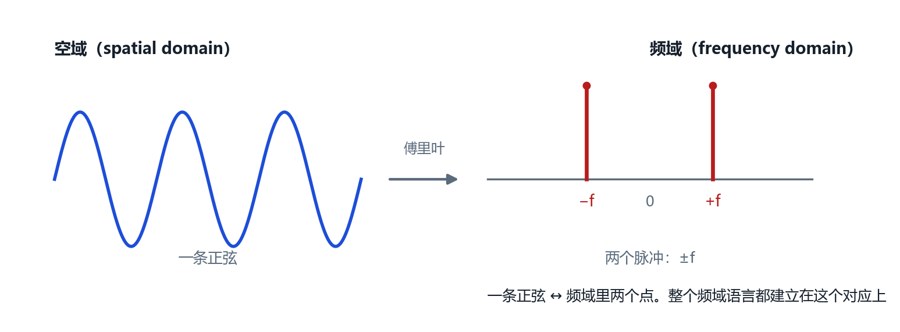

*最简的一次变换：空域一条正弦，频域里变成关于原点对称的两个点。**整本频域语言就建立在这个对应上** —— 后面所有"条纹方向/密度"的讨论，都是这两个点在二维平面上的位置怎么摆。*

#### P40　Higher Frequencies Need Faster Sampling

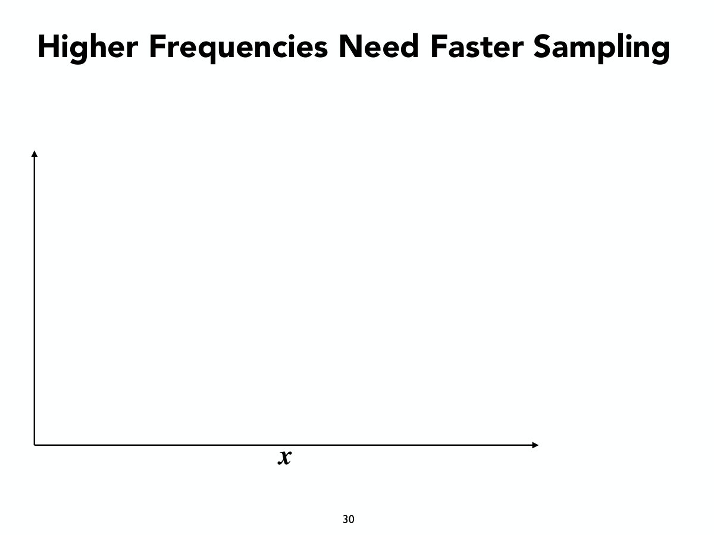

一页几乎空白的图：只有坐标轴和一条 x 轴。

这是动画的起点。P41–P47 会逐条加上不同频率的曲线和采样点。

#### P43　Higher Frequencies Need Faster Sampling

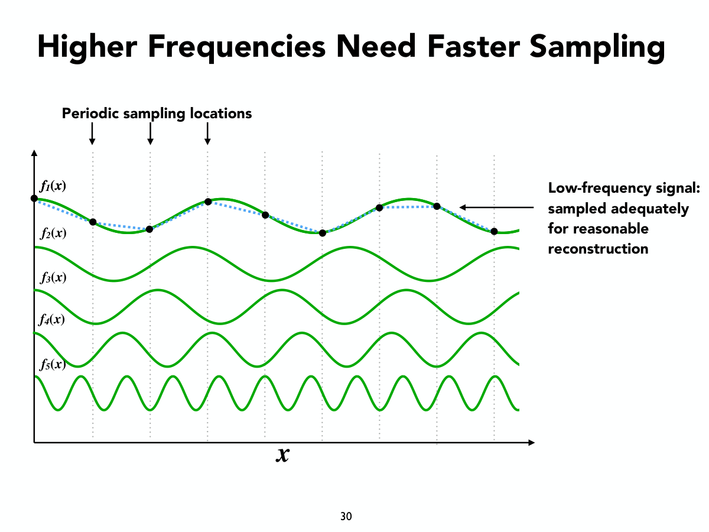

五条曲线 `f1..f5` 叠在一起（频率从上到下递增），加上**周期采样位置**（竖直虚线），黑点是采样值，蓝点是"重建"。

标注：*"Low-frequency signal: sampled adequately for reasonable reconstruction"*。

**看 `f1`（最上面那条）**：采样点落在曲线上，连起来就是原曲线 —— 够采样。

#### P47　Higher Frequencies Need Faster Sampling

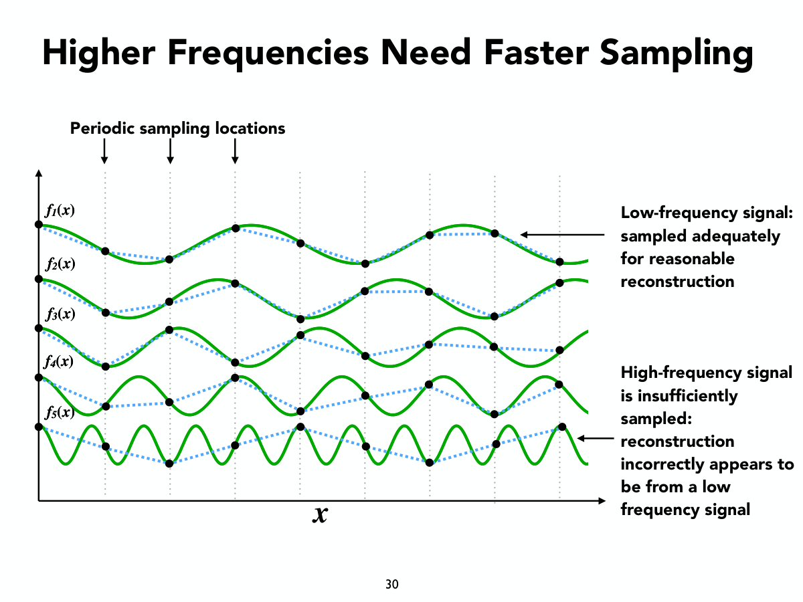

同一张图，加上了第二条标注：*"High-frequency signal is insufficiently sampled: reconstruction incorrectly appears to be from a low frequency signal"*。

**看 `f5`（最下面那条，最密）**：采样点已经不能唯一确定它了 —— 把点连起来会得到一条**慢得多**的曲线。

> **🖼 这一页就是全讲的病根，值得停 30 秒**
>
> 同一个采样间距，`f1` 够用，`f5` 不够用。**采样率没变，是信号变了。**
>
> 所以"采样够不够"从来不是采样率单方面的事，而是 **采样率 vs 信号频率** 的比较 —— 这就是 Nyquist 判据的雏形。

### 4.3 走样：两个频率变成同一个（P48–P53）

#### P49　Undersampling Creates Frequency Aliases

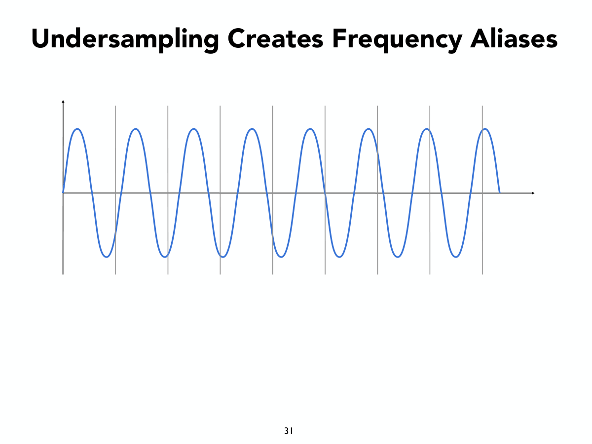

一条高频正弦（蓝色），竖直虚线标出周期采样位置。**还没有采样点**。

#### P51　Undersampling Creates Frequency Aliases

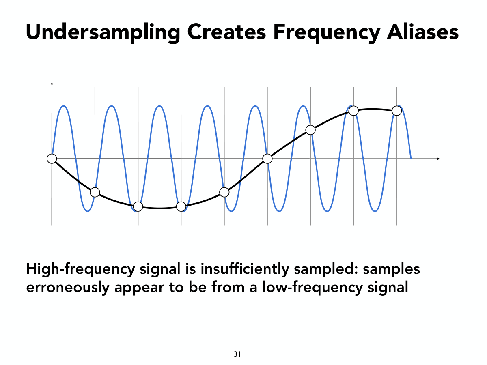

加上采样点和连线，注释：*"High-frequency signal is insufficiently sampled: samples erroneously appear to be from a low-frequency signal"*。

**连线是一条低频曲线** —— 但原信号明明是高频的。

#### P52　Undersampling Creates Frequency Aliases

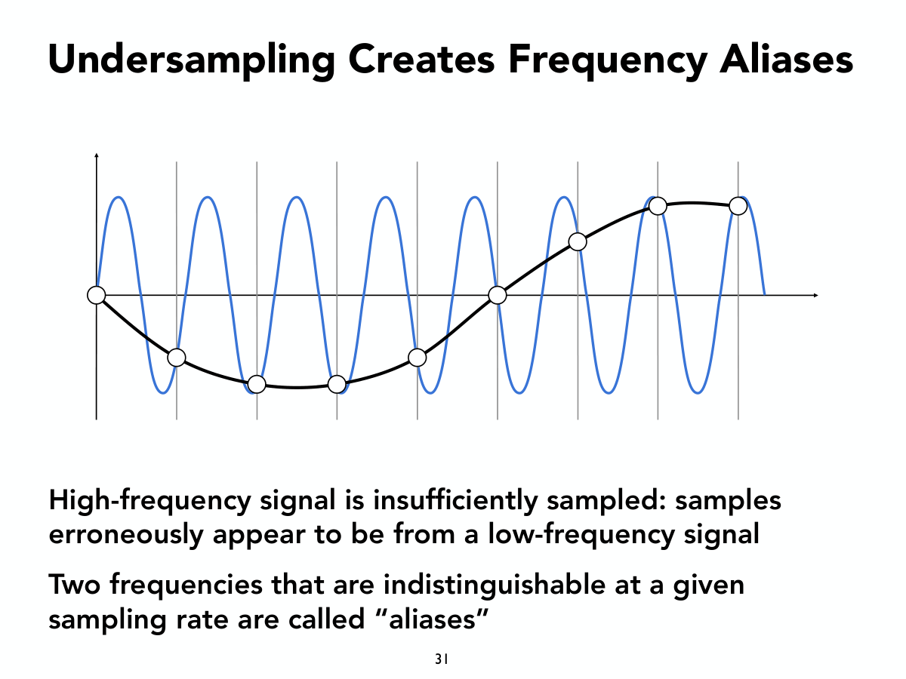

加最后一句定义：

> *"Two frequencies that are indistinguishable at a given sampling rate are called 'aliases'"*
>
> 在给定采样率下**无法区分**的两个频率，互为「别名」。

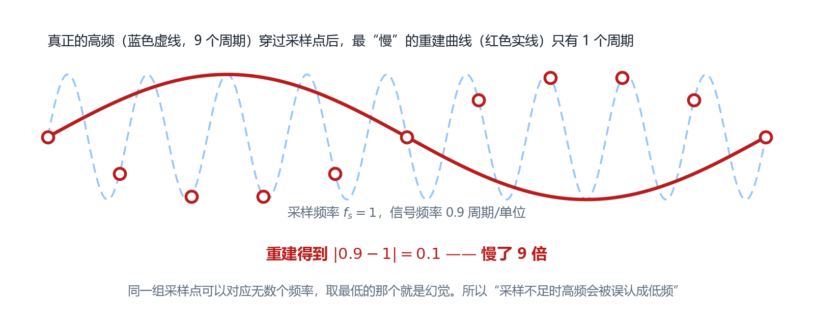

*蓝色虚线是真实信号（9 个周期），红圈是采样点，红色实线是"穿过所有采样点最慢的那条曲线"（1 个周期）。**同一组采样点可以对应无数个频率，取最低的那个就是幻觉** —— 这正是"低频被误认为"的机制。*

#### P53　"Alias" = False Identity

*"Batman" = Bruce Wayne's alias to hide his true identity*

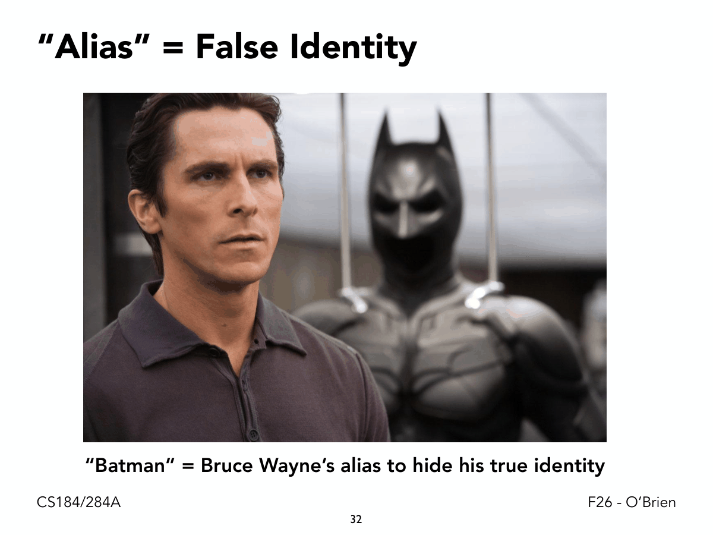

Bruce Wayne 与蝙蝠侠的剧照。

**这一页是在解释英文词义**：alias = **假身份**。所以"频率别名"就是"高频伪装成了低频"—— 它顶着一个假的低频率身份出现在你的图像里。

> **💡 中文翻译的偏差**
>
> 中文把 alias 译成"别名"或"混叠"，两个词都只沾到一半：
> - **别名** 保留了"假身份"的比喻，但容易和编程里的"别名"混淆
> - **混叠** 描述了机制（两个频率叠在一起），但丢了"伪装"的画面感
>
> 记住英文原意最有用：**一个频率用另一个频率的身份出现**。

**🔧 手算 1：算出一个别名频率**

已知采样率 `fs`，真实频率 `f`，则重建（混叠）后的频率是：

$$f_{\text{alias}} = \left| f - f_s \cdot \mathrm{round}\!\left(\frac{f}{f_s}\right) \right|$$

代入几组数：

| 真实 `f` | 采样 `fs` | `f/fs` | `round` | `f_alias` | 判断 |
|---|---|---|---|---|---|
| `0.9` | `1.0` | `0.9` | `1` | **`0.1`** | 慢了 9 倍 |
| `0.3` | `0.25` | `1.2` | `1` | **`0.05`** | 慢 6 倍 |
| `0.45` | `1.0` | `0.45` | `0` | `0.45` | 未超 Nyquist，无走样 |
| `0.6` | `1.0` | `0.6` | `1` | **`0.4`** | 折回 |

**规律**：`f` 落在 `[k·fs − fs/2, k·fs + fs/2]` 里时，`f_alias = |f − k·fs|`。也就是说**整个频率轴被切成了一段一段长为 `fs` 的区间，每段都折回 `[0, fs/2]`**。

这个"折叠"的图像是下一张图的核心。

#### P54　Visualization of Frequency Space

*章节点*

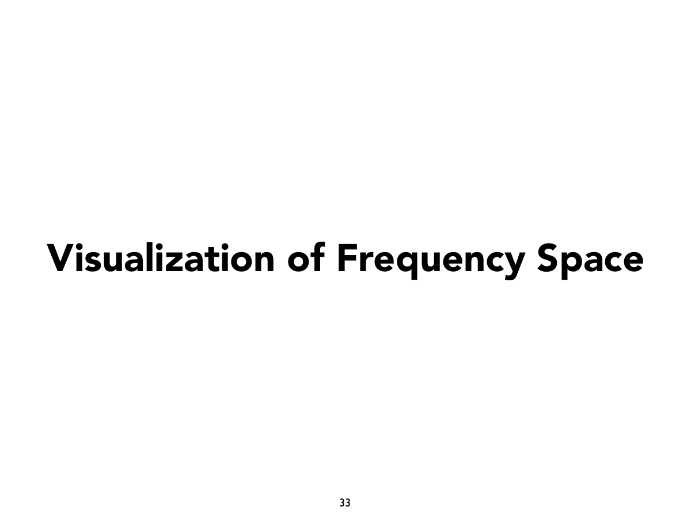

分节页。从二维图像的频域开始，把上面的抽象概念变成能看的图。

## 5. 频率折叠与二维频域

#### P55　2D Frequency Space

*Note: Frequency domain also known as frequency space, Fourier domain, spectrum, …*

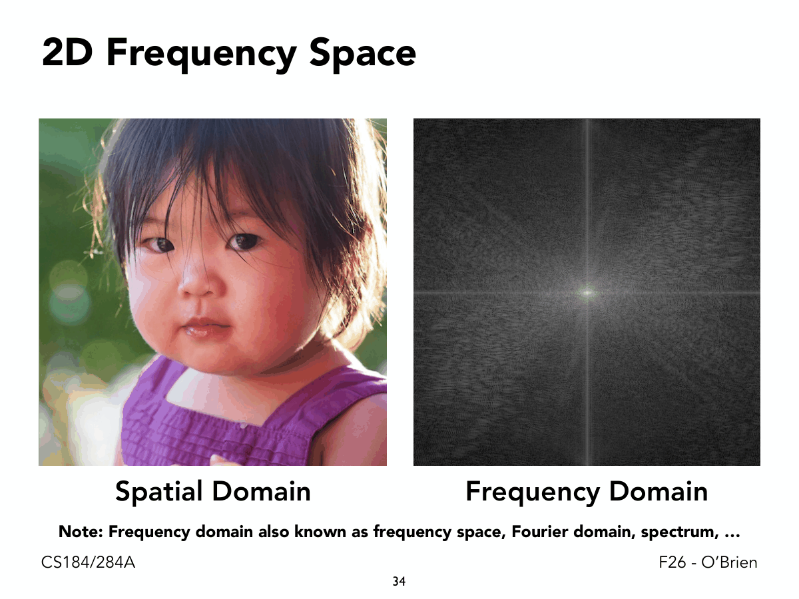

左边一张小女孩照片（Spatial Domain），右边是它的**频谱**（Frequency Domain）：中间一个亮点，向四周放射出十字形的亮线。

**这就是二维傅里叶变换的结果**：一张图被拆成"各个方向、各种密度的条纹"的叠加。

小字提醒：频域还有一堆同义词 —— frequency space、Fourier domain、spectrum。**看到哪个都别懵，是同一个东西。**

> **📌 怎么读这张频谱图**
>
> - **中心 (0,0)** = 最低频（几乎是常数的那部分）→ 对应图像的**整体明暗**
> - **离中心越远** = 频率越高
> - **某个方向上的亮点** = 该方向的条纹成分
>
> 右边那张图的亮线呈**十字形**，说明这张照片里**水平和垂直方向的强边缘最多**（人的肩膀、背景的建筑线条）。

### 5.1 折叠：把整条频率轴折回来

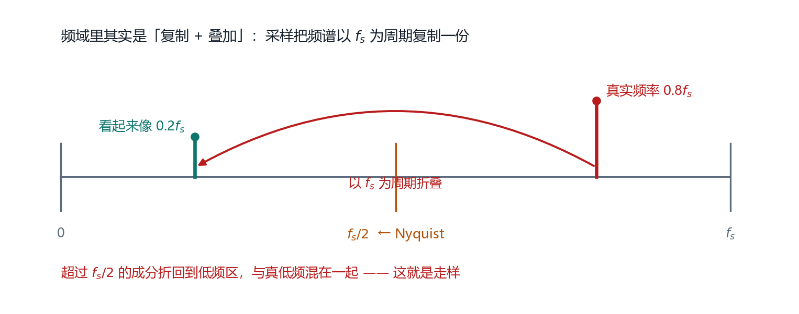

*采样在频域里的效果是「把频谱以 `fs` 为周期复制一份」。于是 `0.8fs` 处的成分会和 `0.2fs` 的复制品重叠 —— 两者从此无法区分。**这就是"折叠"的几何图像**：整个频率轴被切成一段段长 `fs` 的区间，每段都折回 `[0, fs/2]`。*

**这条图解释了手算 1 的那个公式**：`f_alias = |f − k·fs|` 就是把 `f` 折回最近的整数倍 `fs` 的距离。

### 5.2 六种图案的频谱（P56–P64）

讲义用九页建立"空域图案 ↔ 频域分布"的对应直觉。每组左图是图案、右图是频谱。

#### P56　Constant

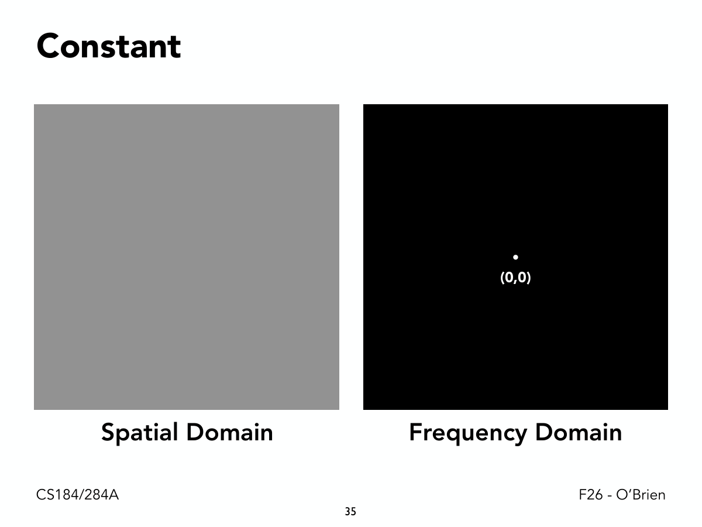

左：纯灰色块。右：**只有 (0,0) 一个点**。

**结论**：常数 = 零频率。整个图像的"平均亮度"就存在这一点上。

#### P57　sin(2π/32)x

*— frequency 1/32; 32 pixels per cycle*

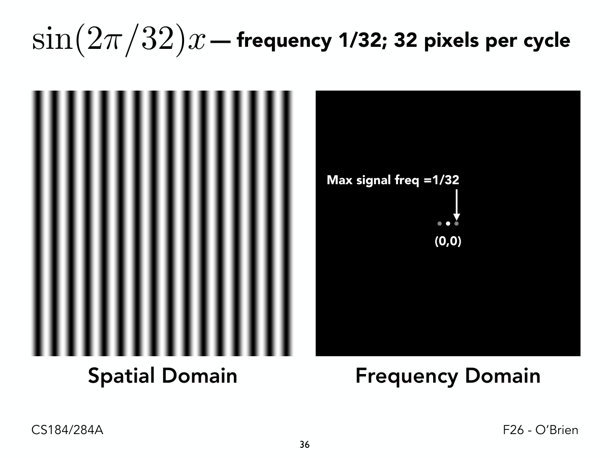

左：竖直黑白条纹。右：水平轴上一对对称亮点，标注 *Max signal freq = 1/32*。

**结论**：**一个方向的条纹 ↔ 该方向轴上的两个点**（±f）。条纹越密，点离中心越远。

#### P58　sin(2π/16)x

*— frequency 1/16; 16 pixels per cycle*

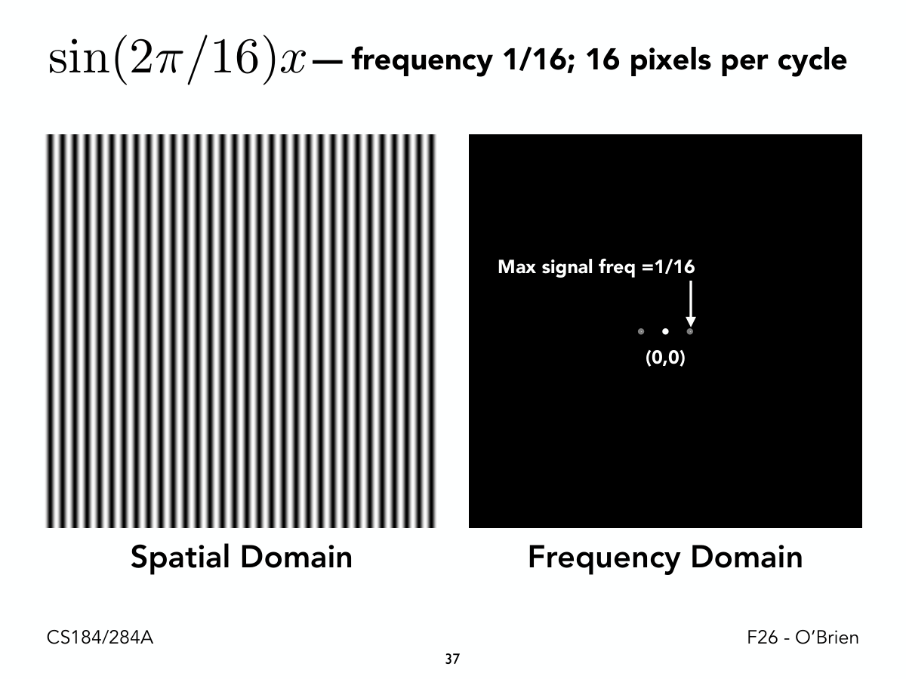

同样的图，但条纹周期从 32 缩到 16 像素，**频谱上的点离中心更远了**（1/16 > 1/32）。

**这一对（P57/P58）就是"频率 = 条纹密度"的可视化**。

#### P59　sin(2π/16)y

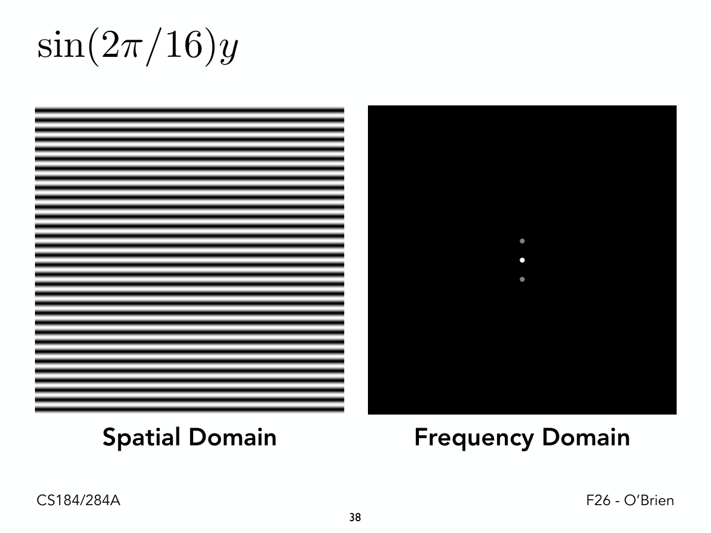

把 `x` 换成 `y`：条纹变水平，**频谱上的点也转到了竖直轴上**。

**结论：空域里的方向 ↔ 频域里的方向，两者互相垂直**（条纹是横的，频谱点在纵轴上）。

#### P60　sin(2π/32)x × sin(2π/16)y


左：棋盘/网格状的交叉条纹。右：**四个点**（水平两个 × 竖直两个的组合）。

**结论：空域相乘 ↔ 频域卷积 → 两个方向的分量各自出现，组合成 4 个点**（这是"乘积 = 频谱卷积"的直接体现）。

#### P61　exp(−r²/16²)


左：一个模糊的圆斑。右：**也是一个小圆斑**（各向同性）。

**结论**：高斯 ↔ 高斯。高斯是唯一"在傅里叶变换下保持自己形状"的函数（自傅里叶）。

#### P63　exp(−x²/32²) × exp(−y²/16²)


左：**横向拉长**的椭圆斑。右：**竖直方向拉长**的椭圆。

**结论：空域里一个方向变宽 ↔ 频域里该方向变窄。** 这正是"核越宽、频带越窄"（第 6 节 P83）的雏形。

#### P64　Rotate 45


把 P63 的图案旋转 45°，**频谱也跟着转 45°**。

**结论：空域旋转 ↔ 频域同向旋转**。方向和角度是一一对应的。


*四组对应关系放在一起：常数只在原点、单向条纹在轴上两点、乘积图案在四个角上。**读频谱图只需记住这一条**：原点 = 平均亮度，离中心距离 = 频率高低，方向 = 条纹走向。*

> **💡 为什么这九页值得认真看一遍**
>
> 因为**抗锯齿的所有操作都是在频域里想清楚的**，而"想清楚"的前提是你能把频谱图和空域图案对上。
>
> 举个实际例子：一张贴了纹理的地面，远处几乎水平，纹理在屏幕上被压缩成很密的横条纹。它的频谱里，能量会集中在**竖直轴的高频端**。**知道这一点，才知道该往哪个方向做各向异性滤波** —— 这就是后期纹理过滤（mipmap 的各向异性版本）的设计依据。

## 6. 滤波 = 卷积

#### P65　Filtering

*章节点*


分节页。**滤波**这个词在这里有了精确含义：**在频域里砍掉一部分，留下另一部分**。

#### P66　Visualizing Image Frequency Content


一个拿纸擦脸的男孩照片，右边是频谱（中心一个很亮的点 + 十字状放射）。

**这张频谱比 P55 那张更亮、更集中**，因为这张照片对比度低、细节少 —— 能量主要在低频。

#### P67　Filter Out Low Frequencies Only (Edges)


做法：把频谱**中心挖掉**（右图中间一个黑洞），左图就只剩**边缘线**。

**结论**：低频 = 大块的颜色渐变；高频 = 边缘与细节。**挖掉低频，得到的就是边缘** —— 这也正是"边缘检测"的原理（Sobel/Laplacian 都是高通滤波器）。

#### P68　Filter Out High Frequencies (Blur)


做法：把频谱**外围全部砍掉**（右图只剩中心一个白点），左图变成**极度模糊**。

**结论**：保留低频 = 保留大块结构、丢掉细节 = 模糊。

> **⚠️ 注意"模糊"在这里不是贬义**
>
> "先模糊再采样"正是抗锯齿的做法（P28 右边那张）。**模糊本身是中性的** —— 关键看它在采样之前还是之后。采样之前模糊叫"预滤波"，是对的；采样之后模糊叫"事后补救"，救不回来。

#### P69　Filter Out Low and High Frequencies


这次**两头都砍**：频谱剩下一圈环（右图一个白色环），左图是"只有中频"的怪异效果 —— 既没有大色块，也没有锐利边缘，只剩下一些中等尺度的纹理。

#### P70　Filter Out Low and High Frequencies


同一操作的另一种带宽（更窄的环），效果更极端。

> **📌 这两页叫"带通"（band-pass）**
>
> 它本身没什么用，但它把"低通 / 高通 / 带通"三种基本操作的完整拼图补齐了。**记住三者：留低频=模糊，留高频=边缘，留中间=这种怪异效果。**

#### P71　Filtering = Convolution

*章节点*


分节页。这是全讲最重要的**概念桥梁**：频域里"砍掉一段"这个操作，在空域里等价的写法是**卷积**。

#### P72–P75　Convolution Theorem

*Convolution in the spatial domain is equal to multiplication in the frequency domain, and vice versa*


P73 只有定理陈述，P74–P75 补上两种实现路径：

> **Option 1**：在空间域做卷积来完成滤波
> **Option 2**：变换到频域 → 乘以滤波核的傅里叶变换 → 逆变换回来

#### P76　Convolution Theorem


**这张图是全讲的枢纽**，值得逐元素读：

| 行 | 左 | 中间算子 | 中 | 右 |
|---|---|---|---|---|
| Spatial Domain | 小女孩图像 | `*`（卷积） | 一个小黑点（核） | 模糊的图像 |
| Frequency Domain | 它的频谱 | `×`（乘法） | 核的频谱 | 相乘后的频谱 |

中间两个竖直箭头标注 **Fourier Transform**（向下）和 **Inv. Fourier Transform**（向上）。


*上行是空域的卷积（⊛），下行是频域的乘法（×）。**两者是同一件事**，中间用傅里叶变换连接。*

> **📌 这个定理的实际用途：算得快**
>
> 直接卷积一个 `N×N` 图像和一个 `K×K` 核，复杂度是 `O(N²K²)`。而走频域：
> 1. FFT 图像：`O(N² log N)`
> 2. 频域逐点相乘：`O(N²)`
> 3. IFFT 回来：`O(N² log N)`
>
> 当 `K` 较大时（比如几十像素的模糊、或大核的全局滤波），频域路线明显更快。**这就是 P85 那个"效率"问题的答案。**

**🔧 手算 2：频域路线省了多少**

设图像 `512×512`，核 `33×33`。

| 路线 | 运算量 |
|---|---|
| 空域直接卷积 | `512² × 33² ≈ 2.9×10⁸` 次乘加 |
| 频域（两次 FFT） | `2 × 512²·log₂512 ≈ 4.7×10⁶` + 乘法 `2.6×10⁵` |

**约快 60 倍。** 但若核只有 `3×3`：空域是 `2.4×10⁶`，频域还是 `5×10⁶` —— **反而更慢**。

> **结论**：**小核走空域，大核走频域。** 这是图像处理里的一条经验法则，也是 P85 想让你自己推出来的结论。

#### P77–P80　Convolution（一维手算示例）

*Signal `1 3 5 3 7 1 3 8 6 4`，Filter `1 2 1`*


四页动画演示一维卷积的滑窗过程：

| 页 | 结果 |
|---|---|
| P78 | `1×1 + 3×2 + 5×1 = 12` |
| P79 | `3×1 + 5×2 + 3×1 = 16` |
| P80 | `5×1 + 3×2 + 7×1 = 18` |


*核 `[1,2,1]` 从左边开始，每个位置做"对齐求和"，然后整体右移一格。*

> **⚠️ 两个容易搞错的细节**
>
> **① 核要归一化。** `[1,2,1]` 的和是 4，所以结果要除以 4，否则图像会整体变亮（`12` 应该是 `3`）。
>
> **② "反转核"还是"不反转"。** 严格的数学卷积要把核**反转**再滑（`(f*g)[n] = Σ f[k]g[n−k]`）；但图像处理里所谓的"卷积"通常是**相关**（correlation），不反转核。对**对称核**（如 `[1,2,1]`、盒式核、高斯核）两者完全一样，所以平时不用管；但对**非对称核**（如 Sobel 的一阶差分核），搞反了符号就反了。

#### P81　Box Filter

*Example: 3×3 box filter*


一个 `3×3` 全是 1 的矩阵，前面乘 `1/9`。

**作用**：把每个像素换成本身及周围 8 个像素的**平均值**。这是最简单、最便宜的模糊。

#### P82　Box Function = "Low Pass" Filter


左：空域一个白色方块。右：频域一个**十字形的 sinc 图案**（中心亮、向四周衰减，带旁瓣）。

**结论：盒式核是低通滤波器** —— 它保留低频、削弱高频。

#### P83　Wider Filter Kernel = Lower Frequencies


左：方块变大了。右：**频域的中心亮了、整体变窄了**。

**结论：核在空域越宽 ↔ 频域响应越窄**（低通更"严格"）。

#### P84　Wider Filter Kernel = Lower Frequencies


讲义把这条规律写成两句对偶的话：

> *"As a filter is localized in the spatial domain, it spreads out in frequency domain. Conversely, as a filter is localized in frequency domain, it spreads out in the spatial domain."*

**这是傅里叶变换的不确定性原理**（时宽 × 带宽 ≥ 常数）。


*窄核 → 频域响应宽 → 只削掉很高频；宽核 → 频域响应窄 → 削掉更多高频，但也削掉真实细节。*

> **📌 这就是抗锯齿里"模糊程度"的取舍**
>
> 抗锯齿要用"1 像素宽的盒式核"，原因就在这里：**核的宽度必须匹配像素间距**。
>
> - 核比 1 像素窄 → 频域响应太宽 → 滤不干净，还会走样
> - 核比 1 像素宽 → 频域响应太窄 → 过度模糊，细节全丢
>
> 所以这不是随便选的数值，而是**由采样率反推出来的**：要滤掉的是"周期 ≤ 1 像素"的成分。

#### P85　Efficiency?


两个问题，不给答案 —— 这正好是手算 2 的内容：

> *"When is it faster to implement a filter by convolution in the spatial domain? When is it faster to implement a filter by multiplication in the frequency domain?"*

**答案**：核小走空域（`O(N²K²)`，K 小时便宜），核大走频域（`O(N² log N)`，与 K 无关）。

## 7. Nyquist：一条判据定生死

#### P86　Nyquist Frequency & Antialiasing

*章节点*


分节页。上一节建立了工具（频域、卷积、低通），这一节用它们推出一条**可执行的判据**。

#### P87　Nyquist Theorem


框起来的定理原文：

> **Theorem**: We get no aliasing from frequencies in the signal that are less than the Nyquist frequency (which is defined as half the sampling frequency) *

小字注：*"\* Won't cover proof in course, see Shannon sampling theorem"*（课上不证，见香农采样定理）。

**把符号写清楚**：

$$f_{\text{Nyquist}} = \frac{f_s}{2}$$

| 符号 | 含义 |
|---|---|
| `fs` | 采样频率（每单位长度取几个样本） |
| `fs/2` | Nyquist 频率 —— 能无走样还原的**最高信号频率** |

> **📌 为什么恰好是一半**
>
> 直观理解：要确定一个正弦的**振幅和相位**，至少需要两个独立信息。而一个周期内至少要采到 **2 个点**，才能唯一确定这条正弦。
>
> 频域理解（更严格）：采样把频谱以 `fs` 为周期复制。若信号最高频率 `fmax < fs/2`，则复制出来的各份**互不重叠**，能反推原频谱；一旦 `fmax > fs/2`，副本开始重叠，"你中有我"，就无法区分了。
>
> 这就是为什么 `fs/2` 是临界值 —— **它是"副本刚好不重叠"的边界**。

### 7.1 三种情形的对照（P88–P95）

讲义用三组图，每组都是"空域条纹 + 频域频谱（带 Nyquist 标记）"，逐像素对比。

#### P88–P91　情形一：信号频率 = Nyquist，无走样

*sin(2π/32)x —— frequency 1/32；32 pixels per cycle；sampling = every 16 pixels*


- 信号频率 `1/32`（每 32 像素一个周期）
- 采样间隔 16 像素 → `fs = 1/16`
- Nyquist `= fs/2 = 1/32`

**信号频率恰好等于 Nyquist** → 图上标注 **"No Aliasing!"**。

> **⚠️ 这是"临界"情形，不是"安全"情形**
>
> 恰好等于 Nyquist 时，数学上还能还原（但只剩两个采样点描述一个周期，非常勉强）。实际工程都会留余量 —— **通常要求信号最高频率明显低于 `fs/2`**，因为：
> - 真实信号的频谱不会在 `fmax` 处突然截断，总有长尾（想想 P36 的方波）
> - 采样点相位稍偏，临界情形立刻变成走样
>
> 所以"sampling at twice the highest frequency"（P117 的推论）是**下限**，不是**目标**。

#### P92–P93　情形二：信号频率超过 Nyquist，走样

*sin(2π/16)x —— frequency 1/16；sampling = every 16 pixels*


- 信号频率 `1/16`
- 采样间隔仍是 16 像素 → `fs = 1/16`，Nyquist `= 1/32`
- **信号 `1/16` > Nyquist `1/32`** → 图上标注 **"Aliasing!"**

**对比 P91 和 P93 的频域小图**：P91 里信号点正好压在 Nyquist 标记上；P93 里信号点**跑到了 Nyquist 标记的右边**（外面）。

**越过那条线，就是走样。**

#### P94–P95　情形三：提高采样率，又无走样

*sin(2π/16)x —— sampling = every 8 pixels*


- 信号还是 `1/16`
- 但采样间隔缩到 **8 像素** → `fs = 1/8`，Nyquist `= 1/16`
- 信号 `1/16` = Nyquist → **"No Aliasing!"**

**这三组是一个完整的实验设计**：控制变量，单独改变"信号频率"和"采样率"，看 Nyquist 判据是否成立。


*橙色虚线是 Nyquist 边界，彩色竖线是信号频率。**判据就是"信号在线的左边还是右边"**：左边无走样，右边折回。第三行说明：同一个信号，采样加密后就越过不了线。*

**🔧 手算 3：给自己定采样率**

要求：一张纹理最细的细节是"每 4 像素重复一次"（即 `fmax = 1/4` 周期/像素）。问：屏幕上的采样率够不够？

| 量 | 值 |
|---|---|
| 信号最高频率 `fmax` | `1/4` 周期/像素 |
| 屏幕采样率 `fs` | `1` 样本/像素（一个像素一个样本） |
| Nyquist | `fs/2 = 1/2` |

判断：`fmax = 1/4 < 1/2` → **理论无走样** ✓

**但等等** —— 第 2 讲的锯齿是怎么回事？因为**硬边缘的 `fmax` 是无穷大**（P36 的方波频谱无上界），不是 `1/4`。所以真实场景里 `fmax` 永远大于 Nyquist，**必须有预滤波**。

> **这就是全讲的闭环**：Nyquist 判据说"低于它的频率安全"，而现实中的边缘信号**没有最高频率** —— 所以只能**先人为地把高频砍掉**，让信号"变得满足 Nyquist"。**这就是抗锯齿的定义。**

## 8. 视觉实验：图像频谱与 Nyquist

#### P96　Visual Example: Image Frequencies & Nyquist Frequency

*章节点*


分节页。前面都是抽象曲线，这一节用一张真实照片做实验，把"频率"变成能看见的量。

#### P97　Image Frequency: Visual Example

*Image is 512x512 pixels. We will progressively blur the image, see how the frequency spectrum shrinks, and see what the maximum frequency is*


实验设计三句话：

1. 图像是 `512×512`
2. **逐步模糊**这张图
3. 观察**频谱如何收缩**，以及**最高频率**变成了多少

**这是一个控制变量的实验**：只改变"模糊程度"，看频谱半径怎么变。

#### P99　Image Frequency: Visual Example

*Max signal freq ≈ 1/2 cycle per pixel（Why 1/2 ?）*


未模糊的原图，频谱半径最大，标注 **"Max signal freq ≈ 1/2 cycle per pixel"**，并留了一个提问：**"(Why 1/2 ?)"**

> **🔭 为什么原图的最高频率恰好是 1/2**
>
> 因为**图像本身就是由像素采样出来的**。一个已经采样过的图像，其采样率是 `1 样本/像素`，所以它**能表达的最高频率只能是 `1/2` 周期/像素**（Nyquist = 半个采样率）。
>
> 换句话说：**`1/2` 不是自然界给你图像的上限，而是"离散像素阵列"这个表示方式刚性的上限。** 想在图像里表达"一个像素亮一个像素暗"这种更密的图案？做不到 —— 那已经是 `1/2`，再快就只能用不同的像素值序列去逼近，而那就是走样。
>
> 这个数字后面还会用到：**任何数字图像的频谱都被限制在半径 `1/2` 的圆内**。

#### P100–P104　逐步模糊，频谱逐步收缩


讲义给了六档模糊（P99 到 P104），标注的最高频率依次是：

| 页 | 模糊程度 | Max signal freq |
|---|---|---|
| P99 | 原图 | `≈ 1/2` |
| P100 | 轻微 | `≈ 1/4` |
| P101 | 更多 | `≈ 1/8` |
| P102 | 更多 | `≈ 1/16` |
| P103 | 更多 | `≈ 1/32` |
| P104 | 极模糊 | `≈ 1/64` |

**规律很清楚：每模糊一档，最高频率减半，频谱半径减半。**

> **💡 这组图给了你一个可直接用的心理模型**
>
> **"模糊" = "频谱半径缩小"**。反过来说：**"频谱半径到哪，就说明图像里能看见多细的细节"**。
>
> 所以当你看到一张图的频谱只有中心一小块亮时，那张图必然是模糊的 —— 这两件事是同一件事。

#### P105　Nyquist Frequency: Visual Example

*Visualize sampling an image every 16 pixels. Visualize when image is blurred enough that image frequencies match Nyquist frequency (no aliasing)*


第二阶段实验：**每 16 像素取一个样本**（即 `fs = 1/16`），对应的 Nyquist 是 `1/32`。

然后拿六档模糊图逐一去采样，看哪一档开始不出走样。

#### P106–P113　六档模糊 × 每 16 像素采样


各页的对比（左：被采样的低分辨率结果；右：频谱 + Nyquist 竖线标记）：

| 页 | Max signal freq | Nyquist | 判断 |
|---|---|---|---|
| P106 | `≈ 1/2` | `1/32` | 严重走样 |
| P109 | `≈ 1/4` | `1/32` | 走样 |
| P110 | `≈ 1/8` | `1/32` | 走样 |
| P111 | `≈ 1/16` | `1/32` | 走样 |
| **P112** | `≈ 1/32` | `1/32` | **刚好无走样** |
| P113 | `≈ 1/64` | `1/32` | 无走样（但过度模糊） |

**P112 是临界点**：信号最高频率正好压到 Nyquist 上。

#### P114　Nyquist Frequency: Visual Example

*Which do you prefer?*


把六档结果排成一排，编号 1–6，配上一条从 **Less blur** 到 **More blur** 的箭头，下面标 **"Aliasing"**（左端）和 **"Overblurring"**（右端），并问：**"Which do you prefer?"**

#### P115　Nyquist Frequency: Visual Example

*Aliasing and over blurring can be objectionable even at small image sizes*


加了结论：**"走样"和"过度模糊"在小图上都让人难以接受。**

> **🔭 这一页是整讲最诚实的地方**
>
> 讲义没有说"按 Nyquist 算就对了"，而是让你在两端的坏处之间选：**左边走样、右边过度模糊，中间只有很窄的一段可取。**
>
> 这正好呼应 P15 那行 "Retort by Don Mitchell"：**"符合采样定理"和"看起来舒服"不是同一个标准。**
>
> 实际工程里的做法是：
> - **不过度追求无走样**，而是让残留的走样"变成噪声"而不是"结构"（这就是抖动采样的动机，P140 会讲）
> - **mipmap 用三线性插值**，让不同距离的层级平滑过渡，避免层级切换处出现明显的模糊跳变
> - **各向异性过滤**，在纹理被斜向压缩时不强行用各向同性的模糊

## 9. 抗锯齿：三件事

#### P116　Antialiasing

*章节点*


分节页。前面把"为什么错"讲透了，这一节讲"怎么修"。

#### P117　Reminder: Nyquist Theorem


把定理再贴一遍，并给出**推论**：

> **Consequence**: sampling at twice the highest frequency in the signal will eliminate aliasing
>
> 推论：以信号最高频率的**两倍**采样，就能消除走样。

#### P118　How Can We Reduce Aliasing Error?


只给标题。讲义又一次"先给问题、再给答案"。

#### P120　How Can We Reduce Aliasing Error?


给出两条路：

> **① Increase sampling rate（提高采样率 = 提高 Nyquist）**
> - 更高分辨率的显示器、传感器、帧缓冲……
> - *But: costly & may need very high resolution*（但：贵，且可能需要极高分辨率）
>
> **② Antialiasing（抗锯齿）**
> - *Simple idea: remove (or reduce) signal frequencies above the Nyquist frequency before sampling*
> - *How? Filter out high frequencies before sampling.*

**两条路的对比很清楚**：

| 路线 | 做法 | 代价 |
|---|---|---|
| 提采样率 | 提高分辨率 | 硬件成本，且对无限频谱的边缘永远不够 |
| **抗锯齿** | 采样前滤掉高频 | 图像变模糊（但可控） |

**讲义选了第二条** —— 因为第一条对"硬边缘"根本走不通（`fmax = ∞`，任何有限采样率都不够）。

### 9.1 实现第一步：预滤波

#### P121　Regular Sampling


三角形 → **Sample** → 采样点阵。标注：*"Note jaggies in rasterized triangle where pixel values are pure red or white"*。

#### P122　Antialiased Sampling


三角形 → **Pre-Filter（remove frequencies above Nyquist）** → **Sample**。

标注：*"Note antialiased edges in rasterized triangle where pixel values take intermediate values"*。

**两张图唯一的区别就是中间多插了一步 Pre-Filter。**

#### P123　A Practical Pre-Filter

*A 1 pixel-width box filter will attenuate frequencies whose period is less than or equal to 1 pixel-width*


**这是全讲最实用的一页**：给出一个**具体可用**的滤波器。

> **1 像素宽的盒式滤波器，会削弱「周期 ≤ 1 像素」的频率成分。**

左图空域：一个白色方块（1 像素）。右图频域：一个 sinc 十字。

底部小字：*"This is practical to implement — why?"*（这实现起来很实用 —— 为什么？）


*左：盒式核就是一个像素大小的方格。右：它的频域响应是 sinc 包络 —— 主瓣之外迅速压下去，但旁瓣衰减慢（不是理想低通）。*

> **💡 "为什么实用"的答案**
>
> 因为**盒式滤波不需要真正的卷积运算**：在空域里，`1 像素盒式卷积 + 采样` 等价于 **"求这个像素内的平均值"**。
>
> 而"求一个像素内的平均值"可以直接用**多个采样点求平均**来近似 —— 这就是**超采样**。
>
> 一句话链：**盒式滤波 → 像素内平均 → 多采样求平均 → 超采样**。P124–P128 就把这条链走完。

#### P124　Antialiasing By Averaging Values in Pixel Area

*Convince yourself the following are the same:*


问题：**说服你自己下面两件事是等价的**。

#### P127　Antialiasing By Averaging Values in Pixel Area


两个选项写全：

| 选项 | 做法 |
|---|---|
| **Option 1** | 用 1 像素盒式核卷积 `f(x,y)`，然后逐像素采样 |
| **Option 2** | **直接算 `f(x,y)` 在这个像素内的平均值** |

**为什么等价**：盒式核卷积在某点的值，定义上就是"以该点为中心、1 像素宽窗口内的平均"。而采样点取在像素中心，于是"中心处的盒式卷积值" = "该像素内的平均值"。

#### P128　Antialiasing by Computing Average Pixel Value

*In rasterizing one triangle, the average value inside a pixel area of f(x,y) = inside(triangle,x,y) is equal to the area of the pixel covered by the triangle.*


**这页是全讲的收官页**，一句话把第 2 讲和第 3 讲焊在一起：

> **三角形光栅化时，`f(x,y) = inside(triangle,x,y)` 在像素内的平均值，恰好等于三角形覆盖该像素的面积比例。**

图上四个字形（黑三角占不同比例），下面对应四个灰度：

| 覆盖比例 | 灰度 |
|---|---|
| 少量 | 浅灰 |
| 一半 | 中灰 |
| 大部分 | 深灰 |
| 全部 | 黑 |

**这就是"覆盖率"（coverage）** —— 第 2 讲讲不出这个数（只有 0/1），这一讲从频域推出来它**就是盒式滤波的结果**。

> **📌 一句话总结全讲**
>
> **抗锯齿的像素值 = 覆盖率 = 像素内 `inside()` 的平均值 = 1 像素盒式滤波后再采样。**
>
> 四种说法，一件事。

### 9.2 实现第二步：超采样

#### P129　Antialiasing By Supersampling

*章节点*


分节页。上面说"要求像素内平均值"，但那个积分算不出来 —— 只能**近似**。

#### P130　Supersampling

*We can approximate the effect of the 1-pixel box filter by sampling multiple locations within a pixel and averaging their values*


一个像素里 `4×4 = 16` 个采样点。

**定义**：**用"像素内多点采样再平均"来近似 1 像素盒式滤波的效果。**

**注意措辞是 "approximate"（近似）** —— 它不是精确的盒式滤波，因为：
- 盒式滤波要求窗口**完全**在像素内、权重**处处为 1**
- 而 16 个离散样本只是对那个积分做**蒙特卡洛式**近似

#### P132　Supersampling: Step 1

*Take NxN samples in each pixel.*


`2×2` 超采样的样子：每个像素格里有 4 个小采样点。

#### P133–P135　Supersampling: Step 2

*Average the NxN samples "inside" each pixel.*


三页动画展示"averaging down"：每个像素内的 4 个样本被平均成一个值。

#### P136　Supersampling: Result

*This is the corresponding signal emitted by the display*


每个像素标上了覆盖百分比：`25%`、`50%`、`75%`、`100%`……

**"This is the corresponding signal emitted by the display"** —— 显示器发出的不再是纯红/纯白，而是不同深浅的红。


*① 像素内取 4×4 个样本 → ② 数出落在三角形内的个数求平均 → ③ 得到 0–100% 之间的灰度。边缘从 2 级变成 17 级（4×4 时）。*

**🔧 手算 4：4×4 超采样的灰度级数**

`4×4 = 16` 个样本，落在三角形内的个数可以是 `0..16` 共 **17 种**，对应覆盖率：

$$0,\ \tfrac{1}{16},\ \tfrac{2}{16},\ \dots,\ \tfrac{16}{16}$$

即 `0%, 6.25%, 12.5%, ..., 100%`。

**所以每个像素只有 17 个可能取值**（假设只有黑白两色）。若要 `256` 级灰度，需要 `16×16 = 256` 个样本（或 `15×15+1`）—— 成本是 256 倍。

> **⚠️ 超采样不是万能的**
>
> 17 级灰度对平缓的边看起来已经够好，但对**几乎水平或垂直的长边**，仍会残留可见台阶（因为覆盖率变化太慢）。这就是为什么实际硬件的 MSAA 只用 4/8 个样本，却要专门优化"边方向"；而 TAA 则用**时间维度**积累样本。

#### P137　Point Sampling

*One sample per pixel*


回到太阳图，**点采样版本**：辐条纯红、背景纯白。

#### P138　4×4 Supersampling + Downsampling

*Pixel value is average of 4x4 samples per pixel*


同一张图，**4×4 超采样版本**：辐条边缘有了渐变，整体干净得多。

**对比 P137 和 P138 的放大区域** —— 这是本讲最直观的一组前后对照。

### 9.3 采样点该放哪：一个更深的追问

#### P139　Off-Grid Sampling?


一个 `4×4` 像素网格，每个像素里有一簇黑色小点，**位置明显不是格心**，而是错开的。

**这是在问**：既然超采样是"求像素内平均"，那采样点**必须**放在规则格点上吗？

#### P140　Random Sampling?


同一张图，每个像素里的小点是**随机位置**。

**这就是"抖动采样"（jittered sampling）**：每个像素内取 `N` 个样本，但位置是随机的（或半随机地分布在子网格里）。

#### P141　Noise vs Coherent Error

*1000x sampled image (reference) / 1x sampled image / 1x sampled image jittered*


三张图对比（一张同心圆纹样的测试图）：

| 图 | 采样 | 结果 |
|---|---|---|
| 参考图 | `1000×` | 干净的同心圆 |
| 1x sampled | 每像素 1 点（格心） | **规则的花纹状伪影** |
| 1x sampled jittered | 每像素 1 点（随机） | **颗粒状噪点** |

**关键观察**：两张 1x 图**都在走样**（信息量一样少），但**伪影的形态完全不同**。

- **规则采样** → 误差是**相干的（coherent）**：在不同的像素之间保持一致的相位关系，于是形成**可辨认的图案**（摩尔纹、同心环）
- **抖动采样** → 误差是**不相干的**：每个像素独立随机，于是变成**噪声**，不形成图案

#### P143　Noise vs Coherent Error（4 spp）


同样三张图，但每像素 `4` 个样本：

- 4x sampled（规则）：伪影变成了**更细的花纹**
- 4x sampled jittered：**噪点更细、更接近参考图**


*同样是欠采样，规则网格产生"可辨认的结构"（人眼专挑结构，所以格外刺眼），抖动把同样的误差打散成"随机颗粒"（人眼宽容得多）。代价是画面有噪点感。*

> **🔭 为什么抖动"更好看"**
>
> 因为**人眼是结构检测器**。一条规则的花纹会被视觉系统当成"真实存在的图案"，从而被判为"错误"；而随机颗粒会被当成"噪声"，大脑会自动忽略。
>
> 这是一个**用感知换精度**的典型交易：
> - 数学上，抖动**没有减少**任何误差（信息量一样）
> - 感知上，抖动把"有害的假结构"换成了"可容忍的颗粒"
>
> 这就是为什么现代渲染器（路径追踪）几乎都用抖动采样：**与其让走样排成图案，不如让它变成噪声**。

#### P145　Use Samples "Outside" Pixel?


采样点**跨过了像素边界**，落到了相邻像素里。

**这是在问**：1 像素盒式滤波要求"窗口严格在像素内"，但如果我用**跨越边界**的样本，会怎样？

**答案**：那就不是在近似"盒式滤波"了，而是在用**更宽的核** —— 相当于更强的模糊（参考 P83：核越宽频带越窄）。**可以，但会更糊。**

#### P146　Non-Uniform Sample Weighting?

*What weighting function k(x,y)? What frequency spectrum would a desirable k(x,y) have?*


采样点有**不同的大小/深浅**，暗示它们**权重不同**。

两个问题：

> **What weighting function k(x,y)?**（用什么权重函数？）
> **What frequency spectrum would a desirable k(x,y) have?**（理想的 `k(x,y)` 应该有什么频谱？）

**这是抗锯齿的"进阶版本"**：

- 盒式核（均匀权重）的问题：频域是 sinc，**旁瓣衰减慢**，所以对刚超过 Nyquist 的频率削得不够（P123 那张图里能看到旁瓣）
- 更好的核：**高斯**（无旁瓣）、**tent/三角**（旁瓣小）、**Mitchell 核**（专门调过，兼顾振铃与模糊）
- 理想核：**sinc**（完美低通，但空域无限宽、会振铃，实际不能用）

**这就是 P15 提到的 "Don Mitchell" 的领域** —— 他在 1988 年提出了著名的 Mitchell-Netravali 滤波器族，用两个参数在"模糊"和"振铃"之间调。

> **📌 现代 GPU 的做法**
>
> 硬件 MSAA 的样本位置和权重是**固定的**（通常 4 或 8 个样本，非均匀分布），就是为了在"有限样本"下让覆盖率估得更准。而 TAA 则把"权重"交给**时间维度**：不同帧用不同的抖动偏移，再靠历史累积。

#### P147　Antialiasing By Supersampling - Summary


五条总结，逐条对应前面的推导：

| 结论 | 对应页 |
|---|---|
| **Antialiasing = remove frequencies above Nyquist before sampling** | P120 |
| **We can attenuate these frequencies quite well with a 1-pixel box filter (convolution)** | P123 |
| **We approximated the 1-pixel box sampling by supersampling and averaging** | P130 |
| **Simple, good idea — high image quality, but costly** | — |
| **May feel "right", but can get even higher quality!** | P146 |

**最后一条很重要**：讲义自己承认"超采样感觉已经对了，但还能更高质量" —— 这是给 P146 那些问题留的口子。

## 10. 压力测试与收获

#### P148　Sampling Stress Test: Zone Plate

*f(x,y) = sin(x² + y²)*


**这是全讲最狠的一张图**。函数是 `sin(x² + y²)`。

**为什么它狠**：`x² + y² = r²`，所以相位是 `r²` —— **频率随半径线性增长**。也就是说：

- 中心 `r` 小 → 频率低 → 任何采样率都对
- 外圈 `r` 大 → 频率极高 → 早就超过 Nyquist

讲义标注：**"Real signal (low frequency oscillation)"**（左侧真信号）和 **"Aliasing from undersampling increasingly high frequencies"**（右侧从外圈开始出现假图案）。


*左：足够高采样率的参考结果（干净的同心环）。右：每 7 像素取 1 个样本 —— 外圈出现成片的**假圆环**，而且这些假环比真环**更醒目**，因为它们有清晰的结构。*

> **💡 这张图为什么叫"压力测试"**
>
> 因为它把**所有频率**同时放在一张图里，而且按半径**连续排序**。所以任何采样误差都会以"某个半径处突然出现假图案"的形式暴露出来 —— **一眼就能看出 Nyquist 边界在哪**。
>
> 这是图形学里的标准测试图（还衍生出一个著名的测试程序叫 `zoneplate`），和音频里的扫频信号是同一个思路。

#### P149　Note: There is Much, Much More To Sampling Theory & Practice!


一句话提示：采样理论**远不止这些**。

**这一讲没讲的**（值得知道存在）：

| 主题 | 一句话 |
|---|---|
| **重建滤波** | 采完怎么变回连续信号？盒式重建 vs tent vs sinc |
| **各向异性过滤** | 纹理被斜向压缩时怎么过滤（mipmap 的三线性解决不了） |
| **随机采样与蓝噪声** | 采样点怎么分布最"均匀"（Poisson disk、blue noise） |
| **重要性采样** | 路径追踪里按贡献大小分配样本（L15） |
| **去噪** | 样本太少时用先验信息补（L16–17 之后的现代渲染器） |

#### P150　Things to Remember


**信号处理核心概念**：
- 频域 vs 空域
- 频域里的滤波器**缩放频率**
- 空域里的滤波器 **= 卷积**

**采样与走样**：
- 图像生成**就是**采样
- Nyquist 频率 = **采样率的一半**
- 超过 Nyquist 的频率**会变成走样伪影**
- **抗锯齿 = 采样前滤掉高频**
- 把超采样理解为**近似的盒式预滤波抗锯齿**

#### P151　Acknowledgments


课件由 **Ren Ng** 与 **James O'Brien** 开发，另有 Kayvon Fatahalian、David Forsyth、Pat Hanrahan、Angjoo Kanazawa、Steve Marschner、Ben Mildenhall、Mark Pauly、Weilun Sun、Lingqi Yan 贡献。

### 10.1 这一讲留下了什么

**带走的五句话：**

1. **采样会出错，而且错误是"凭空产生"的**：超过 `fs/2` 的频率会折成一个假的低频（别名）。
2. **三类伪影同一个病**：锯齿（空间）、车轮倒转（时间）、摩尔纹（图像）都是欠采样。
3. **Nyquist 是唯一判据**：`fmax < fs/2` 才无走样。而硬边缘的 `fmax = ∞`，所以永远不满足。
4. **抗锯齿的唯一正确顺序是"先滤后采"**：先模糊再采样，不能反过来。
5. **盒式滤波 → 像素内平均 → 超采样**：抗锯齿的落地路径就是这三步，本质是**用覆盖率代替 0/1**。

**还差什么：**

| 这一讲没解决 | 谁来解决 |
|---|---|
| 3D 顶点怎么变成屏幕 2D 坐标 | L04–05 变换 |
| 纹理查找时怎么过滤（mipmap / 各向异性） | L06 纹理映射 |
| 光线追踪里怎么用采样理论（每像素几条光线） | L13 光线追踪 |
| 蒙特卡洛采样怎么收敛（重要性采样、方差） | L15 蒙特卡洛 |
| 路径追踪的噪声怎么降 | L16–17 全局光照 |

> **📌 下次课的第一句话**
>
> 这一讲解决的是"**二维平面上怎么采**"。但三角形得先出现在屏幕上 —— 而"3D 顶点怎么变成屏幕上的 2D 坐标"，是**变换**（L04–05）的事。
>
> 而且变换这一讲会重新遇到同一个问题：**变换矩阵怎么组合、顺序为什么重要** —— 那里也有一个"顺序反了就全错"的陷阱，和第 3 讲的"先滤后采"是同一类思维。

---

## 附录 A · 151 页索引

| 页码 | 主题 | 为什么在这儿 |
|---|---|---|
| P1–P2 | 封面 / 采样无处不在 | Section 3 定调 |
| P3 | 视频 = 采样时间 | Edgerton 高速摄影 |
| P4 | 照片 = 采样传感器 | 放大露出像素格 |
| P5 | 光栅化 = 采样位置 | 与第 2 讲的接口 |
| P6 | 光线追踪 = 采样光线 | 方向维度的采样 |
| P7 | 光照积分 = 采样入射角 | 渲染方程是积分 |
| P8 | 采样伪影 | 分节 |
| P9–P10 | 车轮效应（假运动） | 时间走样 |
| P11–P13 | 摩尔纹 | 隔行/隔列丢一半就出假波纹 |
| P14–P15 | 锯齿 | 第 2 讲那张太阳图；Don Mitchell 的反驳 |
| P16 | 三类伪影清单 | 统一解释：高频 + 采样太慢 |
| P17 | 抗锯齿思路 | 分节：采样前滤高频 |
| P18 | 视频：点采样 vs 运动模糊 | 1/4000 vs 1/60 曝光 |
| P19–P20 | 时间上的点采样 | 产生 time aliasing |
| P21–P22 | 运动模糊 = 时间抗锯齿 | 曝光就是积分滤波 |
| P23–P24 | 光栅化：点采样 / 抗锯齿 | 纯红纯白 vs 中间值 |
| P25–P26 | 点采样 / 抗锯齿（太阳图） | 放大看有无过渡 |
| P27 | 棋盘格球面 | Jaggies vs Pre-Filtered |
| P28 | **模糊过的锯齿 vs 预滤波** | 先滤后采 vs 先采后滤 |
| P29 | 本讲任务 | 讲清为什么 + 怎么实现 |
| P30 | 频域 | 分节 |
| P31–P32 | 正弦、余弦、频率 = 1/T | 频率的直观定义 |
| P33–P36 | 傅里叶级数累加 | 方波 = 奇数谐波之和 |
| P37–P39 | 傅里叶变换框图 | 正变换 / 逆变换公式 |
| P40–P47 | 高频需要更快的采样 | 五条曲线 + 采样点 |
| P48–P52 | 欠采样产生别名 | 高频被误认成低频 |
| P53 | alias = 假身份 | 蝙蝠侠的比喻 |
| P54 | 频域可视化 | 分节 |
| P55 | 二维频域 | 照片 + 频谱 |
| P56 | 常数 | 只有原点一个点 |
| P57–P58 | 竖条纹 1/32、1/16 | 条纹越密，点越远 |
| P59 | 横条纹 | 方向 ↔ 轴方向垂直 |
| P60 | 二维乘积图案 | 频谱四个点 |
| P61–P62 | 各向同性高斯 | 空域高斯 ↔ 频域高斯 |
| P63–P64 | 各向异性高斯、旋转 45° | 宽窄互换、方向跟着转 |
| P65 | 滤波 | 分节 |
| P66 | 图像频谱可视化 | 照片 + 频谱 |
| P67 | 只留高频 = 边缘 | 挖掉中心 |
| P68 | 只留低频 = 模糊 | 砍掉外围 |
| P69–P70 | 带通 | 两头都砍 |
| P71 | 滤波 = 卷积 | 分节，概念桥梁 |
| P72–P75 | 卷积定理 | 两种实现路径 |
| P76 | 卷积定理图示 | 空域 ⊛ ↔ 频域 × |
| P77–P80 | 一维卷积手算 | `[1,3,5,3,7,1,3,8,6,4] ⊛ [1,2,1]` |
| P81 | 3×3 盒式滤波 | 最便宜的模糊 |
| P82 | 盒式函数 = 低通 | 空域方块 ↔ 频域 sinc |
| P83 | 核越宽，频域越窄 | 低通更严格 |
| P84 | 两个域宽度成反比 | 不确定性原理 |
| P85 | 效率问题 | 何时走空域、何时走频域 |
| P86 | Nyquist 与抗锯齿 | 分节 |
| P87 | **Nyquist 定理** | `fs/2`；不证，见香农 |
| P88–P91 | 情形一：信号 = Nyquist | 无走样（临界） |
| P92–P93 | 情形二：信号 > Nyquist | 走样 |
| P94–P95 | 情形三：加密采样 | 又无走样 |
| P96 | 视觉实验 | 分节 |
| P97–P104 | 模糊越多，频谱半径越小 | 1/2 → 1/4 → … → 1/64 |
| P105–P113 | 每 16 像素采样 × 六档模糊 | P112 是临界点 |
| P114–P115 | 你更喜欢哪一档 | 走样与过糊两端都不行 |
| P116–P117 | 抗锯齿 / 复习 Nyquist | 两倍最高频率可消除走样 |
| P118–P120 | 降低走样的两条路 | 提采样率 / 预滤波 |
| P121–P122 | 规则采样 vs 抗锯齿采样 | 多插一步 Pre-Filter |
| P123 | **1 像素盒式预滤波** | 实用且便宜 |
| P124–P127 | 盒式卷积 ≡ 像素内平均值 | 两种等价表述 |
| P128 | **平均值 = 覆盖率** | 第 2 讲与第 3 讲焊在一起 |
| P129–P130 | 超采样 | 用多点平均近似盒式滤波 |
| P131–P132 | 点采样 / 第一步：取 N×N 样本 | 2×2 示例 |
| P133–P135 | 第二步：平均 | averaging down |
| P136 | 结果：像素带百分比 | 25/50/75/100% |
| P137–P138 | 点采样 vs 4×4 超采样 | 太阳图前后对照 |
| P139–P140 | 离格采样 / 随机采样 | 采样点位置的选择 |
| P141–P144 | 噪声 vs 相干误差 | 规则=图案，抖动=颗粒 |
| P145 | 用像素外的样本？ | 等价于更宽的核 |
| P146 | 非均匀权重？ | 更好的核：高斯/三角/Mitchell |
| P147 | 超采样总结 | 五条，含"还能更好" |
| P148 | **Zone plate 压力测试** | 频率随半径线性增长 |
| P149 | 采样理论还有更多 | 重建、各向异性、蓝噪声… |
| P150 | Things to Remember | 七条浓缩 |
| P151 | 致谢 | Ren Ng / James O'Brien 等 |

## 附录 B · 自测 20 题

1. 视频的"采样"发生在哪一步？快门时间长短改变了什么？
2. 为什么说光栅化、光线追踪、光照积分是"同一件事"？
3. 车轮效应里，"倒转"的本质是什么？请用采样率与图案周期的关系说明。
4. 摩尔纹为什么会产生**原本不存在**的图案，而不只是丢失细节？
5. 说出三类采样伪影，并指出它们的共同病因。
6. "先采样后滤波"和"先滤波后采样"在静态图上几乎看不出差别，为什么前者仍然是错的？
7. 写出频率与周期的关系式。若某条纹每 12 像素重复一次，频率是多少？
8. 方波为什么需要无穷多项谐波？这对"硬边缘的采样难度"意味着什么？
9. 已知采样率 `fs = 1/8`，信号频率 `f = 1/6`。它会折成什么频率？给出计算过程。
10. 用自己的话解释"频域里采样 = 把频谱以 `fs` 为周期复制"。
11. 二维频谱图上，原点代表什么？离中心越远的点代表什么？十字形亮线说明什么？
12. 空域里把高斯斑横向拉长，频域里的斑点会怎样变化？为什么？
13. 卷积定理的两个方向分别是什么？为什么"大核走频域"更快？
14. 一维信号 `[2, 4, 6, 4]` 与核 `[1, 2, 1]` 卷积，前两个结果是多少？（记得归一化）
15. 为什么 3×3 盒式核是低通滤波器？它的频域响应有什么不理想之处？
16. 核在空域变宽时，频域响应怎么变？请用不确定性原理解释。
17. Nyquist 频率为什么恰好是采样率的一半？用"一周期至少两个点"和"频谱副本不重叠"两种说法各解释一遍。
18. 4×4 超采样最多能产生多少级灰度？若要 8 bit 灰度需要多少样本？
19. 规则采样与抖动采样在信息量上是否相同？为什么抖动"看起来更好"？
20. Zone plate 为什么是好的压力测试图？它的频率随半径怎么变化？

## 附录 C · 术语表

| English | 中文 | 一句话 |
|---|---|---|
| sampling | 采样 | 在有限个点上求值 |
| aliasing | 走样 / 混叠 / 别名 | 两个频率在给定采样率下无法区分 |
| alias | 别名 | 以假身份出现的频率 |
| jaggies | 锯齿 | 空间采样不足的台阶 |
| moiré | 摩尔纹 | 高频图案与采样网格打拍子 |
| wagon wheel effect | 车轮效应 | 时间采样不足导致的假运动 |
| Nyquist frequency | Nyquist 频率 | 采样率的一半，无走样的上限 |
| sampling rate | 采样率 | 每单位长度的样本数 |
| spatial domain | 空域 | 直接看像素/波形 |
| frequency domain | 频域 | 看各频率成分的强弱 |
| spectrum | 频谱 | 频域里的分布 |
| Fourier transform | 傅里叶变换 | 空域 ↔ 频域的变换 |
| inverse transform | 逆变换 | 频域 → 空域 |
| Fourier series | 傅里叶级数 | 周期函数分解为谐波 |
| harmonic | 谐波 | 基频的整数倍频率 |
| convolution | 卷积 | 滑动窗口的加权叠加 |
| convolution theorem | 卷积定理 | 空域卷积 ≡ 频域相乘 |
| kernel / filter | 核 / 滤波器 | 卷积用的权重模板 |
| box filter | 盒式滤波 | 等权平均 |
| low pass / high pass | 低通 / 高通 | 留低频 / 留高频 |
| band pass | 带通 | 只留中间频段 |
| sinc | sinc 函数 | sin(x)/x，理想低通的频域形式 |
| Nyquist theorem | 采样定理 | 信号频率 < fs/2 才能无走样还原 |
| antialiasing | 抗锯齿 | 采样前滤掉高频 |
| pre-filter | 预滤波 | 采样之前的滤波 |
| supersampling | 超采样 | 像素内多点采样再平均 |
| MSAA | 多重采样抗锯齿 | 硬件级的固定样本模式 |
| jittered sampling | 抖动采样 | 样本位置随机/半随机 |
| coherent error | 相干误差 | 形成可辨认图案的误差 |
| coverage | 覆盖率 | 像素被图元覆盖的比例 |
| reconstruction | 重建 | 从样本还原连续信号 |
| zone plate | 波带片 | 频率随半径增长的压力测试图 |
| Gibbs phenomenon | 吉布斯现象 | 用有限谐波逼近阶跃时的过冲 |

## 附录 D · 待生成图（提示词占位）

以下两张需要视频/照片级质感，matplotlib 做不了，留提示词：

> **〔P1〕`diagrams/d17-video-aliasing.png`**
> 用途：第 3 节「时间走样」的对照
> 提示词：*A two-frame side-by-side comparison of a thin water stream falling from a kitchen tap. Left frame: frozen sharp water droplets (1/4000s exposure) suspended in mid-air, visually discontinuous like a beaded chain. Right frame: continuous smooth glass-like stream with soft motion blur (1/60s exposure). Neutral gray background, no text, 1600×900.*
> 建议：下方各标注 `1/4000 s` / `1/60 s`，字号与正文一致。

> **〔P2〕`diagrams/d18-wagon-wheel.png`**
> 用途：第 2 节「车轮效应」的动图/连拍
> 提示词：*A sequence of four photographs of the same black-and-white radial wagon wheel, each rotated slightly backward to illustrate the wagon wheel illusion: the wheel appears to rotate slowly backwards while actually rotating forwards fast. Film-still look, warm tungsten lighting, shallow depth of field, no text, 1600×900.*
> 建议：若无法生成动图，四帧静态排成一行，标注"实际转 4/8 圈 → 看起来转 −1/8 圈"。
