> UC Berkeley · CS184/284A Computer Graphics and Imaging · Fall 2026 · Lecture 4–5

这是**两讲合一**的一份讲义（277 页），但它其实只需要记住一条推理链加一个分支：

```
变换 = 作用在点上的函数 P' = F(P)
   ↓ 线性变换能写成矩阵
矩阵的列 = 基向量被送到的位置 = 新的坐标轴
   ↓ 但线性变换搬不动原点 → 平移做不了
加一维（齐次坐标），把平移也变成矩阵 → 仿射变换
   ↓ 多个变换怎么合
矩阵连乘，从右往左作用，顺序不能交换
   ↓ 三维旋转怎么表示（这里开始分叉）
欧拉角（有死锁）→ 轴角/指数映射 → 四元数
   ↓ 场景怎么组织
层级变换：每个节点只存相对父节点的变换，用矩阵栈求值
   ↓ 相机与投影
look-at（世界→相机）→ 透视矩阵（用 ÷w 实现 ÷z）→ NDC
```

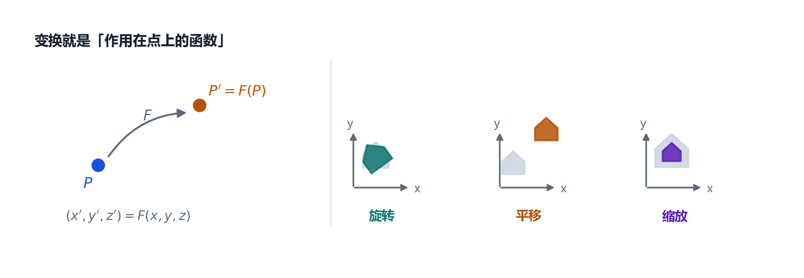

*左：`P' = F(P)`，这就是变换的完整定义。右：所有变换都由旋转、平移、缩放三种基本效果组合出来。注意第三个图里小房子是**缩小**的，不是被裁掉 —— 变换作用在整个平面上，不是作用在房子上。*

*277 页 · 129 张关键页截图 · 22 张原创图解 · 12 个手算 · 26 道自测*

> **💡 与第 1–3 节的衔接**
>
> 第 2 讲留下的问题是"3D 顶点怎么变成屏幕上的 2D 坐标"，这一讲回答它。而第 3 讲刚讲完"先滤后采"的顺序陷阱 —— 你会发现这一讲有一个**同构的陷阱**：**矩阵连乘的顺序**。两者都是"顺序错了就全错，而且错了还看不出明显错误"。

## 1. 变换是什么，为什么要学

#### P1　Section 4: Transforms

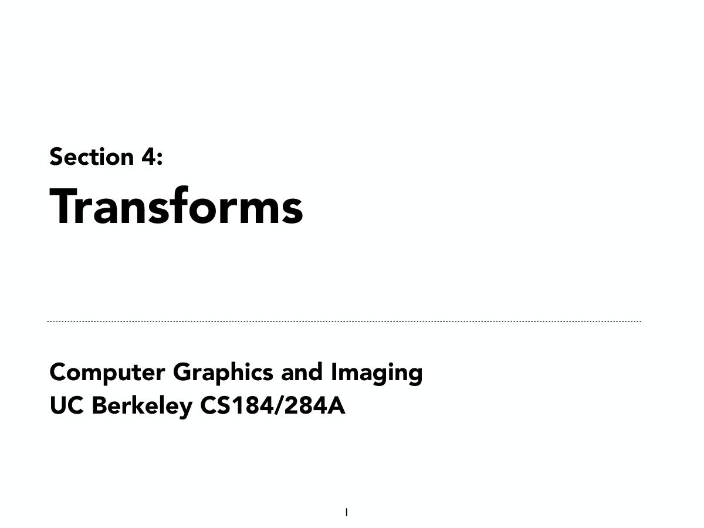

分节页。注意讲义把它标成 **Section 4**（而不是 Lecture 4），暗示这是一个完整章节而非单次课的内容 —— 所以它才跨了两讲、277 页。

#### P2　Basic Transforms

*章节点*

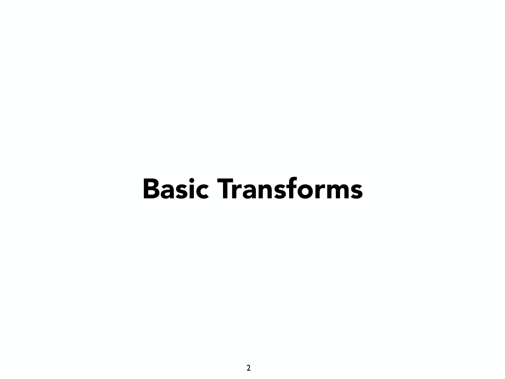

分节页。下面四页用**同一个时钟图案**演示四种基本效果 —— 这个"固定图案"很重要，因为换图案就看不出差别了。

#### P3　Rotate

*R45*

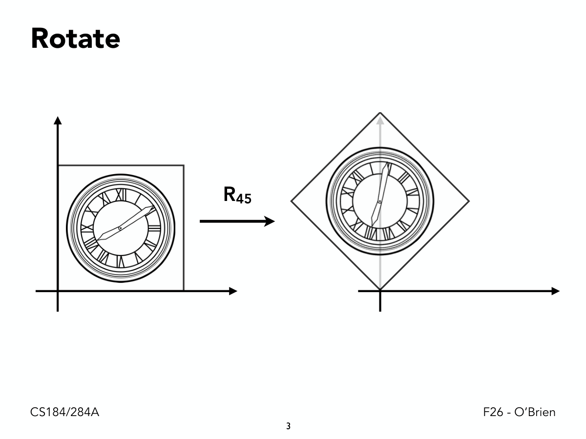

同一张时钟，**逆时针转 45°**。注意方框也跟着转了 —— 说明旋转作用在**整个坐标系里的所有点**上，不只是图案。

#### P4　Translate

*T1,1*

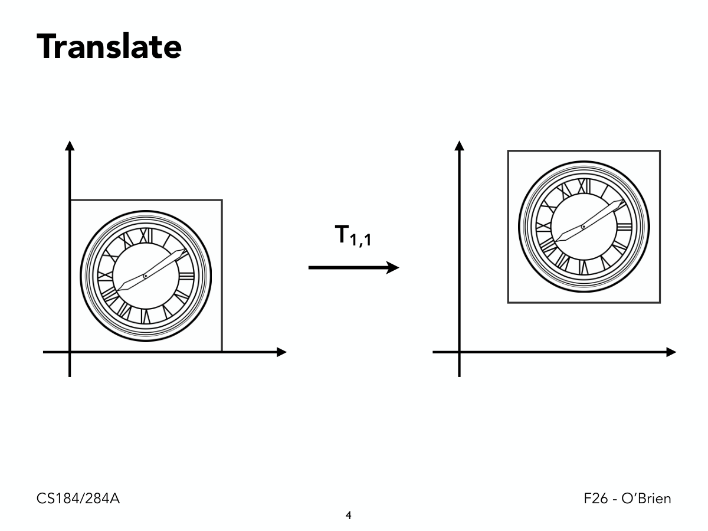

时钟和方框一起**右移 1、上移 1**。图案朝向没变。

#### P5　Scale

*S0.5*

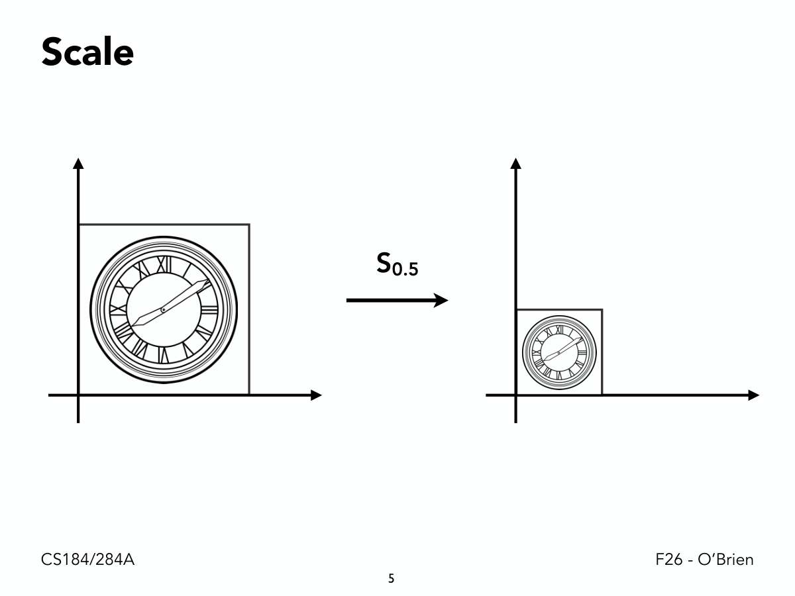

整体**缩小一半**，位置也按比例靠近原点（因为缩放是绕原点的）。

> **⚠️ "绕原点缩放"是个默认约定**
>
> `S0.5` 把点 `(2,2)` 变成 `(1,1)` —— **位置也动了**。这说明缩放不是"把图案缩小"，而是"把整个平面按原点为中心压缩"。
>
> 想"只缩小图案、不移动位置"，得绕图案中心缩放 —— 那就是 P79 那个三步套路。

#### P6　Scale (Non-Uniform)

*S0.5,1.0*

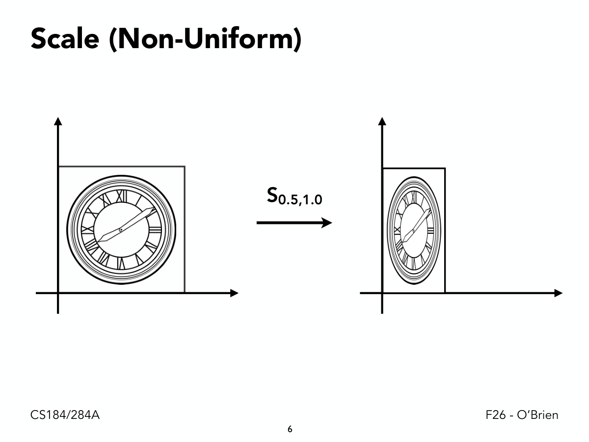

时钟**横向压扁一半**，纵向不变。这叫各向异性缩放（anisotropic scale）。

#### P7　What Are Transforms?

*Just functions acting on points*

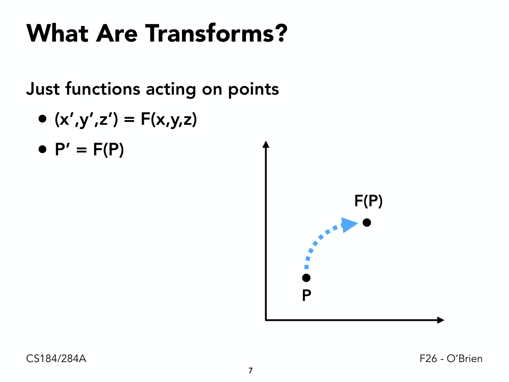

**全讲最重要的定义页**，只有两行：

> - `(x', y', z') = F(x, y, z)`
> - `P' = F(P)`

右边一个示意图：点 `P` 沿一条虚线弧移到 `F(P)`。

> **📌 把这个定义当真的好处**
>
> 一旦变换是"函数"，那么：
> - **组合**就是复合函数 `F₂(F₁(P))` —— 顺序天然明确
> - **逆变换**就是反函数 `F⁻¹`
> - **性质**（保长度、保角度、保平行）就是函数的性质
>
> 后面所有关于"矩阵"的内容，都是给这个函数找一个**好算的表示**。

#### P8　Why Study Transforms?

*章节点*

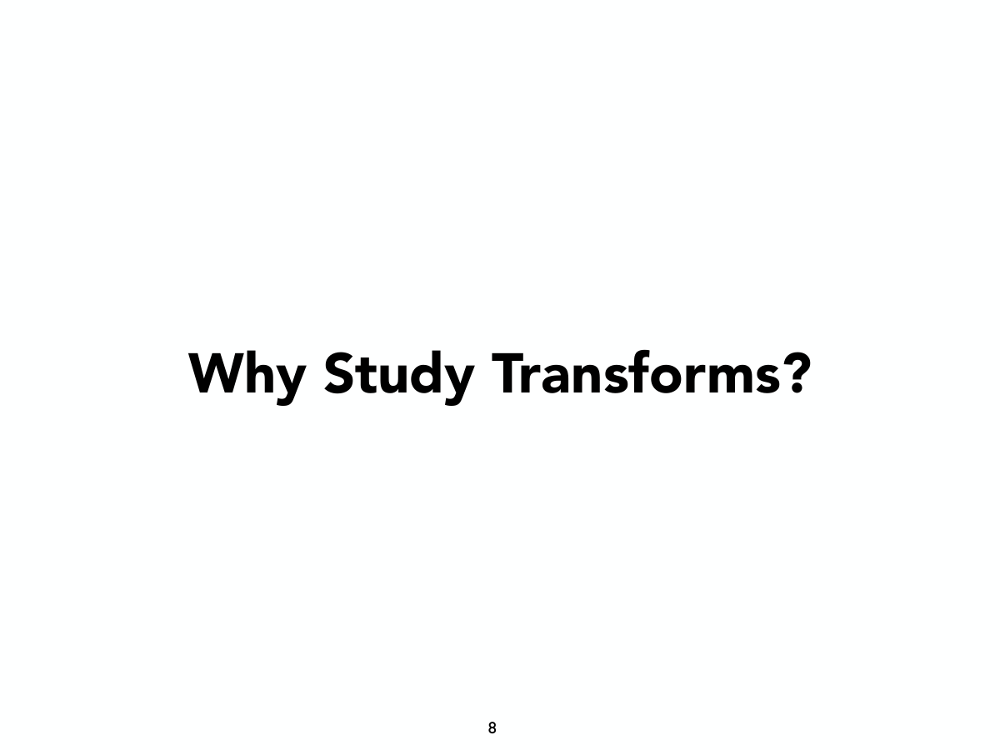

分节页。下面三页给出三个动机，分别对应建模、建模、观察。

#### P9　Modeling A Robot Army

*Transforms can describe position of object instances*

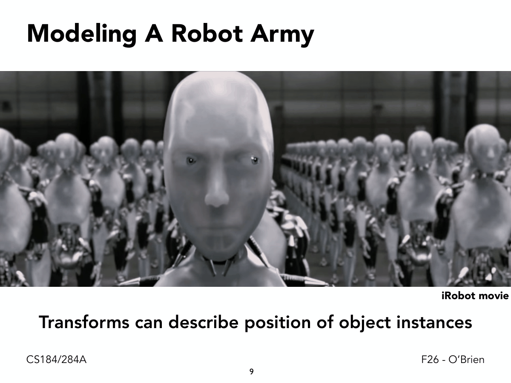

《iRobot》里成排的机器人。

**动机一：一份几何 + 多个变换 = 多个实例。** 不需要为每个机器人存一份模型，只需要存一份模型 + N 个变换矩阵。这是所有场景图（scene graph）的基础思想。

#### P10　Posing a Character's Skeleton

*Transforms can describe relative position of connected body parts*

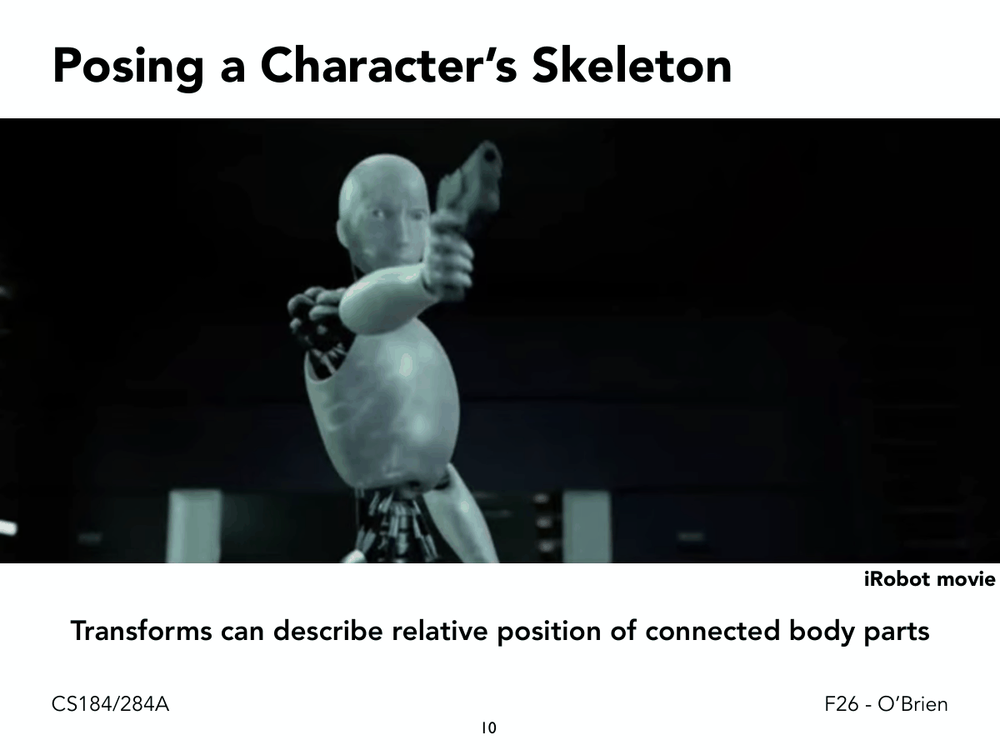

机器人抬手的动作。

**动机二：变换能描述"相连部件之间的相对位置"。** 手臂动的时候，前臂和手要跟着动 —— 这正是第 7 节**层级变换**要解决的问题。

#### P11　Project Polygons in 3D to 2D Screen

*Moments That Changed The Movies: Jurassic Park*

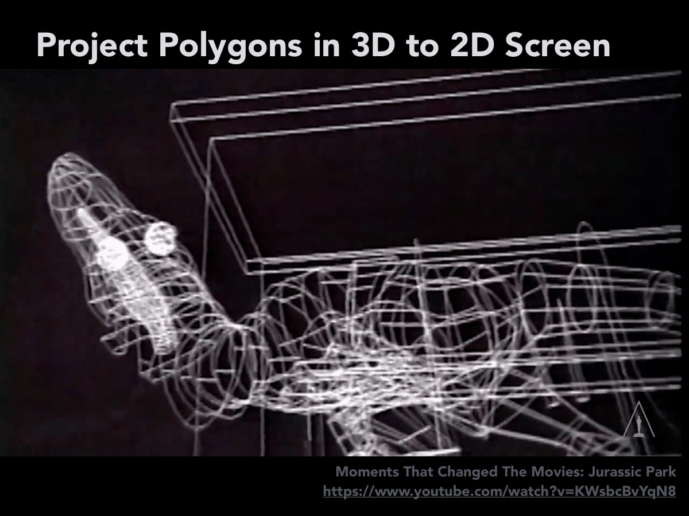

《侏罗纪公园》的线框恐龙。

**动机三：观察。** 3D 世界坐标 → 2D 屏幕坐标，靠的也是变换（相机变换 + 投影）。这是第 8 节的主题。

#### P13　Coordinate Systems are Arbitrary

*So feel free to pick one you like!*

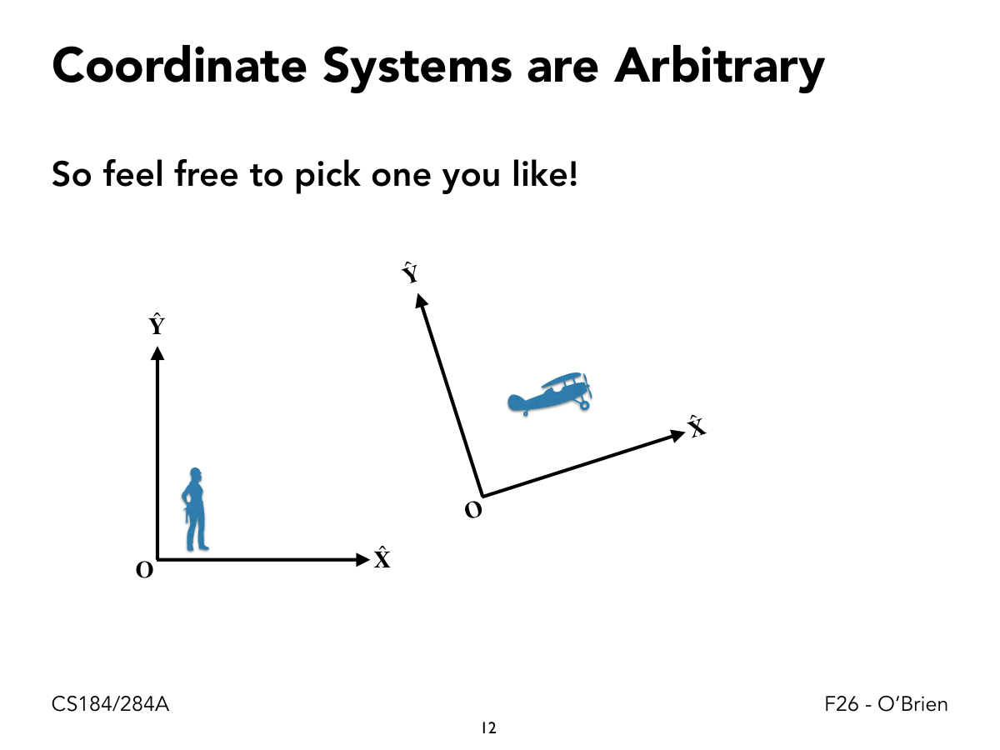

两个完全不同的坐标系画着同一个场景。

**这句话是全讲的哲学前提**：**同一组点，在不同坐标系里有不同坐标**。而"变换"和"换坐标系"本质上是同一件事的两面 —— 这个洞察在 P109 会被正式讲透。

#### P15　Why Study Transforms?

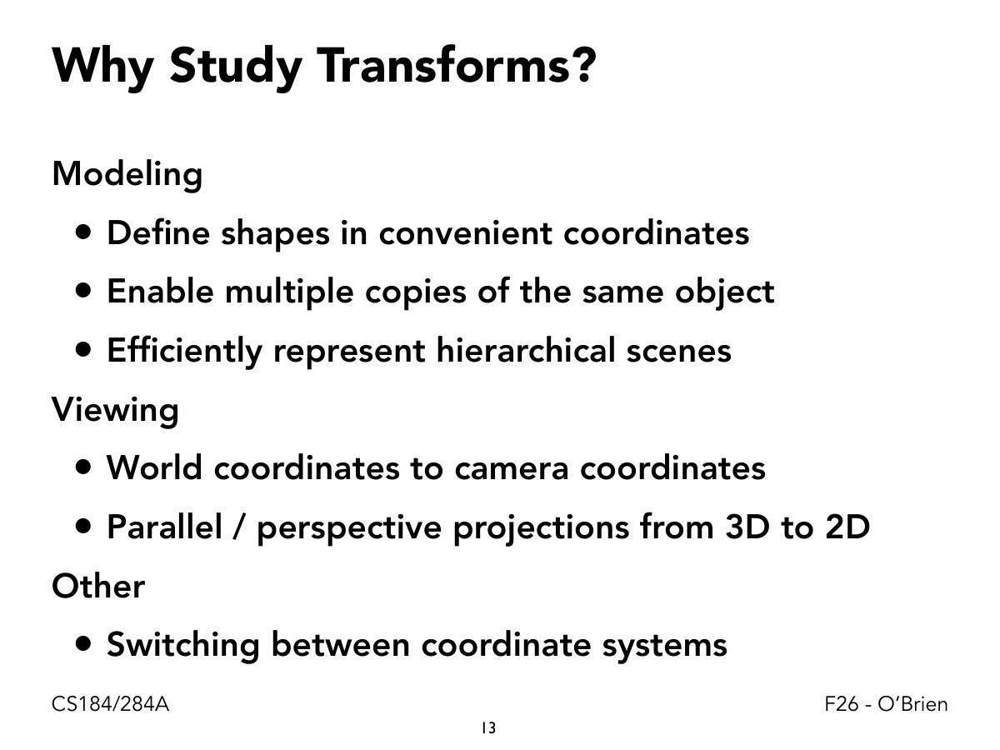

把前面三页归纳成三类：

| 用途 | 具体 | 对应页 |
|---|---|---|
| **Modeling 建模** | 在方便的坐标里定义形状；同一物体多份拷贝；高效表达层级场景 | P9、P10 |
| **Viewing 观察** | 世界坐标 → 相机坐标；平行/透视投影 3D → 2D | P11 |
| **Other** | 坐标系之间的切换 | P13 |

#### P16　Lecture Outline

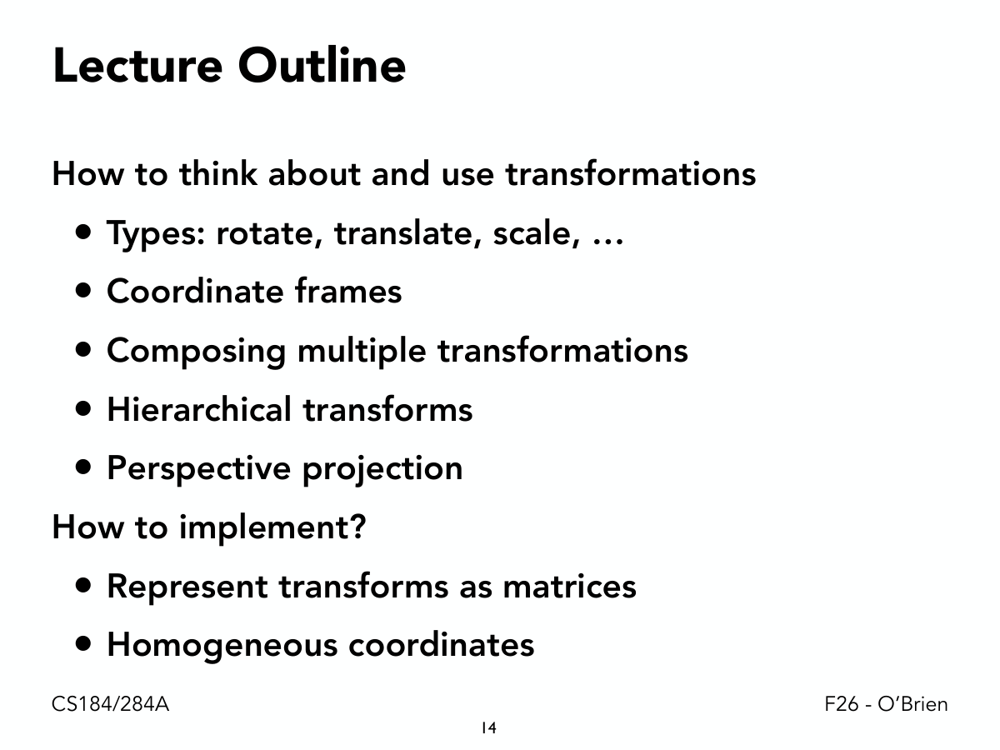

讲义自己给的路线图，值得先看一眼（它和本文的结构一致）：

> **How to think about and use transformations**
> - Types: rotate, translate, scale, …
> - Coordinate frames
> - Composing multiple transformations
> - Hierarchical transforms
> - Perspective projection
>
> **How to implement?**
> - Represent transforms as matrices
> - Homogeneous coordinates

**注意最后一行**：矩阵和齐次坐标被归在"**怎么实现**"里，而不是"是什么"。也就是说，**矩阵只是一种表示手段**，变换本身是函数。这个视角很重要 —— 后面所有公式都是为"好算"服务的。

#### P17　Linear Transforms = Matrices

*章节点*

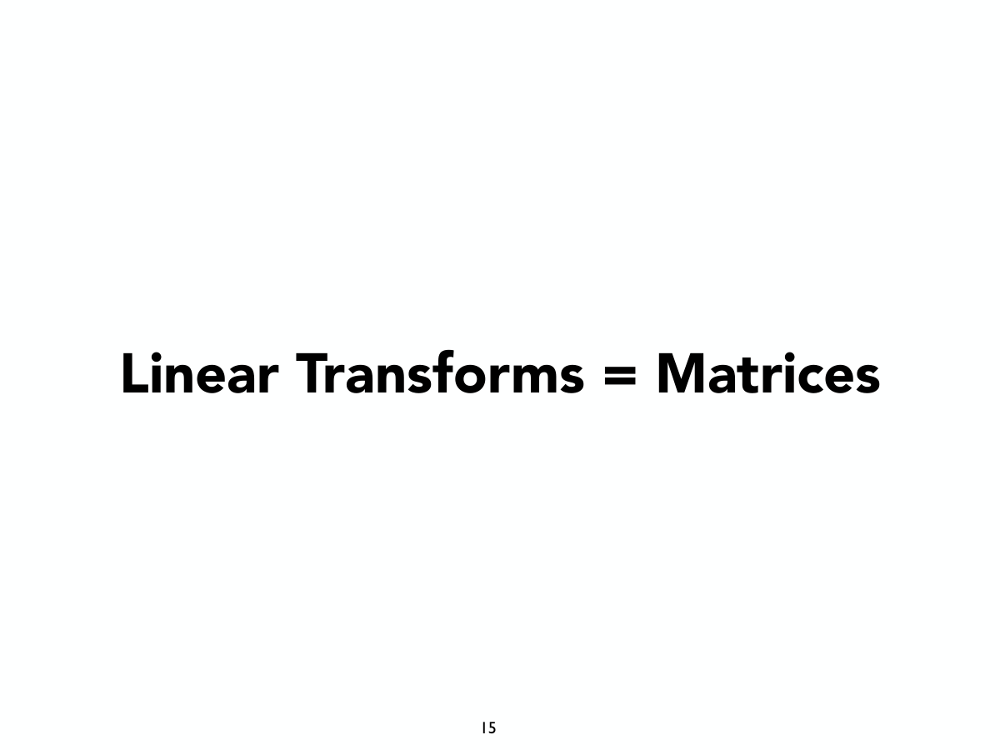

分节页。下一节开始建立"函数 ↔ 矩阵"的对应。

## 2. 线性变换就是矩阵

### 2.1 族谱：从缩放到错切（P18–P27）

讲义用**同一个刻度盘图案**演示了六种线性变换，一页一种。这种"固定被测对象"的对照法值得学：它能让你一眼看出"这次改的到底是什么性质"。

#### P19　Scale Transform

*S0.5 · x' = 0.5x, y' = 0.5y*

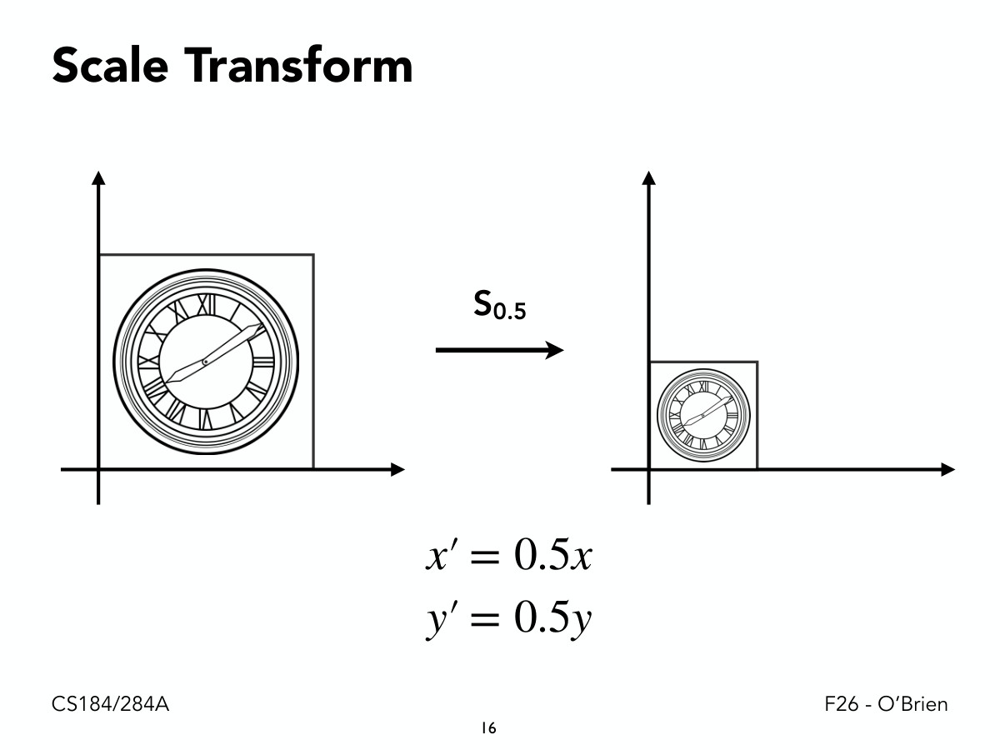

#### P21　Scale Transform (non-uniform a.k.a anisotropic)

*S0.5,1.0 · x' = 0.5x, y' = y*

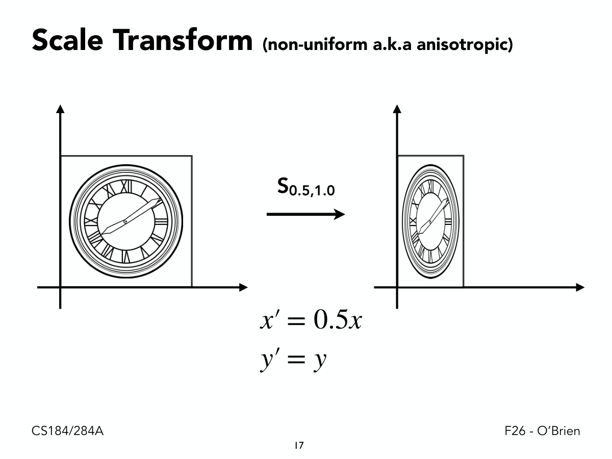

#### P23　Reflection Transform

*x' = −1.0x, y' = y*

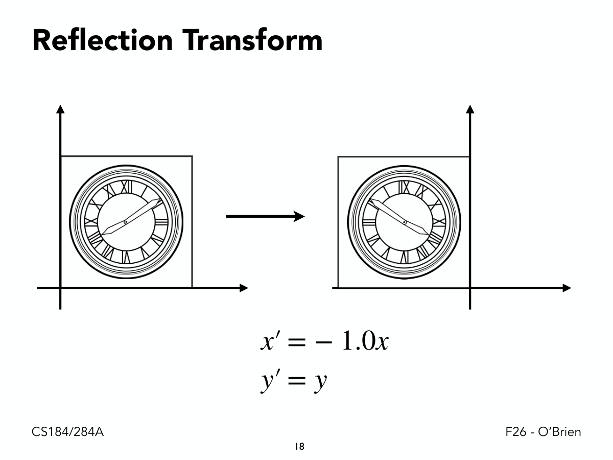

沿 `y` 轴镜像。**注意这个变换的行列式是 `-1`** —— 它把右手系变成了左手系。这就是 P118 里"`det(R) = 1 ≠ −1`"那条性质的由来：**旋转不允许镜像**。

#### P25　Translation Transform

*x' = x + 5, y' = y*

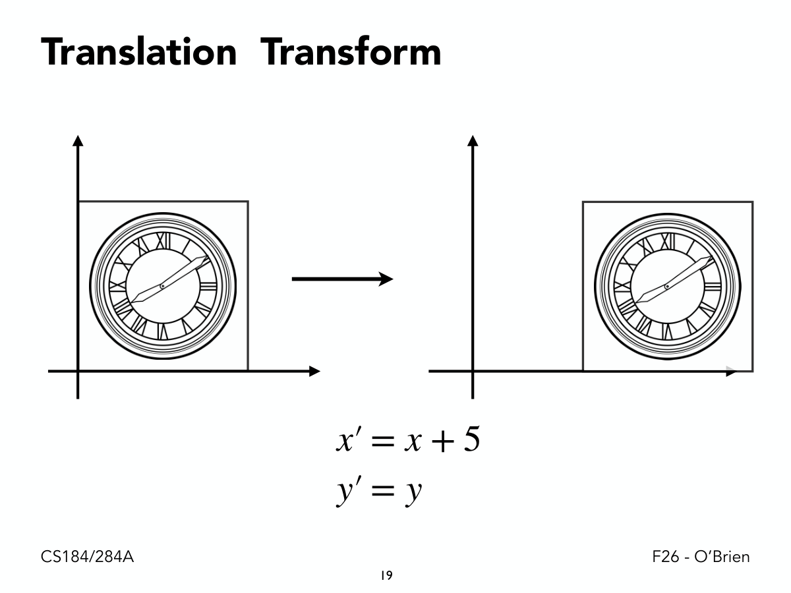

**这是唯一一个不能写成 2×2 矩阵的**（下一节会解释为什么）。

#### P27　Shear Transform

*x' = x + 0.5y, y' = y*

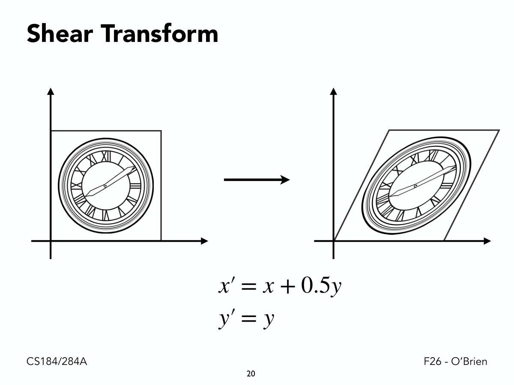

时钟被"推斜"了：`y` 越大，`x` 偏得越多。**错切是线性变换里最容易被忘掉的一个**，但它有两个重要身份：
- 它是**斜投影**的本质（正交投影的错切化）
- 它是"非轴对齐缩放"的组成部件之一

### 2.2 一般形式（P28–P31）

#### P28　Linear Transforms = Matrices

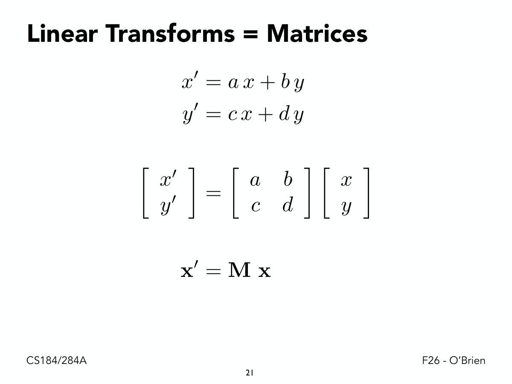

任意二维线性变换都可以写成：

$$
x' = ax + by,\qquad y' = cx + dy
\qquad\Longleftrightarrow\qquad
\begin{bmatrix}x'\\y'\end{bmatrix}
=\begin{bmatrix}a&b\\c&d\end{bmatrix}
\begin{bmatrix}x\\y\end{bmatrix}
$$

即 `x' = M x`。

**为什么"线性"就意味着"能写成这样"？** 因为线性变换要求 `F(αp + βq) = αF(p) + βF(q)`，所以：
- `F(x,y) = F(x·(1,0) + y·(0,1)) = x·F(1,0) + y·F(0,1)`
- 记 `F(1,0) = (a,c)`、`F(0,1) = (b,d)`，就得到上面那个式子

**换句话说：`a,b,c,d` 四个数之所以够，是因为它们是"两个基向量被送到哪里"的答案。**

#### P29　Scale Matrix

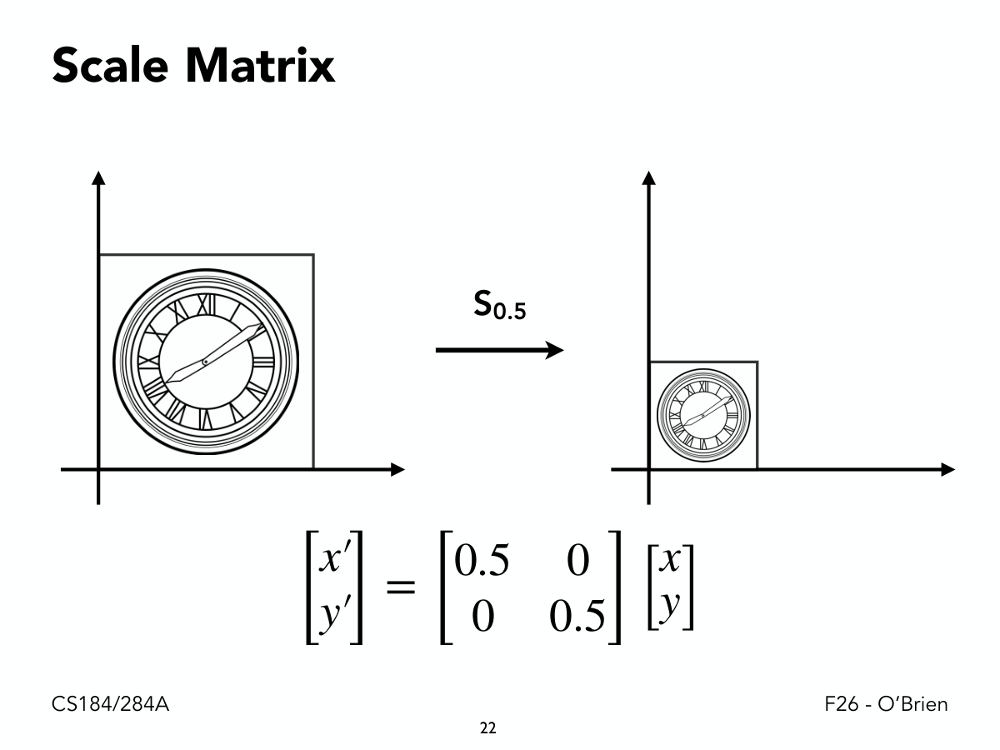

#### P31　Linear Transforms = Matrices

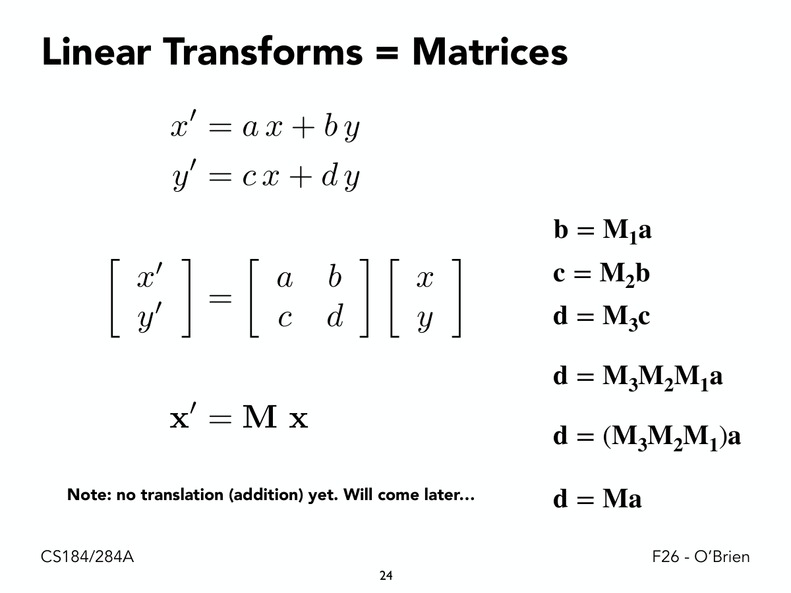

这一页右侧有一串推导：

$$
\mathbf{b} = M_1\mathbf{a},\quad \mathbf{c} = M_2\mathbf{b},\quad \mathbf{d} = M_3\mathbf{c}
\;\Longrightarrow\; \mathbf{d} = (M_3M_2M_1)\mathbf{a}
$$

**这是在预告"预乘"**：n 次变换可以先乘成一个矩阵，再乘一次点。

而左下角有一行小字，是全讲的关键伏笔：

> ***"Note: no translation (addition) yet. Will come later…"***
>
> 注意：这里还没有平移（加法）。后面会讲到。

### 2.3 矩阵的列 = 新的坐标轴（P32–P35）

#### P32　2D Coordinate Systems

*"The x-axis of the plane's coordinate system expressed in the person's coordinate system."*

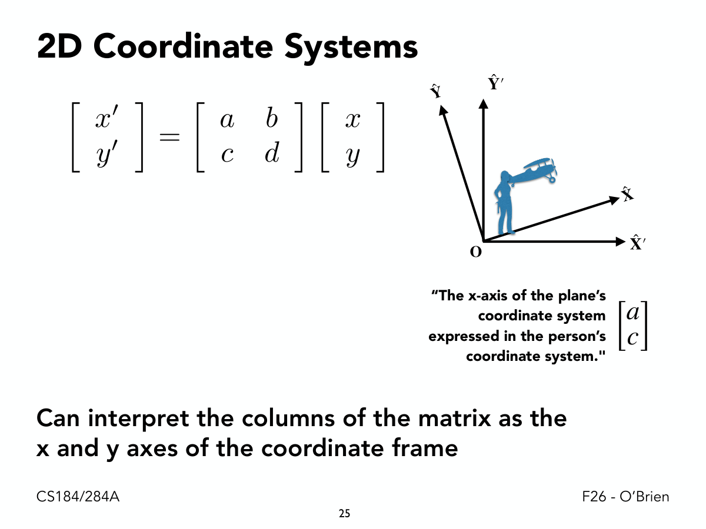

**这是全讲最重要的几何视角。** 图上画了两个人站在不同朝向，各有一套坐标轴 `(x̂, ŷ)` 和 `(x̂', ŷ')`，并标注：

> 矩阵的第一列 `(a, c)` = **"平面的 x 轴，用这个人的坐标系表示出来的结果"**

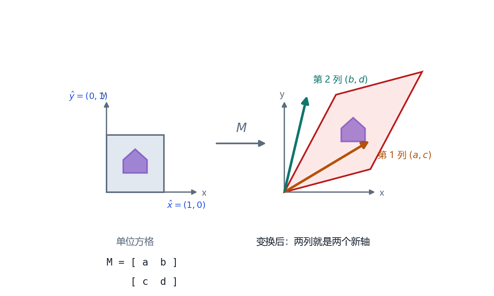

*左：单位方格（两个基向量张成的正方形）。右：乘 `M` 之后，正方形变成平行四边形，**它的两条边正好就是矩阵的两列**。所以看一个矩阵，可以直接读出"它把坐标轴送到了哪里"。*

**这个视角的实用价值**：

| 想看什么 | 怎么做 |
|---|---|
| 这个矩阵把 x 轴转到哪了 | 看第 1 列 |
| 旋转了多少度 | 看第 1 列与 `(1,0)` 的夹角 |
| 是不是镜像了 | 看两列构成的平行四边形"翻面"没有（行列式符号） |
| 缩放多大 | 看两列的长度 |

#### P33–P34　2D Coordinate Systems

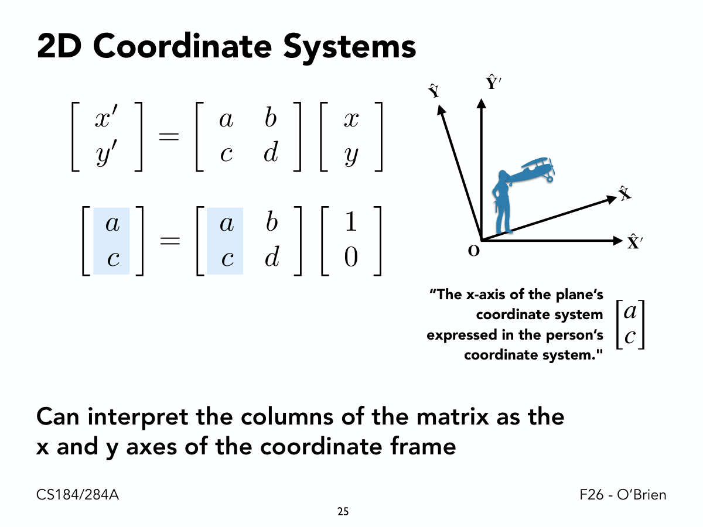

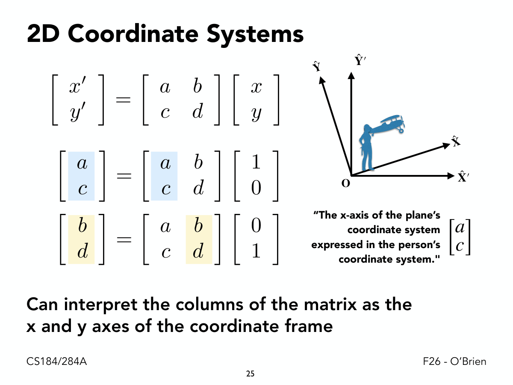

两页把公式写全：

$$
\begin{bmatrix}a\\c\end{bmatrix}=\begin{bmatrix}a&b\\c&d\end{bmatrix}\begin{bmatrix}1\\0\end{bmatrix},
\qquad
\begin{bmatrix}b\\d\end{bmatrix}=\begin{bmatrix}a&b\\c&d\end{bmatrix}\begin{bmatrix}0\\1\end{bmatrix}
$$

**即：矩阵 = 用两个基向量的像排成的。** 一旦接受这个读法，`look-at` 矩阵（P211）为什么长成那样就不再神秘了 —— 它就是"把相机的三个轴排成列"。

#### P35　2D Coordinate Systems

*Consider the inverse matrix…*

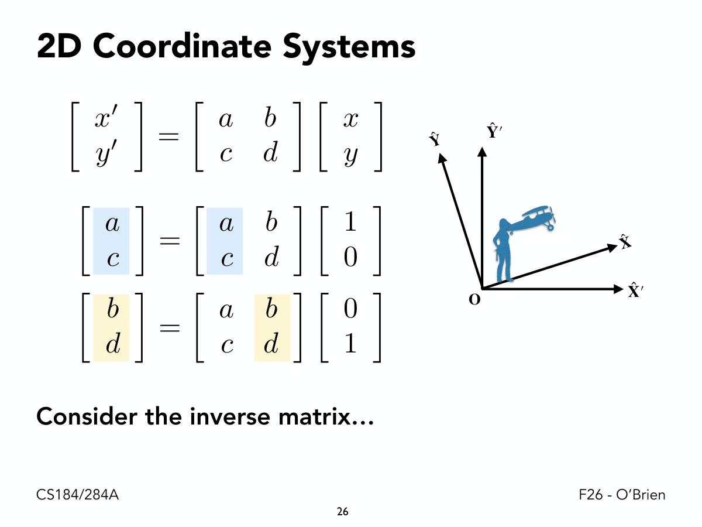

同一张图，多了一行提示：**考虑逆矩阵**。

**逆矩阵的几何意义**：`M⁻¹` 把"新的轴"还原回 `(1,0)`、`(0,1)`。也就是**从这个新坐标系变换回去**。

### 2.4 旋转矩阵怎么来的（P36–P46）

#### P36　Rotation Matrix

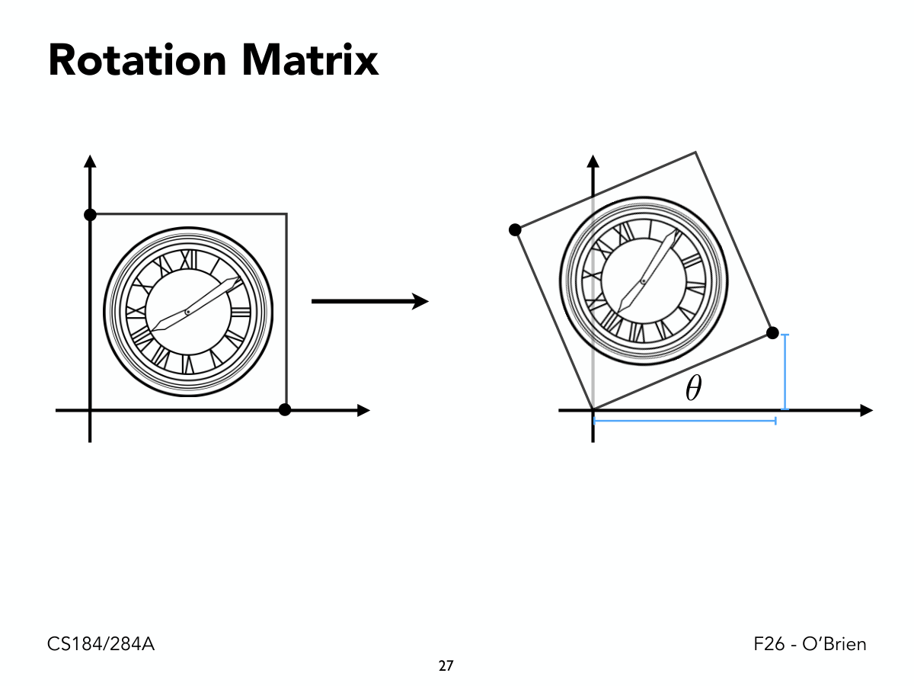

时钟旋转 `θ`，图上标了 `cos θ`（水平投影）和 `sin θ`（竖直投影）。

#### P38　Rotation Matrix

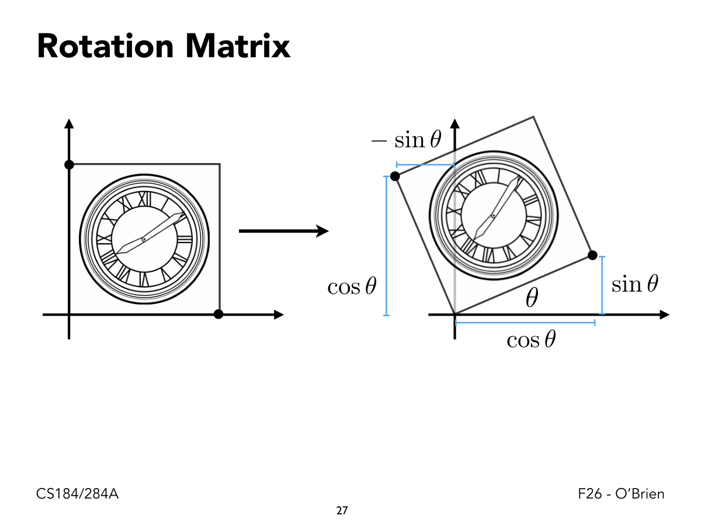

多了 `−sin θ` 和 `cos θ` 两个标注 —— 这是**第二个基向量的像**的两个分量。

#### P40　Rotation Matrix

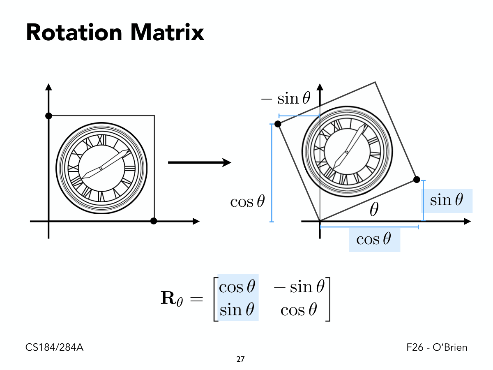

拼起来：

$$R_\theta=\begin{bmatrix}\cos\theta&-\sin\theta\\\sin\theta&\cos\theta\end{bmatrix}$$

#### P42　Rotation Matrix

*Where did this come from? · If you can figure out horizontal and vertical then you can do any vector!*

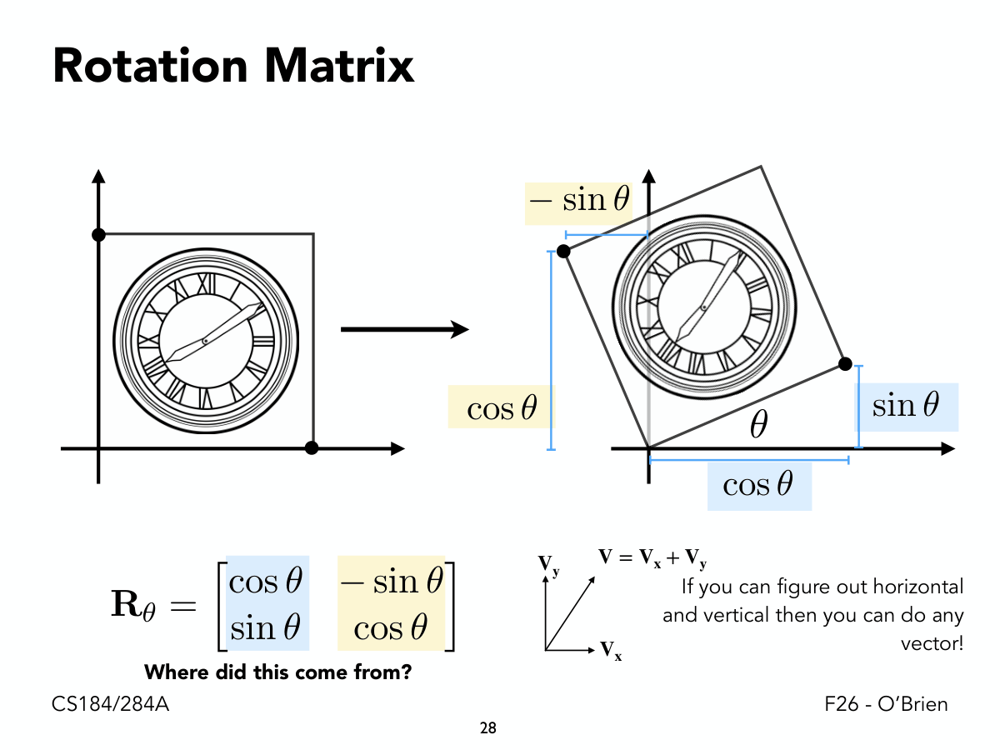

**小字是推导的关键**：

> *"If you can figure out horizontal and vertical then you can do any vector!"*

**推导三步**：

1. 把 `(1,0)` 转 `θ`，得到 `(cos θ, sin θ)` ← **这就是第一列**
2. 把 `(0,1)` 转 `θ`，得到 `(−sin θ, cos θ)` ← **这就是第二列**
3. 按 P32 的"列 = 轴"拼起来

**这正是 P32 那个视角的直接应用**：旋转矩阵的第一列就是"旧 x 轴转到了哪里"。

> **💡 为什么不用三角函数硬推**
>
> 有人会想用 `x' = r cos(φ+θ)` 这样的极坐标恒等式去推，那也行，但很啰嗦。**"列 = 基向量的像"这个方法一步到位**，而且能推广到任意维度、任意变换 —— 只要你知道基向量去哪了。

#### P43–P46　2D Rotation Matrix: Another Way

*xkcd 184 · "What's wrong with this picture??" · "Left handed matrix!"*

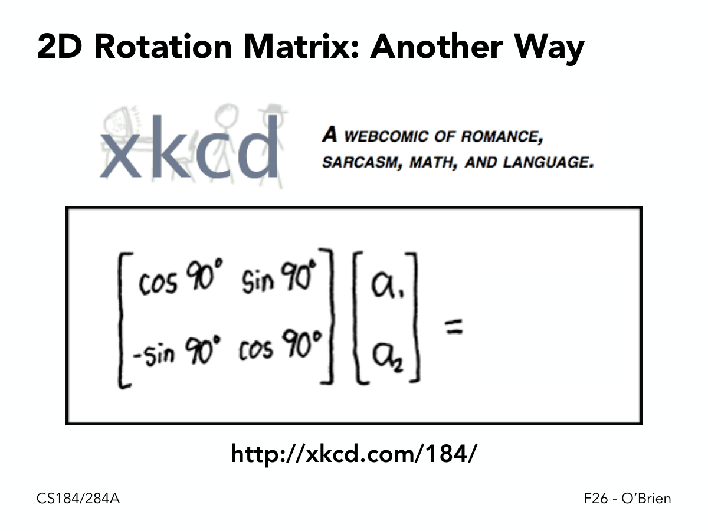

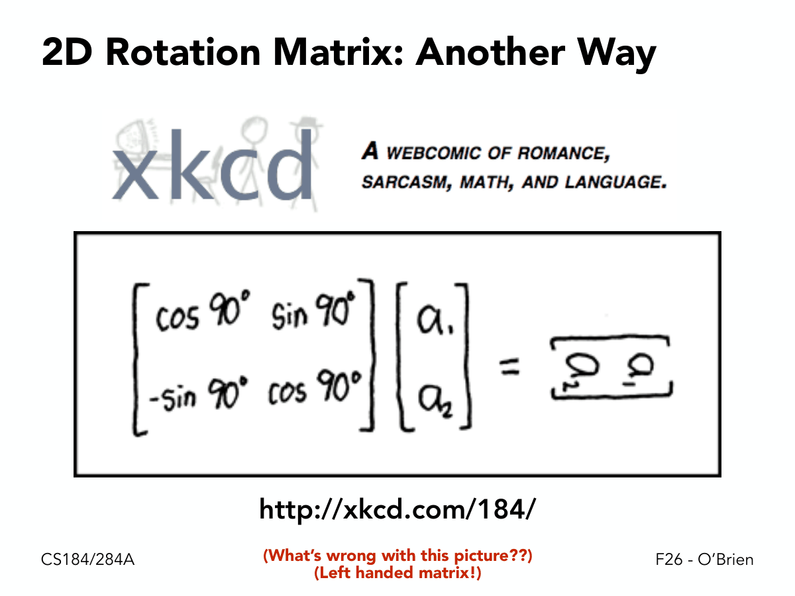

xkcd 漫画里给出了一个"旋转矩阵"：

$$
\begin{bmatrix}\cos90°&\sin90°\\-\sin90°&\cos90°\end{bmatrix}
$$

然后画了一个**顺时针转 90° 的"Ω"**。

P46 给出答案（红字）：**"(Left handed matrix!)"**

**错在哪**：把它代进 `(1,0)`：

$$
\begin{bmatrix}0&1\\-1&0\end{bmatrix}\begin{bmatrix}1\\0\end{bmatrix}=\begin{bmatrix}0\\-1\end{bmatrix}
$$

`(1,0)` 转 90° 变成了 `(0,−1)` —— 那是**顺时针**。而右手系里正角度是逆时针。

**正确写法**：

$$
R_\theta=\begin{bmatrix}\cos\theta&-\sin\theta\\\sin\theta&\cos\theta\end{bmatrix}
\quad\Longrightarrow\quad
R_{90°}=\begin{bmatrix}0&-1\\1&0\end{bmatrix}
$$

> **⚠️ 怎么一眼识破"左手系"**
>
> **把 `(1,0)` 代进去，看结果落在一还是四象限。** 若 `θ` 从 0 增到 90° 时结果从 `(1,0)` 走到 `(0,−1)`（第四象限），就是左手系。
>
> 这条检验在三维里同样适用，而且更重要 —— P120 的 `R_y` 之所以"符号反了"，本质原因就是这个。

## 3. 平移逼出了齐次坐标

#### P47　Translation??

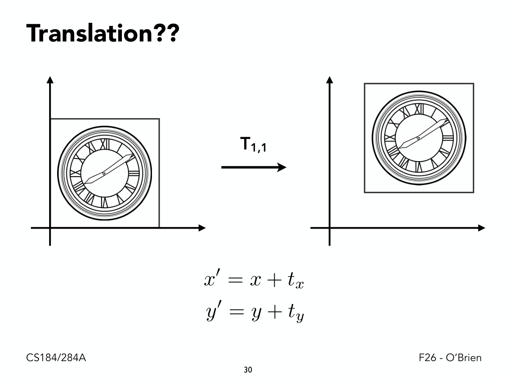

$$
x' = x + t_x,\qquad y' = y + t_y
$$

问题：能写成 `M x` 吗？**不能。**

**原因只有一句：矩阵乘向量必然把原点送到原点**（`M·0 = 0`），而平移把原点搬到 `(t_x, t_y)`。所以平移**不是**线性变换。

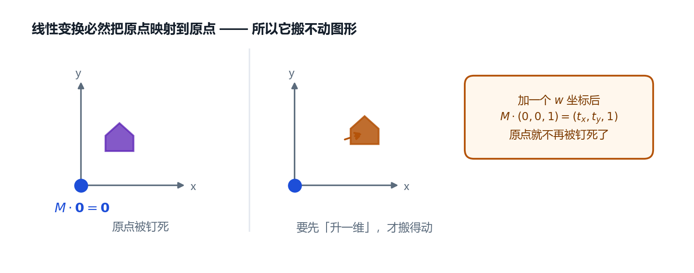

*左：任何线性变换都满足 `M·0 = 0`，原点被钉死。右：想让图形动起来，就必须"升一维" —— 加一个 `w` 坐标后，原点 `(0,0,1)` 不再位于真正的原点，于是 `M·(0,0,1)` 可以等于 `(t_x,t_y,1)`。*

#### P48　Solution: Homogeneous Coordinates

*Add a third coordinate (w-coordinate)*

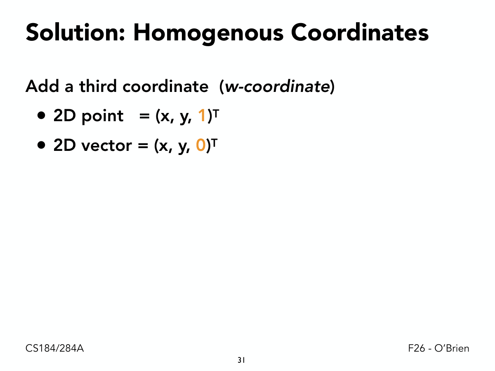

解决办法：**给向量再加一维**。

| 类型 | 表示 |
|---|---|
| 2D **点** | `(x, y, 1)ᵀ` |
| 2D **向量** | `(x, y, 0)ᵀ` |

于是平移可以写成矩阵：

$$
\begin{bmatrix}x'\\y'\\w'\end{bmatrix}
=\begin{bmatrix}1&0&t_x\\0&1&t_y\\0&0&1\end{bmatrix}
\begin{bmatrix}x\\y\\1\end{bmatrix}
=\begin{bmatrix}x+t_x\\y+t_y\\1\end{bmatrix}
$$

#### P50–P55　齐次坐标的合法性规则

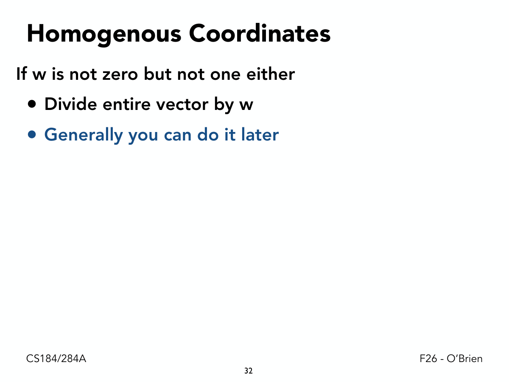

讲义用五页把"哪些运算有意义"讲完。规则其实只有一条：**看 `w` 变成什么**。

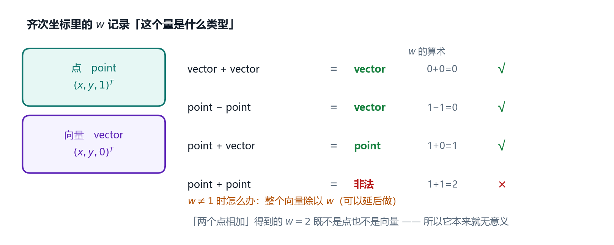

*点 `w=1`、向量 `w=0`。于是"点的 `w` 加向量的 `w`"是 `1+0=1`（还是点），"点减点"是 `1−1=0`（变成向量），而"点加点"是 `1+1=2` —— 既不是点也不是向量。*

| 运算 | 结果 | 为什么有意义 |
|---|---|---|
| `vector + vector` | vector | `0+0=0` |
| `point − point` | **vector** | `1−1=0` —— 两点之差是位移，是向量 |
| `point + vector` | point | `1+0=1` —— 点加位移还是点 |
| **`point + point`** | **无意义** | `1+1=2` —— 两个点的"和"不是任何东西 |

> **📌 这一小节的真正价值**
>
> 它回答了一个初学者常见的困惑：**为什么 `w` 不能一律填 1？**
>
> 因为 `w` 不是装饰，它**记录了这个量是什么类型**。这也是为什么"两点相减得到方向"在图形学代码里是对的，而"两点相加"永远是 bug。
>
> 顺带：法向量（normal）在变换时要用 `w=0`（它只该被旋转，不该被平移），这一点在光照计算里是经典坑。

#### P51–P52　w 不等于 1 怎么办

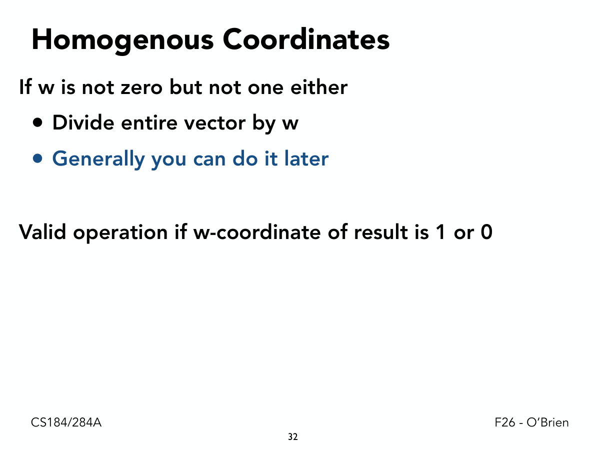

> 如果 `w` 不是 1（也不为 0）：**把整个向量除以 `w`**。
> "Generally you can do it later."（通常可以延后做。）

即 `(x, y, w) ≡ (x/w, y/w, 1)`。

**这条规则在第 8 节的透视投影里会成为主角** —— 那里 `w = z/d`，而"除以 w"就是**透视除法**。

#### P56　Affine Transformations

*Affine map = linear map + translation*

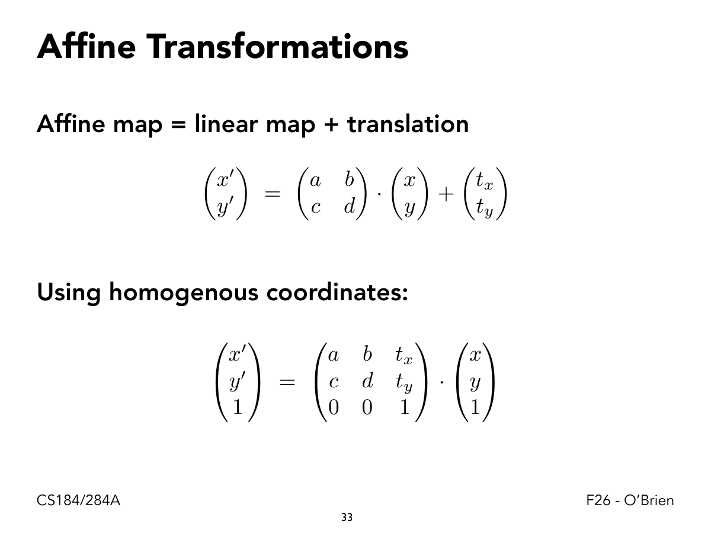

$$
\begin{bmatrix}x'\\y'\\1\end{bmatrix}
=\begin{bmatrix}a&b&t_x\\c&d&t_y\\0&0&1\end{bmatrix}
\begin{bmatrix}x\\y\\1\end{bmatrix}
\quad\Longleftrightarrow\quad
\begin{bmatrix}x'\\y'\end{bmatrix}
=\begin{bmatrix}a&b\\c&d\end{bmatrix}\begin{bmatrix}x\\y\end{bmatrix}
+\begin{bmatrix}t_x\\t_y\end{bmatrix}
$$

**左边是矩阵形式，右边是"线性 + 平移"的原始定义** —— 同一件事。

#### P57–P59　2D 变换全家桶

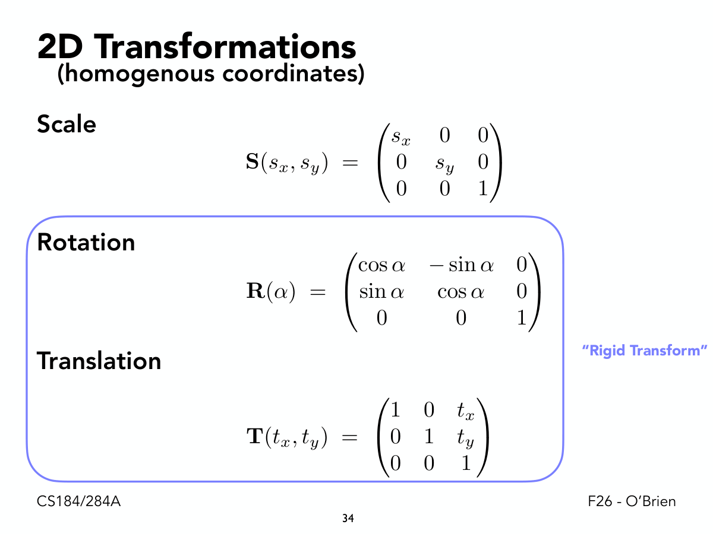

$$
T(t_x,t_y)=\begin{bmatrix}1&0&t_x\\0&1&t_y\\0&0&1\end{bmatrix}
\qquad
S(s_x,s_y)=\begin{bmatrix}s_x&0&0\\0&s_y&0\\0&0&1\end{bmatrix}
\qquad
R(\alpha)=\begin{bmatrix}\cos\alpha&-\sin\alpha&0\\\sin\alpha&\cos\alpha&0\\0&0&1\end{bmatrix}
$$

**这三个要能默写。** 注意它们的区别只在 `2×2` 块和最后一列：

| 变换 | 左上 2×2 | 最后一列 | 底行 |
|---|---|---|---|
| `T` | 单位阵 | `(t_x, t_y)` | `(0,0,1)` |
| `S` | 对角 | `(0,0)` | `(0,0,1)` |
| `R` | 旋转块 | `(0,0)` | `(0,0,1)` |

#### P59　变换的层级分类

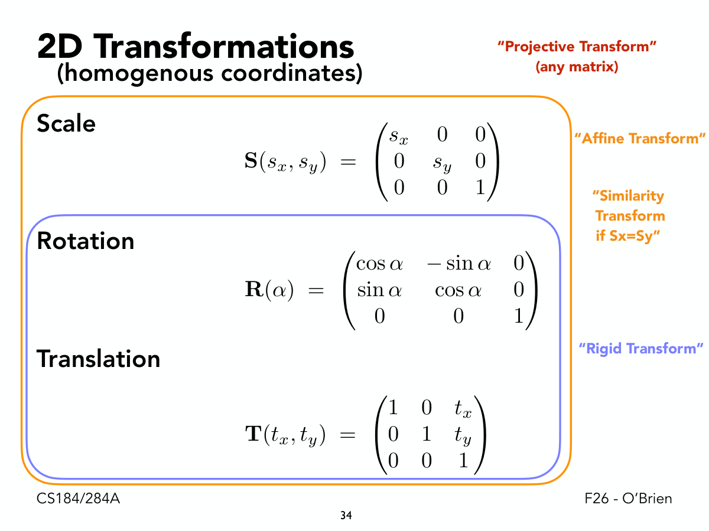

讲义右下角那张图把变换按"自由度"分层：

| 类型 | 允许什么 | 保住什么 |
|---|---|---|
| **Rigid 刚体** | 旋转 + 平移 | 长度、角度 |
| **Similarity 相似** | 刚体 + **均匀**缩放（`s_x = s_y`） | 角度 |
| **Affine 仿射** | 任意线性 + 平移 | 平行 |
| **Projective 投影** | 任意 3×3（底行不受限） | 只保直线 |


*越往里越安全：允许的操作越少，保住的性质越多。平移不是线性变换，所以"仿射"才需要齐次坐标；而透视投影连"平行"都不保了（平行线会汇聚于灭点），所以它必须用完整的 3×3。*

#### P60　Inverse Transform

*M⁻¹ is the inverse of M in both a matrix and a geometric sense*

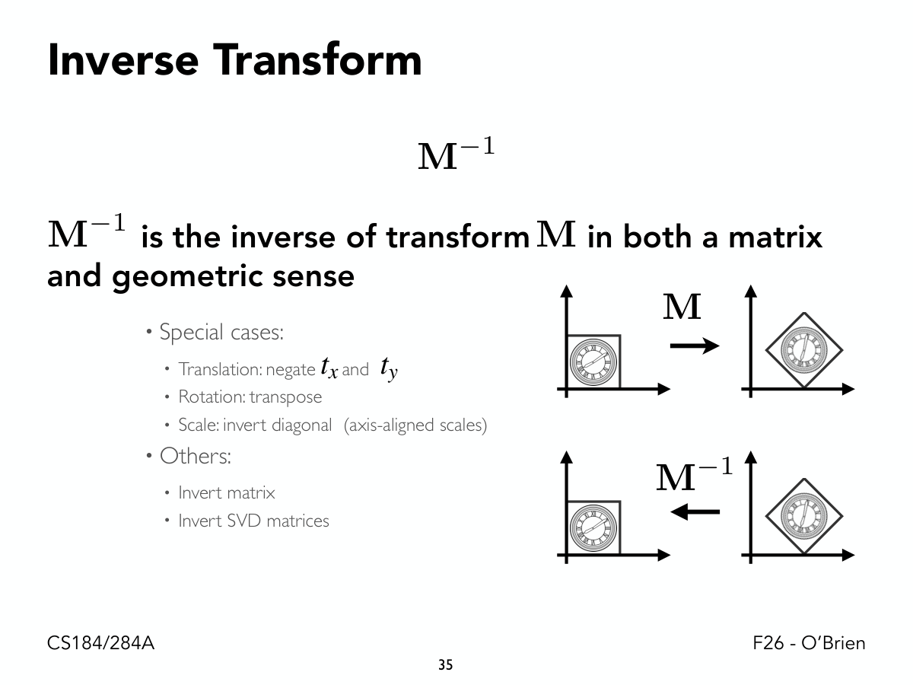

常见的特例（**必须记**）：

| 变换 | 逆 |
|---|---|
| 平移 `T(t)` | `T(−t)`（平移量取负） |
| 旋转 `R(α)` | `R(−α)`，也等于 `Rᵀ`（**转置**） |
| 轴对齐缩放 `S(s)` | `S(1/s)`（对角线取倒数） |
| 一般矩阵 | 求逆，或用 SVD 分解求逆 |

**为什么旋转的逆 = 转置？** 因为旋转矩阵是**正交矩阵**（列向量两两正交且长度 1），正交矩阵满足 `RᵀR = I`，所以 `R⁻¹ = Rᵀ`。

> **💡 这条性质在三维里更值钱**
>
> 三维旋转同样正交，所以 `R⁻¹ = Rᵀ` 依然成立。**而 `look-at` 矩阵之所以长得像转置，用的就是这条**（P211）。
>
> 另外注意：**转置这条捷径只对"纯旋转"成立**。一旦矩阵里混了缩放或平移（变成仿射），就不能简单转置了 —— 必须按 P211 那种"拆成旋转块 + 平移块"的方式来求逆。

## 4. 组合：顺序、预乘与套路

#### P61　Composing Transforms

*章节点*

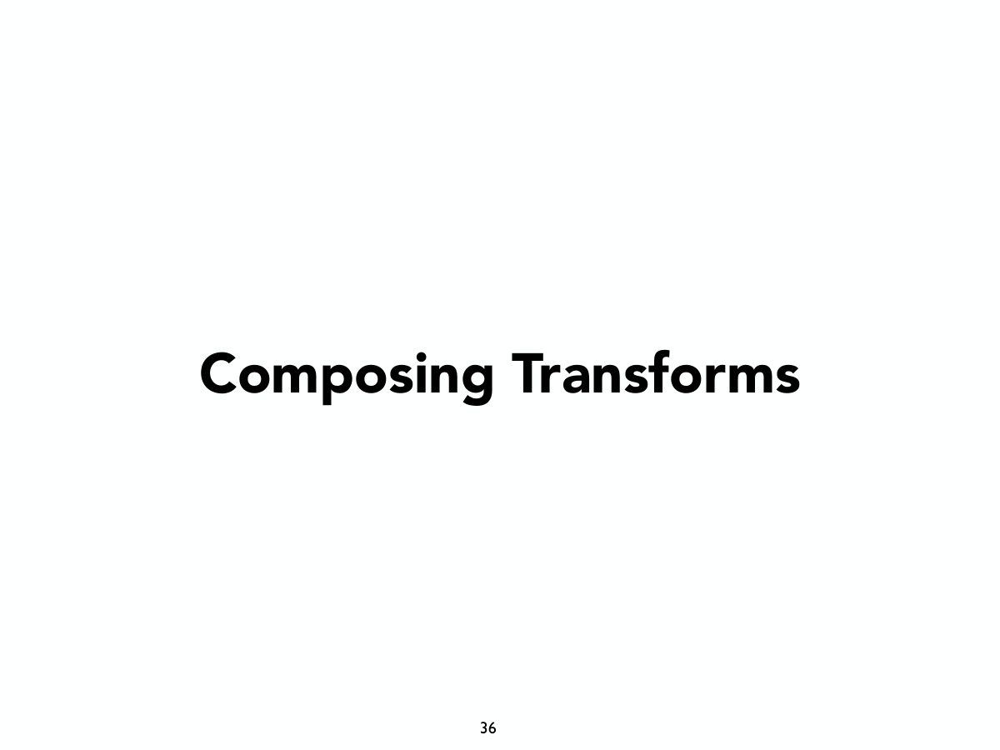

分节页。从"单个变换"进入"多个变换组合"，这是全讲最容易出错的地方。

#### P62　Composite Transform

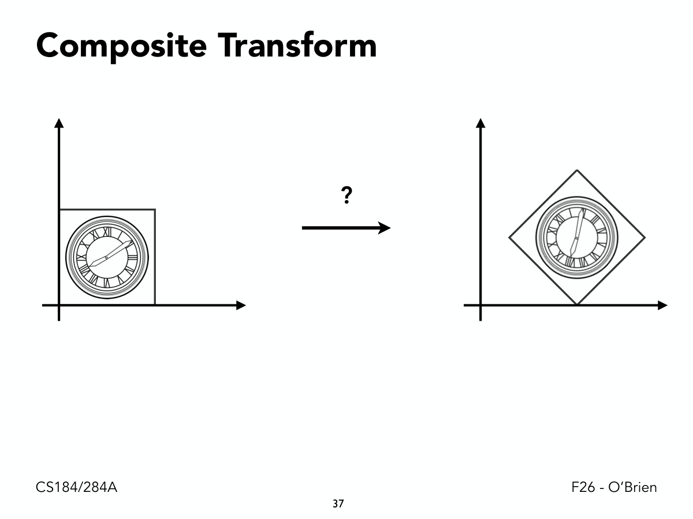

一个"?"—— 多个变换该怎么写成一个？

#### P63–P65　Translate Then Rotate?

*T(1,0) · R45*

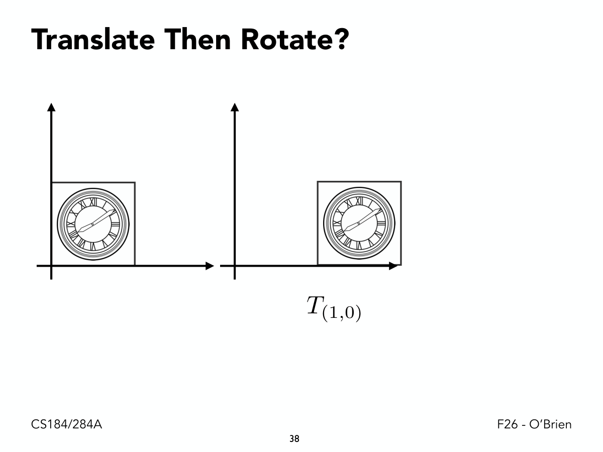

先转 45°、再平移 `(1,0)`：小房子**转到新朝向后整体搬到右边**。

#### P66–P68　Rotate Then Translate

*R45 · T(1,0)*

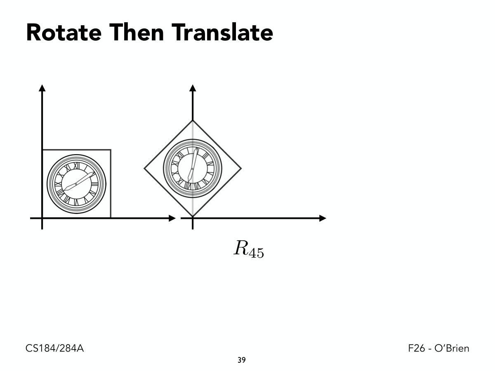

先平移 `(1,0)`、再绕原点转 45°：小房子**被搬开之后又被绕原点甩了一圈**，位置完全不同。

#### P69　Transform Ordering Matters!

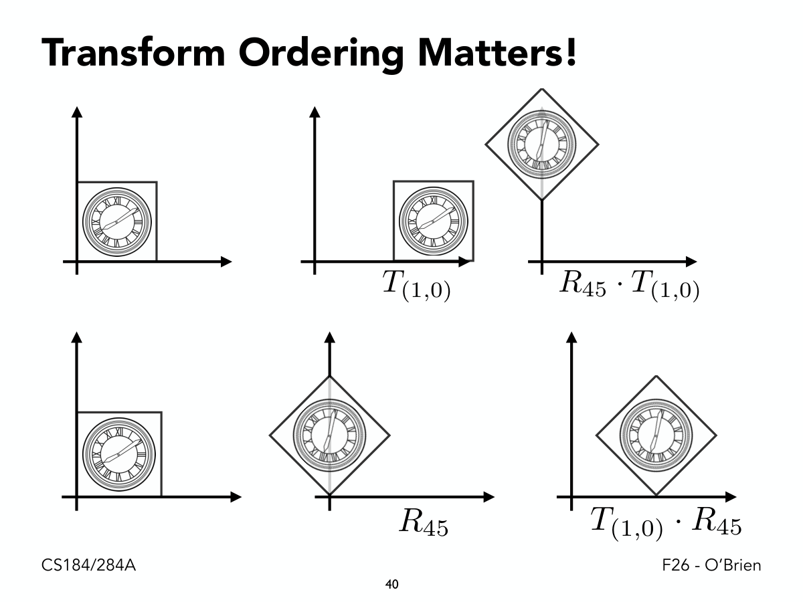

两页并排放在一起，标题就是结论。


*同样的两个变换，换顺序得到完全不同的位置。左边：先转再搬（物体整体搬到右边）。右边：先搬再绕原点转（搬到右边后又被甩了一圈）。*

#### P70–P72　Transform Ordering Matters!

*Matrix multiplication is not commutative*


讲义把两个 3×3 矩阵乘开，明确写出 `R45·T(1,0) ≠ T(1,0)·R45`。

#### P73　关键记忆规则


**加粗那句是全讲最该背下来的**：

> **Matrices are applied right to left.（矩阵从右往左作用）**

$$
A_n\cdots A_3A_2A_1\mathbf{x}
$$

最右边的 `A_1` 最先作用在 `x` 上。

**所以读 `T(1,0) · R45` 要从右往左念**："先 `R45`，再 `T(1,0)`"。

> **⚠️ 写代码时最常见的翻车**
>
> 在 OpenGL / GLM 风格的代码里，`M = translate * rotate` 表示"先旋转后平移"。
> 而在某些教材/数学写法里，`M = R · T` 才表示先旋转。
>
> **两者都不会报错，只会得到一个"看起来差不多但位置不对"的结果。** 唯一可靠的验证方式是：**拿一个具体点代进去手算**（见下面的手算 1）。

**🔧 手算 1：验证顺序差异**

取 `R = R_{90°} = [[0,−1],[1,0]]`、`T = T(1,0)`，作用在点 `p = (0,1)` 上。

**先转后移 `T·R·p`**：

$$
R p=\begin{bmatrix}0&-1\\1&0\end{bmatrix}\begin{bmatrix}0\\1\end{bmatrix}=\begin{bmatrix}-1\\0\end{bmatrix},
\quad
T(-1,0)=\begin{bmatrix}-1+1\\0\end{bmatrix}=\begin{bmatrix}0\\0\end{bmatrix}
$$

**先移后转 `R·T·p`**：

$$
T p=\begin{bmatrix}1\\1\end{bmatrix},
\quad
R\begin{bmatrix}1\\1\end{bmatrix}=\begin{bmatrix}0&-1\\1&0\end{bmatrix}\begin{bmatrix}1\\1\end{bmatrix}=\begin{bmatrix}-1\\1\end{bmatrix}
$$

**结果 `(0,0)` vs `(−1,1)`，差了整整 `√2`。** 这就是"顺序错了"的真实代价。

#### P74–P75　为什么要预乘

*Pre-multiply n matrices to obtain a single matrix representing combined transform*


把序列 `A_1, …, A_n` 塌缩成**一个**矩阵：

$$
A_n(\cdots A_2(A_1(\mathbf{x})))=\underbrace{(A_n\cdots A_2A_1)}_{\text{预乘一次}}\mathbf{x}
$$

**讲义的加粗理由**：*"Very important for performance! Very important for complexity!"*

- **性能**：每个顶点从 n 次矩阵-向量乘法 → 1 次
- **复杂度**：层级变换可以逐节点累积，不必每次回溯整条路径

#### P76–P79　构造复杂变换：绕任意点旋转


先展示**错误做法**：直接 `R(α)` —— 图上打了个红叉。因为旋转是绕原点的，图案会一边转一边绕圈飞走。

#### P81–P85　三步套路


正确做法（讲义逐页累加）：

1. **把中心 `c` 平移到原点**：`T(−c)`
2. **绕原点旋转**：`R(α)`
3. **平移回去**：`T(c)`

$$
M_{\text{composite}}=T(c)\,R(\alpha)\,T(-c)
$$


*这个"移到原点 → 做事 → 移回去"的套路，是整个图形学里出现频率最高的思维模板。后面 P128（绕任意轴旋转）和 P86（非轴对齐缩放）都是它的变体。*

**🔧 手算 2：绕 `(2,3)` 旋转 90°**

$$
M=T(2,3)\,R_{90°}\,T(-2,-3)
$$

先算 `R·T(-2,-3)`：

$$
\begin{bmatrix}0&-1&0\\1&0&0\\0&0&1\end{bmatrix}
\begin{bmatrix}1&0&-2\\0&1&-3\\0&0&1\end{bmatrix}
=\begin{bmatrix}0&-1&3\\1&0&-2\\0&0&1\end{bmatrix}
$$

再左乘 `T(2,3)`：

$$
\begin{bmatrix}1&0&2\\0&1&3\\0&0&1\end{bmatrix}
\begin{bmatrix}0&-1&3\\1&0&-2\\0&0&1\end{bmatrix}
=\begin{bmatrix}0&-1&5\\1&0&1\\0&0&1\end{bmatrix}
$$

**验证**：中心 `(2,3,1)` 应该不动：

$$
\begin{bmatrix}0&-1&5\\1&0&1\\0&0&1\end{bmatrix}\begin{bmatrix}2\\3\\1\end{bmatrix}
=\begin{bmatrix}-3+5\\2+1\\1\end{bmatrix}=\begin{bmatrix}2\\3\\1\end{bmatrix}\checkmark
$$

#### P86–P93　构造非轴对齐缩放


**目标**：沿 45° 方向拉伸 2 倍、垂直方向不变。

**做法**（又是那个套路）：

$$
\underbrace{\begin{bmatrix}\cos45°&-\sin45°\\\sin45°&\cos45°\end{bmatrix}}_{R(45°)}
\underbrace{\begin{bmatrix}1&0\\0&2\end{bmatrix}}_{S(1,2)}
\underbrace{\begin{bmatrix}\cos(-45°)&-\sin(-45°)\\\sin(-45°)&\cos(-45°)\end{bmatrix}}_{R(-45°)}
$$

读法（**从右往左**）：

1. `R(−45°)`：把目标方向先转到 `x` 轴
2. `S(1,2)`：在轴对齐方向做缩放
3. `R(45°)`：再转回去


*这是"移到标准姿态 → 做简单事 → 移回去"的第二次出现。*

#### P93　结果


算出来是：

$$
\begin{bmatrix}1.5&-0.5\\-0.5&1.5\end{bmatrix}
$$

**这个矩阵到底缩了哪个方向？两个方向各验一次**：

沿 45° 方向 `(1,1)`：

$$
\begin{bmatrix}1.5&-0.5\\-0.5&1.5\end{bmatrix}\begin{bmatrix}1\\1\end{bmatrix}
=\begin{bmatrix}1.0\\1.0\end{bmatrix}
$$

长度 `√2 → √2`，**没有缩放**。

沿 `−45°` 方向 `(1,−1)`：

$$
\begin{bmatrix}1.5&-0.5\\-0.5&1.5\end{bmatrix}\begin{bmatrix}1\\-1\end{bmatrix}
=\begin{bmatrix}2.0\\-2.0\end{bmatrix}
$$

长度 `√2 → 2√2`，**正好 2 倍** ✓

> **⚠️ 想清楚"谁被送到 x 轴"就不会绕晕**
>
> `R(−45°)` 把 `+45°` 方向送到 `x` 轴（因为 `R(θ)` 把 `x` 轴送到 `θ` 方向，反过来就是 `R(−θ)` 把 `θ` 方向送回 `x` 轴）。
>
> 于是：
> - `+45°` 方向 → 落在 `x` 轴 → 乘 `s_x = 1` → **不缩放**
> - `−45°` 方向 → 落在 `y` 轴 → 乘 `s_y = 2` → **拉伸 2 倍**
>
> 代点验算完全吻合。**但要注意：这个结论依赖"从右往左读"和"`R(θ)` 的定义方向"两件事同时正确。** 一旦其中任何一个搞反，得出的"哪个方向被拉伸"就会反掉 —— 而矩阵里的 `1.5 / −0.5` 这两个数**在两种情况下是一样的**，光看数字看不出来。
>
> 所以这一节真正要教的是：**组合矩阵的几何效果不能靠"读顺序"推，必须代两个方向的具体向量验算**（或者做特征分解）。

**用 SVD 复核**：这个矩阵是对称的，所以特征分解 = SVD。特征值 `1` 对应特征向量 `(1,1)/√2`，特征值 `2` 对应 `(1,−1)/√2` —— 与上面验算完全一致。

#### P94–P95　矩阵分解：把任意变换拆成三件

*Eigen system / SVD / Polar decomposition*


| 分解 | 形式 | 各部分 |
|---|---|---|
| **特征分解** | `A = V Λ V⁻¹` | `Λ` 对角（特征值）；`V` 的列是特征向量 |
| **SVD** | `A = Q S Rᵀ` | `S` 对角（奇异值）；`Q, R` 正交 |
| **极分解** | `A = P R S Rᵀ`，其中 `PR = Q` | `P` 正交；`S` 对角 |

**几何解读**（讲义右下角那三行）：

| 数学对象 | 几何对应 |
|---|---|
| 正交矩阵（`det = +1`） | **旋转** |
| 对角矩阵 | **轴对齐缩放** |
| 正交 · 对角 · 正交 | **任意方向的缩放** |

> **📌 P86 那个手动构造，就是 SVD 的特例**
>
> 你手动拼出 `R(45°)·S(1,2)·R(−45°)`，其实就是在做一次 SVD —— 只不过你**已经知道**两个正交方向是 ±45°。
>
> SVD 的价值在于：**任意矩阵都自动给你这两个方向**（即 `Q` 和 `R` 的列）。所以如果你拿到一个"看起来很怪"的矩阵，想回答"它到底沿哪个方向拉伸了多少"，做一次 SVD 就有答案。
>
> 小字补充：**若 `A` 是对称实矩阵，则 `V = Q = R`**（三种分解合一）。

## 5. 坐标系变换，以及"两种解读"

#### P96　Coordinate Systems

*章节点*


分节页。前面所有变换都是"在同一个坐标系里动东西"，这一节开始允许**坐标系本身不同**。

#### P97　Coordinate System Transform

*In general, a new coordinate frame is defined by an origin (point) and two unit axes (vectors)*


图和文字一起给出了坐标系的三要素：

| 要素 | 类型 | 例子 |
|---|---|---|
| 原点 `o` | **点**（`w=1`） | `(1,1)` |
| 轴 `u` | **向量**（`w=0`） | `(√2/2, √2/2)` |
| 轴 `v` | **向量**（`w=0`） | `(0,−2)` |

问题：**给定点在 `(o,u,v)` 坐标系里的坐标，怎么变换到 `(x,y)` 坐标系？**

#### P98　Coordinate System Transform Matrix


答案就是 P32 那个视角的直接应用：

$$
F=\begin{bmatrix}u&v&o\\0&0&1\end{bmatrix}
=\begin{bmatrix}u_x&v_x&o_x\\u_y&v_y&o_y\\0&0&1\end{bmatrix}
$$

**列是新坐标系的轴和原点。** 就这么简单 —— "给坐标系写变换矩阵" 就是 **"把它的轴和原点排成列"**。

> **📌 为什么"排成列"就对了**
>
> 因为矩阵作用在 `(1,0,0)ᵀ` 上得到第 1 列。而 `(1,0,0)` 在新坐标系里正是 `u` 方向的单位点。
>
> 所以：**在新坐标系里取 `(1,0,0)` → 得到世界坐标里的 `u`** —— 这正好是"用新坐标系解释旧点"的正确含义。

#### P99–P103　例题


讲义给了一张图，要求"写出这个变换的矩阵"。已知 `u = (√2/2, √2/2)`、`v = (0,−2)`、`o = (1,1)`，答案是：

$$
T=\begin{bmatrix}u_x&v_x&o_x\\[2pt]u_y&v_y&o_y\\[2pt]0&0&1\end{bmatrix}
=\begin{bmatrix}\frac{\sqrt2}{2}&0&1\\[2pt]\frac{\sqrt2}{2}&-2&1\\[2pt]0&0&1\end{bmatrix}
$$

**解法**：把三个向量按列填进去 —— 第 1 列 `u`、第 2 列 `v`、第 3 列 `o`。

**🔧 手算 3：验证一个点**

新坐标系里的点 `(1,0,1)` 在世界坐标里应该是 `o + 1·u = (1+√2/2, 1+√2/2)`。代进矩阵：

$$
\begin{bmatrix}\frac{\sqrt2}{2}&0&1\\[2pt]\frac{\sqrt2}{2}&-2&1\\[2pt]0&0&1\end{bmatrix}
\begin{bmatrix}1\\0\\1\end{bmatrix}
=\begin{bmatrix}\frac{\sqrt2}{2}+1\\[2pt]\frac{\sqrt2}{2}+1\\[2pt]1\end{bmatrix}\checkmark
$$

再验证 `(0,1,1)`（应该等于 `o + v = (1, −1)`）：

$$
\begin{bmatrix}\frac{\sqrt2}{2}&0&1\\[2pt]\frac{\sqrt2}{2}&-2&1\\[2pt]0&0&1\end{bmatrix}
\begin{bmatrix}0\\1\\1\end{bmatrix}
=\begin{bmatrix}0+1\\-2+1\\1\end{bmatrix}=\begin{bmatrix}1\\-1\\1\end{bmatrix}\checkmark
$$

> **⚠️ 最容易错的地方：`o` 的两个分量进两行**
>
> `F = [u v o]` 里 `o` 是**点**，它的 `x` 进第 1 行、`y` 进第 2 行。而 `u`、`v` 是**向量**，各占一整列。
>
> 手写这种矩阵时，**逐列写**（先写完第 1 列再写第 2 列）比"一行一行填"可靠得多 —— 因为按行填最容易把 `o` 的分量错放，而错放之后矩阵看起来依然"有模有样"，不会报错。

#### P104　Two Interpretations of A Transform


分节页。这是全讲**概念上最重要**的一节：同一个矩阵，有两种完全不同的读法。

#### P109–P114　两种解读的对照动画


讲义用同一组"小房子"做了两条平行的动画：

**上排：解读 1 —— 变换物体上的点**

$$
T(-1,-1)\;S(0.5,0.5)\;R(45°)\;T(1,1)
$$

小房子被**缩放、旋转、平移**，坐标轴始终不动。

**下排：解读 2 —— 变换坐标系**

$$
T(1,1)\;S(2,2)\;R(-45°)\;T(-1,-1)
$$

**小房子不动，是坐标网格在动。** 注意每个参数都取了倒数（`−1` 变 `1`、`0.5` 变 `2`、`45°` 变 `−45°`）。


*上：动物体 —— 你看到房子动了。下：动坐标系 —— 房子没动，是"尺子"转了。**两者是逆运算关系**：把"谁在动"换过来，矩阵就要取逆。*

> **📌 这个等价关系的三条推论**
>
> **① 相机"后退 10 米" ≡ 世界"前进 10 米"。**
> 所以相机变换永远是"反着算"的 —— 这就是 `look-at` 矩阵为什么长得像转置加负号（P211）。
>
> **② 对齐操作可以选更省力的那个方向。**
> 想"把物体对齐到某个坐标系"，可以写成"把坐标系对齐到物体"再取逆 —— 哪个好算用哪个。
>
> **③ 矩阵的每一列有双重身份。**
> - 读作"物体上新轴的方向"（解读 1）
> - 读作"坐标系里新基向量的坐标"（解读 2）
>
> 这两个说法**数学上完全一样**，只是心理图像不同。选哪个能让你少犯错，就用哪个。

## 6. 三维变换与旋转的表示


*任何仿射矩阵都能拆成"缩放 → 旋转 → 平移"。**顺序不能换** —— 换了语义就变了（缩放要对齐物体自身轴，平移最后才放到世界位置）。*

#### P115　3D Transforms

*章节点*


分节页。从二维升到三维 —— **大部分公式只是"多一行"，但旋转的表示问题会突然变复杂**。

#### P116　3D Transformations

*Scale / Translation / Coordinate Change (Frame-to-world)*


$$
T(t_x,t_y,t_z)=\begin{bmatrix}1&0&0&t_x\\0&1&0&t_y\\0&0&1&t_z\\0&0&0&1\end{bmatrix},
\quad
S(s_x,s_y,s_z)=\begin{bmatrix}s_x&0&0&0\\0&s_y&0&0\\0&0&s_z&0\\0&0&0&1\end{bmatrix}
$$

$$
F(u,v,w,o)=\begin{bmatrix}u&v&w&o\\0&0&0&1\end{bmatrix}
$$

**注意结构完全没变**：左上 3×3 是线性部分，最后一列是平移，底行是 `(0,0,0,1)`。坐标系矩阵还是"把轴和原点排成列"，只是现在有 4 列。

#### P117　3D Transformations


跟二维一样：

- 3D **点** = `(x, y, z, 1)ᵀ`
- 3D **向量** = `(x, y, z, 0)ᵀ`
- **4×4** 矩阵表示仿射变换

#### P118　Rotations

*Rotations still orthonormal · Det(R) = 1 ≠ −1 · 3D rotations DO NOT COMMUTE! · Right-hand rule · Unique matrices*


**这页列了五条，每一条后面都会用到**：

| 性质 | 含义 | 后果 |
|---|---|---|
| **正交（orthonormal）** | 列两两正交、长度 1 | 保长度、保到原点距离；**逆 = 转置** |
| **`det(R) = 1`** | 不是 `−1` | `−1` 是**镜像**（把右手系变左手系），不算旋转 |
| **不可交换** | `R_x R_y ≠ R_y R_x` | 组合顺序重要（和二维一样，但更容易踩） |
| **右手定则** | 拇指指轴正向，四指弯曲即正转方向 | 所有符号约定的来源 |
| **唯一矩阵** | 每个旋转对应唯一正交阵 | 所以"矩阵 ↔ 旋转"是双射 |

图上画了两个箭头：一个是正确方向，另一个打了红叉 —— 红叉那个是**左手系**的转法。

#### P119　2D and 3D Rotations

*2D rotations implicitly rotate about a third out-of-plane axis*


左图：一个菱形在平面里转（二维），箭头标出转向。
右图：同一个旋转画在三维里 —— **它其实是绕垂直于平面的 `z` 轴转**。

**这条对应关系很有用**：`R_{2D}(θ) = R_z(θ)`，所以二维和三维的公式可以互相校验。

#### P120　3D Transformations

*Rotation around x-, y-, or z-axis · Also known as "direction-cosine" matrices*


$$
R_x(\alpha)=\begin{bmatrix}1&0&0&0\\0&\cos\alpha&-\sin\alpha&0\\0&\sin\alpha&\cos\alpha&0\\0&0&0&1\end{bmatrix}
$$

$$
R_y(\alpha)=\begin{bmatrix}\cos\alpha&0&\sin\alpha&0\\0&1&0&0\\-\sin\alpha&0&\cos\alpha&0\\0&0&0&1\end{bmatrix}
$$

$$
R_z(\alpha)=\begin{bmatrix}\cos\alpha&-\sin\alpha&0&0\\\sin\alpha&\cos\alpha&0&0\\0&0&1&0\\0&0&0&1\end{bmatrix}
$$


**看 `R_y` 和另外两个的区别**：`R_x` 和 `R_z` 都是"右上负、左下正"，而 `R_y` 是"**右上正、左下负**"。

**为什么会反？** 因为绕 `y` 转时，`x → z` 的顺序在右手系里是**反向**的（`y` 轴在上，从 `y` 的正向看下去，`x` 轴要顺时针才能转到 `z`）。

**🔧 手算 4：验证 `R_y` 的符号**

把 `R_y(90°)` 作用在 `(1,0,0)` 上：

$$
\begin{bmatrix}\cos90°&0&\sin90°\\0&1&0\\-\sin90°&0&\cos90°\end{bmatrix}
\begin{bmatrix}1\\0\\0\end{bmatrix}
=\begin{bmatrix}0\\0\\-1\end{bmatrix}
$$

所以 **`x` 轴被转到了 `−z`**。

**用右手定则验算**：拇指指 `+y`，四指从 `+z` 弯向 `+x`。所以正转方向是 `z → x`，反过来就是 `x → −z` ✓

**如果照抄 `R_x` 的模式会得到什么？**

$$
\begin{bmatrix}\cos&0&-\sin\\0&1&0\\\sin&0&\cos\end{bmatrix}
\xrightarrow{90°}
\begin{bmatrix}1\\0\\0\end{bmatrix}=\begin{bmatrix}0\\0\\1\end{bmatrix}
$$

得到 `+z`，**方向反了**。这就是"三行都一样地背"的代价。

#### P121–P124　欧拉角

*Compose any 3D rotation from Rx, Ry, Rz? · So-called Euler angles · roll, pitch, yaw*


思路：用三个轴旋转拼出任意旋转：

$$
R_{xyz}(\alpha,\beta,\gamma)=R_x(\alpha)\,R_y(\beta)\,R_z(\gamma)
$$

应用场景：飞行模拟里的 **roll / pitch / yaw**。

**讲义加粗的一句警告**（P124）：

> ***"A list of the Euler angles is NOT a vector!"***
>
> 三个角排成一列**不是向量**。

**为什么不是向量**：向量要满足"加法有意义"和"数乘有意义"。而"欧拉角 `(10°,20°,30°)` 加上 `(5°,0°,0°)`"——听起来像"再转 5°"，但因为旋转不可交换，**加法结果依赖顺序**，所以它不满足向量空间公理。**给欧拉角做线性插值，会得到荒谬的中间姿态。**

#### P125–P126　欧拉角的三个问题


讲义列了三条：

> - **Gimbal Lock!**（万向节死锁）
> - **Not unique!**（不唯一）
> - **Ugly manifold!**（流形丑陋）


*左：三个环互相垂直，三个角各自有效。右：两个环转到共面 —— 这时它们只能绕同一根轴转，**少了一个自由度**。这就是"死锁"的字面意思：某个方向上你转不动了。*

**三项逐个解释**：

| 问题 | 具体表现 |
|---|---|
| **万向节死锁** | 当 `β = ±90°` 时，`R_x` 和 `R_z` 的旋转轴重合，只剩两个独立角 —— 丢失一个自由度 |
| **不唯一** | 同一个姿态有多组 `(α,β,γ)` 表示（例如 `(0,0,0)` 和 `(360°,0,0)`） |
| **流形丑陋** | 参数空间有奇异点，插值时会出现"跳变"（从 `359°` 到 `1°` 要转一整圈） |

#### P127–P128　绕任意轴旋转：第一种方法


讲义先给一个"好理解但少用"的方法：

1. 绕 `x` 轴转，把 `w` 转进 `x-y` 平面
2. 绕 `z` 轴转，把 `w` 对齐 `x` 轴
3. 绕 `x` 轴转 `θ` 度
4. 撤销第 2 步、再撤销第 1 步
5. 全部乘起来

图上是三个依次的坐标轴变换示意。

**为什么"少用"**：它需要显式算出每一步的角度（要 `atan2`），而且**对 `w` 不可导**（讲义留了个思考题："How would you take a derivative w.r.t. w?"）—— 在需要求导的场合（优化、物理模拟）没法用。

#### P143–P147　绕任意轴旋转：第二种方法（推荐）

*Construct orthonormal frame · Apply the transform (F Rz(θ) F⁻¹)*


**方法**：构造一个以 `p, u, v, w` 为基的正交坐标系 `F`，其中 `p` 是轴上一点、`w` 沿轴方向，然后：

$$
F\,R_z(\theta)\,F^{-1}
$$


*`F⁻¹` 把 `w` 转到 `z` 轴 → 绕 `z` 转 `θ` → `F` 转回原处。*

**这是"移到标准姿态 → 做事 → 移回去"的第三次出现**（第一次是绕点旋转，第二次是非轴对齐缩放）。

**好处**：不需要算任何角度，只需要能构造出两个与 `w` 正交的向量（一个叉积就够）。

#### P148–P152　罗德里格公式

*Rotation by angle α around axis n*


更直接的办法：绕**单位轴 `n`** 转 `α` 的矩阵有闭式解：

$$
R(n,\alpha)=\cos\alpha\,I+(1-\cos\alpha)\,nn^{\mathsf T}+\sin\alpha\,N
$$

其中 `N` 是**叉积矩阵**：

$$
N=\begin{bmatrix}0&-n_z&n_y\\n_z&0&-n_x\\-n_y&n_x&0\end{bmatrix},
\qquad n\times v=Nv
$$

**关键技巧**：**叉积可以写成矩阵乘法**。这样"旋转"就能用纯矩阵运算表达。

**证明思路**（讲义给了两条）：取正交基 `e₁, e₂, n`，则
- `R n = n`（轴上的向量不动）
- `R e₁ = cos α · e₁ + sin α · e₂`
- `R e₂ = −sin α · e₁ + cos α · e₂`

即：**旋转在垂直于轴的平面上就是个二维旋转**。


*把待转向量 `x` 拆成"沿轴分量"和"垂直分量"：沿轴分量**完全不动**，垂直分量**只在自己的平面里转**。公式的三项正好对应：常数项（沿轴不动的部分）+ 斜坡项（把垂直分量投影回去）+ 正弦项（垂直分量的旋转）。*

**🔧 手算 5：用罗德里格验证 `R_z`**


*矩阵线性插值的中间帧**会缩水**（列向量长度掉到 0.707）；四元数 slerp 保持在单位圆上。**这就是动画必须用四元数的原因。***

取 `n = (0,0,1)`、`α = 90°`。此时 `cos α = 0`、`sin α = 1`、`nnᵀ = diag(0,0,1)`：

$$
R = 0\cdot I + 1\cdot\begin{bmatrix}0&0&0\\0&0&0\\0&0&1\end{bmatrix}
+ 1\cdot\begin{bmatrix}0&-1&0\\1&0&0\\0&0&0\end{bmatrix}
=\begin{bmatrix}0&-1&0\\1&0&0\\0&0&1\end{bmatrix}
$$

**这正是 `R_z(90°)`** ✓ 罗德里格公式和三个轴旋转矩阵是自洽的。

#### P153–P154　指数映射（axis-angle）

*Direct representation of arbitrary rotation · AKA: axis-angle, angular displacement vector*


用**一个三维向量**表示旋转：

- 方向 = 转轴
- 长度 = 转角，即 `θ = ‖r‖`

**优点**（P154）：

| 好处 | 说明 |
|---|---|
| 允许翻滚（tumbling） | 任何姿态都能表示 |
| **无万向节死锁** | 只有 3 个参数，无不连续 |
| 几乎唯一 | 朝向空间是半径 `π` 的球内 |
| 适合插值 | 球内直线插值有意义 |

**缺点**：`2π` 半径的球壳上有奇异点（`θ = 2π` 和 `θ = 0` 是同一个旋转）。

#### P155–P161　为什么叫"指数"（选学，灰色页）

讲义用六页灰色幻灯片做了完整推导（标注 *"Material on gray slides is optional for cs184"*）。**思路值得知道**：

1. 不去一次性转 `θ`，而是转 `n` 次、每次 `θ/n`
2. 小角度时旋转近似为 `x' ≈ (I + (θ/n)(r̂×))x`
3. 转 `n` 次：`x' = (I + (r̂×)θ/n)ⁿ x`
4. 取极限 `n → ∞`，这就是 `e^a = lim(1+a/n)ⁿ`，所以 `x' = e^{(r̂×)θ}x`
5. 泰勒展开并利用 `(r̂×)³ = −(r̂×)`，级数分裂成两串，**正好得到罗德里格公式**

**所以"指数映射"和"罗德里格公式"是同一件事的两种写法。**

#### P162–P166　四元数（选学，灰色页）

*More popular than exponential maps · Natural extension of e^{iθ} = cos θ + i sin θ · Due to Hamilton (1843)*


**定义**：三个"虚部"加一个实部，

$$
i^2=j^2=k^2=-1,\quad ij=k,\ ji=-k,\ jk=i,\ kj=-i,\ ki=j,\ ik=-j
$$

记 `q = (z, s) = iz₁ + jz₂ + kz₃ + s`（`z` 是三维向量部分，`s` 是标量部分）。

| 运算 | 公式 |
|---|---|
| 乘法 | `q·p = (z_q s_p + z_p s_q + z_p×z_q, \; s_p s_q − z_p·z_q)` |
| 共轭 | `q* = (−z, s)` |
| 模长 | `‖q‖² = z·z + s² = q·q*` |

**用四元数做旋转**：

| 概念 | 形式 |
|---|---|
| 向量 | `v = (v, 0)`（标量部为 0） |
| 旋转 | `r = (r̂ sin(θ/2), cos(θ/2))` |
| 旋转一个向量 | `x' = r·x·r*` |
| 组合旋转 | `r = r₁·r₂` |


*`r` 在 `x' = r x r*` 里被**用了两次**（左乘一次、右乘一次），所以 `r` 自己只需要承担一半的旋转量 —— 这就是 `θ/2` 的由来。*

**性质**（P166）：

| 性质 | 说明 |
|---|---|
| 无翻滚问题 | ✓ |
| 无万向节死锁 | ✓ |
| **"双重唯一"** | `r` 与 `−r` 表示**同一个旋转**（double cover） |
| 单位四元数位于 4D **3-球面** | `‖r‖ = 1` |
| 适合插值 | 用 **slerp**（球面线性插值） |

#### P167–P168　插值对比

*Euler angles vs Exponential maps or quaternions*


| 表示 | 插值效果 |
|---|---|
| 欧拉角 | ❌ 会翻滚、跳变、绕远路 |
| 指数映射 / 四元数 | ✅ 走最短路径、平滑 |

**实操结论（贯穿整个图形工业界）**：

| 场合 | 用什么 |
|---|---|
| **存储、插值、物理** | 四元数 |
| **渲染、着色器** | 矩阵（硬件要 4×4） |
| **人机界面（给动画师看）** | 欧拉角 |

> **💡 为什么四元数"更小更稳"还有额外好处**
>
> 一个 4×4 旋转矩阵有 16 个数，但旋转只有 **3 个自由度** —— 意味着矩阵里有大量冗余。冗余的坏处是**数值误差会累积**：反复乘矩阵，正交性会慢慢退化，最终矩阵"不再是旋转"（行列式偏离 1，出现剪切）。
>
> 四元数只有 4 个数（1 个冗余约束），**归一化一下就能修正误差**。这是物理引擎和动画系统普遍用四元数的工程原因。

## 7. 层级变换

#### P193　Skeleton（骨骼解剖图）


一页人体骨架的解剖示意图（正面、侧面、背面三个视角）。这一节要用它来类比**层级结构**：躯干、头、上肢、下肢 —— 每一节都挂在上一节下面。

（顺带注意：讲义用**真实解剖图**而不是简笔火柴人，因为后面的例子直接就是"抬手时前臂和手要跟着动"。）

#### P169　Hierarchical Transforms

*章节点*


分节页。前面的变换都是"一个物体一组矩阵"，这一节解决"物体之间怎么串联"。

#### P170–P171　Skeleton - Linear Representation

*Each shape associated with its own transform · A single edit can require updating many transforms*


把所有部件摊平成一串：`head, torso, right upper arm, right lower arm, right hand, ...`，**每个部件各自存一个世界坐标变换**。

**问题（P171）**：*"A single edit can require updating many transforms"* —— 抬一下肩膀，就要更新上臂、下臂、手（可能还有手指）的**所有**矩阵。

#### P172–P173　Skeleton - Hierarchical Representation


把骨骼组织成**树**：

```
torso
├── head
├── right arm
│   └── upper arm → lower arm → hand
└── left arm
    └── upper arm → lower arm → hand
```

#### P174–P181　Hierarchical Representation

*Grouped representation (tree)*


讲义把层级表示的四条核心规则写全了：

1. **每组包含子组和/或形状**
2. **每组的变换是相对于父组的**
3. **叶节点形状的最终变换 = 从根到叶路径上所有变换的连乘**
4. **改变一个组的变换 → 影响它下面所有部件**


*左：线性表示，抬手臂要改 3 个矩阵。右：层级表示，只改 1 个。代价是求值必须按层级顺序，或者用矩阵栈。*

#### P182–P192　push / pop 矩阵栈

讲义用 10 页动画演示了同一段代码的执行过程。核心是三个调用：


```c
translate(0, 10);
drawTorso();

pushmatrix();                       // 把当前变换压栈（复制一份）
  translate(-2, 3);
  rotate(rightShoulderRotation);
  drawUpperArm();

  pushmatrix();
    translate(0, 5);
    rotate(headRotation);
    drawHead();
  popmatrix();                      // 弹栈，回到调用前的状态

  pushmatrix();
    translate(0, -3);
    rotate(elbowRotation);
    drawLowerArm();

    pushmatrix();
      translate(0, -3);
      rotate(wristRotation);
      drawHand();
    popmatrix();
  popmatrix();
popmatrix();
```

**这段代码要读懂的三个点**：

| 点 | 说明 |
|---|---|
| `pushmatrix()` **复制**当前变换压栈 | 后续操作在副本上做，不影响外层 |
| `translate`/`rotate` 是**右乘**到当前矩阵上 | 所以它们是"在父节点坐标系里"的局部变换 |
| `popmatrix()` **弹栈** | 回到 `push` 之前的状态 |

> **📌 为什么非要栈不可**
>
> 因为树的遍历是**递归**的：进入一个子节点时要"继承"父节点的累积变换，退出时要"撤销"它。
>
> 没有栈的话，你就得手动维护"当前累积矩阵"，并在每个分支结束后**手动乘上逆**来还原 —— 又慢又容易漏。栈把这件事变成了 `push` / `pop` 一对操作，天然匹配递归。
>
> 现代引擎（Unity / Unreal / three.js）内部都是这个模式，只是名字换成了 `Matrix4x4` 的 `TRS`（Translate·Rotate·Scale）组合 + 场景图节点。

## 8. 相机与透视投影


*`z` 从 0.1 到 1（1 米）占了约 90% 的深度精度，远处 999 米只占 10%。**这就是 z-fighting 的根源** —— 也是"把近裁剪面推远"能显著改善的原因。*

#### P194　Viewing and Perspective

*章节点*


一个人端着相机拍照。这一节要回答：**拍照这件事，数学上是怎么发生的？**

#### P195　Viewing and Perspective Transforms


左边：小紫牛模型 + **3D 世界坐标**。右边：屏幕光栅化 + **2D 屏幕坐标**。中间一个大大的 **?**。

**这个问号就是第 8 节的全部内容**：从 `(x,y,z)` 到 `(u,v)` 要经过哪些变换？

#### P196　Camera Space

*章节点*


分节页。第一步：把世界坐标换成"以相机为原点"的坐标。

#### P197　"Standard" Camera Space


**这是全课最重要的约定之一**，四条要记住：

| 约定 | 值 |
|---|---|
| 相机位置 | **原点** |
| 视线方向 | 沿 **−z** |
| 上方向 | **+y** |
| x 轴 | 与 y、z 正交 |

**注意"看向 −z"**：`z` 轴是**背离场景**的方向（指向观察者身后）。这和 OpenGL 的传统约定一致。

#### P199　"Standard" Camera Coordinates

*Resulting image（z-axis pointing away from scene）*


一只羊的照片，上面标了 `x`（向右）和 `y`（向上）轴，并注明 **"z-axis pointing away from scene"**。

**这一页在提醒一个容易搞混的点**：图像坐标的 `y` 是**向上**的，而第 2 讲的屏幕坐标 `y` 是**向下**的。这两者之间的翻转发生在最后的"屏幕变换"里（NDC → 像素）。

#### P200–P201　Consider A Camera Pointing in The World


一个在海边拍照的人，图上标了三样：

| 符号 | 含义 |
|---|---|
| `e` | **eye point**（眼睛位置 = 相机位置） |
| `u` | **up vector**（上方向） |
| `v` | **view direction**（视线方向） |

**三者都是世界坐标给出的。**

#### P202　Camera "Look-At" Transformation

*Input: e, u & v given in world space coordinates · Output: transform matrix from world space to standard camera space*


问题定义得很清楚：

- **输入**：`e`（点）、`u`、`v`（向量），都在世界坐标系里
- **输出**：从世界空间到标准相机空间的变换矩阵

#### P203–P210　look-at 的构造


**四步**：

1. 假设 `u` 和 `v` 正交归一（若不正交，先正交化）
2. **求右向量** `r = v × u`
3. 于是相机自身的坐标系是 `(e, r, u, v)`，注意相机的 **−z 是 `v`**，所以相机的 **+z 是 `−v`**
4. 按 P98 的结论：**把这三个轴和原点排成列**，得到"相机 → 世界"矩阵

#### P211–P214　矩阵与它的逆


**相机 → 世界**（列是轴）：

$$
\begin{bmatrix}r_x&u_x&-v_x&e_x\\r_y&u_y&-v_y&e_y\\r_z&u_z&-v_z&e_z\\0&0&0&1\end{bmatrix}
$$

**世界 → 相机 = 它的逆**（讲义给了完整分解）：

$$
\begin{bmatrix}r_x&u_x&-v_x&e_x\\r_y&u_y&-v_y&e_y\\r_z&u_z&-v_z&e_z\\0&0&0&1\end{bmatrix}^{-1}
=
\underbrace{\begin{bmatrix}r_x&r_y&r_z&0\\u_x&u_y&u_z&0\\-v_x&-v_y&-v_z&0\\0&0&0&1\end{bmatrix}}_{\text{旋转部分转置}}
\;\underbrace{\begin{bmatrix}1&0&0&-e_x\\0&1&0&-e_y\\0&0&1&-e_z\\0&0&0&1\end{bmatrix}}_{T(-e)}
$$


*相机→世界是"把相机的轴和原点排成列"。世界→相机是它的逆，而逆可以拆成"旋转部分转置 × 平移取负"——因为相机的三个轴构成正交矩阵，正交矩阵的逆就是转置。*

**两个"为什么"**：

| 疑问 | 答案 |
|---|---|
| 为什么旋转部分变成转置？ | 相机三轴构成**正交矩阵**，`R⁻¹ = Rᵀ` |
| 为什么是 `T(−e)`？ | 把眼睛移到原点 = 把世界反向平移 —— **这就是"动坐标系"解读**（P109） |

#### P215　Transform Camera Space to Image Plane?

*One option: orthographic projection (just delete z)*


**最简单的做法**：直接**丢掉 `z`**。这就是**正交投影**（orthographic），工程制图（三视图）用它。

但标题是问句，末尾还留了一句：

> *"But is this the whole story?"*（但这就是全部吗？）

答案是"不是" —— 因为现实有**近大远小**。

#### P216　Perspective

*章节点*


分节页。下面几页先讲艺术史，再讲数学。

#### P217–P219　Perspective in Art


两幅中世纪画作：Berlinghieri（1235）、Giotto（1290）。

#### P220　Perspective in Art

*Something wrong here!*


同样的 Giotto 画作，多了红字：**"Something wrong here!"**

**错在哪**：Giotto 画里的**透视线没有汇聚到同一个灭点**。那时透视法还没被系统化，画家靠直觉，所以不同物体的消失方向不一致。

> **🔭 这一页在铺垫什么**
>
> 它在说：**透视不是"画得像"，而是有一条严格的几何规则** —— 所有平行线在图像中必须汇聚到同一个灭点。
>
> 而这个规则恰好可以从"针孔相机"这一个模型里**全部推出来**（P247）。所以接下来讲完针孔模型，就能解释为什么这幅画"错"。

#### P221–P223　Perspective Composition = Camera Position + Angle of View

*From Canon EF Lens Work III*


三页展示同一个规律：

| 参数 | 效果 |
|---|---|
| **16 mm（110°）** | 靠近 + 广角 → 背景被剧烈夸张 |
| **200 mm（12°）** | 后退 + 长焦 → 背景被压平 |

**关键结论**（P221 的小字）：

> 主体在画面里**大小相同**，但**背景的透视完全不同**。

**这就是"为什么人像要用长焦"的数学原因**：长焦 + 后退，能压缩背景纵深；广角 + 贴近，会放大透视。**两者不是"同一种照片的两种参数"，而是两种不同的空间表达。**

#### P224　Pinhole Camera Model

*章节点*


分节页。开始进数学。

#### P225–P226　Pinhole Camera


一个小孔 + 一块像平面。

#### P227–P228　Projective Transform


真实针孔相机的像是**倒立**的：场景点 `(x,y,z)` 的光线穿过中心 `C`，落在 `z = d` 的像平面上，坐标是**负**的。

#### P228　Pinhole Camera Projective Transform


数学上为了省事，把像平面**放到前面**，得到**正立**的像。后面都用这个约定。

#### P229–P234　Projective Transforms

*Center of projection: (0,0,0)ᵀ · Image plane at z = d*


讲义用六页推出投影公式。核心是两个**相似三角形**：

$$
\frac{x'}{d}=\frac{x}{z}\quad\Longrightarrow\quad
x'=\frac{x\,d}{z},\qquad y'=\frac{y\,d}{z}
$$


*图上画了两个不同深度的场景点：远的那个投影靠近中心，近的那个投影偏得更多。**近大远小的全部秘密就是这条公式里的 `/z`**。*

**🔧 手算 6：两个深度的投影**

设 `d = 1`（像平面在 `z=1`），两个点都在 `x = 2`，但深度不同：

| 场景点 | `z` | `x' = xd/z` |
|---|---|---|
| A | `4` | `0.5` |
| B | `2` | `1.0` |

**同样偏离光轴 2 个单位，深度减半 → 投影偏离翻倍。** 这就是近大远小。

#### P235–P239　问题：除法不是线性运算

*Perspective foreshortening · Need division by z · Matrix representation? ➡ Homogeneous coordinates!*


四个字说完了本讲最重要的一步：**"Need division by z"**，而矩阵不能做除法。

**P239 的答案**：*"➡ Homogeneous coordinates!"*

#### P240–P246　Homogeneous Coordinates (3D)

*Note zeros in 4th column · We'll change this later for hidden surface determination · Note non-zero term in final row. First time we have seen this.*


$$
\mathbf{q}=M\begin{bmatrix}x\\y\\z\\1\end{bmatrix}
=\begin{bmatrix}x\\y\\z\\z/d\end{bmatrix},
\qquad
M=\begin{bmatrix}1&0&0&0\\0&1&0&0\\0&0&1&0\\0&0&1/d&0\end{bmatrix}
$$

**两个必须看懂的点**：

1. **最后一行不是 `(0,0,0,1)`** —— 这是全课第一次出现底行不为 `(0,0,0,1)` 的矩阵。它把 `w` 变成了 `z/d`。
2. **除以 `w` 就实现了除以 `z`**：齐次除法 `(x,y,z,w) → (x/w, y/w, z/w, 1)` 正好得到 `(xd/z, yd/z, d, 1)`。**"透视除法"这个名字就是这么来的。**

> **⚠️ 讲义还标记了两件事**
>
> - *"Note zeros in 4th column. We'll change this later for hidden surface determination."* —— 第四列全零；后面做深度测试时会改动它。
> - *"Note non-zero term in final row. First time we have seen this."* —— 底行出现了非零项，这是**投影变换**（projective）区别于仿射变换的标志。

#### P247　Pinhole Camera Model

*This mathematical model produces all linear perspective effects! · Converging lines + vanishing points · Closer objects appear larger in images*


**这句"produces all linear perspective effects"是给 P220 那个"Giotto 画错了"收尾**：

| 效应 | 从哪来 |
|---|---|
| 汇聚线 + 灭点 | 平行线在 `/z` 下收敛到同一点 |
| 近大远小 | `x' = xd/z` |
| 地平线 | `z → ∞` 时所有点收敛到 `y' = 0` |

**所以 P220 的"错"有了严格判据**：同一方向的平行线，必须交于同一点。

#### P248　Specifying Real Camera Perspectives

*章节点*


分节页。针孔模型是"理论"，实际相机要用四个**人类可理解**的参数来描述。

#### P249–P253　Specifying Perspective Viewing Volume


| 参数 | 含义 |
|---|---|
| `fovy` | 竖直方向的**角度**视场 |
| `aspect` | 宽高比 = 宽 / 高 |
| `near` | 近裁剪面深度 |
| `far` | 远裁剪面深度 |

**推导量**：

$$
\text{top}=\text{near}\cdot\tan\!\left(\frac{\text{fovy}}{2}\right),\quad
\text{bottom}=-\,\text{top},\quad
\text{right}=\text{top}\cdot\text{aspect},\quad
\text{left}=-\,\text{right}
$$

**🔧 手算 7：从 fovy 算视锥**


*`fovy` 定纵向、`aspect` 推横向。**只给一个 fov 就够**，另一个必须由宽高比决定 —— 否则图会被拉伸。*

取 `fovy = 60°`、`aspect = 16/9`、`near = 0.1`：

| 量 | 计算 | 结果 |
|---|---|---|
| `top` | `0.1 × tan(30°) = 0.1 × 0.5774` | `0.0577` |
| `bottom` | `−top` | `−0.0577` |
| `right` | `0.0577 × 1.778` | `0.1026` |
| `left` | `−right` | `−0.1026` |

> **⚠️ `fovy` 是半角还是全角**
>
> 讲义幻灯片上写的是 `top = near * tan(fovy)`，那是把 `fovy` 当成**半角**的简写。而标准约定里 `fovy` 是**全角**，所以要除 2。
>
> 这是"画面莫名其妙缩小一半"的经典 bug 来源。写代码前先确认你的 API 用的是哪种 —— `glm::perspective(fovy, ...)` 用的是全角。

#### P254　Perspective Projection Implementation

*章节点*


分节页。从"相机空间"到"NDC"。

#### P255　Perspective Projection Transform

*Camera Coordinates → Normalized Device Coords "NDC"*


左边：相机空间里的**视锥**（梯形，标注 `(left, bottom, −near)` 和 `(right, top, −near)`，以及 `z = −near`、`z = −far`）。
右边：**NDC 立方体**（`(−1,−1,−1)` 到 `(1,1,1)`）。

**这个变换的目标**：把任意形状的视锥，映射成一个标准立方体。这样后续的屏幕映射就不用关心相机的具体参数了。

底部小字：*"Later we will 'flatten and scale' NDC to get framebuffer coordinates"* —— 这是第 2 讲那个屏幕变换。

#### P256　Perspective Projection Transform

*Need not be symmetric about z-axis, but for simplicity here we assume so · This transform will preserve depth information (ordering) in NDC*


两条注释都很重要：

1. **不必关于 z 轴对称**，这里为简化假设对称（即 `left = −right`、`bottom = −top`）
2. **这个变换保持深度信息的顺序** —— 即 `z` 的相对远近在 NDC 里不变

#### P257–P258　Perspective Transform Matrix

*Note entry in 4th column*


$$
P=\begin{bmatrix}
\dfrac{\text{near}}{\text{right}}&0&0&0\\[8pt]
0&\dfrac{\text{near}}{\text{top}}&0&0\\[8pt]
0&0&-\dfrac{\text{far}+\text{near}}{\text{far}-\text{near}}&-\dfrac{2\,\text{far}\cdot\text{near}}{\text{far}-\text{near}}\\[10pt]
0&0&-1&0
\end{bmatrix}
$$


*流程是三步：乘 `P` 得到 `w' = −z`，然后齐次除法（÷w）自动变成 ÷z，最后落进 `[−1,1]³` 的 NDC。*

#### P259–P260　Perspective Transform Matrix Example


讲义把 `(right, top, −near, 1)` 代进去，算出 `(near, near, ·, near)`，除以 `near` 得到 `(1,1,·,1)` —— 正是 NDC 的右上角。

**🔧 手算 8：自己验一遍**

取 `right = 0.1026`、`top = 0.0577`、`near = 0.1`、`far = 100`。

第 1 行：`(near/right) × right + 0 + 0 + 0 = near = 0.1`
第 2 行：`(near/top) × top = near = 0.1`
第 4 行：`−1 × (−near) = near = 0.1`

齐次除法：`(0.1, 0.1, z', 0.1) → (1, 1, z'/0.1, 1)` ✓ **正好是 NDC 的右上角。**

**这也顺带证明了**：`near/right` 和 `near/top` 这两个系数的意义就是"把 `right` 和 `top` 归一化到 1"。

#### P261　Perspective Projection

*Z-Values do not swap order!*


一张示意图（view plane + 一组点），红字加叉：

> **"Z-Values do not swap order!"**

**这是深度测试（z-buffer）能工作的理论基础**：透视变换后，`z` 的**相对顺序**不变，所以"比较 z 谁小谁在前"依然有效。

> **⚠️ 但要注意：顺序保住了，间距没保住**
>
> 透视变换后的 `z` 是**非线性**的（`z_ndc` 与 `1/z` 成正比）。后果是：
> - **近处精度高**：`near` 附近 `z` 值变化很快，深度区分度好
> - **远处精度低**：`far` 附近大量不同的深度被压到几乎同一个 `z_ndc` 上
>
> 这就是 **z-fighting**（深度冲突）的根源 —— 当 `far/near` 比值太大时（比如 `0.1 : 10000`），远处会出现闪烁的斑块。
>
> **工程对策**：让 `near` 尽量大（别用 `0.001`），或者用反转 Z（reverse-Z）+ 浮点深度缓冲。

#### P262–P266　Perspective Tricks（选学，灰色页）


五页灰色幻灯片（标注 *"Material on gray slides is optional for cs184"*），主题是"**正确的透视有时候看起来反而奇怪**"：

- Zorin & Barr（SIGGRAPH 1995）讨论了"几何正确的透视"在大视场角下会让人感觉别扭（因为人眼不是单点透视）
- Holbein 的《大使们》里那个变形头颅，是一种**故意违反透视**的技法

> **🔭 这和 P15 的 "Retort by Don Mitchell" 呼应**
>
> 两次都出现同一个主题：**数学上正确 ≠ 看起来正确**。
>
> 第 3 讲是"符合采样定理 vs 看起来舒服"，这里是"几何正确的透视 vs 视觉自然的透视"。图形学里这类张力到处都是。

## 10. 定量细节：四个「算一遍就懂」

#### 🔧 手算 9：把一个矩阵拆成 T·R·S

设一个物体经过变换后，某个顶点从 `(0,0)` 到了 `(3, 4)`，同时它的局部 `x` 轴方向变成了 `(0, 2)`、`y` 轴方向变成了 `(-1.5, 0)`。

**从"轴的方向"读矩阵**：

$$
M=\begin{bmatrix} 0 & -1.5 & 3\\ 2 & 0 & 4\\ 0 & 0 & 1\end{bmatrix}
$$

（前两列是变换后的 `x`、`y` 轴，第三列是平移）

**第一步：取下平移** `T = (3,4)`。

**第二步：左上 2×2 部分做分解**：

$$
A=\begin{bmatrix} 0 & -1.5\\ 2 & 0\end{bmatrix}
$$

**看两个列向量的长度**：

$$
\|c_1\|=\|(0,2)\|=2,\qquad \|c_2\|=\|(-1.5,0)\|=1.5
$$

**这就是缩放 `S = (2, 1.5)`**。

**第三步：把列向量归一化，得到旋转矩阵**：

$$
R=\begin{bmatrix} 0 & -1\\ 1 & 0\end{bmatrix}
$$

**验证 `R` 是旋转**：`RᵀR = I` ✓，`det(R) = 0·0 − (−1)·1 = 1` ✓

**看 `R` 是什么旋转**：第一列 `(0,1)` 是 `x` 轴转到了 `y` 轴 —— 这是**逆时针 90°** ✓

**所以完整分解是**：

$$
M=T(3,4)\cdot R(90°)\cdot S(2,\ 1.5)
$$

**验证**：把 `(1,0)` 走一遍：

1. `S`：`(1,0) → (2,0)`
2. `R(90°)`：`(2,0) → (0,2)` ✓ 和矩阵的 `x` 轴方向一致
3. `T`：`(0,2) → (3,6)`

**而直接用 `M` 乘 `(1,0,1)`**：

$$
\begin{bmatrix}0&-1.5&3\\2&0&4\\0&0&1\end{bmatrix}\begin{bmatrix}1\\0\\1\end{bmatrix}=(3,\ 6,\ 1)\ \checkmark
$$

> **📌 这个分解什么时候不唯一**
>
> 如果 `A` 包含**错切**（shear），就不存在 `T·R·S` 的分解 —— 需要 `T·R·S·Shear` 或者更一般的分解。
>
> **判据**：`AᵀA` 是对角矩阵 ⟺ 只有缩放没有错切。因为 `AᵀA = SᵀRᵀRS = S²`，如果 `A` 里混了错切，`AᵀA` 就会出现非对角项。

#### 🔧 手算 10：矩阵插值 vs 四元数插值

设一个物体从 `0°` 旋转到 `90°`（绕 `z` 轴），取中间帧 `t = 0.5`。

**做法一：矩阵线性插值**

$$
R(0)=\begin{bmatrix}1&0\\0&1\end{bmatrix},\qquad
R(90°)=\begin{bmatrix}0&-1\\1&0\end{bmatrix}
$$

线性平均：

$$
R_{\text{lerp}}=0.5\begin{bmatrix}1&0\\0&1\end{bmatrix}+0.5\begin{bmatrix}0&-1\\1&0\end{bmatrix}
=\begin{bmatrix}0.5&-0.5\\0.5&0.5\end{bmatrix}
$$

**检查它是不是旋转矩阵**：两个列向量的长度：

$$
\|(0.5,0.5)\|=\sqrt{0.5}=\sqrt{0.5}\approx0.707
$$

**长度不是 1** —— 说明它**包含 0.707 倍的缩放**（物体在中间帧缩小了约 29%）。

**看它对应的实际角度**：`atan2(0.5, 0.5) = 45°` ✓ 角度是对的，但**长度错了**。

**做法二：四元数 slerp**

$$
q(0)=(1,0,0,0),\qquad q(90°)=(\cos45°,\ 0,0,\sin45°)=(0.707,\ 0,0,\ 0.707)
$$

**slerp 的中间值**（角度减半）：

$$
q(45°)=(\cos22.5°,\ 0,0,\sin22.5°)=(0.924,\ 0,0,\ 0.383)
$$

**转回矩阵**：

$$
R= \begin{bmatrix}1-2(0.383)^2 & -2(0.924)(0.383)\\ 2(0.924)(0.383) & 1-2(0.383)^2\end{bmatrix}
=\begin{bmatrix}0.707&-0.707\\0.707&0.707\end{bmatrix}
$$

**长度是 1** ✓ —— 而且角度还是 45°。

**两者的差别**：

| | 矩阵 lerp | 四元数 slerp |
|---|---|---|
| 角度 | 45° ✓ | 45° ✓ |
| 列向量长度 | **0.707**（缩水） | 1.0 ✓ |
| 视觉 | 中间帧"缩一下" | 纯旋转 |

**这就是为什么动画必须用四元数**：矩阵 lerp 会让物体在旋转过程中**缩小再放大**。

> **📌 一个"看起来能凑合"的修法**
>
> 有人会对矩阵 lerp 的结果做一次**正交化**（Gram-Schmidt），把长度拉回 1。这样确实能修好长度，但：
>
> - 角度不再是均匀的（`45°` 会偏）
> - 多次累积后误差会漂移
>
> 所以正确做法还是四元数 slerp。

#### 🔧 手算 11：透视深度的非线性

取近裁剪面 `n = 0.1`、远裁剪面 `f = 1000`。

**投影公式**（OpenGL 约定）：

$$
z_{ndc}=\frac{f+n}{f-n}-\frac{2fn}{(f-n)\,z}
$$

代入 `(f+n)/(f−n) = 1000.1/999.9 ≈ 1.0002`，`2fn/(f−n) = 200/999.9 ≈ 0.20002`：

$$
z_{ndc}\approx1.0002-\frac{0.20002}{z}
$$

**算几个点**：

| `z`（eye） | `z_ndc` | 说明 |
|---|---|---|
| 0.1 | `1.0002 − 2.0002 = −1.000` | 近裁剪面 |
| 1 | `1.0002 − 0.20002 = 0.800` | **已经到 0.8** |
| 10 | `1.0002 − 0.0200 = 0.980` | 0.98 |
| 100 | `1.0002 − 0.0020 = 0.998` | 0.998 |
| 1000 | `1.0002 − 0.0002 = 1.000` | 远裁剪面 |

**关键观察**：`z` 从 `0.1` 到 `1`（1 米范围），`z_ndc` 从 `−1` 走到 `0.8` —— **走了整个范围的 90%**！而 `z` 从 `1` 到 `1000`（999 米），`z_ndc` 只从 `0.8` 到 `1.0`。

**所以**：**近处 1 米占了 90% 的深度精度，远处 999 米只占 10%。**

**换成 24 bit 深度缓冲**（`2²⁴ ≈ 1677 万`个值）：

- 近处 `[0.1, 1]` 分到 `≈1500 万`个值
- 远处 `[1, 1000]` 分到 `≈170 万`个值

**这意味着**：在 `z = 500` 附近，相邻两个深度值之间的间隔是 `(1000−1)/170万 ≈ 0.0006 米 = 0.6 毫米`。**两个表面相差不到 0.6 毫米就会 z-fighting** —— 而 500 米外差 0.6 毫米是很常见的。

**缓解办法**：

| 办法 | 效果 |
|---|---|
| **把 `n` 推远**（0.1 → 0.5） | 精度提升 5 倍（因为 `n` 在公式里权重很大） |
| **反向 Z**（`z_ndc` 从 1 到 0） | 配合浮点深度，精度分布更合理 |
| **分块渲染**（多 pass） | 每块用不同的 `n/f` |

#### 🔧 手算 12：从 fovy 算屏幕坐标

设 `fovy = 60°`、`aspect = 16/9 ≈ 1.778`、屏幕 `1920×1080`。

**第一步：算两个 tan**：

$$
\tan\frac{fovy}{2}=\tan30°=0.5774
$$

$$
\tan\frac{fovx}{2}=\text{aspect}\times0.5774=1.778\times0.5774=1.0266
$$

**第二步：取一个点** `p_c = (1, 1, -2)`（相机空间，`z = −2` 在前方 2 米）。

**归一化到 `[-1,1]`**：

$$
x_s=\frac{x_c}{-z_c\tan(fovx/2)}=\frac{1}{2\times1.0266}=\frac{1}{2.053}=0.487
$$

$$
y_s=\frac{y_c}{-z_c\tan(fovy/2)}=\frac{1}{2\times0.5774}=\frac{1}{1.1548}=0.866
$$

**映射到像素**：

$$
\text{pixel}_x=\frac{x_s+1}{2}\times1920=(0.487+1)/2\times1920=1427
$$

$$
\text{pixel}_y=\frac{1-y_s}{2}\times1080=(1-0.866)/2\times1080=72
$$

（`y` 要翻转，因为像素行号向下增长）

**验证**：`y_s = 0.866` 很接近上边缘（`y_s=1`），所以 `pixel_y = 72` 靠近顶部 ✓ —— 因为 `y_c = 1` 且 `z_c = −2`，仰角是 `atan(1/2) = 26.6°`，而 `fovy/2 = 30°`，所以确实在靠近顶部的位置 ✓

> **📌 为什么 `aspect` 乘在横向**
>
> 因为 `fovy` 固定了"纵向能看多宽"，而屏幕的宽高比是固定的 —— 所以**横向的视场角是被"推导"出来的**，不是独立参数。
>
> 反过来也可以：给 `fovx` 推 `fovy`（`tan(fovy/2) = tan(fovx/2)/aspect`）。**但只能选一个**，另一个必须由 aspect 决定。

## 11. 实现坑

| 坑 | 症状 | 正解 |
|---|---|---|
| **转换方向搞反** | 图"镜像"或旋转方向反了 | 分清 `world→camera` 和 `camera→world`（互为逆） |
| **行/列主序混用** | 矩阵乘起来结果完全不对 | 记一条：`M·v`（列向量）是图形学默认；OpenGL 是列主序存储 |
| **组合顺序写反** | 物体绕错点转、缩放中心不对 | `M = T·R·S`，**作用到点上是先 S 后 R 后 T** |
| **绕任意点旋转忘了平移** | 物体绕原点转，飞出屏幕 | `T(c)·R·T(−c)` |
| **法线用 `M` 变换** | 非均匀缩放时光照错 | 法线用 `(M⁻¹)ᵀ` |
| **透视除法忘了 `w`** | 图整体缩放不对 | 投影后必须 `÷ w`，且 `w = −z` |
| **深度范围设错** | 物体被裁掉或全黑 | 检查 `n/f`；OpenGL 是 `[-1,1]`，DirectX 是 `[0,1]` |
| **`aspect` 没传** | 图被拉伸 | `aspect = W/H`，且必须和实际视口一致 |
| **fov 方向搞混** | 视角差很多 | 有的 API 是垂直 fov，有的是水平 |
| **四元数没归一化** | 旋转矩阵有缩放 | `q = q/‖q‖`；累积后要重新归一化 |
| **四元数符号没处理** | 插值走"远路"（转 270° 而不是 90°） | 若 `dot(q1,q2) < 0`，把 `q2` 取负再插值 |
| **层级变换没乘父级** | 子物体不跟着动 | `M_child = M_parent · M_local` |
| **矩阵累积浮点漂移** | 长时间旋转后"变形" | 定期正交化/重归一化 |

### 11.1 一个可用的调试检查表

| 现象 | 先查什么 | 再查什么 |
|---|---|---|
| **物体不见了** | 是否落在裁剪体外 | `n/f` 是否把物体排除 |
| **物体在原点附近** | 平移是否生效 | 齐次坐标的 `w` 是否为 1 |
| **转错方向** | 左手系 vs 右手系 | 角度的正方向约定 |
| **缩放中心不对** | 是否绕原点缩放 | 需要 `T(c)·S·T(−c)` |
| **图被拉伸** | `aspect` | fov 是垂直还是水平 |
| **光照在缩放后错** | 法线变换 | 用 `(M⁻¹)ᵀ` |
| **子物体位置漂移** | 父子矩阵顺序 | `M_parent · M_local` |
| **动画中途变形** | 旋转插值 | 改用四元数 slerp |

## 12. 跨讲连接

这一讲是**整条管线的入口** —— 后面所有讲都在用它定义的空间。

| 本讲的概念 | 后来出现在 | 具体在哪 |
|---|---|---|
| **齐次坐标** | **L08–09** 着色 | 深度缓冲的 `z/w` |
| **透视除法** | **L06–07** 纹理 | 属性插值必须用 `1/w` |
| **透视除法** | **L08–09** 着色 | 深度非线性（`z_ndc vs z_eye`） |
| **投影矩阵** | **L13** 光线追踪 | 生成眼睛光线要用逆投影 |
| **相机变换** | **L13** 光线追踪 | 光线起点/方向在世界空间 |
| **法线变换** | **L08–09** 着色 | `M⁻ᵀ` 的推导 |
| **四元数** | **L10–12** 几何 | 曲线/网格的形变插值 |
| **层级变换** | **L11–12** 网格 | 骨骼动画的关节链 |
| **MVP** | **整个渲染管线** | 每个顶点都要走一遍 |

**三条"回头看才明白"**：

1. **齐次坐标的 `w` 是"透视除法"的载体** —— 学的时候只觉得是"为了把平移塞进矩阵"，后来才发现：**保留 `w` 才能做透视除法**，而透视除法又带来两个后果（纹理插值要校正、深度非线性）。**一个设计，三种影响。**

2. **`M⁻ᵀ` 不是"技巧"，是"法线本质"的表达** —— 法线是切空间的**余向量**，所以它按"逆变换的转置"走。这一点在 L08–09 用手算验证过（`M` 让法线不垂直，`M⁻ᵀ` 才垂直）。

3. **"矩阵 vs 四元数"的取舍在 L10–12 又出现一次** —— 曲线/网格的形变插值同样面临"线性插值会缩水"的问题。**同一个数学困难，同一个解法（在正确的流形上插值）。**

**这一讲给下游留的包袱**：

- **可见性**（谁挡住谁）→ L08–09 的 z-buffer
- **投影后的采样**（走样）→ L02/L03
- **旋转的插值**（动画）→ 本讲讲了四元数，但蒙皮/骨骼在 L11–12
- **逆向问题**（从屏幕点反推世界方向）→ L13 的光线生成

## 13. 收尾：整条管线串起来

#### P267　Transforms Recap

*章节点*


分节页。最后四页把整讲的五个坐标系串成一条链。

#### P268　Transforms Recap


$$
\text{物体坐标}\xrightarrow{\text{建模变换}}\text{世界坐标}
\xrightarrow{\text{观察变换}}\text{相机坐标}
\xrightarrow[\text{+ 齐次除法}]{\text{透视投影}}\text{NDC}
\xrightarrow{\text{屏幕变换}}\text{屏幕坐标}
\xrightarrow{\text{光栅化}}\text{像素}
$$

#### P269–P275　五个阶段逐一展开


| 阶段 | 变换 | 说明 |
|---|---|---|
| **建模** | `M_model` | 摆放物体（可含层级连乘） |
| **观察** | `M_view` = look-at | 世界 → 相机 |
| **投影** | `M_proj`（含 ÷w） | 相机 → NDC |
| **屏幕** | `M_screen` | NDC `[−1,1]` → `[0,w]×[0,h]` |
| **光栅化** | — | 第 2 讲的内容 |

**合起来就是那个经典的 MVP**：

$$
\underbrace{M_{\text{screen}}\,M_{\text{proj}}\,M_{\text{view}}\,M_{\text{model}}}_{\text{预乘一次，所有顶点复用}}\mathbf{p}
$$

#### P276　Things to Remember


**Transform uses**（变换用来干什么）：
- 基本变换：旋转、缩放、平移……
- 建模变换、观察变换、投影变换、透视
- 坐标系的改变
- 层级场景描述（push / pop）

**Implementing transforms**（怎么实现）：
- 线性变换 = 矩阵
- 变换组合 = 矩阵乘法
- 平移与投影要用齐次坐标

#### P277　Acknowledgments


课件由 **Ren Ng** 与 **James O'Brien** 开发，另有 Kayvon Fatahalian、David Forsyth、Pat Hanrahan、Angjoo Kanazawa、Steve Marschner、Ben Mildenhall、Mark Pauly、Weilun Sun、Lingqi Yan 贡献。

### 13.1 这一讲留下了什么

**带走的六句话：**

1. **变换是点上的函数**；线性变换能写成矩阵，**因为矩阵的列就是基向量的像**。
2. **平移不是线性的**（搬不动原点），所以必须加一维；`w` 记录"是点还是向量"。
3. **矩阵从右往左作用**，顺序不能交换 —— 这是最贵的错误，而且不报错。
4. **所有复杂变换都是"移到标准姿态 → 做事 → 移回去"**：绕点旋转、非轴对齐缩放、绕任意轴旋转，同一个套路。
5. **同一个矩阵可以读成"动物体"或"动坐标系"**，两者互为逆 —— 这就是 `look-at` 为什么长成那样。
6. **透视的全部数学就是除以 `z`**，而矩阵用"把 `w` 设成 `−z`，再做齐次除法"来实现它。

**还差什么：**

| 这一讲没解决 | 谁来解决 |
|---|---|
| 三角形内部怎么填色（重心坐标从哪来） | L02 已讲，L06 会用来插值纹理 |
| 纹理怎么贴到三角形上（透视校正插值） | L06 纹理映射 |
| 多个三角形谁在前（深度测试细节） | L08 光栅化管线 |
| 曲面怎么用多项式表示（与矩阵同为"表示"问题） | L09–11 曲线曲面 |
| 相机参数怎么从照片反推 | 不在本课（计算机视觉方向） |

> **📌 下次课的第一句话**
>
> 这一讲把"3D 顶点怎么变成屏幕坐标"讲完了。但屏幕上的三角形还得**涂上纹理** —— 而纹理坐标在三角形内部怎么插值？
>
> 答案是重心坐标（第 2 讲提过，是 `L_i` 的副产品）。但这里有个陷阱：**在透视投影下，直接对纹理坐标做线性插值是错的**，必须做"透视校正"（除以 `w` 再加权）。那就是 L06 的内容。

---

## 附录 A · 公式速查

| 对象 | 公式 | 备注 |
|---|---|---|
| **线性变换** | `f(ax+by) = a f(x) + b f(y)` | 必须保持原点和线性组合 |
| **矩阵的列** | 第 `i` 列 = `eᵢ` 变换后的位置 | 读矩阵最快的方法 |
| **平移（齐次）** | `[[I, t],[0,1]]` | 2D 需要 3×3 |
| 绕点旋转 | `T(c)·R(θ)·T(−c)` | 三步，别忘两边 |
| **组合顺序** | `M = T·R·S`，作用是"先 S 后 R 后 T" | 右乘先作用 |
| **坐标系变换** | `M = (Fᵀ)⁻¹`（从标准基到 `F` 的逆） | 也可以"转置 + 平移取负" |
| 绕任意轴旋转（罗德里格） | `R = I + sinθ·[k]× + (1−cosθ)·[k]ײ` | `[k]×` 是反对称矩阵 |
| **四元数** | `q = (cos(θ/2), sin(θ/2)·n̂)` | 半角是关键 |
| 四元数转矩阵 | `R = I + 2s[k]× + 2[k]ײ`（`s = w = cos(θ/2)`） | 注意 `2s` 不是 `2` |
| **slerp** | `q = (sin((1−t)Ω)q₁ + sin(tΩ)q₂)/sinΩ` | `cosΩ = q₁·q₂` |
| 四元数符号 | 若 `q₁·q₂ < 0`，把 `q₂` 取负 | 否则走"远路" |
| **LookAt** | `M = [u v w eye]⁻¹`，`w = −g/‖g‖` | 相机看向 `−z` |
| **透视投影** | `x_ndc = x/(−z·tan(fovx/2))`，`w = −z` | 除 `w` 之后 |
| fov 关系 | `tan(fovx/2) = aspect · tan(fovy/2)` | 只需给一个 |
| **深度非线性** | `z_ndc = (f+n)/(f−n) − 2fn/((f−n)z)` | 近处占 90% 精度 |
| **法线变换** | `n' = normalize((M⁻¹)ᵀ n)` | 非均匀缩放时必需 |
| 矩阵分解 | `M = T·R·S`（无错切时） | `AᵀA` 对角 ⟺ 只有缩放 |
| 层级变换 | `M_child = M_parent · M_local` | 父子顺序不能反 |
| 正交矩阵 | `RᵀR = I`，`det(R) = 1` | 判旋转的两条 |

## 附录 B · 277 页索引

| 页码 | 主题 | 为什么在这儿 |
|---|---|---|
| P1–P2 | 封面 / 基本变换 | Section 4 定调 |
| P3–P6 | 旋转 / 平移 / 缩放 / 非均匀缩放 | 同一个时钟图案的四种效果 |
| P7 | **变换 = 点上的函数** | 全讲的定义 |
| P8–P10 | 建模动机：机器人军团、骨骼姿态 | 一份几何 + 多个变换 |
| P11–P12 | 投影动机：侏罗纪公园 | 3D → 2D |
| P13–P14 | 坐标系是任意的 | 全讲的哲学前提 |
| P15 | 三类用途 | 建模 / 观察 / 坐标系切换 |
| P16 | 本讲大纲 | 矩阵和齐次坐标属于"怎么实现" |
| P17 | 线性变换 = 矩阵 | 分节 |
| P18–P23 | 缩放、非均匀缩放、镜像 | 固定图案的对照 |
| P24–P25 | 平移 | 唯一写不成 2×2 的 |
| P26–P27 | 错切 | 最容易被忘的线性变换 |
| P28 | 一般线性变换 `x' = Mx` | 为什么四个数够 |
| P29–P30 | 缩放矩阵 | — |
| P31 | 组合预览 + 「暂时还没有平移」 | 伏笔 |
| P32–P35 | **矩阵的列 = 坐标轴** | 全讲最重要的几何视角 |
| P36–P42 | 旋转矩阵的推导 | 列 = 基向量的像 |
| P43–P46 | xkcd 左手系矩阵 | 怎么一眼识破符号写反 |
| P47 | 平移写不成矩阵 | 矩阵必然固定原点 |
| P48–P49 | 齐次坐标 | 加一维 |
| P50–P55 | **运算合法性（w 的算术）** | 点/向量的类型系统 |
| P56 | 仿射变换 | 线性 + 平移 |
| P57–P58 | 2D 三个基本矩阵 | 要能默写 |
| P59 | 变换的层级（刚体/相似/仿射/投影） | 保住什么 |
| P60 | 逆变换的快速求法 | 旋转的逆 = 转置 |
| P61–P62 | 组合变换 | 分节 |
| P63–P68 | 先转后移 vs 先移后转 | 两条链的对照 |
| P69–P72 | 顺序很重要 / 不可交换 | 矩阵乘法不交换 |
| P73–P75 | **从右往左作用 + 预乘** | 最该背的规则 |
| P76–P85 | 绕点旋转的三步套路 | `T(c) R T(-c)` |
| P86–P93 | 非轴对齐缩放 | 同一套路的第二次 |
| P94–P95 | 三种矩阵分解（特征/SVD/极分解） | 任意矩阵都能拆成"转+缩+转" |
| P96–P98 | 坐标系变换矩阵 | 把轴和原点排成列 |
| P99–P103 | 坐标系变换例题 | 逐列填，别按行填 |
| P104 | 两种解读 | 分节 |
| P109–P114 | **动物体 vs 动坐标系** | 两者互为逆 |
| P115–P117 | 三维矩阵（4×4） | 结构完全没变 |
| P118 | 旋转的五条性质 | 正交、det=1、不交换、右手、唯一 |
| P119 | 2D 旋转 = 绕第三轴 | `R_2D = R_z` |
| P120 | **Rx / Ry / Rz** | `Ry` 的符号是反的 |
| P121–P124 | 欧拉角 | 「三个角不是向量」 |
| P125–P126 | 万向节死锁 / 不唯一 / 流形丑陋 | 欧拉角的三个病灶 |
| P127–P128 | 绕任意轴：分步旋转法 | 好懂但不可导 |
| P143–P147 | **绕任意轴：构造正交系法** | `F Rz F⁻¹` |
| P148–P152 | 罗德里格公式 | 叉积矩阵化 |
| P153–P154 | 指数映射（轴角） | 无死锁、适合插值 |
| P155–P161 | 为什么叫「指数」（选学） | 极限定义 → 泰勒 → 罗德里格 |
| P162–P166 | 四元数（选学） | `θ/2`、double cover |
| P167–P168 | 插值对比 | 欧拉角 vs 四元数 |
| P169–P171 | 线性表示的问题 | 抬手臂要改多个矩阵 |
| P172–P181 | 层级表示（树） | 四条规则 |
| P182–P192 | push / pop 矩阵栈 | 递归求值 |
| P193 | 骨骼解剖图 | 层级的现实对应 |
| P194–P195 | 观察与透视 / 3D→2D 的问号 | 分节 + 问题 |
| P196–P199 | 标准相机空间 | 原点、−z 视线、+y 上 |
| P200–P201 | 世界里的相机 | `e, u, v` |
| P202–P210 | look-at 的构造 | `r = v × u`，排成列 |
| P211–P214 | look-at 矩阵与逆 | 转置 + `T(-e)` |
| P215 | 正交投影（丢掉 z） | 「这就是全部吗？」 |
| P216 | 透视 | 分节 |
| P217–P220 | 艺术中的透视 / Giotto 的错误 | 透视有严格规则 |
| P221–P223 | 视角与距离的组合 | 16mm vs 200mm |
| P224–P228 | 针孔相机、倒像与正立像 | 模型建立 |
| P229–P234 | 投影公式（相似三角形） | `x' = xd/z` |
| P235–P239 | 除法不是线性 → 齐次坐标 | 关键转折 |
| P240–P246 | **齐次坐标实现透视** | 底行 `(0,0,−1,0)`，÷w = ÷z |
| P247 | 针孔模型产生所有透视效应 | 给艺术史的「错」定性 |
| P248–P253 | `fovy / aspect / near / far` | 四个可调参数 + 推导量 |
| P254–P256 | 实现 / NDC 映射 / 两条注释 | 视锥 → 立方体 |
| P257–P258 | **透视矩阵 P** | 4×4 显式形式 |
| P259–P260 | 代入近平面角点验证 | 手算的依据 |
| P261 | `Z-Values do not swap order` | 深度测试的理论基础 |
| P262–P266 | 透视花絮（选学） | 正确 ≠ 好看 |
| P267–P275 | 五阶段回顾 | 物体→世界→相机→NDC→屏幕 |
| P276 | Things to Remember | 六条浓缩 |
| P277 | 致谢 | Ren Ng / James O'Brien 等 |

## 附录 C · 自测 26 题

1. 用一句话定义"变换"。为什么把它当函数看有好处？
2. 为什么任意二维线性变换只需要四个数 `a,b,c,d` 就能描述？
3. 已知 `M = [[2,1],[0,3]]`，它把 `x` 轴和 `y` 轴分别送到哪里？
4. 如何一眼判断一个 3×3 矩阵里是否含镜像？
5. 写出绕原点旋转 `90°` 的 3×3 齐次矩阵。
6. 旋转矩阵的逆为什么等于它的转置？这条性质对仿射矩阵成立吗？
7. 为什么平移不能写成 2×2 矩阵？用"矩阵必然固定原点"解释。
8. 齐次坐标里，`point − point` 得到什么？`point + point` 为什么非法？
9. `w ≠ 1` 时该怎么处理？为什么可以"延后处理"？
10. 刚体变换、相似变换、仿射变换、投影变换，各自保住什么性质？画出包含关系。
11. `T(1,0)·R45` 和 `R45·T(1,0)` 作用在 `(0,1)` 上，结果差多少？请手算。
12. 矩阵是从左往右还是从右往左作用？给一个具体的记忆方法。
13. 写出绕 `(2,3)` 旋转 90° 的矩阵，并验证中心点不动。
14. 非轴对齐缩放的三步套路是什么？为什么它和 SVD 是同一件事？
15. 同一个矩阵，"动物体"和"动坐标系"两种解读之间是什么关系？
16. 三维旋转的五条性质分别是什么？其中哪一条排除了镜像？
17. `R_y(90°)` 把 `(1,0,0)` 送到哪里？用右手定则验证。
18. 为什么 `R_y` 的 `sin` 符号和 `R_x`、`R_z` 相反？
19. 万向节死锁发生在什么姿态？为什么说"丢了一个自由度"？
20. 欧拉角的三个问题分别是什么？各自的后果？
21. 罗德里格公式里三项分别对应什么几何意义？
22. 四元数旋转为什么用 `θ/2` 而不是 `θ`？`r` 和 `−r` 是什么关系？
23. 层级变换为什么需要矩阵栈？不用栈要怎么改？
24. look-at 矩阵的旋转部分为什么是转置？`T(−e)` 在那里的几何意义是什么？

25. 手算：`A = [[0,-1.5],[2,0]]`，分解出缩放与旋转。怎么验证 `R` 是旋转？
26. 手算：`0°→90°` 旋转，矩阵 lerp 的中间帧列向量长度是多少？四元数呢？

## 附录 D · 术语表

| English | 中文 | 一句话 |
|---|---|---|
| transform | 变换 | 作用在点上的函数 |
| linear transform | 线性变换 | 能写成矩阵，且 `M·0=0` |
| affine | 仿射 | 线性 + 平移 |
| rigid / similarity | 刚体 / 相似 | 保长度 / 保角度 |
| projective | 投影 | 只保直线；底行不受限 |
| homogeneous coordinates | 齐次坐标 | 加一维，用 `w` 区分点/向量 |
| **w-coordinate** | w 分量 | 点 = 1，向量 = 0 |
| composite transform | 复合变换 | 矩阵连乘 |
| pre-multiply | 预乘 | 把 n 个矩阵塌缩成一个 |
| inverse | 逆变换 | 反函数 |
| orthonormal | 正交归一 | `RᵀR = I` |
| transpose | 转置 | 正交矩阵的逆 |
| shear | 错切 | `x' = x + ky` |
| reflection | 镜像 | `det = −1`，不算旋转 |
| Euler angles | 欧拉角 | roll / pitch / yaw |
| gimbal lock | 万向节死锁 | 两轴重合，丢一个自由度 |
| axis-angle | 轴角 | 方向 = 轴，长度 = 角 |
| exponential map | 指数映射 | 轴角的另一种叫法 |
| Rodrigues' formula | 罗德里格公式 | 绕任意轴的闭式解 |
| quaternion | 四元数 | `θ/2`，double cover |
| slerp | 球面线性插值 | 四元数的最短路径插值 |
| hierarchical transform | 层级变换 | 相对父节点的变换 |
| matrix stack | 矩阵栈 | push / pop |
| look-at | 观察矩阵 | 世界 → 相机 |
| eye point / up / view dir | 眼点 / 上方向 / 视线 | `e, u, v` |
| orthographic | 正交投影 | 直接丢掉 z |
| perspective | 透视 | 除以 z |
| pinhole camera | 针孔相机 | 投影模型 |
| perspective division | 透视除法 | 除以 `w` |
| NDC | 归一化设备坐标 | `[−1,1]³` |
| frustum | 视锥 | `near/far/fovy/aspect` |
| fovy / aspect | 视场角 / 宽高比 | — |
| z-fighting | 深度冲突 | `far/near` 太大导致 |
| MVP | 模型-观察-投影 | 顶点变换的三段式 |

## 附录 E · 待生成图（提示词占位）

以下两张需要照片/渲染质感，matplotlib 做不了，留提示词：

> **〔P1〕`diagrams/d19-16mm-vs-200mm.png`**
> 用途：第 8 节「视角与距离的组合」
> 提示词：*Two portrait photographs of the same person filling the same amount of frame, shot from the same distance to subject size. Left: 16mm ultra-wide lens from very close, background building dramatically stretched and warped. Right: 200mm telephoto from far away, background compressed flat and smooth. Neutral lighting, no text, 1600×900, side by side.*
> 建议：下方标注 `16 mm (110°)` / `200 mm (12°)`。

> **〔P2〕`diagrams/d20-z-fighting.png`**
> 用途：第 8 节「深度精度」的注脚
> 提示词：*A 3D rendered wall with two coplanar surfaces at long viewing distance, showing classic z-fighting artifacts: jagged flickering patchwork stripes of two different colors interleaved. Perspective view, soft daylight, no text, 1600×900.*
> 建议：与 `d18-projection-w.png` 相邻，作为"为什么远/近比值不能太大"的直观证据。
