> UC Berkeley · CS184/284A Computer Graphics and Imaging · Fall 2026 · Lecture 6–7

纹理映射的动机很朴素：**加细节，但不加几何复杂度**。可一旦把细节放进一张图里，就要解决三个新问题：

```
纹理图是一张二维数组 (u,v)
   ↓ 它要贴到三维曲面上
怎么把曲面摊平成 (u,v)？（展开；必有接缝）
   ↓ 三角形内怎么取值？
重心坐标插值（第 2 讲的 L 函数已经算过了）
   ↓ 但屏幕上的三角形是透视投影后的
致命陷阱：屏幕空间线性插值是错的，必须除以 w
   ↓ 取纹理值 = 重采样
采样频率在两个方向上都会失配
   ├── 放大：1 个 texel → 多个像素  → 双线性插值
   └── 缩小：1 个像素 → 多个 texel  → 预滤波 = mipmap
                                            ↓
                                     各向异性（斜视时过度模糊）
```

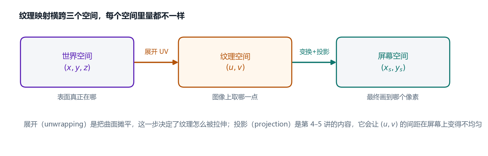

*世界空间里曲面在哪、纹理空间里取哪一点、屏幕空间里画到哪个像素 —— 三个空间各有各的度量，纹理映射的麻烦几乎全部来自它们之间的「不均匀」。*

*170 页 · 117 张关键页截图 · 18 张原创图解 · 6 个手算 · 22 道自测*

> **💡 与前面几讲的关系**
>
> 这一讲是**三讲的汇合点**：
> - **第 2 讲**给了三角形内点判据 `L_i`；这里的重心坐标就是它的归一化
> - **第 3 讲**给了采样理论；这里「贴纹理」就是一次重采样
> - **第 4–5 讲**给了透视除法 `÷w`；这里正是它出问题的地方

## 1. 纹理能干什么

#### P1　Section 5: Texture Mapping

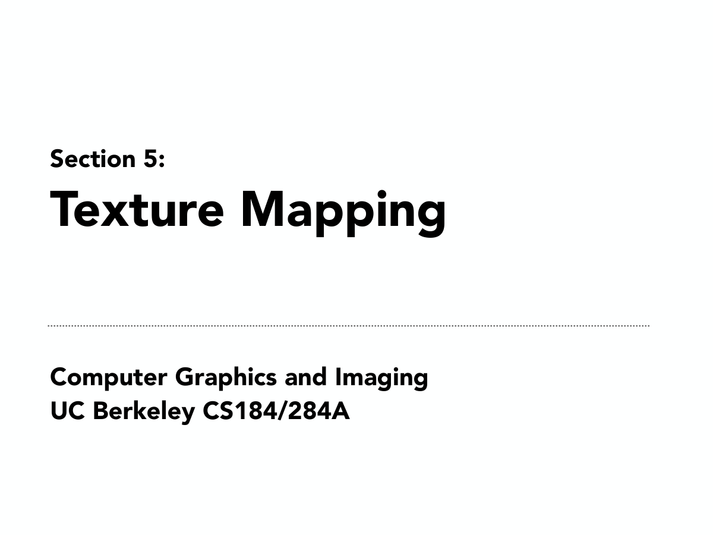

注意这是 **Section 5**，同样跨两讲。

#### P2　Texture Mapping Has Many Uses

*Pattern on ball · Wood grain on floor*

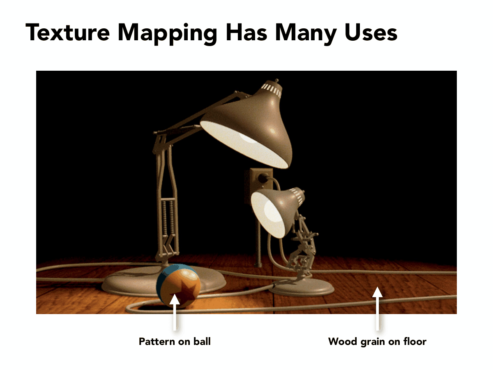

一个带花纹的球、一块木地板的渲染图。

**这一页的潜台词**：这两样东西如果都用几何来建模，多边形数会爆炸（木地板上的年轮、球面上的图案）。而用纹理，只需要「一个光滑的几何 + 一张图」。

#### P3　Describe Surface Material Properties

*Proudfoot et al.*

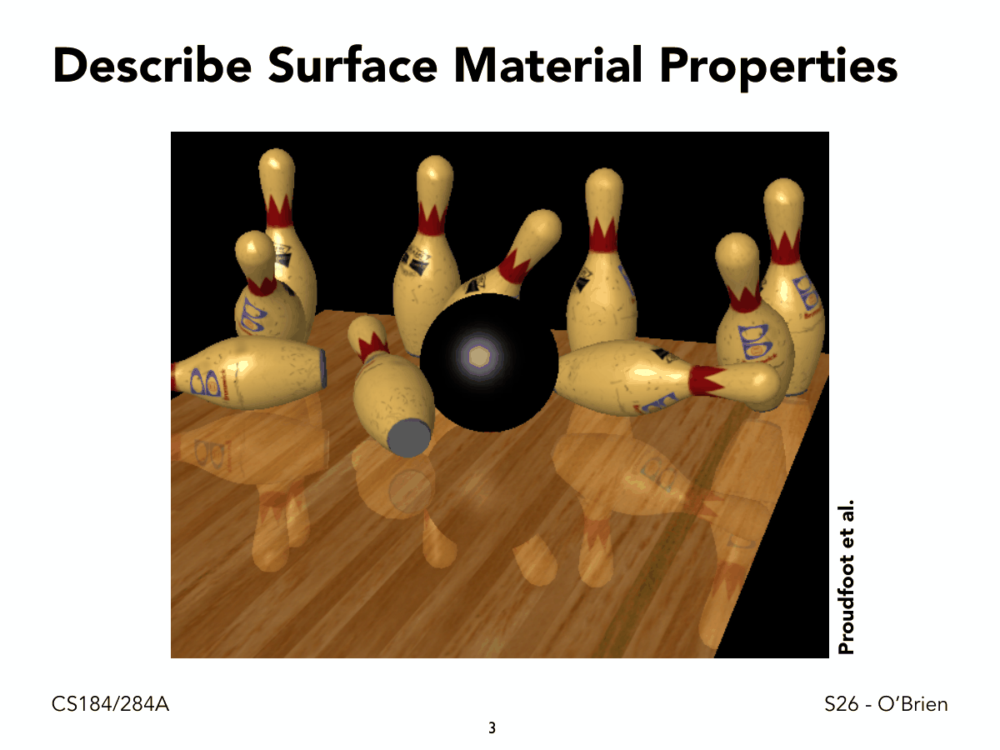

一组复杂表面的渲染（金属、陶瓷质感）。

#### P4　Describe Surface Material Properties

*Add details without raising geometric complexity · Paste image onto geometry or define procedurally*

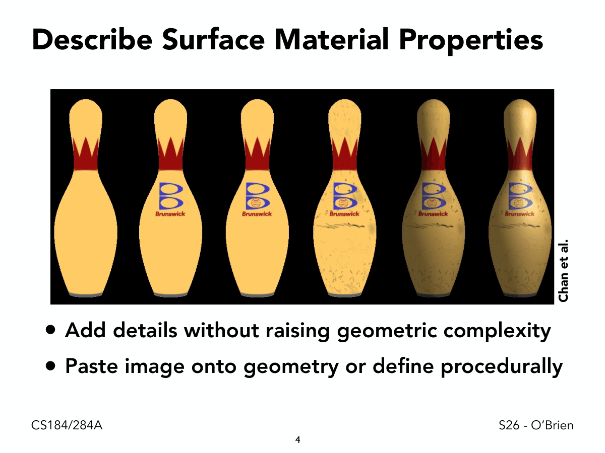

**这是全讲的动机句**，两条路：

| 做法 | 说明 | 优点 / 缺点 |
|---|---|---|
| **贴图**（paste image） | 把一张拍摄/绘制的图贴上去 | 真实，但受分辨率限制 |
| **程序化**（procedural） | 用函数在运行时算 | 无限分辨率，但难调、慢 |

> **📌 「不加几何复杂度」是这一切的起点**
>
> 同一块木地板：
> - 几何做法：每道年轮都要建模 → 几百万三角形，且放大后会看到多边形棱角
> - 纹理做法：一个平面 + 一张图 → 两个三角形
>
> 但这个便宜不是白拿的：**细节被「冻结」进了一张固定分辨率的图**。于是放大就会糊、缩小就会走样 —— 这一讲后半部分全在偿还这笔债。

#### P5–P8　2D Texture Mapping of Images

*Map 2D image onto object*

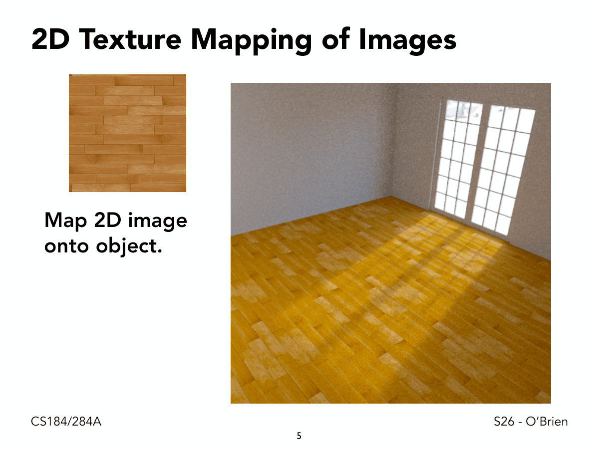

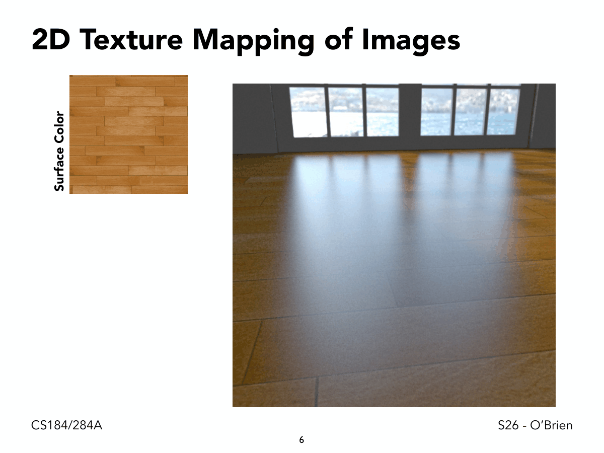

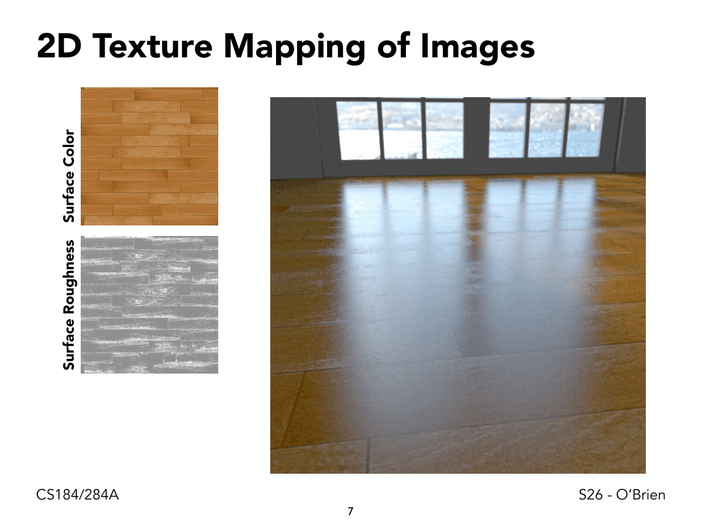

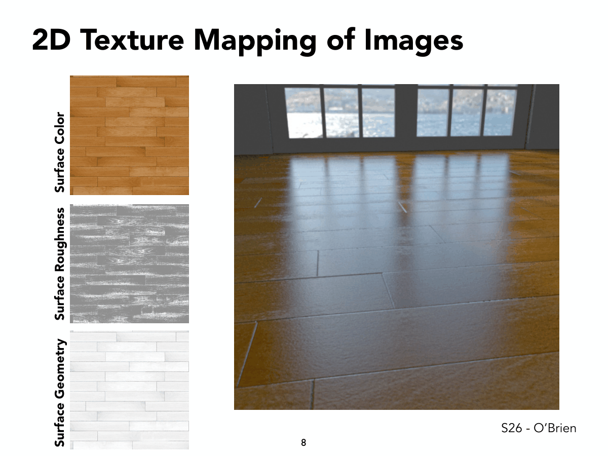

四页逐层加码，说明纹理**存的不一定是颜色**：

| 页 | 纹理存什么 | 用途 |
|---|---|---|
| P5 | 图像本身 | — |
| P6 | **表面颜色**（albedo） | 最经典：木纹、砖墙 |
| P7 | **表面粗糙度** | 控制高光宽窄（金属 vs 塑料） |
| P8 | **表面几何** | 凹凸、皱纹（后面 P152 的 displacement） |

**这个「纹理是通用数据容器」的观点，在 P141 会被正式讲出来**：现代 GPU 里 texture = memory + filtering。

## 2. 从曲面到贴图：UV 与展开

#### P9　Texture Coordinate Mappings

*章节点*

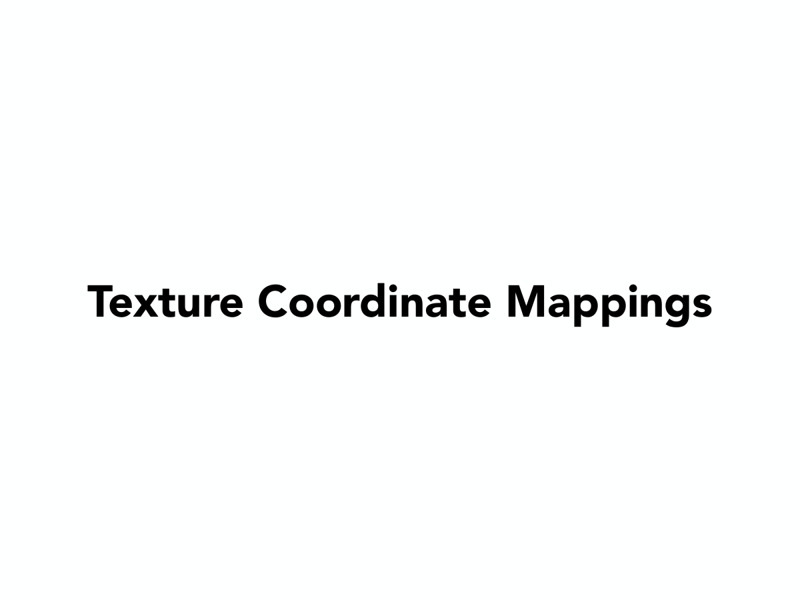

分节页。核心问题：**三维曲面上的每个点，对应到二维图的哪个位置？**

#### P10　Think Chocolate Wrappers

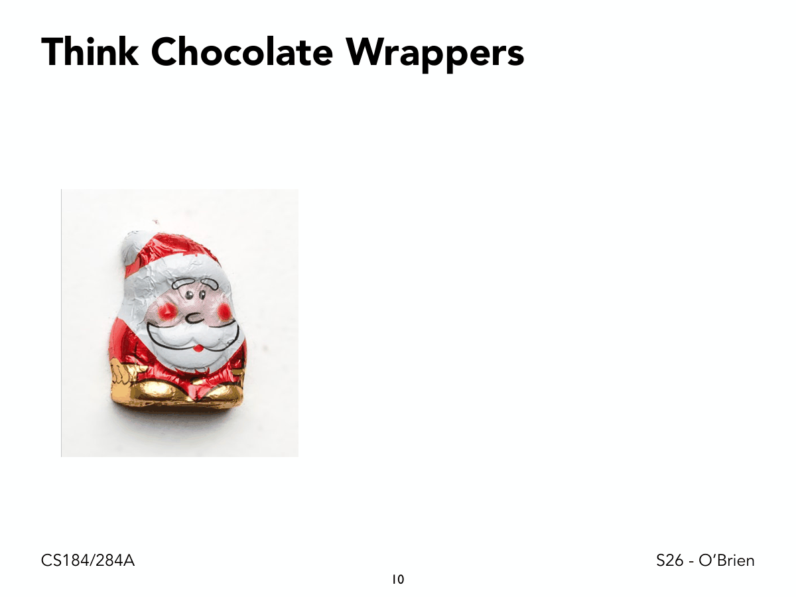

一块巧克力的包装纸（铝箔）。

**这个类比是本节的全部**：包装纸是**二维的一片**，但它包在**三维的巧克力**上。所以：

- 「贴图」= 把一张平面纸包到曲面上
- 「展开」= 反过来，把包好的纸拆下来摊平
- **纸会被拉伸/压缩** —— 这就是纹理扭曲的来源

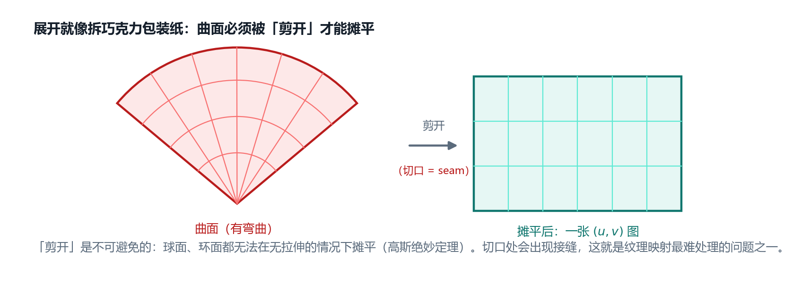

*左：曲面上的格网（弯曲的）。右：摊平后的 `(u,v)` 矩形。中间那一步「剪开」是不可避免的 —— 球面和环面都无法无拉伸摊平，所以切口处必然有接缝。*

#### P12　Three Spaces

*Surface lives in 3D world space · Every 3D surface point also has a place where it goes in the 2D image and in the 2D texture*

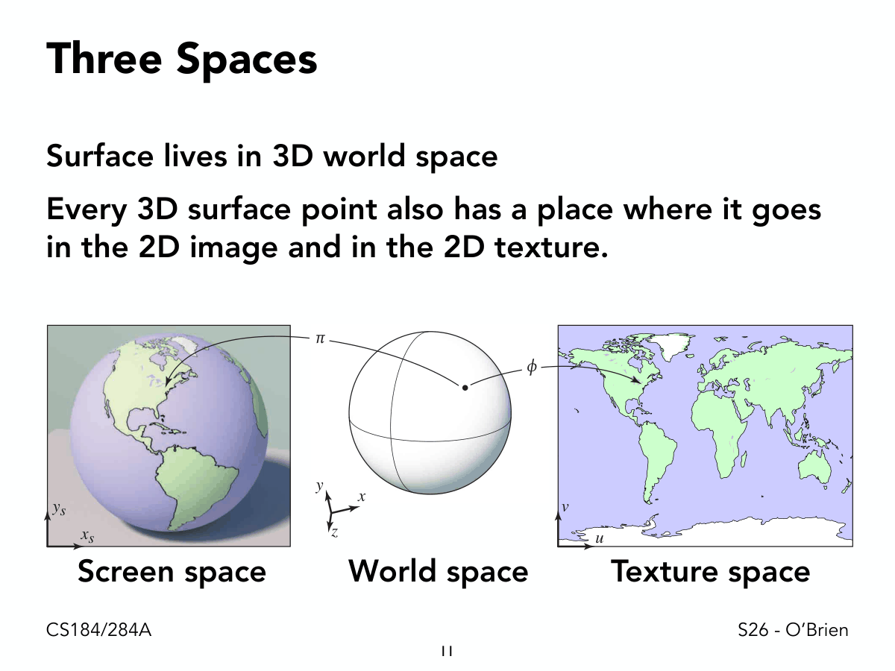

一页图上标了三种坐标：

| 空间 | 坐标 | 量什么 |
|---|---|---|
| **world space** | `(x, y, z)` | 表面真正在哪 |
| **texture space** | `(u, v)` | 图像上取哪一点 |
| **screen space** | `(x_s, y_s)` | 画到哪个像素 |

图上还有 `φ, π`（球面的经纬参数），说明 UV 可以由参数化直接给出。


*三种坐标之间的两次映射：展开（曲面 → UV）和投影（3D → 屏幕）。纹理映射的失真，本质就是这两次映射都不是「保长度」的。*

#### P13　Image Texture Applied to Surface

*Each triangle "copies" a piece of the texture image back to the surface.*

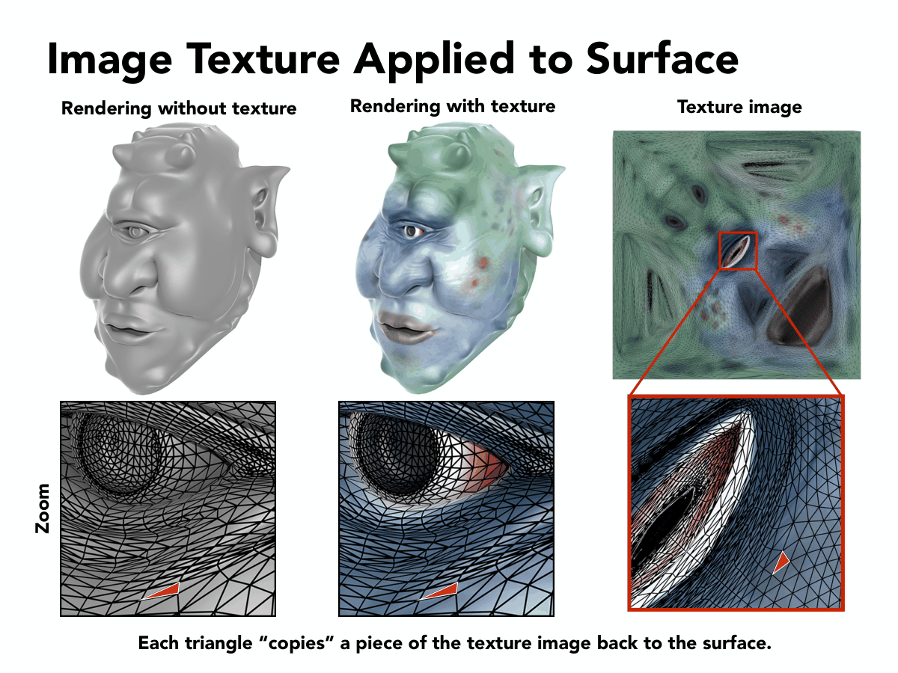

四张图：无纹理渲染、有纹理渲染、纹理图、外加两个放大局部（对比无纹理/有纹理的边缘）。

**加粗小字是本讲最实用的心智模型**：

> ***"Each triangle 'copies' a piece of the texture image back to the surface."***
>
> 每个三角形从纹理图里「抄」一小块贴回曲面。

**为什么这个说法好用**：因为它在 GPU 里的确是这样实现的 —— 三角形的三个顶点各自带一个 `(u,v)`，内部的 `(u,v)` 靠插值，然后逐像素去纹理里取色。**所以「三角形」是纹理映射的基本单位，而 UV 只存在顶点上。**

#### P14–P16　Visualization of Texture Coordinates

*Each surface point is assigned a texture coordinate (u,v)*

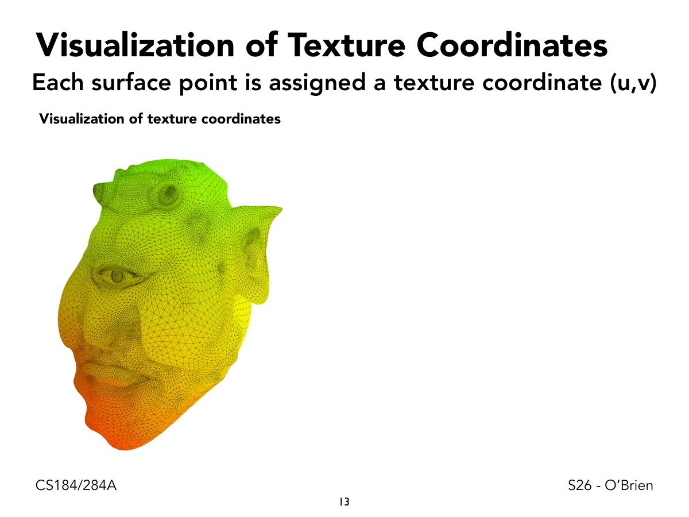

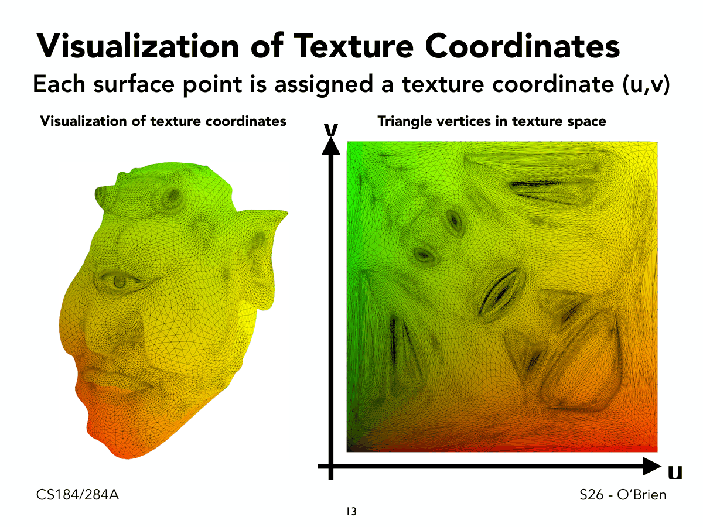

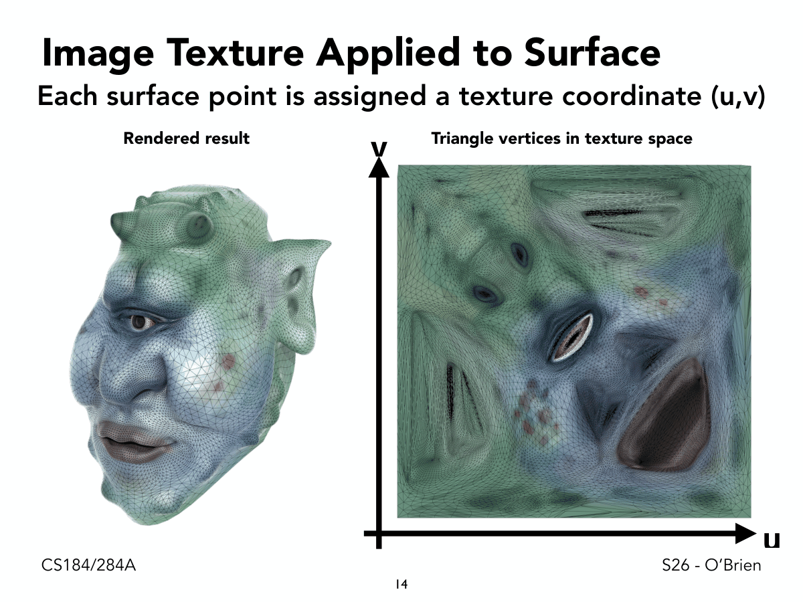

三页是同一个模型的三种显示：

| 页 | 显示什么 |
|---|---|
| P14 | 模型表面用**彩虹色**表示 `(u,v)`（红→绿 是 u，绿→黄 是 v） |
| P15 | 右边多一个**摊平的 uv 方形**，里面是同一套彩虹图案 |
| P16 | 换成真实纹理，左边模型、右边仍是 uv 摊平图 |

**这种「彩虹 UV 可视化」是图形学里标准的调试手段**：它把「抽象坐标」变成「看得见的图案」，一眼就能看出 UV 有没有重叠、有没有拉伸。

#### P17　Creating Good Surface Coordinates is Hard

*Finding cuts · Texture atlases*

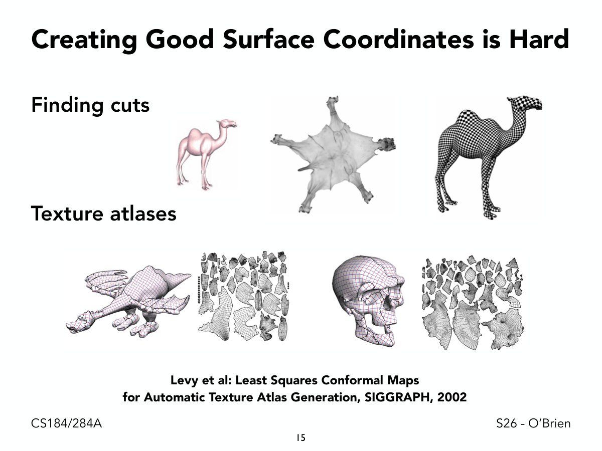

图上列了三个模型的展开（骆驼、犰狳、人），并标注两个难点：

| 难点 | 说明 |
|---|---|
| **Finding cuts** | 要摊平就必须剪开，而「在哪剪」是个难题（剪得不好会有明显接缝、拉伸） |
| **Texture atlases** | 把多个物体的 UV 打包进一张图，减少贴图数量（游戏里常见） |

底部引文：**Levy et al: Least Squares Conformal Maps for Automatic Texture Atlas Generation, SIGGRAPH 2002** —— 这是一篇经典的自动展开论文。

#### P18–P20　Sponza Palace Model

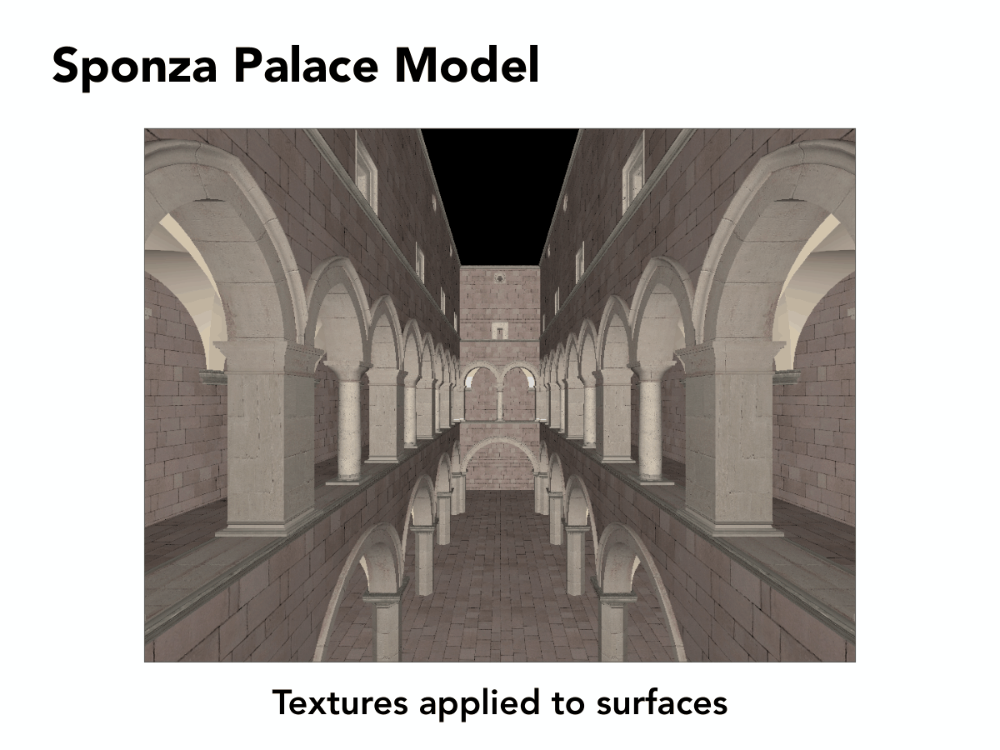

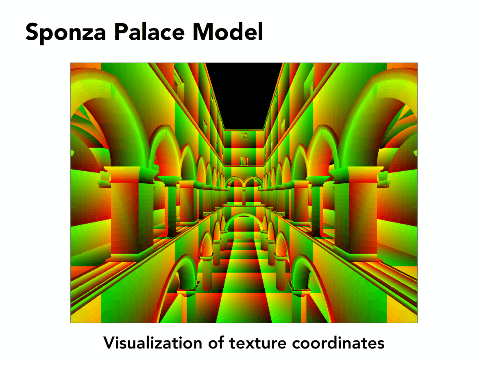

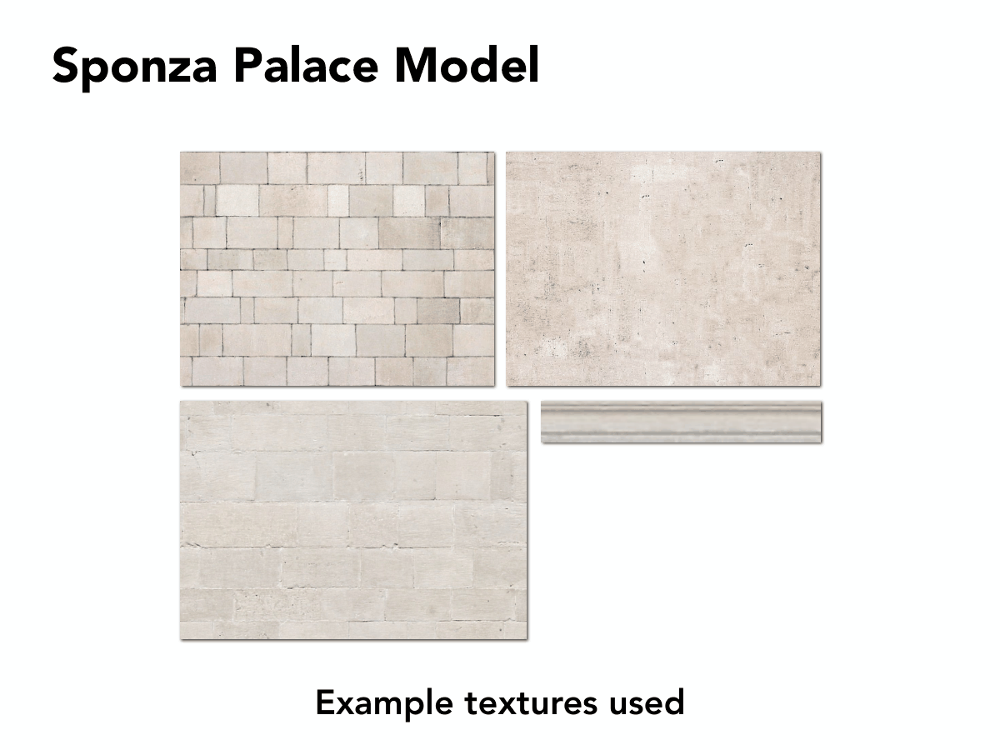

三页展示一个真实场景模型：

- P18：贴完纹理的效果（石柱、拱廊、地面）
- P19：**同一模型的 UV 可视化** —— 注意那些颜色是「一块块矩形」而不是连续的彩虹，说明这张 UV 是**图集**（很多矩形块拼在一张图上）
- P20：实际用到的几张砖石纹理

**P19 值得多看一眼**：它展示了真实资产的做法 —— 不是「一个模型一张连续展开图」，而是**把墙面、柱子、地面各切成几块，各自映射到一张图集的不同区域**。这样能复用材质、减少纹理切换。

#### P21　Repeating Textures

*Image Tiles allow repeating textures · Images must be manipulated to allow tilling · Often result in visible artifacts · There are methods to get around artifacts....*

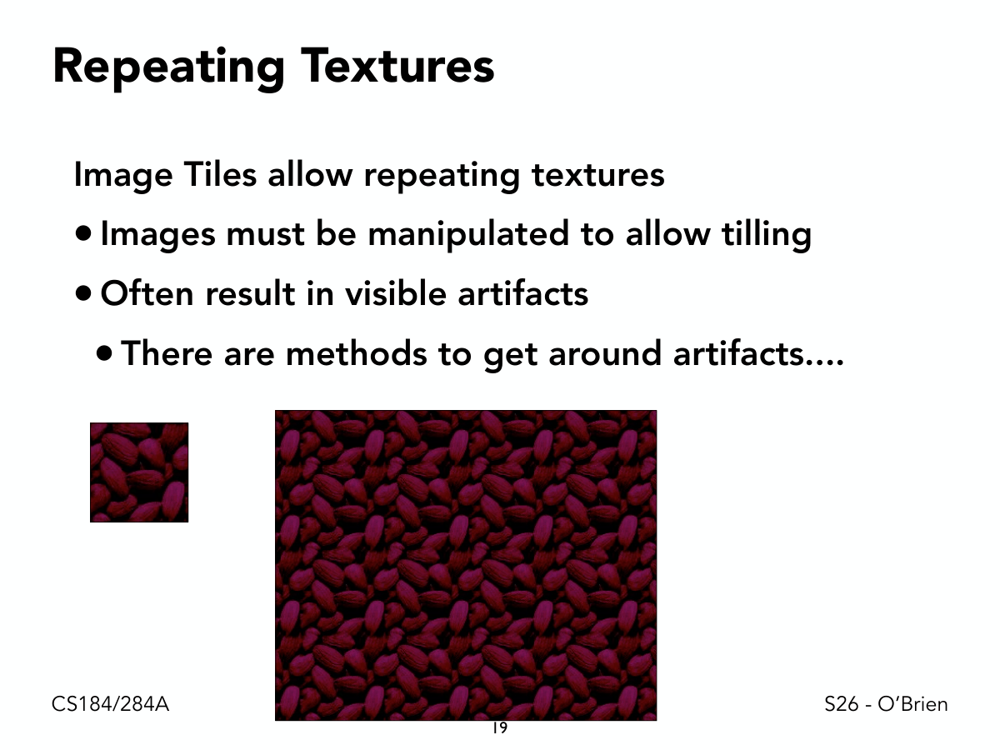

一块砖纹在一个小方块里，旁边是同一张图平铺 4×4 的效果。

四条要点：

| 要点 | 说明 |
|---|---|
| 平铺能放大覆盖范围 | 一张 512² 的砖纹可以铺满整面墙 |
| 图像必须**可平铺**（tileable） | 左右边缘要能无缝接上 |
| 常产生**可见的重复感** | 人眼很容易认出「同样的图案每 2 米重复一次」 |
| 有办法缓解 | 混合多个不同尺度的平铺、随机旋转、加噪声扰动 |

> **⚠️ 平铺还有一个采样上的毛病**
>
> 平铺的接缝处，UV 从 `0.99` 跳到 `0.01`。如果对 `u` 做线性插值（或算导数），**跨越接缝的那一个像素会算出一个巨大的 `du`** → mipmap 层级突然跳变 → 接缝处出现一条模糊带或一条硬线。
>
> 正确做法是在**采样时**用 `frac()` 处理 UV，但在**算导数时**要避免跨越接缝（或用 `fract` 后的差分并做环绕修正）。这是写纹理 shader 时的经典坑。

## 3. 重心坐标：三角形内的插值

#### P22　Interpolation Across Triangles: Barycentric Coordinates

*章节点*

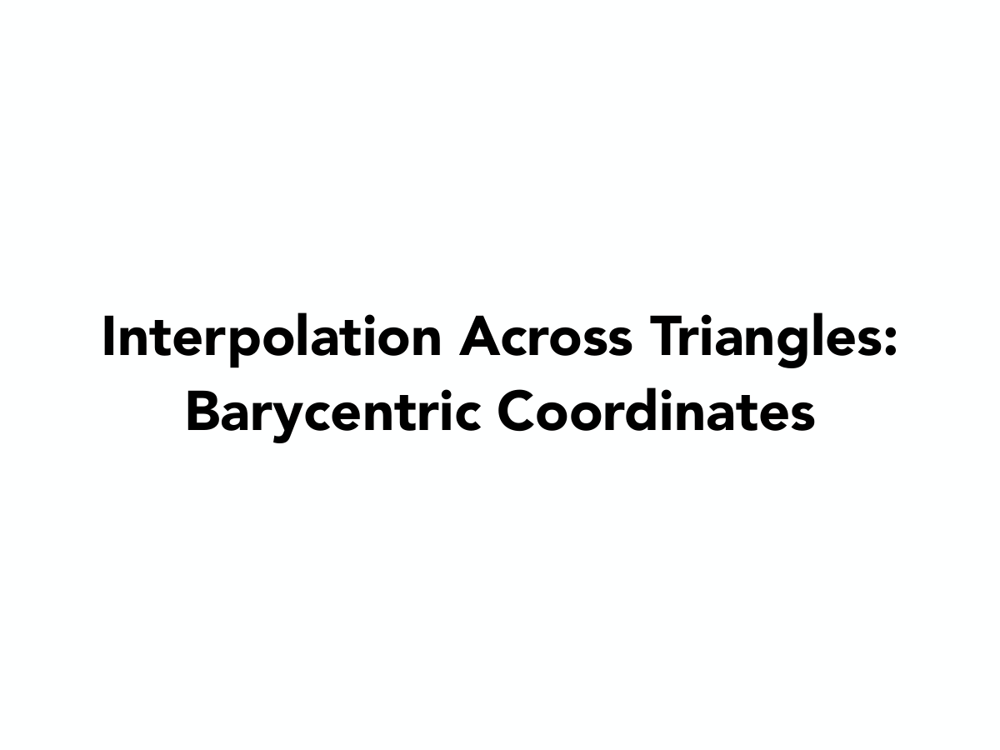

分节页。UV 只存在于顶点上，**三角形内部的值必须插出来**。这一节专门解决"怎么插"。

#### P23–P26　Interpolation Across Triangles

*Why? What? How?*

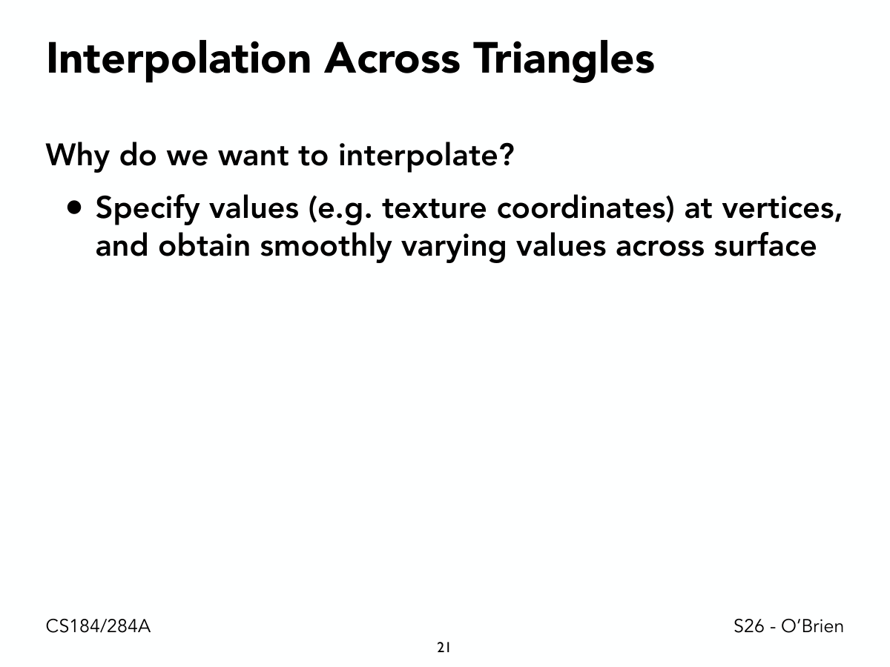

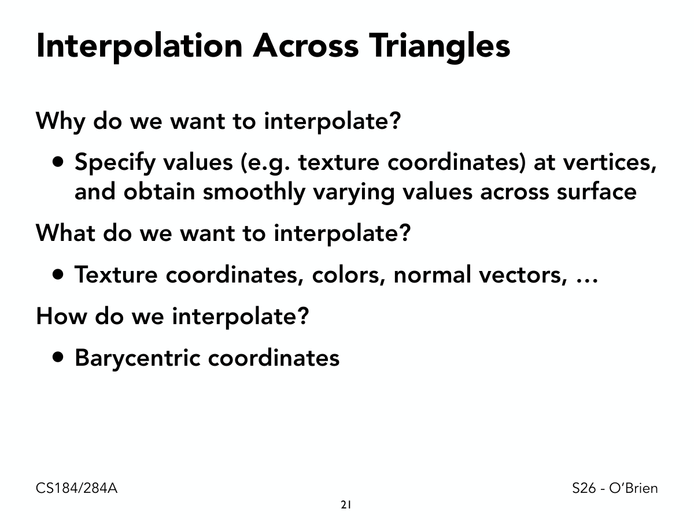

讲义用四个问题组织：

| 问题 | 答案 |
|---|---|
| **Why** interpolate? | 在顶点上指定值，然后让它在表面**平滑变化** |
| **What** to interpolate? | 纹理坐标、颜色、法向量、材质参数…… |
| **How**? | **重心坐标**（barycentric coordinates） |
| 还有一问 | 插值出来的东西**对不对**？（第 4 节回答：透视下不对） |

**为什么只插顶点就够**：因为三角形是**凸**的（第 2 讲 P37），任何内部点都能唯一写成三个顶点的凸组合。这就是重心坐标存在的理由。

#### P27　Barycentric Coordinates

*A coordinate system for triangles*

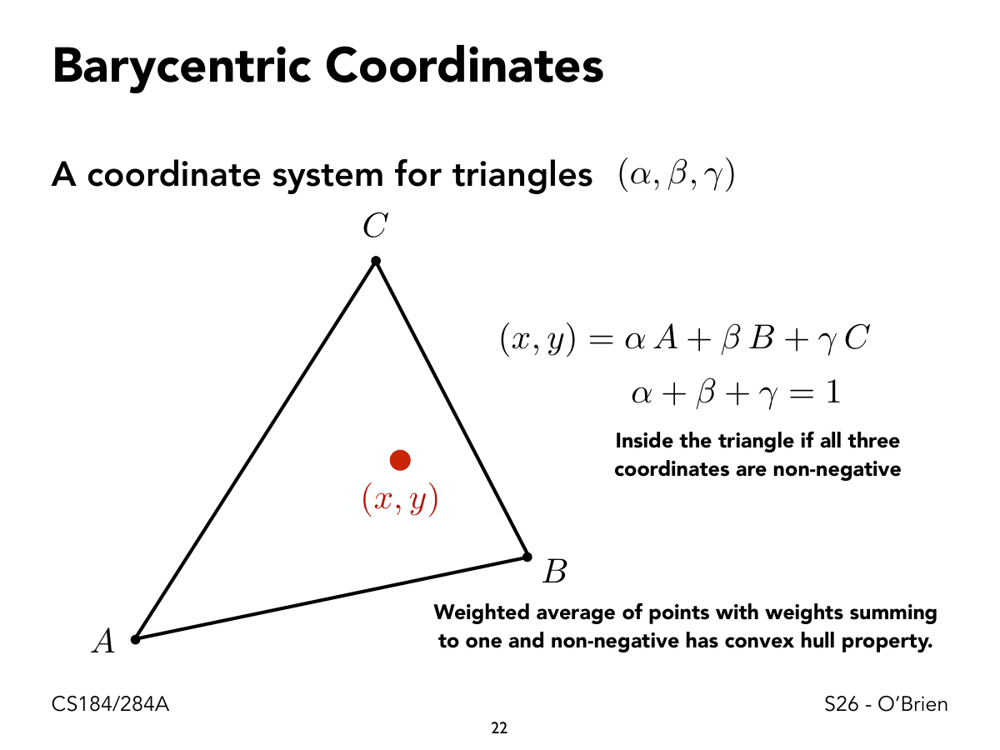

$$
\alpha+\beta+\gamma=1,\qquad (x,y)=\alpha A+\beta B+\gamma C
$$

图上画了三角形 `A B C`，内部点 `(x,y)` 标注为 `(α, β, γ)`。

两个性质（讲义原文）：

> - Inside the triangle if all three coordinates are **non-negative**
> - Weighted average of points with weights summing to one and non-negative has **convex hull property**

**第二句是全讲的隐含基础**：因为权重非负且和为 1，插出来的值一定落在三个顶点值张成的范围内 —— **不会「插飞」**。这个性质叫凸包性质。

#### P28–P29　Barycentric Coordinates - Examples

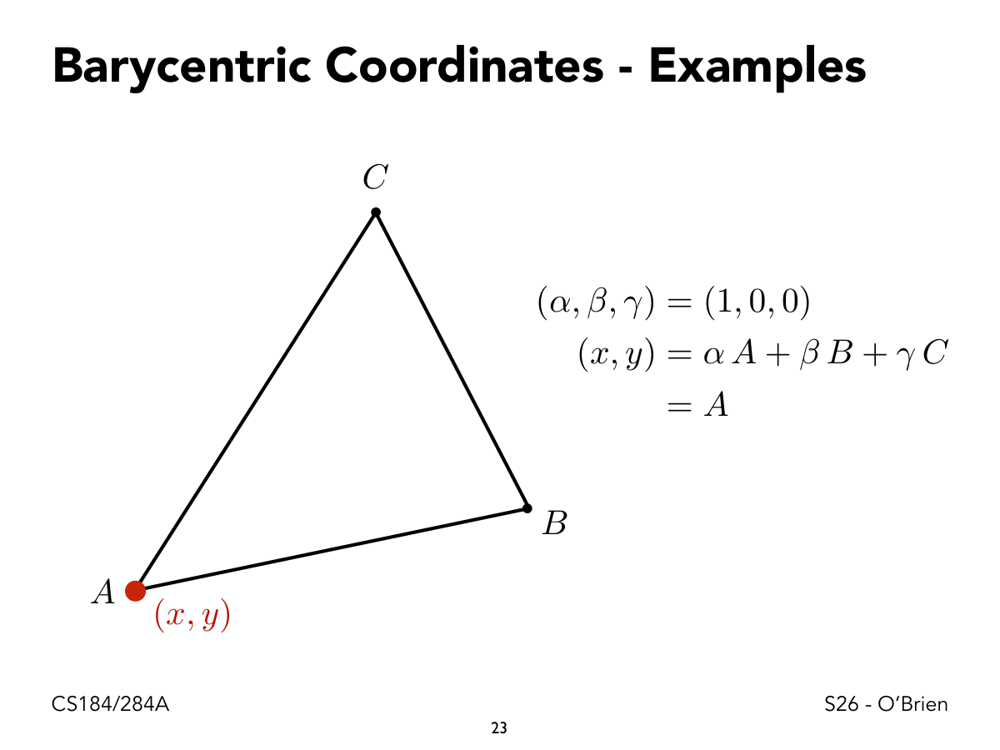

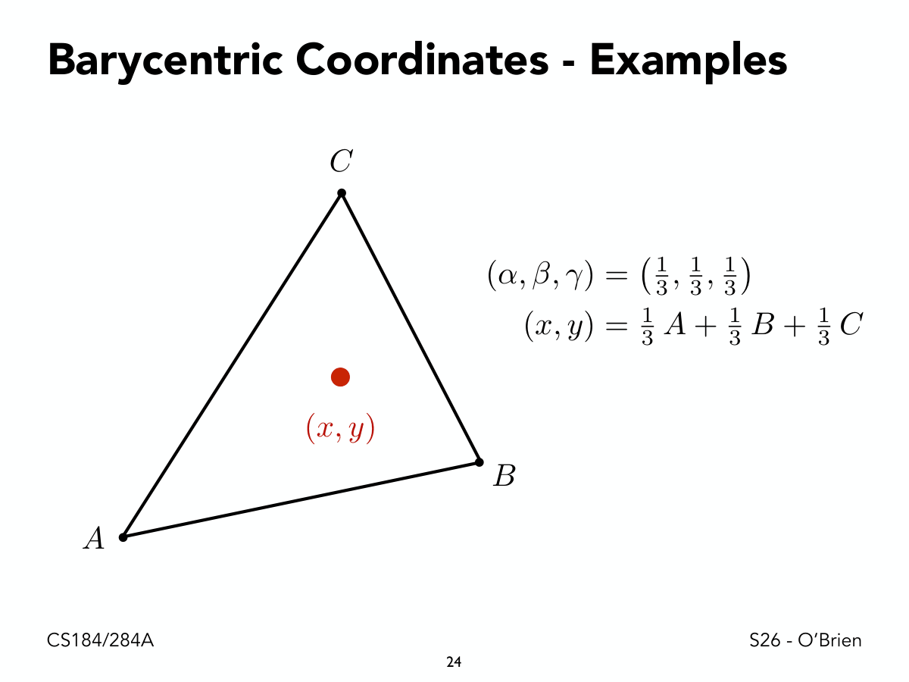

两页给出两个基准值：

| 位置 | `(α, β, γ)` | 说明 |
|---|---|---|
| `A` 点 | `(1, 0, 0)` | 在顶点上，权重全给 A |
| 三角形中心 | `(1/3, 1/3, 1/3)` | 三个顶点等权 |

**这两个值构成了整个插值的"边条件"**：在 `A` 处插值结果必须等于 `V_A`，在中心处必须等于三个的平均。

#### P30　Linear Interpolation Across Triangle

*Barycentric coords linearly interpolate values at vertices*

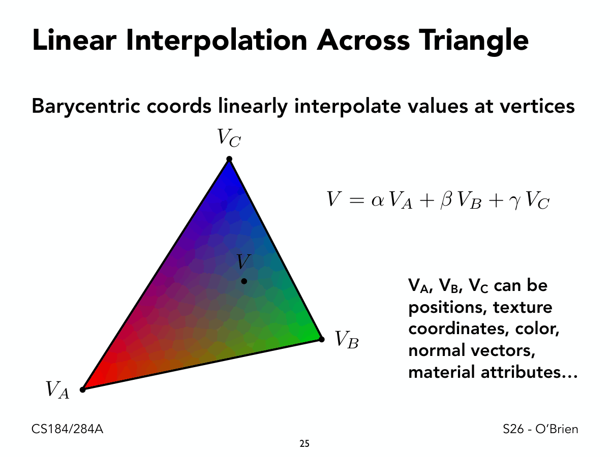

$$
V=\alpha V_A+\beta V_B+\gamma V_C
$$

图上标了 `V_A, V_B, V_C` 和内部的 `V`。

**`V` 可以是任何东西**（讲义明确列出）：位置、纹理坐标、颜色、法向量、材质属性。

**这就是"顶点属性插值"的统一框架** —— 只要一个量存在顶点上，就能用同一个公式插到内部。

#### P31　Barycentric Coordinates

*Geometric viewpoint — proportional distances*

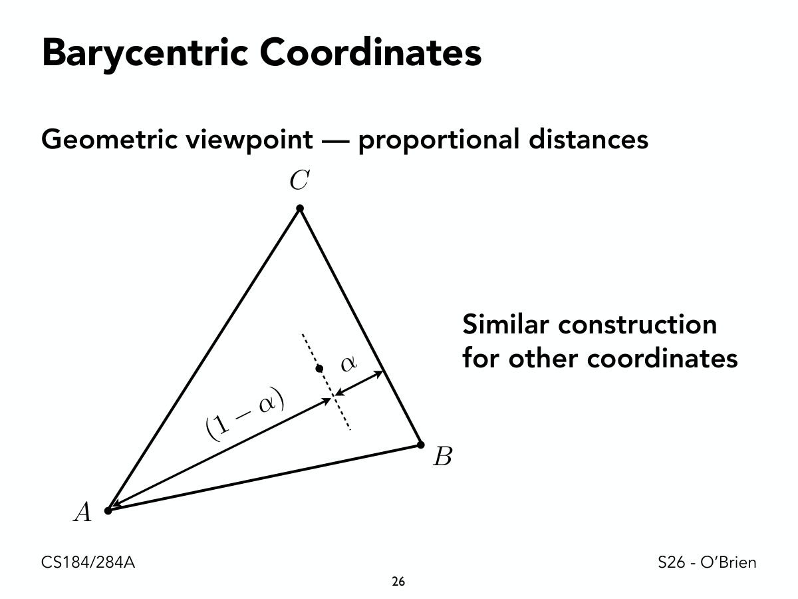

图上从 `A` 向 `BC` 边画了一条线段，在内部点处分成 `α` 和 `(1−α)` 两段。

**读法**：`α` 就是"从 `A` 出发、向 `BC` 走，走了多少比例"。

- `α = 1` 时还在 `A`（走了 0）
- `α = 0` 时已经到了 `BC` 边

**注意这个方向很容易搞反**：`α = 1` 对应 `A` 点，而不是对应 `BC` 边。记住 P28 的 `(1,0,0) = A` 就不会错。

### 3.1 怎么算（P32–P36）

#### P32　Computing Barycentric Coordinates

*Recall the line equation we derived in Lecture 2. L_PQ(x,y) is proportional to the distance from line PQ.*

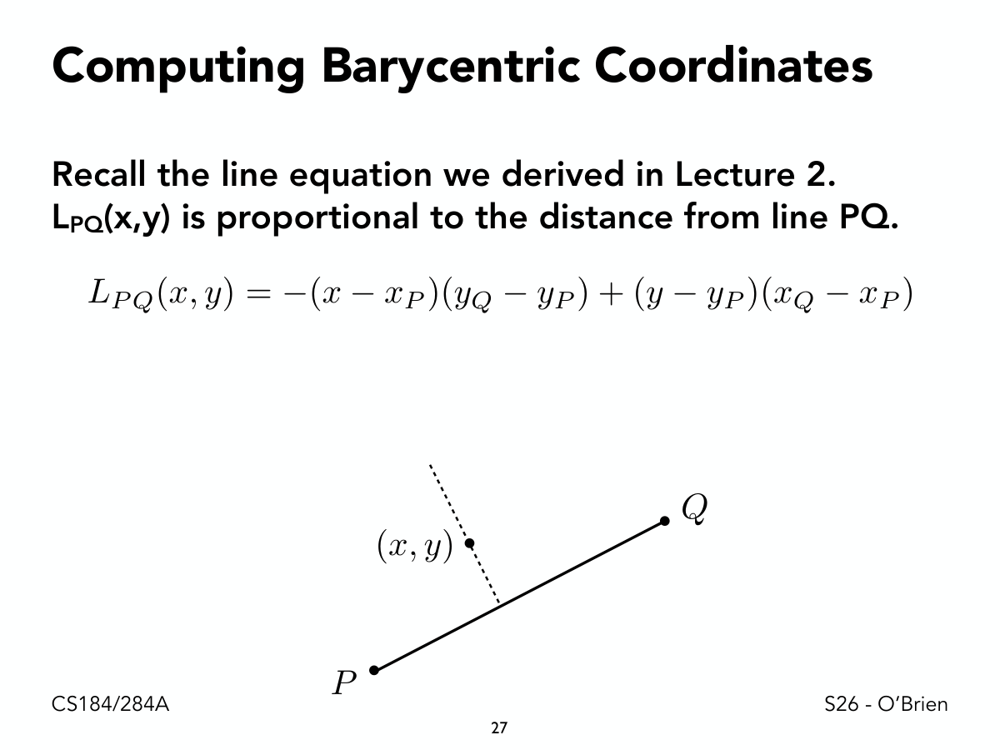

**这一页把两讲接上了**：第 2 讲为了判断内点算出的

$$
L_{PQ}(x,y)=-(x-x_P)(y_Q-y_P)+(y-y_P)(x_Q-x_P)
$$

**正比于点到直线 `PQ` 的距离**（比例因子是 `|Q−P|`）。

既然重心坐标是"距离的比例"，那 `L` 直接就能用：

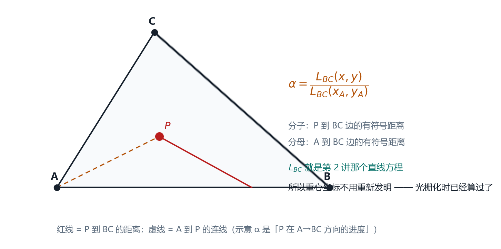

*α 的分子是 P 到 BC 边的有符号距离，分母是 A 到 BC 边的有符号距离。分母是常数（每个三角形算一次），所以每次求值只需算一个 L。*

#### P35　Computing Barycentric Coordinates

*α = L_BC(x,y) / L_BC(x_A, y_A)*

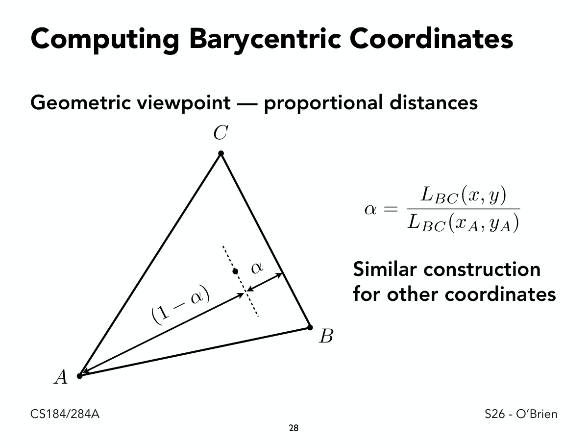

$$
\alpha=\frac{L_{BC}(x,y)}{L_{BC}(x_A,y_A)}
$$

**为什么这样归一化就对**：在 `A` 点处，分子分母相同 → `α = 1` ✓；在 `BC` 边上，分子为 0 → `α = 0` ✓。**两个边界条件都对，而 `L` 又是线性的，所以中间必然线性**。

另外两个坐标同理（用另外两条边）。

#### P36　Barycentric Coordinate Formulas

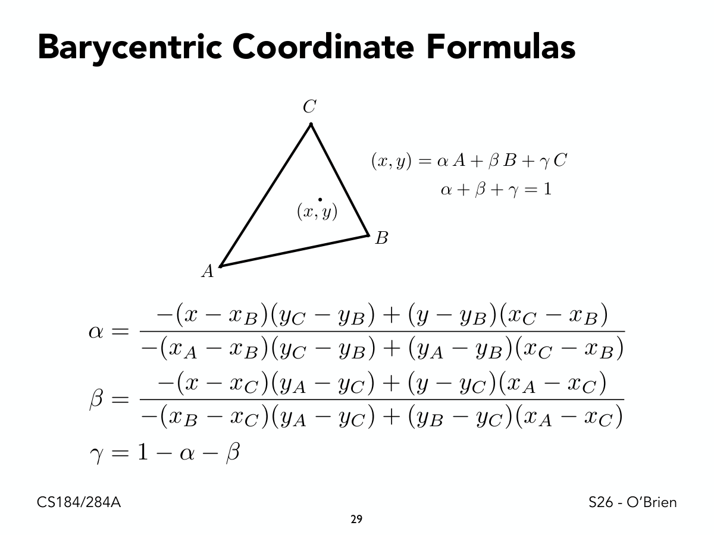

$$
\alpha=\frac{-(x-x_B)(y_C-y_B)+(y-y_B)(x_C-x_B)}
{-(x_A-x_B)(y_C-y_B)+(y_A-y_B)(x_C-x_B)}
$$

$$
\beta=\frac{-(x-x_C)(y_A-y_C)+(y-y_C)(x_A-x_C)}
{-(x_B-x_C)(y_A-y_C)+(y_B-y_C)(x_A-x_C)},
\qquad \gamma=1-\alpha-\beta
$$

**注意 `γ` 是算出来的，不是求出来的** —— 因为 `α+β+γ=1`，算两个就够。**这在实现里省一次求值**，而且自动保证三个权重和恰好为 1（浮点上比三次独立计算更稳）。

**🔧 手算 1：完整算一次**

取 `A=(0,0)`、`B=(4,0)`、`C=(0,4)`，点 `P=(1,1)`。

**用面积法最快**（`α` 对应"对着 A 的那块"，即 `PBC` 的面积）：

| 量 | 计算 |
|---|---|
| `Area(ABC)` | `4×4/2 = 8` |
| `Area(PBC)`（对应 α） | `B(4,0)`、`C(0,4)`、`P(1,1)` → 用叉积：`½|(B−P)×(C−P)| = ½|(3,−1)×(−1,3)| = ½|3·3 − (−1)(−1)| = ½(9−1) = 4` |
| `Area(APC)`（对应 β） | `A(0,0)`、`P(1,1)`、`C(0,4)` → `½|(1,1)×(0,4)| = ½|1·4−1·0| = 2` |
| `Area(ABP)`（对应 γ） | `½|(4,0)×(1,1)| = ½|4·1−0·1| = 2` |

于是：

$$
\alpha=\frac{4}{8}=0.5,\qquad \beta=\frac{2}{8}=0.25,\qquad \gamma=\frac{2}{8}=0.25
$$

验证 `(x,y) = 0.5·(0,0) + 0.25·(4,0) + 0.25·(0,4) = (1, 1)` ✓

#### P37　Alternative Geometric Viewpoint — Proportional Areas

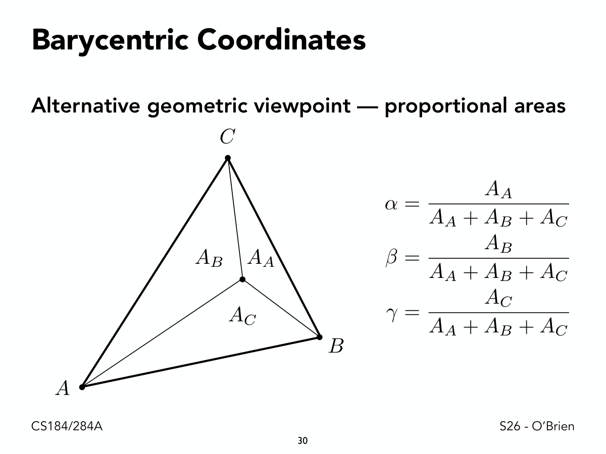

$$
\alpha=\frac{A_\alpha}{A_\alpha+A_\beta+A_\gamma},\quad
\beta=\frac{A_\beta}{\sum A},\quad
\gamma=\frac{A_\gamma}{\sum A}
$$

图上把三角形分成三块（每块由 `P` 和一个边组成），分别标 `A_A, A_B, A_C`。

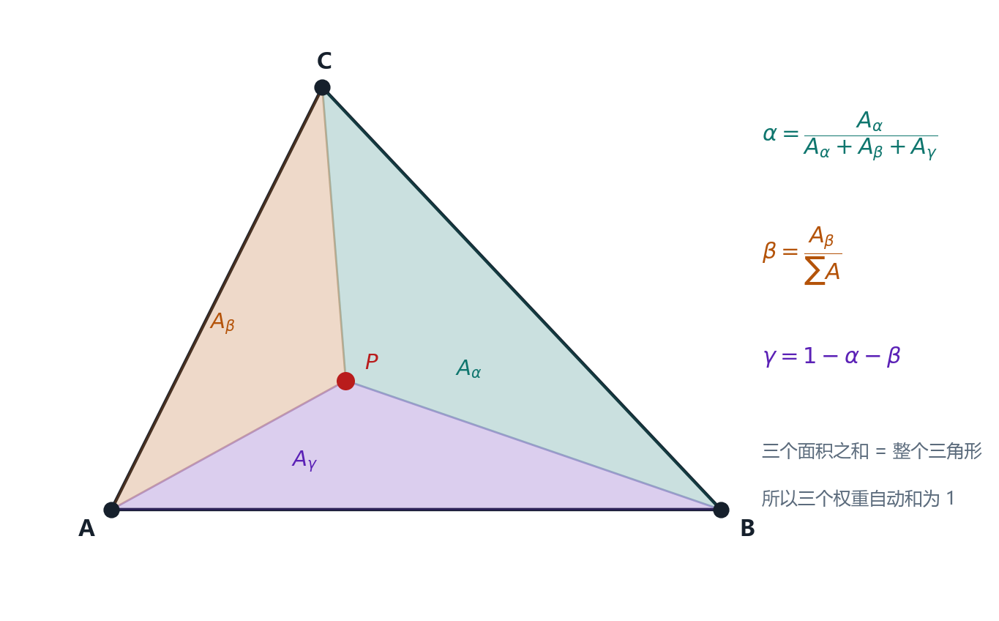

*P 与三条边各围出一个小三角形，重心坐标就是这三个小三角形占大三角形的面积比。**三条边围出的三个面积加起来正好是整个三角形**，所以三个权重自动和为 1。*

**面积视角和距离视角是等价的**：高相同时，面积比 = 底边比 = 距离比。**代码里用哪个都行**，但面积法更直观、距离法更快（不用算叉积的绝对值）。

### 3.2 线性代数视角（P38–P42）

#### P40–P41　Linear Algebra View

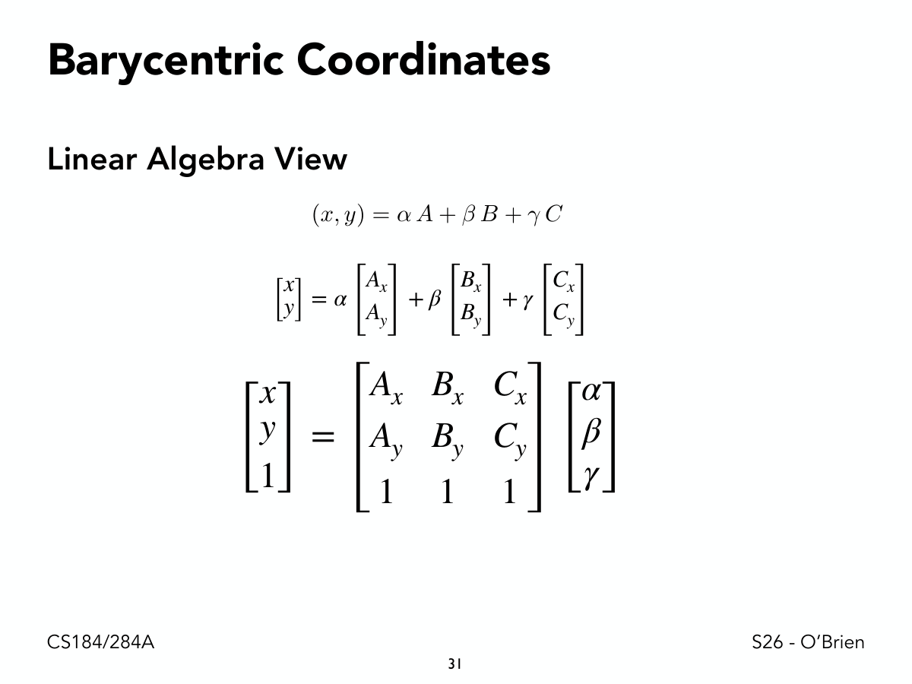

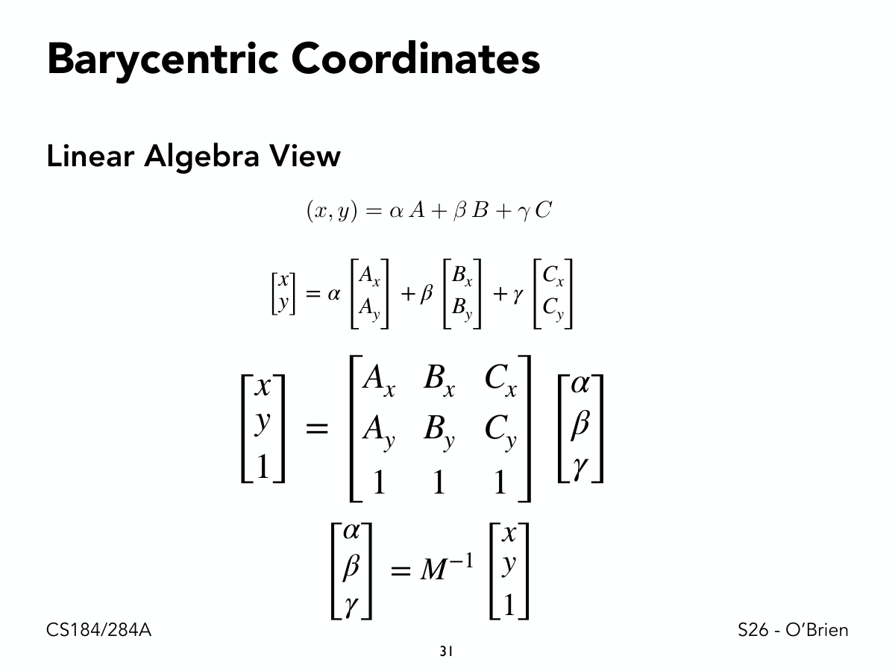

$$
\begin{bmatrix}x\\y\\1\end{bmatrix}
=\begin{bmatrix}A_x&B_x&C_x\\A_y&B_y&C_y\\1&1&1\end{bmatrix}
\begin{bmatrix}\alpha\\\beta\\\gamma\end{bmatrix}
\quad\Longrightarrow\quad
\begin{bmatrix}\alpha\\\beta\\\gamma\end{bmatrix}=M^{-1}\begin{bmatrix}x\\y\\1\end{bmatrix}
$$

**底行全是 1** 这件事很关键：它对应的方程就是 `α+β+γ=1`。**把归一化条件写进矩阵，求解就自动满足归一化**。

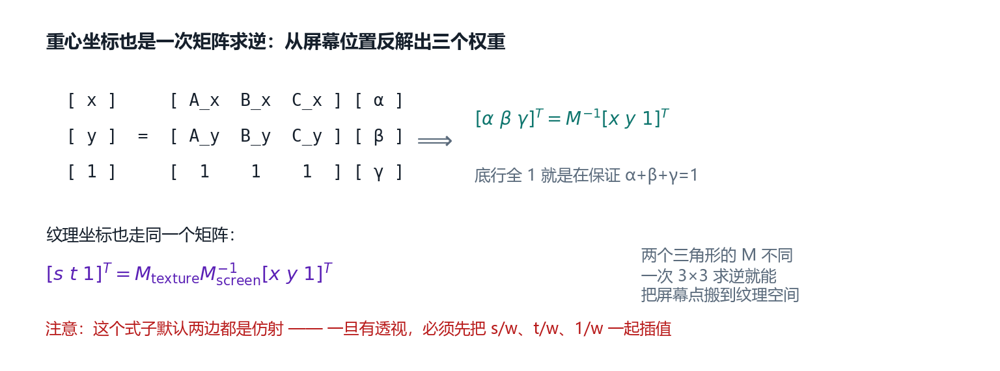

*从屏幕位置反解三个权重，就是一次 3×3 求逆。而纹理坐标走的是同一个矩阵链 —— 这就是为什么"从屏幕点查纹理"能被实现成一个小矩阵乘法。*

#### P42　Barycentric Coordinates

*Consider SVD of · Note: this ignores perspective distortion…*

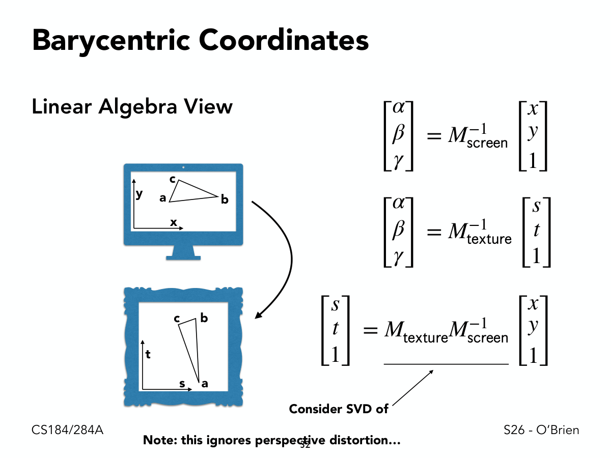

这一页把两条链拼起来：

$$
\begin{bmatrix}s\\t\\1\end{bmatrix}
=M_{\text{texture}}\,M_{\text{screen}}^{-1}
\begin{bmatrix}x\\y\\1\end{bmatrix}
$$

图上是两个「显示器」——左边屏幕空间、右边纹理空间，中间用箭头的逆连接。

**底部那行小字是本讲的转折点**：

> ***"Note: this ignores perspective distortion…"***
>
> 注意：这个式子忽略了透视畸变……

下一节就是讲这个"忽略"有多严重。

## 4. 透视插值：为什么线性是错的

#### P43　Perspective Projection and Interpolation

*章目标题*

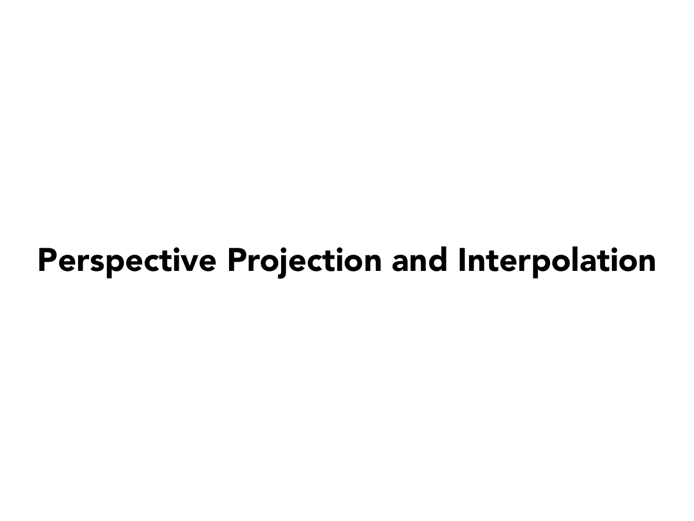

分节页。这一节回答 P42 那个伏笔。

#### P44–P45　Perspective Projection and Interpolation

*Original Texture · Linear/Affine Distortion (Top is "squished") · Perspective Distortion (Plane tilted away from viewer)*

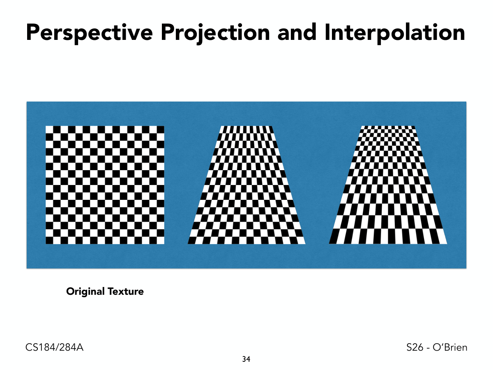

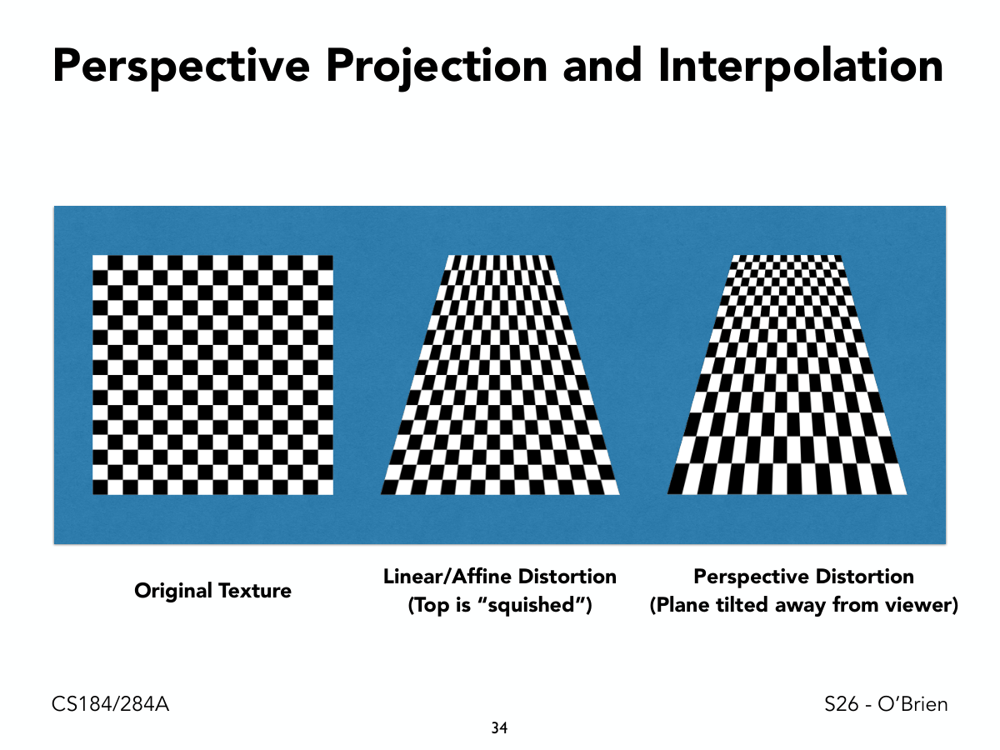

三张棋盘格：

| 图 | 状态 | 说明 |
|---|---|---|
| 左 | **Original Texture** | 原始纹理，正方形的格子 |
| 中 | **Linear/Affine Distortion** | 顶部被「挤扁」（top is "squished"） |
| 右 | **Perspective Distortion** | 平面相对观察者倾斜 |

**注意中间那张的措辞**：*"Linear/Affine Distortion"* —— 讲义把"线性插值造成的失真"直接称为**仿射失真**。因为屏幕上做线性插值，等价于假设"纹理坐标在屏幕空间里是仿射函数"，而这个假设在透视下不成立。

#### P46　Perspective Projection and Interpolation

*Barycentric interpolation of texture coordinates in screen-space*

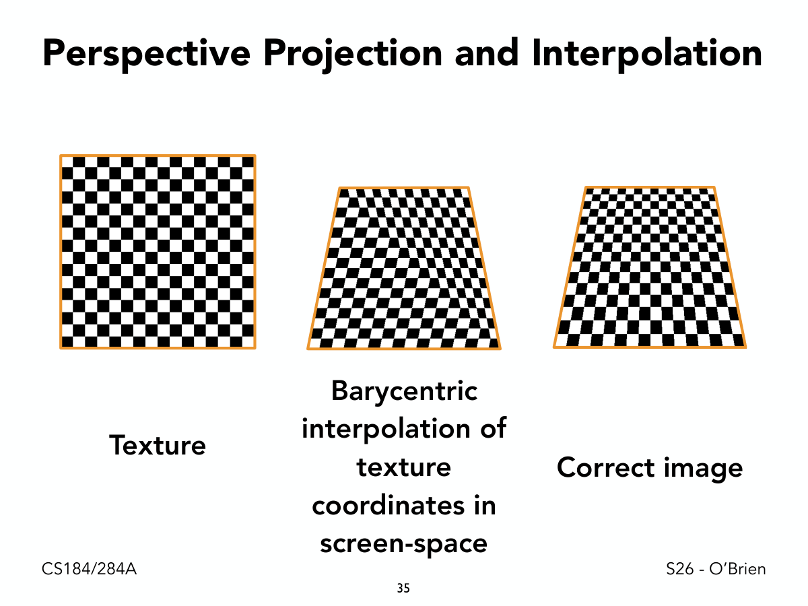

三张图并排：`Texture` / `Barycentric interpolation of texture coordinates in screen-space` / `Correct image`。

**中间那张就是"错的结果"**：格子在上半部分被拉伸，下半部分被压缩。

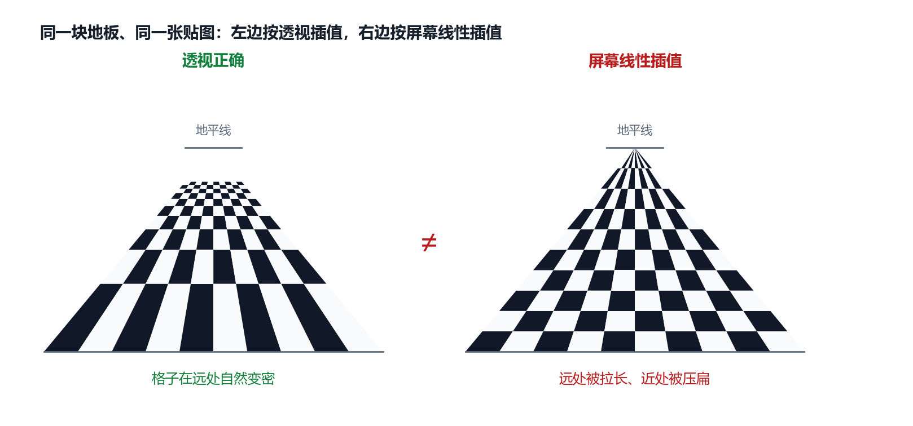

*同一块地板、同一张贴图。左边按透视插值，格子往远处自然变密；右边按屏幕线性插值，远处被拉长、近处被压扁 —— **这就是 P46 中间那张「错图」的成因**。*

#### P47　Perspective Projection Creates Non Linearity

*Linear interpolation in world coordinates yields nonlinear interpolation in screen coordinates! · Perspective interpolation supported in GPU*

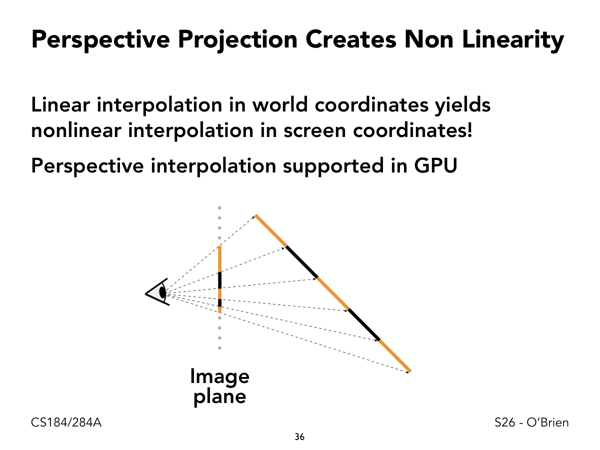

**标题就是定理**：

> 在**世界**坐标里线性插值，在**屏幕**坐标里就变成**非线性**插值！

图上画了像平面和一条斜的平面，虚线表示等分点 —— 在平面上等分，投影到像平面上就不等分了。

**第二行小字是好消息**：*"Perspective interpolation supported in GPU"* —— GPU 硬件**默认**做透视正确的插值，所以你写 shader 时不用操心。**但自己写软件光栅器时必须自己实现**（HW1/HW2 的经典坑）。

#### P48　Perspective-Correct Interpolation

*Affine screen-space interpolation · Perspective world-space interpolation*

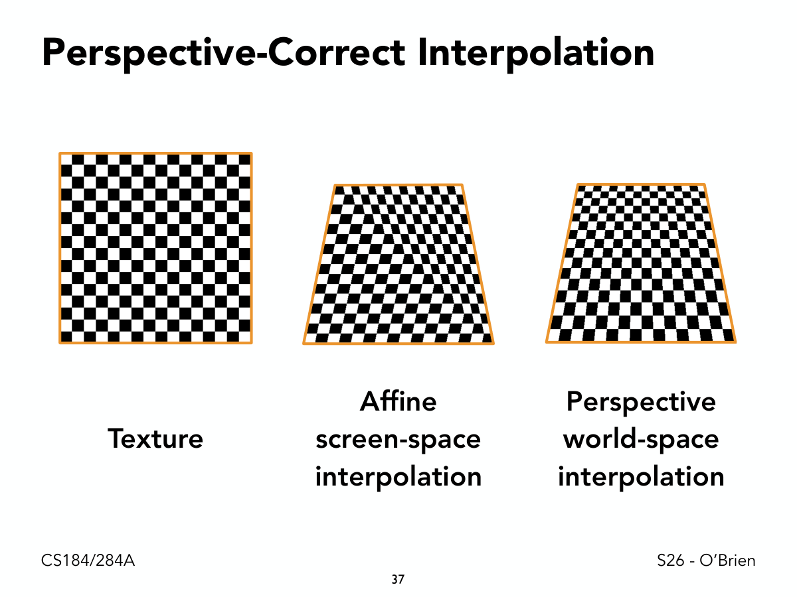

三张图：`Texture` / `Affine screen-space interpolation` / `Perspective world-space interpolation`。

**右边那张才是对的** —— 格子在远处自然变密。

#### P49–P58　Depth Distortion（选学，灰色页）

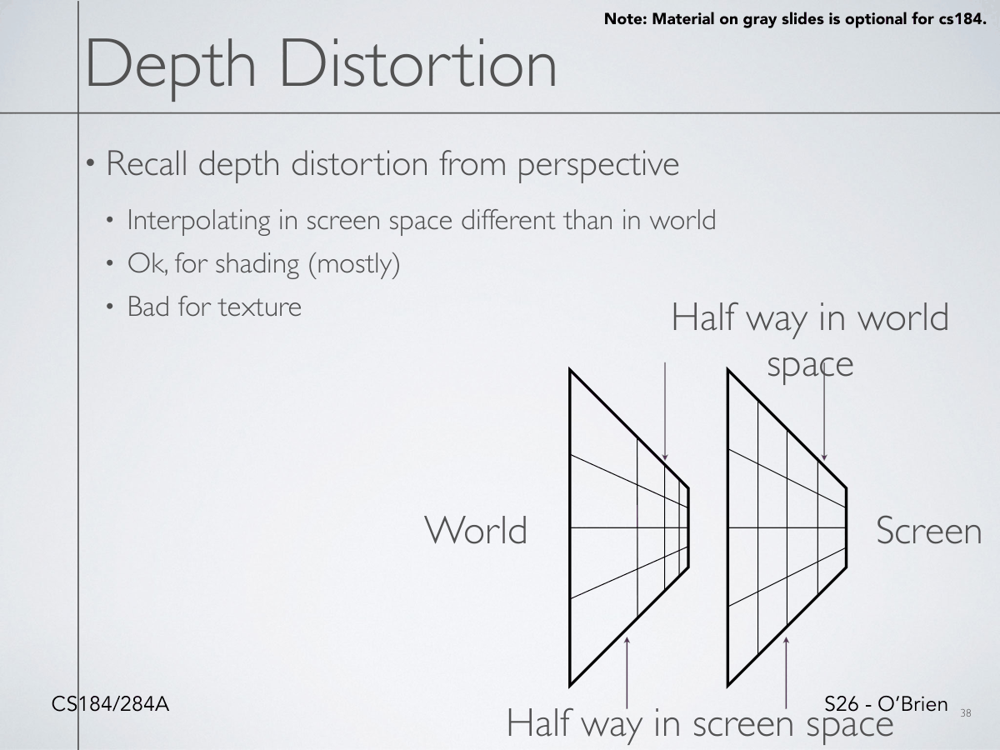

十页灰色幻灯片（标注 *"Material on gray slides is optional for cs184"*），给了完整的数学推导：为什么屏幕空间的线性插值会失真、以及"正确的权重是什么"。

**结论值得知道**（不要求会推）：

> 屏幕空间里应该插值的是 **`u/w`、`v/w`、`1/w`** 这三个量，插完再除以 `1/w`。

下面这张图把这个结论画清楚了：

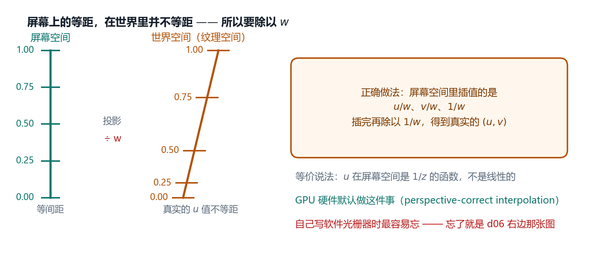

*左边屏幕空间是等距的 `0.00, 0.25, 0.50, 0.75, 1.00`；投影回纹理空间后，对应的真实 `u` 值变得**不等距**（0.00, 0.09, 0.25, 0.55, 1.00 这类分布）。所以「屏幕等分」和「纹理等分」根本是两件事。*

**🔧 手算 2：一个具体的透视插值**

设屏幕上一个三角形的三个顶点，齐次坐标为 `(x, y, w)`：

| 顶点 | 屏幕 `(x, y)` | `w` | `u` |
|---|---|---|---|
| A | (0, 0) | 1 | 0.0 |
| B | (10, 0) | 1 | 1.0 |
| C | (0, 10) | 4 | 0.0 |

取屏幕中点 `(0, 0)` 附近……换个更好算的：取 `A、B` 的屏幕中点 `(5, 0)`。

**错误的做法**（直接插 `u`）：`u = 0.5`

**正确的做法**（先插 `u/w` 和 `1/w`）：

| 量 | A | B | 中点插值 |
|---|---|---|---|
| `u/w` | `0/1 = 0` | `1/1 = 1` | `0.5` |
| `1/w` | `1` | `1` | `1` |

`u = (u/w) / (1/w) = 0.5 / 1 = 0.5` —— 这里恰好相同，因为 `w` 相等。

**换一个**：取 `A、C` 的中点 `(0, 5)`：

| 量 | A | C | 中点插值 |
|---|---|---|---|
| `u/w` | `0` | `0/4 = 0` | `0` |
| `1/w` | `1` | `0.25` | `0.625` |

`u = 0 / 0.625 = 0` —— 仍相同（因为 C 的 `u` 也是 0）。

**再换**：取 `B、C` 的屏幕中点 `(5, 5)`：

| 量 | B | C | 中点插值 |
|---|---|---|---|
| `u/w` | `1` | `0` | `0.5` |
| `1/w` | `1` | `0.25` | `0.625` |

$$
u=\frac{0.5}{0.625}=0.8
$$

**而错误做法会给 `u = 0.5`。差了 0.3！** 这就是 P46 那张"挤扁"图的来源。

> **📌 为什么是 `1/w`**
>
> 因为透视投影把世界坐标除以了 `w`（第 4–5 讲的 `÷w`）。所以在**屏幕**空间里，`u` 与 `1/w` 的关系是**线性**的：
>
> $u_{\text{screen}} \propto u/w$
>
> 换句话说：**屏幕空间能线性插值的是 `u/w`，不是 `u`**。「除以 `w` 再乘回来」这一步，就是所谓的透视校正。

## 5. 贴纹理 = 重采样

#### P59　Applying Textures is Sampling!

*章节点*

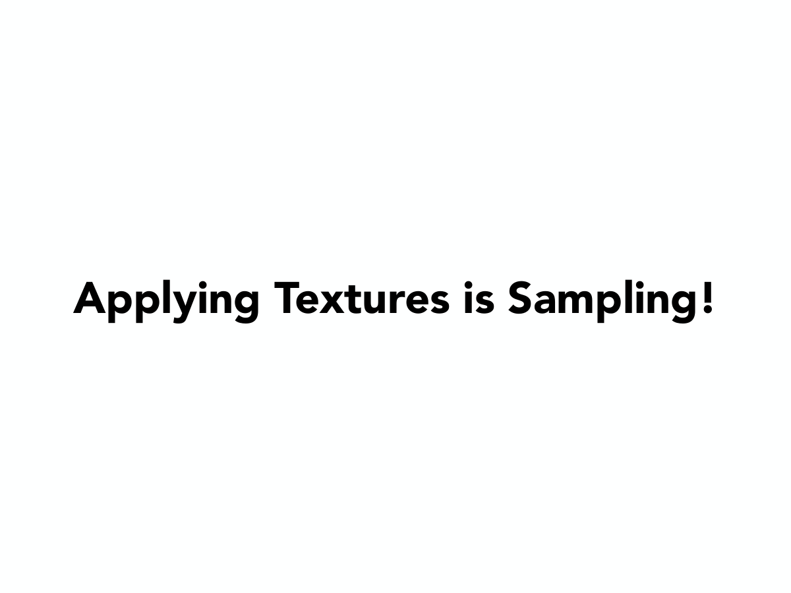

分节页。到这里，第 3 讲的工具全部回来了。

#### P60　Simple Texture Mapping Operation


```c
for each rasterized screen sample (x, y):
    (u, v) = evaluate texcoord value at (x, y)
    float3 texcolor = texture.sample(u, v);
    set sample's color to texcolor;
```

**四行伪代码就是纹理映射的全部**：

| 行 | 做的事 | 难点 |
|---|---|---|
| 1 | 遍历屏幕采样点 | 第 2 讲的光栅化 |
| 2 | 求该点的 `(u,v)` | 重心坐标 + **透视校正** |
| 3 | 从纹理取色 | **重采样**（这一节） |
| 4 | 写进帧缓冲 | 着色 / 混合 |

#### P61–P64　Actually "re-sampling"

*Mathematically, to draw a texture sample at (u,v):*


讲义把"取纹理"拆成严格的三步：

1. **起点是离散的**：`f(x,y)` 只在**整数格点**上非零（它就是那张位图）
2. **重建连续函数**：`f_cont(x,y) = f(x,y) * k(x,y)`，用**重建核** `k` 做卷积
3. **在 `(u,v)` 处求值**：`f_cont(u,v)`


*关键点：`(u,v)` 一般**不是整数**，所以不能直接查表 —— 必须先「用卷积重建出连续函数」，再在任意位置求值。*

#### P65–P68　Signal processing concepts


讲义点明这一步该想到第 3 讲的**全部概念**：

> *"Frequency spectrum, aliasing, Nyquist frequency, filtering, anti-aliasing…"*

**所以纹理映射的两个经典毛病，本质都是第 3 讲那两个毛病**：

| 毛病 | 病因 | 第 3 讲的对应 |
|---|---|---|
| 放大后模糊/有块状 | 重建核选得差 | 重建（P90 的重建核问题） |
| 缩小后闪烁/摩尔纹 | **欠采样** | 走样（Nyquist 不够） |

#### P69–P72　Point Sampling Textures

*High-res reference · Point sampling · Jaggies · Moire*


一个棋盘格地面的渲染对照：

| 图 | 说明 |
|---|---|
| **High-res reference** | `1280×1280` 参考图，抗锯齿正确 |
| **Point sampling** | `256×256` 最近邻取样 |

放大局部标出了两种伪影：**Jaggies**（近处的台阶）和 **Moire**（远处的干涉图案）。

**这张图把第 3 讲的两种伪影同时摆出来了**：
- 近处的**锯齿**是"重建核太硬"（最近邻就是盒式重建）
- 远处的**摩尔纹**是"欠采样"（一个像素覆盖了远超一个 texel）

> **⚠️ 为什么远处会出摩尔纹**
>
> 棋盘格的频率极高（一黑一白就是一周期）。当地面延伸到远处，**一个像素在纹理空间里覆盖的 texel 数迅速增长** —— 从 1 个变成 10 个、100 个。
>
> 而点采样只看**一个** texel，于是采样点和棋盘格的相位关系随距离周期性变化 → 产生低频的明暗条纹 = 摩尔纹。
>
> **这是缩小的典型症状，也是 mipmap 要解决的问题。**

## 6. 放大与缩小：两种采样频率失配

#### P73　Texture Sampling Frequency

*章节点*


分节页。前面说"贴纹理是采样"，这一节量化**采样频率到底差多少**。

#### P74–P75　Sampling Rate on Screen vs Texture

*1:1 mapping*


屏幕空间 600 像素、纹理空间 600 texel，**一一对应**。

**这是"最优观看距离"**：一个 texel 正好落在一个像素上，既不模糊也不走样。

#### P76–P77　Magnified


屏幕还是 600 像素，但纹理只显示了一小块（放大）—— **一个 texel 要铺到多个像素上**。

**这时候问题不是"信息不够"，而是"信息太多"**：纹理在屏幕上被拉大，相邻像素问的是几乎同一个 `(u,v)`，所以画面出现**块状**（texel 的边界被放大）。

#### P78–P79　"Minified"


屏幕 600 像素覆盖**整张**纹理（缩小）—— **一个像素要覆盖很多 texel**。

**这时问题变成"信息太多来不及看"**：一个像素只取一个 texel，就必然丢掉其余所有 texel 的信息 → **欠采样 → 走样**（P72 的摩尔纹）。


*左：一个像素 ≈ 一个 texel（最优）。中：像素里不到一个 texel（放大，需要插值）。右：像素里一大堆 texel（缩小，需要预先滤波）。*

#### P80　Texture Sampling Rate

*The sampling frequency in screen space translates to a sampling frequency in texture space as determined by the mapping function. In general the frequency varies across the scene…*


**这一页的信息量很大**：

> 屏幕空间的采样频率，**通过映射函数**转换成纹理空间的采样频率。
> 而这个频率**在整个场景里是变化的**，取决于几何变换、观察变换和纹理坐标函数。

**"随位置变化"是最麻烦的地方**：

| 场景 | 同一张纹理在地面上的采样频率 |
|---|---|
| 脚下（近处） | 高（几个 texel 对一个像素） |
| 远处（地平线） | 极低（几百个 texel 对一个像素） |

**所以纹理过滤必须是"逐像素自适应"的** —— 这正是 mipmap 里那个 `D` 的作用。

#### P81　Screen Pixel Area vs Texel Area


三条判据（讲义原文）：

| 情形 | 关系 |
|---|---|
| **Optimal** | 像素采样率与 texel 采样率 **1:1**（取决于纹理分辨率） |
| **Magnification** | **多个像素** 对应 **一个 texel** |
| **Minification** | **一个像素** 对应 **多个 texel** |

#### P82–P83　Screen Pixel Footprint in Texture

*Upsampling (Magnification) / Downsampling (Minification)*


**「足迹」（footprint）** 这个概念要建立起来：**一个屏幕像素投到纹理空间后覆盖的那块区域**。

P83 的加粗小字：

> ***"NB: texture sampling pattern not rectilinear or isotropic"***
>
> 注意：纹理采样图案**既不是矩形的，也不是各向同性的**。


*一个正方形像素，映射到纹理空间后变成**斜的平行四边形**。它的两条边恰好是雅可比矩阵的两列 `∂(u,v)/∂x` 和 `∂(u,v)/∂y`。*

#### P84　Estimating Footprint Area With Jacobian


$$
\mathbf{J}=\begin{bmatrix}\dfrac{\partial u}{\partial x}&\dfrac{\partial v}{\partial x}\\[6pt]\dfrac{\partial u}{\partial y}&\dfrac{\partial v}{\partial y}\end{bmatrix}
$$

图的左边是屏幕空间（基向量 `(1,0)`、`(0,1)`），右边是纹理空间（两个被映射后的向量）。

**雅可比矩阵的两列 = 屏幕的两个单位方向在纹理空间里变成什么**。**这两列张成的平行四边形的面积 = 足迹面积**。

> **📌 为什么这点对 mipmap 至关重要**
>
> mipmap 只有**正方形**的层级，所以它必须把"斜平行四边形"压缩成一个标量 —— **边长**。
>
> 而"边长"怎么取，就决定了会不会过度模糊：
> - 取**长边** → 走样最少，但短边方向被过度模糊（P136 的现象）
> - 取**短边** → 更清晰，但会走样
> - 取**面积开方** → 折中
>
> 讲义选的方案（P124）是**取两个方向导数的长度最大值** —— 偏保守（宁可模糊），因为走样比模糊更刺眼。

## 7. 放大：双线性插值

#### P90　Texture Filtering

*章节点*


分节页。从这里开始讲具体算法。

#### P91　Texture Magnification

*章节点*


分节页。先处理**放大**（简单情形）。

#### P92–P93　Bilinear Filtering

*Want to sample texture value f(u,v) at red point · Black points indicate texture sample locations*


一张网格，每个交点是一个 texel（黑点）。**我们要取的是一个红点处的值**，而红点落在四个 texel 中间。

**这就是"重采样"的具体形态**：`(u,v)` 不是整数，所以要**用周围的 texel 插出这个值**。

#### P94　Texture Magnification - Easy Case

*（Generally don't want this — insufficient resolution）· This is image interpolation (will see kernel function)*


三张放大后的眼睛照片：

| 方法 | 效果 |
|---|---|
| **Nearest** | 块状（texel 边界清晰可见） |
| **Bilinear** | 平滑，但有点糊 |
| **Bicubic** | 更锐利（用 4×4 个 texel） |

**小字很关键**：*"(Generally don't want this — insufficient resolution)"* —— 需要放大本身说明**纹理分辨率不够**。理想情况是不放大。

#### P95–P99　Bilinear Filtering


五页动画把双线性讲完：

| 页 | 内容 |
|---|---|
| P95 | 取**最近 4 个** texel |
| P96 | 标出小数偏移 `(s, t)` |
| P97 | 一维线性插值 `lerp(x, v0, v1) = v0 + x(v1−v0)` |
| P98 | 两次**横向** `u0 = lerp(s, u00, u10)`、`u1 = lerp(s, u01, u11)` |
| P99 | 一次**纵向** `f(x,y) = lerp(t, u0, u1)` |


*先沿 `s` 方向插两次（得到 `u0`、`u1`），再沿 `t` 方向插一次。总共 **3 次 lerp、4 次 texel 读取**。*

**🔧 手算 3：算一个具体的双线性值**

取四个 texel 的值：

| `u01` | `u11` |
|---|---|
| `0.2` | `0.6` |
| `u00` | `u10` |
| `0.4` | `1.0` |

注意命名的方向：`u00` 是左下、`u10` 是右下、`u01` 是左上、`u11` 是右上。取 `s = 0.25`、`t = 0.5`。

**第一步：两次横向**

$$
u_0 = \mathrm{lerp}(0.25,\ 0.4,\ 1.0) = 0.4 + 0.25 \times 0.6 = 0.55
$$

$$
u_1 = \mathrm{lerp}(0.25,\ 0.2,\ 0.6) = 0.2 + 0.25 \times 0.4 = 0.30
$$

**第二步：纵向**

$$
f = \mathrm{lerp}(0.5,\ 0.55,\ 0.30) = 0.55 + 0.5 \times (0.30 - 0.55) = 0.425
$$

**结果 `0.425`**，落在四个值 `0.2 ~ 1.0` 之间 ✓（凸包性质）。注意它**不等于**四个数的算术平均（那是 `0.55`）—— 因为 `s,t` 偏向左侧和下方。

#### P100–P102　Bilinear Interpolation

*Same answer either way.*


三页证明一件事：**先横后纵** 和 **先纵后横** 得到**完全一样的答案**。

$$
e=a+\alpha(b-a),\quad f=d+\alpha(c-d),\quad p=e+\beta(f-e)
$$
$$
e'=b+\beta(c-b),\quad f'=a+\beta(d-a),\quad p=f'+\alpha(e'-f')
$$

**为什么可交换**：双线性插值本质是一个**双线性函数** `p(s,t) = a + b·s + c·t + d·s·t`，而 `s,t` 的先后顺序不影响这个函数的求值。

> **💡 这条可交换性有实用价值**
>
> 硬件只要实现一个方向的 lerp 单元，复用它三次就行 —— 不需要专门的 2D 插值电路。这也是为什么 GPU 的纹理单元能做得又快又便宜。

#### P103　Reconstruction Filter Function

*Test your understanding: What is the reconstruction filter k(x,y) for bilinear interpolation? Nearest? What is a theoretically ideal filter? What are the pros/cons of each?*


**这一页把"插值"翻译回第 3 讲的语言** —— 三种放大方法，各自对应一个**重建核**：

| 方法 | 重建核 `k(x,y)` | 频域 | 优点 / 缺点 |
|---|---|---|---|
| **Nearest** | 1 像素宽的**盒式** | sinc（旁瓣慢） | 最便宜；块状、有走样 |
| **Bilinear** | **帐篷（tent）**，2×2 宽 | sinc²（旁瓣衰减快） | 便宜、平滑；略糊 |
| **Bicubic** | 三次核，4×4 宽 | 更接近理想 | 锐利；4× 成本，可能过冲 |
| **理想** | **sinc**（无限宽） | 完美矩形 | 空域无限宽 + 振铃，不可实现 |

**答"什么是理想核"**：sinc 函数 —— 它在频域是完美的矩形低通。但它空域无限宽（要读无限多个 texel）且会产生振铃（Gibbs 现象），所以只能近似。

## 8. 缩小：mipmap

#### P104　Texture Minification

*章节点*


分节页。这是**困难情形**：一个像素要覆盖成百上千个 texel。

#### P105　Screen Pixel Footprint in Texture


再次强调两种情形的对比：Upsampling（放大）vs Downsampling（缩小）。

#### P106–P113　Texture Minification - Hard Case

*Many texels can contribute to pixel footprint · Shape of pixel footprint can be complex*


**两个难点**（讲义原文）：

1. **很多 texel 会落进一个像素的足迹里**
2. **足迹的形状可能很复杂**（P83 那个斜平行四边形）

**讲义的思路**（P112，一段很长的加粗文字，值得逐句读）：

> *Take texture image file, then low-pass filter it (i.e. filter out high frequencies) and downsample it (i.e. sample at a lower resolution) texture file. Do this recursively, and store successively lower resolution, each with successively lower maximum signal frequency.*
>
> *For each sample, use the texture file whose resolution approximates the screen sampling rate.*

**翻译成三步**：

| 步骤 | 做什么 | 对应第 3 讲的概念 |
|---|---|---|
| 1 | 对纹理做**低通滤波** | 滤掉高于 Nyquist 的频率 |
| 2 | **降采样**到一半分辨率 | 降低采样率 |
| 3 | **递归**做下去，存成一系列层级 | 每级的最高频率都减半 |
| 4 | 每个像素**选分辨率最接近的层级** | 让采样率匹配 |

**这就是 mipmap。** 一句话：**「把各种分辨率的版本都预先算好，用的时候挑一个合适的」**。

#### P114–P117　Level 0 / Level 2 / Level 4


三页展示同一场景用不同层级的对比，并标出两处局部：

| 层级 | 近处 | 远处 |
|---|---|---|
| **Level 0**（全分辨率） | 好 | **Aliasing**（走样） |
| **Level 2**（4×4 降采样） | 好 | 好一点，但开始 **Blurring** |
| **Level 4**（16×16 降采样） | **Blurring**（过糊） | 好 |

**这张对照表把"取舍"讲透了**：

- **用全分辨率**：近处对、远处走样
- **用低分辨率**：远处对、近处糊

**所以必须"按距离选层级"** —— 这就是 mipmap 的核心操作。

#### P118　Mipmap (L. Williams 83)

*"Mip" comes from the Latin "multum in parvo", meaning a multitude in a small space*


八张瓢虫纹理，边长依次 `128, 64, 32, 16, 8, 4, 2, 1`。

底部一句词源说明：**"Mip" 来自拉丁语 "multum in parvo"，意思是「小空间里的一大堆」**。


*每一级都是上一级的一半边长（面积 1/4）。总内存是 `1 + 1/4 + 1/16 + ⋯ = 4/3` —— **只多 33%**。*

**🔧 手算 4：mipmap 的内存开销**

等比级数：

$$
\sum_{k=0}^{\infty}\left(\frac{1}{4}\right)^k=\frac{1}{1-\frac14}=\frac{4}{3}
$$

所以 **`1024×1024` 的纹理**（`4 MB`，每像素 4 字节）：

$$
4\ \text{MB}\times\frac{4}{3}\approx 5.33\ \text{MB}
$$

**多出 1.33 MB**，换来 O(1) 的缩小滤波。**这是图形学里性价比最高的 33% 内存**。

> **⚠️ 严格说不是 `4/3`**
>
> 上面的级数假设"无限级、每级正好 1/4"。实际上：
> - 级数会**在 1×1 处截断**（所以略小于 4/3）
> - 若纹理**不是 2 的幂**（如 `1920×1080`），每级取整会让比例略有偏差
>
> 实际显存占用还要加上**对齐/填充**，所以常见说法是"多 33%~40%"。

#### P119　MIP Map

*Pre-compute filtered versions of the texture · A given UV rate is some level of the texture · Tri-linear filtering UV × map level*


三件事：

1. **预计算**滤波后的多个版本
2. **给定的 UV 变化率** 对应某个层级
3. **三线性滤波** = UV 方向的双线性 × 层级方向的线性

#### P120　Mipmap (L. Williams 83)

*Williams' original proposed mipmap layout*


左边是 **Williams 最初提出的紧凑布局**（把各级塞进同一块方形内存里，像俄罗斯方块拼图），右边是"mip hierarchy"的抽象示意（一叠平面，`level = D`）。

底部问题：***"What is the storage overhead of a mipmap?"*** —— 就是手算 4。

**为什么讲这个布局**：因为早期显存紧张，把各级打包进方形纹理能省寻址逻辑。现代 GPU 一般直接按级分配（更简单），但**纹理数组**的思路留下来了。

#### P121–P124　Computing Mipmap Level D

*Estimate texture footprint using texture coordinates of neighboring screen samples*


**核心思路**：不知道雅可比矩阵也没关系 —— **直接用相邻像素的 `(u,v)` 做差分**：

$$
L=\max\left(\sqrt{\left(\frac{\partial u}{\partial x}\right)^2+\left(\frac{\partial v}{\partial x}\right)^2},\
\sqrt{\left(\frac{\partial u}{\partial y}\right)^2+\left(\frac{\partial v}{\partial y}\right)^2}\right)
$$

$$
D=\log_2 L
$$


*`L` 是「一个像素在纹理里走过多少个 texel」（取两个方向的最大值）。`D = log2 L` 把它转成层级：`L=1` 用 Level 0，`L=2` 用 Level 1，`L=8` 用 Level 3。*

**🔧 手算 5：算一个层级**

设屏幕上一个像素步进 `Δx = 1` 时，`u` 增加 `0.25`、`v` 不变；步进 `Δy = 1` 时，`u` 不变、`v` 增加 `0.25`。

$$
\frac{\partial u}{\partial x}=0.25,\quad
\frac{\partial v}{\partial x}=0,\quad
\frac{\partial u}{\partial y}=0,\quad
\frac{\partial v}{\partial y}=0.25
$$

两个方向的长度都是 `0.25`：

$$
L=\max(0.25,\ 0.25)=0.25
$$

$$
D=\log_2 0.25=-2
$$

**`D = −2` 是什么鬼？** 说明**像素比 texel 还小**（每个像素只覆盖 1/4 个 texel）—— 这是**放大**的情形。此时 `D` 会被 **clamp 到 0**（只能用最精细的 Level 0），然后靠双线性插值放大。

**再试一个缩小的例子**：若 `∂u/∂x = 3`、`∂v/∂y = 3`，则 `L = 3`、`D = log2 3 ≈ 1.58`。

**`D` 是小数**，所以要**在 Level 1 和 Level 2 之间做插值** —— 这就是三线性。

#### P125　Linear Algebra View（选学，灰色页）


灰色幻灯片，说明 `∂s/∂x` 也可以从 `M_texture M_screen^{-1}` 那条链直接求出来。

> *"This function is linear so ∂s/∂x would be const if no depth distortion. Accounting for depth distortion creates non-constant derivatives."*

**这句话解释了为什么不能直接用矩阵**：如果没有透视（纯仿射），导数 `∂s/∂x` 是**常数** —— 整个三角形共用一个 `D`。但**一旦有透视，导数就不再是常数**，必须逐像素算差分。

#### P126　Visualization of Mipmap Level

*D rounded to nearest integer level*


一张图，用不同颜色表示每个像素选了哪一级（`D` 取整）。

**这张图很能说明"逐像素自适应"**：远处的像素选了高层级（大 `D`），近处选了低层级，边界清晰地勾出了地面在屏幕上的深度梯度。

#### P127–P131　Trilinear Filtering


五页动画讲完三线性：

| 页 | 内容 |
|---|---|
| P127–P128 | 层级 `D` 上做一次双线性 → 结果 A |
| P129–P130 | 层级 `D+1` 上做一次双线性 → 结果 B |
| P131 | 按**小数部分**在 A、B 之间线性插值 |


*代价是双线性的两倍：**8 次 texel 读取、7 次 lerp**。换来的是层级切换处不再有可见的接缝。*

#### P132　Visualization of Mipmap Level

*Trilinear filtering: visualization of continuous D*


和 P126 同一张图，但 `D` **不取整**，颜色是连续渐变。

**对比 P126 和 P132**：取整的版本有明显的色块边界（层级跳变处），连续的版本是平滑渐变。**这就是线性插值的效果。**

#### P133　Bilinear vs Trilinear Filtering Cost


| 方法 | texel 读取 | lerp 次数 | 乘 / 加 |
|---|---|---|---|
| **Bilinear** | 4 | 3 | 3 mul + 6 add |
| **Trilinear** | 8 | 7 | 7 mul + 14 add |

**🔧 手算 6：成本翻了几倍**

$$
\frac{\text{trilinear}}{\text{bilinear}}=\frac{8}{4}=2\ (\text{读取}),\qquad
\frac{7}{3}\approx 2.33\ (\text{lerp})
$$

**大约 2 倍**的成本。所以在显存带宽紧张的年代，三线性是"值得开"的选项；而今天 GPU 里它已经是标配。

## 9. mipmap 的极限：各向异性

#### P134–P137　Mipmap Limitations

*Point sampling · Supersampling 512x · Mipmap trilinear sampling · Overblur, Why?*


四页是一个完整的实验：

| 图 | 方法 | 近处 | 远处 |
|---|---|---|---|
| P134 | **Point sampling** | 好 | 严重走样（摩尔纹） |
| P135 | **Supersampling 512×** | 好 | 好（但贵 512 倍） |
| P136 | **Mipmap trilinear** | 好 | 好，但**偏糊** |
| P137 | 同上 + 标题 *"Overblur, Why?"* | — | 追问原因 |

**mipmap 的问题不是走样，而是"糊得不对"**：远处的格子看起来像一片灰雾，而不是"密而清晰"的格子。


*掠射角看地面时，一个像素的足迹是**又长又窄**的平行四边形。而 mipmap 只有一个正方形的层级，为了覆盖长边，只能取一个**面积等于长边的正方形** → 短边方向被过度平均 → 细节被抹平。*

#### P138–P139　Anisotropic Filtering

*Elliptical weighted average (EWA) filtering · Ripmaps and summed area tables*


讲义给了三类方案：

| 方案 | 做法 | 优劣 |
|---|---|---|
| **Ripmap**（矩形 mipmap） | 每个层级存多个"非正方形"版本（如 1×2、1×4、4×1…） | 能查轴对齐矩形；**斜向足迹仍不行** |
| **Summed area table**（SAT） | 预存二维前缀和，任意矩形区域 O(1) 求和 | 任意矩形都行；**斜向仍需近似**，且精度/内存开销大 |
| **EWA**（椭圆加权平均） | 用**多次**（4–16 次）mipmap 查询加权拟合一个椭圆 | 效果最好；代价最高 |


*思路：把长条足迹沿长轴切成若干段，每段用一个方形查询，再按权重平均。段数越多越精确（对应硬件里的 2×/4×/8×/16× AF 档位）。*

**P139 右上有两张经典配图**：
- 上：一个"X"形测试图案在 ripmap 下的结果（轴对齐部分好，斜向仍糊）
- 下：**Greene & Heckbert '86** 的 EWA 论文插图 —— 这是各向异性过滤的开山之作

> **📌 到这里，纹理过滤的完整谱系就齐了**
>
> | 问题 | 解法 | 代价 |
> |---|---|---|
> | 放大模糊（块状） | 双线性 | 4 次读取 |
> | 缩小走样 | mipmap + 三线性 | 8 次读取 |
> | 斜视过度模糊 | 各向异性（AF） | 8–64 次读取 |
>
> **每一级都是"多花一点换取更好"**，而且都建立在第 3 讲的同一套理论上：**先滤后采**。

## 10. 纹理的更多用法

#### P140　Advanced Texturing Methods

*章节点*


分节页。前面都是"用纹理存颜色"，这一节展示**纹理可以存任何东西**。

#### P141　Many, Many Uses for Texturing

*In modern GPUs, texture = memory + filtering · General method to bring data to fragment calculations*


**这一页是全讲的思想升华**，两行字：

> ***"In modern GPUs, texture = memory + filtering"***
> ***"General method to bring data to fragment calculations"***

**翻译**：在现代 GPU 里，**纹理 = 一块显存 + 一套过滤硬件**。

于是纹理变成了一个**通用的数据通道**：
- 想给每个像素提供一张查找表？用纹理
- 想给每个像素查一个环境光颜色？用纹理
- 想给每个像素查一个法线？用纹理
- 想给每个像素查一个"遮蔽程度"？用纹理

**这就是为什么后面所有内容都能叫"纹理"**。讲义列了六个应用：

| 应用 | 存什么 | 对应页 |
|---|---|---|
| 环境光照 | 从各方向来的光 | P142–P151 |
| 微几何 | 法线 / 高度 | P152–P157 |
| 程序化纹理 | 用噪声函数现场算 | P159 |
| 实体建模 | 三维纹理 | P158 |
| 体积渲染 | 密度场 | P160 |
| 预计算着色 | 环境光遮蔽等 | P161 |

#### P142–P143　Environment Map

*A function from the sphere to colors, stored as a texture · Lat / long texture map · Reflection vector indexes into texture map*


**环境贴图的定义**（讲义原话）：

> 从**球面**到**颜色**的一个函数，存成一张纹理。

图上左：一张经纬展开的窗户图（lat/long texture map）；右：一个茶壶，标注 *"Reflection vector indexes into texture map"* —— **反射方向就是查表的索引**。

P143 对比一个球在环境光下 vs 单点光下的渲染（**Dror, Willsky & Adelson 2004**）：左边那个金属球上能看到整个房间的倒影。


*球面上某点的反射方向 `R` 直接用来查纹理。`R` 是三维方向向量，而纹理是二维的，所以需要一张"方向 → uv"的映射表（经纬或立方体）。*

#### P144　Spherical Environment Map

*Hand with Reflecting Sphere. M. C. Escher, 1935 · Light Probes, Paul Debevec*


左边是 **Escher 的《手与反射球》**（1935 石版画）—— 画中那颗镜面球上倒映着整个房间。右边是 **Debevec 的 Light Probe** 系列照片：用一颗铬球把真实环境拍下来。

**这一页的用意**：说明"环境贴图"这个想法**在计算机之前就存在了** —— Escher 画的就是一张人工计算的环境贴图。

#### P145–P146　Environmental Lighting


环境贴图不只是"反射"，还能当**光源**用：每个方向的光照强度都存在图里，漫反射表面可以积分整个环境贴图。

P146 是 Emil Persson 的示例（他后来做了著名的"Humus"系列渲染demo）。

#### P147　Cube Map

*A vector maps to cube point along that direction. The cube is textured with 6 square texture maps.*


**问题**：经纬贴图有两个毛病：
1. **极点处严重畸变**（南北极被拉伸成整行）
2. **接缝**（经度 0/360 处要特殊处理）

**解法**：**立方体贴图**（cube map）—— 用一个立方体的六个面各存一张方形纹理。

| 特点 | 说明 |
|---|---|
| 六张贴图 | `+x, −x, +y, −y, +z, −z` 各一张 |
| 查表方式 | 方向向量落在哪个面，就用哪张（用最大分量定面，另两个分量定 uv） |
| 优点 | 面内畸变小、无极点问题 |
| 缺点 | 面与面的边界仍要处理（要保证可无缝滤波） |

图上标了两处：

> `(u,v) = (1,1)` 对应 `x = y = z`
> `(u,v) = (0,0)` 对应 `x = −y = −z`
> right face 的条件是 `|x| > |y|` 且 `|x| > |z|`

#### P148–P151　Environment Maps

*Used in 1985 in movie Interface · Lance Williams from the New York Institute of Technology · Note errors*


四页展示 **1985 年电影《Interface》**里的环境贴图应用，作者是 **NYIT 的 Lance Williams**（也是 mipmap 那篇论文的作者，见 P118）。

**小字标注 "Note errors"** —— 早期实现里能看到明显错误（比如反射方向算错、贴图接缝）。这一页是在提示：**这个技术当年很难做对**。

> **🔭 Lance Williams 一个人占了两个 "L."**
>
> - **P118 mipmap**：L. Williams 1983
> - **P148 环境贴图**：Lance Williams 1985
>
> 这两篇都是图形学的里程碑，而它们解决的是同一类问题（**怎么用有限的内存表达无限的信息**）。这一点值得体会：**纹理映射的整部历史，都是在"有限资源"和"视觉可信"之间找平衡。**

#### P152　Displacement Mapping

*Texture stores perturbation to surface position*


一句话定义：**纹理存的是「对表面位置的扰动」**。

#### P153　Displacement Mapping 实例

*base surface · displaced surface · hand-painted displacement map (detail)*


三张图：基础面（光滑）、位移后的面（有了真实起伏）、手绘的位移图（灰度表示高度）。

#### P154　Bump Mapping

*Texture stores perturbation to surface normal*


一句话定义：**纹理存的是「对表面法线的扰动」**。

引文 **[Blinn 1978]** —— James Blinn 1978 年的凹凸贴图论文，比 Williams 的两篇还早。

#### P155–P157　Bump Mapping

*Where is the difference most noticeable? · Geometry / Bump mapping / Displacement mapping · Perturbs normals / Perturbs positions*


**这是全讲最实用的一页对照**：

| 方法 | 改什么 | 轮廓 | 代价 |
|---|---|---|---|
| **Geometry**（真几何） | 顶点位置 | 有起伏 | 需要极高细分 |
| **Bump mapping** | **法线**（着色用） | **仍然光滑** | 便宜 |
| **Displacement mapping** | **顶点位置** | 有起伏、能自遮挡 | 需要细分 + 位移 |


*三张侧视图：① 光滑几何；② bump：表面不变，但法线被扰动（所以**轮廓还是光滑的**）；③ displacement：表面真的被推开（轮廓出现起伏，能自遮挡）。*

**讲义留的问题**：***"Where is the difference most noticeable?"***

**答案**：**在轮廓（silhouette）上**，以及**掠射角观察时**。
- 看轮廓：bump 的轮廓是光滑的、displacement 的轮廓是起伏的 → **一眼可辨**
- 掠射看：bump 的阴影是假的（只是明暗变化）、displacement 能产生真实的投影阴影

> **⚠️ bump mapping 的两个经典坑**
>
> **① 法线要用「法线贴图」空间，不是世界空间。**
> 法线贴图存的是**切线空间**（tangent space）里的法线，所以渲染时必须构造 TBN 矩阵做变换。用错空间会出现"光照跟着物体转"的怪现象。
>
> **② 法线扰动后要重新归一化。**
> 从贴图里插值出来的法线长度一般不是 1，不归一化会让光照强度出错（暗部忽明忽暗）。

#### P158　3D Textures

*Textures is a function of (u,v,w). Solid modeling.*


**三维纹理**：`(u,v,w)` 三个坐标，相当于"一整块有图案的材料"。

图上展示的是**从一块材料里"雕"出物体**——比如一块有木纹的实心块，从中切出一个球，球上就自然有木纹。

**优点**：不用担心 UV 展开和接缝（因为物体是从"材料"里切出来的）。

#### P159　3D Procedural Noise + Solid Modeling

*Perlin noise, Ken Perlin*


**Ken Perlin 的噪声函数**：不用存任何纹理，直接在 `(x,y,z)` 处用一组插值过的随机梯度**算**出一个值。

| 特点 | 说明 |
|---|---|
| 无限分辨率 | 放大多少倍都清晰（因为它是连续函数） |
| 无需存储 | 只存一个随机种子 |
| 平滑 | 梯度噪声天然连续 |
| 缺点 | 计算贵；参数难调 |

**Perlin 因此拿了 1997 年的奥斯卡技术成就奖**（电影特效里大量用它生成云、烟、岩石）。

#### P160　3D Textures and Volume Rendering

*Marc Levoy*


**体积渲染**：把三维纹理当作"密度场"，光线穿过时累积不透明度。

图上是一张医学/科学可视化的例子（Marc Levoy 是体积渲染的先驱）。

**和前面所有纹理的区别**：这里纹理**不是一个表面**，而是一整块**介质**。所以没有"贴到曲面上"这回事，而是"光线在介质里走"。

#### P161　Provide Precomputed Shading

*Simple shading · Ambient occlusion texture map · With ambient occlusion*


三张图：简单着色、**环境光遮蔽（AO）贴图**、应用 AO 之后。

**思路**：把一些**很贵的计算**（比如"这个点被周围环境挡住了多少光"）**预先算好存成纹理**，运行时光查表。

**这是 P141 那句话的最好例证**：texture = memory + filtering —— 只要计算能"按位置查表"，就能塞进纹理。

#### P162　Acknowledgments


课件由 **Ren Ng** 与 **James O'Brien** 开发，另有 Kayvon Fatahalian、David Forsyth、Pat Hanrahan、Angjoo Kanazawa、Steve Marschner、Ben Mildenhall、Mark Pauly、Weilun Sun、Lingqi Yan 贡献。

## 11. 附加页与收尾

#### P163　Bonus Slides


分节页，标着 **Bonus**（附加内容，考试不要求）。

#### P164–P170　Examples of Texture Coordinate Functions


七页附加内容（Rosalee Wolfe 的教程材料）展示各种**纹理坐标函数**：

| 方式 | 做法 |
|---|---|
| **参数曲面**（样条面） | 直接把参数空间 `(s,t)` 当 UV |
| **球面投影** | 用经纬度当 UV（极点畸变） |
| **柱面投影** | 绕轴的角度 + 高度 |
| **平面投影** | 直接取某两个坐标 |
| **复杂表面** | 把各部件分别投影到参数面，再拼起来 |

#### P169　Function of object or world coordinates?


**这一页提了个很实际的问题**：UV 该用**物体坐标**还是**世界坐标**？

| 用物体坐标 | 用世界坐标 |
|---|---|
| 纹理**跟着物体动**（物体转，纹理转） | 纹理**固定在世界里**（物体动，纹理像穿过它） |
| 适合：木头、皮肤、涂装 | 适合：地面、水面、墙面 |
| 问题：物体变形时纹理变形 | 问题：物体移动时纹理滑动 |

**选择取决于"你想让纹理属于谁"** —— 这是个语义问题，不是数学问题。

### 11.1 这一讲留下了什么

**带走的六句话：**

1. **纹理是"二维函数"**，它可以是颜色、粗糙度、法线、高度，甚至光照 —— 现代 GPU 里 texture = memory + filtering。
2. **UV 只存在顶点上**，三角形内部靠**重心坐标**插值；而重心坐标就是第 2 讲那个 `L` 函数的归一化。
3. **屏幕空间线性插值是错的**：必须插 `u/w`、`v/w`、`1/w`，再除以 `1/w` —— 这是全讲最贵的坑。
4. **贴纹理 = 重采样**：重建连续函数再求值。放大用双线性，缩小必须预滤波。
5. **mipmap = 预先算好各级低通版本**，只多 33% 内存，换来 O(1) 的缩小滤波。
6. **mipmap 的形状不匹配**（正方形 vs 斜长条）导致过度模糊 → 各向异性过滤（ripmap / EWA）。

**还差什么：**

| 这一讲没解决 | 谁来解决 |
|---|---|
| 光照怎么算（Brdf、着色模型） | L07–08 光栅化管线与着色 |
| 多条纹理怎么混合、透明怎么叠 | L08 深度测试与混合 |
| 环境贴图怎么和全局光照结合 | L16–17 路径追踪 |
| 位移贴图需要的细分曲面 | L09–11 曲线曲面 |
| 纹理内存怎么压缩 | 不在本课（工业界有 BC/ASTC 等格式） |

> **📌 下次课的第一句话**
>
> 这一讲把"像素该取什么颜色"解决了一半 —— 从纹理里取到了**颜色**。但颜色还要被**光照**调制：同一个纹理颜色，在阳光下和阴影里完全不同。
>
> 那就要引入**着色模型**（Blinn-Phong）和**可见性**（深度测试）—— 那是 L07–08 的内容。

---

## 附录 A · 170 页索引

| 页码 | 主题 | 为什么在这儿 |
|---|---|---|
| P1 | Section 5: Texture Mapping | 封面 |
| P2 | 纹理的用途 | 球面花纹、木地板 |
| P3–P4 | 描述材质；加细节不加几何 | 全讲动机 |
| P5–P8 | 二维图贴到物体；颜色 / 粗糙度 / 几何 | 纹理存的不只是颜色 |
| P9 | Texture Coordinate Mappings | 分节 |
| P10–P11 | 巧克力包装纸 | 展开的类比 |
| P12 | **三个空间** | world / texture / screen |
| P13 | **每个三角形抄一块纹理** | 最实用的心智模型 |
| P14–P16 | UV 彩虹可视化 | 调试手段 |
| P17 | 好 UV 很难做；图集；Levy 2002 | 展开是独立难题 |
| P18–P20 | Sponza 宫殿；UV 可视化；纹理图 | 真实资产的做法 |
| P21 | 重复纹理与平铺伪影 | 接缝处的坑 |
| P22 | Interpolation Across Triangles | 分节 |
| P23–P26 | 为什么 / 插什么 / 怎么插 | 三问 |
| P27 | **重心坐标定义** `α+β+γ=1` | 凸包性质 |
| P28–P29 | 顶点 (1,0,0)；中心 (1/3,1/3,1/3) | 边界条件 |
| P30 | `V = αV_A + βV_B + γV_C` | 顶点属性统一插值 |
| P31 | 几何解读：比例距离 | α 的方向易搞反 |
| P32–P34 | 借第 2 讲的直线方程 | 两讲接上 |
| P35 | `α = L_BC(P)/L_BC(A)` | 边界条件自动满足 |
| P36 | 三个坐标的完整公式 | γ 用 1−α−β |
| P37 | **面积解读** | 与距离解读等价 |
| P38–P41 | 线性代数视角 | 底行全 1 = 归一化 |
| P42 | 矩阵链；**忽略透视畸变** | 伏笔 |
| P43 | Perspective Projection and Interpolation | 分节 |
| P44–P45 | 原纹理 / 仿射失真 / 透视失真 | 三种效果 |
| P46 | 屏幕空间重心插值（错） | 错在哪 |
| P47 | **透视产生非线性**；GPU 支持 | 关键定理 |
| P48 | 仿射 vs 透视正确 | 对照 |
| P49–P58 | 深度失真推导（选学） | `u/w`、`1/w` |
| P59 | Applying Textures is Sampling! | 分节 |
| P60 | 四行伪代码 | 全流程 |
| P61–P68 | 其实是重采样；三步；该想到的概念 | 第 3 讲回归 |
| P69–P72 | 点采样：Jaggies 与 Moire | 两种伪影 |
| P73 | Texture Sampling Frequency | 分节 |
| P74–P79 | 1:1 / 放大 / 缩小 | 三种频率关系 |
| P80 | 采样频率随位置变化 | 逐像素自适应 |
| P81 | 像素面积 vs texel 面积 | 三条判据 |
| P82–P83 | **像素足迹**；非矩形非各向同性 | 关键概念 |
| P84 | **雅可比矩阵**估计足迹 | 两列 = 两个方向导 |
| P85 | Texture Antialiasing | 分节 |
| P86–P88 | 超采样可行但贵；目标；先滤后采 | 方向确定 |
| P89 | 信号 / 采样率 / Nyquist？ | 回到第 3 讲 |
| P90–P91 | Texture Filtering；Magnification | 分节 |
| P92–P93 | 在红点处取值 | 重采样的形态 |
| P94 | Nearest / Bilinear / Bicubic | 放大三法 |
| P95–P99 | 双线性五步 | 4 次读取 3 次 lerp |
| P100–P102 | 先横后纵 = 先纵后横 | 双线性函数可交换 |
| P103 | **重建核是什么** | 三种插值的频域解释 |
| P104–P105 | Texture Minification | 分节 + 两种情形 |
| P106–P113 | 难在哪；**思路：低通 + 降采样 + 递归** | mipmap 的动机 |
| P114–P117 | Level 0 / 2 / 4 的取舍 | 走样 vs 模糊 |
| P118 | **mipmap 金字塔**；multum in parvo | Williams 1983 |
| P119 | 预计算 + 三线性 | 一句话概括 |
| P120 | Williams 原始布局；**存储开销？** | 4/3 |
| P121–P124 | **L 与 D 的公式** | 逐像素自适应 |
| P125 | 导数也可以用矩阵链（选学） | 为什么不能直接算 |
| P126 | 层级可视化（取整） | 深度梯度 |
| P127–P131 | 三线性五步 | 2 次双线性 + 1 次插值 |
| P132 | 连续 D 的可视化 | 与 P126 对比 |
| P133 | 双线性 vs 三线性的代价 | 4/3 vs 8/7 |
| P134–P137 | **mipmap 的限制：过度模糊** | 形状不匹配 |
| P138–P139 | **各向异性**：ripmap / SAT / EWA | 三种方案 |
| P140–P141 | 进阶纹理；**texture = memory + filtering** | 思想升华 |
| P142–P143 | 环境贴图；经纬图；反射查表 | Blinn & Newell 1976 |
| P144 | Escher 反射球；Debevec 光探针 | 这个想法的历史 |
| P145–P146 | 用环境贴图做光照 | 当光源用 |
| P147 | **立方体贴图** | 解决极点畸变 |
| P148–P151 | 1985 年电影 Interface；Lance Williams | 早期实现与错误 |
| P152–P153 | 位移贴图；基础面 vs 位移面 | 改位置 |
| P154 | 凹凸贴图（Blinn 1978） | 改法线 |
| P155–P157 | 几何 / bump / displacement 三者对比 | 差异在轮廓 |
| P158 | 三维纹理 | 实体建模 |
| P159 | Perlin 噪声 | 程序化、无限分辨率 |
| P160 | 体积渲染 | 介质而非表面 |
| P161 | 预计算着色（AO） | 把贵计算存成纹理 |
| P162 | 致谢 | Ren Ng / James O'Brien 等 |
| P163 | Bonus Slides | 附加分节 |
| P164–P170 | 各种纹理坐标函数 | 参数曲面 / 球面 / 柱面 / 投影 |

## 附录 B · 自测 22 题

1. 纹理除了颜色，还能存什么？举出三个例子。
2. 为什么"加细节不加几何"会带来放大/缩小的问题？
3. 一个三维曲面能无拉伸地摊平成平面吗？为什么？
4. 重心坐标的三个权重为什么自动和为 1？
5. `(α,β,γ) = (1,0,0)` 对应三角形的哪个位置？`(1/3,1/3,1/3)` 呢？
6. 用 `A=(0,0)`、`B=(4,0)`、`C=(0,4)` 和点 `P=(1,1)`，手算三个重心坐标。
7. 重心坐标的"距离解读"和"面积解读"为什么等价？
8. 为什么 `γ` 通常用 `1−α−β` 算，而不是独立求？
9. 线性代数视角里，矩阵 `<x y 1> = M<α β γ>` 的底行为什么全是 1？
10. 为什么在屏幕空间对纹理坐标做线性插值是错的？错在哪个假设？
11. 正确做法要插值哪三个量？为什么是 `1/w`？
12. 手算：`B(10,0,w=1,u=1)`、`C(0,10,w=4,u=0)` 的屏幕中点 `(5,5)`，正确的 `u` 是多少？线性插值会给多少？
13. 什么是「重采样」？它和第 3 讲的「采样」差在哪一步？
14. 双线性插值需要读几个 texel、做几次 lerp？先横后纵和先纵后横结果一样吗？
15. 双线性、最近邻、bicubic 各自的重建核是什么形状？大约多宽？
16. 什么叫「像素足迹」？它为什么既不是矩形也不是各向同性的？
17. 雅可比矩阵的两列在几何上代表什么？
18. mipmap 的内存开销为什么是 4/3？实际会略大还是略小？为什么？
19. `L` 和 `D` 的关系是什么？`L=4` 对应第几层？
20. 三线性比双线性贵多少？它解决的是「走样」还是「接缝」？
21. mipmap 为什么会过度模糊？什么几何条件下最明显？
22. bump mapping 和 displacement mapping 在**轮廓**上有什么区别？为什么？

## 附录 C · 术语表

| English | 中文 | 一句话 |
|---|---|---|
| texture mapping | 纹理映射 | 把二维函数贴到三维表面 |
| UV / texture coordinates | 纹理坐标 | 顶点上的 `(u,v)` |
| unwrapping | 展开 | 把曲面摊平成 UV 平面 |
| seam | 接缝 | 展开时剪开的地方 |
| texture atlas | 纹理图集 | 多块 UV 打包进一张图 |
| tiling / tileable | 平铺 / 可平铺 | 边缘能无缝接上 |
| barycentric coordinates | 重心坐标 | 三角形内的插值权重 |
| convex hull property | 凸包性质 | 权重非负且和为 1 时不会插飞 |
| perspective-correct interpolation | 透视校正插值 | 插 `u/w`、`1/w` 再除回来 |
| affine distortion | 仿射失真 | 屏幕线性插值造成的错 |
| resampling | 重采样 | 重建连续函数再求值 |
| reconstruction filter | 重建核 | 把离散样本变回连续信号 |
| footprint | 足迹 | 一个像素在纹理空间覆盖的区域 |
| Jacobian | 雅可比矩阵 | 两个方向的导数 |
| magnification | 放大 | 一个 texel 铺到多个像素 |
| minification | 缩小 | 一个像素覆盖多个 texel |
| bilinear filtering | 双线性过滤 | 4 texel + 3 lerp |
| bicubic filtering | 双三次过滤 | 16 texel 的三次核 |
| lerp | 线性插值 | `v0 + x(v1−v0)` |
| mipmap | 多级渐远纹理 | 预计算的低通金字塔 |
| level `D` | 层级 | `D = log2 L` |
| trilinear filtering | 三线性过滤 | 两层双线性 + 层间插值 |
| overblur | 过度模糊 | mipmap 形状不匹配的后果 |
| anisotropic filtering (AF) | 各向异性过滤 | 沿长轴多次采样 |
| ripmap | 矩形 mipmap | 允许非正方形层级 |
| summed area table | 积分图 / 前缀和表 | 任意矩形 O(1) 求和 |
| EWA | 椭圆加权平均 | 按椭圆足迹加权 |
| environment map | 环境贴图 | 球面方向到颜色 |
| cube map | 立方体贴图 | 六个面存方向数据 |
| light probe | 光探针 | 用镜面球拍环境 |
| displacement mapping | 位移贴图 | 改顶点位置 |
| bump mapping | 凹凸贴图 | 改法线（Blinn 1978） |
| normal map | 法线贴图 | 存切线空间法线 |
| TBN | 切线空间基 | tangent / bitangent / normal |
| procedural texture | 程序化纹理 | 用函数现场算 |
| Perlin noise | Perlin 噪声 | 梯度噪声 |
| volume rendering | 体积渲染 | 光线穿过介质 |
| ambient occlusion | 环境光遮蔽 | 预计算的遮蔽程度 |
| solid modeling | 实体建模 | 从三维材料里雕物体 |

## 附录 D · 待生成图（提示词占位）

以下两张需要真实渲染/照片质感，matplotlib 做不了，留提示词：

> **〔P1〕`diagrams/d19-footprint-in-scene.png`**
> 用途：第 8 节「mipmap 层级」的可视化
> 提示词：*A 3D rendered checkerboard floor seen in perspective, with each screen pixel tinted by a false-color palette that encodes the mipmap level chosen for it: near the camera the tint is dark blue (level 0), smoothly transitioning through green and yellow to red at the horizon (high levels). Flat shading, no other lighting, 1600×900.*
> 建议：附图例 `L0 → L6`，与 `d13-mipmap-level.png` 相邻。

> **〔P2〕`diagrams/d20-aniso-comparison.png`**
> 用途：第 9 节「各向异性」的前后对照
> 提示词：*Side-by-side render of the same receding tiled floor, identical camera and lighting. Left half: trilinear mipmapping only, distant floor looks washed-out and blurry. Right half: 16x anisotropic filtering, distant floor retains crisp grid lines. Neutral lighting, no text, 1600×900.*
> 建议：下方标注 `Trilinear` / `16× AF`。
