> UC Berkeley · CS184/284A Computer Graphics and Imaging · Fall 2026 · Lecture 8–9

到这里，前面几讲讲的东西终于要拼成一台完整的机器：

```
前七讲已有：变换 → 投影 → 光栅化覆盖 → 纹理取色
   ↓ 但还有两个空白
① 谁挡住谁？        → z-buffer（逐像素记最小深度）
② 这个颜色在光下多亮？→ Blinn-Phong（环境 + 漫反射 + 高光）
   ↓ 着色在哪里算？
逐面 / 逐顶点 / 逐像素 —— 三种频率，代价与效果不同
   ↓ 法线怎么来、怎么变换？
顶点法线平均；法线要用 M⁻ᵀ 而不是 M
   ↓ 全部装进管线
Vertex → Triangle → Raster → Fragment → Framebuffer
```

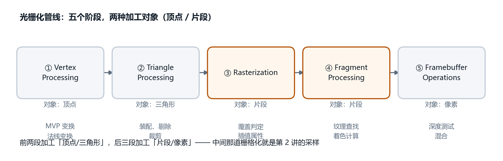

*前两段加工「顶点 / 三角形」，后三段加工「片段 / 像素」。中间那道栅格化就是第 2 讲的采样，而这一讲新增的是：③ 之前的深度测试、④ 里的着色计算、⑤ 里的深度与混合。*

*127 页 · 79 张关键页截图 · 16 张原创图解 · 6 个手算 · 24 道自测*

> **💡 这一讲的定位**
>
> 讲义（P12）自己给的路线图里，今天这一格叫 **「Visibility, Shading, Overall Pipeline」** —— 注意最后那个词 **Overall**：这一讲的主要作用是**把前面所有零件装起来**，新知识其实只有两块（可见性 + 局部着色）。

## 1. 我们已经有什么，还缺什么

#### P1　Section 6: The Rasterization Pipeline

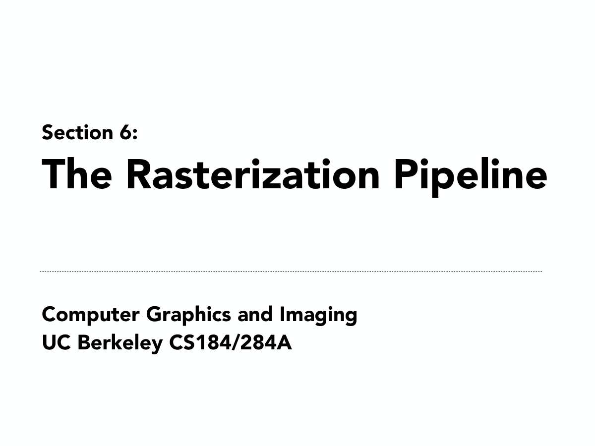

注意这次的标题是 **The Rasterization Pipeline**（整条管线），而不是某个具体算法 —— 这一讲是"总装"。

#### P2　What We've Covered So Far

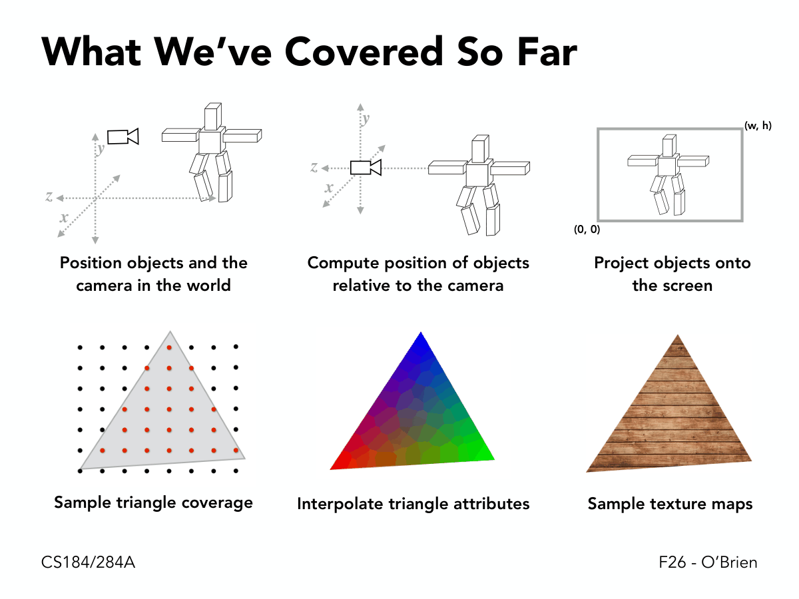

一页图上标出了前七讲的全部成果：

| 步骤 | 来自哪讲 |
|---|---|
| 在世界里摆放物体和相机 | L04–05 变换 |
| 算物体相对相机的位置 | L04–05 变换 |
| 投影到屏幕 | L04–05 透视 |
| 采样三角形覆盖 | L02 光栅化 |
| 插值三角形属性 | L06–07 重心坐标 |
| 采样纹理 | L06–07 纹理映射 |

**这一页的价值**：它说明"能画出一个带纹理的立方体"已经做完了。**那还缺什么？**

#### P3–P8　Rotating Cubes in Perspective

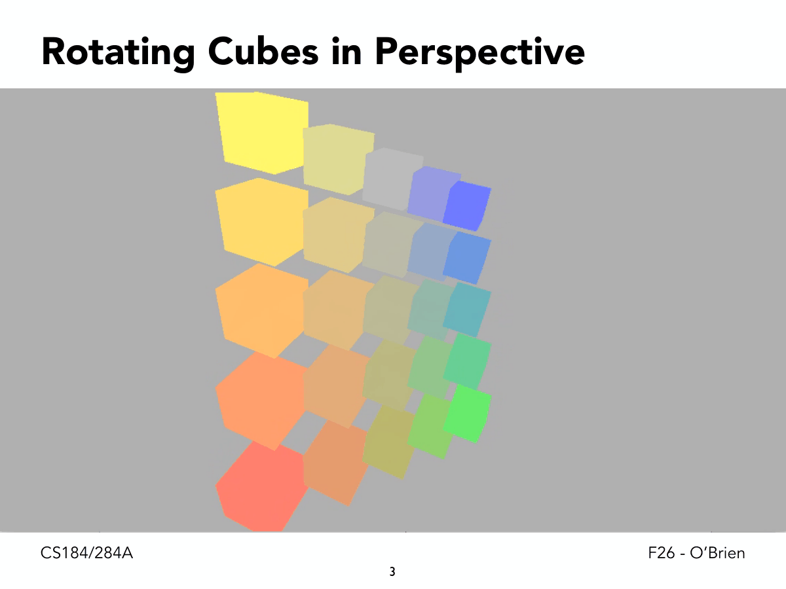

六页旋转立方体的连续帧。**这是"目前能做到的最好效果"** —— 几何正确、有透视、有遮挡（立方体自身遮挡自己）。

**但它看起来完全不像真实世界。**

#### P9–P10　What Else Are We Missing?

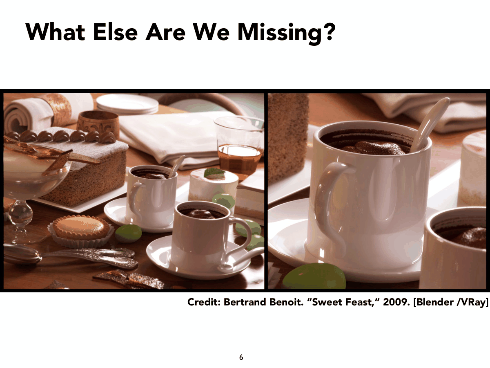


两张照片级渲染（Bertrand Benoit 的 *Sweet Feast*、Giuseppe Albergo 的 *Colibri*）。

#### P11　What Else Are We Missing?

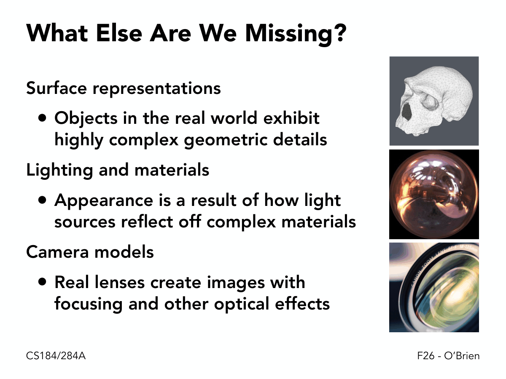

讲义列了三条，**这就是后面几讲的地图**：

| 缺口 | 说明 | 谁来补 |
|---|---|---|
| **Surface representations** | 真实世界的几何细节极其复杂 | L09–11 曲线曲面、L11–12 网格 |
| **Lighting and materials** | 外观是光在复杂材质上反射的结果 | **本讲 + L16–17** |
| **Camera models** | 真实镜头有聚焦等光学效应 | L14 相机与镜头 |

#### P12　Course Roadmap

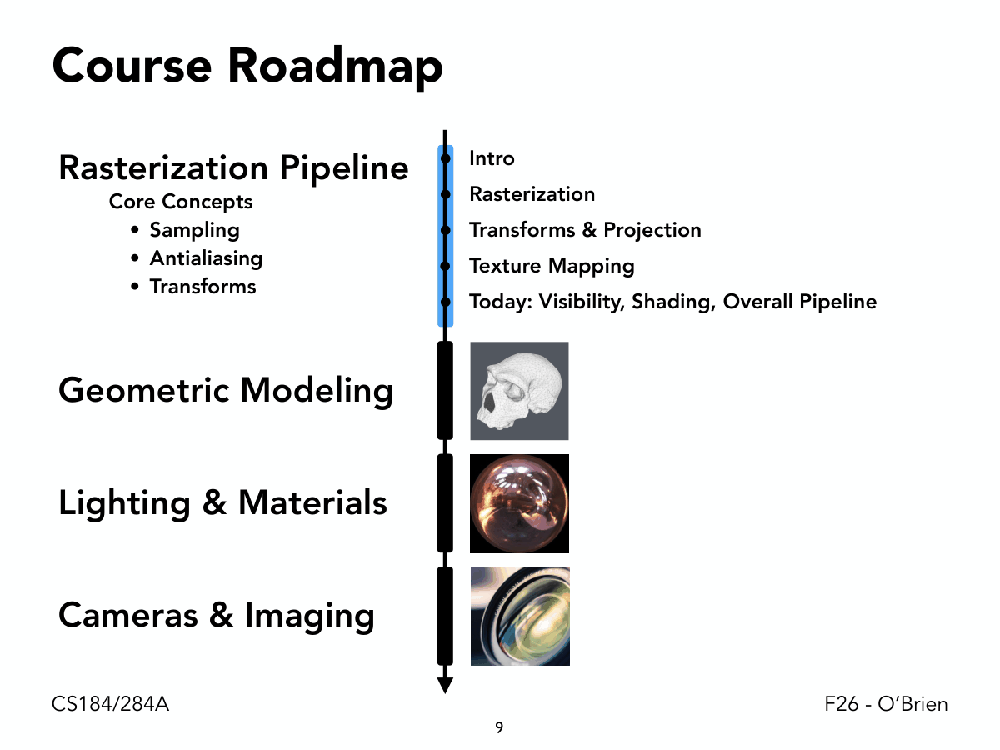

路线图上高亮了 **Today: Visibility, Shading, Overall Pipeline**。

**注意左边那列 "Core Concepts"**：Sampling、Antialiasing、Transforms —— 这三个是贯穿全课的骨架，而不是某一讲的专属内容。

## 2. 可见性：画家算法

#### P13　Visibility

*章节点*

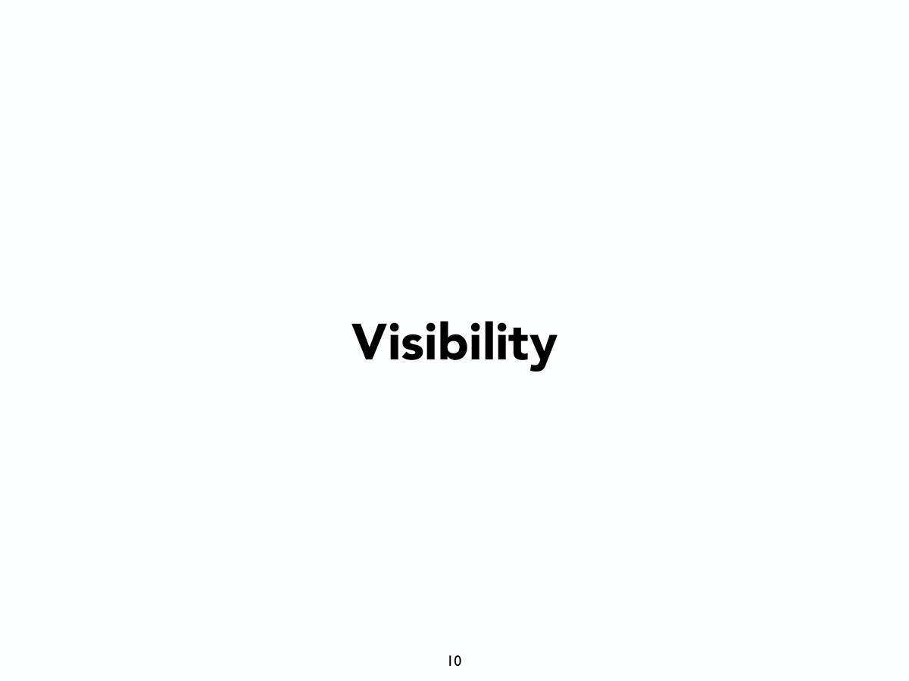

分节页。要解决的第一个问题：**屏幕上一个像素被多个三角形覆盖时，该显示哪个？**

#### P14–P23　Inspired by how painters paint

*Paint from back to front, overwrite in the framebuffer*

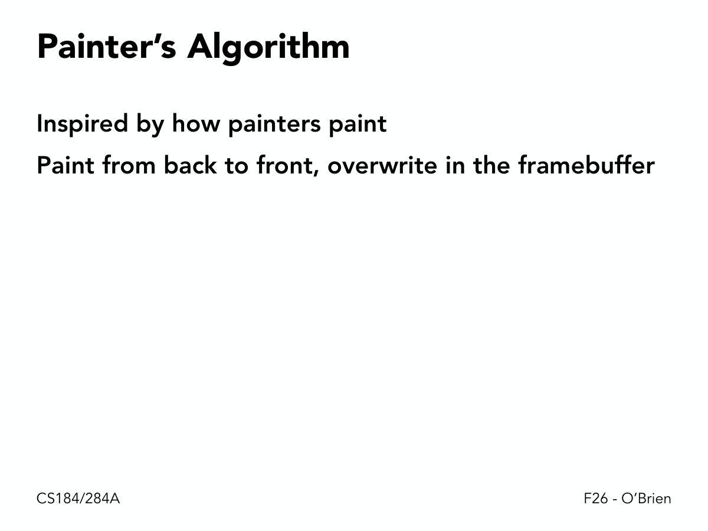

一页画家作画的照片（Wikipedia），配一句加粗：

> **从后往前画，直接覆盖帧缓冲里的值。**

**这个类比很准**：油画家先画远景、再画中景、最后画近景，后画的颜料自然盖住先画的。**图形学里的"画家算法"就是这个策略**。

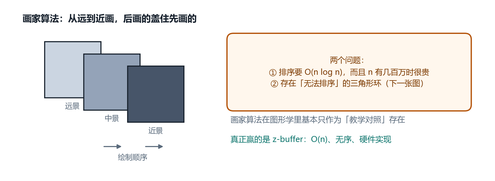

*三个不同深度的物体，从远到近依次画上去，后画的直接覆盖先画的像素值。*

**优点**：极其简单，不需要额外的深度缓冲。

**但 P24 给出了两个致命问题。**

#### P24　Painter's Algorithm

*Requires sorting in depth (O(n log n) for n triangles) · Can have unresolvable depth order · (BSP Trees will provide a way of dealing with both issues.)*

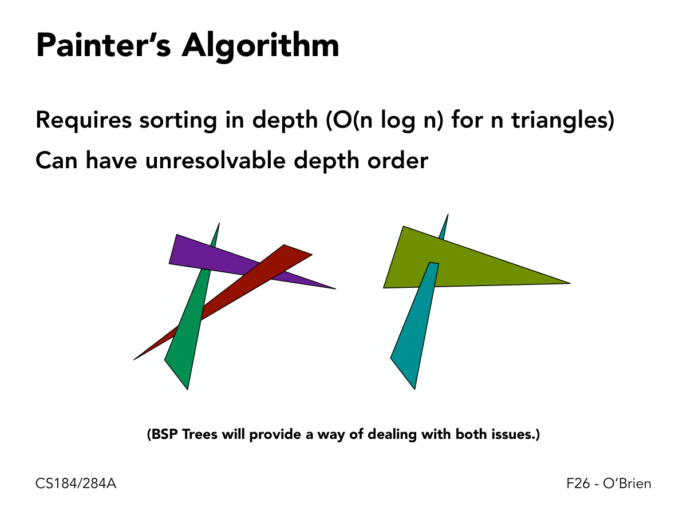

两条加粗：

| 问题 | 说明 |
|---|---|
| **要排序** | `O(n log n)`，n 是三角形数。场景有几百万三角形时很贵 |
| **可能无解** | 存在**无法排序**的三角形排列 |

**"无法排序"是什么意思？** 看下一张图。

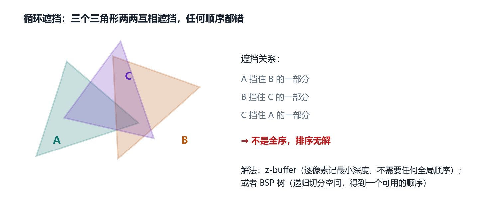

*三个三角形两两互相遮挡：A 挡 B、B 挡 C、C 挡 A。**这不是全序关系**（不是"甲在乙前面、乙在丙前面"），所以不存在任何一个"正确的绘制顺序"。*

**这就是画家算法出局的原因**：它要求一个**全局顺序**，而遮挡关系本质上**不是全局的**（不同像素上的前后关系可能相反）。

> **📌 括号里那句话值得注意**
>
> 讲义写：***"(BSP Trees will provide a way of dealing with both issues.)"***
>
> BSP 树（二叉空间分割）能给出一个"可用的"绘制顺序 —— 它递归地把空间切成两半，直到每个区域里只剩一个不交叉的多边形。这样得到的顺序**保证正确**，而且不需要排序。
>
> 但 BSP 树的构建本身很贵（`O(n log n)` 到 `O(n²)`），且只适合静态场景。**所以工业界最终选了 z-buffer。**

## 3. z-buffer：赢下可见性的算法

#### P25–P31　Z-Buffer

*This is the hidden-surface-removal algorithm that eventually won.*

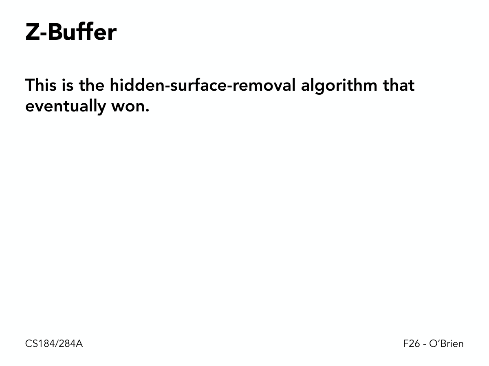

一句很自信的加粗：

> ***"This is the hidden-surface-removal algorithm that eventually won."***
>
> 这就是最终赢下「隐面消除」的那个算法。

**思路（P28–P31 逐条累加）**：

| 要点 | 说明 |
|---|---|
| **每个采样位置存当前最小的 z** | 谁离相机最近，就记谁 |
| **需要一块额外缓冲** | 帧缓冲存 RGB，**深度缓冲（z-buffer）存深度** |
| 深度精度 | 16 到 32 bit |

**关键洞察**：**我们不需要知道"正确的绘制顺序"，只需要知道"每个像素上谁最近"。**

- 画家算法：**全局顺序** → 排序问题
- z-buffer：**逐像素比较** → 无排序

这个转变把一个"全局难题"化成了"局部比较"。

#### P32　Z-Buffer Example

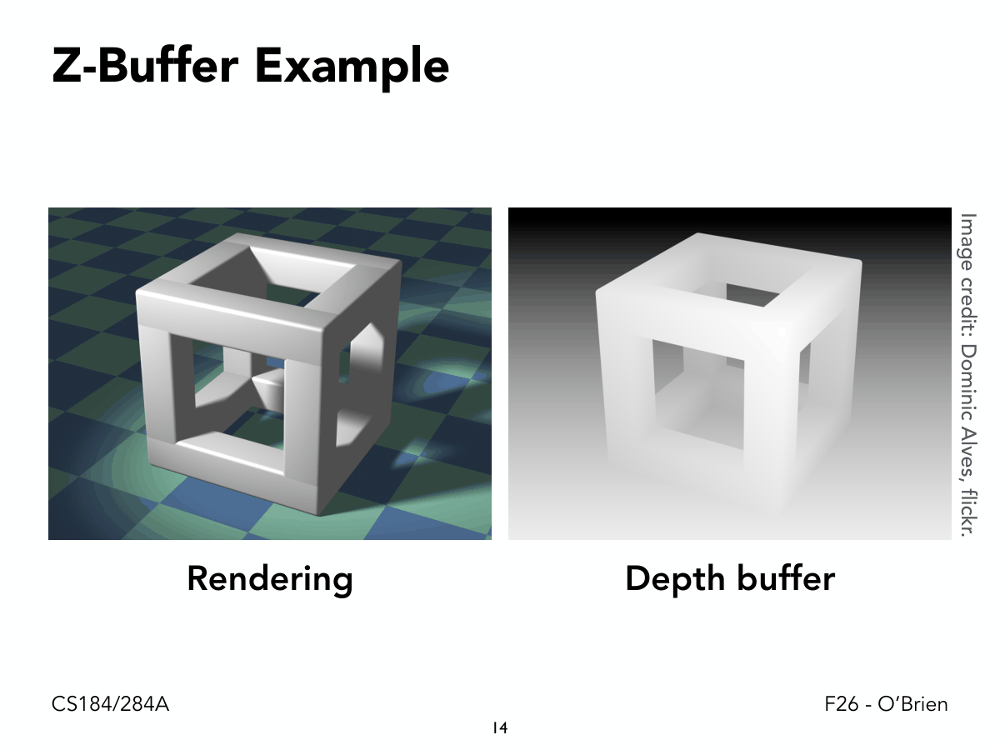

两张图并排：左边是正常渲染（一个放在棋盘地面上的镂空立方体），右边是**深度缓冲的可视化**（越近越暗/越亮，取决于映射）。

**深度缓冲长什么样**：它是一张**灰度的"距离图"**，没有颜色、没有纹理、只有远近。**它和渲染图在几何轮廓上完全一致**，因为两者都是"这张图里每个像素对应的那个表面"的属性。

#### P33　Z-Buffer Algorithm

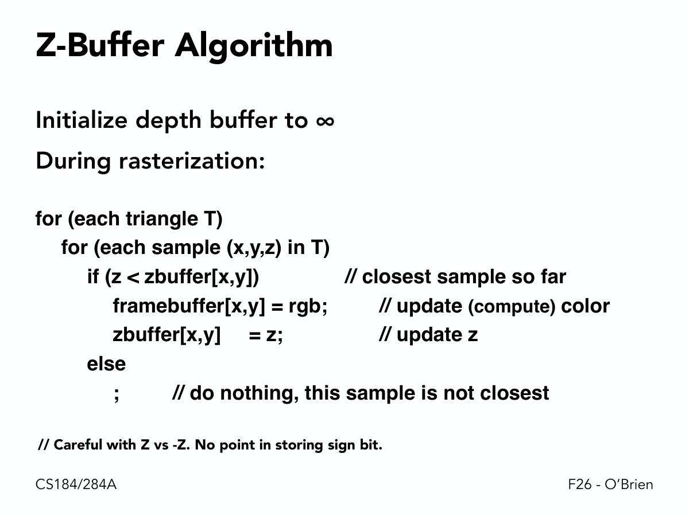

```c
Initialize depth buffer to ∞
During rasterization:
  for (each triangle T)
    for (each sample (x,y,z) in T)
      if (z < zbuffer[x,y]) {        // closest sample so far
        framebuffer[x,y] = rgb;      // update (compute) color
        zbuffer[x,y]     = z;        // update z
      } else
        ;                            // do nothing, this sample is not closest
// Careful with Z vs -Z. No point in storing sign bit.
```

**四行核心逻辑**，但有两个注释值得说：

**① `// Careful with Z vs -Z`**
观察空间里相机看向 `−z`（第 4–5 讲 P197），所以"更近"意味着 `z` **更大**（更接近 0）。而深度缓冲通常存"正的距离"，于是判定方向要反过来。**这是实现时最常见的符号错误**。

**② `// No point in storing sign bit`**
因为深度总是正的（距离），所以可以把符号位省掉，换成一个额外的精度位。**这是真实硬件的做法** —— 深度缓冲常常是 24 位无符号。

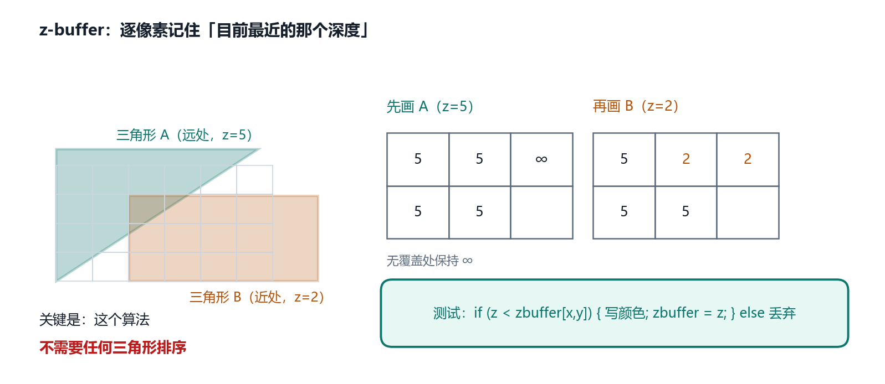

*先画远的 A（z=5），缓冲里填 5；再画近的 B（z=2），因为 2 < 5 所以覆盖 —— **整个过程不需要知道三角形的绘制顺序**，只要每个像素比一次就够了。*

#### P34　Z-Buffer Algorithm

*（In this example positive values are further.）*

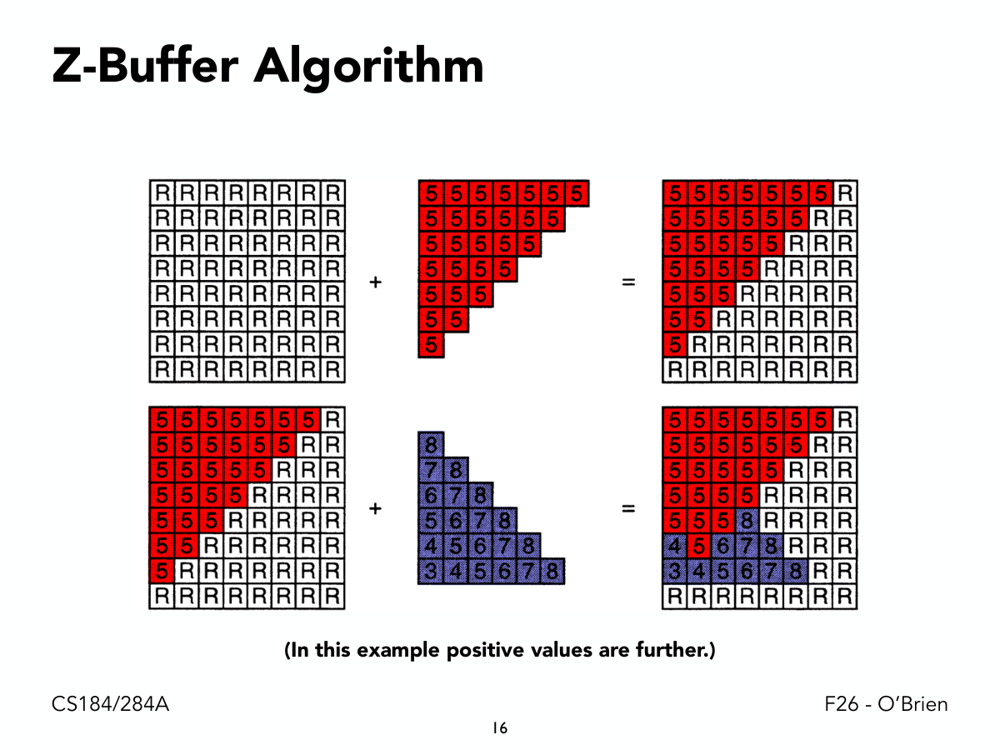

一页图示：两个三角形分别光栅化（红、蓝掩码），然后合并（z 测试决定谁保留）。

**注意小字**：*"In this example positive values are further."* —— 这一页假设 `z` 越大越远，即 `z` 是"距离"而非"观察空间坐标"。**两种约定都常见，但绝不能混用。**

#### P35　Z-Buffer Complexity

*Complexity: O(n) for n triangles · How can we sort n triangles in linear time? · Most important visibility algorithm · Implemented in hardware for all GPUs · Used by OpenGL · Issues: Overdraw · Transparency*

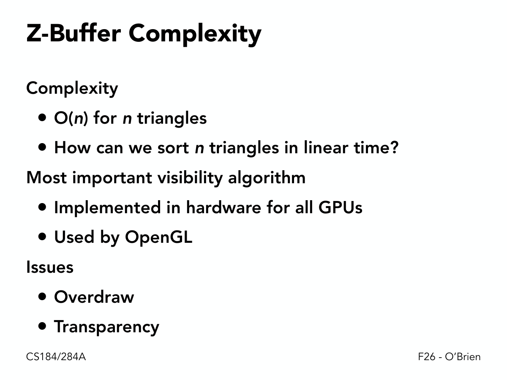

**复杂度 `O(n)`** —— 注意这里有个反问：*"How can we sort n triangles in linear time?"*（怎么能线性时间排序 n 个三角形？）

**答案是：我们没有排序。** 每个样本只做一次比较，总工作量 = 所有三角形覆盖的样本总数 = `O(n)`（在三角形面积有限的前提下）。

**三条地位**：

| 事实 | 意义 |
|---|---|
| **最重要的可见性算法** | 没有之一 |
| **所有 GPU 硬件实现** | 不是软件优化，是固定功能电路 |
| **OpenGL 采用** | 也是 DirectX / Vulkan 的默认行为 |

**两个问题（P35 列出的）**：

| 问题 | 说明 |
|---|---|
| **Overdraw** | 被遮挡的像素也要跑一遍片元着色（先着色后测深度），浪费带宽。现代 GPU 用"early-Z"优化 |
| **Transparency** | 半透明物体不能用这个算法（见 P36） |

#### P36–P37　Z-Buffer and Transparency

*Transparency requires partial sorting*

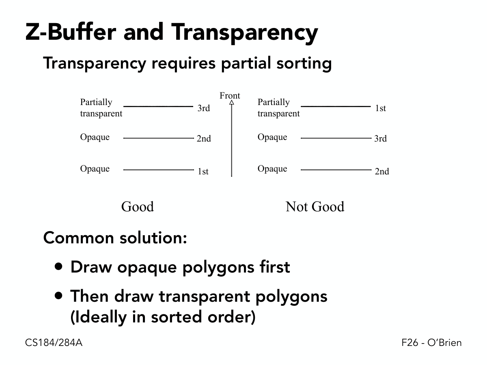

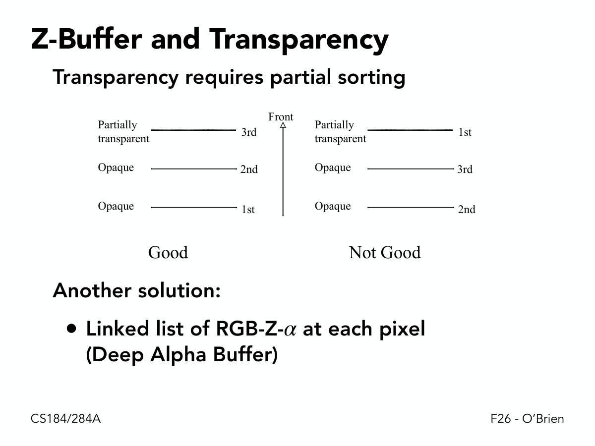

**问题**：半透明像素不能"覆盖"，必须"混合"（把已有颜色和新颜色按权重加起来）。而 z-buffer 只保留**最近的一个** —— 后面的信息全被丢掉了。

**两种解法**：

| 方案 | 说明 | 问题 |
|---|---|---|
| **先画不透明，再画透明**（理想情况下透明物体从远到近） | 常规做法 | 透明物体之间仍需要排序，而且可能无解（P24 的循环） |
| **Deep Alpha Buffer** | 每个像素存一个"RGB-Z 链表"，事后统一合成 | 需要可变长存储，硬件不友好 |

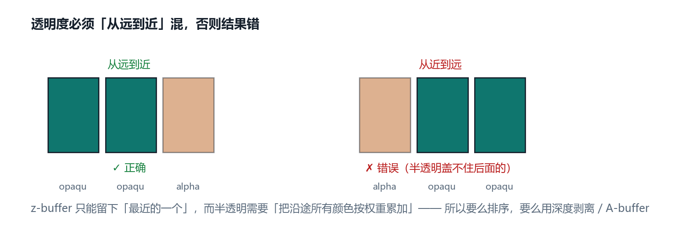

*左：按"不透明 → 不透明 → 半透明"的顺序，正确。右：先画半透明，它后面再画的不透明物体就会把它覆盖掉 —— 错的。*

> **⚠️ 为什么"先画不透明"就能缓解**
>
> 不透明物体之间的正确性由 z-buffer 保证（不需要排序）。只有**不透明与半透明之间**需要顺序。
>
> 所以"先不透明、后透明"把问题缩小到了"透明物体内部"—— 而透明物体通常数量少、且常常可以接受轻微错误。

## 4. 阴影贴图：可见性的第二次利用

#### P38　Shadow Maps

*Pre-render scene from perspective of light source · Only render Z-Buffer (the shadow buffer) · Render scene from camera perspective · Compare with shadow buffer · If nearer light, if further shadow*

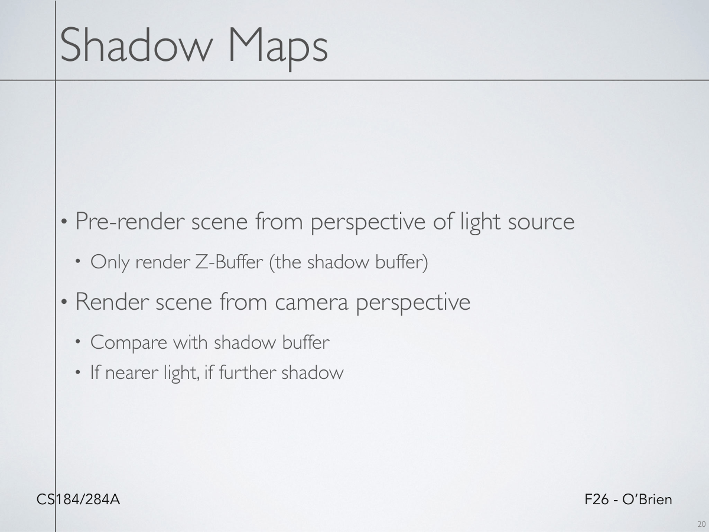

**四步算法，全在复用 z-buffer**：

| 步骤 | 做什么 |
|---|---|
| 1 | 从**光源**视角渲染场景 |
| 2 | 只保留**深度缓冲**（叫 shadow buffer） |
| 3 | 从**相机**视角渲染场景 |
| 4 | 逐像素比较：到光源的距离 vs shadow buffer 里的值 |

**判据**：

- **比 shadow buffer 里更远** ⇒ 中间有东西挡光 ⇒ **在阴影里**
- **更近或相等** ⇒ 光源能直接看到 ⇒ 正常光照

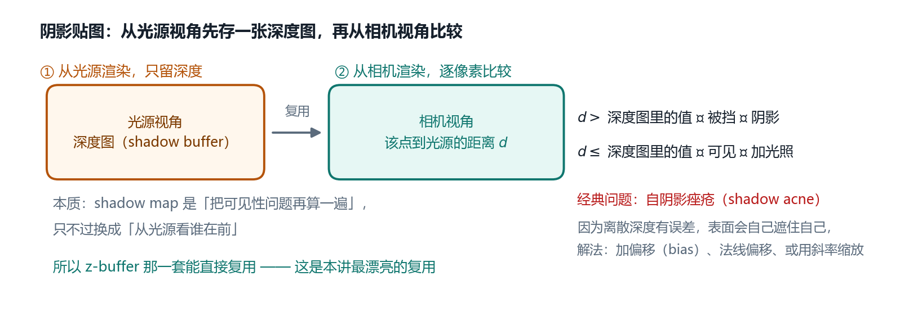

*本质是"把可见性问题再算一遍"，只不过换成"从光源看谁在前"。**这是本讲最漂亮的复用** —— 一个 z-buffer，解决了两个完全不同的需求。*

#### P39　Shadow Maps

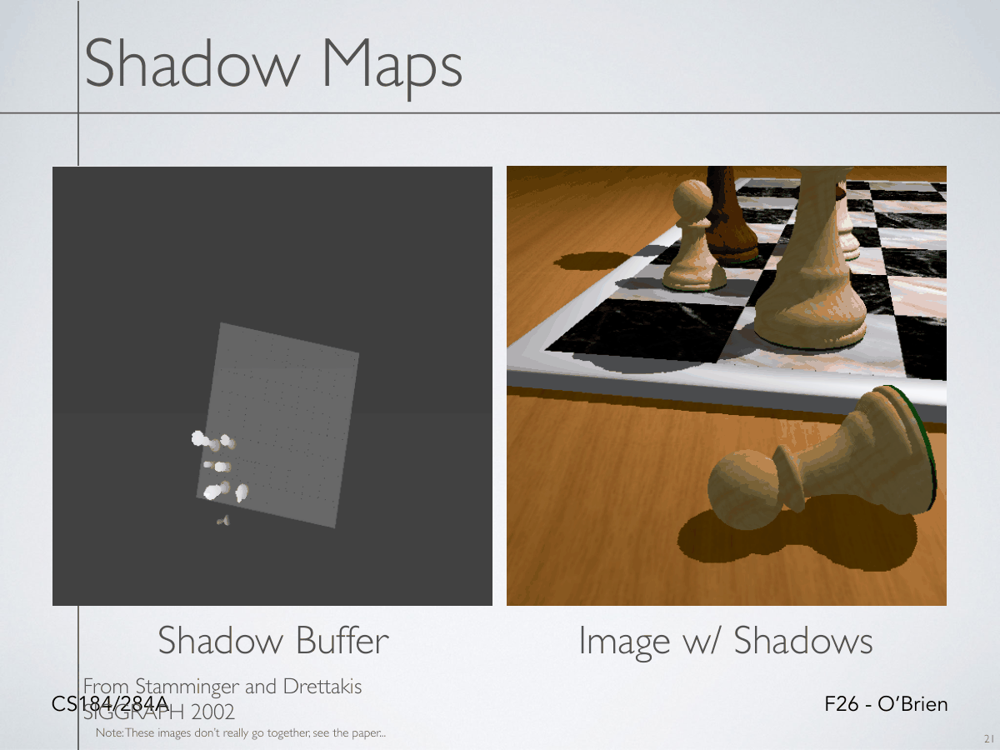

一张有阴影的渲染（Stamminger & Drettakis, SIGGRAPH 2002）。

**小字有个诚实的免责声明**：*"Note: These images don't really go together, see the paper..."* —— 讲义用了论文里的图，但两张图其实不是同一份数据的。**这种标注值得学：不假装严谨。**

#### P40　Deep Shadow Maps

*Some objects only partially occlude light · A single shadow value will not work · Similar to transparency in Z-Buffer*

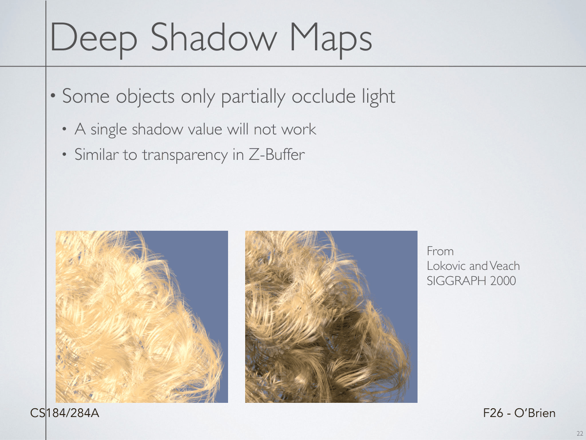

**问题和 P36 完全同构**：如果遮挡物是**半透明**的（比如树叶、烟、毛发），那么"完全挡住"和"完全没挡"都不对 —— 需要记录**衰减比例**。

**解法**：每个 texel 存一个**透射率函数**（transmittance as a function of depth），而不只是一个深度值。

#### P41　Attendance

*Word of the day: visibility · Lecture number: 8*


签到页，写着 **"Word of the day: visibility"，Lecture number 8**。

**这个细节确认了讲次编号**：这一讲在课程里是 **Lecture 8**（对应 fa26 的 L08–09 合并讲义第一半）。

## 5. 简单着色：为什么不用物理

#### P42　Simple Shading（Blinn-Phong Reflection Model）

*章节点*

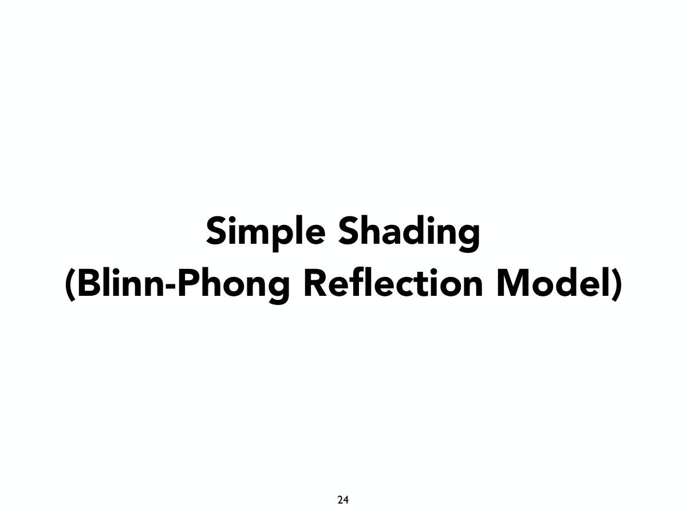

分节页。可见性解决"看到谁"，现在解决"它有多亮"。

#### P43　Simple Shading vs Realistic Lighting & Materials

*What we will cover today: A local shading model: simple, per-pixel, fast · Based on perceptual observations, not physics*

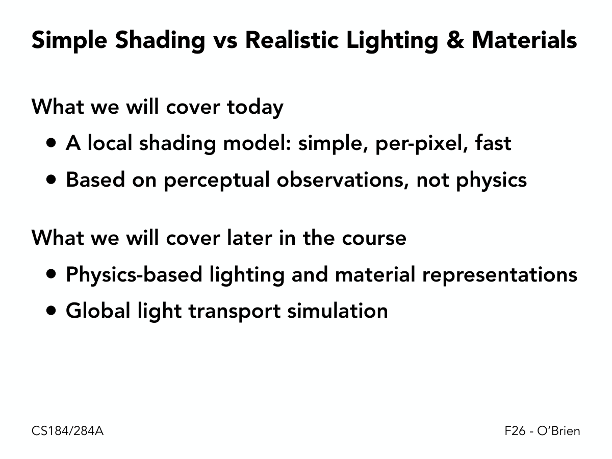

**这一页把"取舍"讲得很直白**：

| 今天 | 后面 |
|---|---|
| **局部（local）** 着色模型 | 基于物理的光照与材质 |
| 简单、逐像素、快 | 全局光传输模拟 |
| **基于感知观察，不是物理** | 有物理依据 |

**"Based on perceptual observations"** 是关键词：Blinn-Phong 不是从物理推导出来的，而是**观察"真实物体看起来有哪几种亮"然后手工凑出来的公式**。

#### P44　Perceptual Observations

*Specular highlights · Diffuse reflection · Ambient lighting*

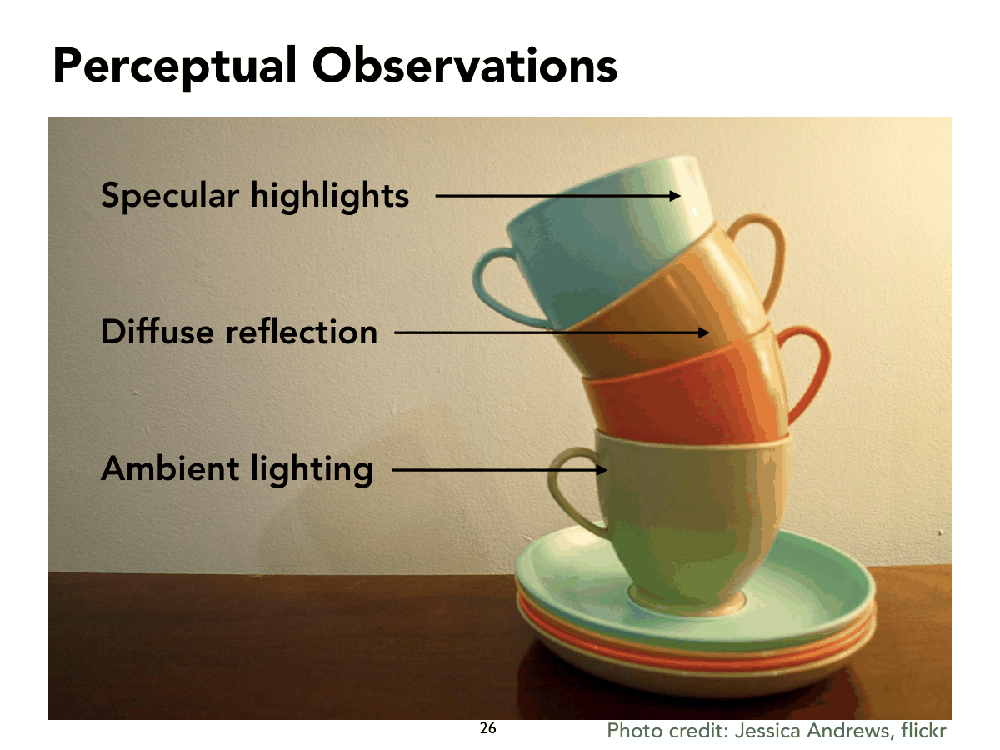

一摞彩色茶杯的照片（Jessica Andrews），三处用箭头标出：

| 观察 | 在图上的位置 |
|---|---|
| **Specular highlights（高光）** | 杯子釉面上那几块亮斑 |
| **Diffuse reflection（漫反射）** | 杯身的平滑明暗过渡 |
| **Ambient lighting（环境光）** | 背光面也不是全黑 |

**这就是 Blinn-Phong 三项的由来** —— 先看见三种现象，再各造一项去模拟。

#### P45　Local Shading

*Compute light reflected toward camera · No "global" effects · Unit length (normalized) vectors!!!*

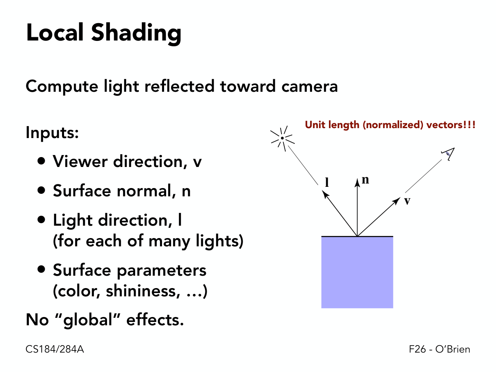

图上是 `l`（光源方向）、`n`（法线）、`v`（视线）三个箭头从同一点出发。

**四个输入**：

| 输入 | 含义 |
|---|---|
| `v` | 观察方向（surface → eye） |
| `n` | 表面法线 |
| `l` | 光源方向（surface → light），**对每个光源各一个** |
| 表面参数 | 颜色、光泽度…… |

**加粗的警告**：***"Unit length (normalized) vectors!!!"*** —— 三个向量必须归一化。

> **⚠️ 为什么归一化这么重要**
>
> 因为公式里全是点积 `n·l`、`n·h`。**点积的定义是 `|a||b|cos θ`** —— 只有单位向量时，点积才等于 `cos θ`。
>
> 用了非单位向量，亮度会随向量长度缩放，出现"离得远就变暗"之类的怪现象，而且很难排查。

## 6. 漫反射：Lambert 余弦定律

#### P46–P48　Light Falloff

*intensity here: I/r²*

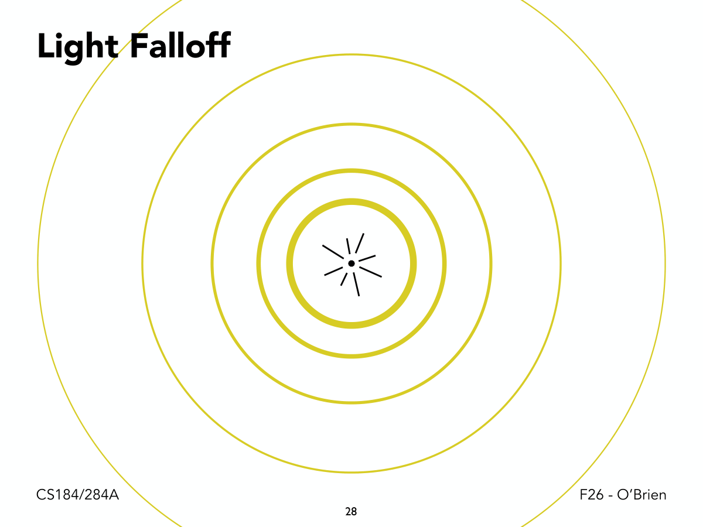

光源发出的光向四周扩散，**单位面积上的能量按 `1/r²` 衰减**（平方反比定律）。

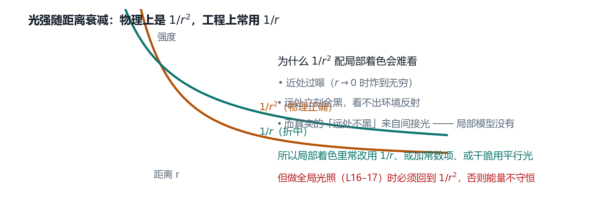

*物理上是 `1/r²`。但局部着色模型里用它常常很难看 —— 因为"远处全黑"这件事，物理上是由**间接光**填回来的，而局部模型没有间接光。*

#### P49　Falloff

*Physically correct: 1/r² light intensity falloff · Tends to look bad with local shading (why?) · Sometimes compromise of 1/r used · Very important to use 1/r² for correct global illumination methods*

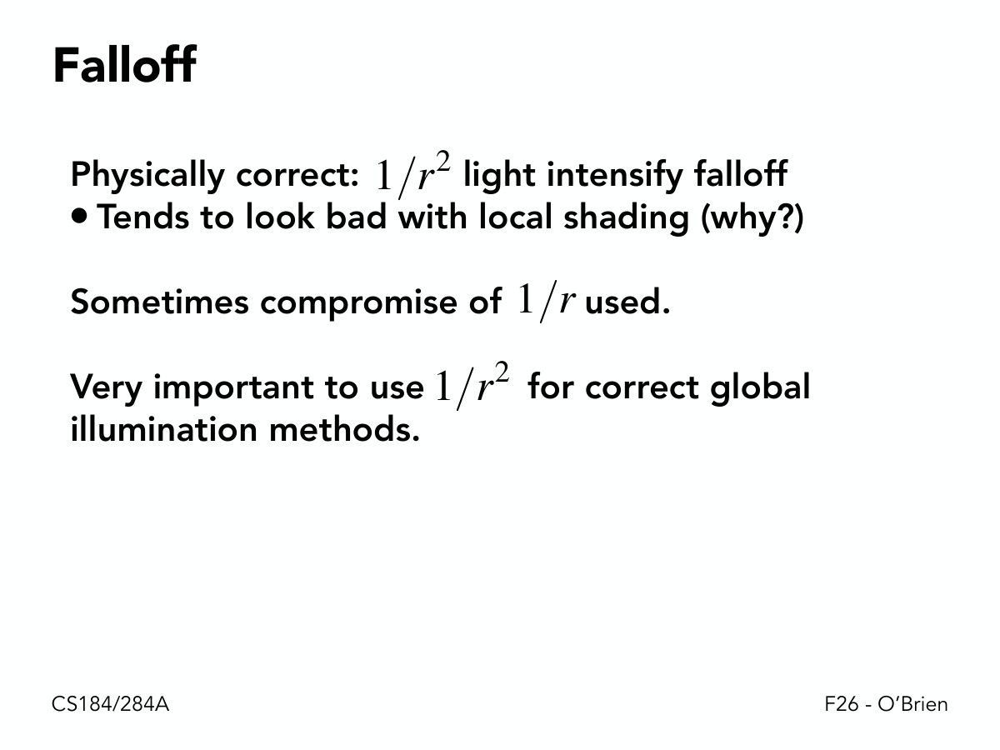

**三个要点**：

| 说法 | 含义 |
|---|---|
| 物理正确是 `1/r²` | 平方反比 |
| **但配局部着色会难看（为什么？）** | 因为局部模型没有间接光填底，远处直接变黑 |
| 有时折中用 `1/r` | 衰减更慢，视觉上更"耐看" |
| **做全局光照时必须用 `1/r²`** | 否则能量不守恒 |

**🔧 手算 1：`1/r²` 有多陡**

设 `r=1` 处强度为 1：

| 距离 `r` | `1/r²` | `1/r` |
|---|---|---|
| 1 | 1.0 | 1.0 |
| 2 | 0.25 | 0.5 |
| 4 | 0.0625 | 0.25 |
| 10 | 0.01 | 0.1 |

**`r=10` 时 `1/r²` 只剩 1%** —— 这就是"远处全黑"的来源。而 `1/r` 还有 10%，视觉上更像真实照片（真实照片里远处是暗但不是纯黑，因为环境光/间接光在起作用）。

#### P50　Diffuse Reflection

*Light is scattered uniformly in all directions · Surface color is the same for all viewing directions · Lambert's cosine law*

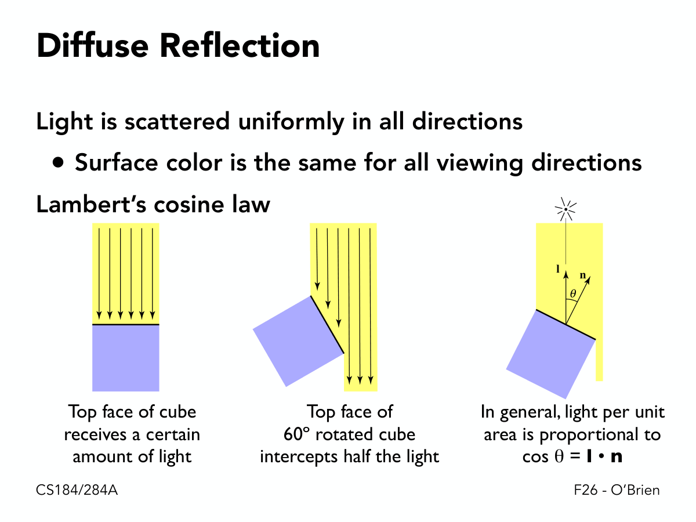

图上是三块板：

| 图 | 说明 |
|---|---|
| 左：正对光源 | *Top face of cube receives a certain amount of light* |
| 中：旋转 60° | *Top face of 60° rotated cube intercepts **half** the light* |
| 右：一般情况 | *light per unit area is proportional to `cos θ = l · n`* |

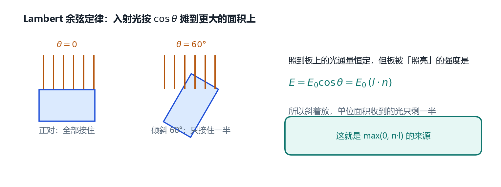

*光通量是恒定的，但板子倾斜后**同样的光摊到更大的面积**上，所以单位面积收到的能量按 `cos θ` 下降。*

**🔧 手算 2：为什么 60° 恰好是一半**

$$
\cos 60° = 0.5
$$

**所以 `60°` 倾斜的板，单位面积上只收到一半的光。** 这也是为什么 P50 的图特意选 60° —— 一半是个好记的数。

**两个性质**（P50 列出的）：

1. **光向所有方向均匀散射** → 从哪个角度看都一样
2. **表面颜色与观察方向无关**

#### P51　Lambertian (Diffuse) Shading

*Shading independent of view direction*

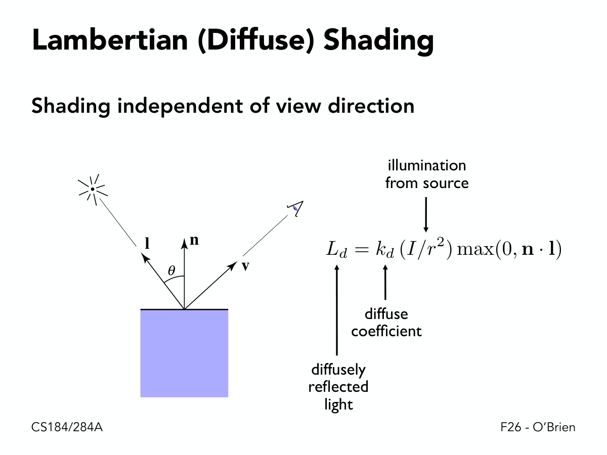

$$
L_d=k_d\,\frac{I}{r^2}\,\max(0,\ \mathbf{n}\cdot\mathbf{l})
$$

四个符号的含义（图上逐一标注）：

| 符号 | 含义 |
|---|---|
| `k_d` | **漫反射系数**（材质颜色） |
| `I/r²` | 到达表面的**光照强度**（含衰减） |
| `max(0, n·l)` | **余弦项**（斜着的面收光少） |
| `max(0, ...)` | **避免背面为负**（`n·l < 0` 说明光在背面） |

> **📌 `max(0, ...)` 为什么不能省**
>
> 如果 `n·l < 0`（光从背面来），点积是负的。不裁剪的话会得到**负的光照** —— 比黑还黑，在后续加法里会把其他项也吃掉，出现黑斑。
>
> 这个 `max` 在 shader 里对应 `saturate()` 或 `clamp(x, 0, 1)`，是每个图形程序员写的第一行防御性代码。

#### P52　Lambertian (Diffuse) Shading

*Produces matte appearance*

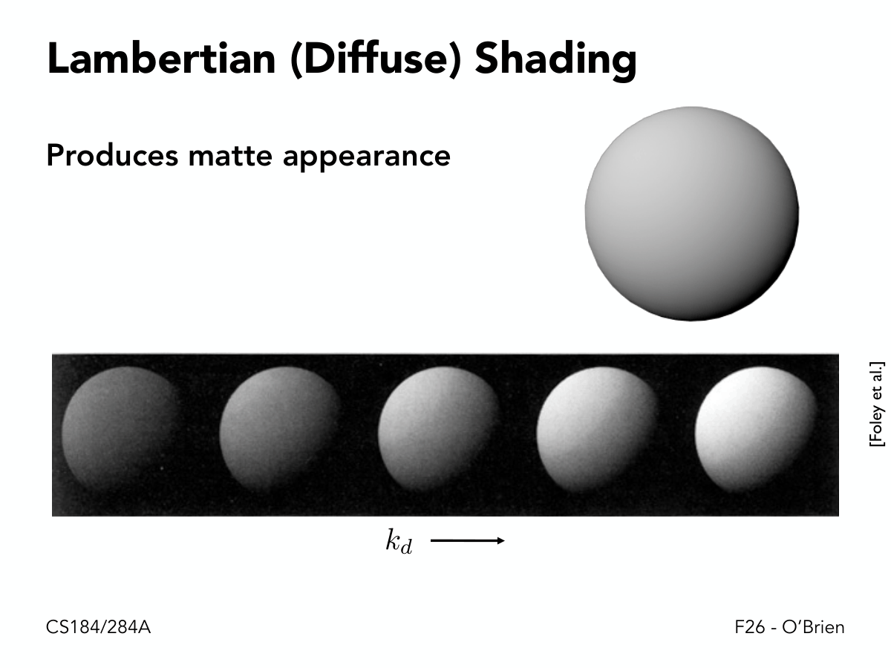

一排球，`k_d` 从左到右递增。

**"matte"（哑光）的视觉特征**：明暗过渡很柔和，**没有亮斑**。粉笔、橡皮、未上釉的陶器都是这样。

## 7. 高光：Blinn-Phong 的核心技巧

#### P53　Perceptual Observations

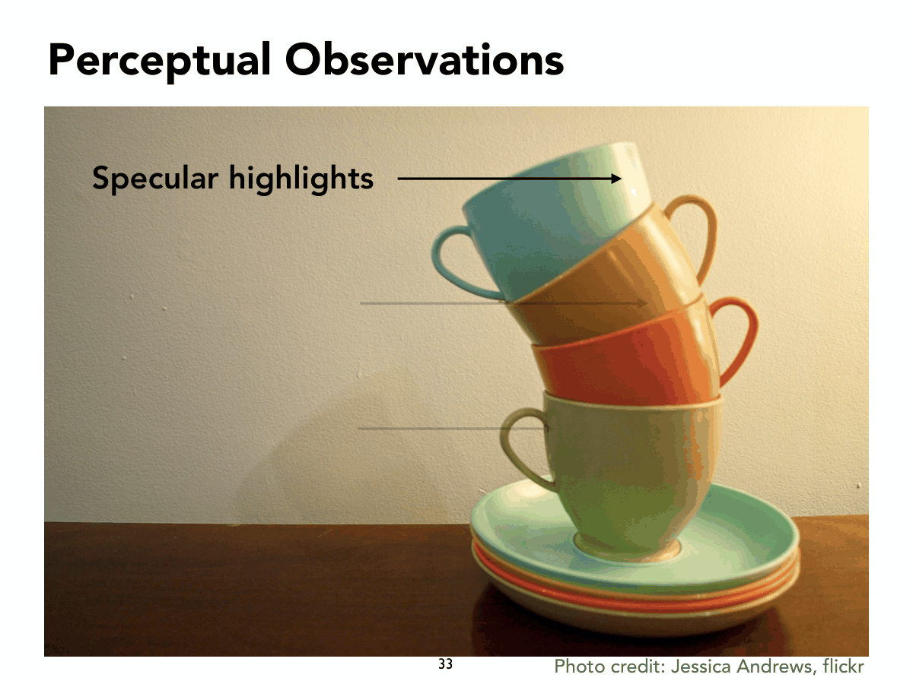

同一张茶杯照片，这次只标 **Specular highlights**。

**高光的视觉特征**：**小而亮的一块**，而且**位置会随着观察方向移动**（你歪一下头，高光也在动）。

#### P54　Specular Shading (Blinn-Phong)

*Intensity depends on view direction · Bright near mirror reflection direction*

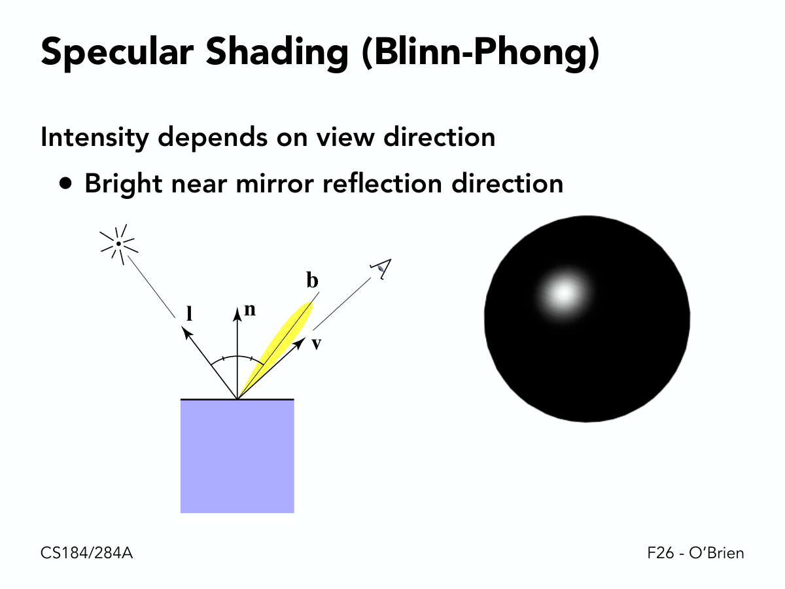

一个球在黑色背景上，右上方一块明亮的高光。

**关键区别**：漫反射"从哪个角度看都一样"，而高光"只在一个特定方向附近亮"。

#### P55　Specular Shading (Blinn-Phong)

*Close to mirror direction ⇔ half vector near normal · Measure "near" by dot product of unit vectors*

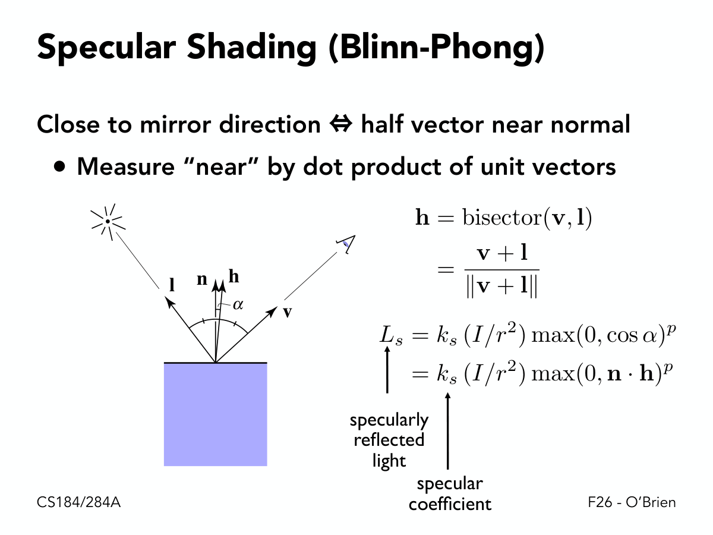

**这是全讲最漂亮的一个技巧**：

$$
\mathbf{h}=\operatorname{bisector}(\mathbf{v},\mathbf{l})=\frac{\mathbf{v}+\mathbf{l}}{\|\mathbf{v}+\mathbf{l}\|}
$$

$$
L_s=k_s\,\frac{I}{r^2}\,\max(0,\cos\alpha)^p=k_s\,\frac{I}{r^2}\,\max(0,\mathbf{n}\cdot\mathbf{h})^p
$$

**为什么用 `h` 而不是反射方向 `r`**：

| 用 `r`（Phong 1975 的做法） | 用 `h`（Blinn 1977 的改进） |
|---|---|
| 要算反射方向 `r = 2(l·n)n − l` | 只要 `h = (v+l)/‖v+l‖` |
| 一次反射计算 | 一次加法 + 一次归一化 |
| 镜面条件：`r` 与 `v` 重合 | 镜面条件：`h` 与 `n` 重合 |

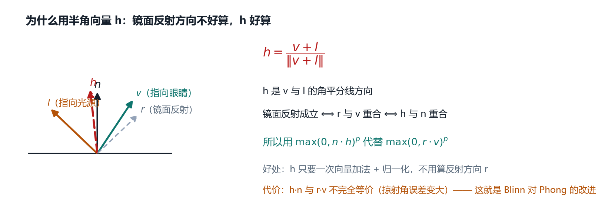

*`h` 是 `v` 与 `l` 的角平分线。**镜面反射成立 ⟺ `r` 与 `v` 重合 ⟺ `h` 与 `n` 重合** —— 所以用 `n·h` 判断"是否接近镜面方向"是等价的，而且更便宜。*

> **📌 "等价"不是"完全相等"**
>
> 严格说 `n·h` 与 `r·v` 不是同一个量。它们的差别在**掠射角**（grazing angle）变大时明显 —— Blinn 的近似会让高光在掠射时偏大。
>
> 但工程上这个近似"看起来更好"，所以 Blinn-Phong 成了标准。**这也是一个"感知优先于物理"的例子**（呼应 P43）。

#### P56–P58　Cosine Power Plots / 高光指数 p

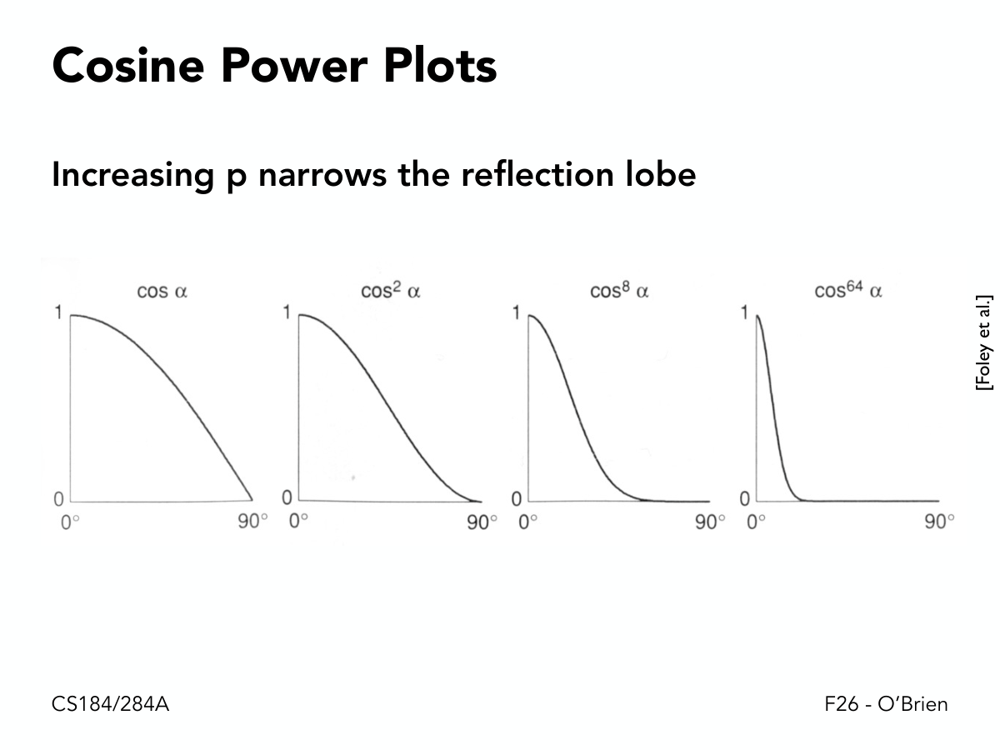

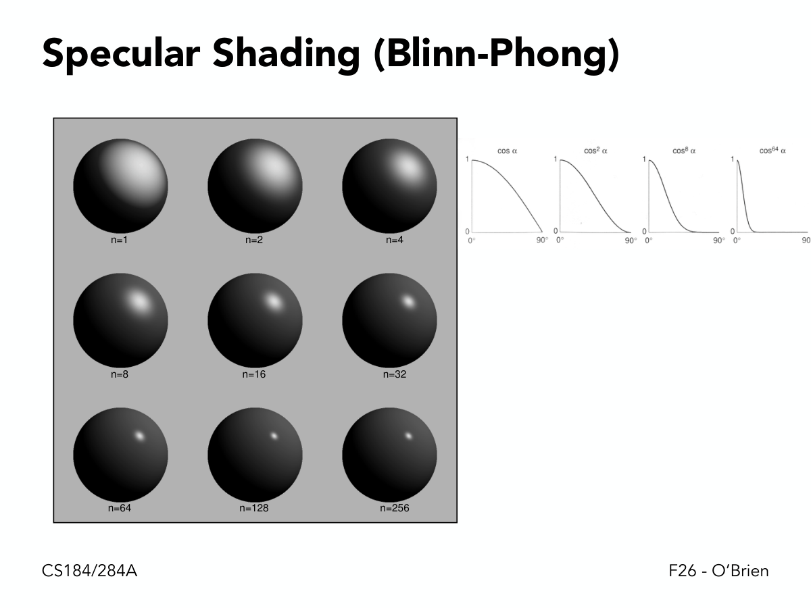

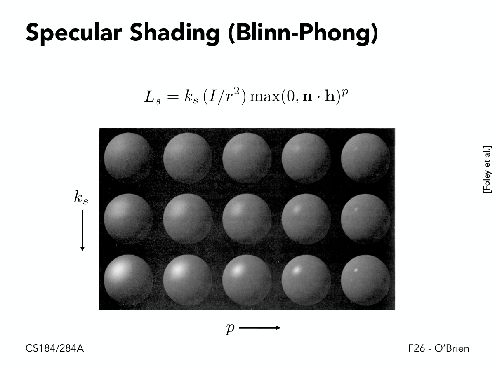

$$
\max(0,\mathbf{n}\cdot\mathbf{h})^p
$$

**`p` 的物理含义**：**材质的"光滑程度"**。

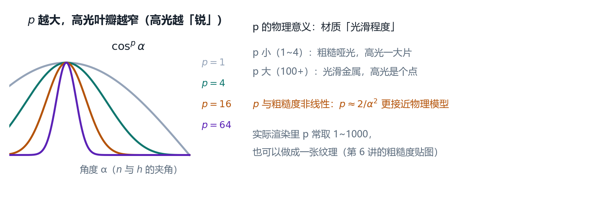

*`p=1` 时高光一大片（粗糙）；`p=64` 时高光是一个点（光滑）。*

**🔧 手算 3：`p` 有多敏感**

取 `n·h = 0.9`（偏离镜面方向约 26°），算 `0.9^p`：

| `p` | `0.9^p` | 视觉 |
|---|---|---|
| 1 | 0.90 | 几乎满亮 |
| 4 | 0.656 | 还挺亮 |
| 16 | 0.185 | 明显变暗 |
| 64 | 0.0012 | 基本没有 |
| 256 | 1.5×10⁻¹² | 完全没有 |

**结论**：`p` 从 16 变到 64，`n·h=0.9` 处的亮度掉了 **150 倍**。所以 `p` 是**控制高光"紧不紧"的核心参数**，而它对数值极其敏感 —— 调参时建议在对数尺度上试（1, 4, 16, 64, 256）。

#### P59　Direction vs Point Lights

*For a point light, the light direction changes over the surface · For "distant" light, the direction is constant*

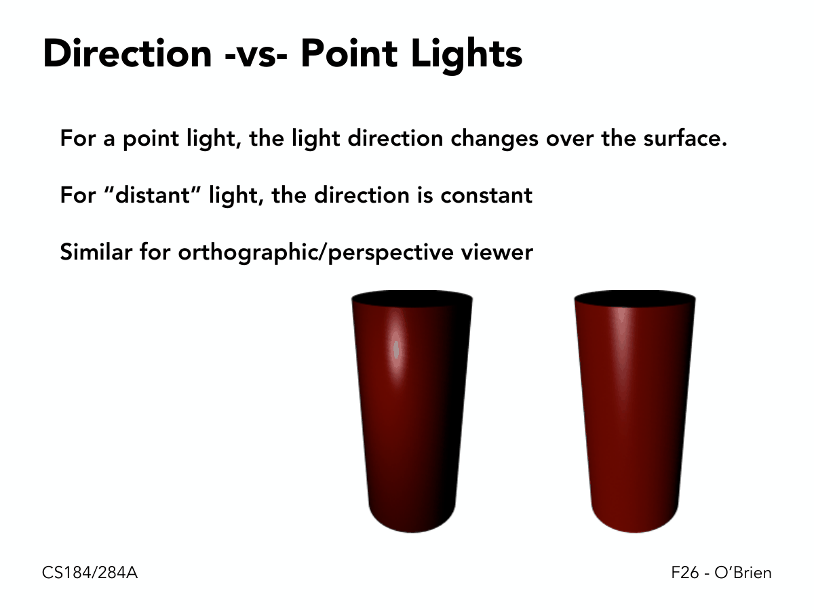

两个圆柱体，标注对比：

| 光源类型 | `l` 怎么算 |
|---|---|
| **点光源** | `l = (light_pos − surface_pos) / ‖...‖`，**每个像素都不同** |
| **平行光（distant）** | `l` 是**常量**，全场一样（太阳） |

**视觉差别**：平行光的明暗带是**直的、平行的**；点光源的明暗带会**弯曲、发散**（图上是两个圆柱，左边隐约看到差别）。

**这个区别在性能上很重要**：平行光不需要逐像素算 `l`，可以提到片元着色之外。

#### P60　Spot and Other Lights

*Other calculations for useful effects: Spot light · Only light certain objects · Negative lights · etc.*

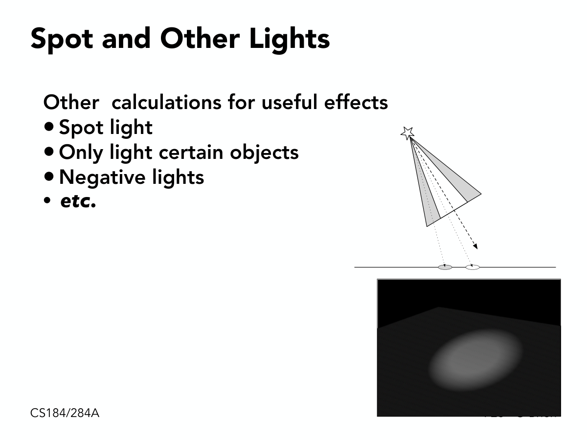

一个**聚光灯（spot light）**的示意图（圆锥 + 一个圆形亮斑）。

**聚光灯的额外计算**：除了方向，还要判断"这个点是否在光锥内"，常用 `cos(angle)` 与锥角比较，并用平滑衰减（否则边缘是硬的圆环）。

**"Negative lights"**（负光源）：用来**减光**，做"挖掉一块光照"的调试效果 —— 不是物理，但是实用的美术工具。

## 8. 环境光与三项求和

#### P61–P62　Ugly....

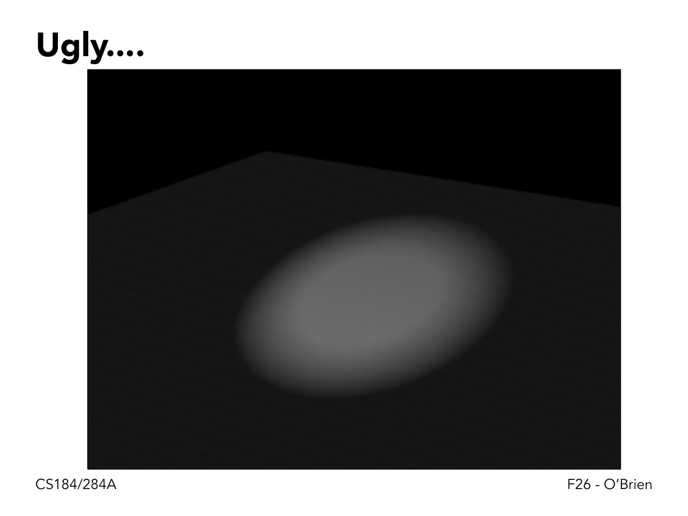

标题只有两个字：**"Ugly...."** —— 展示**只用漫反射 + 高光**的渲染结果。

**为什么丑**：背光面是**纯黑**的，硬邦邦地"断"掉。真实世界里，背光面会被周围物体反射的光照亮（间接光）。

**局部模型做不出间接光**，于是"造"一项来假装它。

#### P63–P64　Ambient Shading

*Shading that does not depend on anything · Add constant color to account for disregarded illumination and fill in black shadows*

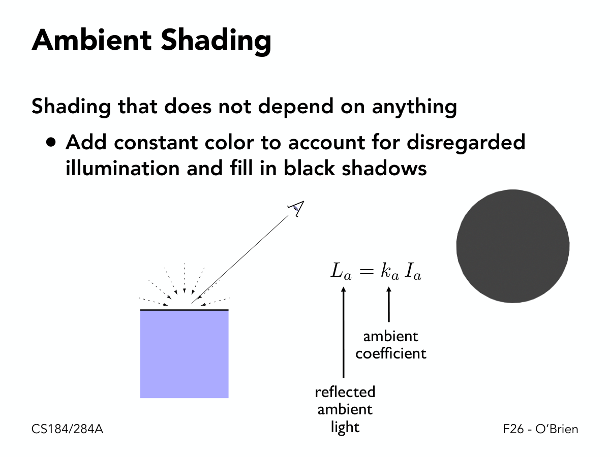

$$
L_a=k_a\,I_a
$$

**只有两个量**：环境光系数 `k_a` 和环境光强度 `I_a` 的乘积。**不依赖任何方向**。

加粗小字说得很直白：*"add constant color to account for **disregarded illumination** and **fill in black shadows**"* —— 加一个常数，来**补偿被忽略的光照**、**填补纯黑的阴影**。

> **⚠️ 环境光是"承认失败"的项**
>
> 它没有任何物理依据 —— 它的全部作用就是**让阴影不要黑得那么假**。
>
> 这也是为什么 L16–17（全局光照）之后，环境光项会被**真正算出来的间接光**取代。**Blinn-Phong 里的 `k_a` 本质上是一个"手工调节的间接光近似"。**

#### P65–P66　Blinn-Phong Reflection Model

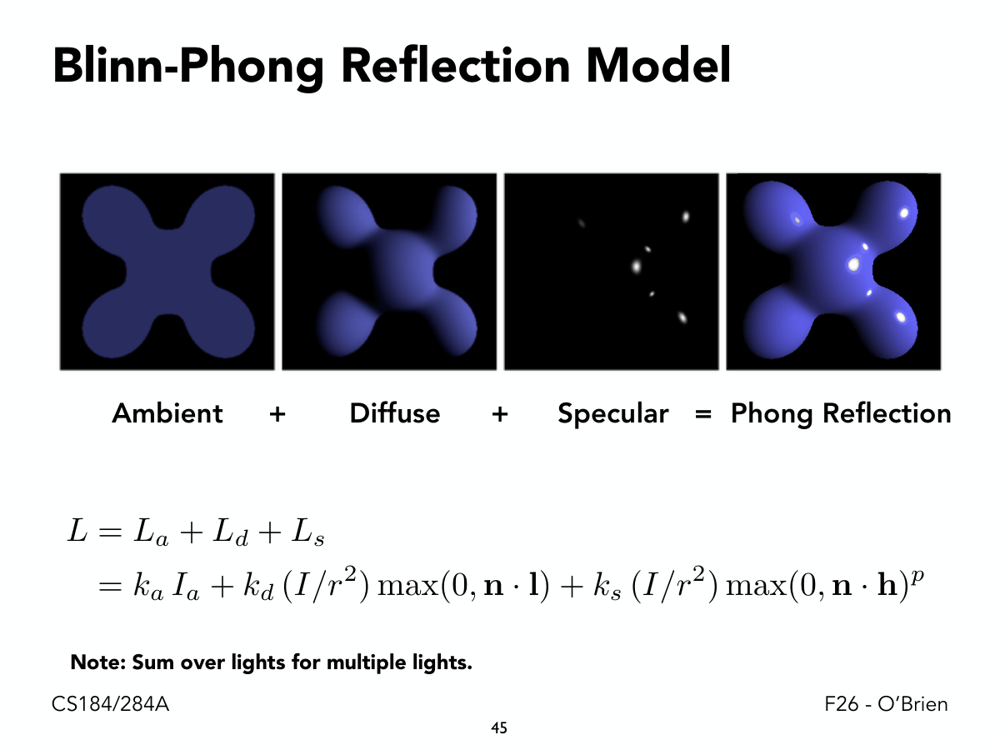

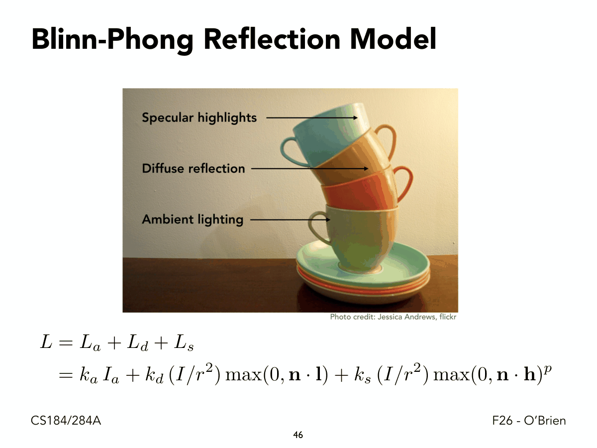

$$
L=L_a+L_d+L_s
=k_aI_a+k_d\frac{I}{r^2}\max(0,\mathbf{n}\cdot\mathbf{l})
+k_s\frac{I}{r^2}\max(0,\mathbf{n}\cdot\mathbf{h})^p
$$

**注意最后那行小字**：***"Note: Sum over lights for multiple lights."***

**多光源时，要把每个光源的 `L_d + L_s` 加起来**（环境光只加一次）：

$$
L=k_aI_a+\sum_{i}\left(k_{d}\frac{I_i}{r_i^2}\max(0,\mathbf{n}\cdot\mathbf{l}_i)
+k_{s}\frac{I_i}{r_i^2}\max(0,\mathbf{n}\cdot\mathbf{h}_i)^{p}\right)
$$


*从左到右：只有环境光（死板的平色）、只有漫反射（有立体感但没亮斑）、只有高光（黑底上一个亮点）、三项相加。*

**🔧 手算 4：算一个点的颜色**

设 `k_a=0.1, I_a=1`；`k_d=0.6, k_s=0.4, p=32`；一个光源在 `r=2` 处、`I=4`；该点 `n·l = 0.8`、`n·h = 0.95`。

| 项 | 计算 | 值 |
|---|---|---|
| 环境 | `0.1 × 1` | **0.10** |
| 到达强度 | `I/r² = 4/4` | `1.0` |
| 漫反射 | `0.6 × 1.0 × 0.8` | **0.48** |
| 高光 | `0.4 × 1.0 × 0.95^32` | `0.4 × 0.194 =` **0.078** |
| **合计** | `0.10 + 0.48 + 0.078` | **0.658** |

**注意高光项**：`0.95` 看起来"很接近 1"，但 `0.95^32` 只有 `0.194` —— 这就是 P56 说的"`p` 让叶瓣变窄"。

## 9. 从 Blinn-Phong 到 BRDF

#### P67–P73　Ashikhmin-Shirley BRDF

*More realistic specular term (for some materials) · Anisotropic specularities · Fresnel behavior (grazing angle highlights) · Energy preserving diffuse term*


讲义用七页介绍一个**比 Blinn-Phong 更真实**的模型（Ashikhmin & Shirley, 2000），四个改进点：

| 改进 | 解决什么 |
|---|---|
| **各向异性高光** | 拉丝金属、头发、丝绸的高光是**长条**的，不是圆点 |
| **菲涅耳行为** | 掠射角时反射变强（所以水面远处格外亮） |
| **能量守恒的漫反射项** | Blinn-Phong 的 `k_d + k_s` 可以超过 1（凭空发光） |
| 漫反射 + 高光两部分（和原来一样） | 结构不变 |

#### P74　BRDF

*The Bi-directional Reflectance Distribution Function · Given: surface material, incoming light direction, direction of viewer, orientation of surface · Return: fraction of light that reaches the viewer*


**定义**：给定**材质、入射方向、出射方向、表面朝向**，返回"有多少比例的光被反射到观察者"。

$$
\rho(v,l,n)
$$

**关键一句**：***"Phong shading is one example of a computed BRDF."***
> Blinn-Phong 就是一个"手工设计出来的 BRDF"。


*BRDF 是一个四维函数（入射方向二维 + 出射方向二维）。Blinn-Phong 只是其中一个特例；真实材质需要更复杂的函数，甚至**实测**得到。*

#### P75–P76　Beyond BRDFs

*The BRDF model does not capture everything · e.g. Subsurface scattering (BSSRDF) · Inter-frequency interactions*


**BRDF 的两个局限**：

| 局限 | 例子 |
|---|---|
| **次表面散射（BSSRDF）** | 蜡、皮肤、大理石、牛奶 —— 光**进到材料内部**散射后再出来，不满足"同点进出" |
| **跨频率交互** | 荧光材料：入射是紫外（看不见），出射是可见光。BRDF 假设"进什么频率出什么频率" |

#### P77–P81　Measuring BRDF

*Images from Marc Levoy · Cornell University Program of Computer Graphics*


五页展示**实测 BRDF**：用机械臂把光源和相机绕样本转一圈，记录每个角度组合下的反射率。

**P78–P81 的四张图分别对应**：汽车漆、气雾喷漆、房屋涂料、有机玻璃板。

> **🔭 实测数据为什么重要**
>
> 因为**没有一个解析公式能准确描述真实材质**。车漆里有金属薄片（各向异性 + 菲涅耳），喷漆有颗粒感，这些都超出 Blinn-Phong 的表达能力。
>
> 所以工业界（尤其是产品渲染、影视）直接**测一张四维查找表**，渲染时插值查表。**这就是"用数据代替公式"** —— 和第 6 讲"用纹理代替几何"是同一个思路。

#### P82　Other Color Effects

*Images from Gooch et. al, 1998*


**Gooch 着色**（Gooch et al. 1998）：一种**非真实感渲染**（NPR）技术，用"冷色到暖色"的渐变代替明暗，让技术插图更易读。

**图上的三个箭头**：`pure blue to yellow` + `pure black to object color` = 最终色调。

**为什么放在这里**：说明着色模型不一定非要"像照片" —— **有时候"看得懂"比"真实"更重要**（工程图、医学插图、动画）。

## 10. 着色频率：逐面、逐顶点、逐像素

#### P83　Shading Triangle Meshes

*章节点*


分节页。前面讲的公式都是"一个点的颜色"。但我们的模型是**三角形**，所以问题是：**在哪里算这个公式？**

#### P84　Shading Frequency: Triangle, Vertex or Pixel


**三种选择，代价与效果都不同**：

| 方法 | 在哪算 | 插值什么 |
|---|---|---|
| **Flat shading**（逐面） | 每个三角形算一次 | 不插值，整个面一个颜色 |
| **Gouraud shading**（逐顶点） | 每个顶点算一次光照 | **插颜色** |
| **Phong shading**（逐像素） | 每个像素算一次 | **插法线**，再算光照 |


*差别只在"插值对象"上：flat 不插；Gouraud 插颜色（法线不插）；Phong 插法线（光照每次重算）。*

> **⚠️ 一个命名陷阱**
>
> 这里的 "Phong shading"（逐像素着色）和反射模型里的 "Phong"（Blinn-Phong 的前身，1975）**是两件事**，只是都叫 Phong。
>
> - **Phong reflection model** = 一个着色公式
> - **Phong shading** = 一种着色频率（逐像素）
>
> 考试里常拿这个混淆。

#### P85–P88　Shading Frequency: Face, Vertex or Pixel

*Num Vertices × Shading freq. × Shading type*


**这一页是"九宫格"矩阵**：横轴是着色频率（Face / Vertex / Pixel），纵轴是网格密度（Num Vertices 三档）。

**读法**：**提高网格密度和提高着色频率，效果类似但代价完全不同** —— 加密网格要更多三角形（几何成本），提高着色频率只是多算几次（计算成本）。

#### P86–P88　局部放大：三种方法的病灶


三页逐一把病灶圈出来（这是全讲最有价值的三张图）：

| 方法 | 病灶 | 讲义原话 |
|---|---|---|
| **Flat** | ① 相邻面的亮度差形成**假的边缘** | *"Note apparent edge enhancement"* |
| | ② 高光会**整个面都亮** | *"Note specular 'taking over' entire face"* |
| **Gouraud** | ① **C1 不连续**（颜色导数跳变，出现条带） | *"Note C1 interpolation artifacts"* |
| | ② 高光被**摊到好几个三角形上** | *"Note specular spread out over several triangles"* |
| **Phong** | ① 轮廓仍然是**多边形**（因为几何没变） | *"Smooth shading, faceted silhouette"* |
| | ② 高光中心可能出现**过曝截断**（平坦的亮斑） | *"clipping ... where center of specularity appears flat"* |


*同一个球：Flat 是分块的（每个面一个法线）；Gouraud 是"块状渐变"（顶点算法线、块内插颜色）；Phong 才是光滑的，高光是圆的。*

> **📌 为什么 Gouraud 的高光会"摊开"**
>
> 因为 Gouraud 在**顶点**上算光照。如果高光恰好落在三角形**内部**（没碰到任何顶点），那么三个顶点都不亮 —— **插值出来的整个面都不亮，高光就消失了**。
>
> 反过来，如果高光碰到了一个顶点，那个顶点会很亮，然后这个亮度被**线性插值铺满整个三角形**，高光就"摊"成一大片。
>
> **这就是"逐顶点"的根本局限：采样点（顶点）太稀疏，抓不住小而锐的特征。**

#### P89–P94　Result of ... Pipeline


六页展示同一场景（两个球）在管线不同阶段的输出：

| 页 | 阶段 | 现象 |
|---|---|---|
| P89 | z-buffer 之后（无色） | 只有轮廓，没有光照 |
| P90–P91 | Flat shading | 球变成"多面体" |
| P92 | Gouraud | 光滑但高光不对 |
| P93–P94 | 逐像素 | 正确 |

**P94 的小字很有意思**：*"Note that this image is correctly 'exposed' so that the specularities don't overflow 255 max display value."*
> 这张图**做了曝光校正**，所以高光没有溢出 255。

**这提醒一件事**：即使着色公式正确，**显示器只有 8 位**（0–255）。高光值常常远超 1.0，直接截断就会变成一片死白（P88 那个"高光中心发平"的病灶）。**这就是后来 HDR + tone mapping 要解决的问题。**

## 11. 法线：从哪来，怎么变换

#### P95–P98　Defining Per-Vertex Normal Vectors

*Best to get vertex normals from the underlying geometry · Otherwise have to infer vertex normals from triangle faces · Simple scheme: average surrounding face normals*


$$
\mathbf{N}_v=\frac{\sum_i w_i\mathbf{N}_i}{\sum_i w_i}
$$

**两种来源**：

| 来源 | 说明 |
|---|---|
| **从底层几何直接取** | 比如球面：顶点法线就是归一化的顶点位置。**最好** |
| **从面法线反推** | 把周围的面法线加权平均 |

**讲义留了个问题**：***"What weights to use?"***（用什么权重？）


*一个顶点周围有若干面，把它们的法线加权平均。权重可以取等权、按面积、或按夹角。*

**🔧 手算 5：等权平均一个"角"**

设某顶点被三个面共用，面法线（已归一化）为：

$$
\mathbf{N}_1=(0,1,0),\quad \mathbf{N}_2=(0.6,0.8,0),\quad \mathbf{N}_3=(-0.6,0.8,0)
$$

等权平均：

$$
\mathbf{N}_v=\frac{(0,1,0)+(0.6,0.8,0)+(-0.6,0.8,0)}{3}=\frac{(0,\ 2.6,\ 0)}{3}=(0,\ 0.867,\ 0)
$$

**归一化后是 `(0,1,0)`** —— 正好朝上 ✓（三个法线关于 `y` 轴对称，所以平均后回到 `y` 轴）

**注意分母 `Σw_i`**：平均之后再**归一化一次**。很多实现漏了这步，导致法线长度不是 1，光照强度出错。

#### P99–P100　Where are the normals?

*Per-Face normals · Per-Vertex normals · Per-Vertex-Per-Face normals*


**三种法线的区别**（图上画了正方体的一角）：

| 类型 | 数量 | 用在哪 |
|---|---|---|
| **Per-Face** | 每个面一个 | Flat shading |
| **Per-Vertex** | 每个顶点一个（所有共用面共享） | Gouraud/Phong 的**光滑**表面 |
| **Per-Vertex-Per-Face** | "顶点 × 面"一个 | 既能光滑又能保留**硬边** |

最后那种叫 **"split vertex"**（拆点）：在**尖锐的边**上，同一个顶点位置存**多个**不同法线，每个面用自己那个。

**P100 的标注**：
- `a) is a smooth edge/vertex` —— 相邻面夹角小，可以共享法线
- `b) is a sharp edge/vertex` —— 夹角大，必须拆开，否则倒角会被"抹圆"

#### P101　Smooth Shading


一组带"尖锐边"的物体（blender.stackexchange 的图）。

**这一页在展示"硬边与软边可以共存"**：同一个模型上，有些边要光滑（曲面部分），有些边要保持锐利（倒角）。**靠的就是 split vertex + 自定义法线。**

#### P102–P103　Defining Per-Pixel Normal Vectors

*Barycentric interpolation of vertex normals · Problem: length of vectors?*


**做法**：用第 6 讲的重心坐标插值法线：

$$
\mathbf{n}=\alpha\mathbf{n}_A+\beta\mathbf{n}_B+\gamma\mathbf{n}_C
$$

**但有个问题（标题就是问句）**：***"Problem: length of vectors?"***

**为什么**：三个单位向量线性插值，结果**一般不是单位向量**。例如两个相反的法线 `(1,0,0)` 和 `(-1,0,0)` 插值中点得到 `(0,0,0)` —— **零向量**，归一化就炸了。

**解法**：**插值后必须重新归一化**。

> **⚠️ 这是法线插值的必修课**
>
> ```glsl
> vec3 n = normalize(a * nA + b * nB + c * nC);  // normalize 不能省
> ```
>
> 漏掉 `normalize` 的后果：光照强度随位置轻微变化（因为点积 `n·l` 被 `|n|` 缩放），在法线变化剧烈的地方尤其明显。

#### P104–P107　Careful: Transforming Normal Vectors

*Must use inverse transpose matrix · Derivation*


**这是全讲最容易忘的一个细节**：

> 变换**顶点**用 `M`，变换**法线**必须用 **`M⁻ᵀ`（逆转置）**。

**P107 的推导**（很干净，值得跟一遍）：

设切向量 `t`、法线 `n`，它们垂直：`tᵀn = 0`。
变换后切向是 `Mt`，法线是 `Xn`（待定）。要求仍然垂直：

$$
(Mt)^T(Xn)=t^T(M^TX)n=0
$$

要让这个式子对任意 `t` 成立，需要 `MᵀX = I`，即：

$$
X=(M^T)^{-1}=M^{-T}
$$

**所以 `X = M⁻ᵀ`。**


*左：原始正方形和它的法线。中：用 `M` 变换法线 —— 法线跟着错切，不再垂直于表面。右：用 `M⁻ᵀ` —— 恢复垂直。*

**🔧 手算 6：一个错切的例子**

取一个把 `x` 方向拉伸的矩阵（`M` 只缩放 `x`）：

$$
M=\begin{bmatrix}2&0\\0&1\end{bmatrix}
$$

法线是 `n = (1,0)`（水平面朝 `x`）。表面被"拉宽"后，法线**应该仍然指向 `x` 方向**（因为表面只是变宽，没倾斜）。

**用 `M` 变换**：`M n = (2, 0)` → 归一化 `(1,0)` ✓ **看起来对**。

**但换个法线**：`n = (1,1)/√2`（斜 45° 的面）。表面被横向拉宽 2 倍后，这个面会**变缓**，法线应该**更偏向 `y`**。

**用 `M` 变换**：`M n = (2,1)/√2` → 归一化 `(0.894, 0.447)` —— **更偏 `x` 了，错**。

**用 `M⁻ᵀ`**：`M⁻ᵀ = [[0.5,0],[0,1]]`，`M⁻ᵀ n = (0.5,1)/√2` → 归一化 `(0.447, 0.894)` —— **更偏 `y` 了 ✓**

**所以非均匀缩放是最容易暴露这个错误的情形。** 纯旋转时 `M⁻ᵀ = M`，所以很多 demo 看不出问题 —— 一旦有人给物体加了非均匀缩放，光照就突然不对了。

## 12. 完整管线与 shader

#### P108　Rasterization Pipeline

*章节点*


分节页。最后把五个阶段串起来。

#### P109–P114　Rasterization Pipeline

*Vertex Processing · Triangle Processing · Rasterization · Fragment Processing · Framebuffer Operations*


讲义用六页把管线逐步展开：

| 阶段 | 输入 | 输出 | 这一讲讲过的对应 |
|---|---|---|---|
| **① Vertex Processing** | 3D 顶点 | 屏幕空间顶点 + 变换后的法线 | L04–05 变换；本讲 P104 法线变换 |
| **② Triangle Processing** | 顶点流 | 三角形流（已装配、剔除、裁剪） | — |
| **③ Rasterization** | 三角形 | **片段流**（每个被覆盖的样本一个） | L02 覆盖判定；L06 重心坐标插值 |
| **④ Fragment Processing** | 片段 | 着色后的片段 | **本讲 Blinn-Phong**；L06 纹理 |
| **⑤ Framebuffer Operations** | 着色片段 | 像素 | **本讲 z-buffer**；混合 |

**图上还有两个词值得注意**：

- **Application**（最左）：CPU 侧的逻辑（碰撞、AI、场景图）
- **Display**（最右）：送到显示器

**所以"图形管线"是 CPU → GPU → 显示器的一条完整流水线**，而不只是 GPU 内部的事。

#### P115–P117　Shader Programs

*Program vertex and fragment processing stages · Describe operation on a single vertex (or fragment)*


```glsl
uniform sampler2D myTexture;
uniform vec3 lightDir;
varying vec2 uv;
varying vec3 norm;

void diffuseShader() {
  vec3 kd;
  kd = texture2d(myTexture, uv);
  kd *= clamp(dot(-lightDir, norm), 0.0, 1.0);
  gl_FragColor = vec4(kd, 1.0);
}
```

**这七行代码把前三讲全串起来了**：

| 行 | 用到什么 |
|---|---|
| `texture2d(myTexture, uv)` | **L06 纹理映射**（在 `uv` 处重采样） |
| `clamp(dot(-lightDir, norm), 0, 1)` | **本讲 Lambert 余弦定律**（含 `max(0,·)` 的防御） |
| `varying vec2 uv` / `varying vec3 norm` | **L06 重心插值**（`varying` = 由光栅化器插值） |
| `uniform` | CPU 侧传进来的常量 |

**三条说明（讲义原文）**：

> - Shader function executes **once per fragment**
> - Outputs color of surface at the current fragment's screen sample position
> - This shader performs a texture lookup ... then performs a **diffuse lighting calculation**

**`varying` 这个关键字特别值得注意**：它标记"这个变量**会被光栅化器插值**"。也就是说，三角形三个顶点各自的 `uv`、`norm` 会在片上被**自动插值** —— 而这正是 P102 那个"插值后要归一化"的责任落点（实际上 shader 里通常自己 `normalize(norm)`）。

#### P118　Shader Programs

*Measuring and Modeling the Appearance of Finished Wood · Stephen R. Marschner et al., SIGGRAPH 2005 · Code on GitHub*


一个研究项目的 shader（Marschner 等人关于木材外观的论文），代码开源在 GitHub。

**为什么放这一页**：说明 **shader 是表达复杂材质的地方** —— 木纹那种层层叠叠的纹理，用固定管线做不出来，必须写程序。

#### P119　Unreal Engine Kite Demo

*Goal: Highly Complex 3D Scenes in Realtime*


Epic 的 "Kite" 实时 demo（2015）。四个指标：

| 指标 | 数量级 |
|---|---|
| 三角形 | **十万到百万级** |
| shader 复杂度 | 复杂的 vertex + fragment 计算 |
| 分辨率 | 3–5+ 百万像素（还开超采样） |
| 帧率 | 30–60 fps（VR 要更高） |

**这个 demo 的意义**：它是"这一讲所有技术全开"的样子 —— z-buffer + 逐像素 Blinn-Phong + 纹理 + 阴影贴图 + 各种 shader 技巧。

#### P120　Graphics Pipeline Implementation: GPUs

*Specialized processors for executing graphics pipeline computations*


两块硬件：**独立显卡**（NVIDIA Titan X）和**集成 GPU**（Intel CPU 晶片的一部分）。

**"Specialized processors"（专用处理器）** 是关键：GPU 不是"更快的 CPU"，而是**为这条管线专门设计的芯片** —— 里面有大量并行单元 + 固定功能的纹理/光栅硬件。

#### P121–P124　CPU vs GPU


四页引用一个 YouTube 视频（`ZrJeYFxpUyQ`）做对比。

**常见的经典对比**：用 CPU 和 GPU 同时做图像处理/物理模拟，GPU 快几十倍。**但更重要的对比是"架构"**：

| | CPU | GPU |
|---|---|---|
| 核心数 | 几个到几十个 | 几千个 |
| 单核能力 | 强（分支预测、乱序、缓存） | 弱 |
| 适合 | 串行、分支多、不规则 | **数据并行、分支少** |
| 图形管线 | 提交绘制命令 | **执行整条管线** |

#### P125　GPU: Heterogeneous, Multi-Core Processor

*Modern GPUs offer ~2-4 Tera-FLOPs of performance for executing vertex and fragment shader programs · Tera-Op's of fixed-function compute capability over here*


**"Heterogeneous"（异构）是关键词**：GPU 里住着两种完全不同的东西 ——

| 部分 | 能力 |
|---|---|
| **可编程核心** | 2–4 TFLOPs，跑 vertex / fragment shader |
| **固定功能硬件** | "Tera-Op's"（万亿次操作/秒），做光栅化、纹理采样、深度测试 |

**这个数字对比很值得体会**：固定功能硬件的吞吐（Tera-Op）**远高于**可编程部分（Tera-FLOP）—— 因为专用电路不需要取指、译码、调度。

**这也是为什么光栅化、纹理过滤、z-buffer 都是硬件实现的**（第 2 讲 P85 那句"all modern GPUs have special-purpose hardware"在这里得到量化）。

## 13. 收尾

#### P126　Things to Remember


讲义的三段式总结：

**Visibility**
- 画家算法 与 z-buffer 算法

**Simple Shading Model**
- 关键几何：光照方向、观察方向、法线
- 环境、漫反射、高光三种反射函数
- 着色频率：三角形 / 顶点 / 片段

**Graphics Rasterization Pipeline**
- 变换、光栅化、着色、纹理、可见性分别发生在哪一步？
- GPU = 实现图形管线的并行处理器

#### P127　Acknowledgments


课件由 **Ren Ng** 与 **James O'Brien** 开发，另有 Kayvon Fatahalian、David Forsyth、Pat Hanrahan、Angjoo Kanazawa、Steve Marschner、Mark Pauly 等贡献。

### 13.1 这一讲留下了什么

**带走的六句话：**

1. **画家算法要求全局顺序，而遮挡不是全局关系** —— 所以它必然出局。
2. **z-buffer 把"全局排序"变成"逐像素比较"**，复杂度 `O(n)`，是硬件实现的可见性标准。
3. **Blinn-Phong = 环境 + 漫反射 + 高光**，三项都不是物理推导，而是**对观察现象的手工拟合**。
4. **高光用半角向量 `h` 代替反射方向 `r`**：便宜且好看，这是 Blinn 的关键技巧。
5. **着色频率决定插值什么**：flat 不插、Gouraud 插颜色、Phong 插法线；病灶各不相同（假边缘 / C1 断带 / 多边形轮廓）。
6. **法线必须用 `M⁻ᵀ` 变换**，且插值后必须归一化 —— 两个都容易被忘记。

**还差什么：**

| 这一讲没解决 | 谁来解决 |
|---|---|
| 曲线曲面怎么表示（硬边太贵） | L09–11 Bézier / B 样条 |
| 网格怎么简化、重网格化 | L11–12 几何处理 |
| 真实的光传输（全局光照） | L16–17 路径追踪 |
| 材质物理模型（微表面、能量守恒） | L16–17 及后续 |
| HDR 与 tone mapping | 工业和后续课程 |
| 硬件抗锯齿（MSAA）与 TAA | 第 3 讲的工程延伸 |

> **📌 下次课的第一句话**
>
> 这一讲最后提到"几何细节极其复杂"（P11）。**用三角形去描述一个光滑曲面，永远是在近似** —— 而且三角形越多，z-buffer 和着色就越贵。
>
> 下一讲换一条路：**用数学函数（多项式）直接描述曲线和曲面**。这就是 Bézier 曲线与 B 样条（L09–11）。

---

## 附录 A · 127 页索引

| 页码 | 主题 | 为什么在这儿 |
|---|---|---|
| P1 | Section 6: The Rasterization Pipeline | 封面 |
| P2 | 已覆盖的五步 | 前七讲成果清单 |
| P3–P8 | 旋转立方体（六帧） | 目前能做到的水平 |
| P9–P10 | 照片级渲染 | 差距在哪 |
| P11 | **三个缺口**：几何 / 光照材质 / 相机 | 后续几讲地图 |
| P12 | 课程地图 | 今日：可见性 + 着色 + 管线 |
| P13 | Visibility | 分节 |
| P14–P23 | **画家算法**（从后往前画） | 最直观的策略 |
| P24 | 画家算法的两个问题 | 排序 + 无解；BSP 树的提示 |
| P25–P31 | **z-buffer 的思路** | 每样本记最小 z；额外缓冲 16–32 bit |
| P32 | z-buffer 示例 | 渲染图 vs 深度图 |
| P33 | **z-buffer 伪代码** | 四行核心；Z vs −Z 的坑 |
| P34 | 深度测试图示 | 两个三角形的掩码合并 |
| P35 | 复杂度 O(n)；地位；问题 | overdraw / transparency |
| P36 | 透明需要部分排序 | 先不透明后透明；Good/Not Good |
| P37 | Deep Alpha Buffer | 每像素存 RGB-Z 链表 |
| P38 | **阴影贴图四步** | 复用 z-buffer |
| P39 | 阴影效果 | Stamminger & Drettakis 2002 |
| P40 | 深阴影贴图 | 半透明遮挡物 |
| P41 | 签到（visibility，Lecture 8） | 讲次确认 |
| P42 | Simple Shading（Blinn-Phong） | 分节 |
| P43 | 今天的 vs 后面的 | 局部模型 vs 物理模型 |
| P44 | **三处感知观察** | 高光 / 漫反射 / 环境光 |
| P45 | 局部着色的输入 | `v, n, l` + 参数；必须归一化 |
| P46–P48 | 光强衰减 `1/r²` | 平方反比 |
| P49 | 衰减的取舍 | 局部模型配 `1/r²` 会难看 |
| P50 | **Lambert 余弦定律** | 60° 恰好一半 |
| P51 | **兰伯特公式** | `k_d (I/r²) max(0, n·l)` |
| P52 | 哑光效果 | `k_d` 递增 |
| P53 | 高光观察 | 小而亮、随视角移动 |
| P54 | 高光取决于视角 | 只在镜面方向附近亮 |
| P55 | **半角向量 `h`** | `(v+l)/‖v+l‖`；Blinn 的技巧 |
| P56 | 余弦幂曲线 | `p` 越大越窄 |
| P57 | `p = 1…256` 的球 | 光滑度可视化 |
| P58 | 同时变 `k_s` 与 `p` | 两个参数的作用 |
| P59 | 点光源 vs 平行光 | `l` 是否随位置变化 |
| P60 | 聚光灯、负光源 | 实用效果 |
| P61–P62 | "Ugly...." | 没有环境光时阴影纯黑 |
| P63–P64 | **环境光** `L_a = k_a I_a` | 承认失败的项 |
| P65–P66 | **三项求和** | 多光源要累加 |
| P67–P73 | Ashikhmin-Shirley BRDF | 各向异性 + 菲涅耳 + 能量守恒 |
| P74 | **BRDF 定义** | Blinn-Phong 是一个特例 |
| P75–P76 | 超越 BRDF | 次表面散射、跨频率 |
| P77 | 测量 BRDF 的装置 | Levoy 的机械臂 |
| P78–P81 | 实测 BRDF（四种涂料） | 用数据代替公式 |
| P82 | Gooch 着色 | 非真实感渲染 |
| P83 | Shading Triangle Meshes | 分节 |
| P84 | **三种着色频率** | flat / Gouraud / Phong |
| P85 | 面数 × 频率矩阵 | 加密 vs 提频率 |
| P86–P88 | 三种方法的病灶 | 假边缘 / C1 断带 / 多边形轮廓 |
| P89–P94 | 管线各阶段结果 | z-buffer → flat → Gouraud → 逐像素 |
| P95–P98 | **顶点法线平均** | `ΣwᵢNᵢ/Σwᵢ`；权重怎么选 |
| P99–P100 | 三种法线；平滑边 vs 尖锐边 | split vertex |
| P101 | 平滑着色 | 硬边软边共存 |
| P102–P103 | 法线插值；**长度问题** | 插值后必须归一化 |
| P104–P106 | 法线变换：`M` 是错的 | 法线跟着错切 |
| P107 | **`M⁻ᵀ` 的推导** | `tᵀn = 0` → `X = M⁻ᵀ` |
| P108 | Rasterization Pipeline | 分节 |
| P109–P114 | **五个阶段全貌** | 顶点流 → 三角形流 → 片段流 → 像素 |
| P115–P117 | **GLSL 片元 shader** | 七行代码串起前三讲 |
| P118 | 木纹 shader（Marschner） | shader 表达复杂材质 |
| P119 | Unreal Kite demo | 实时渲染的极限 |
| P120 | 独显 vs 集显 | 专用处理器 |
| P121–P124 | CPU vs GPU | 架构差异 |
| P125 | **异构多核** | 可编程 TFLOPs vs 固定功能 Tera-Ops |
| P126 | Things to Remember | 三段式总结 |
| P127 | 致谢 | Ren Ng / James O'Brien 等 |

## 附录 B · 自测 24 题

1. 前七讲已经能画出带纹理的立方体，那还缺哪三样东西？
2. 画家算法的两个致命问题是什么？
3. 什么叫"循环遮挡"？为什么它让排序无解？
4. z-buffer 为什么能做到 `O(n)` 而不需要排序？
5. z-buffer 的 `if (z < zbuffer)` 里，`z` 越大是越近还是越远？这个方向为什么容易搞错？
6. 为什么深度缓冲可以省掉符号位？
7. 半透明物体为什么不能用 z-buffer？两种解法各有什么问题？
8. 阴影贴图的四个步骤是什么？它在复用哪个算法？
9. 深度阴影贴图解决什么问题？和透明度的哪个问题同构？
10. Blinn-Phong 为什么叫"基于感知"而不是"基于物理"？
11. 局部着色模型的"局部"具体指什么？它漏掉了什么？
12. 为什么公式里的 `n, l, v` 必须归一化？不归一化会怎样？
13. 写出 Lambert 余弦定律，并解释 `max(0, ·)` 为什么不能省。
14. 60° 倾斜的板收到多少比例的光？为什么？
15. `1/r²` 衰减在局部着色里为什么"看起来难看"？全局光照为什么必须用它？
16. 半角向量 `h` 怎么算？为什么用它代替反射方向 `r`？
17. `p = 16` 和 `p = 64`，在 `n·h = 0.9` 处的亮度差多少倍？
18. 点光源和平行光在视觉上有什么区别？为什么性能不同？
19. 环境光项有物理依据吗？它在补什么？
20. flat / Gouraud / Phong 三种着色，各自插值什么？各自的典型病灶是什么？
21. 为什么高光落在三角形内部时，Gouraud 会让它"消失"？
22. 顶点法线怎么算？"split vertex" 用来解决什么？
23. 法线插值后为什么必须归一化？什么情况下会出零向量？
24. 证明法线要用 `M⁻ᵀ` 变换；为什么纯旋转时"用 `M` 也对"？

## 附录 C · 术语表

| English | 中文 | 一句话 |
|---|---|---|
| visibility / hidden surface removal | 可见性 / 隐面消除 | 决定哪个表面被看到 |
| painter's algorithm | 画家算法 | 从远到近画并覆盖 |
| depth buffer / z-buffer | 深度缓冲 | 每样本存最小深度 |
| overdraw | 过度绘制 | 被遮挡的像素也跑了着色 |
| early-Z | 提前深度测试 | 着色前先测深度，省带宽 |
| transparency | 透明度 | 需要混合，不能覆盖 |
| deep alpha buffer | 深透明缓冲 | 每像素存 RGB-Z 链表 |
| shadow map | 阴影贴图 | 从光源渲染深度再比较 |
| shadow acne | 自阴影痤疮 | 深度误差导致自遮挡 |
| bias | 偏移 | 缓解 shadow acne |
| deep shadow map | 深阴影贴图 | 存透射率函数 |
| shading model | 着色模型 | 决定表面多亮的公式 |
| local illumination | 局部光照 | 只看本点的光照 |
| Blinn-Phong | 布林-冯模型 | 环境 + 漫反射 + 高光 |
| ambient | 环境光 | 常数值，补间接光 |
| diffuse / Lambertian | 漫反射 / 兰伯特 | 与视角无关 |
| Lambert's cosine law | 余弦定律 | 斜着收光少，`cos θ` |
| specular | 高光 | 与视角强相关 |
| half vector | 半角向量 | `(v+l)/‖v+l‖` |
| specular exponent | 高光指数 `p` | 控制叶瓣宽度 |
| falloff | 衰减 | `1/r²` 或 `1/r` |
| point light / directional light | 点光源 / 平行光 | `l` 是否随位置变 |
| spot light | 聚光灯 | 带锥角的光源 |
| BRDF | 双向反射分布函数 | 四维的方向函数 |
| BSSRDF | 次表面散射 | 光进材料内部再出 |
| anisotropic | 各向异性 | 高光呈长条 |
| Fresnel | 菲涅耳 | 掠射角反射变强 |
| energy conserving | 能量守恒 | 反射不能超过入射 |
| shading frequency | 着色频率 | 逐面 / 逐顶点 / 逐像素 |
| flat shading | 平直着色 | 每个面一个法线 |
| Gouraud shading | 古洛着色 | 顶点算光照，插颜色 |
| Phong shading | 冯着色（逐像素） | 插法线，逐像素算光照 |
| per-vertex normal | 顶点法线 | 面法线的加权平均 |
| split vertex | 拆点 | 尖锐边处存多个法线 |
| inverse transpose | 逆转置 `M⁻ᵀ` | 法线的正确变换 |
| rasterization pipeline | 光栅化管线 | 五个阶段 |
| fragment | 片段 | 被覆盖的样本 + 插值属性 |
| shader | 着色器 | 跑在 GPU 上的程序 |
| varying | 插值变量 | 由光栅化器插值 |
| uniform | 统一变量 | CPU 传入的常量 |
| fixed-function | 固定功能 | 不可编程的专用电路 |

## 附录 D · 待生成图（提示词占位）

以下两张需要真实渲染质感，matplotlib 做不了，留提示词：

> **〔P1〕`diagrams/d17-earlyz-benchmark.png`**
> 用途：第 3 节「overdraw」的说明
> 提示词：*A false-color visualization of GPU overdraw: a 3D scene of overlapping glass panels and foliage rendered so that each pixel's color encodes how many times it was shaded (blue = 1, green = 2, yellow = 4, red = 8+). Flat lighting, no textures, 1600×900.*
> 建议：附图例，与 `d04-zbuffer.png` 相邻。

> **〔P2〕`diagrams/d18-shadow-acne.png`**
> 用途：第 4 节「shadow acne」的直观证据
> 提示词：*Close-up of a 3D rendered sphere casting a shadow on a flat plane, showing classic shadow acne: stripey self-shadowing moiré bands on the lit surface instead of clean lighting. Neutral gray materials, single directional light, 1600×900.*
> 建议：旁边放一张加 bias 后的干净版本作为对照。
