> UC Berkeley · CS184/284A Computer Graphics and Imaging · Fall 2026 · Lecture 11–12

上一讲（L10）用参数多项式描述曲面。但**渲染管线只认三角形** —— 所以曲面最后还是要变成网格。而一旦变成了网格，就出现了新的问题：**怎么存、怎么改、怎么变密、怎么变稀**。

这就是"几何处理"（geometry processing）。

```
网格 = 顶点 + 三角形
   ↓ 怎么存
两种：三角形列表（冗余）/ 索引三角形（共享）
   ↓ 相邻关系怎么快速查
拓扑结构：半边（half-edge）—— 每条边拆成两条有向半边
   ↓ 想改网格
三种局部操作：flip / split / collapse
   ↓ 三种全局任务都是它们的组合
① 变密 → 细分（Loop 三角形 / Catmull-Clark 四边形）
② 变稀 → 简化（二次误差度量 QEM）
③ 变匀 → 等向重网格（split/collapse/flip/居中 四步循环）
```

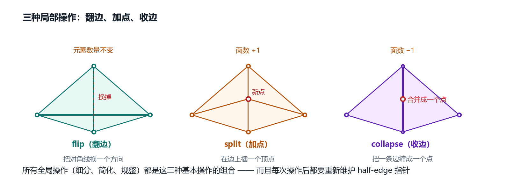

*翻边（换对角线）、加点（边上插顶点）、收边（边缩成点）。**后面所有全局操作都是这三种的组合** —— 细分主要是 split、简化主要是 collapse、规整三者都用。*

*139 页 · 100 张关键页截图 · 25 张原创图解 · 17 个手算 · 29 道自测*

> **💡 这一讲的位置**
>
> 前面十讲都在**用**网格（光栅化、纹理、着色）。这一讲第一次**把网格本身当作研究对象** —— 关心它的**拓扑、数据结构、编辑操作**。
>
> 这是全课里最"数据结构和算法"的一讲，和第 10 讲的"连续数学"正好互补。

## 0. 先用一句话建立全局观

这一讲可以压缩成一句话：

> **网格 = 一张图（拓扑）+ 一堆坐标（几何）；所有几何处理都是在这张图上做局部操作。**

展开成一张表 —— 后面每一节都是补其中一行：

| 你要做的事 | 需要的工具 | 本讲对应 |
|---|---|---|
| 把它存下来 | 索引三角形 / 半边 | §2、§4 |
| 检查它是否合法 | 流形判据 + Euler 公式 | §3 |
| 改一个局部（翻边/加点/收边） | flip / split / collapse | §5 |
| 让它变密且更光滑 | Loop / Catmull-Clark | §6–§9 |
| 让它变稀但保持形状 | QEM | §10 |
| 让它变均匀 | 等向重网格 | §11 |

**为什么这张表有用**：因为这六件事**互相依赖**。

- 细分要用"查邻居" ⇒ 需要半边（§4）
- 细分会破坏流形 ⇒ 需要合法性检查（§3）
- 简化也会破坏流形 ⇒ 需要 link condition（§13）
- 规整要用**全部三种**局部操作（§5）

**所以这一讲的顺序不是随意的**：先把"怎么存"和"怎么判断合法"立起来，再讲"怎么改"，最后三个全局任务才有着力点。

## 1. 网格的规模与三类任务

#### P3　Mesh Examples

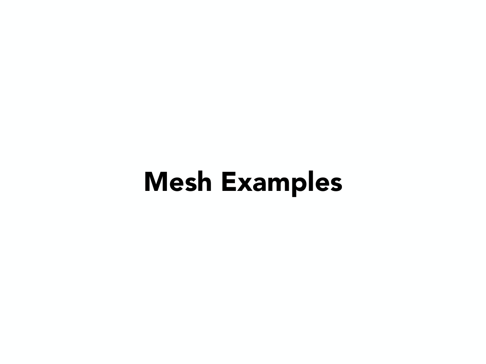


*进入"怎么存"之前的分节页。接下来两页给出两种最基础的存法。*

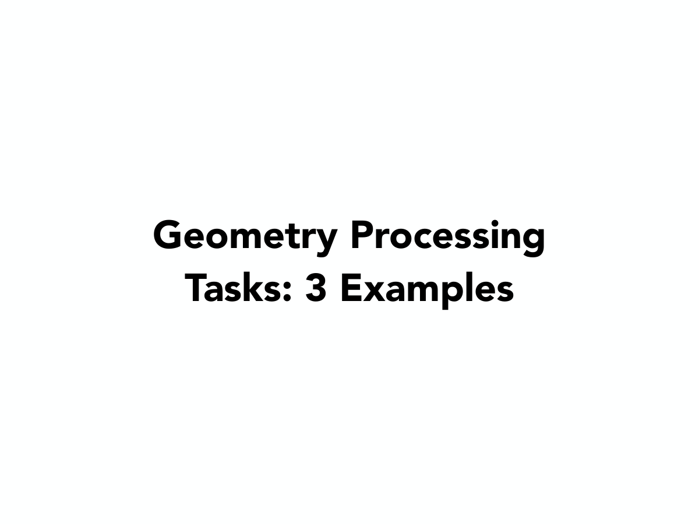

*讲义在讲三类任务之前先停一页 —— 因为它把整讲的地图摆出来了：**同一份网格，可以变密、变稀、变匀**。*

*网格的例子遍布各类资产：扫描、建模、程序生成。**它们的共同点是"用三角形逼近一个形状"，差别只在分辨率和质量**。*

#### P4　A Small Triangle Mesh

*8 vertices, 12 triangles*

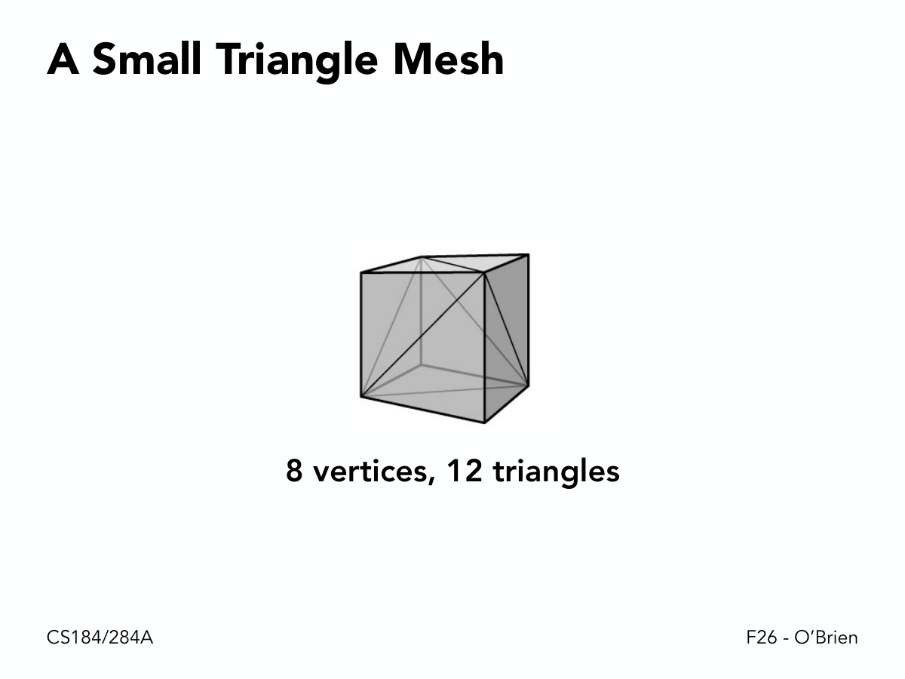

一个最简单的封闭网格：**8 个顶点、12 个三角形**（就是立方体）。

#### P5　A Large Triangle Mesh

*David · Digital Michelangelo Project · 28,184,526 vertices · 56,230,343 triangles*

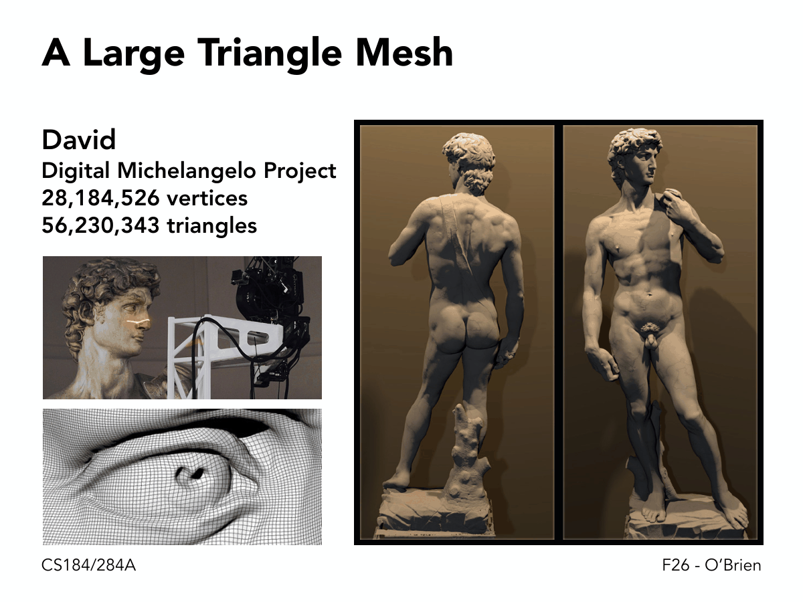

**2818 万顶点、5623 万三角形。** 这是斯坦福的 Digital Michelangelo 项目对米开朗基罗《大卫》的 3D 扫描结果。

**这个数字很值得体会**：`5623 万`个三角形，如果每个三角形存 3 个 `float3` 坐标，就是 `56M × 3 × 12 字节 ≈ 2 GB` —— 还没算索引和法线。

#### P6　A Very Large Triangle Mesh

*Google Earth · Meshes reconstructed from satellite and aerial photography · Trillions of triangles*

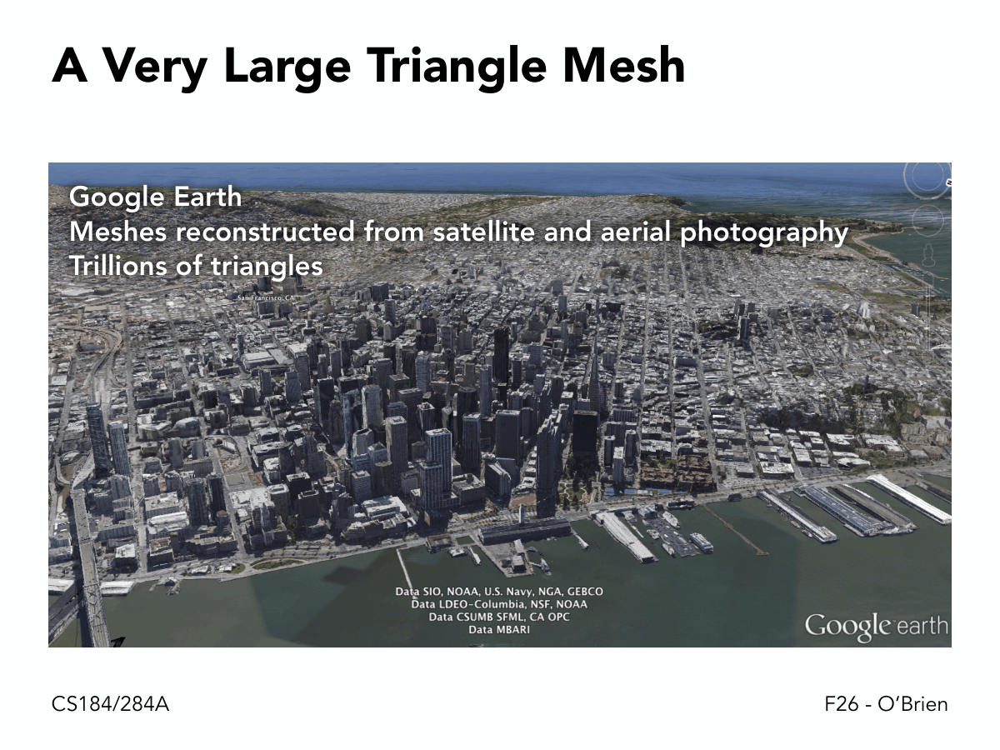

**万亿级三角形**（trillions）。这个规模已经**不可能全部放进显存**，必须按视锥和 LOD（细节层次）流式加载。


*从 12 个三角形到万亿级 —— **规模差 11 个数量级**。这就是为什么需要"变密/变稀/变匀"这三类操作：没有一个固定的分辨率能通吃所有场景。*

#### P7–P8　Digital Geometry Processing

*3D Scanning · 3D Printing*


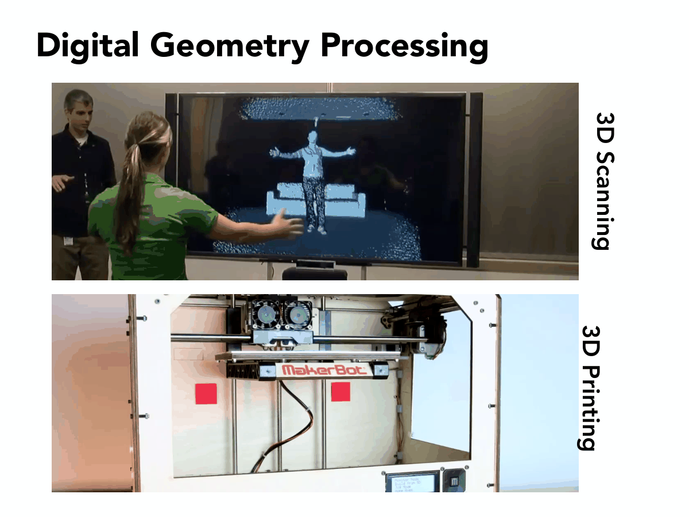

**为什么"几何处理"成了一门学科**：

| 应用 | 为什么需要处理网格 |
|---|---|
| **3D 扫描** | 扫出来的原始网格有**噪声、孔洞、几十万冗余三角形** |
| **3D 打印** | 必须**封闭、流形、无自交**，否则打印机会算出错误的内外 |
| 游戏/VR | 需要**多级 LOD** 和**规整**的网格做形变 |

#### P9–P12　Geometry Processing: Tasks

*Three examples*

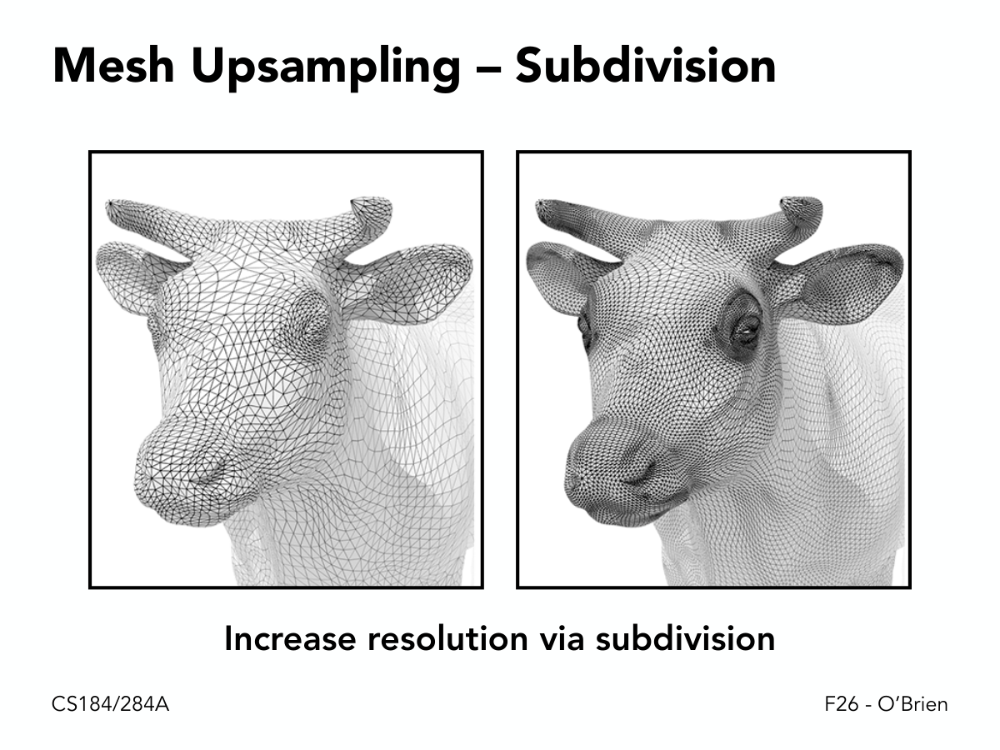

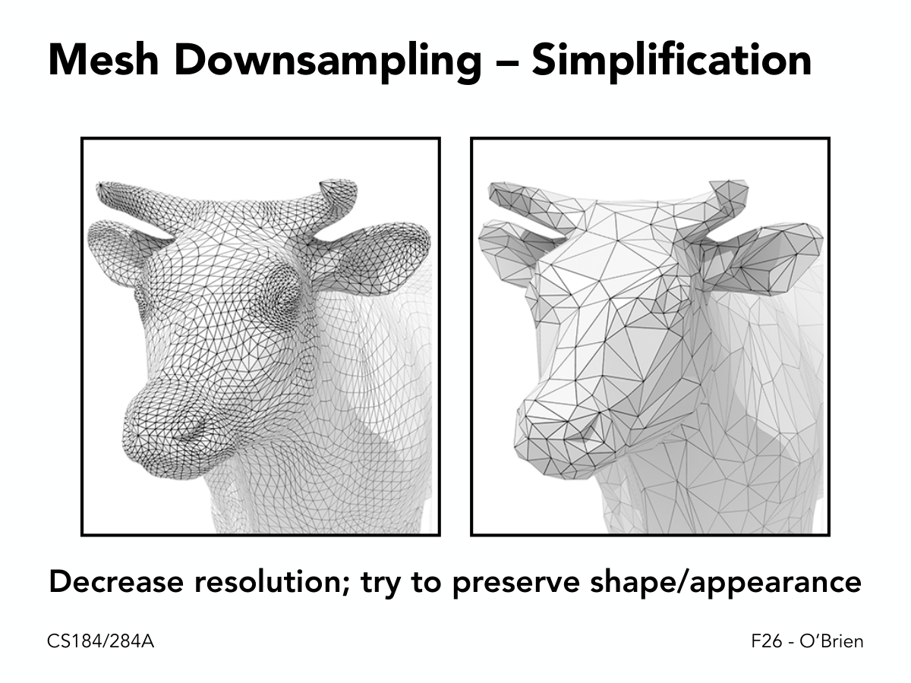

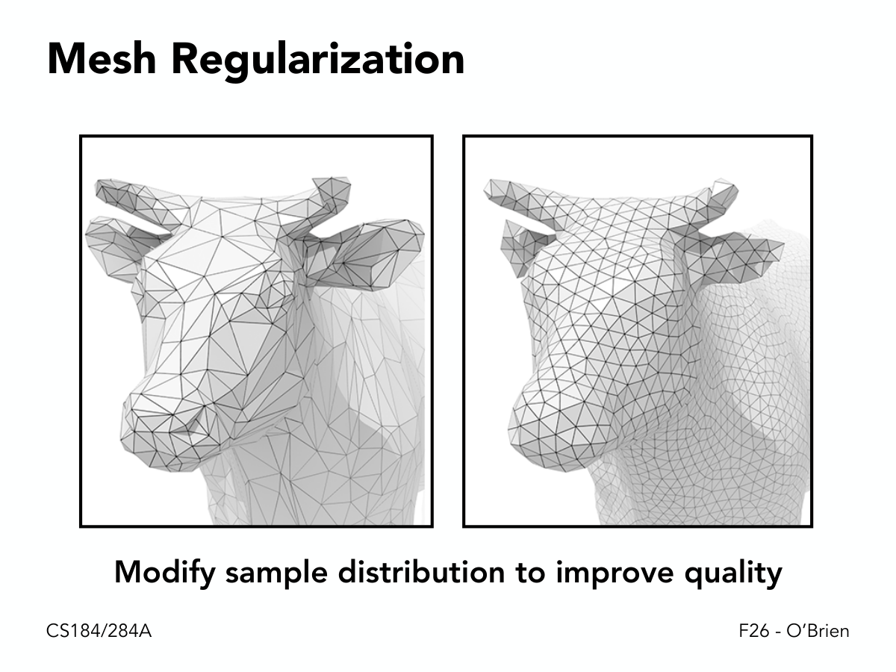

讲义给出三类任务（这三个词贯穿全讲）：

| 任务 | 做什么 | 对应算法 |
|---|---|---|
| **Upsampling（细分）** | 增加分辨率，但**保持形状** | Loop、Catmull-Clark |
| **Downsampling（简化）** | 减少三角形，**尽量保形** | QEM 边收缩 |
| **Regularization（规整）** | **改变采样分布**，提高质量 | 等向重网格 |

**注意三者的目标不同**：细分和简化改变**数目**，规整**不改变数目**（或只微调），只改善**三角形形状**。

## 2. 网格表示

#### P13–P15　List of Triangles / Indexed Triangle

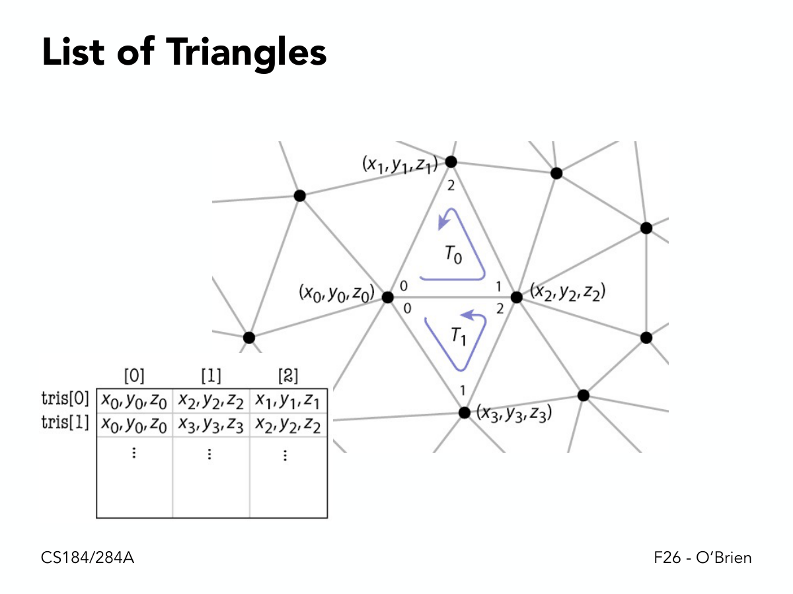

*最朴素的存法：**每个三角形各存三个顶点坐标**。一个顶点被 6 个三角形共用，就存了 6 遍。*

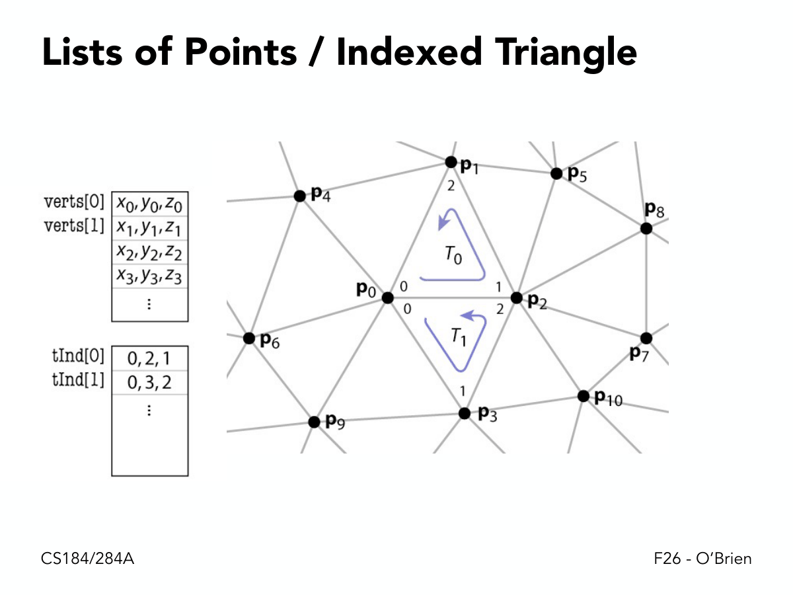

**两种最基础的存法**：

```c
// ① 三角形列表：每个三角形存三个点
struct Triangle { Vec3 v[3]; };
Triangle tris[12];   // 12 * 3 * 12 字节

// ② 索引三角形：点表 + 索引表
Vec3  verts[8];      // 8 个顶点
int   idx[12][3];    // 每个三角形存三个下标
```

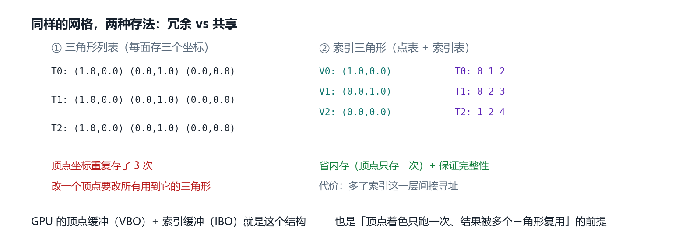

*左边的三角形列表把顶点坐标重复存了很多次；右边的索引三角形只存一份顶点，三角形里存下标。*

#### P16　Comparison

#### 网格之外：还有哪些几何表示

讲义只说"网格是主流"，但把其他表示放进来对照，更能看清网格的位置。

| 表示 | 存什么 | 适合 | 不适合 |
|---|---|---|---|
| **三角形网格** | 顶点 + 面 | 渲染（GPU 原生）、离散几何处理 | 光滑曲面（要靠细分） |
| **点云** | 只有点 | 扫描结果、快速预览 | 渲染要重建表面 |
| **参数曲面**（NURBS） | 控制点 + 基函数 | CAD（精确、可微） | 任意拓扑 |
| **隐式曲面**（SDF） | 距离函数 | 布尔运算、体积、程序化建模 | 大场景（求值贵） |
| **体素** | 三维网格上的值 | 医学、流体、体积渲染 | 表面细节（分辨率受限） |
| **细分曲面** | 粗糙控制网 + 规则 | 动画角色（光滑 + 任意拓扑） | 需要 C2 的工程场景 |

**网格之所以是"通用货币"**：因为 GPU 只吃三角形。所有其他表示最终都要转成网格才能渲染。

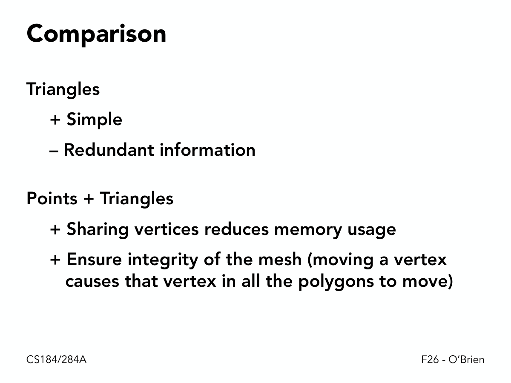

*讲义列了四条：三角形列表**简单但冗余**；点 + 索引**省内存且保证完整性**。**"完整性"这条最容易被低估** —— 改一个顶点时，所有用到它的三角形自动跟着变。*

*Triangles: + Simple, − Redundant information · Points + Triangles: + Sharing vertices reduces memory usage, + Ensure integrity of the mesh*


**讲义列了四条**：

| 存法 | 优点 | 缺点 |
|---|---|---|
| **纯三角形列表** | **简单**（不用管索引） | **信息冗余**（一个顶点被 6 个三角形各存一遍） |
| **点 + 索引** | **省内存** | 多一层间接寻址 |
| | **保证完整性** | 改一个顶点，所有用到它的三角形自动跟着变 |

**"Ensure integrity" 这条最容易被低估**：如果是纯三角形列表，你把一个顶点挪了位置，但忘了改某个三角形里的副本 → **网格出现裂缝**。索引结构从根上避免了这个问题。

## 3. 拓扑：流形与 Euler 公式

#### P17–P20　Topology vs Geometry
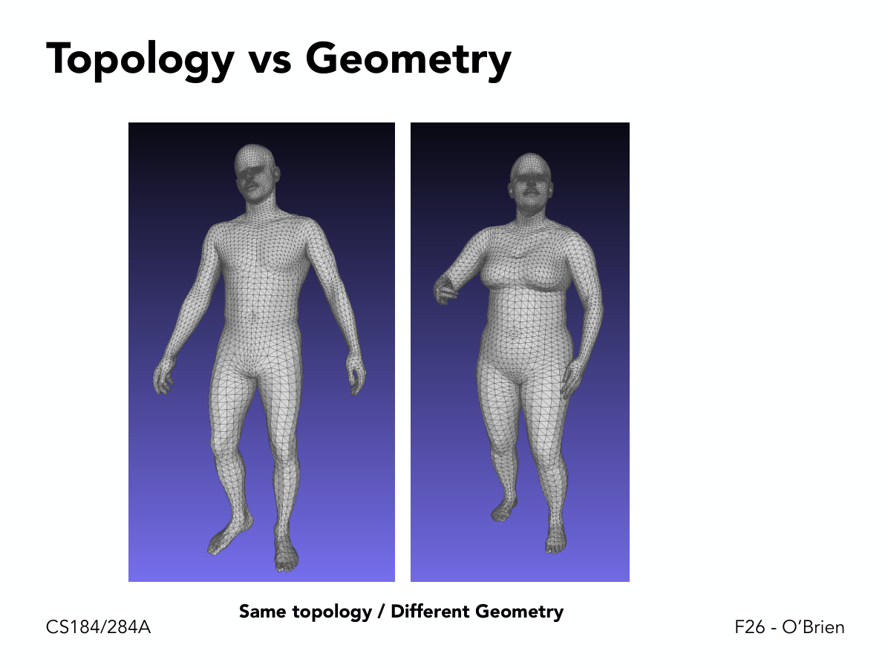

*两个同拓扑的模型之间做逐顶点插值。**这就是形变动画** —— 只要顶点能一一对应，中间帧就是加权平均。*

*Same geometry, different mesh topology · Same mesh topology, different geometry*

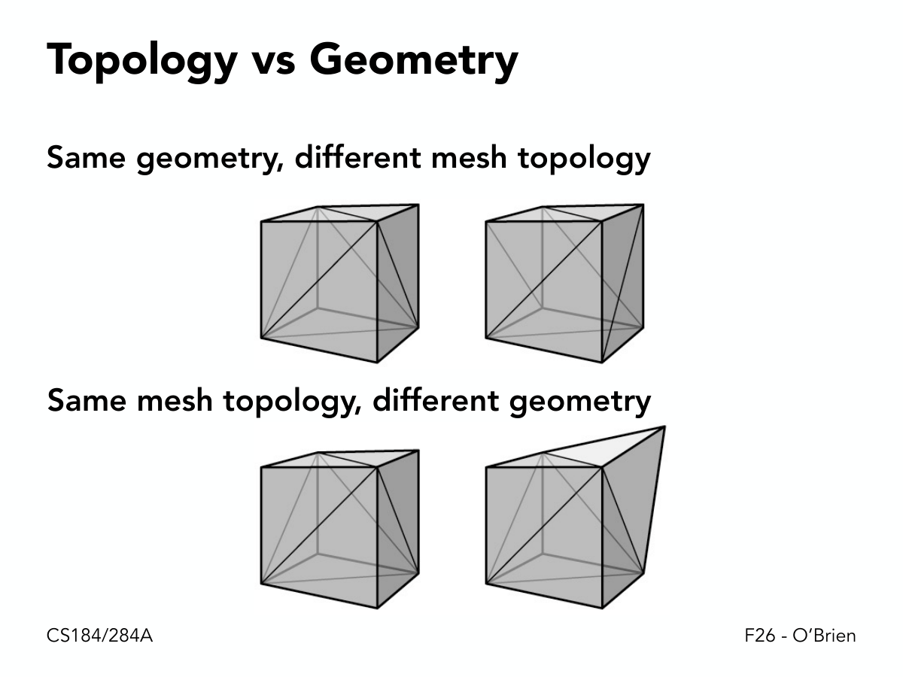

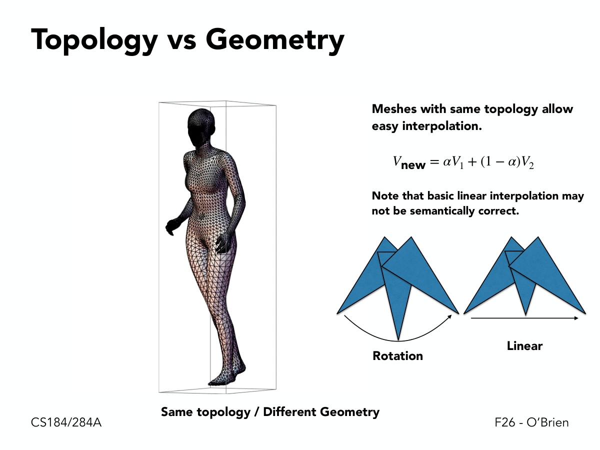

**这是全讲最重要的一个区分**：

| | 拓扑（topology） | 几何（geometry） |
|---|---|---|
| 问什么 | **谁和谁相连** | **点在空间的哪个位置** |
| 由什么决定 | 顶点/边/面的邻接关系 | 顶点的坐标 |

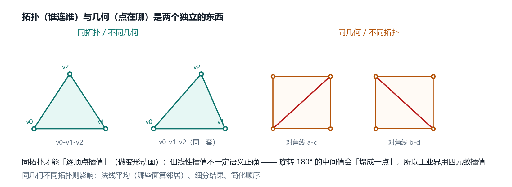

*左边：同一套连接关系（v0-v1-v2），只挪顶点位置 → **同拓扑不同几何**。右边：同一个四边形，两条不同的对角线 → **同几何不同拓扑**。*

**为什么这个区分有用**（P19–P20）：

> 同拓扑的网格之间可以**逐顶点线性插值**：`V_new = αV_1 + (1−α)V_2`

这是**形变动画**（morphing）的基础。

**但讲义立刻给了一个警告**：

> *"Note that basic linear interpolation may not be semantically correct."*

**例子**：把一个物体旋转 180° 再取中间帧。逐顶点线性插值会让物体**塌缩成一点**（所有顶点都往中心移动），而不是"转 90°"。

**正解**：对**变换**插值（用四元数或对偶四元数），而不是对**顶点**插值。

#### P21　Topological Mesh Information

*Applications: Constant time access to neighbors（e.g. surface normal calculation, subdivision）· Editing the geometry（e.g. adding/removing vertices, faces, edges）*

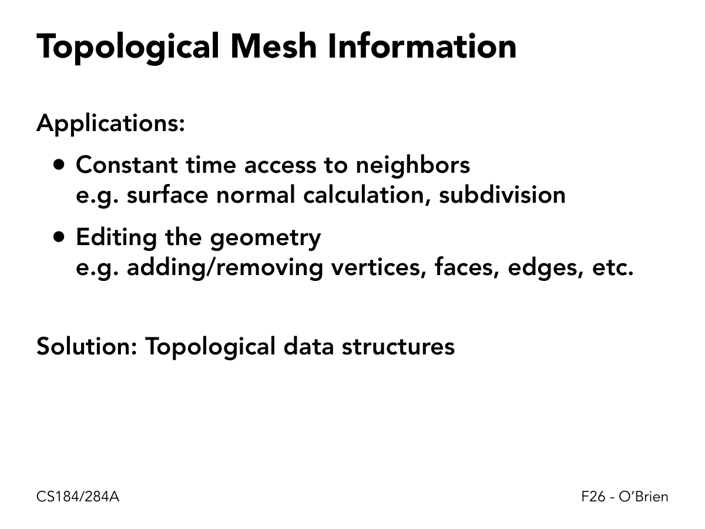

**两个需求**：

| 需求 | 例子 |
|---|---|
| **常数时间访问邻居** | 算法线（要遍历一圈邻面）、细分（要取一圈邻点） |
| **编辑几何** | 加/删顶点、面、边（就是 P31 的局部操作） |

**如果只有索引三角形**：找一个顶点的所有邻面要**扫描整个三角形数组**（`O(n)`）。**几百万三角形时不可接受**。

**所以需要专门的数据结构** —— 就是半边缘。

#### P22–P23　Topological Validity: Manifold

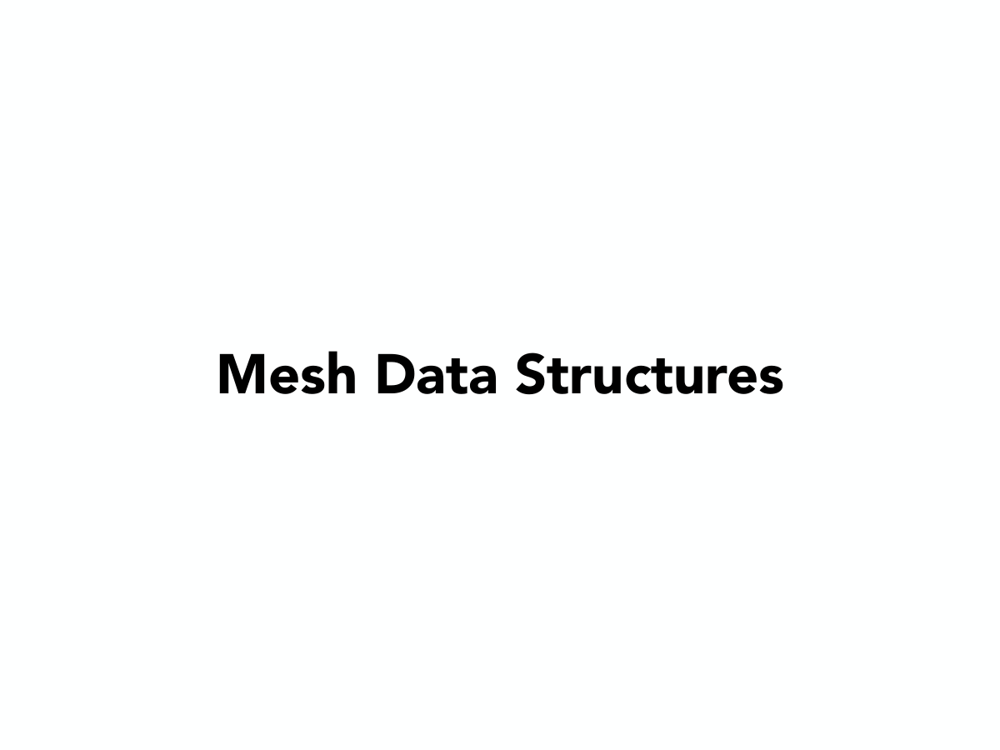

*拓扑讲完，进入"数据怎么排"。**注意讲义的分节顺序：先合法性，再数据结构** —— 因为结构要依赖合法性假设（比如"每条边恰好两个面"才能定义 twin）。*
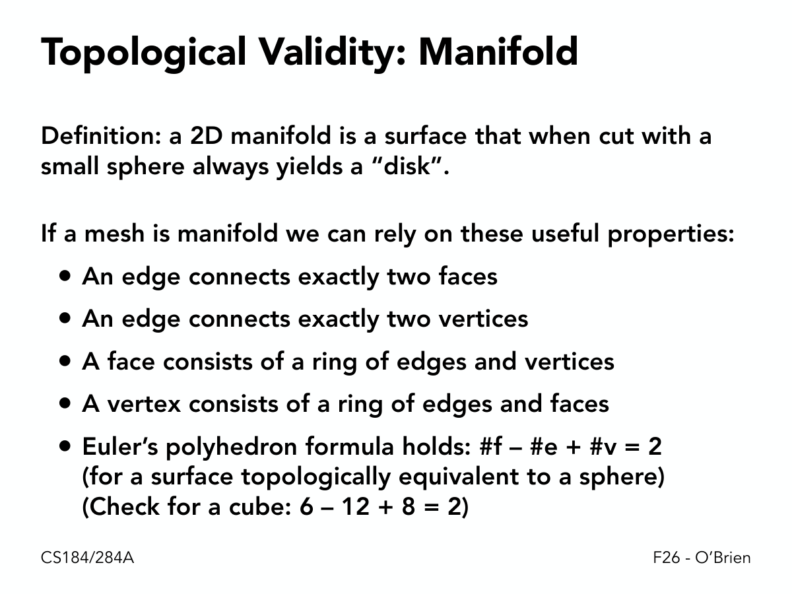

*讲义把流形的组合性质逐条列出（每条边 2 个面、每边 2 个顶点、面是一圈边、顶点是一圈面、Euler 公式）。**这五条就是"网格是否合法"的检查清单**。*

*Definition: a 2D manifold is a surface that when cut with a small sphere always yields a disk.*

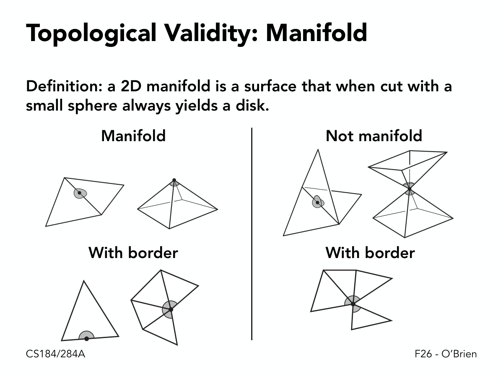

**流形的定义（几何版）**：用任意小球去切表面，切出来的**必须是一块圆盘**。

**推论（组合版）**，讲义列了五条：

| 性质 | 含义 |
|---|---|
| 一条边**恰好**连接两个面 | 不能有"三个面共用一条边" |
| 一条边恰好连接两个顶点 | 不能有"自环" |
| 一个面是一圈边和顶点 | 面要闭合 |
| 一个顶点是一圈边和面 | 顶点的邻域是一圈（不能是两个锥） |
| **Euler 公式** `#f − #e + #v = 2` | 对拓扑等价于球面的封闭网格 |

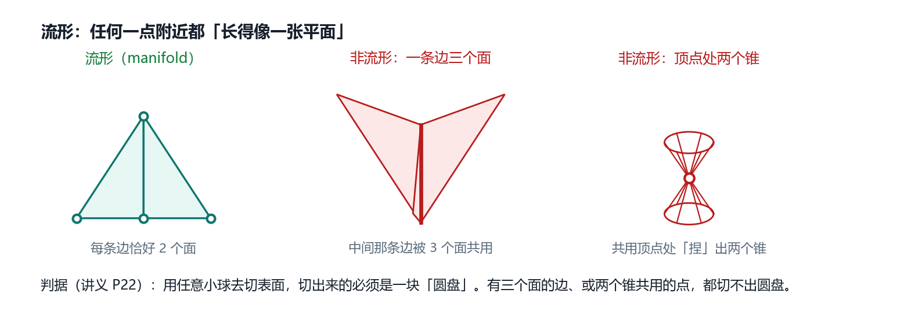

*左：正常流形（每条边 2 个面）。中：一条边被 3 个面共用 —— 切不出圆盘。右：一个顶点处捏出两个锥 —— 切出来是两块圆盘，也不是流形。*

#### P24　Topological Validity: Orientation Consistency

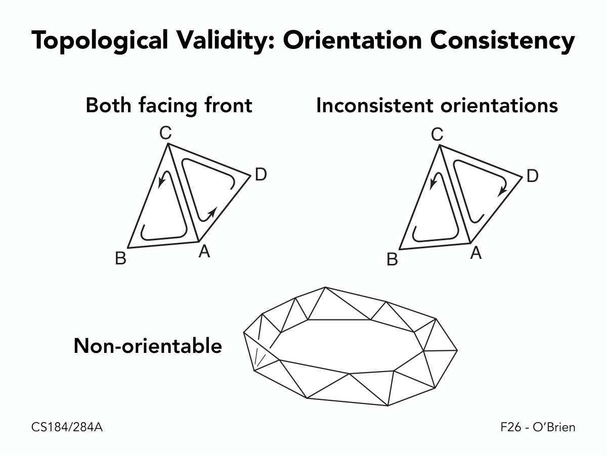

*同一个四边形，两种拆分方式。**右边那种两个三角形的绕序相反** —— 法线一个朝前、一个朝后，光照会出现黑块。*


*同一个四边形，两种拆分。**右边那种两个三角形的绕序相反** —— 法线一个朝前一个朝后，光照会出黑块。*

*Non-orientable · Both facing front · Inconsistent orientations*

**朝向一致性**：相邻两个面必须"同向"（共享边在两个面里的方向相反）。

图上是 `A B C D` 四个顶点，两种三角形拆分方式，其中一种的**朝向不一致**（一个面朝前、一个面朝后）。

**为什么重要**：法线方向、背面剔除（backface culling）、光照全依赖朝向。**朝向不一致的网格，渲染出来会有"黑块"**。

## 4. Euler 公式

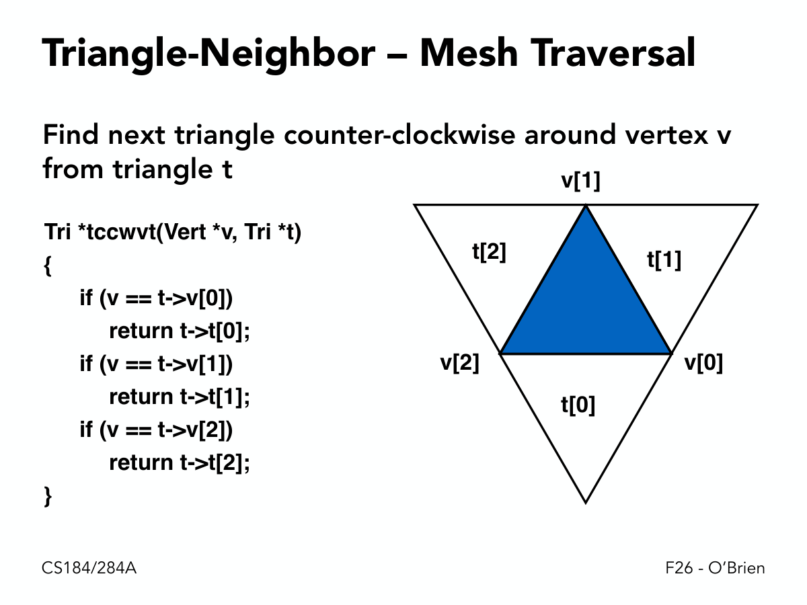

*顺带补一张：讲义用真实的**绘图样条**（一根被铅块压住的弹性条）作为"样条"这个词的物理原型。**它自然弯成最小弯曲能量的形状** —— 这正是三次样条要逼近的东西。*

#### P22 附：Euler's Polyhedron Formula

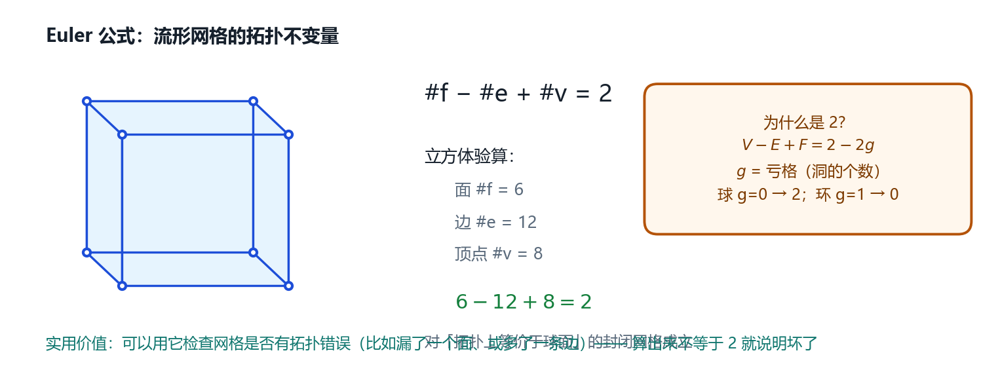

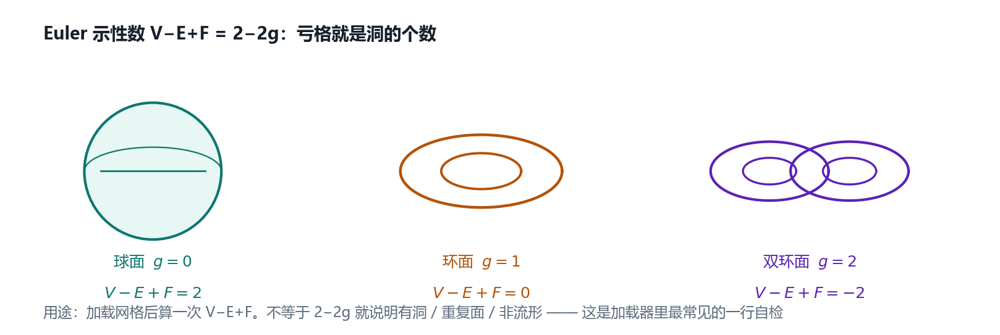

*三种曲面：球面 `g=0`、环面 `g=1`、双环面 `g=2`。**`V−E+F` 分别为 `2, 0, −2`** —— 这个量只跟"有几个洞"有关，跟网格多密无关。*

$$
\#f-\#e+\#v=2
$$

**🔧 手算 1：在立方体上验算**

| 量 | 值 |
|---|---|
| 面 `#f` | 6 |
| 边 `#e` | 12 |
| 顶点 `#v` | 8 |

$$
6-12+8=2\ \checkmark
$$

**推广形式**（图上右下角）：

$$
V-E+F=2-2g
$$

其中 `g` 是**亏格**（genus，洞的个数）：

| 形状 | `g` | `V−E+F` |
|---|---|---|
| 球面 | 0 | **2** |
| 环面（甜甜圈） | 1 | **0** |
| 双环面 | 2 | **−2** |

**🔧 手算 2：验算一个环面网格**

取一个 `4×4` 的环形网格（每圈 4 段，共 4 圈）：

| 量 | 计算 | 值 |
|---|---|---|
| 顶点 `V` | `4 × 4` | 16 |
| 面 `F` | `4 × 4` | 16 |
| 边 `E` | 每条边被 2 个面共用：`4F/2` | 32 |

$$
V-E+F=16-32+16=0\ \checkmark
$$

**正好是 `2−2×1 = 0`** ✓

> **📌 这个公式的实际用途：检查网格是否损坏**
>
> 加载一个扫描得到的网格，算一下 `V−E+F`：
> - 如果等于 2（或 `2−2g`）→ 拓扑正常
> - 如果**不等于** → 网格有洞、有重复面、或非流形
>
> **这是加载器里最常见的一行自检代码。**

## 5. 半边结构

#### P25–P27　Triangle-Neighbor Data Structure

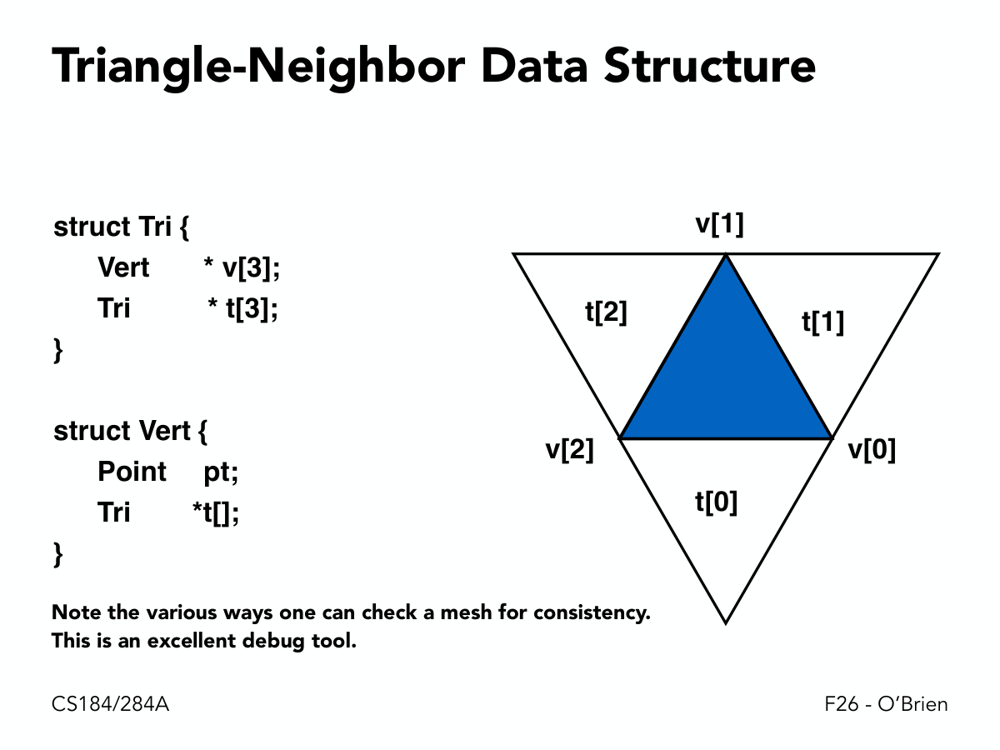

*第一版方案：每个三角形存三个顶点 + 三个邻居。**问题在 `Vert` 里的 `Tri *t[]` 是变长数组** —— 每个顶点的度数不同，不好分配。*

```c
struct Tri {
  Vert *v[3];    // 三个顶点
  Tri  *t[3];    // 三条边对面的三角形（邻居）
};
struct Vert {
  Point pt;
  Tri   *t[];    // 所有相邻的三角形
};
```

**思路很直接**：每个三角形记三个顶点 + 三个邻居。

**P27 的遍历代码**展示了怎么"绕顶点转一圈"：

```c
Tri *tccwvt(Vert *v, Tri *t)   // next triangle CCW around vertex v
{
  if (v == t->v[0]) return t->t[0];
  if (v == t->v[1]) return t->t[1];
  if (v == t->v[2]) return t->t[2];
}
```

**问题**：`Vert` 里的 `Tri *t[]` 是**变长数组** —— 每个顶点的度数不同，不好存。而且每次查询要判断"`v` 是第几个顶点"。

#### P28　Half-Edge Data Structure

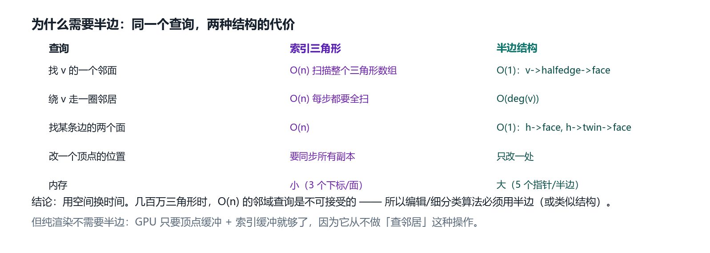

*同一个查询，两种结构的代价差了几个数量级。**这就是为什么编辑类算法必须用半边** —— 而纯渲染不需要它（GPU 只用顶点缓冲 + 索引缓冲，从不做"查邻居"）。*

*Key idea: two half-edges act as "glue" between mesh elements*

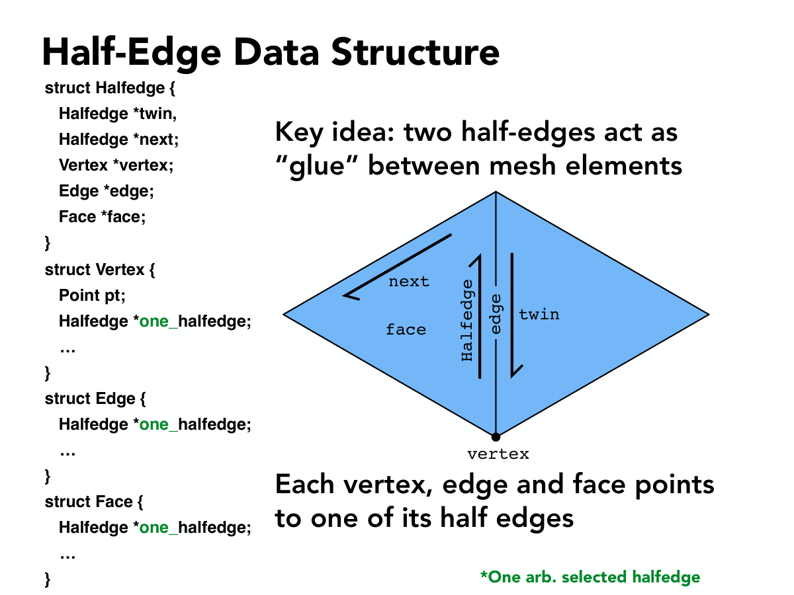

**核心思路**：**把每条边拆成两条有向的"半边"**，每条半边归属一个面。

```c
struct Halfedge {
  Halfedge *twin;    // 反向的那条半边
  Halfedge *next;    // 同一面内的下一条半边
  Vertex   *vertex;  // 指向的顶点
  Edge     *edge;    // 所属的边
  Face     *face;    // 所属的面
};
```

**每个顶点/边/面只存一个半边指针**（图上标 ★ 的 "one-halfedge"），其余靠遍历得到。

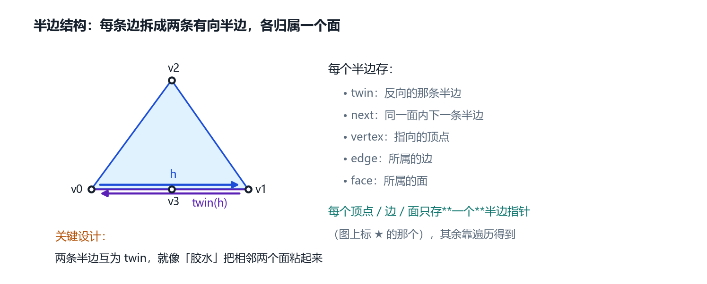

*两个相邻三角形共享一条边，这条边在左边三角形里是 `h`（一个方向），在右边是 `twin(h)`（反方向）。**两条半边就像"胶水"把两个面粘起来**。*

**为什么这个设计好**：

| 问题 | 索引三角形 | 半边 |
|---|---|---|
| 找 `v` 的一个邻面 | `O(n)` 扫描 | **`O(1)`**（`v->halfedge->face`） |
| 绕 `v` 转一圈 | 难 | **`O(deg(v))`** |
| 存一个顶点的邻面列表 | 变长数组 | **不需要**（遍历得到） |
| 内存 | 小 | 大（每半边 5 个指针） |

**"用时间换空间"的经典权衡**：半边多存了指针，但省掉了变长数组、也让所有邻域查询变成常数时间。

#### P29–P30　Half-Edge Facilitates Mesh Traversal

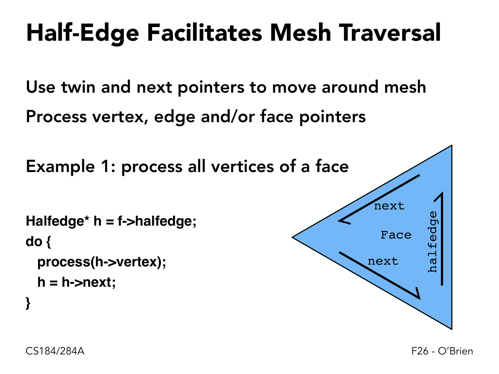

*例 1：绕一个面走一圈。`h = f->halfedge`，然后反复 `h = h->next` 直到转回来。*

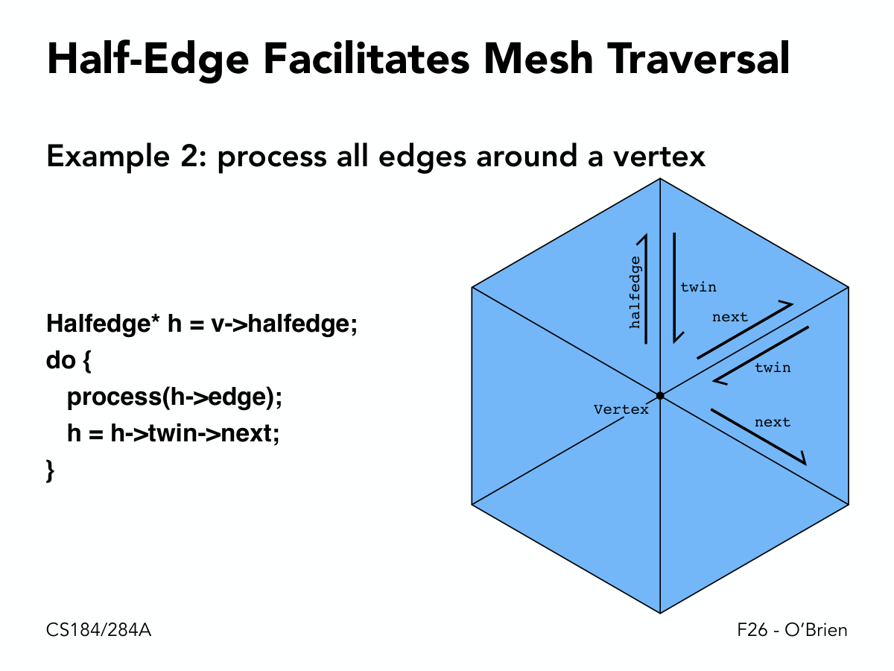

**两条遍历规则，各只要一行**：

```c
// 例 1：绕一个面（所有边）
Halfedge *h = f->halfedge;
do { process(h->vertex); h = h->next; } while (h != f->halfedge);

// 例 2：绕一个顶点（所有邻边）
Halfedge *h = v->halfedge;
do { process(h->edge); h = h->twin->next; } while (h != v->halfedge);
```

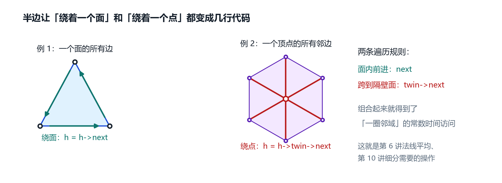

*绕面用 `next`，绕点用 `twin->next`。**组合这两条，就得到了"一圈邻域"的常数时间访问** —— 这正是第 6 讲法线平均、第 10 讲细分所需要的操作。*

**P30 那张立方体图**把"绕顶点的一圈"高亮成红色环 —— 六条边围绕一个顶点。

## 6. 局部操作

#### P31–P36　Local Mesh Operations


*局部操作的下一站：**把三种基本操作组合成全局任务**。*
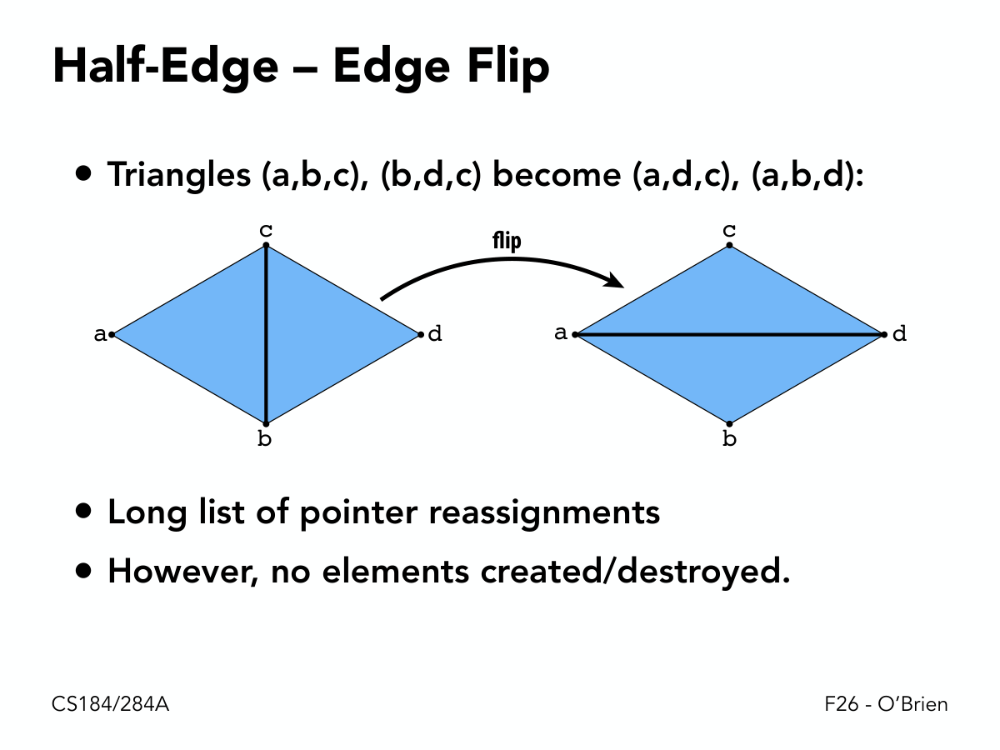
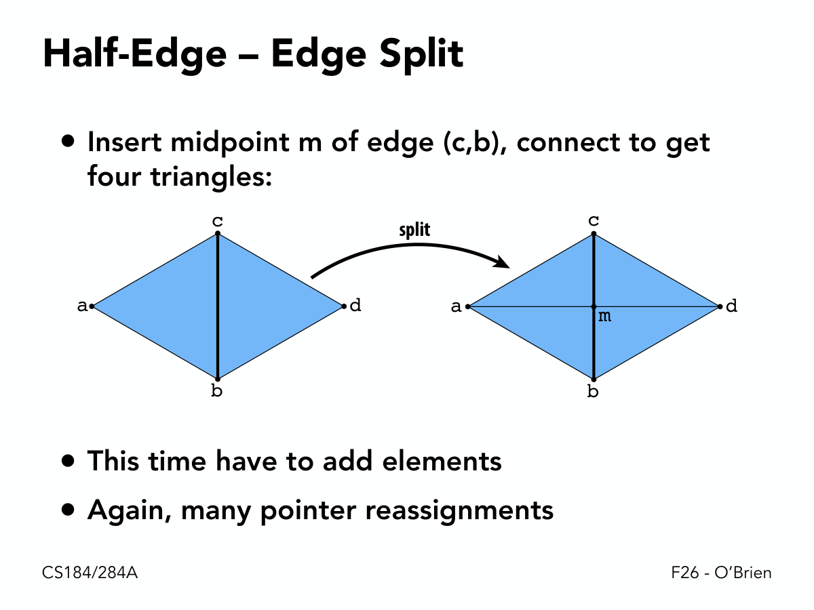

*split：在边 `(c,b)` 上插入中点 `m`，连到 `a` 和 `d`。**面数 +1**，需要新建元素。*

*flip：把 `(a,b,c)` 和 `(b,d,c)` 变成 `(a,d,c)` 和 `(a,b,d)`。**元素数量不变，但指针要重排一长串**。*

*Basic operations for linked list: insert, delete · Basic ops for half-edge mesh: flip, split, collapse edges*

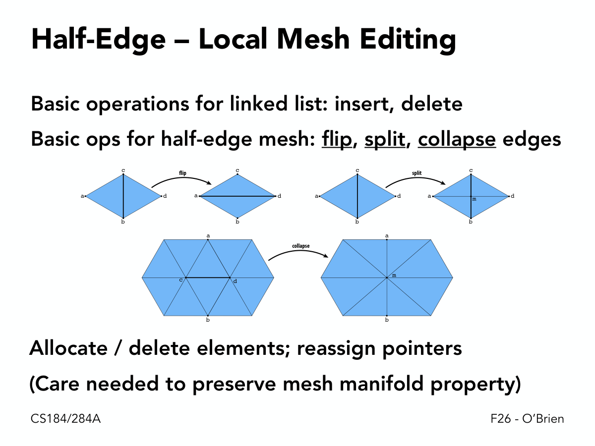

**三种基本操作，讲义逐一给出**：

| 操作 | 做什么 | 元素数量变化 | 页 |
|---|---|---|---|
| **flip（翻边）** | 两个三角形共享的边换成另一条对角线 | **不变** | P33 |
| **split（加点）** | 在边上插一个顶点，把边一分为二 | **面 +1** | P34 |
| **collapse（收边）** | 把一条边缩成一个点（两个顶点合并） | **面 −1** | P35 |

**P33 的原文**：

> *Triangles `(a,b,c)`, `(b,d,c)` become `(a,d,c)`, `(a,b,d)`.*
> *Long list of pointer reassignments. However, no elements created/destroyed.*

**"Long list of pointer reassignments"（一长串指针重排）** 是这节最诚实的描述 —— **数学上很简单，实现上很啰嗦**，而且是 bug 高发区。

**P32 末尾的警告**：

> *(Care needed to preserve mesh manifold property)*

**每次操作后都必须检查网格是否还是流形**。比如 collapse 一条边时，如果两个顶点的邻域有"额外的公共邻居"，合并后会产生非流形结构。

#### P36　Composite Operations

#### 三种操作什么时候用

| 场景 | 用哪个 | 为什么 |
|---|---|---|
| 三角形太细长（质量差） | **flip** | 换对角线能改善最小角，元素数量不变 |
| 需要局部加密 | **split** | 直接加点，面数 +1 |
| 需要减少面数 | **collapse** | 面数 −1，但可能破坏拓扑（要查 link condition） |
| 想让顶点度数趋向正则 | **flip** | 反复 flip 等价于"度数的离散扩散"（讲义 P136） |
| 想让三角形接近正三角 | **flip + 切向移动** | 光 flip 不够，还要挪顶点 |

**一个重要观察**（讲义 P136 提到的）：

> **反复 flip 会让顶点度数"扩散"** —— 高的变低、低的变高，整体趋向正则值（三角形是 6，四边形是 4）。

**这就是"离散扩散"**：flip 像热传导，把度数的"不均匀"慢慢抹平。**但它没有理论保证**（讲义原话：*"No (known) guarantees; works well in practice"*），所以实际的重网格算法会把它和"显式的度数目标"结合起来。

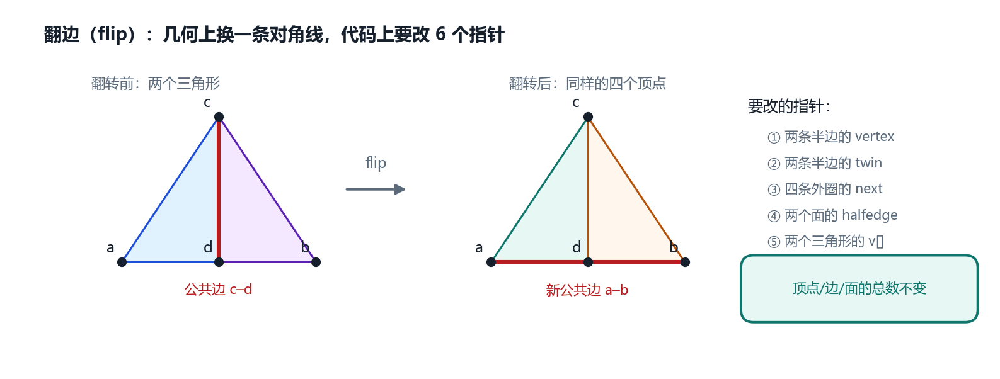

*flip 在几何上只是"换一条对角线"，但在半边结构里要改**六组指针**：两条半边的 `vertex`、`twin`，四条外圈的 `next`，两个面的 `halfedge`，两个三角形的 `v[]`，两条边的 `halfedge`。**这就是讲义说的 "long list of pointer reassignments"**。*

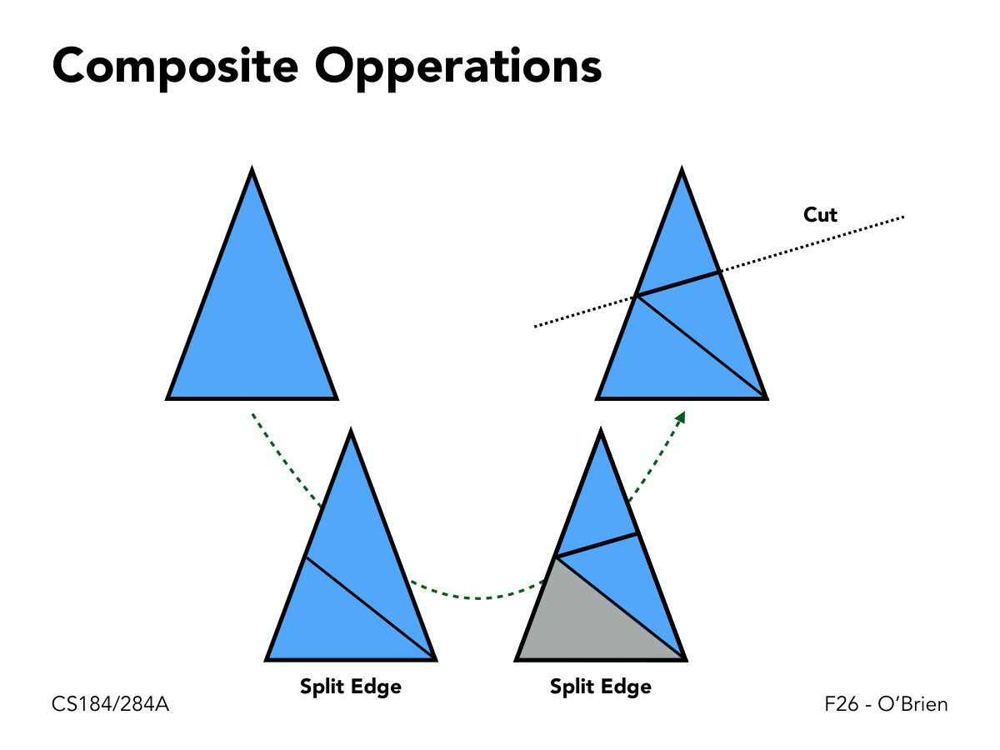

**复合操作**：把基本操作组合成更复杂的编辑。

图上展示的是 `cut`（切分）：把一个大三角形沿一条线切开，需要先 `split` 两次、再重新连接。

## 7. 细分曲面

#### P37–P38　Global Mesh Operations

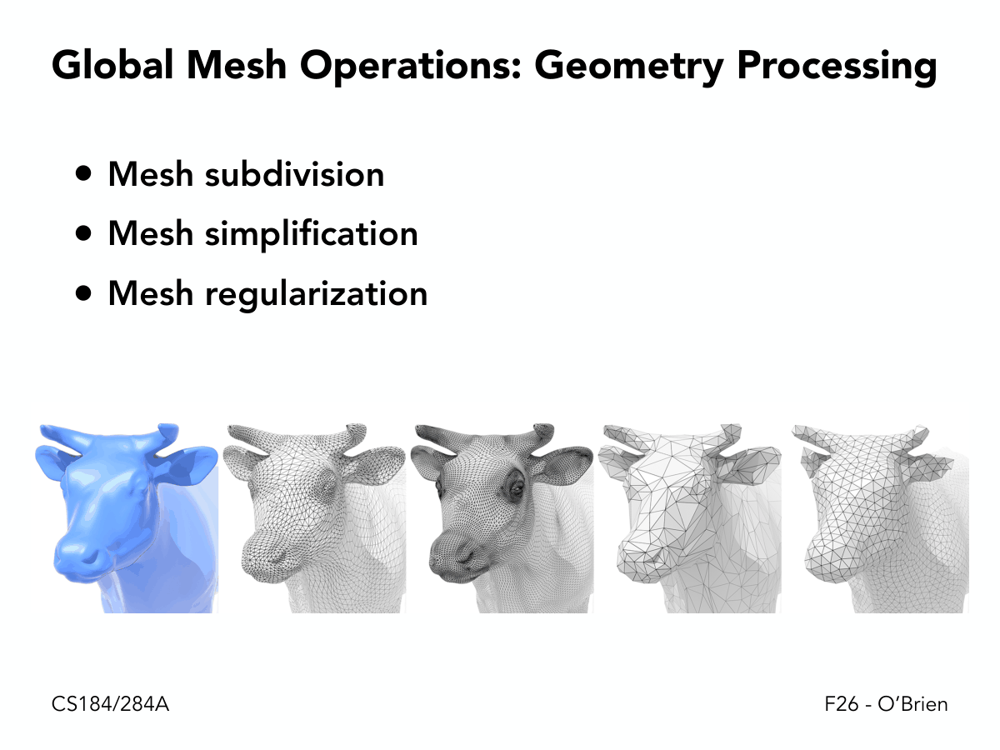

讲义重申三类全局任务（P38 配了一头牛的 LOD 序列图：从粗糙控制网到精细网格）：

| 操作 | 方向 | 算法 |
|---|---|---|
| **Mesh subdivision** | 变密 | Loop / Catmull-Clark |
| **Mesh simplification** | 变稀 | QEM |
| **Mesh regularization** | 变匀 | 等向重网格 |

#### P39–P41　Subdivision Surfaces

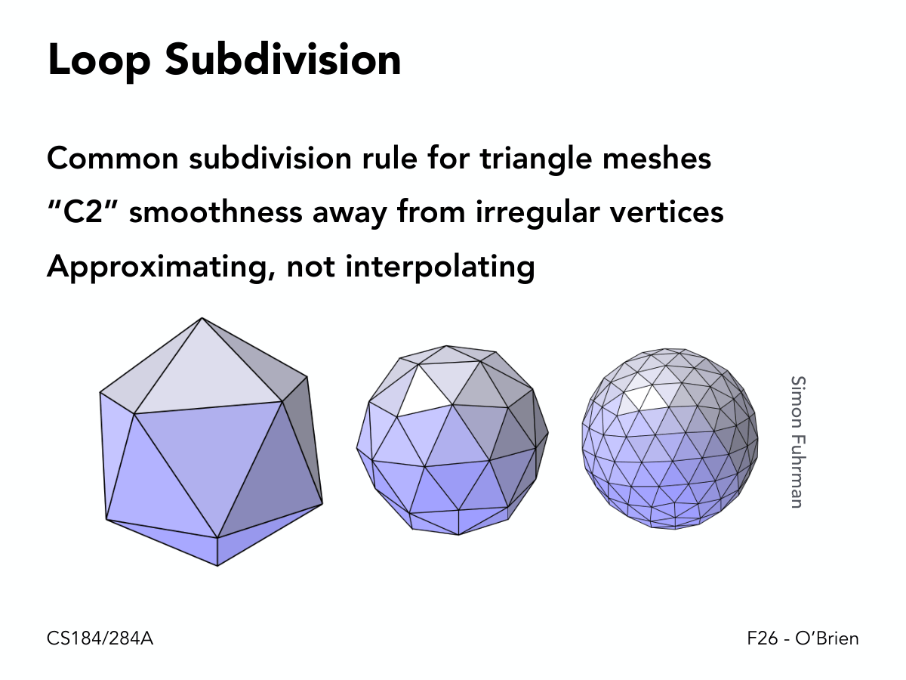

*细分曲面的第一个具体方案：Loop（三角形网格）。*

*Start with coarse polygon mesh ("control cage") · Subdivide each element · Update vertices via local averaging · Many possible rules: Catmull-Clark (quads), Loop (triangles) · Common issues: interpolating or approximating? continuity at vertices?*

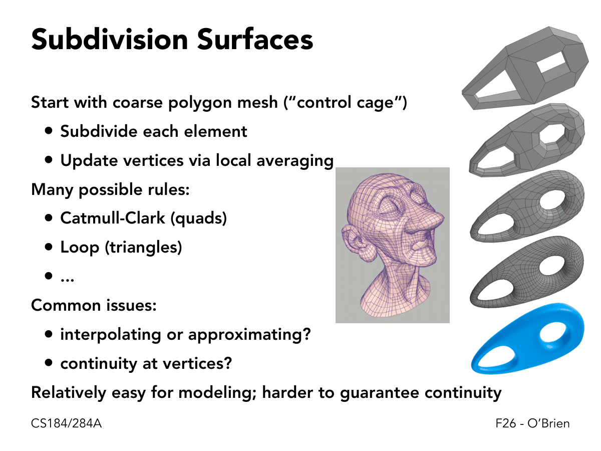

**这是本节的核心思想**，图上有一个"控制笼"（control cage）被逐级细分成光滑表面的序列。

**基本流程（三步）**：

| 步骤 | 做什么 |
|---|---|
| ① | 从一个**粗糙的多边形网格**（控制笼）开始 |
| ② | 把每个元素**细分**（加点） |
| ③ | 用**局部平均**更新顶点位置 |

**两个"common issues"值得注意**：

> - **interpolating or approximating?**（插值还是逼近？）
> - **continuity at vertices?**（顶点处的连续性？）

**这两个问题就是整个细分曲面领域的核心**：
- Loop 和 Catmull-Clark 都是**逼近**（曲线不过控制点）
- 连续性在**正则区域**很好（C2），但在**异常点**附近会降到 C1

#### P41　Core Idea: Let Subdivision Define The Surface

*In Bezier curves, we saw: Evaluation by subdivision (de Casteljau algorithm) · Or evaluation by algebra (Bernstein polynomials) · Insight that leads to subdivision surfaces: Free ourselves from the algebraic evaluation · Let subdivision fully define the surface*

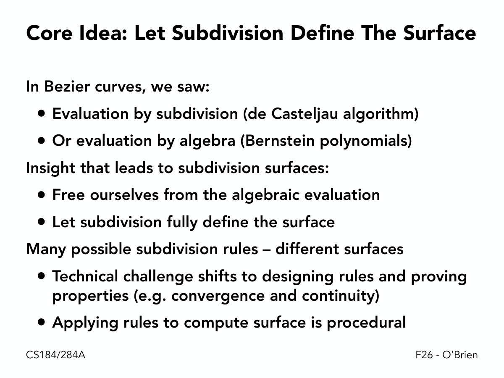

**这一页把 L10 和 L11 接上了**：

> 在 Bézier 曲线里我们看到两种求值方式：**用细分求值**（de Casteljau）或**用代数求值**（Bernstein 多项式）。
>
> **启示**：干脆**抛弃代数**，让"细分规则"本身来定义曲面。

**这个思想转变很深刻**：

| 视角 | 曲面是什么 |
|---|---|
| **传统（Bézier/NURBS）** | 一个解析式，细分只是求值手段 |
| **细分曲面** | **一条无穷细分过程的极限**，没有解析式 |

**好处**：可以处理**任意拓扑**的网格（Bézier 面片只适合规则四边形网格）。

**代价**：没有解析式，所以求值只能靠细分（或近似），连续性的证明变得很难。

> **📌 这句话是全讲的转折点**
>
> 前半讲（数据结构、局部操作）都是"怎么摆弄三角形"。从这里开始，**三角形不再只是三角形，而是一个无穷过程的第 0 层**。
>
> 这个视角也解释了为什么细分能"自动"光滑：**极限曲面本身是光滑的，网格只是它的近似**。

#### 主流细分方案横向对比

| 方案 | 网格类型 | 正则度 | 连续性（正则 / 异常） | 是否插值 | 典型用途 |
|---|---|---|---|---|---|
| **Loop** | 三角形 | 6 | C2 / C1 | 否（逼近） | 三角形网格、游戏 |
| **Catmull-Clark** | 任意多边形 | 4 | C2 / C1 | 否（逼近） | 动画角色（Pixar） |
| **Butterfly** | 三角形 | 6 | C1 | **是（插值）** | 需要过控制点的建模 |
| **√3** | 三角形 | 6 | C1 | 否 | 面数按 3 倍增长（更平滑的 LOD） |
| **Doo-Sabin** | 任意多边形 | 4 | C1 | 否 | 四边形为主的 CAD |

**两个观察**：

1. **几乎所有的都是"逼近"而不是"插值"** —— 因为插值要求基函数在控制点处取 1，这会破坏局部性和光滑性（这和 L10 里 Bézier 与 B 样条的取舍是同一个道理）。
2. **连续性在异常点处必然降一阶** —— C2 降到 C1。这是所有细分方案的共同特征，因为异常点附近的基函数结构不同于正则区域。

**为什么 Catmull-Clark 统治了动画**：它对**任意多边形**都能用（不用先三角化），而且细分一次之后**全部变成四边形** —— 四边形的张量积结构让后续的纹理映射、形变都更好处理。

## 8. Loop 细分

#### P42–P44　Loop Subdivision

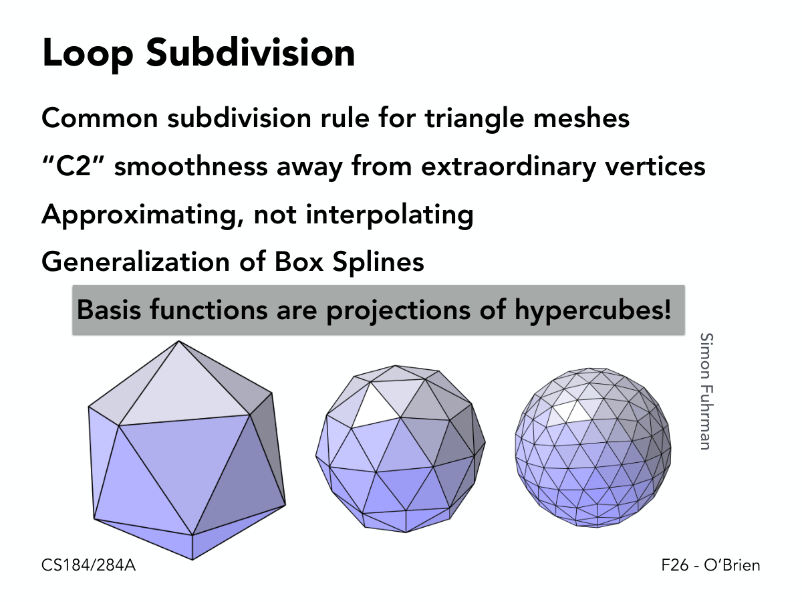

*同一个二十面体被细分 0/1/2 次。**注意轮廓仍然是多面体的棱** —— 因为细分只改拓扑和顶点位置，不增加"真正的曲面"。*

*Common subdivision rule for triangle meshes · "C2" smoothness away from irregular vertices · Approximating, not interpolating · Generalization of Box Splines*


**Loop 细分**（Charles Loop, 1987）是**三角形网格**的标准细分规则。

三条性质：

| 性质 | 说明 |
|---|---|
| **C2 光滑（在正则区域）** | 远离异常点处是 C2 |
| **逼近，不插值** | 新曲面**不经过**原来的顶点（除非特殊处理） |
| **Box 样条的推广** | 图上小字：*"Basis functions are projections of hypercubes!"* |

**P44 的三张图**是同一个二十面体被细分 0/1/2 次 —— 可以看到它逐渐变成球。

#### P45–P47　Loop Subdivision Algorithm

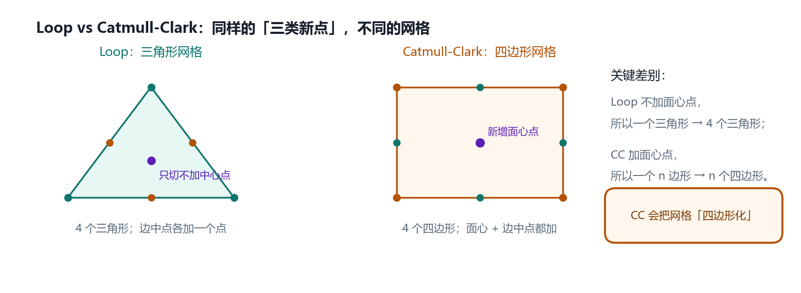

*Loop 和 Catmull-Clark 都产生"新点"，但**加的位置不同**：Loop 只加边中点（一个三角形 → 4 个三角形），CC 还加面心点（一个 n 边形 → n 个四边形）。*

*Split each triangle into four · Assign new vertex positions according to weights*

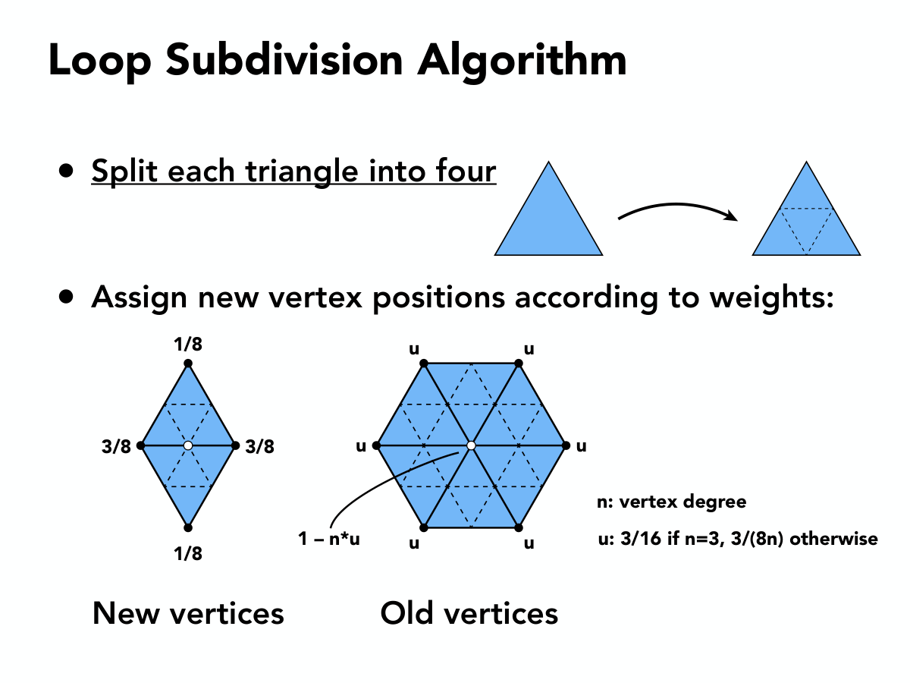

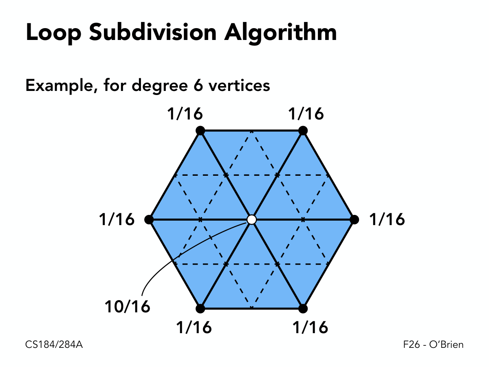

**算法只有两步**：

| 步骤 | 做什么 |
|---|---|
| ① | 把每个三角形**分成四个**（每条边取中点） |
| ② | 按权重**重新分配**新顶点和老顶点的位置 |

**注意第 ② 步才是"Loop"的部分** —— 第 ① 步只是拓扑，任何细分都这么做。

#### 新顶点的权重（边中点）

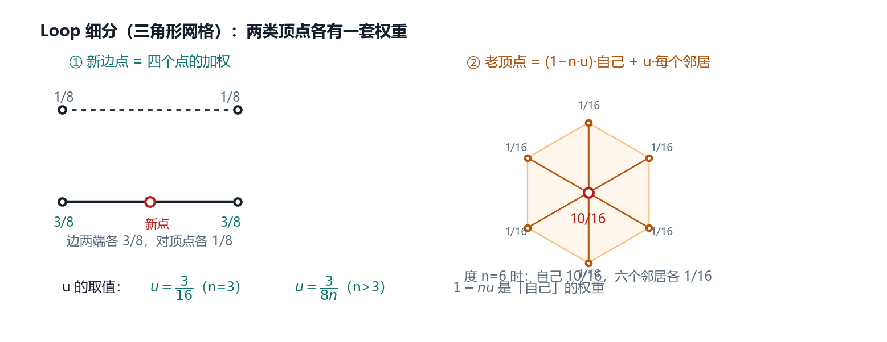

*左边：新边点 = 边两端各 3/8 + 两侧对顶点各 1/8。右边：老顶点 = 自己占 (1−n·u)，每个邻居占 u。*

$$
\text{新边点}=\frac{3}{8}(v_1+v_2)+\frac{1}{8}(v_3+v_4)
$$

其中 `v_1, v_2` 是边的两个端点，`v_3, v_4` 是**两侧三角形的对顶点**。

**四个权重之和**：`3/8 + 3/8 + 1/8 + 1/8 = 1` ✓（仿射组合，不会插飞）

#### 老顶点的权重

$$
\text{老顶点}=(1-n\cdot u)\,v + u\sum_{i=1}^{n}v_i
$$

其中：

$$
u=\begin{cases}\dfrac{3}{16} & n=3\\[6pt]\dfrac{3}{8n} & n>3\end{cases}
$$

`n` 是顶点的**度数**（相邻顶点个数）。

**🔧 手算 3：算一个新边点**

取一条边的两个端点 `v₁=(0,0)`、`v₂=(2,0)`，两侧对顶点 `v₃=(1,1)`、`v₄=(1,−1)`。

$$
\begin{aligned}
\text{新点}&=\frac{3}{8}(0,0)+\frac{3}{8}(2,0)+\frac{1}{8}(1,1)+\frac{1}{8}(1,-1)\\
&=(0,0)+(0.75,0)+(0.125,0.125)+(0.125,-0.125)\\
&=(1.0,\ 0)
\end{aligned}
$$

**结果 `(1,0)` 正是边的中点** —— 因为这个例子的 `v₃, v₄` 关于 `x` 轴对称，它们的贡献互相抵消。

**如果对顶点不对称**（比如 `v₃=(1,2)`、`v₄=(1,0)`）：

$$
\text{新点}=(0.75+0.125+0.125,\ 0+0.25+0)=(1.0,\ 0.25)
$$

**新点被"拉"向对顶点密集的那一侧** —— 这就是细分的**平滑作用**：它把尖锐的起伏平均掉。

**🔧 手算 4：算一个度 6 的老顶点**

取一个度数为 6 的顶点，`v=(0,0)`，六个邻居在单位圆上均匀分布（正六边形）。

**权重**：`n=6 > 3`，所以 `u = 3/(8×6) = 3/48 = 1/16`。

**自己**占 `1 − 6×(1/16) = 1 − 6/16 = 10/16`。

**邻居的贡献**：六个邻居**关于原点对称**，所以求和为 `(0,0)`。

$$
\text{新位置}=\frac{10}{16}(0,0)+\frac{1}{16}\sum \vec{v_i}=(0,0)
$$

**位置不变** ✓ —— 这是正确的：**正六边形网格是 Loop 细分的"正则情形"，顶点不该移动**（否则平面会被细分得起伏）。

**🔧 手算 5：算一个度 3 的老顶点**

`n=3`，所以 `u = 3/16`。自己占 `1 − 3×(3/16) = 1 − 9/16 = 7/16`。

设邻居为 `(1,0)`、`(−0.5, 0.866)`、`(−0.5, −0.866)`（正三角形，和为 `(0,0)`）：

$$
\text{新位置}=\frac{7}{16}v+\frac{3}{16}(0,0)=\frac{7}{16}v
$$

**顶点向原点收缩了 `7/16`！**

> **⚠️ 为什么 `n=3` 要单独处理**
>
> 如果用通式 `u = 3/(8n) = 3/24 = 1/8`，那么自己占 `1 − 3/8 = 5/8`，收缩得更厉害。
>
> `n=3` 用 `3/16` 是**为了让边界和角点的行为正确**（这个特殊值来自 Loop 原始论文的推导）。**度 3 的顶点在封闭网格里对应"最尖的角"**，规则必须区别对待。

#### P48　Semi-Regular Meshes
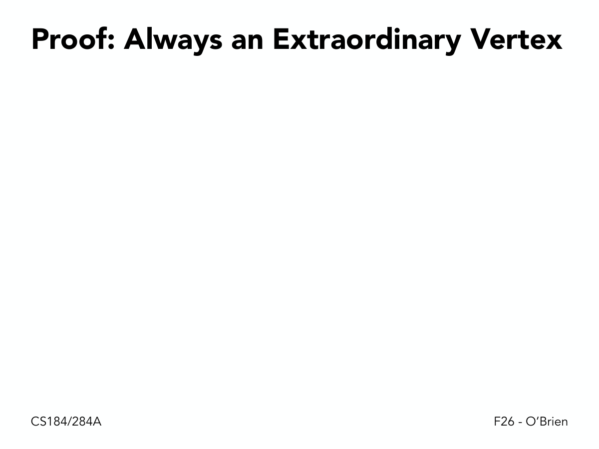

*讲义用几页推导"为什么球面网格必须有异常点"：假设全是度 6，则 `V−E+F = 0`，与球面的 `2` 矛盾。*

*Most of the mesh has vertices with degree 6 · But if the mesh is topologically equivalent to a sphere, then not all the vertices can have degree 6 · Must have a few extraordinary points (degree not equal to 6)*

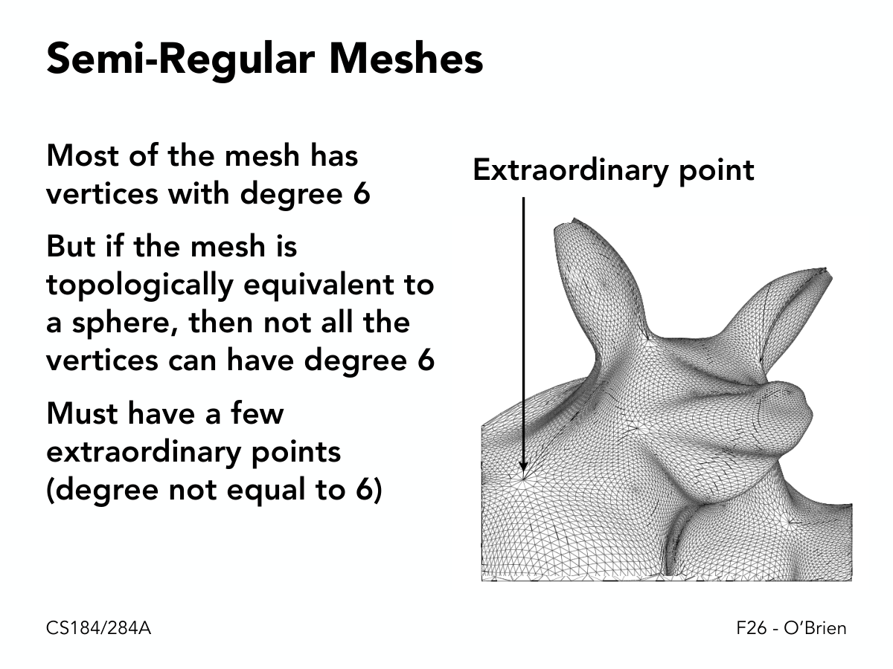

**这段推理很重要，是理解细分曲面的关键**：

| 步骤 | 结论 |
|---|---|
| ① | 三角形网格里"正则"的度数是 **6**（六个正三角形围一点） |
| ② | 但**拓扑上等价于球面的网格不可能全是度 6** |
| ③ | 所以**必然存在少量"异常点"**（度 ≠ 6） |

**第 ② 步的证明**（讲义 P49–P54，很好的一道题）：

**🔧 手算 6：证明球面网格必有异常点**

设一个三角形网格全是度 6 的顶点，`V` 个顶点、`E` 条边、`F` 个面。

**由"每个面 3 条边、每条边 2 个面"**：

$$
3F=2E \quad\Longrightarrow\quad F=\frac{2E}{3}
$$

**由"每个顶点度 6、每条边 2 个端点"**：

$$
6V=2E \quad\Longrightarrow\quad E=3V,\quad F=2V
$$

**代入 Euler 公式**：

$$
V-E+F=V-3V+2V=0
$$

**得到 `0`，但球面应该是 `2`** —— **矛盾！**

**所以"全是度 6"的三角形网格的 Euler 示性数必然是 0**（对应环面，`g=1`），不可能是球面。

**结论**：球面网格**必有异常点**，而且数量由 `Σ(6−deg(v)) = 12` 约束（这是 Euler 公式的另一种写法）。


*细分不会"消灭"异常点，只会把它们**稀释**到越来越大的网格里 —— 所以极限曲面上异常点仍然存在（只是周围越来越光滑）。*

#### P55　Loop via Edge Operations


*Loop 的实现路线：**先 split 每条边，再 flip 中间那三条** —— 复用已经测过的基本操作，比自己写"一次四分"更不容易出 bug。*


**实现路线**：**先 split 每条边，再 flip 中间那三条边**。


*原始三角形 → 每条边 split（得到 4 个小三角形 + 中间一个）→ 把中间那个三角形的三条边 flip → 得到标准的 Loop 细分拓扑。*

**为什么这样绕一圈**：因为半边结构里 `split` 和 `flip` 是**已经实现好的、经过测试的**基本操作。**复用它们比自己写一套"一次分成四份"的代码更不容易出 bug。**

#### P56–P57　Loop 的连续性


*连续细化下去的结果。**注意异常点附近仍能看出一点点不均匀** —— 那正是 C1 与 C2 的差别所在。*


**连续性**（讲义 P56）：

- **正则区域（全度 6）**：**C2** 连续
- **异常点附近**：降到 **C1**

**为什么异常点处会掉到 C1**：因为异常点附近的**基函数结构不同**（不是规则的 Box 样条张量积）。这是所有细分方案的共同特征 —— **异常点是"连续性的瓶颈"**。

## 9. B 样条：为细分做理论准备

#### P58–P59　B-Splines


*进入 B 样条之前的一页：**先把"样条"这个词从物理装置翻译成数学对象**。*


*B 样条的基函数 —— **它只在局部非零**，这正是它比 Bernstein 基"更好脾气"的原因。*

*Goal: local support · Give up interpolation · Convex hull · C2*


讲义用近三十页讲 B 样条（P58–P85）。**为什么在这个位置讲**：因为 **Loop 和 Catmull-Clark 的细分规则都是从 B 样条推导出来的**。

**四条设计目标**（和 Bézier 对照着看）：

| 目标 | Bézier | B 样条 |
|---|---|---|
| **局部支撑（local support）** | ✗ 单片全是全局的 | ✓ 每个控制点只影响 4 段 |
| **放弃插值** | 过首末点 | **完全不经过**控制点 |
| **凸包性质** | ✓ | ✓ |
| **C2 连续** | ✗ 拼接要手工 | ✓ **自动** |


*每个控制点对应一个"小山包"基函数，只在局部非零。曲线是这些山包的加权和 —— **重叠部分自动保证 C2 连续**。*

> **📌 "放弃插值"是整个交易的核心**
>
> Bézier 想"经过控制点"，所以基函数必须在端点取 1 —— 这个约束逼着它全局化（Bernstein 基在整个区间非零）。
>
> B 样条**放弃"经过"**，只要求"在控制点附近"，于是基函数可以做成**局部的**（只覆盖 4 段）。**局部性带来两个好处：局部编辑 + 自动 C2。**
>
> **这就是"用一点直觉性换取数学好性质"的经典取舍。**

#### P60–P67　B 样条的约束与例子


*16 个约束条件逐条写出来 —— **这就是"从目标反推基函数"的过程**：先声明想要的性质（局部支撑、C2、凸包），再解出满足它们的基函数。*


讲义用**16 个约束条件**来推导 B 样条的基函数（P60–P62），然后给出带"端节点"（end knots）的例子（P63–P67）。

**"节点"（knot）是什么**：B 样条把参数轴分成若干段，每段之间用"节点"分隔。**因为节点可以任意分布，所以 B 样条是"非均匀"的**。

#### P68–P70　叠加与重复节点


**P69 展示"重叠"**：多个山包（hump）叠在一起，形成一条光滑曲线。

**P70 讲"重复节点"**：如果把某个节点重复一次，**连续性就降低一阶**：

| 节点重数 | 连续性 |
|---|---|
| 1（简单节点） | C2 |
| 2 | C1 |
| 3 | C0 |
| 4 | C−1（断开） |

**这个性质非常实用**：想在 B 样条里做一条"锐利的边"，只要把节点重复几次即可 —— **不需要换算法**。

#### P71–P74　Cox-de Boor 与 NURBS


*Cox-de Boor 递推的起点：**零次基函数就是一个"盒子"**（在节点区间内为 1）。高次的都由它递推上来。*


**Cox-de Boor 递推**：B 样条基函数的递归定义（结构类似 de Casteljau，也是"降阶递归"）。

#### P75　NURBS


**NURBS**（Non-Uniform Rational B-Spline）：给每个控制点加一个**权重** `w_i`，变成有理形式：

$$
x(u)=\frac{\sum_i N_i(u)\,w_i\,b_i}{\sum_i N_i(u)\,w_i}
$$

图上的小字：*"thumb weights"* —— 讲义用"大拇指按压力度"来类比权重的含义。

**为什么需要有理形式**（呼应第 10 讲）：**只有有理形式才能精确表示圆锥曲线，并且对透视变换保持不变**。所以 CAD 系统统一用 NURBS。

**"Non-Uniform"** 指节点可以不等距；**"Rational"** 指带权重；两者合起来让 NURBS 能表示几乎所有工程曲线。

## 10. Catmull-Clark 细分

#### P76–P79　Catmull-Clark Subdivision


*规则四边形网格细分一次的结果：**每个面变成 4 个，顶点位置按 B 样条规则更新**。*


*先看最简单的情形：**全是四边形、全度 4 的规则网格**。这种情况下 CC 就等于双三次 B 样条细分。*


**Catmull-Clark**（1978）是**四边形网格**（以及任意多边形网格）的标准细分规则。

**它是双三次 B 样条细分规则在任意拓扑网格上的推广** —— 所以正则区域是 C2。

#### P80　四边形网格的三类点


*规则四边形网格的三类点公式：面心 `f = (v₁+v₂+v₃+v₄)/4`、边中点、顶点。**面心就是四个顶点的平均** —— 最简单的一类。*


*规则网格的细分可以写成 `P₁₁ = H_{B1} P H_{B1}ᵀ`，**和 L10 的 Bézier 面片 `P₃(u) β_Z P β_Zᵀ P₃(v)ᵀ` 是同一个"三明治"结构**。*

**这张图值得单独说**，因为它把 L10 和 L11–12 直接接上了：

| | L10 Bézier 面片 | L11–12 规则 B 样条细分 |
|---|---|---|
| 求值式 | `x(u,v) = P₃(u) β_Z P β_Zᵀ P₃(v)ᵀ` | `P₁₁ = H_{B1} P H_{B1}ᵀ` |
| 中间的 `P` | 4×4 控制点 | 4×4 控制点 |
| 两边的矩阵 | Bézier 基矩阵 `β_Z` | 细分矩阵 `H_{B1}` |
| 结果 | 曲面上一个**点** | 细分后的一组**新控制点** |

**同一个结构，只是右边的矩阵不同**：Bézier 的 `β_Z` 把幂基换成 Bernstein 基；细分的 `H_{B1}` 把控制点变成"更细的一层控制点"。

**所以"细分"在代数上就是一次矩阵乘法** —— 这也解释了为什么细分可以用矩阵快速实现（虽然实际都直接用局部权重公式，因为矩阵是稀疏的）。


针对**全四边形网格**，一步细分产生三类点：

| 类型 | 位置 | 规则 |
|---|---|---|
| **Face point** | 面的中心 | 该面四个顶点的平均 |
| **Edge point** | 边的中点附近 | 边两端 + 两侧面心的平均 |
| **Vertex point**（更新老顶点） | 老顶点新位置 | 邻域信息的加权平均 |

#### P86–P95　一般网格的处理


*左边细分前（有非四边形面 + 异常点），右边细分后。**非四边形面消失了，异常点被四边形包围**。*


*左边是细分前（有非四边形面 + 异常点），右边是细分后。**关键观察：非四边形面消失了**（都变成了四边形），而异常点还在，但周围被四边形包围。*


**真正的挑战是"一般网格"** —— 里面有**非四边形面**（图上标红三角）和**异常点**（度 ≠ 4，标紫圆点）。

**P91 那三个问题问得很好**：

> - 一次细分后还有多少异常点？
> - 它们的度数是多少？
> - 还有多少个非四边形面？

**答案是**：
- **非四边形面 → 0 个**（每个 n 边形被拆成 n 个四边形）
- **异常点数量不变**（不会新增）
- 但**度数会变**：原来的 n 度顶点仍 n 度；**新产生的边点度数都是 4**

**所以一次细分之后，所有"非四边形"都消失了，只剩少量异常点** —— 这就是 Catmull-Clark 的关键性质。

#### 异常点的度数怎么演化

一个自然的问题：**细分之后，异常点还是异常点吗？度数会变吗？**

**答案**：原来的异常点**仍然是异常点，度数不变**；新产生的点（面心、边中点）**度数都是 4**（正则）。

| 点的类型 | 细分前度数 | 细分后度数 | 是否异常 |
|---|---|---|---|
| **原顶点**（度 `n`） | `n` | **`n`（不变）** | 若 `n≠4` 则一直异常 |
| **边中点** | — | **4** | 否 |
| **面心点** | — | **4** | 否 |

**关键结论**：**异常点的数量在一次细分后不增加，只有原顶点可能异常。** 所以：

$$
\#\text{异常点}_{\text{细分后}} = \#\text{异常点}_{\text{细分前}}
$$

**这就是"稀释"的准确含义**：异常点的**绝对数量不变**，但总面积里的占比越来越小 —— 因为总顶点数按 `4` 倍增长。

**举例**：一个立方体（8 个顶点，全是度 3 ⇒ 全是异常点）细分一次：

- 顶点数：`8 → 26`
- 异常点：`8 → 8`（占比从 100% 降到 31%）
- 再细分一次：`26 → 98` 个顶点，异常点仍是 8（占比 8%）

**所以只要细分 3–4 次，异常点就"看不见"了** —— 但它们确实还在，极限曲面在那里仍然只是 C1。


*① face point = 面重心；② edge point = 边两端 + 两侧面心；③ vertex point = 邻域平均。然后把每个 n 边形拆成 n 个四边形 `(v, edge, face, edge)`。*

#### P96–P100　Catmull-Clark 顶点更新规则


*一般网格的规则比规则网格复杂：**要同时考虑相邻面心、相邻边中点、以及顶点度数**。讲义用几页把这个公式逐步搭出来。*


一般网格的顶点更新规则（P96–P100）：

$$
v'=\frac{F+2R+\frac{n-3}{n}v}{n}
$$

其中：
- `F` = 相邻**面心**的平均
- `R` = 相邻**边中点**的平均
- `n` = 顶点度数

**🔧 手算 7：算一个 Catmull-Clark 新顶点**

取一个度 `n=4` 的顶点 `v=(0,0)`，周围四个面都是正方形，相邻边中点：

$$
R_1=(1,0),\ R_2=(0,1),\ R_3=(-1,0),\ R_4=(0,-1)
$$

面心（四个象限的中心）：

$$
F_1=(0.5,0.5),\ F_2=(-0.5,0.5),\ F_3=(-0.5,-0.5),\ F_4=(0.5,-0.5)
$$

**平均**：

$$
\bar{F}=(0,0),\qquad \bar{R}=(0,0)
$$

**代入公式**（`n=4`，`(n−3)/n = 1/4`）：

$$
v'=\frac{(0,0)+2(0,0)+\frac{1}{4}(0,0)}{4}=(0,0)
$$

**位置不变** ✓ —— 规则网格上的顶点不动，这正是"细分不该改变平面"的要求。

**换成不对称的例子**：设 `R̄=(0.2,0)`、`F̄=(0.4,0)`、`v=(0,0)`：

$$
v'=\frac{(0.4,0)+2(0.2,0)+0.25\times(0,0)}{4}=\frac{(0.8,0)}{4}=(0.2,\ 0)
$$

**新位置被拉向邻域的中心** —— 这就是细分的平滑作用。

#### P101–P109　连续性与锐边


*标记为锐边的部分**保持棱角**，其余部分照常变圆。**这是细分从数学玩具变成生产工具的关键** —— 现实物体有大量需要保持锐利的地方。*


*锐边的做法：**细分时这条边不参与平均**，所以它保持原来的位置和方向。图上把锐边涂成蓝色，可以看到细分后它仍然是直线。*


**连续性**：

- **正则区域（全度 4）**：**C2**
- **异常点附近**：**C1**

**P102–P108 讲"锐边"（sharp creases）** —— 这是 Catmull-Clark 最实用的扩展：

| 做法 | 效果 |
|---|---|
| 把某条边**标记为 crease** | 细分时这条边**不参与平均**，保持锐利 |
| 部分锐化（partial sharpness） | 用"半锐"的权重，在锐与圆之间插值 |
| 顶点角点（corner） | 完全固定不动 |

**P109 是《Geri's Game》的剧照** —— 皮克斯 1997 年的短片，**第一个大量使用细分曲面做角色**的作品。老头的脸部皱纹、衣服褶皱都靠 crease 控制。

> **📌 为什么"锐边"是必需的**
>
> 纯细分会把**所有**棱角都磨圆 —— 但现实物体有大量需要保持锐利的地方（桌沿、门框、指甲盖）。
>
> 所以工业界的细分曲面系统**必须**提供 crease 机制。这也是"细分"从数学玩具变成生产工具的关键一步。

## 11. 网格简化

#### P110–P112　Mesh Simplification


*把整条 LOD 链存下来就是**渐进网格**：任意精度随取随用，而且可以无损反向恢复细节。*


*从 30,000 个三角形的骷髅出发，逐级往下简。*

*Goal: reduce number of mesh elements while maintaining overall shape*


**目标**：减少元素数量，但**保持整体形状**。

**P112 把三种局部操作和三种全局任务对应起来**：

| 局部操作 | 对应的全局任务 |
|---|---|
| **Edge split** | 局部**上采样** |
| **Edge collapse** | 局部**下采样** |
| **Edge flip** | 局部**规整** |

**小字总结**：*"Still need to intelligently decide which edges to modify!"* —— **关键不是"能不能改"，而是"改哪一条"。**

#### P113–P118　简化的效果


*300 个三角形时轮廓已经明显有棱角，但整体形状还在。**这就是简化的"可用边界"** —— 再往下就认不出了。*


**一个骷髅从 30,000 个三角形逐级简化到 3,000 → 300 → 30**。

**P118 的加粗问题**：***"How to compute?"***（怎么算？）—— 引出下面的误差度量。

**观察这几张图**：
- 3,000 时几乎看不出差别
- 300 时轮廓开始有棱角
- **30 时已经完全认不出** —— 这给出了"简化到什么程度"的直观边界

#### P119–P120　Estimate: Error Introduced by Collapsing An Edge?


*误差该怎么估？**不是"新点到原来那条边的距离"** —— 那样忽略了周围形状。正确做法是"到周围所有平面的距离平方和"。*


**问题**：收缩一条边会引入多少几何误差？

**朴素的答案**：算"新顶点到原来那条边的距离"。**但这是错的** —— 因为它没有考虑**周围的形状**。

**正确思路（QEM）**：一个顶点"偏离原来的表面多远"——**用"到周围所有平面的距离平方和"来度量**。

#### P121–P125　Quadric Error Metric


*QEM 不只是"合并到中点" —— 它能解出使误差最小的位置。**代价是一个 3×3 线性方程组**；矩阵奇异（顶点近似共面）时退回中点。*

*Garland & Heckbert, 1997*


**这是网格简化里最著名的算法**（Garland & Heckbert, SIGGRAPH '97）。


*每个顶点记一个 4×4 矩阵 `Q`，它编码了"这个点周围有哪些平面"。候选新位置 `v` 的代价就是 `ṽᵀQṽ`（`ṽ = [v,1]`）。*

**推导（三步）**：

**① 一个平面的二次型**

平面写成 `nᵀv + d = 0`（`n` 是单位法向）。点到平面的距离平方：

$$
D(v)=\big(n^Tv+d\big)^2=v^T(nn^T)v+2d\,n^Tv+d^2
$$

**② 写成齐次形式**

令 `ṽ = [v_x, v_y, v_z, 1]ᵀ`，则：

$$
D(v)=\tilde{v}^TQ\,\tilde{v},
\qquad
Q=\begin{bmatrix}nn^T & dn\\ d n^T & d^2\end{bmatrix}
$$

**③ 一个顶点的 Q 是它周围所有面的 Q 之和**

$$
Q_v=\sum_{\text{faces }f}Q_f
$$

**🔧 手算 8：算一个点的二次误差**

设一个平面 `z = 0`，法向 `n = (0,0,1)`、`d = 0`。取点 `v = (1, 2, 3)`。

**距离平方**应该是 `3² = 9`。用公式验证：

$$
Q=\begin{bmatrix}0&0&0&0\\0&0&0&0\\0&0&1&0\\0&0&0&0\end{bmatrix}
$$

$$
\tilde{v}^TQ\tilde{v}=v_z^2=3^2=9\ \checkmark
$$

**再把两个平面加起来**：加一个平面 `z = 2`（`n=(0,0,1)`、`d=−2`）。

`Q_2` 的 `d²` 项是 `4`，`dn` 项是 `−2·(0,0,1)`。

$$
D_{\text{total}}(v)=v_z^2+(v_z-2)^2=9+1=10
$$

**这就是"到一个点集的所有平面距离平方和"** —— 正是 QEM 的定义。

#### P126–P127　算法与结果


*`Q` 是一个 4×4 对称矩阵，**只需存 10 个数**。两个顶点合并时 `Q` 直接相加 —— 这就是它可加的原因。*


*四步循环：给每条边算代价 → 放进优先队列 → 收掉最便宜的 → 更新受影响边的代价 → 重复。*

**算法细节**：

| 步骤 | 说明 |
|---|---|
| ① 给每条边算 collapse 代价 | 把 `Q₁ + Q₂` 相加，最小化 `ṽᵀ(Q₁+Q₂)ṽ` |
| ② 优先队列 | 按代价排序 |
| ③ 反复取最小 | 收掉，**只重算相邻边**的代价 |
| ④ 直到目标面数 | 复杂度 `O(n log n)` |

**新位置的选取**：最优解是解线性方程组 `∂D/∂v = 0`（`Q` 左上 3×3 部分可逆时）。不可逆就退化到"边中点"或"两个端点里代价小的那个"。

#### 其他简化方法（对比）

| 方法 | 思路 | 优点 | 缺点 |
|---|---|---|---|
| **顶点聚类** | 把空间划成格子，每格合并成一个点 | 极快 `O(N)` | 质量差，无法控制误差 |
| **QEM（边收缩）** | 每次收缩代价最小的边 | 质量好、有误差度量 | `O(N log N)`，需要优先队列 |
| **顶点删除** | 删一个顶点，重新三角化它的邻域 | 能保留特征边 | 重新三角化较复杂 |
| **区域合并** | 把近似共面的面合并成一个大面 | 能产生非三角形（多边形） | 后续要再三角化 |
| **重采样** | 直接在表面上重新布点 | 质量最均匀 | 会丢细节，需要原表面 |

**QEM 为什么成为标准**：

1. **有明确的误差度量**（到平面的距离平方和），不是启发式；
2. **可以精确控制目标面数**（一次收缩减 2 个面）；
3. **误差可加**（两个顶点的 `Q` 相加），所以局部更新很便宜；
4. **天然支持渐进网格**（反向执行 collapse 就是 refine）。

#### 一个容易忽略的细节：边界怎么办

边 collapse **在边界上会"吃掉"轮廓**。如果模型有开放的边界（比如一件衣服的下摆），简化会把边界往里缩。

**三种处理**：

| 做法 | 说明 |
|---|---|
| **锁定边界** | 边界边不允许 collapse —— 最简单 |
| **给边界加约束** | 在 `Q` 里额外加"保持边界形状"的二次项 |
| **边界单独简化** | 先简化边界曲线（一维问题），再简化内部 |

**工业界的默认做法是第二种**：给边界边加一个"虚拟垂直平面"的二次约束，强迫新顶点留在边界上。

> **⚠️ 边收缩的两个陷阱**
>
> **① 拓扑破坏（link condition）**
> 收缩一条边时，如果两个顶点有"额外的公共邻居"，合并后会产生**非流形结构**（比如两个面变成同一个面）。所以要检查 **link condition**。
>
> **② 翻面（normal flip）**
> 收缩后相邻三角形的**法向可能反过来**（因为顶点移动太多）。也必须检查。
>
> 这两个检查让 QEM 的实际实现比论文描述要长得多。

## 12. 网格规整

#### P128–P132　Mesh Regularization


*第三类任务：**不改变形状，只改采样分布**。*


*规整不改变形状，只改**采样点的分布**。*


*规整不改变形状，只改变"采样点在表面上的分布"。**左图是原始不均匀的网格，右图是规整后** —— 轮廓完全一样，但三角形质量差很多。*


**目标**：**不改变形状**，只改善**三角形的质量**。

**两个质量指标**：

| 指标 | 目标 |
|---|---|
| **三角形形状** | 接近**正三角形**（不要细长的"针"） |
| **顶点度数** | 接近 **6**（三角形网格的正则度数） |

**为什么要规整**：

- **细长三角形**在光栅化时覆盖判定不准、插值误差大
- **度数不均**会让细分、简化、形变都出问题
- **有限元分析**（FEA）对网格质量极其敏感

#### P133–P137　Delaunay 与度数


*Delaunay 的判据：**任意三角形的外接圆内不含其他顶点**。它最大化最小角，避免"针"形三角形。*


*理想情况下三角形网格的每个顶点都是 6 度 —— 图上是度数分布的可视化，**规整就是让这张图变均匀**。*


*顶点度数的可视化：颜色表示度数偏离 6 的程度。**规整的目标就是让这张图尽量均匀**。*


**Delaunay 三角化**：最大化最小角（避免"针"形三角形）。

**但讲义提醒**（P137）：*"Delaunay doesn't mean equilateral triangles"* —— **Delaunay 只保证"没有过小的角"，不保证"接近正三角形"**。

**更好的做法**：**把顶点移到邻域的重心**（centroid），同时**约束在切平面上**（否则会改变形状）。


*四步循环：split 长边、collapse 短边、flip 改善度数、把顶点切向平移到重心。*

#### P138　Isotropic Remeshing Algorithm

*Repeat four steps: Split edges over 4/3rds mean edge length · Collapse edges less than 4/5ths mean edge length · Flip edges to improve vertex degree · Center vertices tangentially*


**四步循环**（Botsch & Kobbelt, 2004）：

| 步骤 | 阈值 | 用哪个局部操作 |
|---|---|---|
| ① **split** | 边 > `4/3 × 平均边长` | split |
| ② **collapse** | 边 < `4/5 × 平均边长` | collapse |
| ③ **flip** | 改善顶点度数（趋向 6） | flip |
| ④ **切向平移到重心** | — | 移动顶点（不改变拓扑） |

**🔧 手算 9：算一下阈值区间**

设平均边长 `L̄ = 1.0`：

| 判据 | 阈值 | 动作 |
|---|---|---|
| 边 > `4/3 × 1 = 1.333` | 太长 | split |
| 边 < `4/5 × 1 = 0.8` | 太短 | collapse |
| `0.8 ≤ 边 ≤ 1.333` | 合格 | 不动 |

**注意两个阈值不对称**：上界 `1.333`、下界 `0.8`，中间留了一个"缓冲区"。

**为什么要留缓冲区**：如果上界和下界相等（比如都是 1.0），那么 split 一次会让边变成 0.5（触发 collapse），collapse 又让边变回 1.0（触发 split）—— **无限抖动**。

**`4/3` 和 `4/5` 的比值是 `5/3 ≈ 1.67`**，足够宽，能保证收敛。

> **📌 这就是"用局部规则实现全局目标"的范例**
>
> 你没法直接说"我要每个三角形都是正三角" —— 那是个**全局优化**问题，很难解。
>
> 但你可以说"边太长就切、太短就合、度数不对就翻、位置偏了就挪" —— **四个纯局部规则，反复迭代，就收敛到接近最优的全局状态**。
>
> 这和 QEM（局部边收缩 → 全局简化）、细分（局部平均 → 全局光滑）是同一个套路：**局部规则 + 迭代 = 全局行为**。

## 13. 实现坑

几何处理是**最容易写出"看起来对但拓扑坏了"的代码**的地方。下面按阶段列，每条都是"症状 → 正解"。

### 13.1 半边结构

| 坑 | 症状 | 正解 |
|---|---|---|
| **`twin` 没成对设置** | 绕顶点遍历死循环 | 建完结构后遍历所有半边，断言 `h->twin->twin == h` |
| **`next` 没闭环** | 绕面遍历转不回来 | 断言"一个面绕一圈的边数 = 该面的顶点数" |
| **边界半边缺失** | 开边界网格崩溃 | 给边界建"虚拟半边"（`twin` 指向 `nullptr` 或哨兵） |
| **面的 `halfedge` 指向外部** | 面法线算反 | 建完之后用面积向量验一次朝向 |
| **删除元素后指针悬空** | 随机崩溃（最难查） | 用索引 + 自由链表，而不是裸指针 |

**一个非常有效的自检**：建完结构后跑一遍"全网格一致性检查"——

```c
for each halfedge h:
    assert(h->twin->twin == h);
    assert(h->next->vertex == h->twin->vertex);   // 圈的连续性
    assert(h->face != nullptr);
for each vertex v:
    assert(v->halfedge->vertex == v);
for each face f:
    assert(f->halfedge->face == f);
```

**这套断言能在几秒内发现 90% 的结构错误**，比渲染出问题再回头查便宜得多。

### 13.2 局部操作

| 坑 | 症状 | 正解 |
|---|---|---|
| **flip 后两个面朝向反了** | 光照出现黑块 | flip 前后检查两个面的绕序；必要时反转 `next` 链 |
| **collapse 破坏了流形** | 出现"三面共边" | 检查 **link condition**：两个端点的公共邻居只能正好是这条边的两个对顶点 |
| **collapse 导致翻面** | 局部出现"折叠"的三角形 | 收缩后检查受影响三角形的法线是否与原方向一致（点积 > 0） |
| **split 后新顶点的属性没插值** | 细分后颜色/UV 出现突变 | 新顶点的属性 = 两端点按 `t` 插值 |
| **在遍历中修改网格** | 迭代器失效 / 跳过元素 | 先收集要操作的元素列表，再统一执行 |

**link condition 的具体形式**（这是 collapse 唯一必须做的拓扑检查）：

> 收缩边 `(u,v)` 是合法的 ⟺ `u` 和 `v` 的**公共邻居**恰好只有 2 个（也就是这条边的两个对顶点）。

**为什么**：如果公共邻居超过 2 个，收缩后会出现"两个面共享同一条边但方向相同"或者"一个顶点被两个锥共用" —— 两种都是非流形。

### 13.3 细分

| 坑 | 症状 | 正解 |
|---|---|---|
| **新顶点和老顶点混用** | 细分结果"抖动"（用了更新后的邻居） | **两阶段**：先全部算出新位置，再统一替换 |
| **边界没有特殊规则** | 开边界网格的边界收缩、卷边 | 边界顶点只沿边界平均（Loop 和 CC 都有边界规则） |
| **异常点用了正则规则** | 异常点附近出现尖刺 | 度 ≠ 正则值时必须用通用公式 |
| **锐边没标记** | 所有棱角被磨圆 | 维护 crease 标记，细分时锐边不参与平均 |
| **细分层级过多** | 面数爆炸 `4^n` | 按屏幕误差自适应细分，或限制层数 |

**"两阶段"这条特别重要**。如果边算边替换（in-place），那么计算第二个顶点时它的邻居可能已经被改过了 —— 结果依赖遍历顺序，**同一份数据跑两次结果不同**。这是并行化时也最容易犯的错。

### 13.4 简化

| 坑 | 症状 | 正解 |
|---|---|---|
| **没有 link condition** | 简化后出现非流形 | 同 13.2 |
| **没有翻面检查** | 出现"内外翻转"的三角形 | 检查法线点积 |
| **优先队列没更新** | 简化结果质量差（用了过期代价） | 每次 collapse 后重算邻居边的代价并更新队列 |
| **`Q` 累加时忘记对称性** | 数值不对称、解出奇怪位置 | `Q` 是 4×4 对称，只存 10 个数，累加时按对称写 |
| **奇异矩阵直接求逆** | `NaN` 坐标，整个网格崩掉 | 先算 `det`，`abs(det) < ε` 退回中点 |
| **简化的边界处理** | 边界被"吃掉"（开口变大） | 边界边加权重，或锁定边界 |

### 13.5 规整

| 坑 | 症状 | 正解 |
|---|---|---|
| **顶点移出切平面** | 形状被"吹胀"或"缩水" | 只沿**切平面**移动（去掉法向分量） |
| **一次移动太多** | 三角形翻面 | 限制单步位移（如 `< 0.2 × 平均边长`） |
| **split/collapse 震荡** | 边在阈值上来回跳 | 上下界留缓冲区（`4/3` 与 `4/5`） |
| **没有重算法线** | 规整后光照不对 | 每次迭代后重算顶点法线 |

### 13.6 一个通用的调试套路

几何问题**看数字比看图快**。建议在关键步骤打印这些统计量：

| 统计量 | 正常范围 | 异常说明 |
|---|---|---|
| `V − E + F` | `2−2g`（封闭） | 拓扑坏了 |
| 每条边的面数 | 恒为 2（流形） | 非流形 |
| 每个面的绕序一致性 | 全部同向 | 朝向错 |
| 最小/最大三角形面积 | 比值 < 100 | 有退化三角形 |
| 顶点度数分布 | 集中在正则值附近 | 网格质量差 |
| 三角形法线与顶点法线夹角 | < 90° | 法线方向错 |

## 14. 跨讲连接

这一讲是**唯一一讲把"网格"本身当研究对象**的，所以它的连接点特别多 —— 前面每一讲都在"用"网格，只有这里在"改"网格。

| 本讲用到的 | 来自哪讲 | 具体在哪 |
|---|---|---|
| 三角形的绕序与朝向 | **L02** 光栅化 | 流形的朝向一致性（§3） |
| 重心坐标插值 | **L06** 重心坐标 | split 时新顶点的属性插值（§13.2） |
| 顶点法线平均 | **L08–09** 着色 | 规整后要重算法线（§13.5） |
| 法线变换 `M⁻ᵀ` | **L08–09** 着色 | 形变网格时法线要跟着变 |
| 参数曲面与张量积 | **L10** Bézier | B 样条 → 细分规则（§8） |
| 细分 = 无限细分的极限 | **L10** Bézier | 细分曲面的核心思想（§6） |
| Bézier 细分（de Casteljau） | **L10** Bézier | Loop 细分就是它的网格版 |
| 光线与三角形求交 | **L13** 光线追踪 | 简化后的网格直接用于求交 |
| BVH 的层次结构 | **L13** 光线追踪 | 和 KD 树同源的"用树化局部"思想 |
| Euler 公式的拓扑意义 | **L13** 光线追踪 | 加速结构不改变几何，但网格质量影响 BVH 质量 |

**三条"回头看才明白"**：

1. **L10 的 de Casteljau 和这里的 Loop 细分是同一件事** —— 前者在参数域反复插值，后者在网格上反复平均。**"细分"这个词在两讲里含义相同：用局部平均产生更细的表示。**

2. **L10 说"Bézier 不保透视，所以 CAD 用 NURBS"**，而这一讲说"B 样条是 CC 细分的理论基础" —— **两讲其实在讲同一族数学对象**，只是 L10 从"求值"看，L11–12 从"构造"看。

3. **L13 的 BVH 和这一讲的细分层次是同一个套路**：都是"用树把全局问题化成局部问题"。**BVH 切物体、KD 树切空间、细分切面片** —— 三种切法，一个思想。

**这一讲也给 L13 提供了工具**：L13 的光线追踪要求交三角形，而**三角形的质量和数量直接决定求交效率**。所以"简化"（这一讲）和"加速结构"（下一讲）是配套的 —— 先减面，再建树。

## 15. 收尾

## 16. 定量细节：五个「算一遍就懂」

前面各节给了规则和公式，但很多量只有**真的算一次**才知道大小。这一节把五个最值得算的补上。

#### 🔧 手算 10：半边结构的内存开销

一个 `N` 个三角形的封闭网格（流形、无边界），用半边结构要存多少？

**先算元素数量**（用 Euler 公式）。对封闭三角网格：

- 每个面 3 条边、每条边 2 个面 ⇒ `E = 3F/2`
- 由 Euler `V − E + F = 2`，代入 `E = 3F/2`：`V − 3F/2 + F = 2` ⇒ `V = F/2 + 2`

取 `F = 1,000,000` 个三角形：

| 元素 | 数量 | 每元素大小 | 合计 |
|---|---|---:|---:|
| 面 `F` | 1,000,000 | 8 B（一个半边指针） | 8 MB |
| 顶点 `V` | 500,002 | 12 B（位置）+ 4 B（指针） | 8 MB |
| 边 `E` | 1,500,000 | 4 B（一个半边指针） | 6 MB |
| **半边** | **3,000,000** | **5 个指针 = 20 B** | **60 MB** |
| **合计** | | | **≈ 82 MB** |

**对比索引三角形的存法**：

$$
索引三角形的存法只要 `V×12` 字节（顶点坐标）+ `F×12` 字节（每面三个 4 字节下标）：`500,002×12 + 1,000,000×12 ≈ 6 + 12 = 18 MB`。
$$

**半边是 4.5 倍内存。** 这就是"空间换时间"的具体代价。

**实际实现会优化**：指针多用 32 位索引而不是 64 位指针（省一半）；半边常存成 `SoA`（数组的结构）而不是 `AoS`，因为遍历时更缓存友好。

#### 🔧 手算 11：QEM 的最优点怎么解

设要收缩一条边，两端点的二次型相加得到 `Q = Q₁ + Q₂`，其左上 3×3 部分和右端项为：

$$
A=\begin{bmatrix}2&0&0\\0&2&0\\0&0&4\end{bmatrix},\qquad
b=\begin{bmatrix}-2\\-4\\-8\end{bmatrix}
$$

（即 `q₁₁=2, q₂₂=2, q₃₃=4, q₁₄=-2, q₂₄=-4, q₃₄=-8`）

**解 `A v = −b`**：

$$
v=\begin{bmatrix}2/2\\4/2\\8/4\end{bmatrix}=\begin{bmatrix}1\\2\\2\end{bmatrix}
$$

**验证**：把 `v` 代回，代价 `vᵀAv + 2bᵀv + c` 的第一部分：

$$
v^TAv=2(1)+2(4)+4(4)=2+8+16=26
$$

而**边中点**（假如两端是 `(0,0,0)` 和 `(2,4,4)`）的 `(1,2,2)` 恰好相同 —— 这是所选端点的巧合；A 对角只让各坐标解耦，不能保证最优点等于任意边中点。

**换成非对角的情形**（真实场景）：

$$
A=\begin{bmatrix}4&1&0\\1&4&1\\0&1&4\end{bmatrix},\qquad b=\begin{bmatrix}-1\\0\\-1\end{bmatrix}
$$

由对称性令 vx=vz=t、vy=s。因为方程是 Av=−b，右端应为 (1,0,1)：

$$
4t+s=1,\qquad 2t+4s=0
$$

第二式给 s=−t/2，代回第一式得到 (7/2)t=1，因此 t=2/7、s=−1/7。

回代三行得到 (1,0,1)，验证解为 **(2/7,−1/7,2/7)**。

平坦区域的 A 可能秩亏，固定绝对行列式阈值还会受坐标单位影响。应检查尺度、条件数或分解状态，再比较端点、中点或线段约束最优点；深入练习给出奇异情形的可运行处理。

#### 🔧 手算 12：简化到目标面数要多少轮

QEM 是**一次收缩一条边**。从 `F₀` 个三角形简化到 `F_target`，要收缩多少次？

对合法的三角流形**内部边**收缩，两个相邻三角形消失，通常 ΔV=−1、ΔE=−3、ΔF=−2。边界边通常只移除一个面；不合法收缩必须拒绝。

$$
\text{轮数}=\frac{F_0-F_{\text{target}}}{2}
$$

从 `30,000` 简化到 `300`：

$$
\frac{30000-300}{2}=14850\ \text{次 collapse}
$$

**每次 collapse 要重算"受影响的边"**的代价。一条边周围大约 6 条边受影响，所以：

$$
14850\times6\approx89{,}000\ \text{次代价重算}
$$

**加上优先队列的 `O(log n)`**：`89,000 × log₂(30,000) ≈ 89,000 × 15 ≈ 1.3×10⁶` 次比较。这只是给定邻域大小假设下的操作数量估计，不是毫秒级性能证据；真实邻接度、合法性检查和队列更新需要测量。

#### 🔧 手算 13：Catmull-Clark 一次细分后有多少元素

对一个**封闭四边形网格**（每个面 4 边），一次 CC 细分：

| 量 | 细分前 | 细分后 |
|---|---|---|
| 面 `F` | `F₀` | **`4F₀`**（每个四边形拆成 4 个） |
| 边 `E` | `E₀ = 2F₀`（由 `4F = 2E`） | `2E₀+4F₀=8F₀`（旧边分成两段，每面再连四条径向边） |

**更简单的算法**：CC 一次细分 = **加面心点 + 加边中点**：

- 新增面心点：`F₀` 个
- 新增边中点：`E₀` 个
- 新顶点总数：`V₀ + F₀ + E₀`

**验算一个立方体**（`V₀=8, E₀=12, F₀=6`）：

$$
V_1 = 8+6+12 = 26
$$

**面数**：每个原面（四边形）变成 4 个 ⇒ `F₁ = 24`。

**边数**：由 `E = 2F` 对全四边形网格成立 ⇒ `E₁ = 2×24 = 48`。

**验 Euler**：

$$
V_1-E_1+F_1 = 26-48+24 = 2\ \checkmark
$$

**所以 CC 细分保持 Euler 示性数不变** —— 拓扑没变，只是加密了。

#### 🔧 手算 14：Euler 检查能抓到什么错

设一个"看起来正常"的网格，加载后算出 `V − E + F = 5`。可能是什么问题？

**逐个排查**：

| 可能的错 | 对 `V−E+F` 的影响 |
|---|---|
| 多了一个孤立顶点 | `V` +1 ⇒ 结果 +1 |
| 少了一个面 | `F` −1 ⇒ 结果 −1 |
| 有一个洞（少一圈面） | 拓扑变成"带边界"，公式不再适用（见下） |
| 有一个非流形边 | 计数仍然对，但几何非法 |

**注意**：`V−E+F` 只对**封闭**网格等于 `2−2g`。如果网格**有边界**（比如一个平面片），公式变成：

$$
V-E+F = 2-2g-b
$$

其中 `b` 是边界环的数量。**一片四边形网格**（`V=4, E=4, F=1`）：

$$
4-4+1=1,\qquad 2-0-1=1\ \checkmark
$$

**所以检查时要知道自己的网格是封闭还是带边界**，否则会把正常的边界网格误判为损坏。

#### P139　Acknowledgments


课件由 **Ren Ng** 与 **James O'Brien** 开发，另有 Kayvon Fatahalian、David Forsyth、Pat Hanrahan、Angjoo Kanazawa、Steve Marschner、Mark Pauly 等贡献。

### 15.1 这一讲留下了什么

**带走的八句话：**

1. **网格 = 拓扑 + 几何**，两者独立；同拓扑才能插值，但线性插值不一定语义正确。
2. **索引三角形**（点表 + 索引）比纯三角形列表省内存，而且保证完整性。
3. **流形**要求每条边恰好 2 个面；**Euler 公式** `V−E+F = 2−2g` 可以检查拓扑是否损坏。
4. **半边结构**把每条边拆成两条有向半边，`twin` 当胶水；绕面用 `next`、绕点用 `twin->next`，都是常数时间。
5. **三种局部操作**：flip / split / collapse —— 一切全局操作的积木。
6. **细分曲面**放弃解析式，让"无穷细分过程的极限"定义曲面；Loop 处理三角形、Catmull-Clark 处理任意多边形。
7. **异常点是连续性的瓶颈**：正则区域 C2，异常点处降到 C1；而且球面网格**必然**有异常点。
8. **简化用 QEM**（到周围平面距离平方和），**规整用四步循环**；两者都是"局部规则 + 迭代 = 全局行为"。

**还差什么：**

| 这一讲没解决 | 谁来解决 |
|---|---|
| 网格怎么变成像素（光栅化） | L02 + L08 |
| 光线怎么和这些网格求交、怎么加速 | **L13 光线追踪** |
| 参数化 / UV 展开（网格 ↔ 纹理） | L06–07 讲过问题，解法属 CAD 方向 |
| 动画 / 蒙皮（骨骼与网格的关系） | 不在本课（角色动画方向） |
| 网格压缩、流式传输 | 工业界（Draco 等） |

> **📌 下次课的第一句话**
> **这一讲与 L10、L13 构成一个完整三角形**
>
> - **L10**：怎么用数学函数描述光滑曲面（连续、精确、但拓扑受限）
> - **L11–12**：怎么用网格描述任意形状，并变密/变稀/变匀（离散、通用、但需要数据结构）
> - **L13**：怎么把这些三角形高效地画出来（求交、加速）
>
> 三者缺一不可：**没有 L10 就没有"精确"的曲面，没有 L11–12 就没有"通用"的网格，没有 L13 就算不出可见性。**

>
> 这一讲最后说"网格是三角形集合"。**渲染它们有两条路**：光栅化（L02，逐三角形投影到屏幕）和**光线追踪**（逐像素发射光线去问"打到哪个三角形"）。
>
> 光栅化的代价与三角形数量**线性相关**；而光线追踪如果逐三角形暴力测试，代价是 `像素数 × 三角形数` —— **完全不可行**。
>
> **所以 L13 的核心不是"怎么求交"，而是"怎么加速求交"**：包围盒层次（BVH）、空间划分、以及采样与降噪。

---

<!-- foundations-v2:start -->

## 深入 1. 翻边后的 Euler 数正确，为什么半边仍可能坏掉

本节为补充推导与可复现教学实验。回查本讲 PDF：p24、p26、p28、p29、p30、p32、p33；下列数值由明确的模型计算，不是课件测量。

Euler 示性数只看元素数量，看不到有向边是否配对、next 是否闭环。用两个三角形组成的方片，可以在翻边前后数出同样的 V/E/F，再故意把一个面的绕序翻转，证明“计数正确”不足以证明连接结构正确。

### 约定与输入

| 量或条件 | 本节约定 |
| --- | --- |
| 顶点 | 0=(0,0)、1=(1,0)、2=(0,1)、3=(1,1)。 |
| 旧面 | (0,1,2)、(2,1,3)，共享无向边 {1,2}。 |
| 翻边后 | (0,1,3)、(0,3,2)，共享无向边 {0,3}。 |

### 推导：把省略的步骤补出来

**第 1 步。** 翻边只重接两个面，元素总数不变，因此 Euler 数不会改变。

$$
(V,E,F)=(4,5,2),\qquad\chi=4-5+2=1
$$

**第 2 步。** 三角形面的 next 必须三步返回；内部有向边应有反向 twin。

$$
\operatorname{next}^3(h)=h,\qquad\operatorname{twin}(\operatorname{twin}(h))=h
$$

**第 3 步。** 如果两个面把同一边都写成 3→0，计数仍不变，但不能构造方向相反的 twin。

$$
(3,0)\not\equiv(0,3)
$$


*翻边前后对角线改变，合法版本中共享边箭头相反；错误版本箭头同向，虽然元素数量完全相同。*

### 🔧 手算 15：翻边后的 Euler 数正确，为什么半边仍可能坏掉

1. 旧内部半边为 1→2 与 2→1。

2. 新内部半边为 3→0 与 0→3，配对后共享新对角线。

3. 四条边界半边仍无普通邻面 twin；若实现用边界虚面，应按自己的统一约定补齐。

4. 将第二个新面误写成 (0,2,3)，内部边也变为 3→0。

5. V=4、E=5、F=2 仍全部正确，但内部边方向配对失败。

### 独立回查与适用边界

同时检查计数、有向边唯一性、反向 twin 和面环。真实半边结构还需检查 vertex/edge/face 的代表半边和指针所有权。

这里是二维流形内部边翻转。边界边、非流形边以及翻转后退化或自交的情形不能直接套用；几何合法性还要单独检查。

### 运行验证

下列 Python 程序只依赖标准库。它验证本节的小模型及反例，不代表完整渲染器或网格系统已经通过测试。

```python
def audit(faces):
    vertices=set();edges=set();directed=[];nxt={}
    for f,tri in enumerate(faces):
        vertices.update(tri)
        for j in range(3):
            a,b=tri[j],tri[(j+1)%3]
            edges.add(tuple(sorted((a,b))));directed.append((a,b))
            nxt[(f,j)]=(f,(j+1)%3)
    assert all(nxt[nxt[nxt[h]]]==h for h in nxt)
    paired=sum((b,a) in directed for a,b in directed)
    return len(vertices)-len(edges)+len(faces),paired,len(set(directed))==len(directed)
old=[(0,1,2),(2,1,3)];new=[(0,1,3),(0,3,2)];bad=[(0,1,3),(0,2,3)]
assert audit(old)==audit(new)==(1,2,True)
assert audit(bad)==(1,0,False)
print('valid flip:',audit(new),'same Euler but broken:',audit(bad))
```

实际运行输出：

```text
valid flip: (1, 2, True) same Euler but broken: (1, 0, False)
```

### 实现坑：症状与定位

症状：翻边后统计数正确，但遍历一环死循环或法线突然反向。先检查 next 环和 twin 互反，再检查面绕序及几何面积；不要只把 Euler=1 当作全部验收。

### 自测 27. 三角形两个面的朝向都一起反转，是否也会失去共享边配对？

<details>
<summary>展开推理与答案</summary>

不会，原来两条反向共享边仍互为反向。问题是局部不一致地反转一个面；全局朝向和局部一致性需要分别验证。

</details>

## 深入 2. QEM 奇异时如何把最优点限制在线段上

本节为补充推导与可复现教学实验。回查本讲 PDF：p122、p123、p124、p125、p126；下列数值由明确的模型计算，不是课件测量。

平坦区域的二次型缺少某些方向约束，矩阵奇异往往是几何本身的性质。直接加一个很大的正则项或永远退回中点，会隐藏这种结构。先在线段参数上求一元二次最小值，能给出一个简单、可回代的候选策略。

### 约定与输入

| 量或条件 | 本节约定 |
| --- | --- |
| 平面 | x=0 与 y=0，单位法线。 |
| 代价 | E(x,y,z)=x²+y²，z 未受约束。 |
| 边端点 | a=(1,0,2)，b=(0,2,4)。 |

### 推导：把省略的步骤补出来

**第 1 步。** 齐次平面外积相加得到 Q，其空间块 A 的秩只有 2；不唯一不等于无解。

$$
A=\operatorname{diag}(1,1,0),\qquad\arg\min E=\{(0,0,z)\}
$$

**第 2 步。** 将候选点约束在原边 v(t)=a+t(b−a)，得到一元二次函数。

$$
E(t)=(1-t)^2+(2t)^2=1-2t+5t^2
$$

**第 3 步。** 导数为零后夹到 [0,1]，再与端点及中点回代比较。

$$
E'(t)=-2+10t=0\Rightarrow t^*=0.2,\qquad v^*=(0.8,0.4,2.4)
$$


*误差的零谷沿 z 轴延伸，原边穿过一组等误差轮廓；边上的最优点偏向 a，明显不同于中点。*

### 🔧 手算 16：QEM 奇异时如何把最优点限制在线段上

1. 端点 a 的误差为 1，b 的误差为 4。

2. 中点 (0.5,1,3) 的误差为 1.25。

3. 线段最优点误差 0.8²+0.4²=0.8，比三个简单候选都小。

4. 配方 E(t)=5(t−0.2)²+0.8，证明这是整个线段上的全局最小值。

5. 该点只保证二次型误差较小，不保证收边后拓扑合法或没有翻面。

### 独立回查与适用边界

配方法给出解析证明，采样扫描只检查程序。平面法线必须单位化，否则外积会隐式改变权重。

对一般 E=vᵀAv+2bᵀv+c，令方向 e=b_endpoint−a，分母为 eᵀAe；接近零时应比较有限候选并用尺度相关判据。不要用固定 abs(det A)<epsilon 跨单位判断病态。

### 运行验证

下列 Python 程序只依赖标准库。它验证本节的小模型及反例，不代表完整渲染器或网格系统已经通过测试。

```python
from math import isclose
a=(1.,0.,2.);b=(0.,2.,4.)
def point(t):return tuple(x+t*(y-x) for x,y in zip(a,b))
def error(v):return v[0]**2+v[1]**2
t=.2;v=point(t)
assert all(isclose(x,y) for x,y in zip(v,(.8,.4,2.4)))
assert isclose(error(v),.8)
assert error(v)<min(error(point(s)) for s in (0,.5,1))
for i in range(101):assert error(point(i/100))>=error(v)-1e-12
assert error((0,0,123))==0
print('segment optimum:',v,'cost:',round(error(v),6),'midpoint:',error(point(.5)))
```

实际运行输出：

```text
segment optimum: (0.8, 0.4, 2.4) cost: 0.8 midpoint: 1.25
```

### 实现坑：症状与定位

症状：平坦网格收边时出现巨大坐标或随机跳点。检查秩与条件数、平面归一化和符号，再使用受约束候选；最终仍要做边界、法线翻转与流形检查。

### 自测 28. 本例无约束最小代价是 0，为什么还选择代价 0.8 的线段点？

<details>
<summary>展开推理与答案</summary>

因为候选可行域不同。无约束解可以离开原边，线段约束保持局部位置关系；代价更低不自动意味着更安全的网格操作。

</details>

## 深入 3. Loop 更新为什么必须读旧位置、写新位置

本节为补充推导与可复现教学实验。回查本讲 PDF：p51、p52、p53、p54、p55、p56、p57；下列数值由明确的模型计算，不是课件测量。

细分权重是同时作用于旧网格的一次线性映射。若遍历到一个顶点就立刻覆盖位置，后续顶点会读到新旧混合的数据，算法便依赖遍历顺序。规则四面体提供了一个可以精确预测整体缩放的回查模型。

### 约定与输入

| 量或条件 | 本节约定 |
| --- | --- |
| 拓扑 | 四面体，四个顶点度数均为 3。 |
| 权重 | Loop 的 n=3 特例 β=3/16，中心权重 1−3β=7/16。 |
| 位置 | (1,1,1)、(1,−1,−1)、(−1,1,−1)、(−1,−1,1)。 |

### 推导：把省略的步骤补出来

**第 1 步。** 所有权重和为 1，保证常量场及平移不变；这不代表每个网格都会保持体积。

$$
p_i^{new}=\frac7{16}p_i+\frac3{16}\sum_{j\ne i}p_j
$$

**第 2 步。** 四个旧顶点和为零，所以每个顶点的邻居和等于自身的负值。

$$
\sum_{j\ne i}p_j=-p_i
$$

**第 3 步。** 同步更新得到精确的 1/4 缩放，而原地更新不再使用同一个旧邻域。

$$
p_i^{new}=\left(\frac7{16}-\frac3{16}\right)p_i=\frac14p_i
$$


*上排表示从旧数组统一读取、计算后统一写入新数组；下方给出四面体旧顶点缩小为 1/4 的检验结果，并标出原地更新的顺序依赖。*

### 🔧 手算 17：Loop 更新为什么必须读旧位置、写新位置

1. 顶点 (1,1,1) 更新为 (0.25,0.25,0.25)。

2. 其他三点分别缩放相同倍数，重心仍为零。

3. 如果先覆盖第一个点，第二个点的邻居和已经改变，不能再用 −p1。

4. 反转遍历顺序，会得到另一组错误输出。

5. 正确方法先计算所有旧顶点的新位置与新边点，再统一提交位置和拓扑变化。

### 独立回查与适用边界

预测缩放倍数、检查重心、反转遍历顺序，是三种互补检查。

这个缩放结论只属于所选对称四面体的旧顶点更新；一次完整细分还包含新边点和重连。边界、锐边和不同度数有不同权重，不能照搬 3/16。

### 运行验证

下列 Python 程序只依赖标准库。它验证本节的小模型及反例，不代表完整渲染器或网格系统已经通过测试。

```python
from math import isclose
P=[(1.,1.,1.),(1.,-1.,-1.),(-1.,1.,-1.),(-1.,-1.,1.)]
def updated(i,points):
    return tuple(7/16*points[i][k]+3/16*sum(points[j][k] for j in range(4) if j!=i) for k in range(3))
sync=[updated(i,P) for i in range(4)]
assert all(q==tuple(x/4 for x in p) for p,q in zip(P,sync))
def inplace(order):
    q=P.copy()
    for i in order:q[i]=updated(i,q)
    return q
forward=inplace(range(4));reverse=inplace(reversed(range(4)))
assert forward!=sync and forward!=reverse
assert all(isclose(sum(p[k] for p in sync),0) for k in range(3))
print('synchronous first vertex:',sync[0])
print('in-place depends on order:',forward!=reverse)
```

实际运行输出：

```text
synchronous first vertex: (0.25, 0.25, 0.25)
in-place depends on order: True
```

### 实现坑：症状与定位

症状：网格越细分越偏向遍历起点，换顶点编号后形状改变。分离 old/new 数组，并在拓扑编辑前完成依赖旧邻接关系的计算。

### 自测 29. 权重和为 1，能否推出整个物体体积不变？

<details>
<summary>展开推理与答案</summary>

不能。它保证平移与常量再现，本例旧顶点整体缩小就已经说明形状尺度可能改变。体积涉及全局几何，需要额外约束或修正。

</details>

[下载本轮 3 张可编辑图解（PPTX 与操作 JSON）](/notes/cs184/figures/foundations-11-editable.zip)

<!-- foundations-v2:end -->

## 附录 A · 公式速查

| 对象 | 公式 | 备注 |
|---|---|---|
| **Euler（封闭）** | `V − E + F = 2 − 2g` | 球 2 / 环面 0 / 双环面 −2 |
| **Euler（带边界）** | `V − E + F = 2 − 2g − b` | `b` = 边界环数 |
| 三角网格关系 | `3F = 2E`，`E = 3V`（全度 6 时） | 推出 `V−E+F = 0` |
| **Loop 新边点** | `⅜(v₁+v₂) + ⅛(v₃+v₄)` | `v₃,v₄` 是两侧对顶点 |
| **Loop 老顶点** | `(1−nu)v + u·Σvᵢ` | `u = 3/16`（n=3）或 `3/(8n)`（n>3） |
| Loop 度数约束 | `Σ(6 − deg(v)) = 12` | 球面必有异常点 |
| **CC 面心** | `f = (v₁+v₂+v₃+v₄)/4` | 四边形网格 |
| **CC 顶点** | `v' = (F̄ + 2R̄ + (n−3)/n·v) / n` | `F̄` 面心均值、`R̄` 边中点均值 |
| **CC 细分元素** | `V₁ = V₀ + F₀ + E₀`，`F₁ = 4F₀` | 立方体：`8→26`，`6→24` |
| **B 样条有理形式** | `x(u) = ΣNᵢwᵢbᵢ / ΣNᵢwᵢ` | NURBS，保透视 |
| 节点重数与连续 | 重数 `k` → `C^(2−k)` | 重 4 次断开 |
| **细分矩阵** | `P₁₁ = H_{B1} P H_{B1}ᵀ` | 同 Bézier 的三明治结构 |
| **QEM 代价** | `D(v) = ṽᵀQṽ`，`ṽ=[v,1]` | `Q` 4×4 对称，存 10 个数 |
| 平面二次型 | `Q = [[nnᵀ, dn],[dnᵀ, d²]]` | 点到平面距离平方 |
| 顶点 Q | `Q_v = Σ_f Q_f` | 合并时 `Q₁+Q₂` |
| QEM 最优点 | 解 `A v = −b`（`A` 为 `Q` 左上 3×3） | 奇异则退回中点 |
| **重网格阈值** | 长边 `> 4/3·L̄`，短边 `< 4/5·L̄` | 比值 5/3，避免抖动 |
| 半边内存 | 约 `4.5 ×` 索引三角形 | `N` 面 ≈ `3N` 条半边 |
| 简化轮数 | `(F₀ − F_target) / 2` | 每次 collapse 减 2 面 |


| 对象 | 公式 | 备注 |
|---|---|---|
| **Euler 公式** | `V − E + F = 2 − 2g` | 球面 `g=0` → 2；环面 `g=1` → 0 |
| 三角网格关系 | `3F = 2E`，`6V = 2E`（全度 6 时） | 推出 `V−E+F = 0` |
| **Loop 新边点** | `⅜(v₁+v₂) + ⅛(v₃+v₄)` | `v₃,v₄` 是两侧对顶点 |
| **Loop 老顶点** | `(1−nu)v + u·Σvᵢ` | `u = 3/16`（n=3）或 `3/(8n)`（n>3） |
| **Loop 度数约束** | `Σ(6 − deg(v)) = 12` | 球面必有异常点 |
| **Catmull-Clark 顶点** | `v' = (F̄ + 2R̄ + (n−3)/n·v) / n` | `F̄` 面心均值，`R̄` 边中点均值 |
| **B 样条有理形式** | `x(u) = ΣNᵢwᵢbᵢ / ΣNᵢwᵢ` | NURBS；保透视、能表圆锥 |
| 节点重数与连续性 | 重数 `k` → `C^(2−k)` | 重 4 次就断开 |
| **QEM 代价** | `D(v) = ṽᵀQṽ`，`ṽ=[v,1]` | `Q` 4×4 对称，存 10 个数 |
| 平面二次型 | `Q = [[nnᵀ, dn],[dnᵀ, d²]]` | 点到平面距离平方 |
| 顶点 Q | `Q_v = Σ_f Q_f` | 合并时 `Q₁+Q₂` |
| **重网格阈值** | 长边 `> 4/3·L̄`，短边 `< 4/5·L̄` | 比值 5/3，避免抖动 |

## 附录 B · 139 页索引

| 页码 | 主题 | 为什么在这儿 |
|---|---|---|
| P1–P2 | 封面 | — |
| P3 | Mesh Examples | 引入 |
| P4 | 小网格（8 顶点 12 面） | 最小封闭网格 |
| P5 | **大卫像**（2818 万顶点） | 规模震撼 |
| P6 | Google Earth（万亿级） | 规模上限 |
| P7–P8 | 3D 扫描 / 3D 打印 | 为什么要做几何处理 |
| P9–P12 | **三类任务**：细分 / 简化 / 规整 | 全讲地图 |
| P13 | Mesh Representations | 分节 |
| P14–P15 | 三角形列表 / 索引三角形 | 两种基础存法 |
| P16 | 对比：冗余 vs 共享 | 取舍 |
| P17 | **拓扑 vs 几何** | 核心区分 |
| P18–P20 | 同拓扑可插值；语义警告 | 形变动画 |
| P21 | 为什么需要拓扑信息 | `O(1)` 邻域访问 |
| P22–P23 | **流形**的五条性质 | 有效性判据 |
| P24 | 朝向一致性 | 法线/剔除的基础 |
| P25 | Mesh Data Structures | 分节 |
| P26 | 三角形-邻居结构 | 第一版方案 |
| P27 | 绕顶点遍历的代码 | 变长数组问题 |
| P28 | **半边结构** | twin 当胶水 |
| P29–P30 | 两条遍历规则 | `next` / `twin->next` |
| P31 | Local Mesh Operations | 分节 |
| P32 | 三种操作总览 | 元素数量变化 |
| P33 | **flip** | 数量不变，指针重排 |
| P34 | **split** | 面 +1 |
| P35 | **collapse** | 面 −1 |
| P36 | 复合操作（cut） | 组合基本操作 |
| P37–P38 | Global Mesh Operations | 三类任务再现 |
| P39 | Subdivision Surfaces | 分节 |
| P40 | 控制笼 → 细分 | 插值 vs 逼近 |
| P41 | **核心思想：让细分定义曲面** | 抛弃解析式 |
| P42–P44 | Loop：C2 / 逼近 / Box 样条推广 | 三角形网格规则 |
| P45–P47 | **Loop 两步 + 权重** | 新边点 / 老顶点 |
| P48 | **半正则网格** | 球面必有异常点 |
| P49–P54 | 异常点必然存在的证明 | `V−E+F = 0` 矛盾 |
| P55 | Loop = split + flip | 复用基本操作 |
| P56–P57 | 连续性 C1/C2；结果 | 异常点是瓶颈 |
| P58–P59 | **B 样条的目标** | 局部支撑 + C2 |
| P60–P62 | 16 个约束条件 | 推导基函数 |
| P63–P67 | 带端节点的例子 | 非均匀 |
| P68–P70 | 重叠山包；**重复节点降连续** | 做锐边的原理 |
| P71–P74 | Cox-de Boor 递推 | 递归定义 |
| P75 | **NURBS** | 权重、保透视 |
| P76–P79 | **Catmull-Clark** 引入 | 四边形网格 |
| P80 | 三类新点（规则网格） | face/edge/vertex |
| P81–P85 | 规则细分结果；同基矩阵思路 | 与 Bézier 对照 |
| P86–P89 | 一般网格：非四边形面 + 异常点 | 真正的挑战 |
| P90–P95 | 细分一次后的三个问题 | 四边形化、异常点不增 |
| P96–P100 | **一般网格的顶点更新规则** | `(F+2R+(n−3)/n·v)/n` |
| P101 | 连续性 C1/C2 | — |
| P102–P108 | **锐边（crease）** | 保持棱角 |
| P109 | Geri's Game | 首个大量用细分的角色 |
| P110 | Mesh Simplification | 分节 |
| P111–P112 | 简化目标；三种局部操作对应 | 关键在"选哪条边" |
| P113–P118 | 骷髅 30000 → 30 | 简化的极限 |
| P119–P120 | 收缩误差怎么估 | 引出 QEM |
| P121–P125 | **QEM**（Garland & Heckbert '97） | 4×4 矩阵、10 个系数 |
| P126 | 算法流程 | 优先队列 + 局部更新 |
| P127 | 简化结果 | — |
| P128 | Mesh Regularization | 分节 |
| P129–P132 | 规整的目标 | 不改变形状 |
| P133–P134 | Delaunay 三角化 | 最大化最小角 |
| P135–P136 | 顶点度数；flip 改善 | 趋向 6 |
| P137 | Delaunay ≠ 正三角；居中 | 切向移动 |
| P138 | **等向重网格四步** | 4/3 与 4/5 |
| P139 | 致谢 | Ren Ng / James O'Brien 等 |

## 附录 C · 自测 26 题

1. 一个 5623 万三角形的网格，光存顶点坐标要多少内存？为什么这决定了必须做简化？
2. 三角形列表和索引三角形各有什么优缺点？"保证完整性"具体指什么？
3. 什么是拓扑？什么是几何？举一个"同拓扑不同几何"和"同几何不同拓扑"的例子。
4. 为什么同拓扑的网格才能做形变插值？为什么线性插值可能"语义不正确"？
5. 流形的定义（用小球切）是什么？列出它的五条组合性质。
6. 举出两种非流形结构，并说明它们为什么切不出圆盘。
7. 立方体的 `V−E+F` 是多少？环面呢？给出通式。
8. 怎么用 Euler 公式检查一个网格有没有坏？
9. 半边结构里存了哪五个指针？为什么每个元素只存一个半边就够？
10. 绕一个面遍历用哪个指针？绕一个顶点呢？
11. 半边相比"三角形-邻居"结构，主要解决了什么问题？
12. flip / split / collapse 各让元素数量怎么变？
13. 为什么每次局部操作后都要检查流形性？举一个 collapse 破坏拓扑的例子。
14. 细分曲面的"核心思想"是什么？为什么说它"放弃了代数求值"？
15. Loop 细分分两步，哪一步是"Loop"的部分？另一部分是什么？
16. 写出 Loop 的新边点公式，并验证四个权重和为 1。
17. 手算：两端点 `(0,0),(2,0)`、对顶点 `(1,2),(1,0)`，新边点在哪？
18. Loop 的老顶点公式里 `u` 为什么对 `n=3` 要特殊处理？
19. 证明"全度 6 的三角形网格的 `V−E+F` 必然是 0"。这说明了什么？
20. 为什么球面网格必然有异常点？异常点的数量受什么约束？
21. B 样条相比 Bézier 放弃了什么、换来了什么？"局部支撑"带来哪些好处？
22. 重复一个节点两次，连续性怎么变？这个性质有什么用？
23. Catmull-Clark 三类新点分别怎么算？为什么它能把任意多边形变成全四边形？
24. Catmull-Clark 的顶点更新公式里，`F`、`R`、`n` 各是什么？
25. QEM 的 `Q` 矩阵为什么只需存 10 个数？两个顶点合并时 `Q` 怎么处理？
26. 等向重网格的四个步骤和阈值是什么？为什么阈值要留缓冲区？

## 附录 D · 术语表

| English | 中文 | 一句话 |
|---|---|---|
| mesh | 网格 | 顶点 + 面 |
| indexed triangle | 索引三角形 | 点表 + 索引表 |
| topology | 拓扑 | 谁和谁相连 |
| geometry | 几何 | 点在哪 |
| manifold | 流形 | 每点邻域像平面 |
| non-manifold | 非流形 | 切不出圆盘 |
| orientation | 朝向 | 相邻面方向一致 |
| Euler's formula | Euler 公式 | `V−E+F = 2−2g` |
| genus | 亏格 | 洞的个数 |
| half-edge | 半边 | 有向的边，twin 配对 |
| twin | 对偶半边 | 反向的那条 |
| traversal | 遍历 | 沿指针走一圈 |
| edge flip | 翻边 | 换对角线 |
| edge split | 加点 | 边上插顶点 |
| edge collapse | 收边 | 边缩成点 |
| link condition | 连接条件 | 判 collapse 是否破坏拓扑 |
| subdivision surface | 细分曲面 | 无穷细分的极限 |
| control cage | 控制笼 | 粗糙的多边形网格 |
| Loop subdivision | Loop 细分 | 三角形网格规则 |
| Catmull-Clark | — | 任意多边形网格规则 |
| extraordinary vertex | 异常点 | 度不等于正则值 |
| regular vertex | 正则顶点 | 三角形：度 6；四边形：度 4 |
| semi-regular mesh | 半正则网格 | 少量异常点 + 大量正则 |
| approximating | 逼近 | 不经过控制点 |
| interpolating | 插值 | 经过控制点 |
| B-spline | B 样条 | 局部支撑、自动 C2 |
| knot | 节点 | 参数轴上的分界点 |
| knot multiplicity | 节点重数 | 重数↑ → 连续性↓ |
| NURBS | 非均匀有理 B 样条 | 带权重、保透视 |
| Cox-de Boor | — | B 样条的递推定义 |
| crease | 锐边 | 细分时保持锐利的边 |
| sharpness | 锐度 | 部分锐化的程度 |
| simplification | 简化 | 减少三角形 |
| QEM | 二次误差度量 | 到平面距离平方和 |
| quadric | 二次型 | 4×4 对称矩阵 |
| priority queue | 优先队列 | 按代价取最小 |
| LOD | 细节层次 | 多级分辨率 |
| regularization | 规整 | 改善三角形质量 |
| Delaunay | Delaunay 三角化 | 最大化最小角 |
| valence / degree | 度数 | 顶点邻居个数 |
| isotropic remeshing | 等向重网格 | 四步循环 |
| tangential smoothing | 切向平滑 | 只沿切平面移动 |

## 附录 E · 与作业的对应

这一讲的内容对应 CS184 的 **HW2（网格与几何处理）**。

| 作业任务 | 本讲对应 | 关键要点 |
|---|---|---|
| **读入网格** | §2 | 索引三角形；注意顶点索引从 0 还是 1 开始 |
| **半边结构构建** | §4 | 每条边拆两条；`twin` 必须成对；边界要建哨兵 |
| **边翻转 / 边分裂 / 边收缩** | §5 | 指针重排；收缩前必须查 link condition |
| **Loop 细分** | §7 | 新边点 `⅜⅜⅛⅛`；老顶点 `(1−nu)`；`n=3` 特殊 |
| **顶点法线重算** | §13 | 规整/细分后必须重算 |
| **网格简化（加分项）** | §10 | QEM：`Q` 累加、解 3×3、优先队列 |

### 常见的作业扣分点

| 扣分点 | 后果 | 检查方法 |
|---|---|---|
| `twin` 没成对 | 绕顶点遍历死循环 | 遍历断言 `h->twin->twin == h` |
| `next` 没闭环 | 绕面转不回来 | 断言一圈的边数 = 面的顶点数 |
| 细分时边算边替换 | 结果依赖遍历顺序 | 两阶段：先算全部，再统一写回 |
| 边界顶点用了内部规则 | 边界收缩 / 卷边 | 检查顶点是否在边界上 |
| `n=3` 用了通用公式 | 角点行为错 | Loop 里 `n=3` 必须用 `3/16` |
| collapse 没查 link condition | 出现非流形 | 公共邻居数必须恰为 2 |
| 简化后没重算法线 | 光照错误 | 对比简化前后的法线 |

### 一个建议的调试顺序

1. **先只建半边结构**，跑全网格一致性断言（§13.1 的那几行）
2. 用**一个立方体**测试 flip/split/collapse，每步之后重新跑断言
3. 加 Loop 细分，先只刷新顶点（不改拓扑），确认位置对
4. 再加拓扑（一分为四），确认 `V−E+F` 不变
5. 最后加简化，用"简化到原来的一半"测试，对比形状

**每步都跑 `V−E+F`** —— 它是最便宜的"拓扑体检"，能在几步之内抓出大部分结构性错误。
