> UC Berkeley · CS184/284A Computer Graphics and Imaging · Fall 2026 · Lecture 13

前面十二讲走的是**光栅化**路线：把三角形投影到屏幕，逐像素判定覆盖。这一讲走**完全相反**的方向：**从眼睛发射光线，去问场景"你挡在哪儿"**。

```
同一个问题：这个像素看到什么？
   ├── 光栅化（L02）：三角形 → 屏幕 → 逐像素覆盖判定
   └── 光线追踪（本讲）：像素 → 光线 → 逐物体求交
        ↓ 求交的数学
     光线 = o + td；求交 = 解方程 f(o+td) = 0
     平面（一次）/ 三角形（一次 + 内测）/ 球（二次）/ 隐式（任意次）
        ↓ 但暴力太慢：#像素 × #物体
     包围盒（先粗筛，用 slab 求交）
        ↓ 怎么组织一堆包围盒
     均匀网格（均匀切空间）/ KD 树（不均匀切空间）/ BVH（切物体）
        ↓ 怎么切得最好
     代价模型 + SAH（面积比 ≈ 命中概率）
```

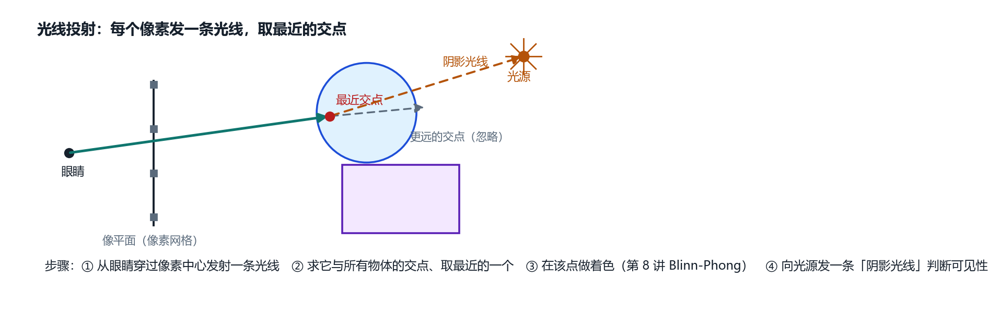

*眼睛 → 像素 → 光线 → 最近的交点 → 在该点着色 → 向光源发阴影光线。**这一页就是整个光线追踪算法的骨架**，后面全是"怎么让求交更快"。*

*193 页 · 103 张关键页截图 · 25 张原创图解 · 16 个手算 · 33 道自测*

> **💡 这一讲与前面所有讲的关系**
>
> - **L02 光栅化**：解决了"三角形 → 像素"，但**不知道全局遮挡**（要靠 L08 的 z-buffer）
> - **L04–05 变换**：光线的起点和方向要变换到世界空间
> - **L08 着色**：光线命中后，还是用 Blinn-Phong 算颜色
> - **L11–12 网格**：光线要求交的就是那些三角形
>
> **所以这一讲是把前面所有零件换个方向重新组装一遍。**

## 0. 先用六步建立全局观

在进入细节之前，先看一个**最小可运行**的光线追踪器需要哪六步 —— 后面的每一节都是在补其中一步。

| 步骤 | 做什么 | 本讲对应 |
|---|---|---|
| ① **生成光线** | 对每个像素算 `o, d` | §2 |
| ② **求交** | 找到最近的命中点 | §4 |
| ③ **着色** | 在命中点算颜色 | §3（局部部分） |
| ④ **阴影** | 向光源发光线判可见性 | §3 |
| ⑤ **递归** | 反射/折射继续追 | §3 |
| ⑥ **加速** | 别逐一遍历所有物体 | §5–§10 |

**主循环只有十几行**：

```c
for (int j = 0; j < H; ++j)
  for (int i = 0; i < W; ++i) {
    Ray ray = generateRay(i, j);              // ①
    Hit hit;
    if (scene.intersect(ray, hit)) {           // ② ⑥（内部用加速结构）
      Color c = shade(hit, ray, 0);            // ③ 内部含 ④ ⑤
      image[j][i] = c;
    } else
      image[j][i] = background;                // 未命中 → 环境色
  }
```

**为什么先看这个**：因为**光追的性能瓶颈几乎永远在 ②**，正确性问题几乎永远在 ① 和 ⑤。知道主循环的形状，后面读各节就知道"这一段是在优化哪一行"。


### 记号约定

全讲统一用下面这套记号，后面不再重复解释：

| 记号 | 含义 | 维数 |
|---|---|---|
| `o` | 光线起点（origin） | 3 |
| `d` | 光线方向，**单位向量** | 3 |
| `r(t)` | 光线上参数 `t` 处的点 | 3 |
| `t` | 沿光线的距离（`d` 归一化后） | 1 |
| `p` / `p₀` | 平面上的一般点 / 已知点 | 3 |
| `n` / `N` | 表面法向（小写=已归一化） | 3 |
| `A, B, C` | 三角形的三个顶点 | 3 |
| `u, v` | 三角形内的重心坐标（`α, β`） | 1 |
| `R` | 球的半径 | 1 |
| `η` | 折射率（`ηᵢ/ηₜ`） | 1 |
| `ε` | 防止自相交的小偏移 | 1 |
| `SA(x)` | 包围盒 `x` 的表面积 | 1 |
| `N(x)` | 节点 `x` 子树里的三角形数 | 1 |
| `C_trav` | 遍历一个节点的代价 | 1 |
| `C_isect` | 求交一个三角形的代价 | 1 |

**两个容易混淆的地方**：

- **`N` 既用作法向，也用作"三角形数"** —— 上下文能区分（`SA·N` 里的 `N` 一定是数量）。
- **`t` 既是光线参数，也是折射光线的方向名** —— 讲折射时用 `t` 表示折射方向（光学术语），其余地方 `t` 一律是参数。

## 1. 为什么需要光线追踪

#### P2　Towards Photorealistic Rendering

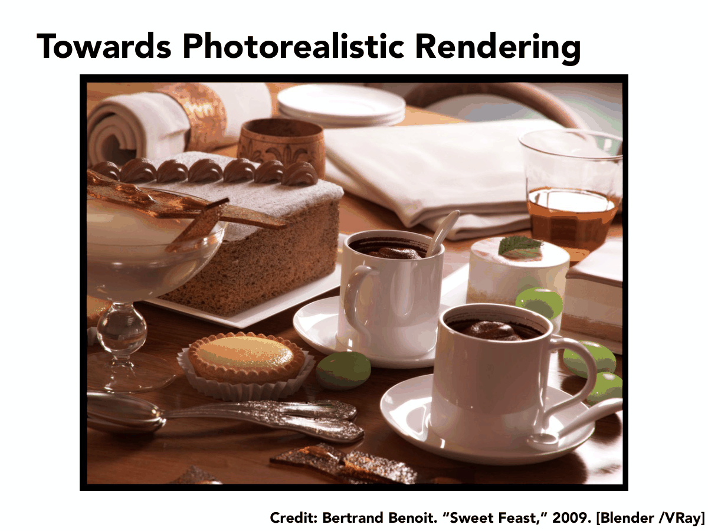

一张照片级渲染（Bertrand Benoit 的 *Sweet Feast*）。

**光栅化做不出这些效果**，因为它只算"直接光照"（光源 → 表面 → 眼睛）。而真实世界的光会**多次弹射**：镜面反射、玻璃折射、物体间的间接光。

**光线追踪天生适合这些效果**，因为它可以**递归地追光线**。

### 两条路线的取舍

| | 光栅化 | 光线追踪 |
|---|---|---|
| 方向 | 三角形 → 像素 | 像素 → 三角形 |
| 复杂度 | **`O(三角形数)`**，与分辨率无关 | `O(像素数 × log 物体数)`，与分辨率**成正比** |
| 全局效果 | 需要额外 pass（shadow map、SSR、SSAO） | **天然支持**（反射、折射、阴影、间接光） |
| 硬件 | 固定功能管线，极度优化 | 需要通用计算 + 遍历加速 |
| 擅长 | 海量三角形、实时 | 高质量、正确性 |
| 弱点 | 镜面反射/折射要"作弊" | 分辨率越高越慢；三角形越多也要加速 |

**关键洞察**：**光栅化的代价与分辨率无关，光线追踪的代价与分辨率成正比。**

所以：
- **4K 游戏**：光栅化 + 屏幕空间技巧（因为像素太多了）
- **电影渲染**：光线追踪（因为要正确，而且可以离线算几小时）

**现代硬件（RTX 等）把两者结合**：用光栅化做第一遍可见性，用光线追踪只算需要它的像素（反射、阴影）。


#### P3–P4　Basic Ray-Tracing Algorithm / Ray Casting
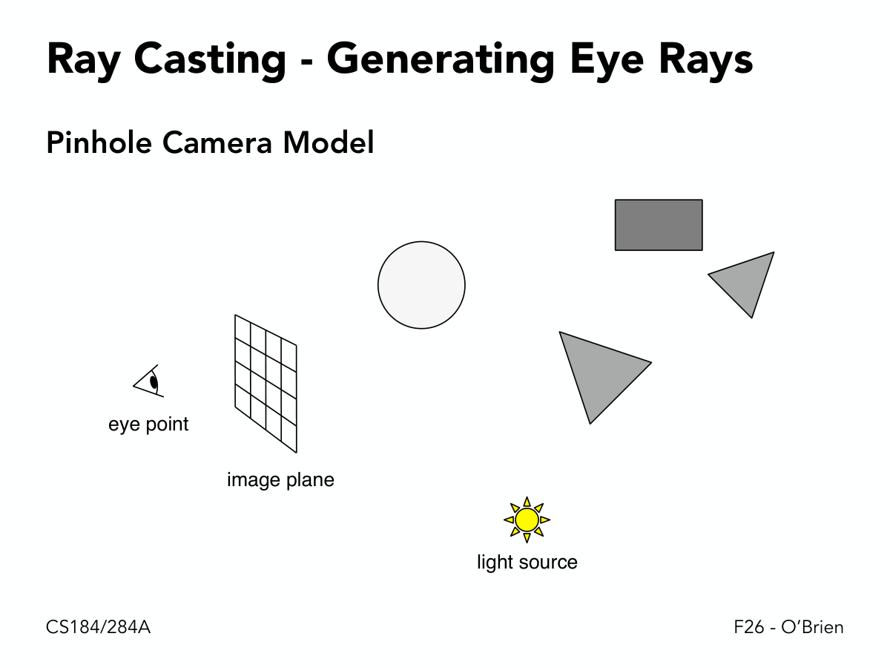

*动画的第一帧：**只有眼睛、像平面和光源**。还没发射任何光线。*

*Appel 1968 - Ray casting · 1. Generate an image by casting one ray per pixel · 2. Check for shadows by sending a ray to the light*

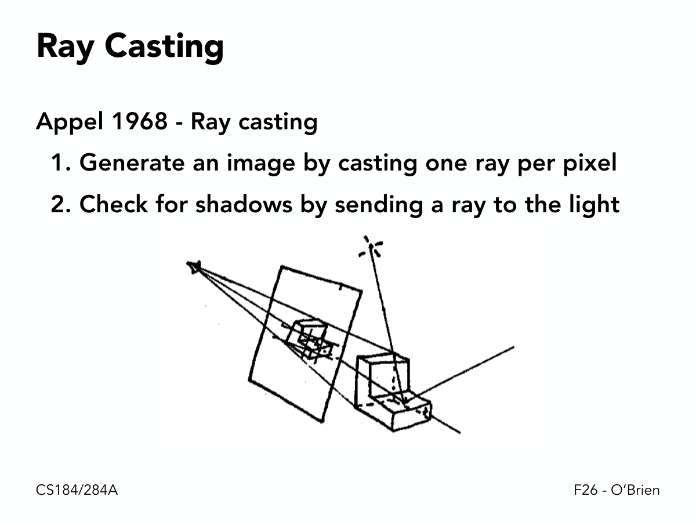

**历史**：**Appel 1968** 提出了光线投射（ray casting）。

**两步**：

| 步骤 | 做什么 |
|---|---|
| ① | **每个像素发一条光线**，找到最近的交点 |
| ② | 从交点**向光源发一条光线**，判断是否被挡（阴影） |

**注意第 ② 步**：这就是"阴影"的来源。光栅化里阴影要靠 shadow map（L08），而光线追踪里**阴影是天然的副产品** —— 只要再发一条光线。

> **📌 "跟踪光线"和"跟踪视线"是一回事**
>
> 真实的光是从光源出发、经过物体、最后进入眼睛。但**这样追是极其浪费的** —— 从光源发出的绝大多数光线都不会进入眼睛。
>
> 所以图形学反过来做：**从眼睛出发，逆着光路找**。这在物理上是同一个路径，只是方向相反（所以叫 "eye ray" 或 "primary ray"）。

## 2. 针孔相机与眼睛光线

#### P5–P10　Ray Casting - Generating Eye Rays

*Pinhole Camera Model · eye point · image plane · light source · eye ray (starts at eye and goes through pixel) · closest scene intersection point*

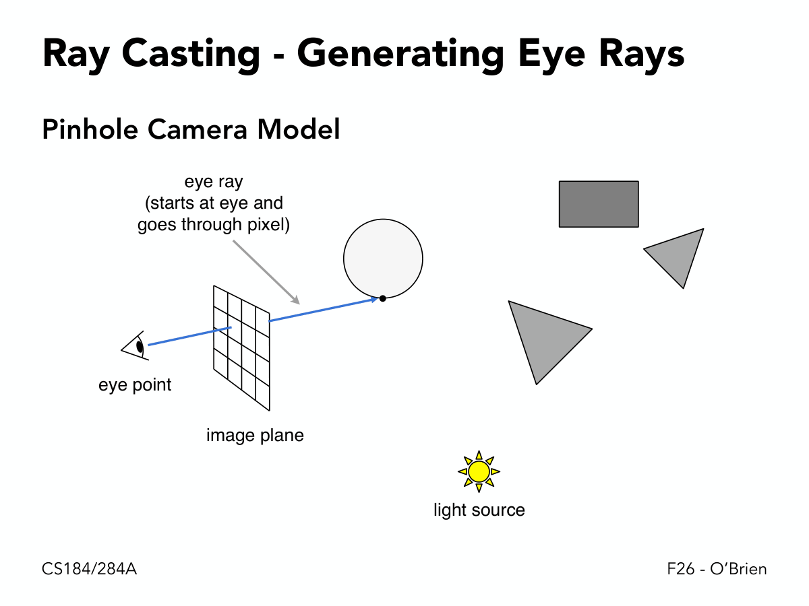

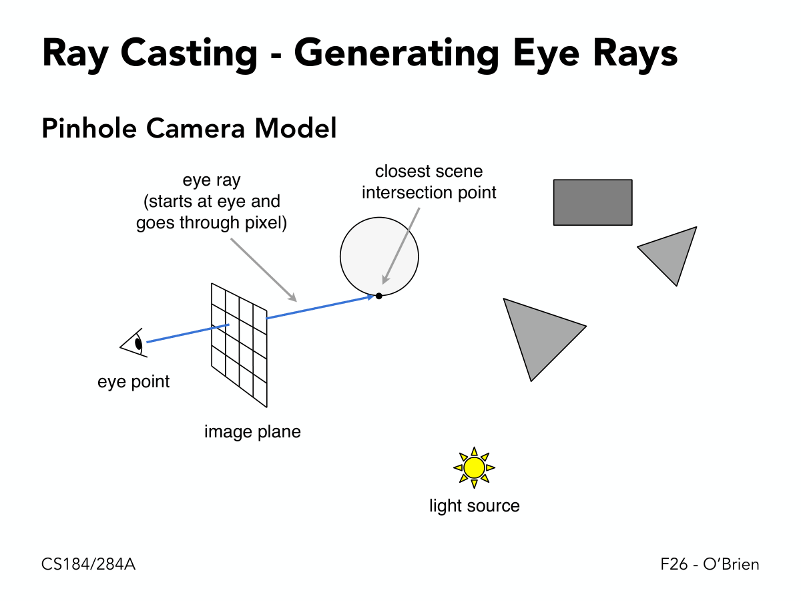

*光线从眼睛出发、**穿过某个像素的中心**。注意图上光线是斜的 —— 因为那个像素不在正中心。*

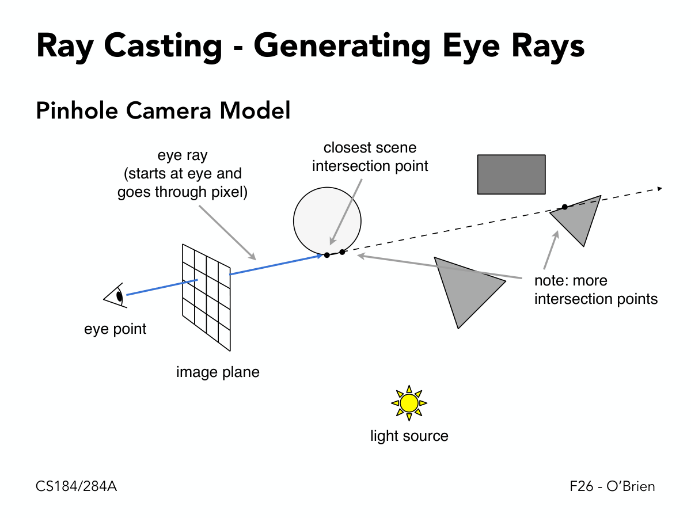

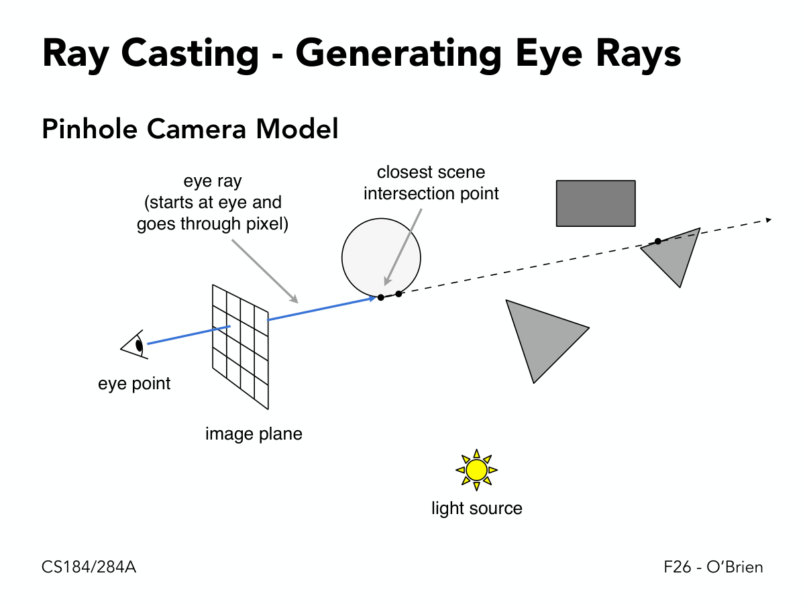

*P5–P10 的完整序列：像平面 → 光线 → 场景 → 最近交点 → 更远交点。**每一步只加一个元素**，这正是讲义"渐进动画"的讲法。*

*同一条光线上可能有**多个交点**（虚线延伸出去）。**取最近的那个**，其余被遮挡。*

**针孔相机模型**（pinhole camera）：

| 元素 | 作用 |
|---|---|
| **eye point** | 光线起点（相机位置） |
| **image plane** | 像素网格所在的平面 |
| **eye ray** | 从眼睛出发、穿过某个像素中心的光线 |
| **closest intersection** | 光线与场景的最近交点 |

**P5–P9 是逐个元素亮起来的动画**：先只有眼睛和像平面，然后出现光线，然后出现场景，最后标出"最近交点"和"更远的交点"。

**关键细节（P10 的小字）**：*"note: more intersection points"* —— 一条光线可能和场景有**多个**交点，但只取**最近的那个**（其余被挡住）。

#### 生成光线：从像素索引到世界方向

讲义没有展开这一步，但**实现时它是第一段代码**，也最容易出错。

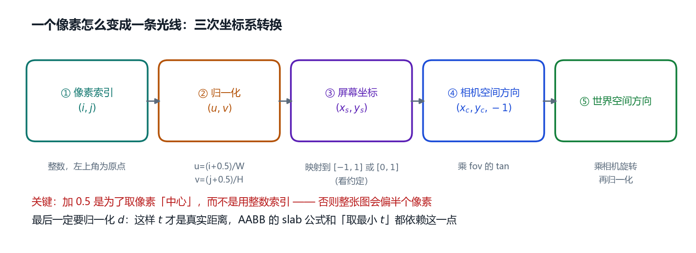

*五次转换：像素索引 → 归一化 → 屏幕坐标 → 相机空间方向 → 世界空间方向。**每一步的约定都可能写反**，这也是自己写渲染器时最常见的 bug 来源。*

**具体公式**（以 `W×H` 图像、视场角 `fov` 为例）：

**① 归一化到 `[0,1]`**：

$$
u=\frac{i+0.5}{W},\qquad v=\frac{j+0.5}{H}
$$

**② 映射到 `[-1,1]`**（`v` 要翻转，因为图像行号向下增长而相机空间 `y` 向上）：

$$
x_s=2u-1,\qquad y_s=1-2v
$$

**③ 乘宽高比与 `tan(fov/2)`**，得到相机空间方向：

$$
d_c=\big(x_s\cdot\text{aspect}\cdot\tan\tfrac{fov}{2},\ \ y_s\cdot\tan\tfrac{fov}{2},\ \ -1\big)
$$

**④ 乘相机旋转矩阵，再归一化**：

$$
d=R\,d_c,\qquad d\leftarrow\frac{d}{\|d\|}
$$

**🔧 手算 1：算一个像素的光线方向**

取 `W = 800`、`H = 600`、`fov = 90°`，求像素 `(i, j) = (400, 300)`（图像正中心）的方向。

**① 归一化**：

$$
u=\frac{400+0.5}{800}=0.5006,\qquad v=\frac{300+0.5}{600}=0.5008
$$

**② 映射**：

$$
x_s=2(0.5006)-1=0.00125,\qquad y_s=1-2(0.5008)=-0.00167
$$

**③ 相机空间**：`aspect = 800/600 = 1.333`，`tan(45°) = 1`：

$$
d_c=(0.00125\times1.333,\ -0.00167,\ -1)=(0.00167,\ -0.00167,\ -1)
$$

**④ 归一化**（假设相机没有旋转）：

$$
\|d_c\|\approx1.0000028,\qquad d\approx(0.00167,\ -0.00167,\ -1)
$$

**结果几乎是 `(0,0,−1)`** —— 正是图像中心的朝向 ✓

**这个结果说明什么**：图像中心的光线方向就是相机的朝向（`−z`），稍微偏了一点点是因为 `0.5` 的像素中心偏移。**如果不加那 `0.5`，结果会正好是 `(0,0,−1)`，但整张图会偏半个像素。**

> **⚠️ 三个最容易写错的地方**
>
> **① `v` 没有翻转** → 图像上下颠倒。
> **② 忘了宽高比 `aspect`** → 图像被拉伸（圆变椭圆）。
> **③ 忘了归一化 `d`** → `t` 不再等于距离，AABB 的 slab 公式和"取最小 `t`"全部失效。

#### 三种常见的相机模型

| 模型 | 光线方向 | 用途 |
|---|---|---|
| **针孔（perspective）** | 从眼睛穿过像素 | 标准透视，最常见 |
| **正交（orthographic）** | 所有光线**平行**，起点在像平面上滑动 | 工程图、CAD、无透视畸变 |
| **薄透镜（thin lens）** | 起点在透镜上随机采样，方向指向焦点 | **景深**（depth of field） |

**正交相机**只是把"起点"从眼睛换成了"像平面上的点"，方向固定为相机朝向 —— 改两行代码就能切换。

**薄透镜相机**是路径追踪里做景深的标准方法：**对透镜面采样**，每个像素发多条光线，焦点处清晰、其他位置模糊。


#### P11–P15　Shading Pixels (Local Only)

*perform shading calculation here to compute color of pixel (e.g. Blinn Phong model)*

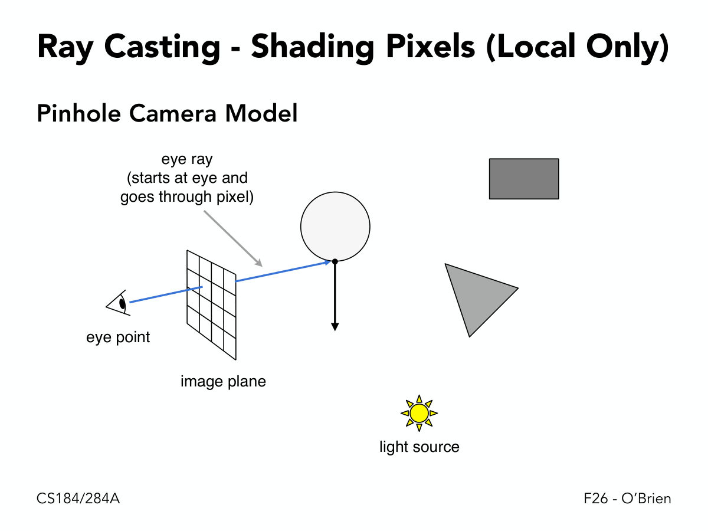

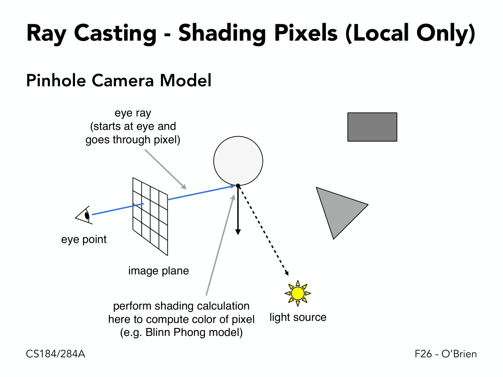

找到交点之后，**在那里做一次着色计算** —— 就是第 8 讲的 Blinn-Phong。

**"Local Only" 这个限定很重要**：此时还不考虑反射/折射，只用光源方向、法线、视线算一个局部颜色。

**这时的效果和光栅化几乎一样** —— 光线追踪的威力在下一步。

## 3. Whitted 递归光线追踪

#### P16　Recursive Ray Tracing

*"An improved Illumination model for shaded display" · T. Whitted, CACM 1980 · Time: VAX 11/780 (1979) 74m · PC (2006) 6s · GPU (2012) 1/30s*

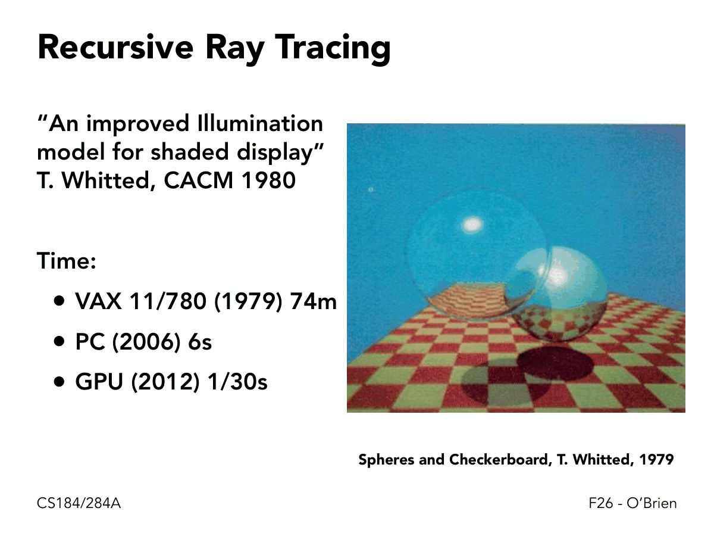

**Turner Whitted 1980** 的论文是图形学的里程碑。图上是他渲染的"球与棋盘格"。

**那段"时间"数据特别有意思**：

| 硬件 | 年份 | 渲染时间 |
|---|---|---|
| VAX 11/780 | 1979 | **74 分钟** |
| PC | 2006 | 6 秒 |
| GPU | 2012 | **1/30 秒** |

**同一张图，33 年快了 13 万倍。** 这个加速来自三方面：硬件、算法（本讲的加速结构）、以及并行化。

#### P17–P20　Mirror Ray（镜面反射）


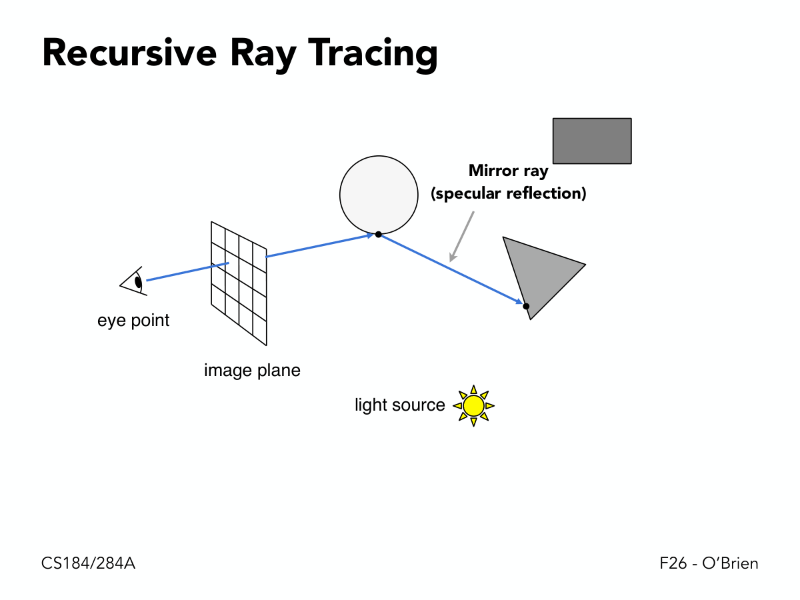

*反射光线命中新物体后，**在新交点再发一条反射** —— 图上已经能看到两层虚线。*

*反射光线打到另一个物体后，**再从那个交点继续追** —— 这就是"递归"。图上的虚线就是第二层。*

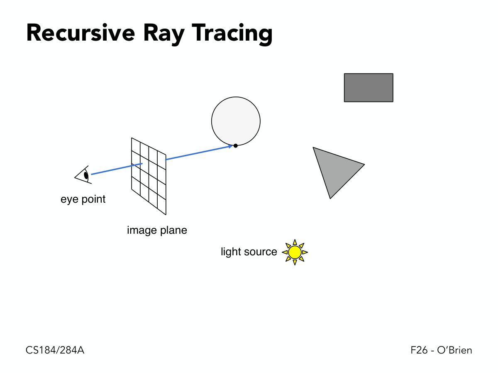

**反射方向**（这个公式在 L08 讲过，这里用在"追踪"上）：

$$
r=d-2(d\cdot n)\,n
$$

**注意符号约定**：这里 `d` 是**入射方向**（从眼睛指向表面），`n` 是表面法线。得到的 `r` 是**反射出去的方向**。

#### P21–P23　Refractive Rays（折射）
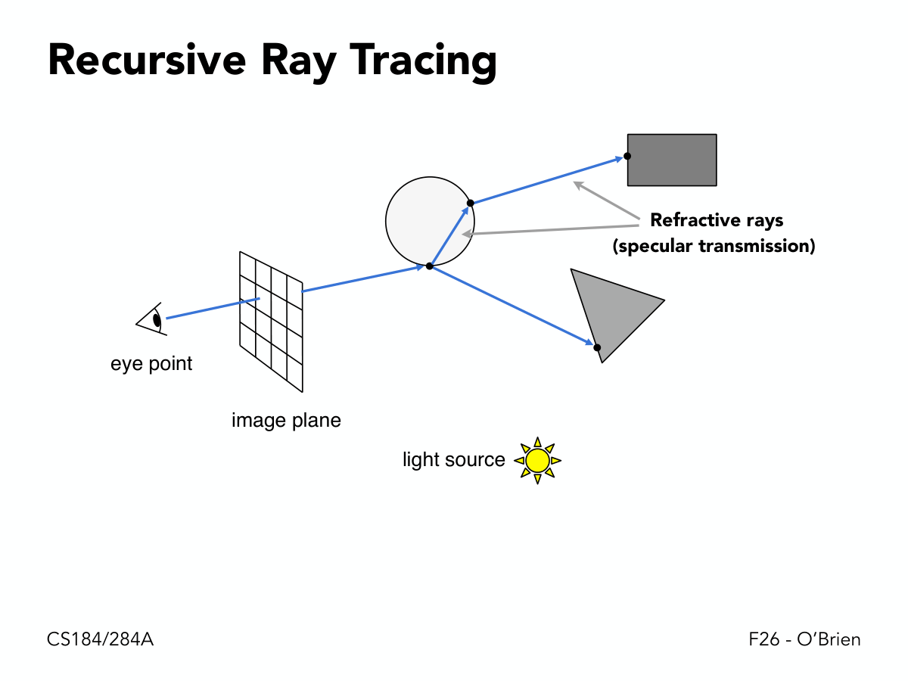

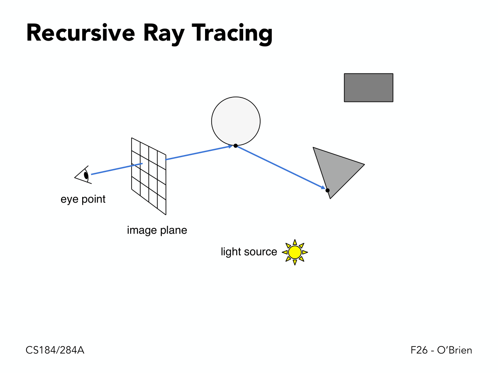

*玻璃球的第一层：光线在表面**分成两条**，一条反射、一条折射进内部。*

*玻璃球表面**同时**有反射和折射。Whitted 模型里两者都追，然后按 Fresnel 权重相加。*

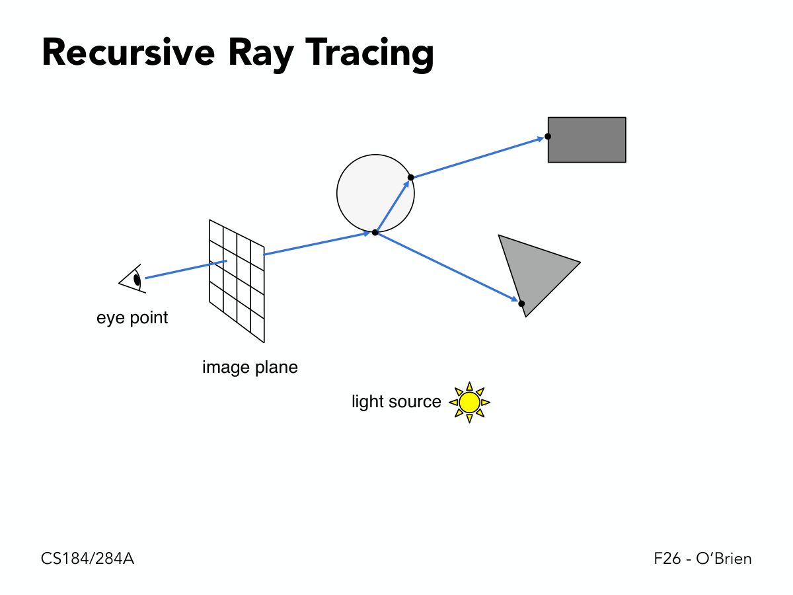


**折射比反射复杂**，因为它依赖**两种介质的折射率之比**。

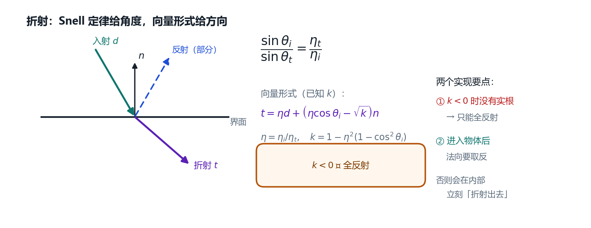

*Snell 定律给出角度关系，但渲染时我们需要**向量形式**的方向。`k < 0` 时没有实根 —— 那就是**全反射**。*

**Snell 定律**：

$$
\frac{\sin\theta_i}{\sin\theta_t}=\frac{\eta_t}{\eta_i}
$$

**向量形式**（已知入射 `d`、法线 `n`、折射率比 `η = η_i/η_t`）：

$$
t=\eta\,d+\Big(\eta\cos\theta_i-\sqrt{k}\Big)n,
\qquad k=1-\eta^2\big(1-\cos^2\theta_i\big)
$$

其中 `cos θ_i = −(d · n)`。

**🔧 手算 2：算一次折射**

设光线从空气（`η_i = 1.0`）进入玻璃（`η_t = 1.5`），入射角 `θ_i = 45°`。

**① 折射率比**：

$$
\eta=\frac{1.0}{1.5}=0.6667
$$

**② Snell 定律求折射角**：

$$
\sin\theta_t=\frac{\sin 45°}{1.5}=\frac{0.7071}{1.5}=0.4714
$$

$$
\theta_t=\arcsin(0.4714)\approx28.1°
$$

**③ 验证 `k`**：

$$
\cos\theta_i=0.7071,\qquad \cos^2\theta_i=0.5
$$

$$
k=1-0.6667^2\times(1-0.5)=1-0.4444\times0.5=0.7778>0
$$

**`k > 0` ⇒ 有折射光线** ✓

**再看全反射**：如果从玻璃射向空气（`η = 1.5/1.0 = 1.5`），入射角 `θ_i = 45°`：

$$
k=1-1.5^2\times(1-0.5)=1-2.25\times0.5=-0.125<0
$$

**`k < 0` ⇒ 没有折射，全部反射** ✓

**临界角**：`k = 0` 时 `sin θ_i = 1/1.5 = 0.6667`，即 `θ_c ≈ 41.8°`。**超过这个角度，玻璃就变成镜子了** —— 这就是为什么水下的气泡看起来像银色的。

> **⚠️ 进入物体之后法线要取反**
>
> 光线从空气进入玻璃时，法线指向**外部**；从玻璃射出时，法线仍然指向外部，但此时光线是"从内部撞向表面"，所以**需要把法线翻转**（`n ← −n`）再做计算。
>
> 漏掉这一步的典型症状：玻璃球内部一片漆黑（因为每次都在"往外折射"却算出无解）。

#### P24–P29　Shadow Rays（阴影光线）

阴影光线只问一个问题：**从交点到光源之间有没有东西挡着？**

**答案是二值的**（通 / 不通），所以阴影光线**不需要递归**，也不需要求最近交点 —— **只要发现任何遮挡就可以立刻返回**。

**P25–P29 是渐进动画**：图上虚线从交点指向光源，被挡住的那些不会产生光照贡献。


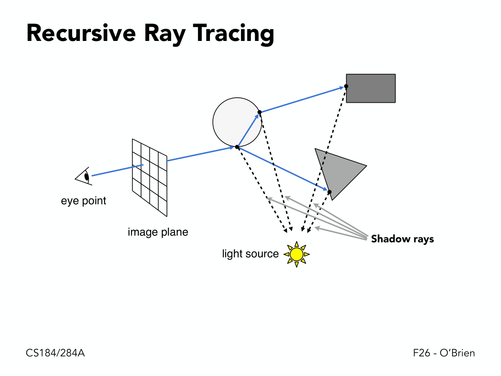

*所有交点的阴影光线同时画出来。**被挡住的那几条（虚线中断）不产生光照贡献**。*

*从交点向光源发的虚线**穿过了别的物体** ⇒ 这个交点处于阴影中 ⇒ 只保留环境光项。*

#### P30–P35　递归规则与终止条件
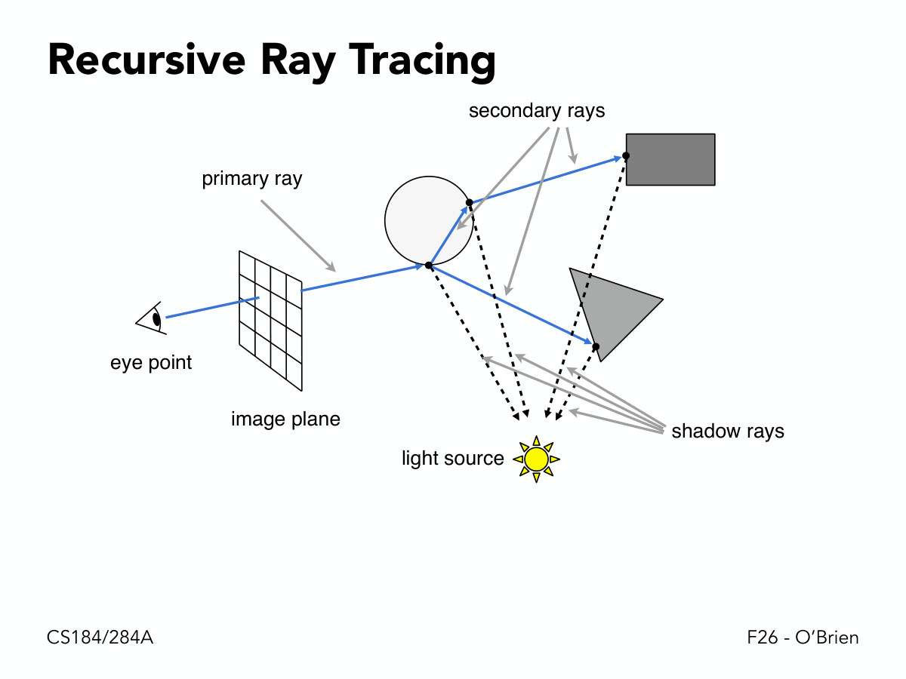

*讲义到这一页才把 **primary ray / secondary rays / shadow rays** 三个标签同时标上 —— 前面几页是逐个加的。*

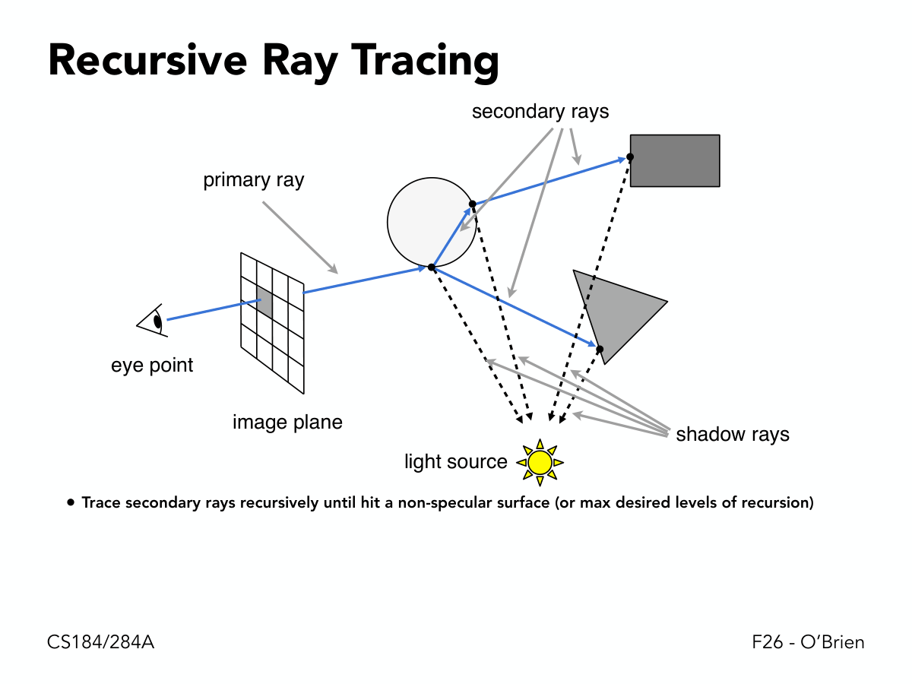

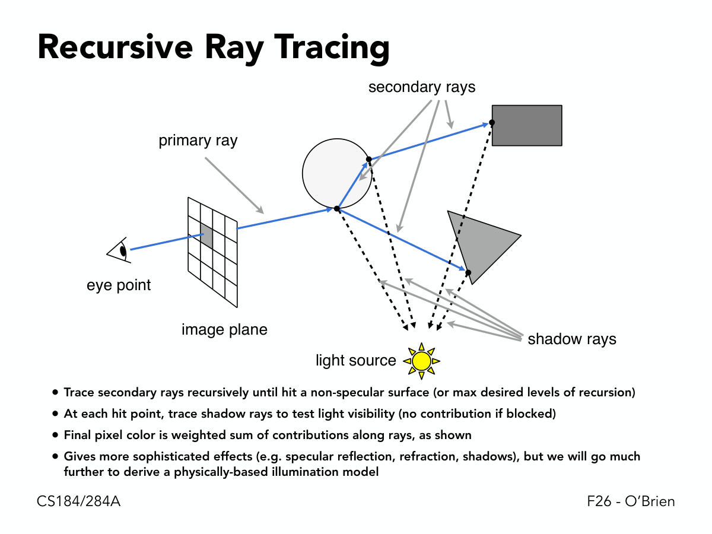

**讲义用六页把规则逐条加上去**，最终是四条：

| 规则 | 内容 |
|---|---|
| ① | **递归地追踪次级光线**，直到撞上**非镜面**表面，或达到最大递归深度 |
| ② | 在每个交点向光源**发阴影光线**，测试可见性（被挡则无贡献） |
| ③ | **最终像素颜色 = 沿所有光线的贡献加权和** |
| ④ | 比局部模型更真实（镜面反射、折射、阴影），但**离物理模型还很远** |

**第 ④ 条很重要**：Whitted 的模型**不是基于物理的**。它的"加权和"里的权重是手工调的，不是从 BRDF 推导出来的。真正的物理模型在 L16–17。

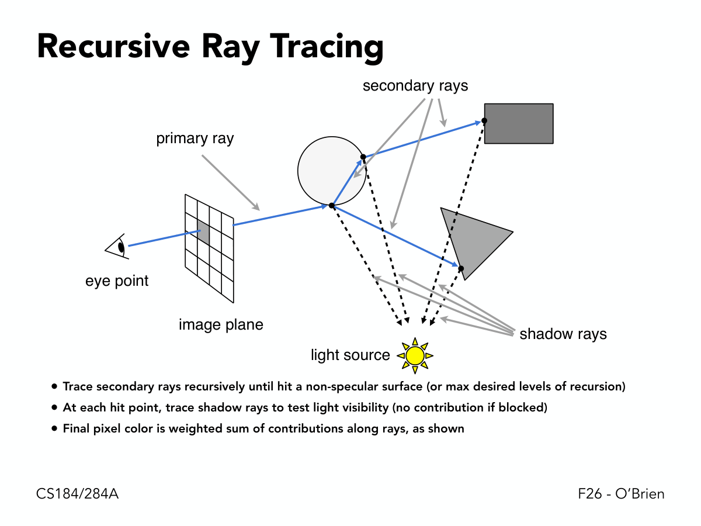

*四条规则累积完成。**注意最后一条是"我们还要走得更远"** —— 这句话直接指向 L16–17 的基于物理的渲染。*


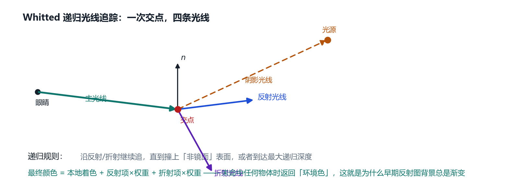

*主光线打进场景 → 交点处再发三条：反射（镜面）、折射（透明）、阴影（可见性）。**递归地追下去，就得到了镜面和玻璃**。*

**加权和的公式**（P35 隐含的）：

$$
C=C_{\text{local}}+k_r\,C_{\text{reflect}}+k_t\,C_{\text{refract}}
$$

其中 `k_r`、`k_t` 来自材质的 Fresnel 项。

#### 递归的代价

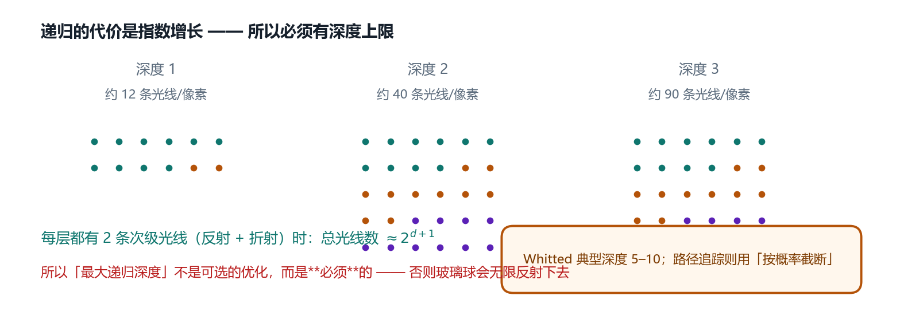

*每层都发两条次级光线时，总光线数约 `2^(d+1)`。**深度每加 1，代价翻倍** —— 所以"最大深度"不是可选优化，而是必须的。*

**🔧 手算 3：算一次递归的总光线数**

设每次反射/折射都发 2 条次级光线，阴影光线每条 1 条（不递归）。

| 深度 | 该层光线数 | 累计 |
|---|---|---|
| 0（主光线） | 1 | 1 |
| 1 | 2 | 3 |
| 2 | 4 | 7 |
| 3 | 8 | 15 |
| 4 | 16 | 31 |
| 5 | 32 | 63 |

**规律**：累计 = `2^(d+1) − 1`。

**再加上阴影光线**（每个交点 1 条，数量等于节点数）：

**总计 `≈ 2^(d+2)`**。取 `d = 5`：

$$
2^7=128\ \text{条光线/像素}
$$

**一张 1920×1080 的图**：

$$
2.07\times10^6\times128\approx2.65\times10^8
$$

**2.65 亿条光线** —— 这就是为什么早期的递归光线追踪那么慢。

> **📌 工业界的做法：不是"限制深度"，而是"按概率截断"**
>
> 硬性限制深度 `d` 会**系统性丢失**远处的高阶效果（比如两个镜子互相反射很多次）。
>
> 更好的做法是 **Russian roulette**（俄罗斯轮盘）：每层以概率 `p` 继续追、以 `1−p` 终止，然后把结果除以 `p` 保持无偏。这样**大部分光线很快终止，少数会追得很深** —— 数学期望正确，方差可控。
>
> 这是 L16–17 路径追踪的核心技巧之一。

## 4. 求交数学

#### P36–P40　Ray-Surface Intersection

*Rendering: visibility, shadows, lighting … · Geometry: inside/outside test · Simple idea: just intersect ray with each triangle · Note: can have 0, 1 or multiple intersections*

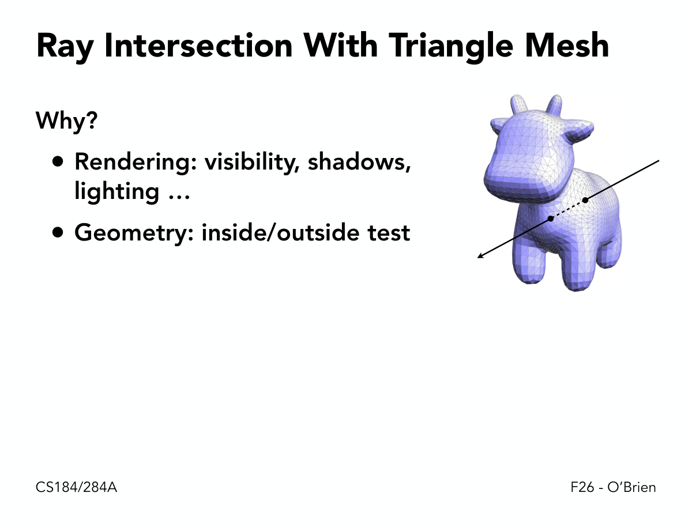

**求交的两个用途**：

| 用途 | 说明 |
|---|---|
| **渲染** | 可见性、阴影、光照 |
| **几何** | 判断内外（点在不在物体内部） |

**最朴素的做法**：光线和**每个三角形**求交。**慢，但简单** —— 加速放到第 6 节。

**注意（P40）**：*"can have 0, 1 or multiple intersections"* —— 一条光线可能 0 个（打空）、1 个（相切/穿过一片薄面）、或多个（穿过一个封闭物体 = 2 个）。

#### P41–P44　Ray Equation
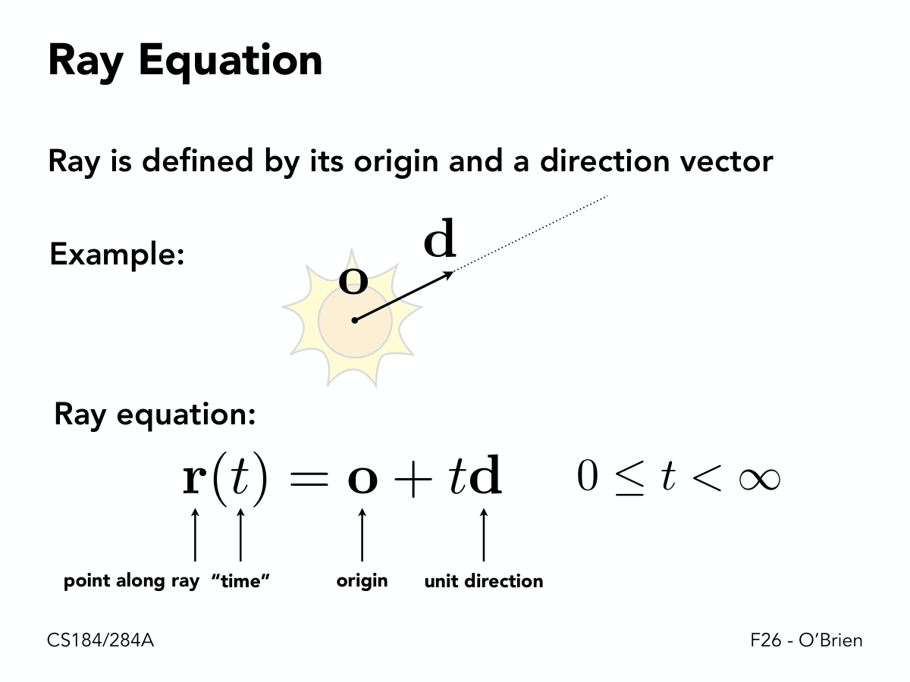

*`t` 在图上被标成"时间"，但它其实就是**沿光线的距离**（因为 `d` 是单位向量）。*

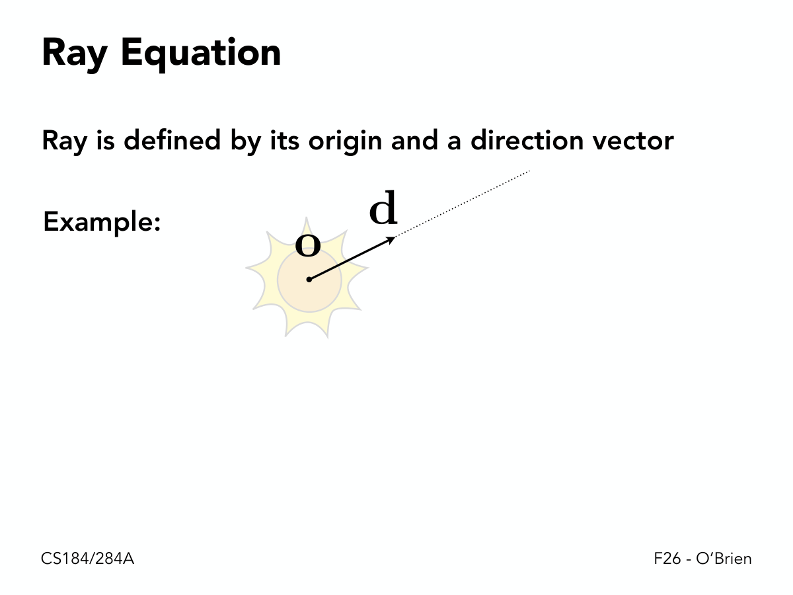

$$
r(t)=o+t\,d,\qquad 0\leq t<\infty
$$

| 符号 | 含义 |
|---|---|
| `o` | 起点（origin） |
| `d` | 方向（**单位向量**） |
| `t` | 参数（"时间"/距离） |

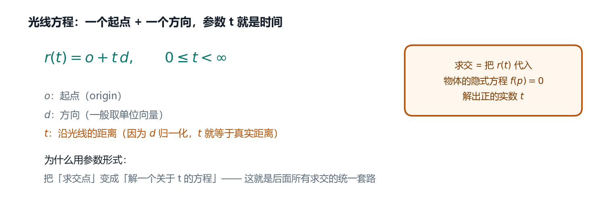

*一个起点 + 一个方向，`t` 是沿光线的距离。**所有求交问题都被转化成"把 `r(t)` 代入物体的隐式方程，解出 `t`"** —— 这是本讲最统一的思想。*

#### P45–P50　Plane Equation 与光线-平面求交
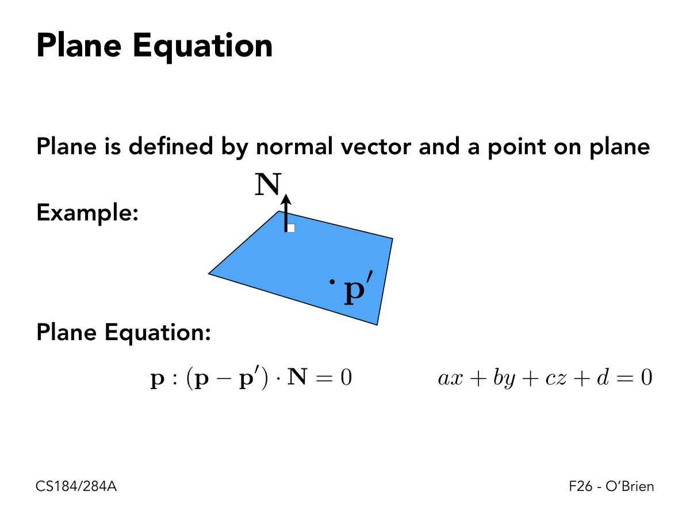

*`(p − p₀)·N = 0` 的含义：**从 `p₀` 到 `p` 的向量必须垂直于法向** —— 这正是"在平面内"的定义。*

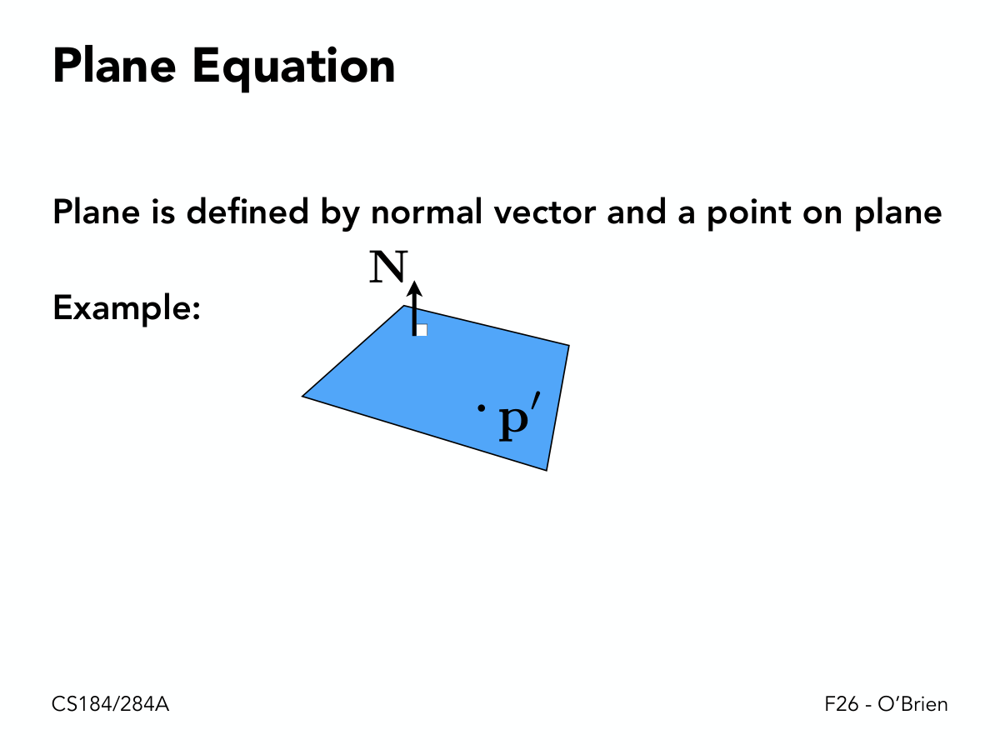

$$
p:(p-p_0)\cdot N=0
$$

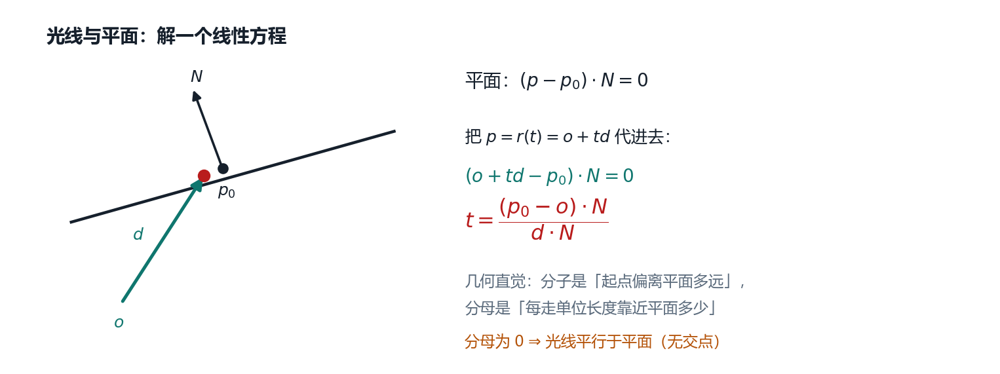

*平面由「一个点 `p₀` + 一个法向 `N`」定义。求交就是把光线方程代进去，解一个**线性**方程。*

**推导**：把 `p = o + td` 代入：

$$
(o-p_0)\cdot N+t\,(d\cdot N)=0
$$

$$
\boxed{t=\frac{(p_0-o)\cdot N}{d\cdot N}}
$$

**🔧 手算 4：求光线与平面的交点**

平面：过 `p₀ = (0,0,5)`，法向 `N = (0,0,1)`（即 `z = 5`）。
光线：`o = (0,0,0)`，`d = (0,0,1)`。

$$
t=\frac{(0,0,5)\cdot(0,0,1)}{(0,0,1)\cdot(0,0,1)}=\frac{5}{1}=5
$$

**交点 `(0,0,5)`** ✓

**平行的情况**：`d = (1,0,0)` → 分母 `0` → **无交点**。

**几何直觉**：分子 = 起点偏离平面多远；分母 = 每走单位长度靠近平面多少。

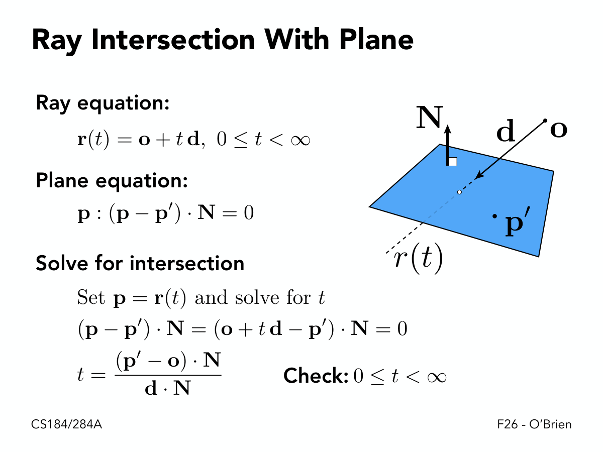

*把光线方程代入后**只剩一个未知数 `t`** —— 因为 `o`、`d`、`p₀`、`N` 全是已知的。*


#### P51–P53　Ray Intersection With Triangle

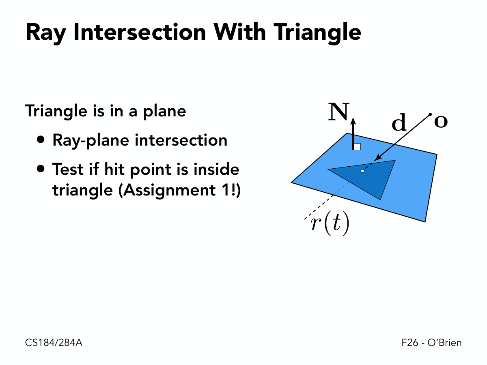

**两步走**：

| 步骤 | 做什么 |
|---|---|
| ① | 求光线与**三角形所在平面**的交点 |
| ② | 判断交点**是否在三角形内**（第 2 讲的 `L` 函数 / 第 6 讲的重心坐标） |

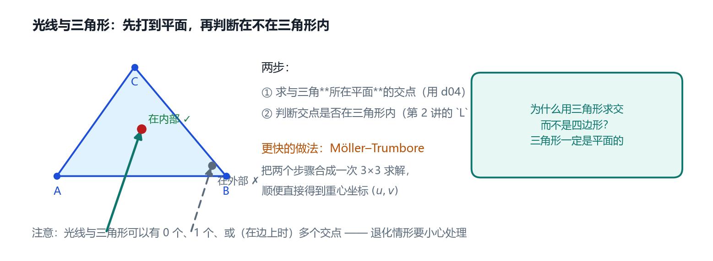

*先在平面上求交点，再判断在不在三角形内部。**第 ② 步就是 HW1 里做过的"点在三角形内"测试**。*

#### P54　Möller-Trumbore Algorithm

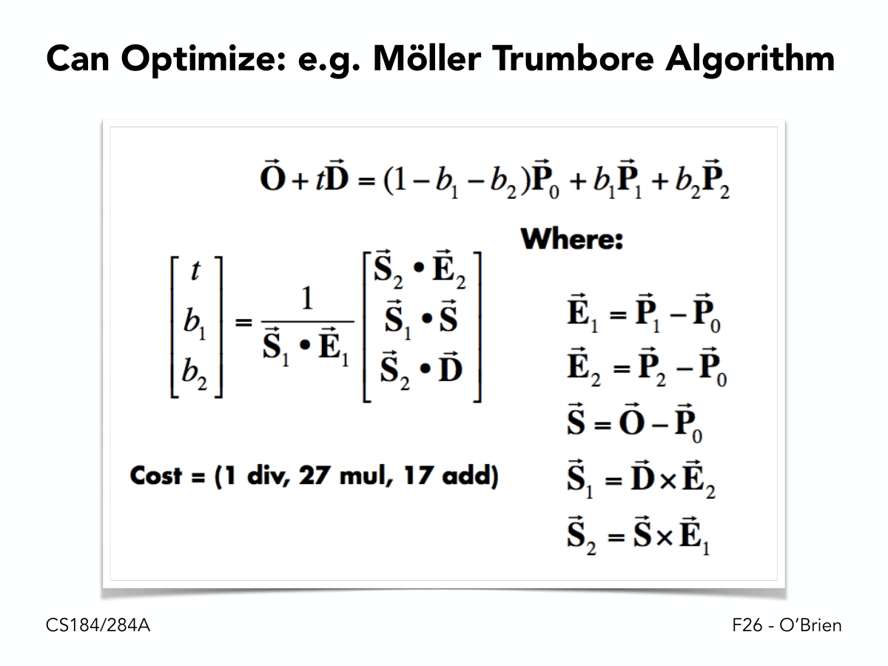

**更快的做法**：把两步合成一次 3×3 求解。

**推导**：设交点用重心坐标表示：

$$
o+t\,d=(1-u-v)A+uB+vC
$$

整理成三个未知数 `(t, u, v)` 的线性系统：

$$
\begin{bmatrix}-d & B-A & C-A\end{bmatrix}
\begin{bmatrix}t\\u\\v\end{bmatrix}=o-A
$$

**用 Cramer 法则解**，三个分量都是三重积：

$$
t=-\frac{S\cdot(E_1\times E_2)}{d\cdot(E_1\times E_2)},\qquad
u=\frac{d\cdot(S\times E_2)}{d\cdot(E_1\times E_2)},\qquad
v=\frac{d\cdot(E_1\times S)}{d\cdot(E_1\times E_2)}
$$

其中 `E₁ = B−A`、`E₂ = C−A`、`S = o−A`。

**判据**：`t > ε` 且 `u ≥ 0`、`v ≥ 0`、`u + v ≤ 1`。

**为什么它更快**：一次 3×3 求解同时完成"求交"和"内测"，还**顺便得到重心坐标**（可以直接插值颜色/法线/UV）。

**🔧 手算 5：用重心坐标验算一次求交**

三角形：`A = (0,0,0)`、`B = (1,0,0)`、`C = (0,1,0)`。
光线：`o = (0.2, 0.2, −1)`、`d = (0,0,1)`。

**先用平面法**：三角形在 `z = 0` 平面，法向 `(0,0,1)`：

$$
t=\frac{((0,0,0)-(0.2,0.2,-1))\cdot(0,0,1)}{1}=\frac{1}{1}=1
$$

交点 `P = (0.2, 0.2, 0)`。

**再用重心坐标验内**：解 `P = (1−α−β)A + αB + βC`：

$$
(0.2,0.2)=(α,\ \beta)\ \Longrightarrow\ α=0.2,\ \beta=0.2
$$

`α ≥ 0`、`β ≥ 0`、`α+β = 0.4 ≤ 1` ⇒ **在三角形内** ✓

> **⚠️ 符号和顶点对应要分别检查**
>
> S=o−A 时，线性系统右端是 S，平面法给 t=−(S·N)/(d·N)。负号来自 A−o，不是“u/v 对应不同教材”的问题。
>
> 一套一致的实现为 h=d×E2，a=E1·h，q=S×E1，u=(S·h)/a，v=(d·q)/a，t=(E2·q)/a。
>
> u、v 单纯交换不改变 u≥0、v≥0、u+v≤1 的对称包含判据，但会错配 B、C 的属性。应采用 u≠v 的测试点，并分别回代光线和重心表示；深入练习给出这样的检查。

#### P55–P59　Ray Intersection With Sphere
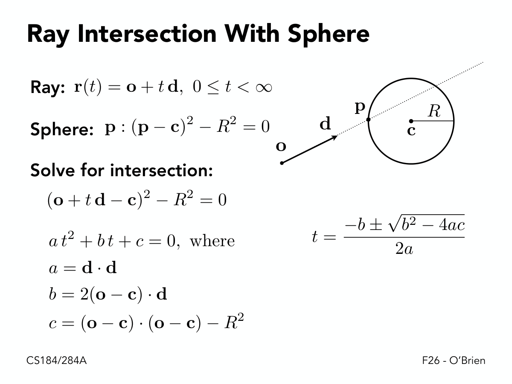

*两个根 `t₁ < t₂` 分别对应**进入**和**穿出**。渲染时取 `t₁`（除非 `t₁ < 0`）。*

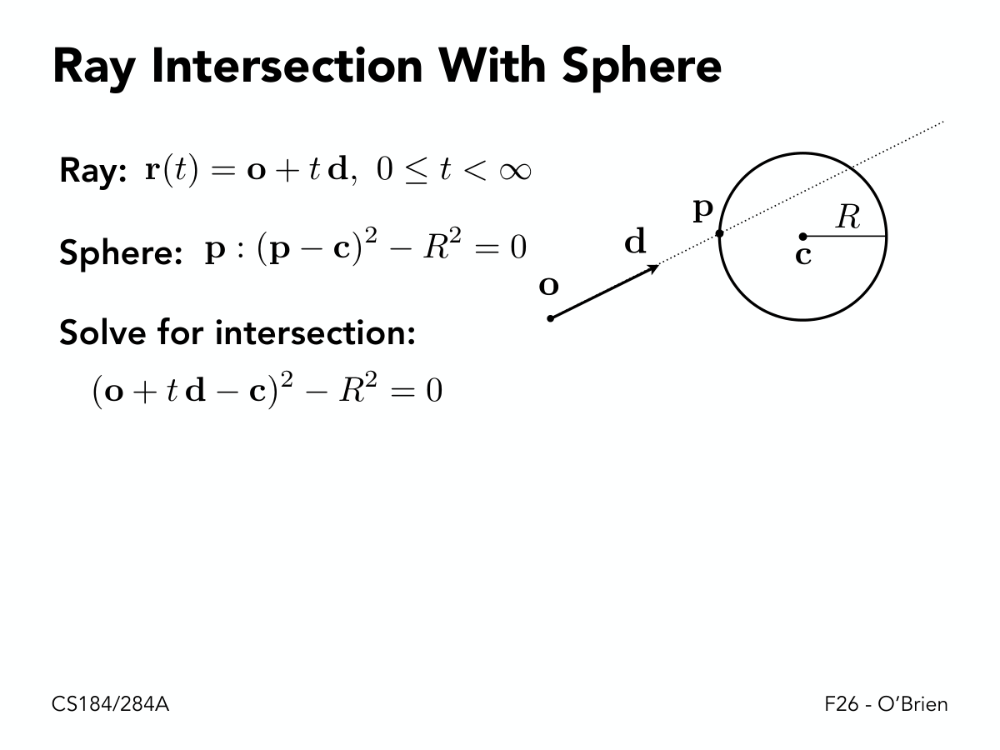

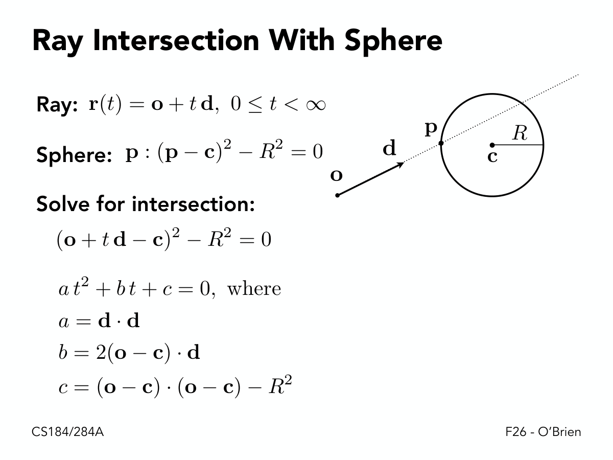

球方程 `(p−c)² − R² = 0`，代入 `p = o + td`：

$$
at^2+bt+c'=0
$$

$$
a=d\cdot d,\qquad b=2(o-c)\cdot d,\qquad c'=(o-c)\cdot(o-c)-R^2
$$

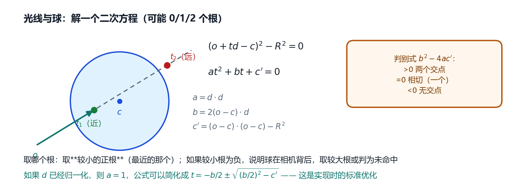

*判别式决定交点数：`>0` 两个、`=0` 相切、`<0` 打空。**取较小的正根**。*

**🔧 手算 6：求光线与球的交点**

球心 `c = (0,0,5)`、`R = 1`；光线 `o = (0,0,0)`、`d = (0,0,1)`。

$$
a=1,\qquad b=2\,(0,0,-5)\cdot(0,0,1)=-10,\qquad c'=25-1=24
$$

解 `t² − 10t + 24 = 0`：

$$
t=\frac{10\pm\sqrt{100-96}}{2}=\frac{10\pm2}{2}\ \Rightarrow\ t=4,\ 6
$$

**取 `t = 4`**（进入点）✓

**归一化后的简化**：若 `a = 1`：

$$
t=-h\pm\sqrt{h^2-c'},\qquad h=\frac{b}{2}
$$

**`h = b/2` 的几何意义**：`h` 是"球心在光线上的投影参数" —— 也就是**最接近球心的那个点的 `t`**。所以上式其实是"先走到最近点，再前后各走 `√(h²−c')`"，非常直观。

#### P60–P64　Ray Intersection With Implicit Surface

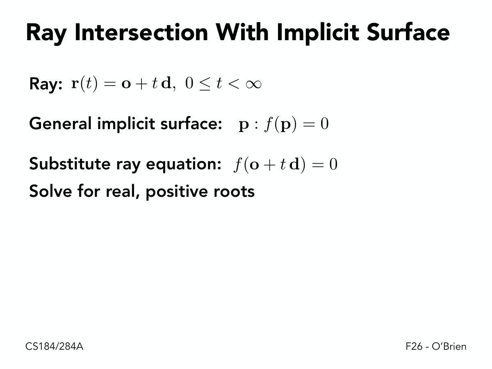

**统一框架**：

1. 隐式曲面 `f(p) = 0`
2. 代入 `f(o + td) = 0`
3. 解出**实数、正的**根

**难度由 `f` 的次数决定**：

| 曲面 | 次数 | 求解方法 |
|---|---|---|
| 平面 | 1 | 一个除法 |
| 球 / 椭球 | 2 | 求根公式 |
| 环面 | 4 | 需数值方法（或降次） |
| 一般隐式 | 任意 | 牛顿迭代等 |

**这就是为什么实际渲染里几乎只用三角形** —— 它是一次方程，没有数值稳定性问题。

#### 其他求交方式（不要求，但值得知道）

| 方式 | 思路 | 优劣 |
|---|---|---|
| **SDF ray marching** | 沿光线小步前进，每步用距离函数判断离表面多远 | 任意几何；但可能漏细节、步数多 |
| **解析求交** | 本文讲的解方程 | 精确、快；但只适合简单曲面 |
| **细分 + 凸包剔除** | 反复切分，用凸包快速排除 | 适合 Bézier / 细分曲面 |
| **体素遍历** | 把几何离散成体素网格 | 简单；有离散误差 |

**SDF ray marching 值得单独说一句**：它不解方程，而是"**沿光线走，每一步问'离最近的表面还有多远'，然后走那么远**"。几何用距离场表示时（程序化建模常见），这是最自然的求交方式。


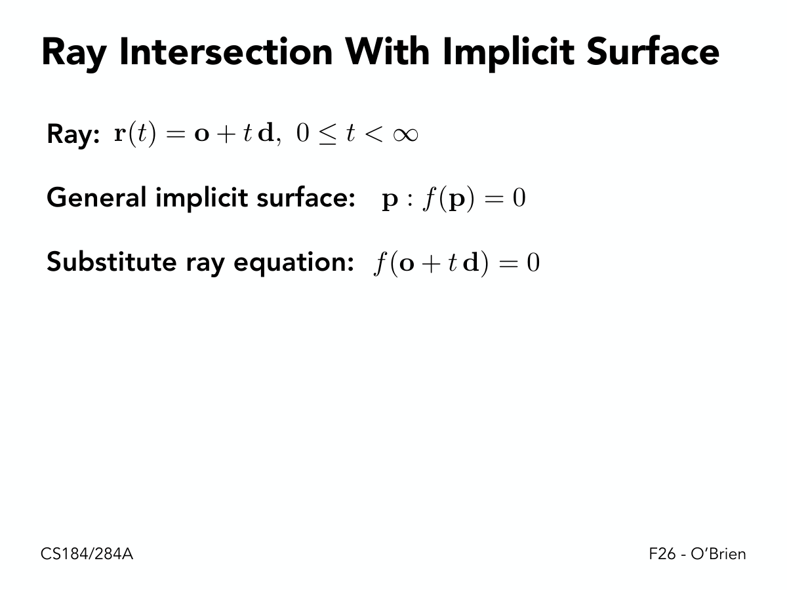

*任何隐式曲面都是同一个套路：**把 `r(t)` 代进 `f(p) = 0`，然后解方程**。*


## 5. 为什么必须加速

#### P65–P66　Ray Tracing – Performance Challenges

*Exhaustive algorithm = #pixels ⨉ #objects · Very slow!*

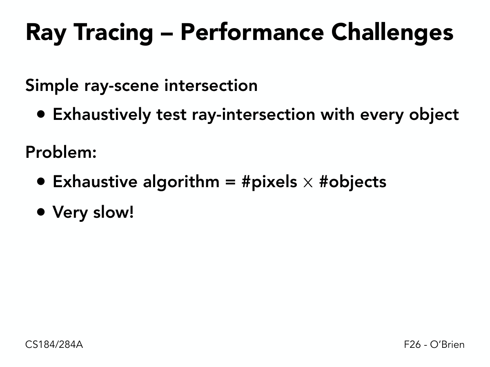

$$
\text{总求交次数}=\#\text{pixels}\times\#\text{objects}
$$

#### P67–P68　真实的场景规模

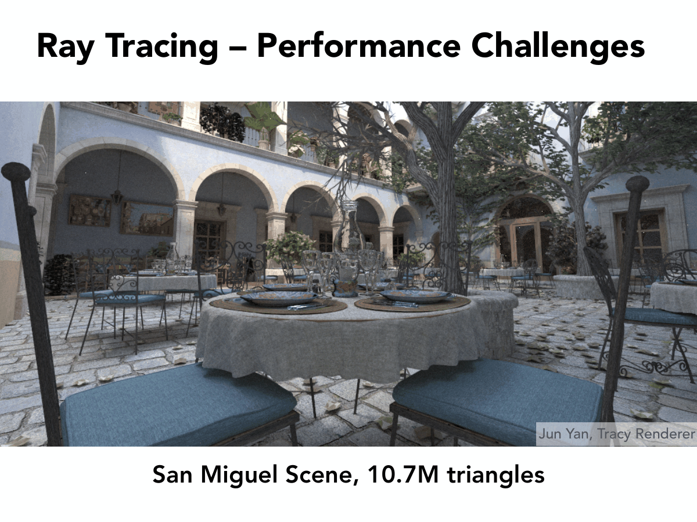

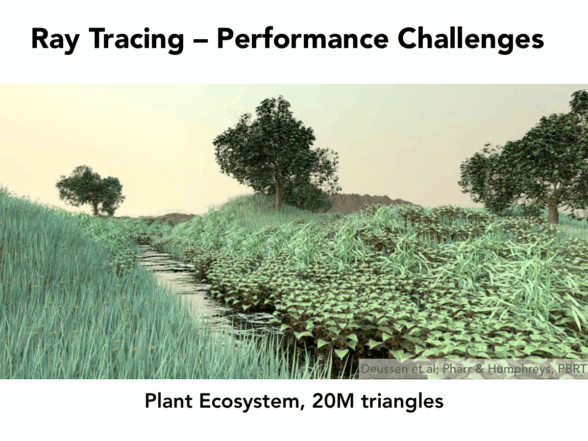

| 场景 | 三角形数 |
|---|---|
| **San Miguel**（J. Yan, Tracy Renderer） | **1070 万** |
| **植物生态**（Deussen et al / PBRT） | **2000 万** |

**🔧 手算 7：暴力算法到底多慢**

取 `1920×1080` 和 `1070 万` 三角形：

$$
\text{像素}=2.07\times10^{6},\qquad
\text{求交}=2.07\times10^6\times1.07\times10^7\approx2.2\times10^{13}
$$

**220 亿次求交**。按每次 1 ns 算：

$$
2.2\times10^{13}\times10^{-9}=2.2\times10^{4}\ \text{s}\approx6\ \text{小时}
$$

**一张图 6 小时。**

**加速后的估算**：如果每条光线平均只测 `log₂(10⁷) ≈ 23` 个盒子 + 少量三角形：

$$
2.07\times10^6\times(23+5)\approx5.8\times10^{7}
$$

**比暴力少了约 38 万倍。**

> **📌 这一讲真正的主题**
>
> 前面那些求交公式（平面/球/三角形）都是**一节课就能讲完的初等数学**。
>
> **这一讲 80% 的内容都在解决一个问题：怎么避免遍历全部物体。**
>
> 这也解释了为什么讲义的分节标题是 "Accelerating Ray-Scene Intersection" —— **加速才是主题，求交只是前提**。

## 6. 包围盒

#### P69–P70　Bounding Volumes

*Object is fully contained in the volume · If it doesn't hit the volume, it doesn't hit the object*

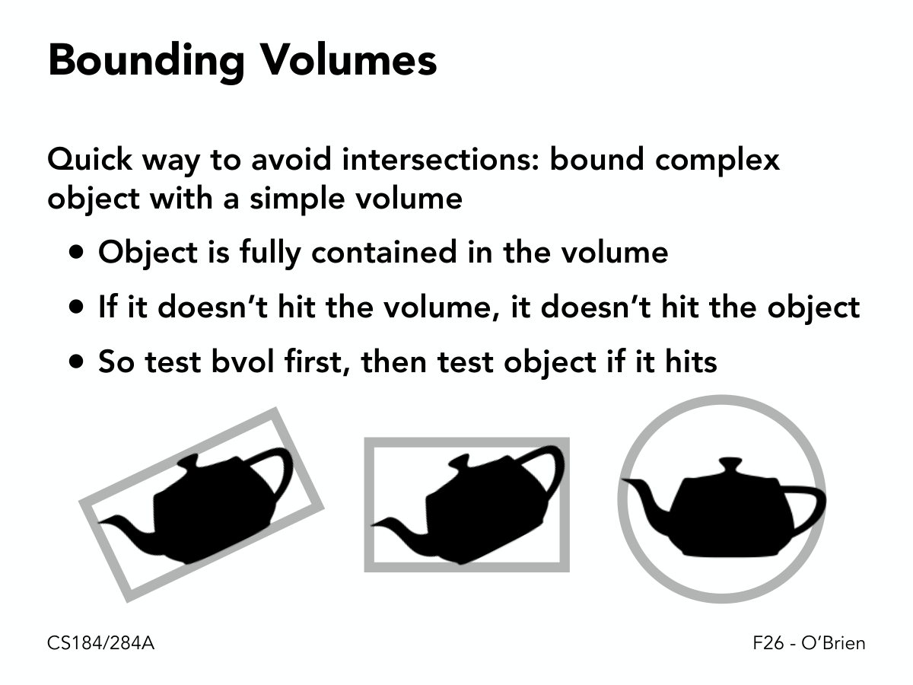

**核心思想**：

> 用一个**简单的体积**把复杂物体包起来。**如果光线打不中这个体积，就打不中物体。**

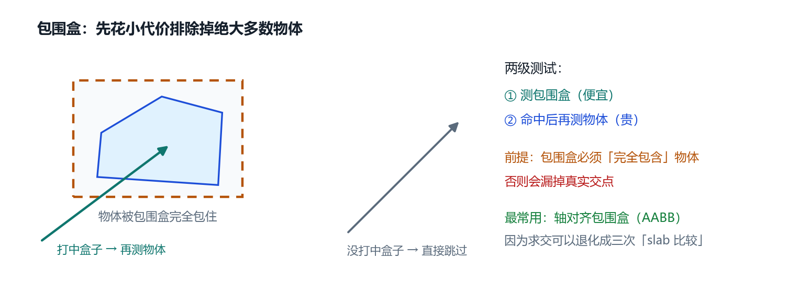

*两级测试：先测包围盒（便宜），命中后再测真正的物体（贵）。**前提是包围盒必须完全包含物体**，否则会漏掉真实交点。*

#### P71–P78　Ray-Intersection With Box
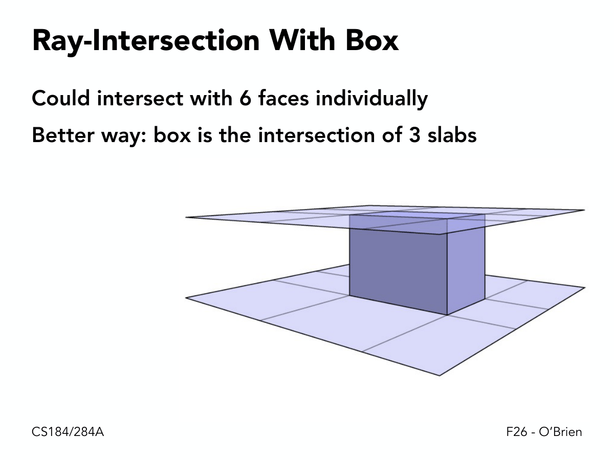

*盒子的三个 slab：`x` 方向两条平行面、`y` 方向两条、`z` 方向两条。**每个 slab 就是一个 `[t_near, t_far]` 区间**。*

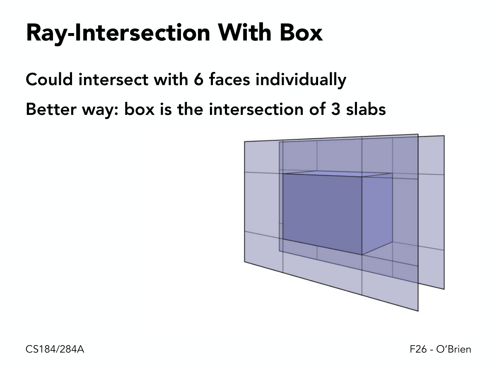

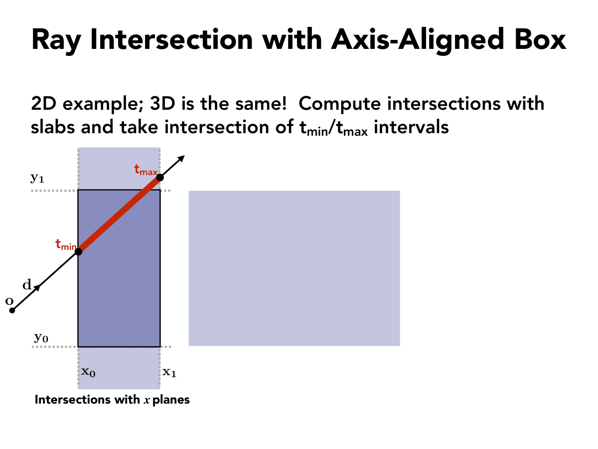

**两种做法**：

| 做法 | 代价 |
|---|---|
| 分别与 6 个面求交 | 6 次平面求交 + 判断交点是否在面内 |
| **当作 3 个 slab 的交集** | 3 次除法 + 几次 max/min |


*每个轴算一个 `[t_near, t_far]` 区间，三个区间取**交集**。交集非空 ⇒ 光线穿过盒子。*

**算法**：

$$
t_{x}=\frac{x_{0,1}-o_x}{d_x},\qquad
t_{y}=\frac{y_{0,1}-o_y}{d_y},\qquad
t_{z}=\frac{z_{0,1}-o_z}{d_z}
$$

$$
t_{\min}=\max\big(\min t_x,\min t_y,\min t_z\big),\qquad
t_{\max}=\min\big(\max t_x,\max t_y,\max t_z\big)
$$

**判据**：

$$
t_{enter}\le t_{exit},\quad[t_{enter},t_{exit}]=[t_{\min},t_{\max}]\cap[t_{ray,min},t_{ray,max}]
$$

**🔧 手算 8：算一次 AABB 求交**

盒子 `x,y,z ∈ [1,3]`；光线 `o = (0,0,0)`、`d = (1,1,1)/√3`。

三轴对称，算 `x`：

$$
t_{x,\text{near}}=\frac{1}{1/\sqrt3}=\sqrt3\approx1.732,\qquad
t_{x,\text{far}}=\frac{3}{1/\sqrt3}=3\sqrt3\approx5.196
$$

$$
t_{\min}=1.732,\qquad t_{\max}=5.196
$$

**`t_min < t_max` 且 `t_max > 0`** ⇒ **命中** ✓

**验证**：`r(1.732) = (1,1,1)` —— 正好是盒子的一个角 ✓

**再算一个"擦边未命中"的例子**：盒子 `x,y,z ∈ [1,3]`，光线 `o = (0,0,0)`、`d = (1,0,0)`（沿 `x` 轴）。

`d_y = 0`，光线永远停在 `y = 0`，而盒子要求 `y ≥ 1` ⇒ **`y` 方向无解（空区间）** ⇒ 未命中。

**实现上**：d 分量为 0 时，先判断原点是否位于该 slab 内；在外直接拒绝，在内则该轴不限制区间。倒数优化还需正确处理 signed zero、0×∞ 的 NaN 和保守舍入，不能认为 max/min 自动兜底。

#### P79　Optimize Ray-Plane Intersection For Axis-Aligned Planes?


*三个区间取交集：**左端取最大、右端取最小**。如果交出来 `t_min > t_max`，说明某个方向的区间和别的没重叠 ⇒ 未命中。*

*General: 3 subtractions, 6 multiplies, 1 division · Perpendicular to x-axis: 1 subtraction, 1 division*


| 情况 | 运算量 |
|---|---|
| **一般平面** | 3 减 + 6 乘 + 1 除 |
| **垂直于 x 轴** | **1 减 + 1 除** |

**原因**：轴对齐平面的法向是 `(1,0,0)`，点积退化成"取一个分量"：

$$
t=\frac{p_{0x}-o_x}{d_x}
$$

**从 10 次运算降到 2 次** —— 5 倍。AABB 要算 6 次这样的式子，所以这个优化直接体现在每条光线上。

## 7. 均匀网格

#### P80–P85　Uniform Spatial Partitions (Grids)


*预处理第一步：**先求整个场景的包围盒**，网格只在这个盒子里划分。*

*1. Find bounding box · 2. Create grid · 3. Store each object in overlapping cells · Step through grid in ray traversal order (3D DDA) · For each grid cell test intersection with all objects stored at that cell*


**三步预处理**：

| 步骤 | 做什么 |
|---|---|
| ① | 求整个场景的**包围盒** |
| ② | 把包围盒**均匀划分**成 `n×n×n` 个格子 |
| ③ | 把每个物体存进**它覆盖的所有格子** |

**运行时**：沿着光线**按顺序**走过它穿过的格子（3D DDA），对每个格子里的物体做求交。


*光线从进入点开始，每次前进一个格子，只测"这个格子里存的物体"。**这就是 3D DDA（数字微分分析器）算法**。*

**DDA 的实现要点**：维护三个"到下一个格子边界的 `t`"，每次取最小的那个前进：

$$
t_{\text{next},x}=\frac{x_{\text{boundary}}-o_x}{d_x}
$$

**每次只要一次比较 + 一次加法就能前进一格** —— 这是网格最大的优势：遍历极其便宜。

**DDA 的伪代码**：

```c
// 初始化：算进入点所在的格子，以及到三个方向下一个边界的 t
cell = cellOf(o + tEnter * d);
tNextX = tOfNextXBoundary();  // 三个方向各一个
tNextY = ...;  tNextZ = ...;
stepX = sign(d.x);  // +1 或 -1

while (insideBBox) {
  test all objects in cell;
  if (tNextX < tNextY && tNextX < tNextZ) {
    cell.x += stepX;  tNextX += tDeltaX;   // 只需一次加法
  } else if (tNextY < tNextZ) {
    cell.y += stepY;  tNextY += tDeltaY;
  } else {
    cell.z += stepZ;  tNextZ += tDeltaZ;
  }
}
```

**`tDelta` 是"穿过一整格需要多少 `t`"**，它是常数，所以每次前进只要加一次 —— **没有乘法、没有除法**。这就是网格遍历能做到纳秒级的原因。


*第二步：把包围盒切成 `n×n×n`。**格子大小完全一样** —— 这正是它在"体育场茶壶"场景里失效的原因。*


#### P86–P88　Grid Resolution?

*One cell: No speedup · Too many cells: Inefficiency due to extraneous grid traversal · Heuristic: #cells = C * #objs, C ≈ 27 in 3D*


| 格子数 | 问题 |
|---|---|
| **1 个** | 等于没有加速 |
| **太多** | 光线穿过大量**空格**，遍历开销超过求交开销 |
| **太少** | 每格堆积很多物体，测试次数降不下来 |


**经验公式**：

$$
\#\text{cells}=C\times\#\text{objs},\qquad C\approx 27\ (\text{3D})
$$

**🔧 手算 9：算一个网格分辨率**

场景有 `1000` 个物体，`C = 27`：

$$
\#\text{cells}=27\times1000=27000
$$

立方体网格：`n = 27000^(1/3) = 30`，取 **`30×30×30`**。

**`C = 27` 的直觉**：它等于 `3³`，意思是"边长取 `3`" —— 平均每个物体占据一个 `3×3×3` 的区域。这不是推导出来的，而是实验拟合的经验值。

#### P89–P93　Careful! Objects Overlapping Multiple Cells

*What goes wrong here? · First intersection found (red) is not the nearest! · Solution? Check intersection point is inside cell · Optimize: Cache intersection to avoid re-testing (mailboxing)*


**这是均匀网格最大的坑**：

> 如果一个物体**跨越多个格子**，光线可能在**较远的格子**里先遇到它 —— 而这个交点**不是最近的**。


**两种解法**：

| 解法 | 做法 |
|---|---|
| **检查交点是否在本格内** | 交点不在当前格子范围内 ⇒ 是"穿出去的"，继续下一格 |
| **Mailboxing** | 每条光线带一个递增 ID，物体记"上次被哪条光线测过"，相同则跳过 |

**Mailboxing 的收益**：一个跨 10 格的大物体会被测试 10 次 → 变成 1 次。


*另一种解法：**检查交点是否落在当前格子里**。不在 ⇒ 这个交点是"穿出去"的，继续往下一格走。*


#### P94–P95　When They Work Well / Fail


**适用**：大量**大小相近、空间分布均匀**的物体。

**不适用**：***"Teapot in a stadium"*** —— 体育场里的茶壶。

| 场景 | 网格的困境 |
|---|---|
| 一个大体育场 + 一个小茶壶 | 网格覆盖整个体育场 → 格子很大 → 茶壶挤在一个格子里 |
| 想让茶壶精细 | 格子很小 → 体育场被切成几十亿个空格 |

**根因**：**均匀网格假设"物体大小一致"**。真实场景几乎从不满足这一条。

**解法：不均匀地划分空间** —— 下一节。

## 8. 空间划分：KD 树

#### P96–P101　Spatial Hierarchies


*一个区域被切成若干子区域，子区域再被切 —— **递归**产生层次。*


**思路**：不再均匀切，而是**递归地、不均匀地**切。


*每次沿一个轴切一刀，递归下去。**切得密的地方格子小（适合细节），切得疏的地方格子大（适合空旷区域）**。*

#### P102　Spatial Partitioning Variants

*Oct-Tree · KD-Tree · BSP-Tree*


| 类型 | 每层怎么切 | 分支数 |
|---|---|---|
| **Oct-Tree（八叉树）** | 沿三个轴各切一刀 | 8 |
| **KD-Tree** | **只沿一个轴**切一刀 | 2 |
| **BSP-Tree** | 切面可以是**任意方向** | 2 |

**KD 树胜出的原因**：比八叉树简单（二叉）、比 BSP 树简单（轴对齐切面让求交退化成一次除法）。


*左：空间被递归切成小块；右：对应的树。**每个叶子节点就是一块区域**，里面存着落在这块区域的物体。*


#### P103–P109　KD-Tree 的数据结构

*Internal nodes store: split axis, split position, children · Leaf nodes store: list of objects, mailbox information*


```c
struct KDNode {
  int    splitAxis;     // 0=x, 1=y, 2=z（仅内部节点）
  float  splitPos;      // 切割面位置（仅内部节点）
  KDNode *children[2];
  // 叶子节点：
  Object **objects;
  int    nObjects;
  int    mailbox;
};
```

| 节点类型 | 存什么 |
|---|---|
| **内部节点** | 切割轴 + 切割位置 + 两个孩子指针 |
| **叶子节点** | **物体列表** + mailbox 信息 |

**"只有叶子节点存物体"** —— 内部节点是**纯粹的几何划分**。


*预处理的核心循环：**选轴 → 选位置 → 切 → 对两个子区域重复**，直到满足终止条件。*


#### P110–P117　KD-Tree Pre-Processing

*Choosing the split plane · Simple: midpoint, median split · Ideal: split to minimize expected cost · Termination: maximum tree depth (empirical 8 + 1.3 log N)*


| 决策 | 简单做法 | 理想做法 |
|---|---|---|
| **选哪个位置切** | 中点 / 中位数 | **最小化期望求交代价** |
| **什么时候停** | 最大深度 `8 + 1.3 log N` | 切分不再降低期望代价 |

**🔧 手算 10：中点切 vs 中位数切**

设一维空间 `[0,100]`，物体（按中心）在 `x = 1, 2, 3, 4, 96`。

**中点切**（`x = 50`）：

- 左 `[0,50]`：4 个物体
- 右 `[50,100]`：1 个物体
- **比例 4:1，不均衡**

**中位数切**（`x = 4.5`）：

- 左：`1, 2, 3` → 3 个（空间只占 `[0, 4.5]`）
- 右：`4, 96` → 2 个（空间 `[4.5, 100]`）
- **物体均衡了，但空间极不均衡**

**两个都不完美** —— 这就是需要 SAH 的原因：同时考虑"空间大小"和"物体数量"。


*终止条件有两个来源：**深度上限 `8 + 1.3 log N`**（经验公式，来自 PBRT），或者**物体数少于阈值**。*


#### P118–P137　KD-Tree 遍历

*Top-Down Recursive In-Order Traversal · Internal node: split · Leaf node: intersect all objects*


**遍历过程的四步**：

1. 光线从根节点进入，带一个 `[t_min, t_max]` 区间
2. **内部节点**：算 `t_split`，决定先访问哪个孩子
3. **叶子节点**：与其中所有物体求交
4. **找到交点后**，把 `t_max` 收缩到该交点的距离

**第 4 步是关键优化**：`t_max` 变小 ⇒ 后续完全在它之外的子树可以**整棵跳过**。


*找到交点后 `t_max` 被改写成命中距离，**剩下的子树如果完全在它之外就整棵剪掉** —— 这是 KD 树遍历的加速核心。*


#### P137　遍历的三种情况

*W.L.O.G. consider x-axis split with ray moving right · t_split = (x_split − o_x)/d_x*


$$
t_{split}=\frac{x_{split}-o_x}{d_x}
$$


| 情况 | 几何含义 | 访问哪边 |
|---|---|---|
| `t_max < t_split` | 整条线段都在**左边** | **只访问左子树** |
| `t_min < t_split < t_max` | 线段**跨过**切割面 | **两边都访问**（先近后远） |
| `t_split < t_min` | 整条线段都在**右边** | **只访问右子树** |

**第二种情况要注意顺序**：先访问光线**先进入**的那一侧，能更早找到近处交点、更早收缩 `t_max`、更快剪枝。

## 9. 物体划分：BVH

#### P138–P139　Spatial vs Object Partitions

*Spatial partition: Partition space into non-overlapping regions · Objects can be contained in multiple regions · Object partition: Partition set of objects into disjoint subsets · Bounding boxes for each set may overlap in space*


*A、B、C、D 四个物体被切成 `{A,B}` 和 `{C,D}` 两组，各自算一个包围盒。**物体不重复，但盒子可能交叠**。*

**这是全讲最重要的对照**：

| | 空间划分（KD 树） | 物体划分（BVH） |
|---|---|---|
| **切什么** | **空间** | **物体集合** |
| 区域 | **互不重叠** | **包围盒可以重叠** |
| 物体 | **可以跨多个区域** | **只属于一个叶子** |
| 需要 mailboxing | **是** | 否 |
| 求交代码 | 复杂（三种情况） | **简单（四行递归）** |


*BVH 的每个节点都罩住一棵**子树**的全部三角形。注意孩子的盒子**可以互相重叠** —— 这是物体划分的代价。*


#### P140–P145　Bounding Volume Hierarchy (BVH)


**构建四步**：

| 步骤 | 做什么 |
|---|---|
| ① | 把**所有物体**放进根节点的包围盒 |
| ② | 把物体集合**递归地分成两个子集** |
| ③ | 每个子集重新算包围盒 |
| ④ | 直到每个节点只剩少量物体 |


| 节点类型 | 存什么 |
|---|---|
| **内部节点** | 包围盒 + 两个孩子 |
| **叶子节点** | 包围盒 + 物体列表 |

**每个节点都有包围盒**（包括内部节点）—— 因为"先测盒子"这一步是递归进行的。

#### P146–P159　BVH Pre-Processing


*递归到"每个节点只剩几个物体"就停下，把它们存进叶子。**图中彩色三角形就是被分到叶子里的图元**。*


*讲义的过渡页：预处理的前四步做完之后，**下一个问题就是"怎么切"**。*

| 决策 | 简单做法 | 理想做法 |
|---|---|---|
| **沿哪个轴切** | x / y / z 轮流 | 最长轴 / 统一代价评估 |
| **切在哪里** | 空间中点 / 物体中位数 | **最小化期望求交代价（SAH）** |
| **什么时候停** | 节点里只剩几个物体（如 5 个） | 切分不再降低期望代价 |


*讲义给了两个"简单方案"：**按空间中点切**（`split around spatial midpoint`）和**按物体中位数切**（`split at location of median object`）。*


#### P160–P168　BVH Recursive Traversal


*遍历从根节点的包围盒开始：**先测盒子**，打不中就整个子树返回。*

*Intersect (Ray ray, BVH node) · if (ray misses node.bbox) return; · if (node is a leaf node) test intersection with all objs; return closest intersection; · hit1 = Intersect(ray, node.child1); hit2 = Intersect(ray, node.child2); return closer of hit1, hit2*


**整个遍历只有四行**：

```c
Intersect(Ray ray, BVH node) {
  if (ray misses node.bbox) return;              // ① 盒子都没打中 → 剪枝
  if (node is a leaf node) {                     // ② 叶子 → 测所有物体
    test intersection with all objs;
    return closest intersection;
  }
  hit1 = Intersect(ray, node.child1);            // ③ 递归两个孩子
  hit2 = Intersect(ray, node.child2);
  return closer of hit1, hit2;                   // ④ 取更近的
}
```

**为什么这四行就够了**：

| 行 | 作用 |
|---|---|
| ① | **剪枝** —— 这是全部的加速来源 |
| ② | 叶子才做真正的求交 |
| ③ | 递归 |
| ④ | 合并结果 |


*两个孩子的结果取更近的。**更聪明的实现会先递归近的那个**，把它的 `t` 传给远的那个用于剪枝。*


#### 两种树的代码对照
#### 构建代价

| 结构 | 构建复杂度 | 内存 | 说明 |
|---|---|---|---|
| **均匀网格** | `O(N)` | `O(格子数)` | 极快，但只适合均匀场景 |
| **KD 树** | `O(N log N)` | `O(节点数)` | 切面搜索较贵 |
| **BVH（中位数）** | `O(N log N)` | `O(节点数)` | 简单，质量一般 |
| **BVH（SAH + 分桶）** | `O(N log N)` | `O(节点数)` | **实际标准**，质量好 |

**动态场景怎么办**：物体一动，BVH 就失效了。两种做法：

- **重建（rebuild）**：每帧重新构建，`O(N log N)` —— 适合中小场景
- **增量更新（refit）**：只更新每个节点的包围盒，不改结构，`O(N)` —— 快但树会退化

**工业界的做法**：大部分静态几何用高质量 SAH 建一次；动态物体用 refit 或单独的动态结构。


*左边 KD 树要分三种情况、维护 `t_min/t_max`、还要 mailboxing；右边 BVH 只有一次判断。**这就是 BVH 胜出的唯一原因**：遍历简单 → 分支少 → 对 GPU/SIMD 友好。*

> **💡 一个可以自己验证的优化**
>
> 上面第 ③ 行是"先递归左边、再递归右边"。**更聪明的做法是先递归更近的那个孩子**，并把左边的命中距离传给右边作为 `t_max`：
>
> ```c
> hit1 = Intersect(ray, child1);
> hit2 = Intersect(ray, child2, maxT = hit1.t);   // 传下去用于剪枝
> ```
>
> 这样右边如果比 `hit1.t` 远，就会**整棵被剪掉**。**能再快 1.5–2 倍**，不需要任何额外数据结构 —— 只改递归顺序。

## 10. 怎么切最好：SAH

#### P169–P176　How to Split into Two Sets?

*Key insight: a good partition minimizes the average cost of tracing a ray*


**问题**：中位数切让两个孩子**元素数相等**，但**包围盒可能很大、重叠严重**。

> ***"A good partition minimizes the average cost of tracing a ray."***
>
> 好的划分 = 让**一条随机光线**的平均遍历代价最小。


*右边那种划分：**包围盒更小、重叠更少、空区域更少** —— 所以平均遍历代价更低。*


#### P177–P178　代价模型


**叶子节点**：

$$
\text{Cost}(\text{leaf})=C_{isect}\times\text{TriCount}
$$

**内部节点**：

$$
\text{Cost}(\text{node})=C_{trav}+P(\text{hit }L)\cdot\text{Cost}(L)+P(\text{hit }R)\cdot\text{Cost}(R)
$$

| 符号 | 含义 |
|---|---|
| `C_isect` | 测试**一个三角形**的代价 |
| `C_trav` | **遍历一个节点**（测包围盒）的代价 |
| `P(hit L)` | 光线命中左孩子的**概率** |

#### P180　Ray Intersection Probability

*The probability of a random ray hitting a convex shape A enclosed by another convex shape B is the ratio of their surface areas, SA / SB*


$$
P(\text{hit }A\mid\text{hit }B)=\frac{SA}{SB}
$$

**为什么是表面积比**：所有可能的光线方向均匀分布时，"打中 A 的光线数"正比于 A 的投影面积，对全方向积分后正比于**表面积**。

#### P181–P188　SAH 公式


$$
\text{Cost}_{split}=C_{trav}+C_{isect}\left[\frac{SA(L)}{SA(P)}N(L)+\frac{SA(R)}{SA(P)}N(R)\right]
$$

**注意**：只在同一父节点比较不同切法的排序时，可省略公共 Ct、Ci 和父面积，比较 SA(L)N(L)+SA(R)N(R)。与叶子比较时必须恢复完整公式，保持单位一致。

**课件 P188 给出的历史代价比例示例**（不代表当前版本默认值或本机实测）：

| 实现 | `C_trav : C_isect` |
|---|---|
| **PBRT** | **1 : 8** |
| 高度优化版 | **1 : 1.5** |

**比值直接影响树的结构**：`C_trav` 小 → SAH 倾向**切得更深**；大 → 倾向**早点停**。


*实际构建时：**对所有候选切面各算一次 `SA(L)N(L) + SA(R)N(R)`，取最小的那个**。*


**🔧 手算 11：用两个候选切法算 SAH**

设节点有 `N = 100` 个三角形，两个候选：

| 候选 | `SA(L)` | `N(L)` | `SA(R)` | `N(R)` |
|---|---|---|---|---|
| **A（中位数）** | 1200 | 50 | 1200 | 50 |
| **B（SAH 选）** | 700 | 40 | 1100 | 60 |

**先忽略 `C_trav`**：

$$
\text{Cost}(A)=1200\times50+1200\times50=120000
$$

$$
\text{Cost}(B)=700\times40+1100\times60=94000
$$

**B 的未归一化模型分数低约 21.67%**；这是模型比较，不是实测加速比。

**现在把 `C_trav` 加进去**。取 PBRT 的 `C_trav = 1`、`C_isect = 8`，则两者都要加同一个 `C_trav`，**不影响比较** ✓

**与不切分比较时必须知道父表面积。** 补充设 SA(P)=2000、Ct=1、Ci=8，则 A 的代价为 481，B 为 377，叶子为 800。二者都值得切，B 的模型代价较小。

SAH 并不要求数量均衡，而是最小化“命中概率×子节点工作量”的总和。这个例子不能单独推出“较小的盒子一定要放更多物体”；需对实际候选的几何和数量一起计算。深入练习还检查两个孩子命中概率之和大于 1 的情况。

#### P189　候选切分平面

*2N–2 candidate split planes for node with N primitives. (Why?)*


**🔧 手算 12：为什么是 `2N − 2`**

沿 `x` 轴切时，把 `N` 个物体的中心排序 `c₁ ≤ c₂ ≤ … ≤ c_N`。**有意义的切分位置**只在相邻两个中心之间：

- `c₁` 与 `c₂` 之间：1 个
- …
- `c_{N−1}` 与 `c_N` 之间：1 个

所以**沿一个轴有 `N − 1` 个位置**。常见实现只考虑**两个轴**（第三个由前两个决定，或只切最长轴）：

$$
2(N-1)=2N-2\ \checkmark
$$

**`N` 很大时的问题**：根节点有 100 万三角形 ⇒ `2N−2 = 200 万` 个候选，每个都算一次 SAH 不可能 ⇒ **必须分桶**。

**几种 SAH 变体的取舍**：

| 变体 | 候选数 | 质量 | 构建速度 |
|---|---|---|---|
| **精确 SAH** | `2N−2` | 最好 | 最慢 |
| **分桶 SAH**（`B=16~32`） | `B−1` | 接近最好 | 快数量级 |
| **中位数切** | `1` | 一般 | 最快 |
| **HLBVH**（并行分桶 + 局部重建） | `B−1` | 好 | **GPU 友好** |

**现代 GPU 构建器（Embree、OptiX）大多用"分桶 + 并行"**：先在粗层并行分桶，再在细层串行精化。


#### P190　分桶近似

*Split spatial extent of primitives into B buckets (B typically small: B < 32)*


**做法**：把空间范围切成 `B` 个桶，物体按中心落桶：

```c
for each axis (x, y, z):
  initialize buckets;
  for each object p in node:
    b = compute_bucket(p.centroid);
    b.bbox.union(p.bbox);
    b.prim_count++;
  for each of the B-1 partitioning planes:
    evaluate SAH;
  execute lowest cost partitioning found;
```


*关键技巧：**从左往右扫一遍累计 `N(L)` 和 `bbox(L)`，从右往左扫一遍累计 `N(R)` 和 `bbox(R)`**。于是每个候选只需 `O(1)`，总共 `O(B)` —— 而不是 `O(N)`。*

**🔧 手算 13：算一次前缀扫描**

设 `B = 6` 个桶，物体数 `[8, 3, 0, 5, 12, 2]`，`N = 30`。

**前缀（左）**：

| 切面 `k` | `N(L)` = 前 `k` 个桶之和 |
|---|---|
| 1 | 8 |
| 2 | 11 |
| 3 | 14 |
| 4 | 19 |
| 5 | 31（超过 30，说明 `k=5` 不合法，最后一桶必须归右） |

**后缀（右）**：`N(R) = 30 − N(L)`

| 切面 `k` | `N(L)` | `N(R)` |
|---|---|---|
| 1 | 8 | 22 |
| 2 | 11 | 19 |
| 3 | 14 | 16 |
| 4 | 19 | 11 |
| 5 | 31 | −1 ✗ |

**所以合法的切面是 `k = 1..4`**，共 `B − 2 = 4` 个（首尾不能用，否则一边为空）。

**总工作量**：填桶 `O(N) = 30` 次，评估 `O(B) = 6` 次 —— **而暴力是 `O(2N) = 60` 次评估**。`N` 越大差距越大。

#### P191–P192　棘手情况与推广


| 情况 | 问题 | 处理 |
|---|---|---|
| **所有物体中心重合** | 按中心切分永远分不开 | 做成叶子 / 限制深度 |
| **所有物体包围盒相同** | 切了也没用 | 同上 |

**P192 的推广**：**同样的代价模型和 SAH 也适用于 KD 树** —— 只是"概率"和"节点数"的定义不同。

## 11. 实现坑

讲义不会专门列这些，但自己写一个光线追踪器时几乎都会踩。

### 11.1 求交阶段

| 坑 | 症状 | 正解 |
|---|---|---|
| **`d` 没归一化** | 场景整体"缩水"或"膨胀"，阴影距离不对 | 生成光线时就归一化 |
| **`t` 允许为负** | 看到相机背后的物体 | 判据用 `t > ε`（不是 `t > 0`） |
| **三角形求交的 `u/v` 记反** | 内部判定偶尔错、插值颜色错位 | 用已知答案的三角形验算（手算 5） |
| **光线与平面平行未处理** | 出现 `inf` / `NaN`，整条光线崩掉 | 检查 `|d·N| < ε` 直接判未命中 |
| **球求交取了较大的正根** | 看到球的背面（内壁） | 取**较小**正根；若为负再取较大 |

### 11.2 自相交（最重要的一个）


*交点 `p` 恰好在表面上，从这里发出的阴影光线**会立刻再次命中同一个三角形** —— 于是所有像素都以为自己被挡住，整个场景全黑。*

**两种解法（都要用）**：

| 解法 | 公式 |
|---|---|
| **沿法线偏移起点** | `p' = p + ε·n` |
| **给 `t` 一个下界** | `t_min = ε`（如 `10⁻⁴`） |

**ε 怎么选**：

- 太小 → 浮点误差仍会自相交
- 太大 → 近处的接触阴影会"漏光"（本该有阴影的地方没有）

**实用做法**：`ε` 随 `|p|` 缩放（因为远处的浮点绝对误差更大），例如 `ε = 1e-4 × max(1, |p|)`。

### 11.3 加速结构阶段

| 坑 | 症状 | 正解 |
|---|---|---|
| **包围盒没完全包含物体** | 物体边缘被"切掉" | 用 `min/max` 逐顶点累计，别用中心±半径近似 |
| **BVH 递归没有终止** | 栈溢出 / 无限循环 | 叶子判据要有"物体数 ≤ k"**和**"深度 ≤ maxDepth"两条 |
| **叶子里 0 个物体** | 空节点浪费遍历 | 空节点直接返回，或构建时就合并掉 |
| **SAH 用父节点面积未约掉** | 数学上没错但白算一遍 | 比较时只用 `SA(L)N(L)+SA(R)N(R)` |
| **KD 树忘记 mailboxing** | 跨格物体被反复测试，性能崩 | 加光线 ID |

### 11.4 精度与数值

| 坑 | 症状 | 正解 |
|---|---|---|
| **`t` 用 `float`** | 超大场景深度冲突 | 用 `double` 或做原点平移（相机相对坐标） |
| **极小的三角形** | 行列式接近 0，`t` 爆炸 | 检查 `|det| < ε` 判未命中 |
| **法线未归一化** | 光照强度错、偏移方向错 | `n = normalize(n)`，且 `ε·n` 用归一化后的 |

### 11.5 并行化与 GPU

光线追踪**极其适合并行** —— 因为每条光线互不依赖。这也是它能跑在 GPU 上的原因。

| 层次 | 怎么并行 | 问题 |
|---|---|---|
| **像素级** | 每个线程一条光线 | 完美并行，无冲突 |
| **SIMD/warp** | 32 条光线同时走 | **分支发散**：同一条 warp 里有的光线走左子树、有的走右子树 |
| **多机** | 按 tile 分给不同机器 | 数据要共享（BVH 要复制） |

**"分支发散"是 GPU 光追的核心难题**：

> 一条 warp 有 32 个线程。如果 16 个要走左子树、16 个要走右子树，**硬件只能先跑左边（右边 16 个空转），再跑右边** —— 有效利用率掉到 50%。

**缓解办法**：

- **把相似的光线分组**（按方向/起点排序），让同一个 warp 内的光线走相似的路径
- **用更宽的树**（BVH4、BVH8）减少遍历层数
- **用栈的硬件实现**（RTX 的 RT core 就是这么做的）

**这也是为什么"BVH 遍历简单"比"BVH 剔除率高"更重要** —— 在 GPU 上，**分支越少，吞吐越高**。


### 11.6 一个可用的调试检查表

自己写的渲染器出问题时，按这个顺序排查（从便宜到贵）：

| 现象 | 先查什么 | 再查什么 |
|---|---|---|
| **全黑** | 光线方向是否为 `−z`？`t > 0` 判据写反了吗？ | 包围盒是否把场景包在外面？ |
| **全白 / 全背景色** | 求交是否永远返回 false？ | 归一化了吗？`ε` 是否太大？ |
| **图像上下颠倒** | `v` 有没有翻转？ | 相机 `up` 向量方向 |
| **图像拉伸** | `aspect` 乘了吗？ | `fov` 是垂直还是水平？ |
| **有黑点 / 黑线** | 自相交（加 `ε`） | 三角形退化（面积为 0） |
| **边缘有锯齿** | 没做抗锯齿（每像素多条光线） | — |
| **玻璃内部发黑** | 法线没取反 | `k<0` 时是否回退成全反射 |
| **反射里有奇怪的条纹** | 递归深度不够 | 反射方向公式符号 |
| **性能突然变慢** | 加速结构是否真的生效（打印遍历节点数） | 叶子节点物体数是否过大 |

**最有用的一条**：**打印统计量** —— 每条光线平均测了多少个包围盒、多少个三角形。如果包围盒数是 `O(N)` 而不是 `O(log N)`，说明加速结构没起作用。


## 12. 跨讲连接

这一讲几乎用到了前面每一讲的工具，下面把连接点列清楚。

| 本讲用到的 | 来自哪讲 | 具体在哪 |
|---|---|---|
| 三角形内点判定（`L` 函数） | **L02** 光栅化 | 光线-三角形的第 ② 步 |
| 重心坐标 | **L06** 重心坐标 | Möller-Trumbore 顺带算出的 `u, v` |
| 相机模型与光线生成 | **L04–05** 变换 | `d = R·d_c` 那一步 |
| 透视除法与 `w` | **L04–05** 变换 | 光线的起点方向都在世界空间，投影在着色后由相机完成 |
| Blinn-Phong 着色 | **L08–09** 着色 | 命中点算局部颜色 |
| 法线插值（`normalize`） | **L08–09** 着色 | 三角形命中后插值 `n` |
| 三角形网格 | **L11–12** 网格 | 求交的基本图元 |
| BVH / 空间划分思想 | **L11–12** 网格（细分是层次结构） | 加速结构本身 |
| 采样与 Monte Carlo | **L03** 采样 | 路径追踪（L16–17）的基础 |
| Bézier clipping | **L10** 曲线曲面 | 曲面求交（P181 提过） |

**三个"回头看才明白"的点**：

1. **L02 的 `L` 函数**当时只是"判断点在内不在内"，在这里变成了**光线求交的核心**。
2. **L03 的采样理论**当时讲的是"像素抗锯齿"，而路径追踪里**整个积分都是用采样做的** —— 同一个工具，尺度完全不同。
3. **L11–12 的层次结构**（细分）和这一讲的 BVH 是**同一种思维**：用树把"全局问题"化成"局部问题"。

## 13. 收尾

#### P193　Acknowledgments


课件由 **Ren Ng** 与 **James O'Brien** 开发，另有 Kayvon Fatahalian、David Forsyth、Pat Hanrahan、Angjoo Kanazawa、Steve Marschner、Mark Pauly 等贡献。

### 13.1 这一讲留下了什么

**带走的十句话：**

1. **光线追踪和光栅化是同一个问题的两个方向**：一个从三角形出发找像素，一个从像素出发找三角形。
2. **求交的统一套路**：把 `r(t) = o + td` 代入 `f(p) = 0`，解正的实根。难度由 `f` 的次数决定。
3. **光线生成有五个步骤**，`+0.5` 取像素中心、翻转 `v`、乘 `aspect`、归一化 `d` —— 四个细节都会导致整张图出错。
4. **Whitted 的四条光线**：主光线、反射、折射、阴影。递归到非镜面或最大深度为止。
5. **递归代价是指数的**（`≈2^(d+2)` 条光线/像素），所以深度限制是必须的；工业界用 Russian roulette 替代硬限制。
6. **折射要用向量形式**，`k < 0` 就是全反射；进入物体后法线要取反。
7. **AABB 求交 = 三个 slab 的 `t` 区间求交**，只需要几次除法 + max/min。
8. **暴力的代价是 `#像素 × #物体`** —— 1070 万三角形时约 220 亿次求交，一张图 6 小时。
9. **KD 树切空间，BVH 切物体**。BVH 胜出是因为**每个物体只属于一个叶子** —— 遍历只有四行。
10. **SAH 用表面积近似命中概率**，把切分选择变成可计算的代价优化；分桶 + 前缀扫描让它从 `O(N²)` 降到 `O(N)`。

**还差什么：**

| 这一讲没解决 | 谁来解决 |
|---|---|
| 漫反射的多次弹射（本讲只做镜面） | L16–17 路径追踪 |
| 随机采样与降噪（蒙特卡洛） | L16–17 + 后续 |
| 光线与曲面的精确求交 | L10 的 Bézier clipping |
| 动态场景的树更新（重建 vs 增量 refit） | 工业界 |
| GPU 上的树遍历（栈深度、warp divergence） | 工业界（RTX 等） |

> **📌 整门课到这里闭环了**
>
> | 讲次 | 问题 | 答案 |
> |---|---|---|
> | L02 | 三角形怎么变成像素 | 光栅化 + 采样 |
> | L03 | 为什么会走样 | 频域 + Nyquist |
> | L04–05 | 3D 怎么变到 2D | 变换 + 透视除法 |
> | L06–07 | 表面细节从哪来 | 纹理 + 重采样 |
> | L08–09 | 谁挡住谁、多亮 | z-buffer + Blinn-Phong |
> | L10 | 光滑曲线怎么表示 | Bézier + 细分 |
> | L11–12 | 网格怎么存/改/简化 | 半边 + 细分 + QEM |
> | **L13** | **怎么全局地算可见性** | **光线追踪 + 加速结构** |
>
> **而所有讲共享同一套底层工具**：采样、插值、变换。这也解释了为什么讲义 P12 的课程地图把 Sampling、Antialiasing、Transforms 标成 "Core Concepts"。

---

扩展核对：[PBRT 第四版 BVH 与 SAH](https://pbr-book.org/4ed/Primitives_and_Intersection_Acceleration/Bounding_Volume_Hierarchies)。本文数值代价为教学模型，候选排序与停止条件分开计算。

<!-- foundations-v2:start -->

## 深入 1. Möller–Trumbore 的符号怎样用回代锁定

本节为补充推导与可复现教学实验。回查本讲 PDF：p49、p50、p51、p52、p54；下列数值由明确的模型计算，不是课件测量。

求交代码最危险的情况是推导、记号和程序各自来自不同约定。先从同一条向量等式整理线性系统，再选 u≠v 的测试点，便能同时查出右端项符号、t 符号和顶点属性对应错误。

### 约定与输入

| 量或条件 | 本节约定 |
| --- | --- |
| 三角形 | A=(0,0,0)、B=(1,0,0)、C=(0,1,0)。 |
| 光线 | o=(0.2,0.3,−2)，d=(0,0,2)，故方向不是单位向量。 |
| 记号 | E1=B−A、E2=C−A、S=o−A；u 对应 B、v 对应 C。 |

### 推导：把省略的步骤补出来

**第 1 步。** 从光线点等于三角形重心表示出发，将未知项整理到左边。

$$
o+td=A+uE_1+vE_2\Rightarrow[-d\ E_1\ E_2](t,u,v)^T=S
$$

**第 2 步。** 将法向 N=E1×E2 点乘原式，u、v 项消失。

$$
t=-\frac{S\cdot N}{d\cdot N}
$$

**第 3 步。** 利用标量三重积，可选择一套与常见实现一致的中间变量。

$$
h=d\times E_2,\ a=E_1\cdot h,\ q=S\times E_1;\quad u=\frac{S\cdot h}{a},\ v=\frac{d\cdot q}{a},\ t=\frac{E_2\cdot q}{a}
$$


*不等的 u=0.2 与 v=0.3 标出交点相对两个顶点的权重；光线方向长度为 2，因此参数 t=1 对应距离 2。*

### 🔧 手算 14：Möller–Trumbore 的符号怎样用回代锁定

1. h=(−2,0,0)，a=−2；负号不表示没命中，只与方向和绕序有关。

2. S·h=−0.4，所以 u=0.2。

3. q=(0,−2,−0.3)，d·q=−0.6，所以 v=0.3。

4. E2·q=−2，t=1。回代 o+td=(0.2,0.3,0)。

5. 重心回代 (1−u−v)A+uB+vC 也得相同点；沿光线的物理距离是 |td|=2，不是 t=1。

### 独立回查与适用边界

必须选 u≠v 的案例才能发现属性槽交换；只用 u=v=0.2 的对称点无法区分。

单纯交换 u、v 不改变对称包含判据，但会错配属性；叉积顺序或分母符号不一致才可能翻转正负。近乎平行、退化三角形与 watertight 求交需要进一步处理。

### 运行验证

下列 Python 程序只依赖标准库。它验证本节的小模型及反例，不代表完整渲染器或网格系统已经通过测试。

```python
from math import isclose,sqrt
def cross(a,b):return (a[1]*b[2]-a[2]*b[1],a[2]*b[0]-a[0]*b[2],a[0]*b[1]-a[1]*b[0])
def dot(a,b):return sum(x*y for x,y in zip(a,b))
E1=(1,0,0);E2=(0,1,0);S=(.2,.3,-2);d=(0,0,2)
h=cross(d,E2);a=dot(E1,h);q=cross(S,E1)
u=dot(S,h)/a;v=dot(d,q)/a;t=dot(E2,q)/a
assert all(isclose(x,y) for x,y in zip((t,u,v),(1,.2,.3)))
ray=tuple(o+t*di for o,di in zip(S,d));bary=(u,v,0)
assert all(isclose(x,y) for x,y in zip(ray,bary))
assert -dot(S,cross(E1,E2))/dot(d,cross(E1,E2))==t
assert u+v<=1 and u>=0 and v>=0
print('t,u,v:',t,u,v,'hit:',ray,'distance:',t*sqrt(dot(d,d)))
```

实际运行输出：

```text
t,u,v: 1.0 0.2 0.3 hit: (0.2, 0.3, 0.0) distance: 2.0
```

### 实现坑：症状与定位

症状：已知内部点被报为未命中，或方向长度变化后距离错误。先回代向量方程再检查 epsilon；不要把符号错误解释成“不同教材把 u/v 换了”。

### 自测 31. 把 d 改为 (0,0,1)，交点不变时 t 应如何变化？

<details>
<summary>展开推理与答案</summary>

t 变为 2，u、v 不变。t 是参数，只有方向单位化时才等于沿线距离；所有 t_min/t_max 必须采用同一参数约定。

</details>

## 深入 2. AABB 相切、平行与有限线段要放进同一个区间

本节为补充推导与可复现教学实验。回查本讲 PDF：p71、p75、p76、p77、p78、p93；下列数值由明确的模型计算，不是课件测量。

把三个 slab 区间相交还不够：必须再与射线允许的参数区间相交。对加速结构，擦边命中宁可保守保留；d=0 时如果原点恰好在面上，盲目乘倒数可能产生 0×∞ 的 NaN。

### 约定与输入

| 量或条件 | 本节约定 |
| --- | --- |
| 盒子 | 每轴范围 [0,1]，视作闭集。 |
| 射线 | 允许 t∈[0,tmax]，教学实现显式处理方向分量为零。 |
| 反例 | o=(−1,0,0.5)、d=(1,1,0)，仅在 t=1 触及角边。 |

### 推导：把省略的步骤补出来

**第 1 步。** 非零方向按两个端面求参数并排序，再收紧当前区间。

$$
t_{lo}\leftarrow\max(t_{lo},\min(t_0,t_1)),\quad t_{hi}\leftarrow\min(t_{hi},\max(t_0,t_1))
$$

**第 2 步。** 平行轴若原点在 slab 外则不可能命中；在内则这一轴不限制参数。

$$
d_i=0:\quad o_i\notin[b_i^{min},b_i^{max}]\Rightarrow\varnothing
$$

**第 3 步。** 闭包围盒保守测试允许端点相等。

$$
\operatorname{hit}\Longleftrightarrow t_{lo}\le t_{hi}
$$


*x 与 y 的 slab 区间只在 t=1 相交，第三行将交集画成一个点；z 方向平行且原点在 slab 内，因而不再缩小区间。*

### 🔧 手算 15：AABB 相切、平行与有限线段要放进同一个区间

1. 反例 x 轴给 [1,2]，y 轴给 [0,1]，z 轴平行且在内。

2. 交集只有 {1}，点为 (0,1,0.5)，属于盒子。

3. 若用严格小于会拒绝这一接触，对包围盒可能造成错误漏测。

4. o=(−1,0.5,0.5)、d=(1,0,0) 给区间 [1,2]；若 tmax=0.5，有限线段不能到达盒子。

5. o=(−1,2,0.5)、d=(1,0,0) 在 y slab 外且平行，应立即拒绝，不做除零。

### 独立回查与适用边界

对返回区间端点回代坐标，分别检查每一轴在盒内；点接触与有限 shadow ray 应单独列用例。

此显式分支实现用于教学，不声称已覆盖所有浮点舍入情形。高性能倒数实现必须定义 signed zero、NaN 与保守舍入行为；包围盒和表面图元的边界策略也不必相同。

### 运行验证

下列 Python 程序只依赖标准库。它验证本节的小模型及反例，不代表完整渲染器或网格系统已经通过测试。

```python
def intersect(o,d,tmax=float('inf')):
    lo,hi=0.,tmax
    for origin,direction in zip(o,d):
        if direction==0:
            if not 0<=origin<=1:return None
        else:
            a,b=sorted(((0-origin)/direction,(1-origin)/direction))
            lo=max(lo,a);hi=min(hi,b)
            if lo>hi:return None
    return lo,hi
assert intersect((-1,0,.5),(1,1,0))==(1.,1.)
assert intersect((-1,.5,.5),(1,0,0))==(1.,2.)
assert intersect((-1,.5,.5),(1,0,0),.5) is None
assert intersect((-1,2,.5),(1,0,0)) is None
assert intersect((0,.5,.5),(0,1,0))==(0.,.5)
print('touch:',intersect((-1,0,.5),(1,1,0)),'segment misses:',intersect((-1,.5,.5),(1,0,0),.5))
```

实际运行输出：

```text
touch: (1.0, 1.0) segment misses: None
```

### 实现坑：症状与定位

症状：相机恰在盒面或光线平行时模型偶尔消失。先用分支版本建立参照，再检查倒数优化是否制造 NaN 或把相切区间丢掉。

### 自测 32. 只判断 t_exit>0，能判断一条到光源为止的阴影线段是否被盒子挡住吗？

<details>
<summary>展开推理与答案</summary>

不能，还要与 [t_min,t_light] 相交。盒子位于光源之后时，半无限射线会命中，但不应遮挡该光源。

</details>

## 深入 3. SAH 怎样比较切分与不切分，而不丢单位

本节为补充推导与可复现教学实验。回查本讲 PDF：p179、p180、p181、p182、p183、p184、p188；下列数值由明确的模型计算，不是课件测量。

只比较同一父节点内不同切法时，可以略去公共常数；一旦比较叶子与内部节点，就必须恢复父表面积和求交代价。这里重算原文的两个候选，并解释孩子命中概率之和为什么不一定是 1。

### 约定与输入

| 量或条件 | 本节约定 |
| --- | --- |
| 父节点 | 表面积 SP=2000，N=100。 |
| 候选 | A: SL=SR=1200, NL=NR=50；B: SL=700,NL=40,SR=1100,NR=60。 |
| 代价 | Ct=1，Ci=8，为教学假设，不代表当前 PBRT 默认参数或实测时间。 |

### 推导：把省略的步骤补出来

**第 1 步。** 孩子期望工作量按条件命中概率加权；两个孩子都可能访问。

$$
C_{split}=C_t+C_i\left(\frac{S_L}{S_P}N_L+\frac{S_R}{S_P}N_R\right)
$$

**第 2 步。** 同一个父节点的候选排序可只比面积加权数量，但它不是与叶子同单位的代价。

$$
Q=S_LN_L+S_RN_R,\qquad C_{leaf}=C_iN
$$

**第 3 步。** 代入归一化后的代价，才能判断是否值得切。

$$
C_A=1+8\frac{120000}{2000}=481,\quad C_B=1+8\frac{94000}{2000}=377,\quad C_{leaf}=800
$$


*三根柱分别为不切分、候选 A、候选 B 的同单位代价；右侧列出固定的遍历代价与图元测试代价。候选 B 最低，但这里只比较模型期望工作量，不把柱高比当成实测加速比。*

### 🔧 手算 16：SAH 怎样比较切分与不切分，而不丢单位

1. A 的 Q=1200×50+1200×50=120000。

2. B 的 Q=700×40+1100×60=94000。

3. 恢复父面积和 Ci 后得到 481 与 377，二者都低于叶子 800。

4. B 的模型代价较 A 低 (481−377)/481≈21.62%，这是估计量，不是测得加速比。

5. A 的两个概率 0.6+0.6=1.2 不矛盾；沿一条光线可能先后穿过两个孩子，事件并非互斥。

### 独立回查与适用边界

增加一个完全重叠候选：两孩子表面积都等于父面积，代价为 801，比不切分更差，能检验停止条件。

表面积比基于理想化射线分布。实际主光线、阴影光线、缓存和遍历顺序不同，最终性能必须在真实负载上测。

### 运行验证

下列 Python 程序只依赖标准库。它验证本节的小模型及反例，不代表完整渲染器或网格系统已经通过测试。

```python
from math import isclose
SP=2000;Ct=1;Ci=8;N=100
def cost(SL,NL,SR,NR):return Ct+Ci*(SL*NL+SR*NR)/SP
A=cost(1200,50,1200,50);B=cost(700,40,1100,60);leaf=Ci*N
assert (A,B,leaf)==(481,377,800)
assert B<A<leaf
assert 1200/SP+1200/SP>1
assert isclose((A-B)/A,104/481)
bad=cost(2000,50,2000,50)
assert bad==801 and bad>leaf
print('A/B/leaf:',A,B,leaf,'full overlap split:',bad)
```

实际运行输出：

```text
A/B/leaf: 481.0 377.0 800 full overlap split: 801.0
```

### 实现坑：症状与定位

症状：树无限倾向切分或极端过深。检查是否拿未归一化的 Q 与 CiN 比较，或丢了 Ct；不要把候选排序中的省略公式直接搬到停止条件。

### 自测 33. 如果把所有空间坐标统一放大 100 倍，SAH 模型应改变吗？

<details>
<summary>展开推理与答案</summary>

表面积都放大 10000 倍，但孩子/父面积比不变，因此在 Ct、Ci 与物体数不变时模型代价不变。未归一化公式会暴露单位错误。

</details>

[下载本轮 3 张可编辑图解（PPTX 与操作 JSON）](/notes/cs184/figures/foundations-13-editable.zip)

<!-- foundations-v2:end -->

## 附录 A · 公式速查

| 对象 | 公式 | 备注 |
|---|---|---|
| **光线** | `r(t) = o + t·d`，`t ≥ 0` | `d` 归一化后 `t` 就是距离 |
| **像素 → 方向** | `u=(i+0.5)/W`，`v=(j+0.5)/H`；`d_c=(x_s·aspect·tan(fov/2), y_s·tan(fov/2), −1)` | `y_s = 1−2v` 要翻转 |
| **反射方向** | `r = d − 2(d·n)n` | `d` 是入射方向 |
| **折射（向量）** | `t = ηd + (ηcosθᵢ − √k)n`，`k = 1 − η²(1−cos²θᵢ)` | `k<0` ⇒ 全反射 |
| **Snell** | `sinθᵢ/sinθₜ = ηₜ/ηᵢ` | 临界角 `θ_c = arcsin(ηₜ/ηᵢ)` |
| **递归光线数** | `≈ 2^(d+2)` 条/像素 | `d` = 最大深度 |
| **平面** | `(p − p₀)·N = 0` | 或 `ax+by+cz+d=0` |
| **光线-平面** | `t = (p₀−o)·N / (d·N)` | 分母 0 ⇒ 平行 |
| **光线-三角形** | 平面求交 + 内测 | 或用 Möller-Trumbore |
| **Möller-Trumbore** | `[−d, E₁, E₂]·[t,u,v]ᵀ = o−A`，`E₁=B−A`，`E₂=C−A` | 判据 `t>ε, u,v≥0, u+v≤1` |
| **球** | `at²+bt+c'=0`，`a=d·d`，`b=2(o−c)·d`，`c'=\|o−c\|²−R²` | 取较小正根 |
| 归一化后简化 | `t = −h ± √(h²−c')`，`h = b/2` | `h` = 球心投影参数 |
| **AABB（slab）** | `t_min = max(min t_x, min t_y, min t_z)`，`t_max = min(max ...)` | 命中 ⟺ `t_min<t_max ∧ t_max>0` |
| 轴对齐平面求交 | `t = (p₀ₓ − oₓ)/dₓ` | 1 减 1 除（一般平面 10 次运算） |
| **网格分辨率** | `#cells = C·#objs`，`C ≈ 27` | 3D 经验值 |
| **KD 遍历** | `t_split = (x_split − oₓ)/dₓ` | 三种情况 |
| **BVH 遍历** | miss→return；leaf→测全部；else 递归取近 | 四行 |
| **SAH** | `Cost = C_trav + SA(L)N(L) + SA(R)N(R)` | 面积比 ≈ 命中概率 |
| `C_trav : C_isect` | PBRT 1:8；高度优化 1:1.5 | 影响树深度 |
| 候选切面数 | `2N − 2`（两轴 × `N−1`） | 大 N 用 bucketing（`B<32`） |
| **ε 偏移** | `p' = p + ε·n`，`t_min = ε` | `ε` 随 `\|p\|` 缩放 |

## 附录 B · 193 页索引

| 页码 | 主题 | 为什么在这儿 |
|---|---|---|
| P1 | 封面（Lecture 9/10） | 旧编号 |
| P2 | 照片级渲染 | 目标 |
| P3 | Basic Ray-Tracing Algorithm | 分节 |
| P4 | **光线投射**（Appel 1968） | 一像素一光线 + 阴影光线 |
| P5–P10 | 针孔相机、眼睛光线、最近交点 | 主光线怎么产生 |
| P11–P15 | 局部着色 | Blinn-Phong（第 8 讲） |
| P16 | **Whitted 递归光线追踪** | 1979/2006/2012 的时间对比 |
| P17–P20 | 镜面反射光线 | 递归的第一条支路 |
| P21–P23 | 折射光线 | 透明材质 |
| P24–P29 | 阴影光线 | 可见性判断 |
| P30–P35 | **递归规则与终止条件** | 撞非镜面就停 |
| P36 | Ray-Surface Intersection | 分节 |
| P37–P40 | 为什么求交；0/1/多个交点 | — |
| P41–P44 | **光线方程** `r(t)=o+td` | 统一套路 |
| P45–P48 | 平面方程 | `(p−p₀)·N=0` |
| P49–P50 | **光线-平面**通式 | `t=(p₀−o)·N/(d·N)` |
| P51–P53 | 光线-三角形（两步） | 平面 + 内测 |
| P54 | **Möller-Trumbore** | 一次 3×3 解出 `t,u,v` |
| P55–P59 | **光线-球**（二次方程） | 判别式 / 取较小正根 |
| P60–P64 | 光线-隐式曲面 | 难度由次数决定 |
| P65 | Accelerating Ray-Surface Intersection | 分节 |
| P66 | 性能挑战 `#像素 × #物体` | 为什么必须加速 |
| P67–P68 | San Miguel 1070 万；植物 2000 万 | 真实规模 |
| P69–P70 | **包围盒** | 先粗筛 |
| P71–P74 | 盒子 = 三个 slab | 比六个面便宜 |
| P75–P78 | **AABB 求交**（`t_min`/`t_max`） | 区间取交集 |
| P79 | 轴对齐平面的优化 | 10 次运算 → 2 次 |
| P80 | Uniform Spatial Partitions (Grids) | 分节 |
| P81–P84 | 建网格三步 | — |
| P85 | 光线遍历（3D DDA） | 只测经过的格子 |
| P86–P88 | **分辨率的选择** | `C ≈ 27` |
| P89–P93 | **跨格物体的坑** + mailboxing | 会先撞到更远的物体 |
| P94 | 网格适用：大小均匀 | — |
| P95 | **"体育场里的茶壶"** | 网格失效的典型 |
| P96 | Non-Uniform Spatial Partitions | 分节 |
| P97–P101 | 空间层次 | 递归切 |
| P102 | **Oct / KD / BSP 三种** | KD 胜出 |
| P103 | KD 节点内容 | 内部存切面、叶子存物体 |
| P104–P108 | KD 预处理 | 递归切 + 终止条件 |
| P109 | 只有叶子存物体 | — |
| P110–P116 | 切面选择；深度 `8+1.3log N` | 简单 vs 理想 |
| P117 | 中点切 vs 中位数切 | 两种都不完美 |
| P118–P136 | **遍历动画** | 内部切、叶子测、命中后收缩 `t_max` |
| P137 | **遍历的三种情况** | 核心算法 |
| P138 | Object Partitions & BVH | 分节 |
| P139 | **空间划分 vs 物体划分** | 全讲最重要的对照 |
| P140–P144 | BVH 结构 | 包围盒嵌套 |
| P145 | BVH 节点内容 | 每个节点都有 bbox |
| P146–P150 | BVH 预处理 | 递归分成两个子集 |
| P151–P159 | 划分选择；终止条件 | 与 KD 对应 |
| P160–P168 | **BVH 遍历（四行代码）** | 简单是最大优势 |
| P169 | Optimizing Hierarchical Partitions | 分节 |
| P170–P175 | 中位数切 vs 更好的切法 | 盒子小、重叠少 |
| P176 | **好划分 = 平均代价最小** | 关键洞察 |
| P177–P178 | **代价模型**（叶子/内部） | 递推式 |
| P179 | Example: SAH | 分节 |
| P180 | **命中概率 ∝ 表面积** | SAH 的理论依据 |
| P181–P188 | **SAH 公式**；`C_trav` 取值 | 1:8 或 1:1.5 |
| P189 | `2N−2` 个候选切面 | 为什么 |
| P190 | **分桶近似**（`B < 32`） | `O(N)` 而非 `O(N²)` |
| P191 | 棘手情况 | 中心重合 / 盒子相同 |
| P192 | SAH 也适用于 KD 树 | 思想普适 |
| P193 | 致谢 | Ren Ng / James O'Brien 等 |

## 附录 C · 自测 30 题

### 基础概念（1–8）

1. 光栅化和光线追踪在"求可见性"这件事上有什么本质区别？
2. 为什么图形学不"从光源发射光线"，而是从眼睛出发？
3. 光线投射（Appel 1968）的两步是什么？阴影是怎么来的？
4. Whitted 在交点处发哪四条光线？各自负责什么效果？
5. 递归的终止条件是什么？为什么"撞上非镜面就停"？
6. 为什么 Whitted 的模型"不是基于物理的"？它的权重从哪来？
7. 写出光线方程。为什么 `d` 要归一化？不归一化会坏掉哪些公式？
8. 一条光线和一个封闭网格最多有几个交点？为什么只取最近的？

### 光线生成与递归（9–14）

9. 光线生成的五个步骤分别是什么？哪一步最容易写反？
10. 为什么归一化时要用 `(i+0.5)/W` 而不是 `i/W`？后果是什么？
11. 手算：`W=800, H=600, fov=90°`，像素 `(400,300)` 的方向是多少？
12. 如果忘了乘 `aspect`，渲染结果会怎样变形？
13. 手算：反射/折射各发 2 条次级光线，深度 5 时每条主光线共产生多少条光线？
14. 什么是 Russian roulette？它相比"硬性限制深度"好在哪？

### 求交数学（15–21）

15. 推导光线-平面求交的 `t` 公式，并解释分子分母的几何含义。
16. 手算：光线从原点沿 `+z`，平面 `z=5`，求 `t`。方向改成 `+x` 呢？
17. 光线与三角形求交的两步是什么？第二步用到了前面哪一讲的知识？
18. Möller-Trumbore 一次求解能同时得到什么？判据是什么？
19. 如果 `u/v` 记反了，会出什么症状？怎么验证自己没写错？
20. 写出光线-球的二次方程系数。为什么取较小的正根？
21. 手算：球心 `(0,0,5)`、半径 1，光线从原点沿 `+z`，求两个 `t`。

### 折射（22–24）

22. 写出 Snell 定律和折射的向量形式。`k < 0` 表示什么？
23. 手算：空气 → 玻璃（`η=1.5`），入射角 45°，求折射角。
24. 为什么进入物体后要把法线取反？不取反会怎样？

### 加速结构（25–30）

25. 暴力光线追踪的复杂度是多少？1070 万三角形、1920×1080 时约多少次求交？
26. AABB 求交为什么比"测六个面"快？写出 slab 法的公式与判据。
27. 均匀网格的格子数怎么选？"体育场里的茶壶"说明什么假设失效了？
28. 空间划分和物体划分的核心区别是什么？BVH 因此获得了哪些实现好处？
29. 写出 BVH 的四行遍历代码，并说明每一行在做什么。
30. 写出 SAH 代价公式。为什么"命中概率正比于表面积"？`2N−2` 是怎么来的？

## 附录 D · 术语表

| English | 中文 | 一句话 |
|---|---|---|
| ray casting | 光线投射 | 一像素一光线 |
| ray tracing | 光线追踪 | 递归追反射/折射 |
| primary ray | 主光线 | 眼睛 → 像素 |
| secondary ray | 次级光线 | 交点处再发出的光线 |
| shadow ray | 阴影光线 | 交点 → 光源，判断可见性 |
| mirror ray | 反射光线 | 镜面材质 |
| refraction | 折射 | 透明材质 |
| Snell's law | Snell 定律 | 折射角关系 |
| total internal reflection | 全反射 | `k < 0` 时只有反射 |
| critical angle | 临界角 | 全反射的边界角 |
| Russian roulette | 俄罗斯轮盘 | 按概率截断递归 |
| pinhole camera | 针孔相机 | 眼睛 + 像平面 |
| ray equation | 光线方程 | `r(t) = o + td` |
| implicit surface | 隐式曲面 | `f(p) = 0` |
| Möller-Trumbore | — | 一次解出 `t, u, v` |
| discriminant | 判别式 | 决定交点个数 |
| epsilon | 偏移量 | 防止自相交 |
| self-intersection | 自相交 | 光线打到自己 |
| bounding volume | 包围盒 / 包围体 | 先粗筛 |
| AABB | 轴对齐包围盒 | 求交最便宜 |
| OBB | 有向包围盒 | 更紧但更贵 |
| slab | 平板 | AABB 的等价描述 |
| DDA | 数字微分分析器 | 沿格子步进 |
| uniform grid | 均匀网格 | 均匀切空间 |
| mailboxing | 信箱法 | 同一物体每光线只测一次 |
| teapot in a stadium | 体育场里的茶壶 | 网格失效的典型场景 |
| spatial partition | 空间划分 | 切空间 |
| object partition | 物体划分 | 切物体集合 |
| KD-tree | KD 树 | 每次沿一个轴切 |
| octree | 八叉树 | 每次沿三个轴切 |
| BSP-tree | BSP 树 | 任意方向切面 |
| BVH | 包围体层次 | 物体划分的树 |
| traversal | 遍历 | 递归下降 |
| pruning | 剪枝 | 没打中盒子就跳过 |
| SAH | 表面积启发式 | 用面积近似命中概率 |
| bucket | 桶 | SAH 的近似加速 |
| prefix scan | 前缀扫描 | `O(B)` 评估所有候选 |
| `C_trav` / `C_isect` | 遍历/求交代价 | 影响树深度 |
| path tracing | 路径追踪 | 漫反射的多次弹射 |
| Monte Carlo | 蒙特卡洛 | 随机采样估计积分 |
| RTX | 实时光追硬件 | 工业实现 |

## 附录 E · 与作业的对应

这一讲的内容和 CS184 的 **HW3（光线追踪）** 直接对应。下面把每一项对到具体实现任务，方便对照着写代码。

| 作业任务 | 本讲对应 | 关键公式/要点 |
|---|---|---|
| **生成眼睛光线** | §2 光线生成 | `+0.5` 取中心、`y_s = 1−2v` 翻转、乘 `aspect`、归一化 |
| **光线-三角形求交** | §4 Möller-Trumbore | 判据 `t>ε`、`u,v≥0`、`u+v≤1`；顺便拿重心坐标 |
| **光线-球求交** | §4 二次方程 | 归一化后 `t = −h ± √(h²−c')`，取较小正根 |
| **直接光照（Blinn-Phong）** | §3 局部着色 + L08 | `n` 要插值后归一化 |
| **阴影光线** | §3 阴影 | `ε` 偏移 + `t_min`；被挡则只留环境光 |
| **镜面反射递归** | §3 反射 | `r = d − 2(d·n)n`；深度上限 |
| **折射（如果做了加分项）** | §3 折射 | `k<0` → 全反射；进入物体后法线取反 |
| **BVH 构建** | §9 | SAH 或中位数切；叶子阈值 ~4 个 |
| **BVH 遍历** | §9 | 四行递归；先近后远 + 传 `t_max` |
| **抗锯齿** | L03 采样 | 每像素多条抖动光线（分层采样更好） |
| **性能测试** | — | 打印"每光线平均测了几个盒子" |

### 常见的作业扣分点

按我踩过和见过的顺序排：

| 扣分点 | 后果 | 检查方法 |
|---|---|---|
| 光线方向没归一化 | 深度/距离全错，阴影位置偏 | 断言 `\|d\| ≈ 1` |
| 忘了 `aspect` | 渲染图被拉伸 | 用正方形测试图验证 |
| `ε` 太大 | 接触阴影消失 | 看球放在地面上的接触点 |
| `ε` 太小 | 表面出现斑点噪点 | 放大看阴影边缘 |
| 递归没有深度上限 | 栈溢出 / 极慢 | 放两个镜子对射测试 |
| BVH 叶子阈值太大 | 慢（退化成暴力） | 打印平均盒子测试数 |
| BVH 先递归远的孩子 | 慢 1.5–2 倍 | 交换顺序对比时间 |
| 法线没归一化 | 光照过亮/过暗 | 断言 `\|n\| ≈ 1` |
| 三角形求交没有 `t>0` | 看到背后的物体 | 单三角形测试 |

### 一个建议的调试顺序

1. **先不写加速结构**，用一个 2 个三角形的小场景跑通
2. 打印每个像素的光线方向和第一个交点 —— **和手算对照**（用手算 4/5/6 的数值）
3. 加上直接光照，确认明暗方向正确（`n·l` 的符号）
4. 加上阴影，**先用一个 ε 很大的版本**看到明显阴影，再逐步调小
5. 最后加 BVH，用同一个场景对比"有/无加速"的耗时和结果（**结果必须完全一致**）
