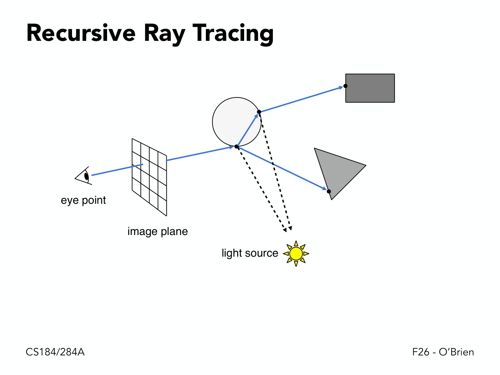
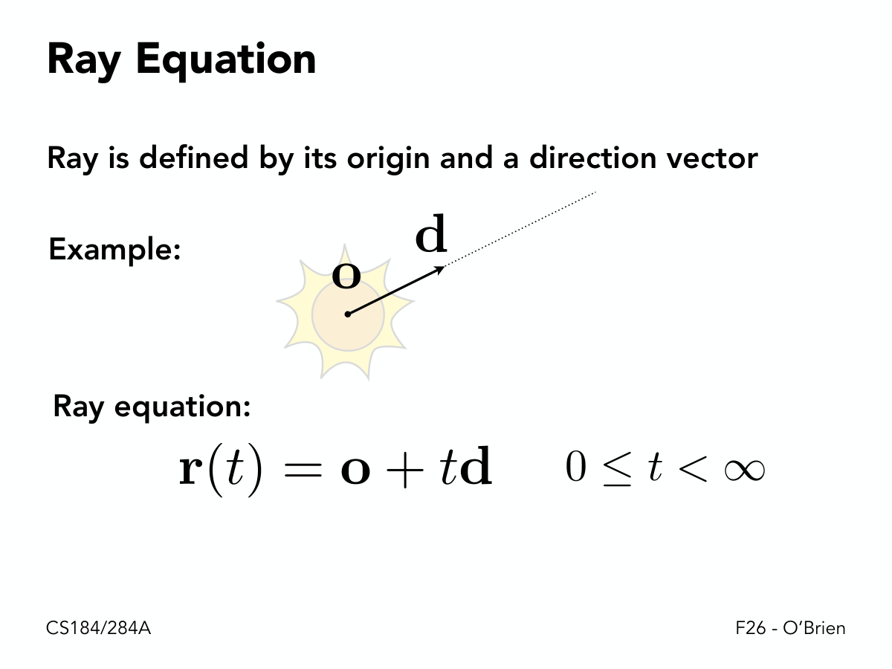
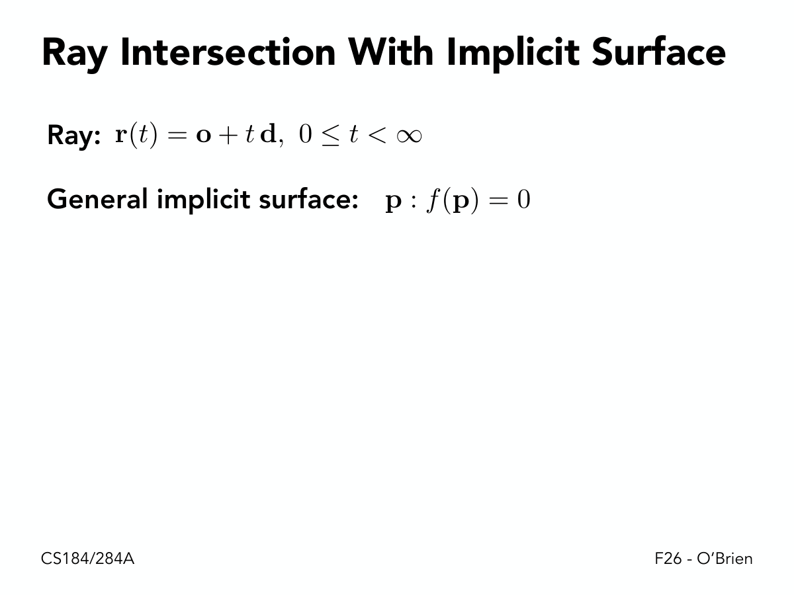
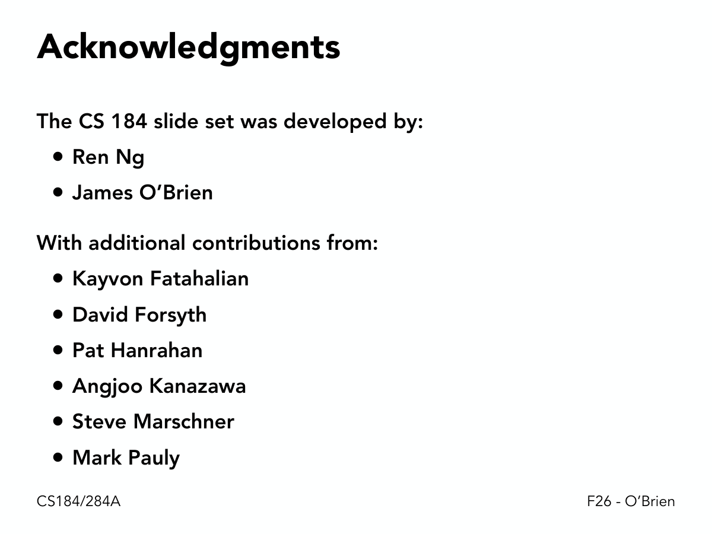

> UC Berkeley · CS184/284A Computer Graphics and Imaging · Fall 2026 · Lecture 13

前面十二讲走的是**光栅化**路线：把三角形投影到屏幕，逐像素判定覆盖。

这一讲走**完全相反**的方向：**从眼睛发射光线，去问场景"你挡在哪儿"**。

```
同一个问题：这个像素看到什么？
   ├── 光栅化（L02）：三角形 → 屏幕 → 逐像素覆盖判定
   └── 光线追踪（本讲）：像素 → 光线 → 逐物体求交
        ↓ 求交的数学
     光线 = o + td；求交 = 解方程
     平面（线性）/ 三角形（线性+内测）/ 球（二次）/ 隐式（任意）
        ↓ 但暴力太慢
     #像素 × #物体 = 不可行
        ↓ 加速
     包围盒（先粗筛）
        ↓ 怎么组织一堆包围盒
     均匀网格（均匀切空间）/ KD 树（不均匀切空间）/ BVH（切物体）
        ↓ 怎么切得最好
     代价模型 + SAH（按命中概率分配）
```


*眼睛 → 像素 → 光线 → 最近的交点 → 在该点着色 → 向光源发阴影光线。**这一页就是整个光线追踪算法的骨架**，后面全是"怎么让求交更快"。*

*193 页 · 71 张关键页截图 · 16 张原创图解 · 8 个手算 · 26 道自测*

> **💡 这一讲与前面所有讲的关系**
>
> - **L02 光栅化**：解决了"三角形 → 像素"，但**不知道全局遮挡**（要靠 L08 的 z-buffer）
> - **L04–05 变换**：光线的起点和方向要变换到世界空间
> - **L08 着色**：光线命中后，还是用 Blinn-Phong 算颜色
> - **L11–12 网格**：光线要求交的就是那些三角形
>
> **所以这一讲是把前面所有零件换个方向重新组装一遍。**

## 1. 为什么需要光线追踪

#### P2　Towards Photorealistic Rendering


一张照片级渲染（Bertrand Benoit 的 *Sweet Feast*）。

**光栅化做不出这些效果**，因为它只算"直接光照"（光源 → 表面 → 眼睛）。而真实世界的光会**多次弹射**：镜面反射、玻璃折射、物体间的间接光。

**光线追踪天生适合这些效果**，因为它可以**递归地追光线**。

#### P3–P4　Basic Ray-Tracing Algorithm / Ray Casting

*Appel 1968 - Ray casting · 1. Generate an image by casting one ray per pixel · 2. Check for shadows by sending a ray to the light*


*Appel 的原始想法很朴素：**从眼睛穿过每个像素发一条光线**，看它先撞到什么。*

**历史**：**Appel 1968** 提出了光线投射（ray casting）。

**两步**：

| 步骤 | 做什么 |
|---|---|
| ① | **每个像素发一条光线**，找到最近的交点 |
| ② | 从交点**向光源发一条光线**，判断是否被挡（阴影） |

**注意第 ② 步**：这就是"阴影"的来源。光栅化里阴影要靠 shadow map（L08），而光线追踪里**阴影是天然的副产品** —— 只要再发一条光线。

#### P5–P10　Ray Casting - Generating Eye Rays

*Pinhole Camera Model · eye point · image plane · light source · eye ray (starts at eye and goes through pixel) · closest scene intersection point*


**针孔相机模型**（pinhole camera）：

| 元素 | 作用 |
|---|---|
| **eye point** | 光线起点（相机位置） |
| **image plane** | 像素网格所在的平面 |
| **eye ray** | 从眼睛出发、穿过某个像素中心的光线 |
| **closest intersection** | 光线与场景的最近交点 |

**关键细节（P10 的小字）**：*"note: more intersection points"* —— 一条光线可能和场景有**多个**交点，但只取**最近的那个**（其余被挡住）。

#### P11–P15　Shading Pixels (Local Only)

*perform shading calculation here to compute color of pixel (e.g. Blinn Phong model)*


*交点处用 `n, l, v` 做一次 Blinn-Phong。**此时还没有反射/折射**，所以效果和光栅化几乎一样。*

找到交点之后，**在那里做一次着色计算** —— 就是第 8 讲的 Blinn-Phong。

**"Local Only" 这个限定很重要**：此时还不考虑反射/折射，只用光源方向、法线、视线算一个局部颜色。

**这时的效果和光栅化几乎一样** —— 光线追踪的威力在下一步。

#### P16　Recursive Ray Tracing

*"An improved Illumination model for shaded display" · T. Whitted, CACM 1980 · Time: VAX 11/780 (1979) 74m · PC (2006) 6s · GPU (2012) 1/30s*


**Turner Whitted 1980** 的论文是图形学的里程碑。图上是他渲染的"球与棋盘格"。

**那段"时间"数据特别有意思**：

| 硬件 | 年份 | 渲染时间 |
|---|---|---|
| VAX 11/780 | 1979 | **74 分钟** |
| PC | 2006 | 6 秒 |
| GPU | 2012 | **1/30 秒** |

**同一张图，33 年快了 13 万倍。** 这个加速来自三方面：硬件、算法（本讲的加速结构）、以及并行化。

#### P17–P35　Recursive Ray Tracing


*镜面反射光线：按法线镜像出去，递归追踪。**这就是"镜子里看到另一个世界"的实现方式**。*

*Mirror ray (specular reflection) · Refractive rays (specular transmission) · Shadow rays*


*阴影光线只判断"能不能到光源"，**不需要递归** —— 它的答案只有"通/不通"两种。*



**Whitted 的核心贡献：在交点处发四条光线**。


*主光线打进场景 → 交点处再发三条：反射（镜面）、折射（透明）、阴影（可见性）。**递归地追下去，就得到了镜面和玻璃**。*

**四条光线的规则**：

| 光线 | 方向 | 贡献 |
|---|---|---|
| **主光线（primary）** | 眼睛 → 像素 | 决定看到什么 |
| **反射（mirror）** | 按法线镜像 | 镜面材质 |
| **折射（refraction）** | 按折射率偏折 | 透明材质 |
| **阴影（shadow）** | 交点 → 光源 | 是否被遮挡 |

**递归终止条件（P30–P35）**：

> 一直追到**撞上非镜面表面**，或者达到**最大递归深度**。

**最终颜色是"沿光线所有贡献的加权和"**（P35）：

$$
C=C_{\text{local}}+k_r C_{\text{reflect}}+k_t C_{\text{refract}}
$$

（`k_r`、`k_t` 是反射/折射系数，来自材质的 Fresnel 项）

> **📌 为什么必须"撞上非镜面就停"**
>
> 因为对**漫反射**表面再追反射光线**没有意义** —— 漫反射把光散射到所有方向，追一条特定方向的光线得不到任何信息。
>
> 真实的做法是**对半球积分**（发射很多条光线），这就是**路径追踪**（path tracing）—— 它在 L16–17 讲。**Whitted 的模型是一个"只处理镜面"的近似**。

## 2. 光线求交

#### P36–P40　Ray-Surface Intersection

*Rendering: visibility, shadows, lighting … · Geometry: inside/outside test · Simple idea: just intersect ray with each triangle · Note: can have 0, 1 or multiple intersections*


**求交的两个用途**：

| 用途 | 说明 |
|---|---|
| **渲染** | 可见性、阴影、光照 |
| **几何** | 判断内外（点在不在物体内部） |

**最朴素的做法**：光线和**每个三角形**求交。

**慢，但简单** —— 加速放到第 3 节。

**注意（P40）**：*"can have 0, 1 or multiple intersections"* —— 一条光线可能 0 个（打空）、1 个（相切/穿过一片薄面）、或多个（穿过一个封闭物体 = 2 个）。

#### P41–P44　Ray Equation


*起点 + 方向。**图上的 `t` 就是沿光线的距离** —— 归一化之后这个等式才成立。*

*Ray is defined by its origin and a direction vector · unit direction · origin · "time" · point along ray*



$$
r(t)=o+t\,d,\qquad 0\leq t<\infty
$$

| 符号 | 含义 |
|---|---|
| `o` | 起点（origin） |
| `d` | 方向（**单位向量**） |
| `t` | 参数（"时间"/距离） |
| `r(t)` | 光线上的点 |


*一个起点 + 一个方向，`t` 是沿光线的距离。**所有求交问题都被转化成"把 `r(t)` 代入物体的隐式方程，解出 `t`"** —— 这是本讲最统一的思想。*

**为什么强调 `d` 是单位向量**：因为归一化之后，`t` 就等于**真实距离**。这样比较"哪个交点更近"时就不用再算长度。

#### P45–P50　Plane Equation 与光线-平面求交


*一个点 `p₀` + 一个法向 `N` 就能唯一定义一个平面。**图上那些点都满足 `(p−p₀)·N = 0`**。*

*Plane is defined by normal vector and a point on plane · p : (p − p0) · N = 0*


$$
p:(p-p_0)\cdot N=0
$$

或者展开成熟悉的代数形式：

$$
ax+by+cz+d=0
$$


*平面由「一个点 `p₀` + 一个法向 `N`」定义。求交就是把光线方程代进去，解一个**线性**方程。*

**推导（P50）**：把 `p = r(t) = o + td` 代入平面方程：

$$
(o+td-p_0)\cdot N=0
$$

展开：

$$
(o-p_0)\cdot N+t\,(d\cdot N)=0
$$

解出：

$$
\boxed{t=\frac{(p_0-o)\cdot N}{d\cdot N}}
$$

**🔧 手算 1：求光线与平面的交点**

平面：过 `p₀ = (0,0,5)`，法向 `N = (0,0,1)`（即平面 `z = 5`）。
光线：`o = (0,0,0)`，`d = (0,0,1)`（朝 `+z` 射）。

**分子**：

$$
(p_0-o)\cdot N=(0,0,5)\cdot(0,0,1)=5
$$

**分母**：

$$
d\cdot N=(0,0,1)\cdot(0,0,1)=1
$$

$$
t=\frac{5}{1}=5
$$

**交点**：`r(5) = (0,0,5)` ✓ 正好在平面上。

**再看一个平行的情况**：`d = (1,0,0)`（沿 `x` 方向）。

分母 `d·N = 0` → **无交点**（光线平行于平面）。

**几何直觉**：

- **分子** = 起点偏离平面多远（沿法向的投影）
- **分母** = 每走单位长度、沿法向靠近平面多少

**两者的比值就是"要走多远才能到达平面"** —— 这就是那个公式的全部含义。

#### P51–P54　Ray Intersection With Triangle

*Triangle is in a plane · Ray-plane intersection · Test if hit point is inside triangle · Many ways to optimize… · Möller Trumbore Algorithm*


**两步走（P51–P53）**：

| 步骤 | 做什么 |
|---|---|
| ① | 求光线与**三角形所在平面**的交点（用上面的公式） |
| ② | 判断交点**是否在三角形内**（用第 2 讲的 `L` 函数，或第 6 讲的重心坐标） |


*先在平面上求交点，再判断在不在三角形内部。**第 ② 步就是 HW1 里做过的"点在三角形内"测试**。*

#### P54　Möller-Trumbore Algorithm


**更快的做法**：把两步合成一次 3×3 求解。

**核心**：把交点写成重心坐标形式 `o + td = (1−u−v)A + uB + vC`，得到三个未知数 `(t, u, v)` 的三个方程：

$$
\begin{bmatrix}-d & B-A & C-A\end{bmatrix}
\begin{bmatrix}t\\u\\v\end{bmatrix}=o-A
$$

**用 Cramer 法则解**，就能同时得到 `t` 和重心坐标 `(u,v)`。

**判据**：

- `t > 0`（交点在光线前方）
- `u ≥ 0`、`v ≥ 0`、`u + v ≤ 1`（在三角形内）

**为什么它更快**：**一次 3×3 求解就同时完成了"求交"和"内测"**，避免了两次独立的计算，也省掉了显式构造平面方程。

> **⚠️ 数值稳定性**
>
> 当光线**几乎平行于三角形所在的平面**时，那个 3×3 矩阵接近奇异，`t` 会变得极大且不稳定。
>
> 实际实现里要检查行列式是否接近 0（`|det| < ε`）并直接判为未命中。

#### P55–P59　Ray Intersection With Sphere


*把球方程和光线方程联立，就得到关于 `t` 的二次方程。**两个根对应"进入"和"穿出"两个交点**。*

*Ray: r(t) = o + td · Sphere: p : (p − c)² − R² = 0*


球方程：

$$
(p-c)^2-R^2=0
$$

代入 `p = o + td`：

$$
(o+td-c)^2-R^2=0
$$

展开成关于 `t` 的二次方程：

$$
at^2+bt+c'=0
$$

其中：

$$
a=d\cdot d,\qquad b=2(o-c)\cdot d,\qquad c'=(o-c)\cdot(o-c)-R^2
$$


*判别式决定交点数：`>0` 两个、`=0` 相切、`<0` 打空。**取较小的正根**（最近的交点）。*

**🔧 手算 2：求光线与球的交点**

球：球心 `c = (0,0,5)`、半径 `R = 1`。
光线：`o = (0,0,0)`、`d = (0,0,1)`。

**系数**：

$$
a=d\cdot d=1
$$
$$
b=2(o-c)\cdot d=2\,(0,0,-5)\cdot(0,0,1)=2\times(-5)=-10
$$
$$
c'=(o-c)\cdot(o-c)-R^2=25-1=24
$$

**解方程** `t² − 10t + 24 = 0`：

$$
t=\frac{10\pm\sqrt{100-96}}{2}=\frac{10\pm 2}{2}
$$

**两个根**：`t = 4` 和 `t = 6`。

**验证**：`r(4) = (0,0,4)`，到球心距离 `|4−5| = 1` ✓；`r(6) = (0,0,6)`，距离也是 1 ✓

**取较小正根 `t = 4`** —— 这是光线**进入**球的位置（`t=6` 是穿出）。

> **📌 归一化之后的简化**
>
> 如果 `d` 已经是单位向量，则 `a = 1`，公式可以简化为：
>
> $t=-b/2\pm\sqrt{(b/2)^2-c'}$
>
> 令 `h = b/2`，只需算一次 `h`、一次平方根。**这是所有实现里的标准优化** —— 而且 `h` 恰好是"球心在光线上的投影参数"，几何意义很清晰。

#### P60–P64　Ray Intersection With Implicit Surface


*任何隐式曲面都是同一个套路：代入、解方程、取正的实根。**区别只在方程的次数**。*

*General implicit surface: p : f(p) = 0 · Substitute ray equation: f(o + td) = 0 · Solve for real, positive roots*



**统一框架**：

1. 隐式曲面写成 `f(p) = 0`
2. 代入光线：`f(o + td) = 0`
3. 解出**实数、正的**根

**复杂度取决于 `f` 的次数**：

| 曲面 | `f` 的次数 | 求解难度 |
|---|---|---|
| 平面 | 1（线性） | 一个除法 |
| 球 / 椭球 | 2（二次） | 求根公式 |
| 环面 | 4（四次） | 需要数值方法 |
| 一般隐式 | 任意 | 通常只能数值求解（牛顿迭代等） |

**所以"求交"这件事的难度完全由曲面的代数次数决定** —— 这也是为什么实际渲染里几乎只用**三角形**（一次方程）。

## 3. 加速：为什么必须做

#### P65–P66　Ray Tracing – Performance Challenges

*Simple ray-scene intersection · Exhaustively test ray-intersection with every object · Problem: Exhaustive algorithm = #pixels ⨉ #objects · Very slow!*


**暴力算法的复杂度**：

$$
\text{总求交次数}=\#\text{pixels}\times\#\text{objects}
$$

**算一下就知道有多离谱**（下一节手算 3）。

#### P67–P68　真实的场景规模


| 场景 | 三角形数 |
|---|---|
| **San Miguel**（J. Yan, Tracy Renderer） | **1070 万** |
| **植物生态**（Deussen et al / PBRT） | **2000 万** |

**🔧 手算 3：暴力算法到底多慢**

取一个 `1920×1080` 的图像和 `1070 万` 三角形：

$$
\text{像素数}=1920\times 1080\approx 2.07\times 10^{6}
$$

$$
\text{求交次数}=2.07\times10^6\times1.07\times10^7\approx 2.2\times10^{13}
$$

**220 亿次求交。** 假设每次求交只要 1 纳秒（这已经很乐观）：

$$
2.2\times10^{13}\times10^{-9}\ \text{s}=2.2\times10^{4}\ \text{s}\approx 6\ \text{小时}
$$

**一张图 6 小时** —— 完全不可接受。

**而加速结构的威力**：如果每条光线平均只测 `log₂(10⁷) ≈ 23` 个包围盒 + 少数三角形，那么求交次数降到：

$$
2.07\times10^6\times(23+5)\approx 5.8\times10^{7}
$$

**比暴力少了 38 万倍。**

> **📌 这一讲真正的主题**
>
> 前面那些求交公式（平面/球/三角形）都是**一节课就能讲完的初等数学**。
>
> **这一讲 80% 的内容都在解决一个问题：怎么避免遍历全部物体。**
>
> 这也解释了为什么讲义的分节标题是 "Accelerating Ray-Scene Intersection" —— **加速才是主题，求交只是前提**。

## 4. 包围盒

#### P69–P70　Bounding Volumes

*Quick way to avoid intersections: bound complex object with a simple volume · Object is fully contained in the volume · If it doesn't hit the volume, it doesn't hit the object · So test bvol first, then test object if it hits*


**核心思想**：

> 用一个**简单的体积**把复杂物体包起来。**如果光线打不中这个体积，就打不中物体。**


*两级测试：先测包围盒（便宜），命中后再测真正的物体（贵）。**前提是包围盒必须完全包含物体**，否则会漏掉真实交点。*

**为什么能加速**：如果场景里有 `N` 个物体，每个都用一个盒子包起来，那么大部分光线会**打空大部分盒子**，从而跳过那些昂贵的物体求交。

**最常用：轴对齐包围盒（AABB）** —— 因为它的求交可以退化成几次比较（下一节）。

#### P71–P78　Ray-Intersection With Box


*讲义先用 2D 讲清楚：**盒子就是两个 x-slab 和两个 y-slab 的交集**。3D 只是多一个 z。*

*Could intersect with 6 faces individually · Better way: box is the intersection of 3 slabs*


**两种做法**：

| 做法 | 代价 |
|---|---|
| 分别与 6 个面求交 | 6 次平面求交 + 判断交点是否在面内 |
| **当作 3 个 slab 的交集** | 3 次除法 + 几次 max/min |


*每个轴算一个 `[t_near, t_far]` 区间，三个区间取**交集**。交集非空 ⇒ 光线穿过盒子。*

**算法**：

$$
t_{x}=\frac{x_{0,1}-o_x}{d_x},\qquad
t_{y}=\frac{y_{0,1}-o_y}{d_y},\qquad
t_{z}=\frac{z_{0,1}-o_z}{d_z}
$$

$$
t_{\min}=\max\big(\min t_x,\ \min t_y,\ \min t_z\big)
$$
$$
t_{\max}=\min\big(\max t_x,\ \max t_y,\ \max t_z\big)
$$

**判据**：

$$
t_{\min}<t_{\max}\quad\text{且}\quad t_{\max}>0
$$

**🔧 手算 4：算一次 AABB 求交**

盒子：`x ∈ [1,3]`、`y ∈ [1,3]`、`z ∈ [1,3]`。
光线：`o = (0,0,0)`、`d = (1,1,1)/√3`（归一化，朝三个轴等量前进）。

**因为三个轴对称**，先算 `x`：

$$
t_{x,\text{near}}=\frac{1-0}{1/\sqrt3}=\sqrt3\approx1.732
$$
$$
t_{x,\text{far}}=\frac{3-0}{1/\sqrt3}=3\sqrt3\approx5.196
$$

`y`、`z` 完全相同。所以：

$$
t_{\min}=\max(1.732,1.732,1.732)=1.732
$$
$$
t_{\max}=\min(5.196,5.196,5.196)=5.196
$$

**`t_min < t_max` 且 `t_max > 0`** ⇒ **命中** ✓

**验证**：`r(t_min) = (1,1,1)` —— 正好是盒子的一个角 ✓

#### P79　Optimize Ray-Plane Intersection For Axis-Aligned Planes?

*General: 3 subtractions, 6 multiplies, 1 division · Perpendicular to x-axis: 1 subtraction, 1 division*


**这一页是"为什么 AABB 特别快"的量化说明**：

| 情况 | 运算量 |
|---|---|
| **一般平面** | 3 次减法 + 6 次乘法 + 1 次除法 |
| **垂直于 x 轴的平面** | **1 次减法 + 1 次除法** |

**原因**：一般平面的法向是 `N = (Nx, Ny, Nz)`，分子分母都要做完整点积；而轴对齐平面的法向是 `(1,0,0)`，点积退化成"取一个分量"：

$$
t=\frac{p_{0x}-o_x}{d_x}
$$

**从 10 次运算降到 2 次** —— 5 倍。而 AABB 求交要算 6 次这样的式子（3 个轴 × 2 个面），所以这个优化直接体现在每一条光线上。

> **📌 这就是"选对数据结构"的价值**
>
> AABB 之所以是标准选择，不只是"容易算"，而是**它的求交代码可以被完全展开、没有循环、没有分支** —— 这对 GPU 和 SIMD 极其友好。
>
> 相比之下，一个有向包围盒（OBB）虽然更紧凑（包得更紧，剔除率更高），但求交要解 6 个一般平面方程 —— **慢得多**。工程上宁可用"包得松但算得快"的 AABB。

## 5. 均匀网格

#### P80–P85　Uniform Spatial Partitions (Grids)


*预处理最后一步：**把每个物体登记进它覆盖的所有格子**。这一步就是后面"跨格问题"的根源。*

*1. Find bounding box · 2. Create grid · 3. Store each object in overlapping cells · Step through grid in ray traversal order (3D line - 3D DDA) · For each grid cell test intersection with all objects stored at that cell*


**三步预处理（P81–P84）**：

| 步骤 | 做什么 |
|---|---|
| ① | 求整个场景的**包围盒** |
| ② | 把包围盒**均匀划分**成 `n×n×n` 个格子 |
| ③ | 把每个物体存进**它覆盖的所有格子** |

**运行时（P85）**：

> 沿着光线**按顺序**走过它穿过的格子（3D DDA），对每个格子里的物体做求交。


*光线从进入点开始，每次前进一个格子，只测"这个格子里存的物体"。**这就是 3D DDA（数字微分分析器）算法**。*

**优点**：

- **构建极快**（`O(n)`，一次遍历）
- **内存规整**（数组）
- **遍历简单**（DDA 只有加法和比较）

#### P86–P88　Grid Resolution?


*格子太细时，光线大部分时间在**空转**（穿过一堆空格），遍历开销超过求交开销本身。*

*One cell: No speedup · Too many cells: Inefficiency due to extraneous grid traversal · Heuristic: #cells = C * #objs, C ≈ 27 in 3D*


**分辨率的选择是个权衡**：

| 格子数 | 问题 |
|---|---|
| **1 个** | 等于没有加速（还是要测所有物体） |
| **太多** | 光线穿过大量**空格**，遍历开销超过求交开销 |
| **太少** | 每个格子里堆积很多物体，测试次数降不下来 |


*左：一个格子 = 没加速。中：合适。右：太细 = 光线在空格里空转。*

**经验公式（P88）**：

$$
\#\text{cells}=C\times\#\text{objs},\qquad C\approx 27\ (\text{3D})
$$

**🔧 手算 5：算一个网格分辨率**

场景有 `1000` 个物体。用 `C = 27`：

$$
\#\text{cells}=27\times1000=27000
$$

如果是立方体网格：`n = 27000^(1/3) ≈ 30`，所以取 **`30×30×30`**。

**为什么 `C ≈ 27`**：这个数字不是推导出来的，而是**经验值**（类似"每个格子里平均放 1 个物体"的直觉 —— 因为 `27` 是边长的立方，边长 `≈3` 意味着一个物体平均占据一个 `3×3×3` 的区域）。

#### P89–P93　Careful! Objects Overlapping Multiple Cells


*mailboxing：给每个物体记"上次被哪条光线测过"，**同一条光线内只测它一次**。*

*What goes wrong here? · First intersection found (red) is not the nearest! · Solution? Check intersection point is inside cell · Optimize: Cache intersection to avoid re-testing (mailboxing)*


**这是均匀网格最大的坑**：

> 如果一个物体**跨越多个格子**，那么光线可能在**较远的格子**里先遇到它 —— 而这个交点**不是最近的**。


*光线先进入"大物体（远）"所在的格子，于是先测到了它。但它其实比旁边那个小物体更远。**如果直接返回这个结果，就会渲染错误**。*

**两种解法（P89–P93）**：

| 解法 | 做法 |
|---|---|
| **检查交点是否在本格内** | 如果交点不在当前格子范围内，说明是"穿出去的"，继续往下一格走 |
| **Mailboxing（信箱法）** | 给每个物体一个"本轮已测过"的标记，同一个物体只测一次 |

**Mailboxing 的细节**：每条光线带一个**递增的 ID**，物体上记"上次被哪条光线测过"。如果 `物体.lastRayID == 当前光线ID`，就跳过。

**为什么需要它**：一个跨 10 个格子的大物体会被测试 10 次 —— 完全浪费。用 mailboxing 之后只测一次。

#### P94–P95　Uniform Grids – When They Work Well / Fail


**适用（P94）**：

> 大量**大小相近、空间分布均匀**的物体。

**不适用（P95）**：***"Teapot in a stadium"*** —— **体育场里的茶壶**。

**问题在哪**：

| 场景 | 网格的困境 |
|---|---|
| 一个大体育场 + 一个小茶壶 | 网格要覆盖整个体育场 → 格子很大 → 茶壶挤在一个格子里 |
| 想让茶壶精细 | 格子要很小 → 体育场的空间被切成几十亿个空格 |

**根因**：**均匀网格假设"物体大小一致"**。一旦场景尺度差异巨大（这是真实场景的常态），均匀划分就失效。

**解法：不均匀地划分空间** —— 这就是下一节的 KD 树。

## 6. 空间划分：KD 树

#### P96–P102　Spatial Hierarchies


*空间层次的本质：**同一个切分规则递归地用在子区域上**，于是大区域粗、小区域细。*


**思路**：不再均匀切，而是**递归地、不均匀地**切。


*每次沿一个轴切一刀，递归下去。**切得密的地方格子小（适合细节），切得疏的地方格子大（适合空旷区域）** —— 这正是体育场里放茶壶需要的。*

#### P102　Spatial Partitioning Variants

*Oct-Tree · KD-Tree · BSP-Tree*


| 类型 | 每层怎么切 | 分支数 |
|---|---|---|
| **Oct-Tree（八叉树）** | 沿三个轴各切一刀 | 8 |
| **KD-Tree** | **只沿一个轴**切一刀 | 2 |
| **BSP-Tree** | 切面可以是**任意方向** | 2 |

**KD 树胜出的原因**：

- 比八叉树**简单**（二叉，不用处理 8 个孩子）
- 比 BSP 树**简单**（切面轴对齐，求交便宜）
- 轴对齐切面让"光线与切面求交"退化成一次除法（和 P79 的优化一样）

#### P103–P109　KD-Tree 的数据结构

*Internal nodes store: split axis, split position, children · Leaf nodes store: list of objects, mailbox information*


```c
struct KDNode {
  int    splitAxis;     // 0=x, 1=y, 2=z（仅内部节点）
  float  splitPos;      // 切割面位置（仅内部节点）
  KDNode *children[2];  // 两个孩子
  // 叶子节点：
  Object **objects;     // 物体列表
  int    nObjects;
  int    mailbox;       // 用于 mailboxing
};
```

**关键区别**：

| 节点类型 | 存什么 |
|---|---|
| **内部节点** | 切割轴 + 切割位置 + 两个孩子指针 |
| **叶子节点** | **物体列表** + mailbox 信息 |

**"只有叶子节点存物体"**（P109 的加粗）—— 内部节点是**纯粹的几何划分**，没有任何物体信息。

#### P110–P117　KD-Tree Pre-Processing


*切割面的位置直接决定树的质量。**中点切可能让一边空、一边挤满**。*

*Choosing the split plane · Simple: midpoint, median split · Ideal: split to minimize expected cost · Termination: maximum tree depth (empirical 8 + 1.3 log N) · Ideal: stop when splitting does not reduce expected cost*


**两个决策**：

| 决策 | 简单做法 | 理想做法 |
|---|---|---|
| **选哪个位置切** | 中点（midpoint）/ 中位数（median） | **最小化期望求交代价** |
| **什么时候停** | 最大深度 `8 + 1.3 log N` | 切分不再降低期望代价 |

**P117 对比了中点切和中位数切**：

| 做法 | 特点 |
|---|---|
| **中点切（midpoint）** | 把空间切成两半 —— 可能一边空、一边挤满 |
| **中位数切（median）** | 把物体数切成两半 —— 但空间大小可能极不均衡 |

**🔧 手算 6：中点切 vs 中位数切**

设一维空间 `[0,100]`，物体（按中心）在 `x = 1, 2, 3, 4, 96`。

**中点切**（`x = 50`）：

- 左边 `[0,50]`：4 个物体
- 右边 `[50,100]`：1 个物体
- **不均衡**（4:1）

**中位数切**（`x = 4.5`，第 2、3 个物体之间）：

- 左边：`1, 2, 3` → 3 个（但空间只占 `[0, 4.5]`，很小）
- 右边：`4, 96` → 2 个（空间 `[4.5, 100]`，很大）
- **物体均衡了，但空间极不均衡**

**两个都不完美** —— 这就是为什么需要 SAH（第 8 节）来同时考虑"空间大小"和"物体数量"。

#### P118–P137　KD-Tree 遍历


*遍历时每到内部节点就重新算 `t_split`，决定往哪边走 —— **图上的 `t_split` 标记就是这一步**。*

*Top-Down Recursive In-Order Traversal · Internal node: split · Leaf node: intersect all objects · Intersection found*


**遍历过程（P118–P136 是一段动画）**：

1. 光线从根节点进入，有一个 `[t_min, t_max]` 区间
2. **内部节点**：算光线与切割面的交点 `t_split`，决定先访问哪个孩子
3. **叶子节点**：与其中所有物体求交
4. 找到交点后，把 `t_max` **收缩**到该交点的距离（因为更远的都不用测了）

**第 4 步是关键的优化**：一旦找到命中，`t_max` 变小，后续的子树如果完全在 `t_max` 之外就可以**整棵跳过**。

#### P137　KD-Trees Traversal – Recursive Step

*W.L.O.G. consider x-axis split with ray moving right · t_split = (x_split − o_x)/d_x · Three cases*


**这一页是整讲的算法核心**。设切割面在 `x = x_split`：

$$
t_{split}=\frac{x_{split}-o_x}{d_x}
$$

**三种情况**：


| 情况 | 几何含义 | 访问哪边 |
|---|---|---|
| `t_max < t_split` | 整条线段都在**左边** | **只访问左子树** |
| `t_min < t_split < t_max` | 线段**跨过**切割面 | **两边都访问**（先近后远） |
| `t_split < t_min` | 整条线段都在**右边** | **只访问右子树** |

**第二种情况要注意顺序**：先访问光线**先进入**的那一侧，这样能更早找到近处的交点、更早收缩 `t_max`、更快剪枝。

> **📌 为什么 KD 树遍历比 BVH 麻烦**
>
> 看这张表：**三种情况要分别处理**，而且"跨过切割面"时要**递归两边**。
>
> 而且 KD 树还有前面那个"物体跨格"的问题（P89–P93）—— 一个物体会出现在多个叶子里，所以需要 mailboxing。
>
> **正是这些麻烦让 BVH 最终胜出**（下一节）。

## 7. 物体划分：BVH

#### P138–P139　Spatial vs Object Partitions


*讲义用一张图讲完区别：**空间划分的区域不重叠但物体跨格；物体划分的物体不重复但盒子重叠**。*

*Spatial partition (e.g. KD-tree): Partition space into non-overlapping regions · Objects can be contained in multiple regions · Object partition (e.g. BVH): Partition set of objects into disjoint subsets · Bounding boxes for each set may overlap in space*


**这是全讲最重要的一个对照**：

| | 空间划分（KD 树） | 物体划分（BVH） |
|---|---|---|
| **切什么** | **空间** | **物体集合** |
| 区域 | **互不重叠** | **包围盒可以重叠** |
| 物体 | **可以跨多个区域** | **只属于一个叶子** |
| 需要 mailboxing | **是** | 否 |
| 需要"检查交点在格内" | **是** | 否 |
| 求交代码 | 复杂（三种情况） | **简单（四行递归）** |


*左：切空间 —— 区域不重叠但物体跨格。右：切物体 —— 物体不重复但包围盒重叠。**BVH 的所有优点都来自"每个物体只属于一个叶子"**。*

#### P140–P145　Bounding Volume Hierarchy (BVH)


*根节点的盒子罩住全部，孩子的盒子罩住各自的子集。**孩子的盒子之间可以重叠** —— 这正是"物体划分"的代价。*


**BVH 的构建**：

| 步骤 | 做什么 |
|---|---|
| ① | 把**所有物体**放进根节点的包围盒 |
| ② | 把物体集合**递归地分成两个子集** |
| ③ | 每个子集重新算包围盒 |
| ④ | 直到每个节点只剩少量物体 |


*每个节点的包围盒罩住**它整棵子树的所有三角形**。**孩子包围盒可以重叠** —— 这是和 KD 树最大的区别。*

**节点内容（P145）**：

| 节点类型 | 存什么 |
|---|---|
| **内部节点** | 包围盒 + 两个孩子 |
| **叶子节点** | 包围盒 + 物体列表 |

**注意**：**每个节点都有包围盒**（包括内部节点）—— 因为遍历时"先测包围盒"这一步是递归进行的。

#### P146–P159　BVH Pre-Processing


*和 KD 树的关键差别：**切的是物体集合，不是空间**。所以每个物体只进一个孩子。*

*Recursively split set of objects in two subsets · Stop when there are just a few objects in each set · Choosing the set partition: Choose a spatial dimension · Simple #1: split around spatial midpoint · Simple #2: split at location of median object · Ideal: split to minimize expected cost*


**结构完全对应 KD 树**，但"切"的对象不同：

| 决策 | 简单做法 | 理想做法 |
|---|---|---|
| **沿哪个轴切** | x / y / z 轮流 | 最长轴 / 统一代价评估 |
| **切在哪里** | 空间中点 / 物体中位数 | **最小化期望求交代价（SAH）** |
| **什么时候停** | 节点里只剩几个物体（比如 5 个） | 切分不再降低期望代价 |

#### P160–P168　BVH Recursive Traversal


*遍历时的决策只有两个：**盒子打不中吗？是叶子吗？** 其余全是递归。*

*Intersect (Ray ray, BVH node) · if (ray misses node.bbox) return; · if (node is a leaf node) test intersection with all objs; return closest intersection; · hit1 = Intersect(ray, node.child1); hit2 = Intersect(ray, node.child2); return closer of hit1, hit2*


**整个遍历只有四行**：

```c
Intersect(Ray ray, BVH node) {
  if (ray misses node.bbox) return;              // ① 盒子都没打中 → 剪枝
  if (node is a leaf node) {                     // ② 叶子 → 测所有物体
    test intersection with all objs;
    return closest intersection;
  }
  hit1 = Intersect(ray, node.child1);            // ③ 递归两个孩子
  hit2 = Intersect(ray, node.child2);
  return closer of hit1, hit2;                   // ④ 取更近的
}
```

**为什么这四行就够了**：

| 行 | 作用 |
|---|---|
| ① | **剪枝** —— 这是全部的加速来源 |
| ② | 叶子才做真正的求交 |
| ③ | 递归 |
| ④ | 合并结果 |

**对比 KD 树的三种情况** —— BVH 不需要判断"光线在哪一侧"，因为**两个孩子都在同一个包围盒里，都要测**。**代码简单得多，这是 BVH 胜出的直接原因。**

> **💡 一个可以自己验证的优化**
>
> 上面第 ③ 行是"先递归左边、再递归右边"，但**更聪明的做法是先递归更近的那个孩子**，并且把左边的命中距离传给右边作为 `t_max`：
>
> ```c
> hit1 = Intersect(ray, child1);
> hit2 = Intersect(ray, child2, maxT = hit1.t);   // 传下去用于剪枝
> ```
>
> 这样右边如果比 `hit1.t` 远，就会**整棵被剪掉**。**这个优化能再快 1.5–2 倍**，而且不需要任何额外数据结构 —— 只是改变递归顺序。

## 8. 怎么切最好：SAH

#### P169–P176　How to Split into Two Sets?


*中位数切让两个孩子元素数相等，但**包围盒可能又大又重叠** —— 光线会更频繁地同时进入两个孩子。*

*Split at median element? Child nodes have equal numbers of elements · A better split? Smaller bounding boxes, avoid overlap and empty space · Key insight: a good partition minimizes the average cost of tracing a ray*


**问题**：中位数切让两个孩子**元素数相等**，但**包围盒可能很大、重叠严重**。

**更好的切法**：让孩子的**包围盒更小、重叠更少**。

**但怎么量化"更好"？** 讲义给了关键洞察（P176）：

> ***"A good partition minimizes the average cost of tracing a ray."***
>
> 好的划分 = 让**一条随机光线**的平均遍历代价最小。

#### P177–P178　代价模型


*递推式：**自身遍历代价 + 按命中概率加权的孩子代价**。这个式子就是 SAH 的全部理论基础。*

*For leaf node: Cost(node) = C_isect * TriCount(node) · For internal node: Cost(node) = C_trav + Prob(hit L)*Cost(L) + Prob(hit R)*Cost(R)*


**叶子节点**：

$$
\text{Cost}(\text{leaf})=C_{isect}\times\text{TriCount}
$$

**内部节点**：

$$
\text{Cost}(\text{node})=C_{trav}+P(\text{hit }L)\cdot\text{Cost}(L)+P(\text{hit }R)\cdot\text{Cost}(R)
$$

| 符号 | 含义 |
|---|---|
| `C_isect` | 测试**一个三角形**的代价 |
| `C_trav` | **遍历一个节点**（测包围盒）的代价 |
| `P(hit L)` | 光线命中左孩子的**概率** |

**这个递推式就是全部**：一个节点的代价 = 自身的遍历代价 + 按概率加权的孩子代价。

#### P180　Ray Intersection Probability

*The probability of a random ray hitting a convex shape A enclosed by another convex shape B is the ratio of their surface areas, SA / SB*


**这是 SAH 的理论基础**：

$$
P(\text{hit }A\mid\text{hit }B)=\frac{SA}{SB}
$$

**为什么是表面积比**：想象所有可能的光线方向均匀分布，那么"打中 A 的光线数"正比于 A 的**投影面积**，而对所有方向积分后正比于 A 的**表面积**。

#### P181–P188　Estimating Cost with SAH


*实际构建时，对每个候选切面算一遍 `SA(L)·N(L) + SA(R)·N(R)`，取最小的那个。*

*If assume uniform ray distribution, no occlusions, then probability is proportional to node's surface area · Cost(cell) = C_trav + SA(L)*TriCount(L) + SA(R)*TriCount(R) · C_trav = 1:8 in PBRT · C_trav = 1:1.5 in a highly optimized version*


**把概率换成表面积**：

$$
\text{Cost}=C_{trav}+SA(L)\cdot N(L)+SA(R)\cdot N(R)
$$

其中 `SA(node)` 是节点包围盒的**表面积**，`N` 是子树里的三角形数。

**注意**：上面的式子里已经**把 `SA(父)` 约掉了**（因为它对所有候选切法都一样）—— 所以实际比较时只需算 `SA(L)·N(L) + SA(R)·N(R)`。

**$C_{trav}$ 的取值（P188）**：

| 实现 | `C_trav : C_isect` |
|---|---|
| **PBRT**（教学/参考实现） | **1 : 8** |
| 高度优化版 | **1 : 1.5** |

**为什么差别这么大**：`C_trav` 是"测一个包围盒"的代价，`C_isect` 是"测一个三角形"的代价。优化得越好，测盒子越快，比值越小。

**这个比值直接影响树的结构**：如果 `C_trav` 很小（1:8），SAH 会倾向于**切得更深**（因为遍历便宜）；如果很大（1:1.5），就会倾向于**早点停**（因为遍历贵）。

#### P189　Partition Implementation

*Constrain search to axis-aligned spatial partitions · Choose an axis · Choose a split plane on that axis · Partition objects into two halves by centroid · 2N–2 candidate split planes for node with N primitives. (Why?)*


**问题**：一个节点里有 `N` 个物体，有多少个**有意义的**切分位置？

**答案：`2N − 2`**（讲义留了"为什么？"）。

**🔧 手算 7：为什么是 `2N − 2`**

考虑沿 `x` 轴切。每个物体有一个**中心** `c_i`。把 `N` 个中心排序：

$$
c_1\le c_2\le\cdots\le c_N
$$

**有意义的切分位置**：在相邻两个中心之间切（否则切了等于没切）。

- 在 `c_1` 和 `c_2` 之间：1 个位置
- 在 `c_2` 和 `c_3` 之间：1 个
- …
- 在 `c_{N−1}` 和 `c_N` 之间：1 个

所以**沿一个轴有 `N − 1` 个位置**。

**三个轴** → `3(N − 1)` 个位置。

**但讲义说是 `2N − 2`** —— 因为常见实现里**只考虑两个轴**（第三个轴可以由前两个确定，或者在"最长轴"上切）。

所以：**`2(N − 1) = 2N − 2`** ✓

**这也解释了为什么要 bucketing**：`N` 很大时（比如根节点有 100 万个三角形），`2N − 2` 是 200 万个候选 —— 每个都算一次 SAH 是不可能的。

#### P190　Efficient Approximation: Bucketing


*分桶把 `2N−2` 个候选压缩到 `B−1` 个 —— **代价是最优性略降，但构建快了数量级**。*

*Split spatial extent of primitives into B buckets (B typically small: B < 32)*


**做法**：把空间范围切成 `B` 个**桶**（`B < 32`），每个物体按中心落进一个桶：

```c
for each axis (x, y, z):
  initialize buckets;
  for each object p in node:
    b = compute_bucket(p.centroid);
    b.bbox.union(p.bbox);
    b.prim_count++;
  for each of the B-1 partitioning planes:
    evaluate SAH;
  execute lowest cost partitioning found;
```

**复杂度从 `O(N²)` 降到 `O(N + B²)`**：只需要扫一遍物体填桶（`O(N)`），然后在 `B−1` 个候选位置里评估 SAH（每个 `O(1)`，用前缀/后缀累计）。

**🔧 手算 8：算一次 SAH 比较**

设某个节点有 `N = 100` 个三角形，两个候选切分：

| 候选 | `SA(L)` | `N(L)` | `SA(R)` | `N(R)` |
|---|---|---|---|---|
| **A（中位数）** | 1200 | 50 | 1200 | 50 |
| **B（SAH 选）** | 700 | 40 | 1100 | 60 |

**代价（忽略 `C_trav`）**：

$$
\text{Cost}(A)=1200\times50+1200\times50=60000+60000=120000
$$

$$
\text{Cost}(B)=700\times40+1100\times60=28000+66000=94000
$$

**B 更优**（`94000 < 120000`，快 22%）。

**注意 B 的物体数分配很不均衡**（40 vs 60）—— 但它**赢了**。这说明：

> **SAH 不追求"物体数均衡"，而是追求"总代价最小"。**
>
> 直观理解：左边盒子小（`700`），说明那片区域本来就紧，光线打中的概率低，所以多放一点物体没关系；右边盒子大（`1100`），光线容易打中，所以要少放物体。

#### P191–P192　Troublesome Cases 与推广


**两种退化情况（P191）**：

| 情况 | 问题 |
|---|---|
| **所有物体中心重合** | 按中心切分永远分不开 → 无限递归 |
| **所有物体包围盒相同** | 切了也没用，光线总打中全部 |

**处理办法**：检测到无法有效切分时，**直接做成叶子节点**，或者限制树的深度。

**P192 的推广**：**同样的代价模型和 SAH 也适用于 KD 树**（空间划分）—— 只是"概率"和"节点数"的定义不同。**这体现了代价模型思维的普适性。**


*左：按中位数切（盒子大、代价高）。右：按 SAH 切（盒子紧、代价低）。**同样的 10 个物体，不同的切法，遍历代价差 30%+**。*

## 9. 收尾

#### P193　Acknowledgments



课件由 **Ren Ng** 与 **James O'Brien** 开发，另有 Kayvon Fatahalian、David Forsyth、Pat Hanrahan、Angjoo Kanazawa、Steve Marschner、Mark Pauly 等贡献。

### 9.1 这一讲留下了什么

**带走的八句话：**

1. **光线追踪和光栅化是同一个问题的两个方向**：一个从三角形出发找像素，一个从像素出发找三角形。
2. **求交的统一套路**：把 `r(t) = o + td` 代入物体隐式方程 `f(p) = 0`，解出正的 `t`。难度由 `f` 的次数决定。
3. **AABB 求交 = 三个 slab 的 `t` 区间求交**，只需要几次除法 + max/min，而且完全可展开、无分支。
4. **暴力的代价是 `#像素 × #物体`** —— 1070 万三角形时约 220 亿次求交，一张图 6 小时。
5. **加速的本质是"剪枝"**：包围盒没打中就跳过整棵子树。
6. **均匀网格的致命弱点**：物体大小差异大时失效（"体育场里的茶壶"），而且物体跨格会导致错误的"最近交点"。
7. **KD 树切空间，BVH 切物体**。BVH 胜出是因为**每个物体只属于一个叶子** —— 遍历只有四行，不需要 mailboxing、不需要检查"交点在不在格内"。
8. **SAH 用表面积近似命中概率**，把切分选择变成一个可计算的代价优化：`Cost = C_trav + SA(L)·N(L) + SA(R)·N(R)`。

**还差什么：**

| 这一讲没解决 | 谁来解决 |
|---|---|
| 漫反射的多次弹射（本讲只做镜面） | L16–17 路径追踪 |
| 随机采样与降噪（蒙特卡洛） | L16–17 + 后续 |
| 光线与曲面的精确求交（本讲只到三角形） | L10 的 Bézier clipping |
| 动态场景的树更新（重建 vs 增量） | 工业界（BVH refit） |
| GPU 上的树遍历（栈溢出、 divergence） | 工业界 |
| 实时光线追踪（RTX 等硬件） | 工业界 |

> **📌 整门课到这里闭环了**
>
> 回头看这条线：
>
> | 讲次 | 问题 | 答案 |
> |---|---|---|
> | L02 | 三角形怎么变成像素 | 光栅化 + 采样 |
> | L03 | 为什么会走样 | 频域 + Nyquist |
> | L04–05 | 3D 怎么变到 2D | 变换 + 透视除法 |
> | L06–07 | 表面细节从哪来 | 纹理 + 重采样 |
> | L08–09 | 谁挡住谁、多亮 | z-buffer + Blinn-Phong |
> | L10 | 光滑曲线怎么表示 | Bézier + 细分 |
> | L11–12 | 网格怎么存/改/简化 | 半边 + 细分 + QEM |
> | **L13** | **怎么全局地算可见性** | **光线追踪 + 加速结构** |
>
> **而所有讲共享同一套底层工具**：采样、插值、变换。
>
> 这也解释了为什么讲义的 P12（课程地图）把 Sampling、Antialiasing、Transforms 三个标成 "Core Concepts" —— **它们不是某一讲的内容，而是贯穿全课的方法论。**

---

## 附录 A · 公式速查

| 对象 | 公式 | 备注 |
|---|---|---|
| **光线** | `r(t) = o + t·d`，`t ≥ 0` | `d` 归一化后 `t` 就是距离 |
| **平面** | `(p − p₀)·N = 0` | 或 `ax+by+cz+d=0` |
| **光线-平面** | `t = (p₀−o)·N / (d·N)` | 分母 0 ⇒ 平行 |
| **光线-三角形** | 平面求交 + 内测（`L` 函数/重心坐标） | 或用 Möller-Trumbore 一次解出 |
| **Möller-Trumbore** | `[−d, B−A, C−A]·[t,u,v]ᵀ = o−A` | 判据 `t>0, u≥0, v≥0, u+v≤1` |
| **球** | `(p−c)² − R² = 0` | — |
| **光线-球** | `at²+bt+c'=0`，`a=d·d`，`b=2(o−c)·d`，`c'=\|o−c\|²−R²` | 取较小正根 |
| 归一化后简化 | `t = −h ± √(h²−c')`，`h = b/2` | 标准优化 |
| **AABB（slab）** | `t_min = max(min t_x, min t_y, min t_z)`，`t_max = min(max ...)` | 命中 ⟺ `t_min<t_max ∧ t_max>0` |
| 轴对齐平面求交 | `t = (p₀ₓ − oₓ)/dₓ` | 1 减 1 除（对比一般平面 10 次运算） |
| **网格分辨率** | `#cells = C·#objs`，`C ≈ 27` | 3D 经验值 |
| **KD 遍历** | `t_split = (x_split − oₓ)/dₓ` | 三种情况分别处理 |
| **BVH 遍历** | miss→return；leaf→测全部；else 递归取近 | 四行 |
| **SAH** | `Cost = C_trav + SA(L)·N(L) + SA(R)·N(R)` | 面积比 ≈ 命中概率 |
| `C_trav : C_isect` | PBRT 1:8；高度优化 1:1.5 | 影响树深度 |
| 候选切分平面数 | `2N − 2`（两个轴 × `N−1`） | N 大时用 bucketing（`B < 32`） |

## 附录 B · 193 页索引

| 页码 | 主题 | 为什么在这儿 |
|---|---|---|
| P1 | 封面（Lecture 9/10） | 旧编号 |
| P2 | 照片级渲染 | 目标 |
| P3 | Basic Ray-Tracing Algorithm | 分节 |
| P4 | **光线投射**（Appel 1968） | 一像素一光线 + 阴影光线 |
| P5–P10 | 针孔相机、眼睛光线、最近交点 | 主光线怎么产生 |
| P11–P15 | 局部着色 | Blinn-Phong（第 8 讲） |
| P16 | **Whitted 递归光线追踪** | 1979/2006/2012 的时间对比 |
| P17–P20 | 镜面反射光线 | 递归的第一条支路 |
| P21–P23 | 折射光线 | 透明材质 |
| P24–P29 | 阴影光线 | 可见性判断 |
| P30–P35 | **递归规则与终止条件** | 撞非镜面就停 |
| P36 | Ray-Surface Intersection | 分节 |
| P37–P40 | 为什么求交；0/1/多个交点 | — |
| P41–P44 | **光线方程** `r(t)=o+td` | 统一套路 |
| P45–P48 | 平面方程 | `(p−p₀)·N=0` |
| P49–P50 | **光线-平面**通式 | `t=(p₀−o)·N/(d·N)` |
| P51–P53 | 光线-三角形（两步） | 平面 + 内测 |
| P54 | **Möller-Trumbore** | 一次 3×3 解出 `t,u,v` |
| P55–P59 | **光线-球**（二次方程） | 判别式 / 取较小正根 |
| P60–P64 | 光线-隐式曲面 | 难度由次数决定 |
| P65 | Accelerating Ray-Surface Intersection | 分节 |
| P66 | 性能挑战 `#像素 × #物体` | 为什么必须加速 |
| P67–P68 | San Miguel 1070 万；植物 2000 万 | 真实规模 |
| P69–P70 | **包围盒** | 先粗筛 |
| P71–P74 | 盒子 = 三个 slab | 比六个面便宜 |
| P75–P78 | **AABB 求交**（`t_min`/`t_max`） | 区间取交集 |
| P79 | 轴对齐平面的优化 | 10 次运算 → 2 次 |
| P80 | Uniform Spatial Partitions (Grids) | 分节 |
| P81–P84 | 建网格三步 | — |
| P85 | 光线遍历（3D DDA） | 只测经过的格子 |
| P86–P88 | **分辨率的选择** | `C ≈ 27` |
| P89–P93 | **跨格物体的坑** + mailboxing | 会先撞到更远的物体 |
| P94 | 网格适用：大小均匀 | — |
| P95 | **"体育场里的茶壶"** | 网格失效的典型 |
| P96 | Non-Uniform Spatial Partitions | 分节 |
| P97–P101 | 空间层次 | 递归切 |
| P102 | **Oct / KD / BSP 三种** | KD 胜出 |
| P103 | KD 节点内容 | 内部存切面、叶子存物体 |
| P104–P108 | KD 预处理 | 递归切 + 终止条件 |
| P109 | 只有叶子存物体 | — |
| P110–P116 | 切面选择；深度 `8+1.3log N` | 简单 vs 理想 |
| P117 | 中点切 vs 中位数切 | 两种都不完美 |
| P118–P136 | **遍历动画** | 内部切、叶子测、命中后收缩 `t_max` |
| P137 | **遍历的三种情况** | 核心算法 |
| P138 | Object Partitions & BVH | 分节 |
| P139 | **空间划分 vs 物体划分** | 全讲最重要的对照 |
| P140–P144 | BVH 结构 | 包围盒嵌套 |
| P145 | BVH 节点内容 | 每个节点都有 bbox |
| P146–P150 | BVH 预处理 | 递归分成两个子集 |
| P151–P159 | 划分选择；终止条件 | 与 KD 对应 |
| P160–P168 | **BVH 遍历（四行代码）** | 简单是最大优势 |
| P169 | Optimizing Hierarchical Partitions | 分节 |
| P170–P175 | 中位数切 vs 更好的切法 | 盒子小、重叠少 |
| P176 | **好划分 = 平均代价最小** | 关键洞察 |
| P177–P178 | **代价模型**（叶子/内部） | 递推式 |
| P179 | Example: SAH | 分节 |
| P180 | **命中概率 ∝ 表面积** | SAH 的理论依据 |
| P181–P188 | **SAH 公式**；`C_trav` 取值 | 1:8 或 1:1.5 |
| P189 | `2N−2` 个候选切面 | 为什么 |
| P190 | **分桶近似**（`B < 32`） | `O(N)` 而非 `O(N²)` |
| P191 | 棘手情况 | 中心重合 / 盒子相同 |
| P192 | SAH 也适用于 KD 树 | 思想普适 |
| P193 | 致谢 | Ren Ng / James O'Brien 等 |

## 附录 C · 自测 26 题

1. 光栅化和光线追踪在"求可见性"这件事上有什么本质区别？
2. 光线投射（Appel 1968）的两步是什么？阴影是怎么来的？
3. Whitted 在交点处发哪四条光线？各自负责什么效果？
4. 递归的终止条件是什么？为什么"撞上非镜面就停"？
5. 写出光线方程。为什么 `d` 要归一化？
6. 推导光线-平面求交的 `t` 公式，并解释分子分母的几何含义。
7. 手算：光线从原点沿 `+z`，平面 `z=5`，求 `t`。如果方向改成 `+x` 呢？
8. 光线与三角形求交的两步是什么？第二步用到了前面哪一讲的知识？
9. Möller-Trumbore 相比两步法好在哪？它额外得到了什么？
10. 写出光线-球的二次方程系数 `a, b, c'`。为什么取较小的正根？
11. 手算：球心 `(0,0,5)`、半径 1，光线从原点沿 `+z`，求两个 `t`。
12. 如果 `d` 已归一化，球求交公式能怎么简化？`h = b/2` 的几何意义是什么？
13. 隐式曲面求交的难度由什么决定？举出四次曲面的例子。
14. 暴力光线追踪的复杂度是多少？1070 万三角形、1920×1080 时大约多少次求交？
15. AABB 求交为什么比"测六个面"快？具体省了哪些运算？
16. 写出 slab 法的 `t_min` / `t_max` 公式和命中判据。
17. 手算：盒子 `[1,3]³`，光线从原点沿 `(1,1,1)/√3`，求 `t_min`、`t_max`，判断是否命中。
18. 轴对齐平面求交比一般平面省多少运算？这个优化为什么对 AABB 特别重要？
19. 均匀网格的格子数怎么选？`C ≈ 27` 的直觉是什么？
20. 物体跨多个格子会导致什么问题？两种解法分别是什么？
21. 什么是"体育场里的茶壶"问题？它说明均匀网格的什么假设失效了？
22. KD 树的内部节点和叶子节点各存什么？
23. KD 树遍历的三种情况分别怎么处理？为什么要"先访问光线先进入的一侧"？
24. 空间划分和物体划分的核心区别是什么？BVH 因此获得了哪些实现上的好处？
25. 写出 BVH 的四行遍历代码，并说明每一行在做什么。
26. 写出 SAH 代价公式。为什么"命中概率正比于表面积"？`C_trav : C_isect` 的取值如何影响树的结构？

## 附录 D · 术语表

| English | 中文 | 一句话 |
|---|---|---|
| ray casting | 光线投射 | 一像素一光线 |
| ray tracing | 光线追踪 | 递归追反射/折射 |
| primary ray | 主光线 | 眼睛 → 像素 |
| secondary ray | 次级光线 | 交点处再发出的光线 |
| shadow ray | 阴影光线 | 交点 → 光源，判断可见性 |
| mirror ray | 反射光线 | 镜面材质 |
| refraction | 折射 | 透明材质 |
| pinhole camera | 针孔相机 | 眼睛 + 像平面 |
| ray equation | 光线方程 | `r(t) = o + td` |
| implicit surface | 隐式曲面 | `f(p) = 0` |
| Möller-Trumbore | — | 一次解出 `t, u, v` |
| discriminant | 判别式 | 决定交点个数 |
| bounding volume | 包围盒 / 包围体 | 先粗筛 |
| AABB | 轴对齐包围盒 | 求交最便宜 |
| OBB | 有向包围盒 | 更紧但更贵 |
| slab | 平板 | AABB 的等价描述 |
| DDA | 数字微分分析器 | 沿格子步进 |
| uniform grid | 均匀网格 | 均匀切空间 |
| mailboxing | 信箱法 | 同一物体每光线只测一次 |
| teapot in a stadium | 体育场里的茶壶 | 网格失效的典型场景 |
| spatial partition | 空间划分 | 切空间 |
| object partition | 物体划分 | 切物体集合 |
| KD-tree | KD 树 | 每次沿一个轴切 |
| octree | 八叉树 | 每次沿三个轴切 |
| BSP-tree | BSP 树 | 任意方向切面 |
| BVH | 包围体层次 | 物体划分的树 |
| traversal | 遍历 | 递归下降 |
| pruning | 剪枝 | 没打中盒子就跳过 |
| SAH | 表面积启发式 | 用面积近似命中概率 |
| bucket | 桶 | SAH 的近似加速 |
| `C_trav` / `C_isect` | 遍历/求交代价 | 影响树深度 |
| path tracing | 路径追踪 | 漫反射的多次弹射 |
| Monte Carlo | 蒙特卡洛 | 随机采样估计积分 |
| RTX | 实时光追硬件 | 工业实现 |

## 附录 E · 待生成图（提示词占位）

以下两张需要真实渲染质感，matplotlib 做不了，留提示词：

> **〔P1〕`diagrams/d17-bvh-visualization.png`**
> 用途：第 7 节「BVH 结构」
> 提示词：*A 3D scene of a few hundred scattered spheres and boxes, with the BVH hierarchy drawn as nested semi-transparent colored boxes at three levels of the tree (root = gray wireframe, level 1 = blue/orange, level 2 = many small green boxes). Camera slightly above the scene, no text, 1600×900.*
> 建议：与 `d15-bvh.png` 相邻，展示"包围盒会重叠"这一点。

> **〔P2〕`diagrams/d18-whitted-1979.png`**
> 用途：第 1 节「Whitted 1980」
> 提示词：*Modern re-render of the classic Whitted 1980 scene: a mirror sphere and a glass sphere on a red-and-white checkered floor plane, with visible reflections of each other and refracted light through the glass sphere. Black background, no text, 1600×900.*
> 建议：标注"1979 年要 74 分钟，2012 年 GPU 只要 1/30 秒"。
