> UC Berkeley · CS184/284A · Fall 2026 · 文件标识 `L14-radiometry.pdf`。
> 本文的 **pN 一律是 PDF 的第 N 页**，不是封面讲次或页脚旧编号。文件名与封面可能不同，以下均按文件和页码回查。

## 0. 先抓住这一条推理链

```text
能量
    ↓
每秒通过多少
    ↓
分到哪些方向
    ↓
落到多大面积
    ↓
单位投影面积与方向上的光
    ↓
半球积分
```

这篇笔记的阅读顺序是：先理解输入和输出，再确认公式的条件，最后用小数值检查。
正文将课件概念、补充推导和教学例子分开；示意图中的理想几何与数字不冒充真实实验测量。

| 内容 | 本文提供什么 |
|---|---|
| 来源 | Fall 2026，PDF 共 56 页；正文选择 38 张关键页 |
| 图解 | 12 张概念关系图 + 8 张几何或数值图，均有原生可编辑 PPTX |
| 手算 | 12 个带输入、结果和回代检查的教学例子 |
| 复习 | 26 道自测及答案，末尾保留全页索引 |
| 运行证据 | 数值核对脚本覆盖解析小模型，不代表完整渲染器或模拟器已经实现 |

[下载本篇 20 张可编辑图解（PPTX 与操作 JSON）](/notes/cs184/figures/14-editable.zip)

### 课件与推导的使用边界

课件截图用于对照原始定义与几何；正文用中文解释关系，并提供必要的修正与推导。
后续专题按本地文件的学期和编号组织，不假定它们与秋季一一对应。
若只做第一遍学习，先读每节前两段和数值例子，再展开原页核对。

### 与前面哪一讲接上

先回顾[相关前置讲义](/notes/cs184-13-ray-tracing-acceleration/)。本篇在已有表示与数学工具上增加新变量或新约束，而不是另起一套互不相关的公式。

## 1. 为何“亮度”这个词不够用？

第 13 讲已经能找到交点，现在必须给返回的数一个物理含义。辐射能是累计能量，辐射通量是单位时间的能量；“一盏灯很亮”没有交代测量对象，无法直接放进渲染器。

先固定稳态、几何光学和无参与介质传播的基础模型。后面的方向、面积导数都在细分同一个能量账本，而不是创造四种互不相干的光。

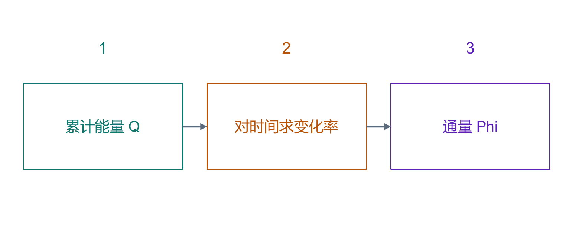

*读图：累计能量 Q → 对时间求变化率 → 通量 Phi。箭头表示本节的推理或处理顺序，具体条件见正文。*

### 先读符号与条件

| 符号 / 条件 | 含义 |
| --- | --- |
| Q | 辐射能，J |
| Phi | 辐射通量，W |
| 时间 t | 秒 |

### 核心关系与推导入口

以下关系使用上述条件；标为教学简化或补充的内容是为理解而推导，不是逐字转录课件。

$$
\Phi=\frac{dQ}{dt}
$$

### 🔧 手算 1：把关系落到数字上

恒定功率 6 W 持续 4 秒，能量 Q=24 J。反算 24/4=6 W。若一半时间关闭，平均功率为 3 W。

| 检查步骤 | 操作 |
| --- | --- |
| 输入 | 先从例子中抄下给定量及单位，不引入未给定的数值。 |
| 计算 | 按本节关系求中间量，再得到结果；不要在第一步就做显示裁剪或整数舍入。 |
| 回查 | 若一半时间关闭，平均功率为 3 W。 |
| 适用边界 | 灯泡的电功率不等于辐射光功率；散热与驱动损耗不能当作可见光输入。 |

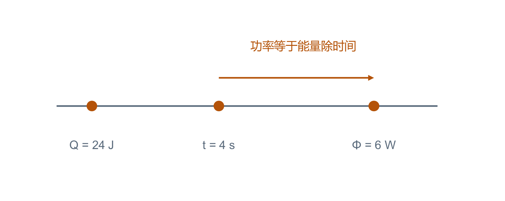

*同一教学例的三个量分别是 24 J、4 s 与 6 W，以关系而非柱高比较不同单位。*

### ⚠️ 易错点：先识别症状与假设

灯泡的电功率不等于辐射光功率；散热与驱动损耗不能当作可见光输入。

### 停下来解释一次

**问题：把 12 J 直接作为点光源强度会少什么？**

<details>
<summary>展开参考回答</summary>

少了时间和方向的定义，单位也不匹配；点光源强度通常以 W/sr 表示。

</details>

<details>
<summary>展开原课件关键页，对照术语与图形</summary>

#### Radiometry

*PDF p2 · 对应本节：为何“亮度”这个词不够用？*

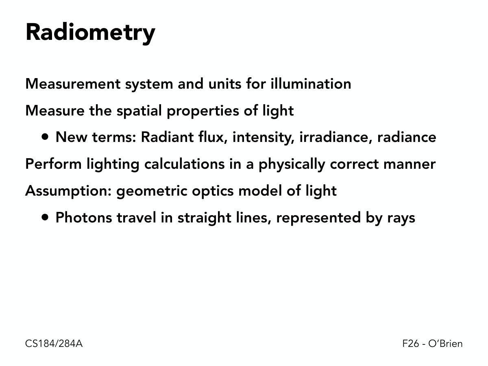

#### Radiometric & Photometric Terms & Units

*PDF p3 · 对应本节：为何“亮度”这个词不够用？*


#### Radiant Energy and Flux (Power)

*PDF p7 · 对应本节：为何“亮度”这个词不够用？*

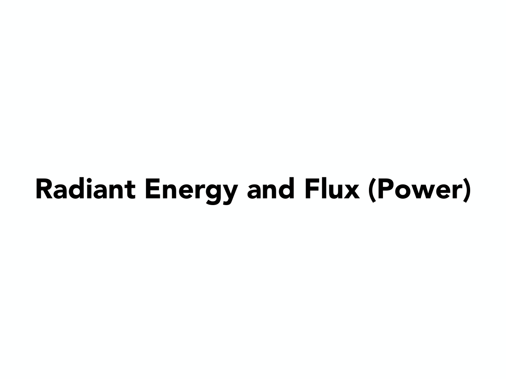

#### Radiant Energy and Flux (Power)

*PDF p8 · 对应本节：为何“亮度”这个词不够用？*

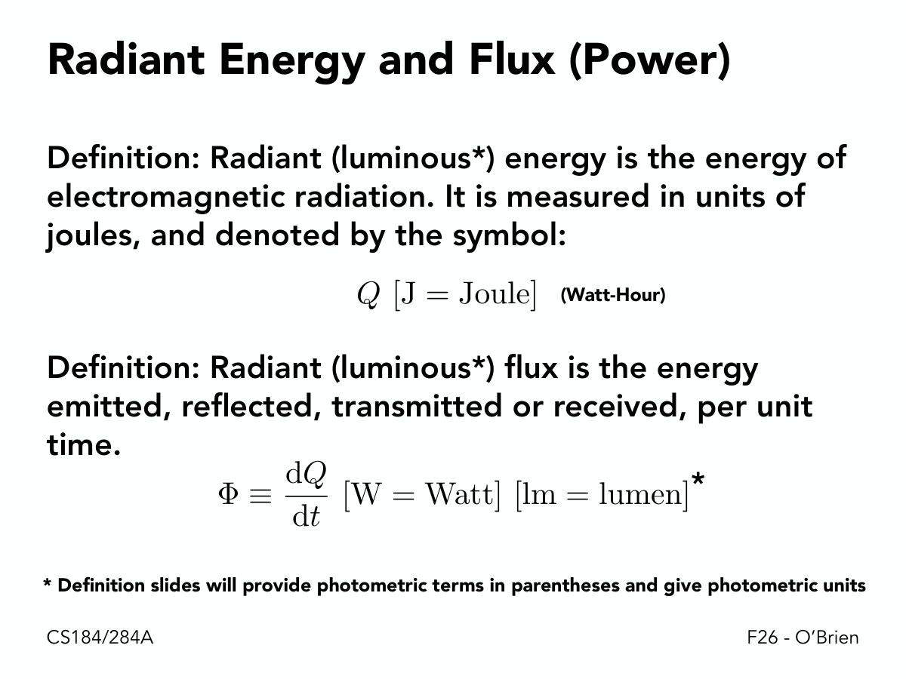

</details>

## 2. 为什么要有立体角？

平面角是弧长除半径；立体角是球面区域面积除半径平方。它衡量一个方向锥张开多大，与选用哪一层同心球无关。

球坐标的纬圈会随极角缩短，因此方向积分的测度含 sinθ。直接均匀选择 θ 与 φ 并不等于均匀选择球面方向，这会在 Monte Carlo 采样中造成系统错误。

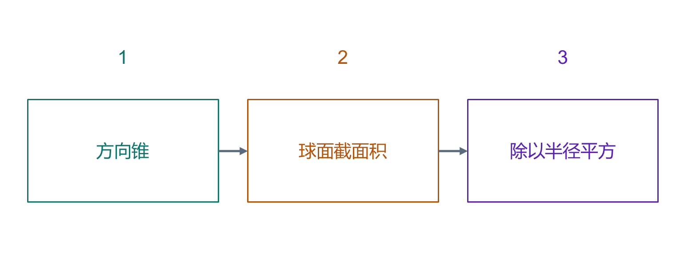

*读图：方向锥 → 球面截面积 → 除以半径平方。箭头表示本节的推理或处理顺序，具体条件见正文。*

### 先读符号与条件

| 符号 / 条件 | 含义 |
| --- | --- |
| theta | 与极轴夹角 |
| phi | 方位角 |
| omega | 立体角，sr |

### 核心关系与推导入口

以下关系使用上述条件；标为教学简化或补充的内容是为理解而推导，不是逐字转录课件。

$$
d\omega=\sin\theta\,d\theta\,d\phi,\qquad \Omega_{sphere}=4\pi
$$

### 🔧 手算 2：把关系落到数字上

半径 2 米球面上一块面积 1 平方米的区域，立体角为 1/4 sr。同方向区域换到半径 4 米，面积变成 4 平方米，仍为 4/16=1/4 sr。

| 检查步骤 | 操作 |
| --- | --- |
| 输入 | 先从例子中抄下给定量及单位，不引入未给定的数值。 |
| 计算 | 按本节关系求中间量，再得到结果；不要在第一步就做显示裁剪或整数舍入。 |
| 回查 | 同方向区域换到半径 4 米，面积变成 4 平方米，仍为 4/16=1/4 sr。 |
| 适用边界 | 立体角不是平面角的平方；单位写 sr，几何定义用球面面积比例。 |

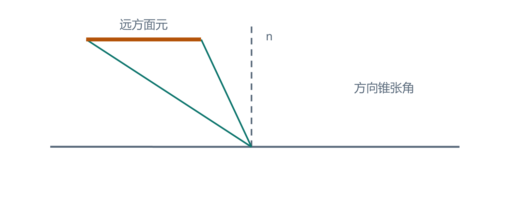

*立体角描述光源从接收点张开的方向范围。*

### ⚠️ 易错点：先识别症状与假设

立体角不是平面角的平方；单位写 sr，几何定义用球面面积比例。

### 停下来解释一次

**问题：远处物体面积不变，立体角如何变化？**

<details>
<summary>展开参考回答</summary>

小面元近似下按距离平方反比变化，并且还要乘面元相对视线的投影余弦。

</details>

<details>
<summary>展开原课件关键页，对照术语与图形</summary>

#### Radiant Intensity

*PDF p12 · 对应本节：为什么要有立体角？*

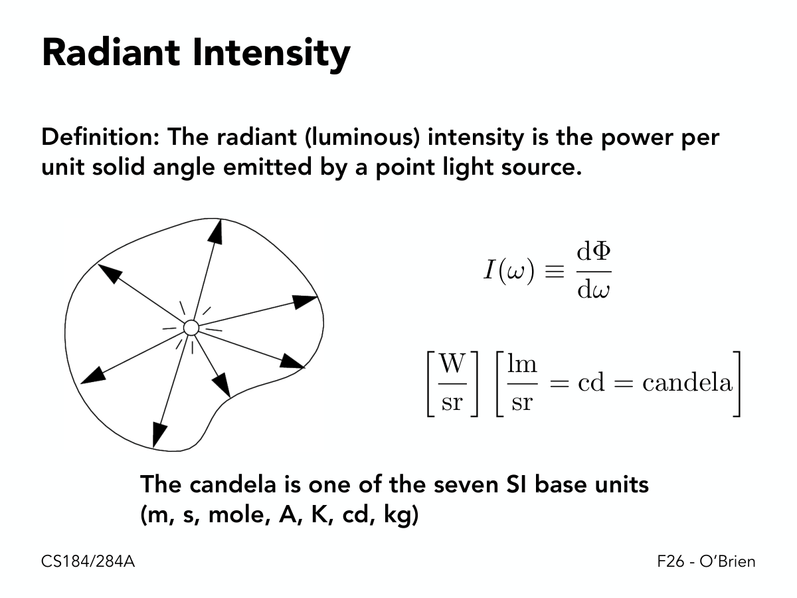

#### Angles and Solid Angles

*PDF p13 · 对应本节：为什么要有立体角？*

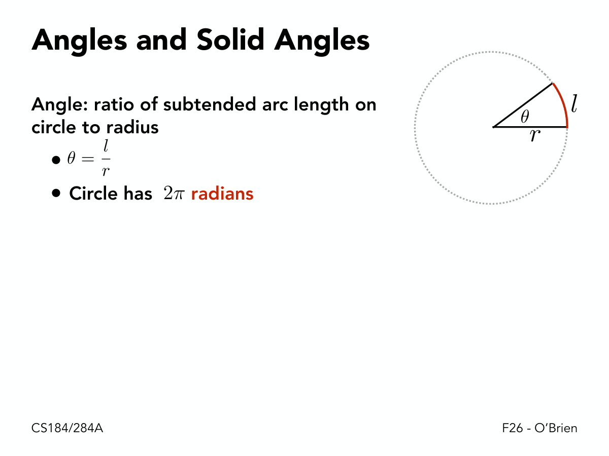

#### Angles and Solid Angles

*PDF p14 · 对应本节：为什么要有立体角？*

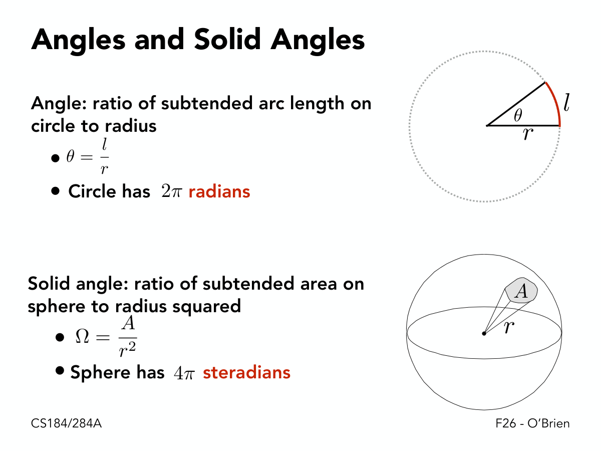

#### Differential Solid Angles

*PDF p18 · 对应本节：为什么要有立体角？*

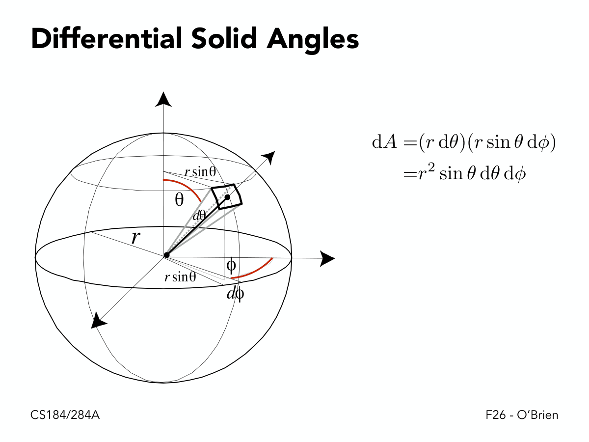

#### Differential Solid Angles

*PDF p20 · 对应本节：为什么要有立体角？*

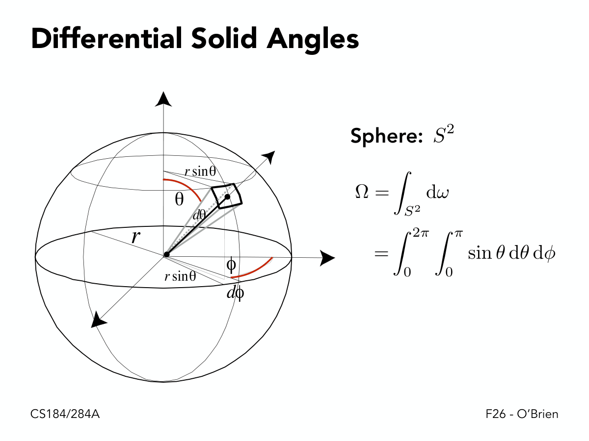

#### Differential Solid Angles

*PDF p21 · 对应本节：为什么要有立体角？*

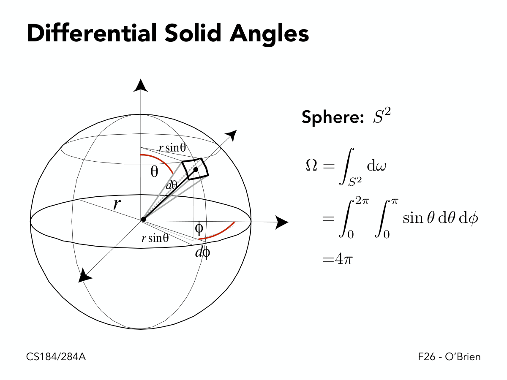

</details>

## 3. 点光源向每个方向分多少功率？

辐射强度 I 是每单位立体角的功率。对于各向同性点光源，所有方向相同，因此全空间通量等于常数强度乘 4π。

点光源是理想化模型，面积趋近于零却仍可有有限总功率；不能把它当作普通有限辐亮度面光源直接用面积采样。灯具配光曲线则描述强度随方向变化。

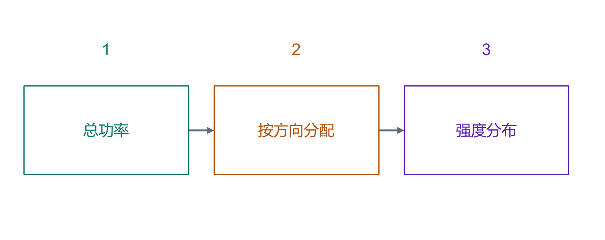

*读图：总功率 → 按方向分配 → 强度分布。箭头表示本节的推理或处理顺序，具体条件见正文。*

### 先读符号与条件

| 符号 / 条件 | 含义 |
| --- | --- |
| I | 辐射强度，W/sr |
| Phi | 总功率 |
| iso | 各向同性假设 |

### 核心关系与推导入口

以下关系使用上述条件；标为教学简化或补充的内容是为理解而推导，不是逐字转录课件。

$$
I(\omega)=\frac{d\Phi}{d\omega},\qquad I_{iso}=\frac{\Phi}{4\pi}
$$

### 🔧 手算 3：把关系落到数字上

各向同性光源通量 8π W，强度为 2 W/sr。一个 0.1 sr 小锥收到约 0.2 W；对整个球积分 2×4π=8π W。

| 检查步骤 | 操作 |
| --- | --- |
| 输入 | 先从例子中抄下给定量及单位，不引入未给定的数值。 |
| 计算 | 按本节关系求中间量，再得到结果；不要在第一步就做显示裁剪或整数舍入。 |
| 回查 | 一个 0.1 sr 小锥收到约 0.2 W；对整个球积分 2×4π=8π W。 |
| 适用边界 | “所有方向均匀”不是只除以半球 2π；若只向半球发射，必须明确新模型。 |

### ⚠️ 易错点：先识别症状与假设

“所有方向均匀”不是只除以半球 2π；若只向半球发射，必须明确新模型。

### 停下来解释一次

**问题：灯具朝下照，是否仍能用 Phi/4π 求任意方向强度？**

<details>
<summary>展开参考回答</summary>

不能，那只是各向同性特例；要读取或建模角度分布。

</details>

<details>
<summary>展开原课件关键页，对照术语与图形</summary>

#### Radiant Intensity

*PDF p11 · 对应本节：点光源向每个方向分多少功率？*

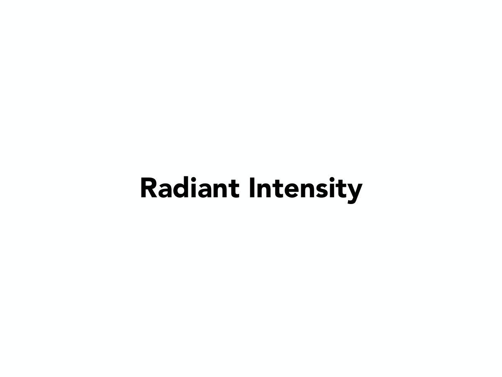

#### Radiant Intensity

*PDF p12 · 对应本节：点光源向每个方向分多少功率？*


#### Isotropic Point Source

*PDF p23 · 对应本节：点光源向每个方向分多少功率？*

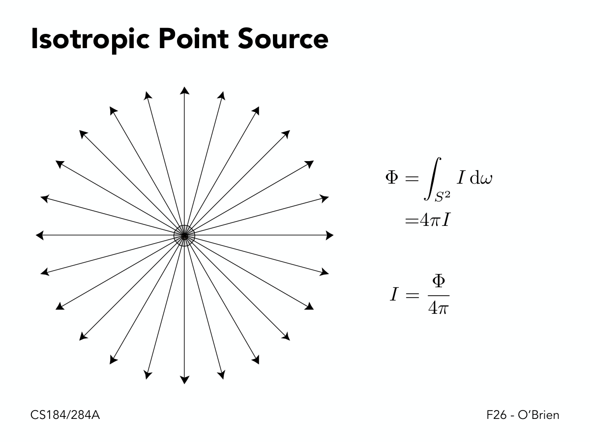

</details>

## 4. 功率落到面积上会怎样？

辐照度 E 是表面每单位面积收到的功率。倾斜表面在同一束平行光中拦截的光减少，因为面对光束的投影面积变小。

点光源的距离平方衰减来自固定立体角对应的球面面积增长；余弦衰减来自接收面的朝向。两者有不同几何来源，代码里都要出现，但不要再给沿光线传播的辐亮度额外乘一次距离平方。

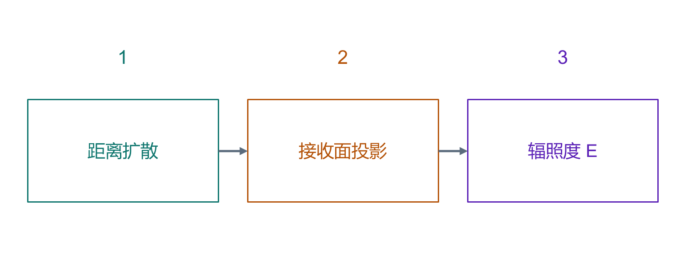

*读图：距离扩散 → 接收面投影 → 辐照度 E。箭头表示本节的推理或处理顺序，具体条件见正文。*

### 先读符号与条件

| 符号 / 条件 | 含义 |
| --- | --- |
| E | W/m² |
| I | 点光源强度 |
| theta | 接收法线与指向光源方向夹角 |
| r | 距离 |

### 核心关系与推导入口

以下关系使用上述条件；标为教学简化或补充的内容是为理解而推导，不是逐字转录课件。

$$
E=\frac{I\max(0,\cos\theta)}{r^2}
$$

### 🔧 手算 4：把关系落到数字上

I=8 W/sr，r=2 米，θ=60°，E=8×0.5/4=1 W/m²。距离改为 4 米得到 0.25；乘面积 2 平方米得功率约 0.5 W（小面近似）。

| 检查步骤 | 操作 |
| --- | --- |
| 输入 | 先从例子中抄下给定量及单位，不引入未给定的数值。 |
| 计算 | 按本节关系求中间量，再得到结果；不要在第一步就做显示裁剪或整数舍入。 |
| 回查 | 距离改为 4 米得到 0.25；乘面积 2 平方米得功率约 0.5 W（小面近似）。 |
| 适用边界 | 背面余弦为负不能产生负照明；单面表面通常截断为零。 |

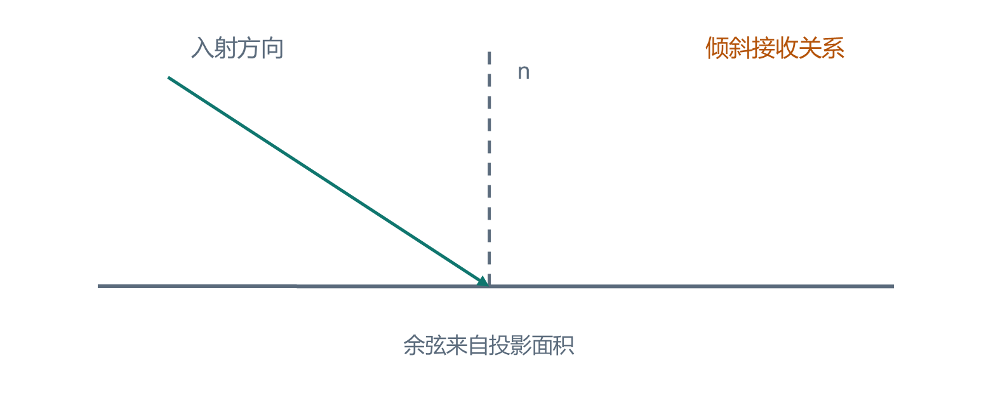

*入射方向与表面法线决定投影余弦，不能用光线与平面的夹角替代。*

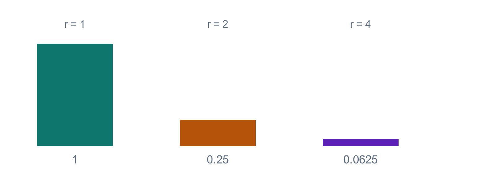

*点光源保持强度与朝向，辐照度按距离平方反比变化。*

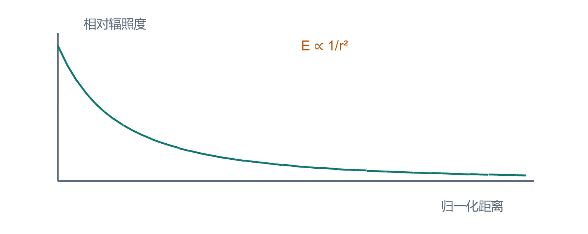

*曲线使用 r=1+4x 的教学参数，显示近处到远处的平方衰减。*

### ⚠️ 易错点：先识别症状与假设

背面余弦为负不能产生负照明；单面表面通常截断为零。

### 停下来解释一次

**问题：距离翻倍且保持朝向，辐照度变成多少？**

<details>
<summary>展开参考回答</summary>

理想点光源与无遮挡条件下变成四分之一；扩展光源近场不能直接套此整体公式。

</details>

<details>
<summary>展开原课件关键页，对照术语与图形</summary>

#### Irradiance

*PDF p30 · 对应本节：功率落到面积上会怎样？*

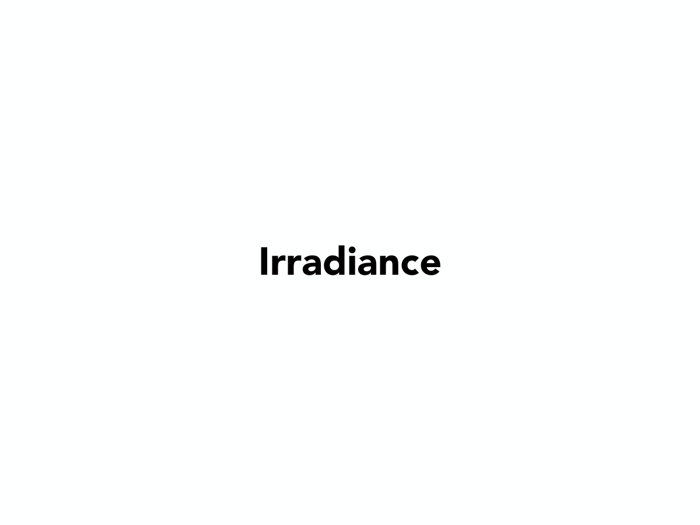

#### Irradiance

*PDF p31 · 对应本节：功率落到面积上会怎样？*

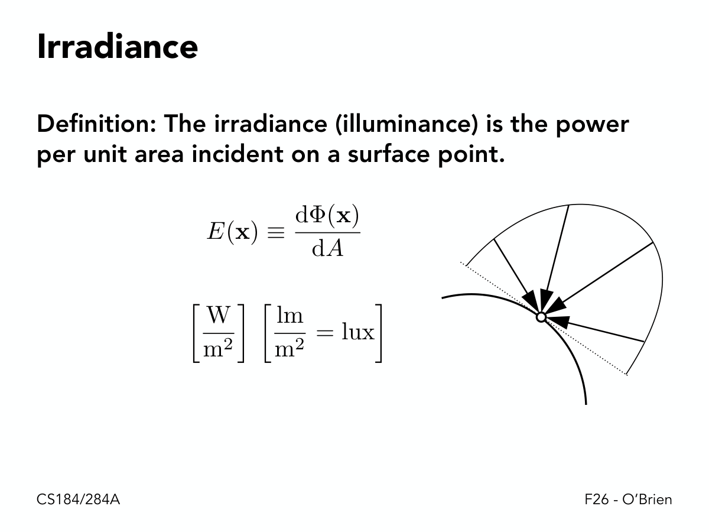

#### Irradiance at surface is proportional to cosine of angle

*PDF p33 · 对应本节：功率落到面积上会怎样？*

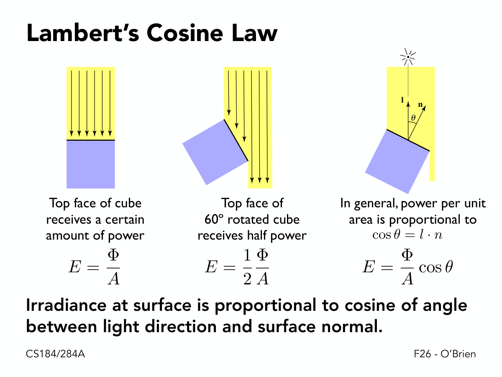

#### Irradiance Falloff

*PDF p35 · 对应本节：功率落到面积上会怎样？*

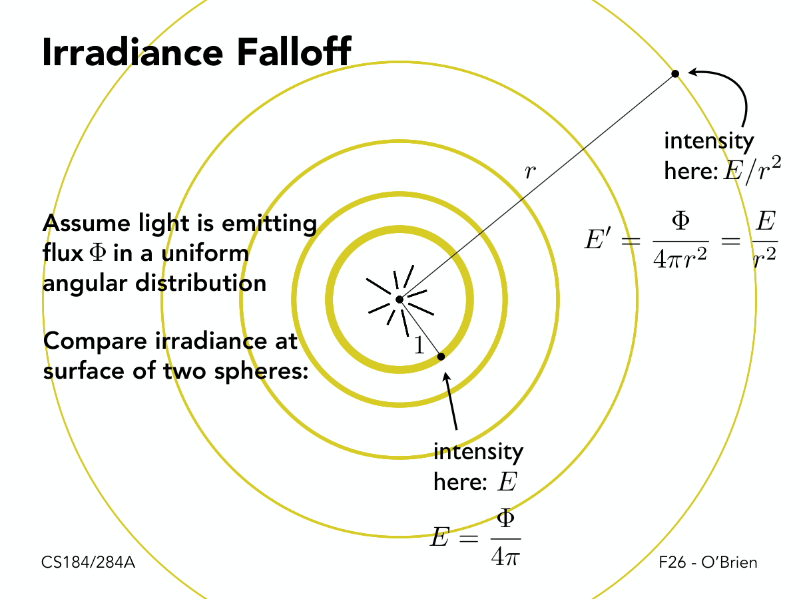

</details>

## 5. 为什么辐亮度要除以投影面积？

辐亮度 L 同时分辨位置和方向。表面斜着看时相同面积在视线垂直平面上的投影缩小，所以定义用 dA cosθ，而非单纯 dA。

这让 L 成为光线传播与相机采样自然使用的量。一个漫反射平面在固定照明下，从不同方向看可以有相同辐亮度，即使它对不同方向发出的总功率不同。

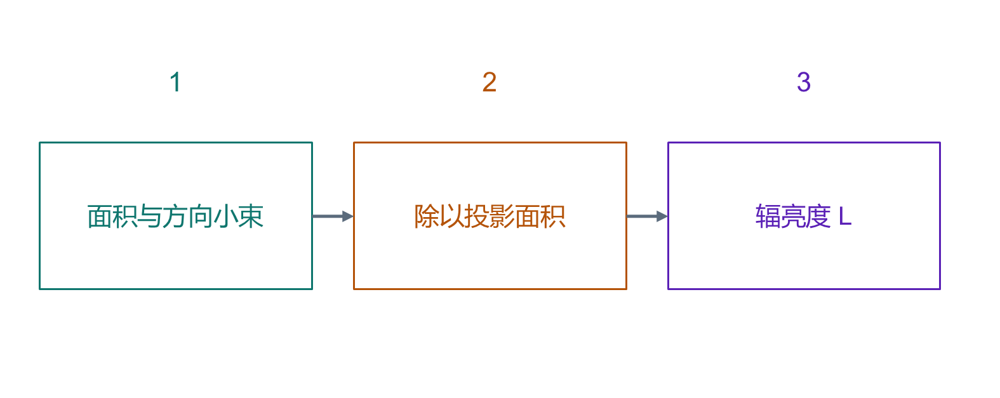

*读图：面积与方向小束 → 除以投影面积 → 辐亮度 L。箭头表示本节的推理或处理顺序，具体条件见正文。*

### 先读符号与条件

| 符号 / 条件 | 含义 |
| --- | --- |
| L | W/(m² sr) |
| dA | 真实面积 |
| cos theta | 面积投影 |
| domega | 方向区域 |

### 核心关系与推导入口

以下关系使用上述条件；标为教学简化或补充的内容是为理解而推导，不是逐字转录课件。

$$
L(p,\omega)=\frac{d^2\Phi}{dA\cos\theta\,d\omega}
$$

### 🔧 手算 5：把关系落到数字上

微小通量 0.02 W，面积 0.1 m²，cosθ=0.5，方向范围 0.2 sr，L=2 W/(m² sr)。回乘 2×0.1×0.5×0.2=0.02。

| 检查步骤 | 操作 |
| --- | --- |
| 输入 | 先从例子中抄下给定量及单位，不引入未给定的数值。 |
| 计算 | 按本节关系求中间量，再得到结果；不要在第一步就做显示裁剪或整数舍入。 |
| 回查 | 回乘 2×0.1×0.5×0.2=0.02。 |
| 适用边界 | 把 irradiance 与 radiance 都叫“亮度”会丢失方向信息；变量命名应保留 E 与 L 的区别。 |

### ⚠️ 易错点：先识别症状与假设

把 irradiance 与 radiance 都叫“亮度”会丢失方向信息；变量命名应保留 E 与 L 的区别。

### 停下来解释一次

**问题：L 相同是否意味着两个面积不同的灯总功率相同？**

<details>
<summary>展开参考回答</summary>

不。还要对面积和发射方向积分；更大的同辐亮度面光源通常总功率更大。

</details>

<details>
<summary>展开原课件关键页，对照术语与图形</summary>

#### Radiance

*PDF p36 · 对应本节：为什么辐亮度要除以投影面积？*

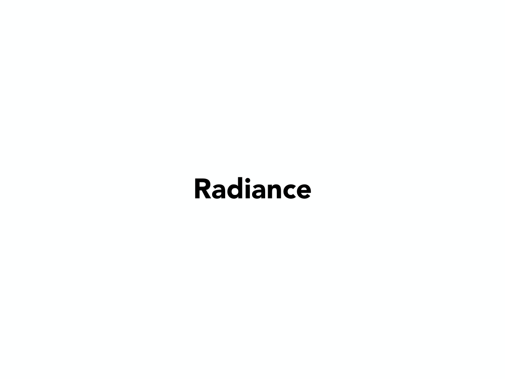

#### Radiance

*PDF p37 · 对应本节：为什么辐亮度要除以投影面积？*

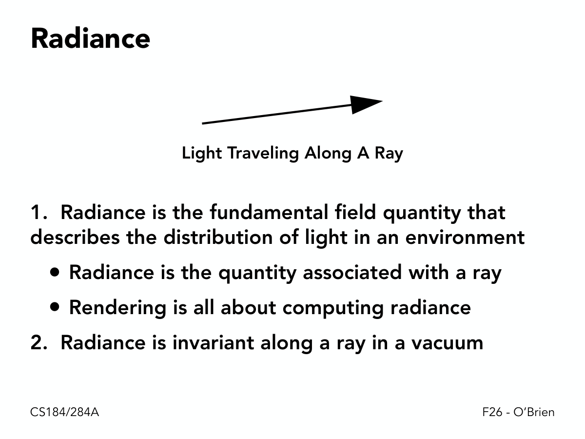

#### Surface Radiance

*PDF p38 · 对应本节：为什么辐亮度要除以投影面积？*

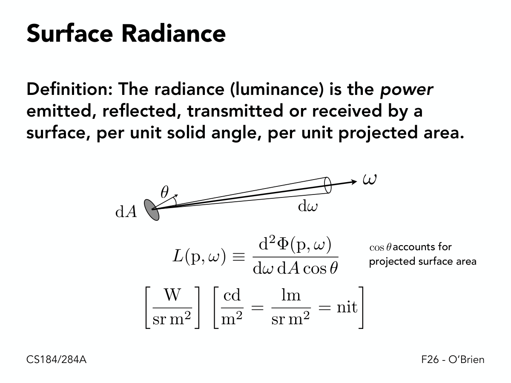

</details>

## 6. 入射与出射为什么要分开写？

同一表面点有入射光场 Li 和出射光场 Lo。前者由环境与其他表面决定，后者由发光和材料散射决定。两者是两个函数，不能因为单位相同就互换。

本笔记采用渲染常见约定：ωi 和 ωo 都从表面指向外部。入射光子的实际行进方向与 ωi 相反；在连接两个表面时方向符号必须翻转。

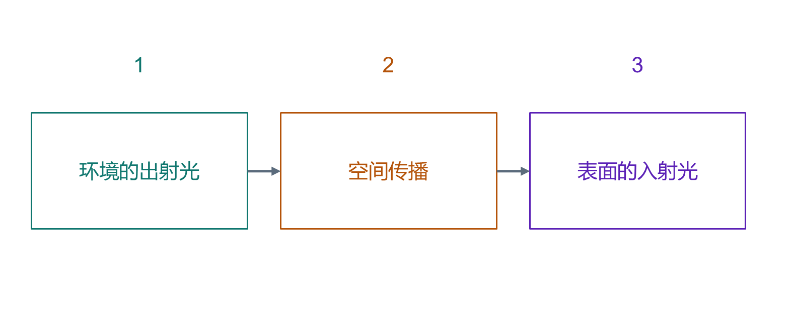

*读图：环境的出射光 → 空间传播 → 表面的入射光。箭头表示本节的推理或处理顺序，具体条件见正文。*

### 先读符号与条件

| 符号 / 条件 | 含义 |
| --- | --- |
| Li | 入射辐亮度 |
| Lo | 出射辐亮度 |
| omega_i | 指向光来源 |
| theta_i | 与法线夹角 |

### 核心关系与推导入口

以下关系使用上述条件；标为教学简化或补充的内容是为理解而推导，不是逐字转录课件。

$$
dE=L_i(p,\omega_i)\cos\theta_i\,d\omega_i
$$

### 🔧 手算 6：把关系落到数字上

Li=4，cosθ=0.5，dω=0.1，得到 dE=0.2 W/m²。由 dE/(cosθ dω) 反求仍为 4。

| 检查步骤 | 操作 |
| --- | --- |
| 输入 | 先从例子中抄下给定量及单位，不引入未给定的数值。 |
| 计算 | 按本节关系求中间量，再得到结果；不要在第一步就做显示裁剪或整数舍入。 |
| 回查 | 由 dE/(cosθ dω) 反求仍为 4。 |
| 适用边界 | 沿射线方向与“指向来源的入射方向”相差一个负号；最常见症状是半球判断把所有灯都剔除了。 |

### ⚠️ 易错点：先识别症状与假设

沿射线方向与“指向来源的入射方向”相差一个负号；最常见症状是半球判断把所有灯都剔除了。

### 停下来解释一次

**问题：Li 与 Lo 的单位相同，能否设置为相等？**

<details>
<summary>展开参考回答</summary>

一般不能。只有特定传播关系连接两点时有相应等式，表面处还要考虑材质和发射。

</details>

<details>
<summary>展开原课件关键页，对照术语与图形</summary>

#### Incident Surface Radiance

*PDF p39 · 对应本节：入射与出射为什么要分开写？*

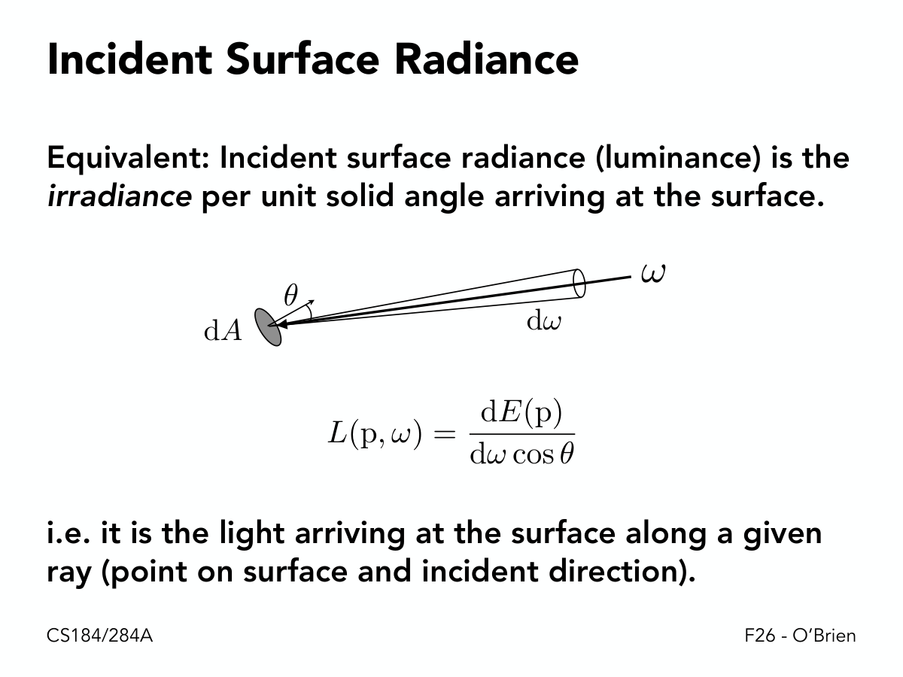

#### Exiting Surface Radiance

*PDF p40 · 对应本节：入射与出射为什么要分开写？*

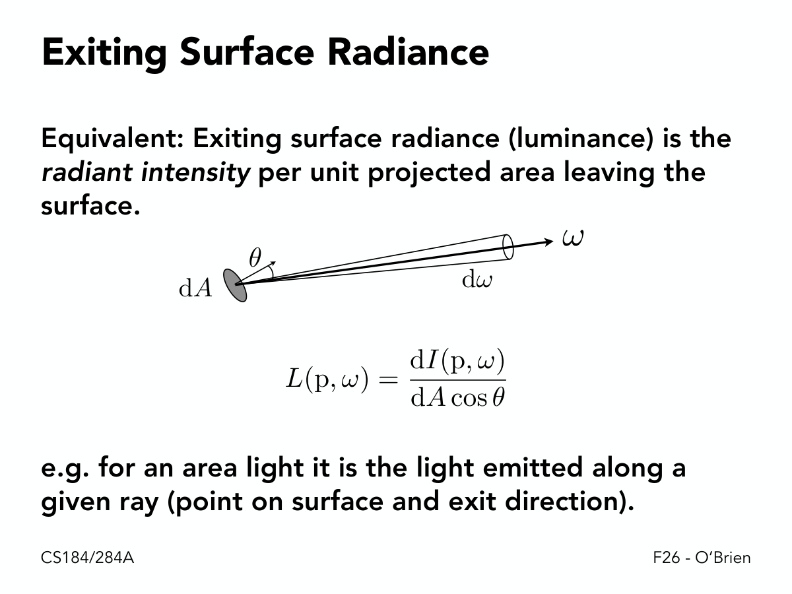

#### Incident & Exiting Surface Radiance Differ!

*PDF p41 · 对应本节：入射与出射为什么要分开写？*

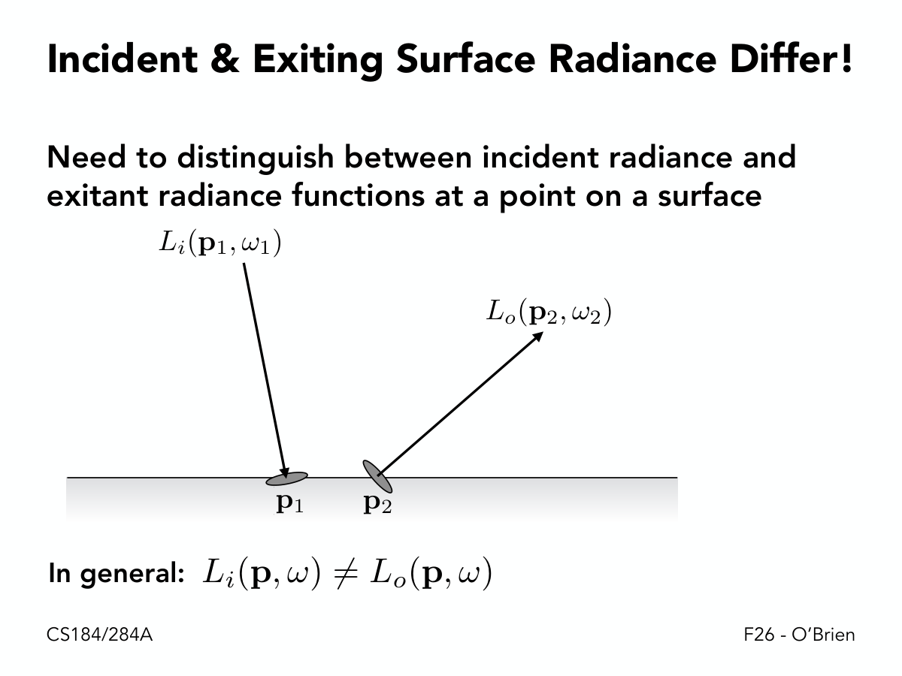

#### Field Radiance or Light Field

*PDF p42 · 对应本节：入射与出射为什么要分开写？*

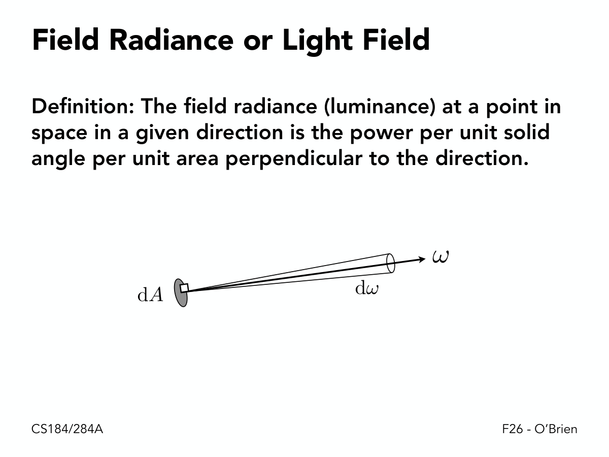

</details>

## 7. 把所有方向加起来为何出现 π？

辐照度需要把半球上所有入射方向的辐亮度乘余弦再积分。如果 Li=L0 为常数，积分中仍有 cosθ 与球坐标 Jacobian sinθ。

先对方位角积分得到 2π，再对极角积分得到 1/2，因此结果是 πL0。这个 π 是下一讲漫反射 BRDF 中 ρ/π 的来源；不是人为调亮度的常数。

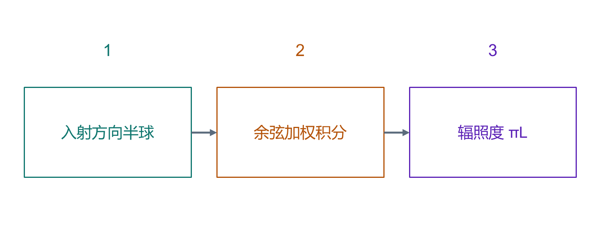

*读图：入射方向半球 → 余弦加权积分 → 辐照度 πL。箭头表示本节的推理或处理顺序，具体条件见正文。*

### 先读符号与条件

| 符号 / 条件 | 含义 |
| --- | --- |
| H² | 法线上方半球 |
| L0 | 均匀入射辐亮度 |
| 积分结果 | 投影后的半球立体角为 pi |

### 核心关系与推导入口

以下关系使用上述条件；标为教学简化或补充的内容是为理解而推导，不是逐字转录课件。

$$
E=\int_{H^2}L_i\cos\theta\,d\omega=L_0\int_0^{2\pi}\!d\phi\int_0^{\pi/2}\cos\theta\sin\theta\,d\theta=\pi L_0
$$

### 🔧 手算 7：把关系落到数字上

L0=2 时 E=2π≈6.283。若错误只乘半球面积会得 4π，正好多一倍；检查 cosθ 平均值 1/2 可再次得到 2π。

| 检查步骤 | 操作 |
| --- | --- |
| 输入 | 先从例子中抄下给定量及单位，不引入未给定的数值。 |
| 计算 | 按本节关系求中间量，再得到结果；不要在第一步就做显示裁剪或整数舍入。 |
| 回查 | 若错误只乘半球面积会得 4π，正好多一倍；检查 cosθ 平均值 1/2 可再次得到 2π。 |
| 适用边界 | 积分 dω 与积分 dθdφ 不一样；漏掉 sinθ 会导致方向密度错误。 |

### ⚠️ 易错点：先识别症状与假设

积分 dω 与积分 dθdφ 不一样；漏掉 sinθ 会导致方向密度错误。

### 停下来解释一次

**问题：均匀半球光照为什么不是 2πL？**

<details>
<summary>展开参考回答</summary>

接收表面只截取各方向的投影贡献，余弦权重把半球积分从 2π 降到 π。

</details>

<details>
<summary>展开原课件关键页，对照术语与图形</summary>

#### Calculating with Radiance

*PDF p44 · 对应本节：把所有方向加起来为何出现 π？*

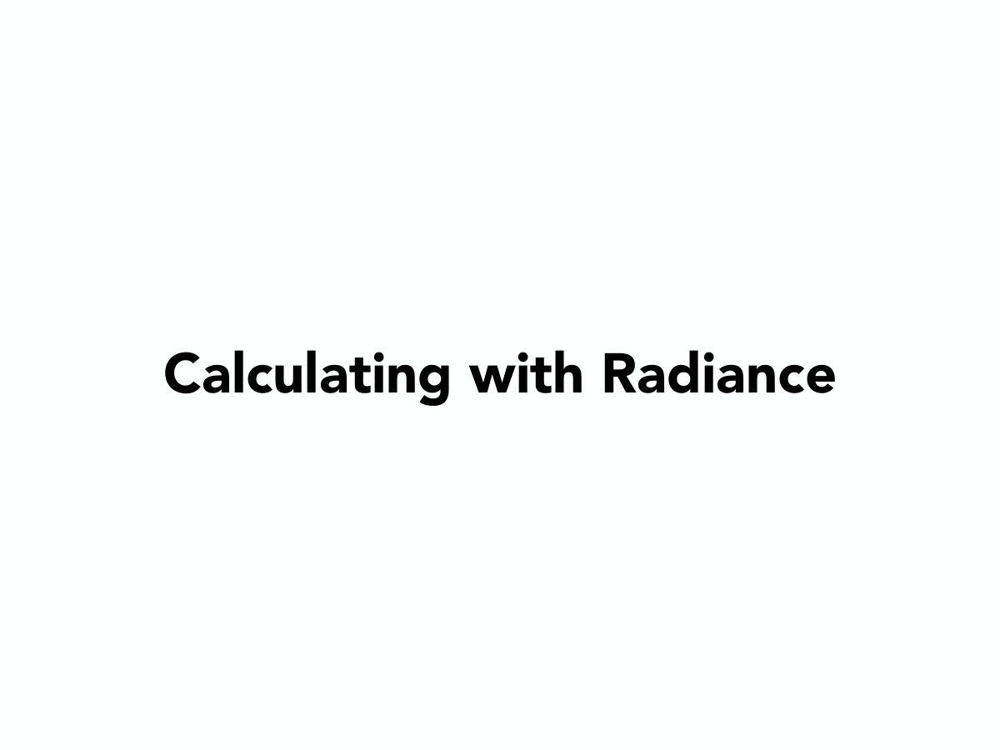

#### Irradiance from the Environment

*PDF p45 · 对应本节：把所有方向加起来为何出现 π？*

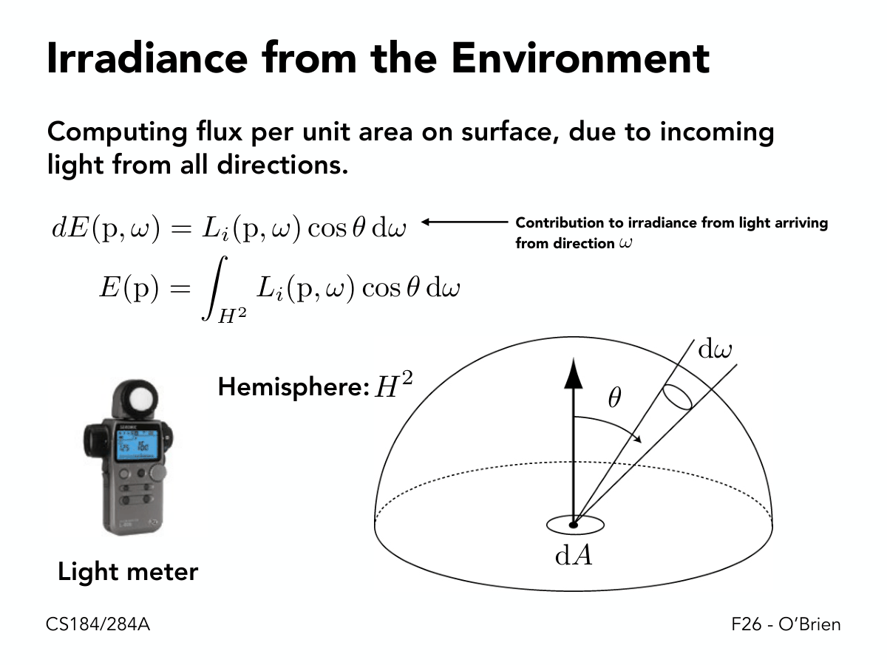

#### Irradiance from Uniform Hemispherical Light

*PDF p46 · 对应本节：把所有方向加起来为何出现 π？*

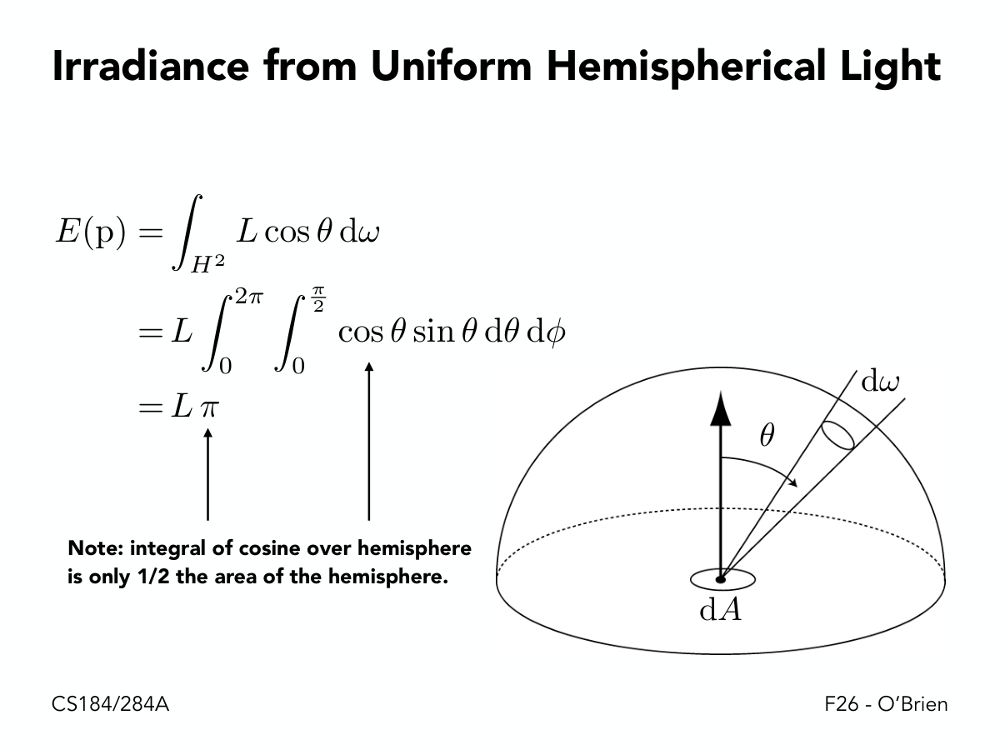

</details>

## 8. 有限圆盘光源怎样照亮表面？

对准接收点法线的均匀圆盘光源，在接收点张成半角 α 的方向锥。将上一节极角积分上限从 π/2 改成 α，就得到投影立体角 πsin²α。

若圆盘半径 R、轴向距离 d，则 sin²α=R²/(R²+d²)。这是有限光源的几何公式，也解释近处大灯不能简单整体套一个固定点源强度。

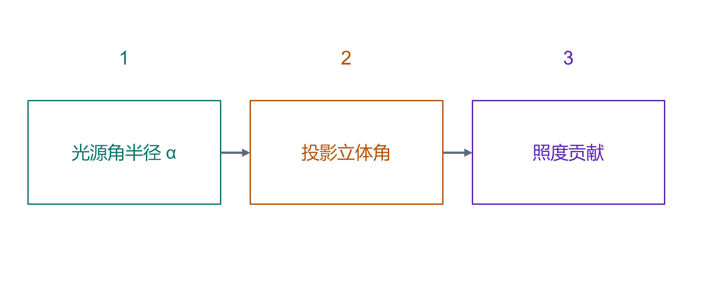

*读图：光源角半径 α → 投影立体角 → 照度贡献。箭头表示本节的推理或处理顺序，具体条件见正文。*

### 先读符号与条件

| 符号 / 条件 | 含义 |
| --- | --- |
| R | 圆盘半径 |
| d | 轴向距离 |
| 前提 | 圆盘正对接收点且无遮挡 |
| L | 恒定发射辐亮度 |

### 核心关系与推导入口

以下关系使用上述条件；标为教学简化或补充的内容是为理解而推导，不是逐字转录课件。

$$
E=L\pi\sin^2\alpha=L\pi\frac{R^2}{R^2+d^2}
$$

### 🔧 手算 8：把关系落到数字上

R=1、d=1、L=2，E=π。d=√3 时 E=π/2；代入角度 α=30°，2π×1/4 也得 π/2。

| 检查步骤 | 操作 |
| --- | --- |
| 输入 | 先从例子中抄下给定量及单位，不引入未给定的数值。 |
| 计算 | 按本节关系求中间量，再得到结果；不要在第一步就做显示裁剪或整数舍入。 |
| 回查 | d=√3 时 E=π/2；代入角度 α=30°，2π×1/4 也得 π/2。 |
| 适用边界 | 该式不适用于任意倾斜圆盘或有遮挡的情况；此时需重新积分或采样。 |

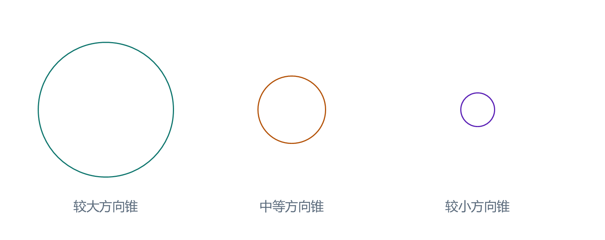

*有限角域大小不同，不能只比较域内相同的辐亮度数值；圆形仅示意角域。*

### ⚠️ 易错点：先识别症状与假设

该式不适用于任意倾斜圆盘或有遮挡的情况；此时需重新积分或采样。

### 停下来解释一次

**问题：当圆盘很远时，这个公式符合平方衰减吗？**

<details>
<summary>展开参考回答</summary>

符合。d 远大于 R 时分母近似 d²，E 近似 LπR²/d²。

</details>

<details>
<summary>展开原课件关键页，对照术语与图形</summary>

#### Irradiance from a Uniform Area Source

*PDF p47 · 对应本节：有限圆盘光源怎样照亮表面？*

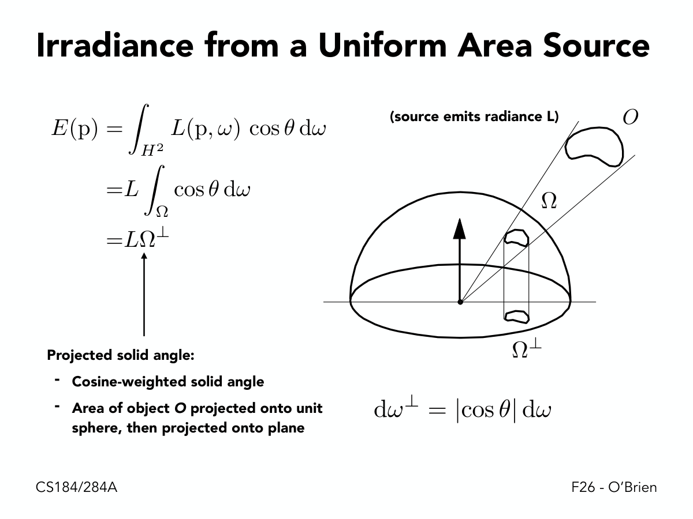

#### Uniform Disk Source Overhead

*PDF p48 · 对应本节：有限圆盘光源怎样照亮表面？*

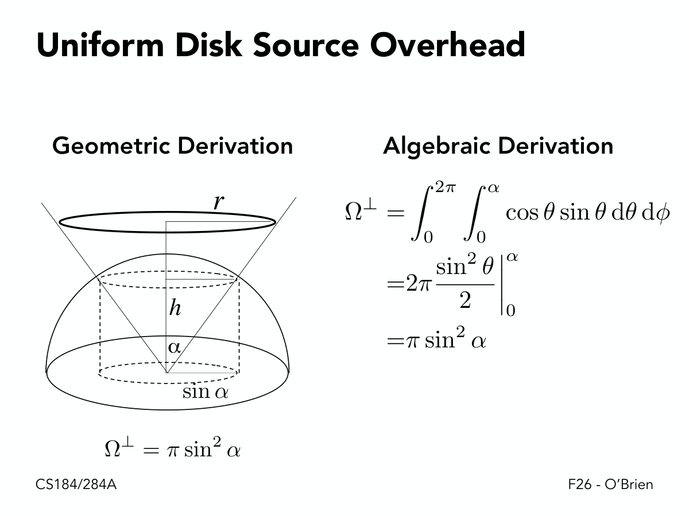

</details>

## 9. 无损空间中什么量保持不变？

光束传播时截面积和对应方向锥会相互变化。在均匀折射率、无吸收散射的介质中，沿一条光线的辐亮度保持不变。距离平方衰减已体现在某个有限光源占据的立体角变小。

因此一个均匀发光平面的可分辨区域远看不会仅因距离翻倍而使每条光线的 L 减半。它占据的像素总数会减少，总接收能量也可减少；不要混淆单方向密度和总量。

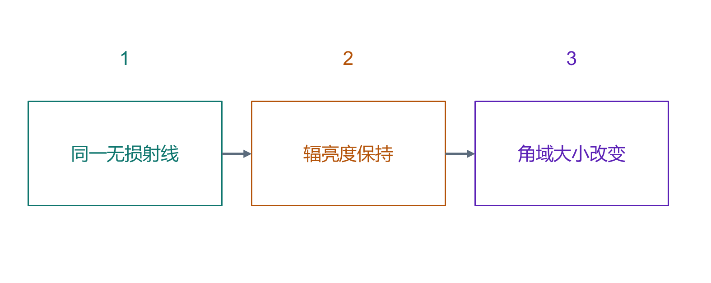

*读图：同一无损射线 → 辐亮度保持 → 角域大小改变。箭头表示本节的推理或处理顺序，具体条件见正文。*

### 先读符号与条件

| 符号 / 条件 | 含义 |
| --- | --- |
| t | 沿射线位移 |
| 条件 | 均匀介质、无吸收散射 |
| 跨折射率界面 | 此式不能直接照搬 |

### 核心关系与推导入口

以下关系使用上述条件；标为教学简化或补充的内容是为理解而推导，不是逐字转录课件。

$$
L(x,\omega)=L(x+t\omega,\omega)
$$

### 🔧 手算 9：把关系落到数字上

沿真空射线初始 L=5，前进 1 米与 2 米都仍为 5。若灯所占立体角从 0.2 缩到 0.05 sr，近法线照度从约 1 降为 0.25。

| 检查步骤 | 操作 |
| --- | --- |
| 输入 | 先从例子中抄下给定量及单位，不引入未给定的数值。 |
| 计算 | 按本节关系求中间量，再得到结果；不要在第一步就做显示裁剪或整数舍入。 |
| 回查 | 若灯所占立体角从 0.2 缩到 0.05 sr，近法线照度从约 1 降为 0.25。 |
| 适用边界 | 玻璃、雾和吸收介质会改变传播关系；“永远不衰减”不是普遍定律。 |

### ⚠️ 易错点：先识别症状与假设

玻璃、雾和吸收介质会改变传播关系；“永远不衰减”不是普遍定律。

### 停下来解释一次

**问题：远处面光源看起来更小与 L 守恒矛盾吗？**

<details>
<summary>展开参考回答</summary>

不矛盾。角域变小影响积分范围，L 是角域内部的密度。

</details>

<details>
<summary>展开原课件关键页，对照术语与图形</summary>

#### Field Radiance or Light Field

*PDF p42 · 对应本节：无损空间中什么量保持不变？*


#### Measuring Radiance

*PDF p49 · 对应本节：无损空间中什么量保持不变？*

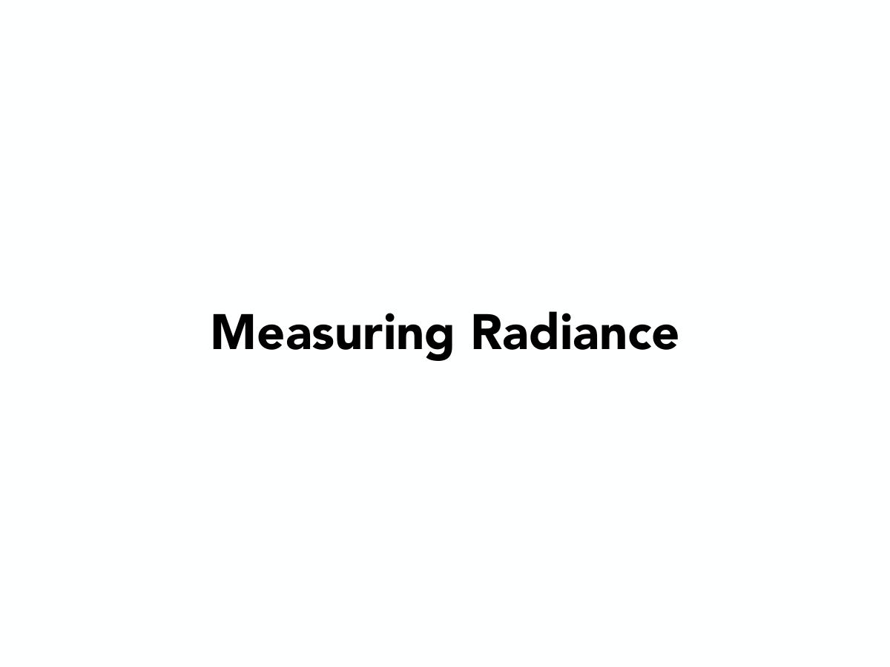

#### A Pinhole Camera Samples Radiance

*PDF p50 · 对应本节：无损空间中什么量保持不变？*

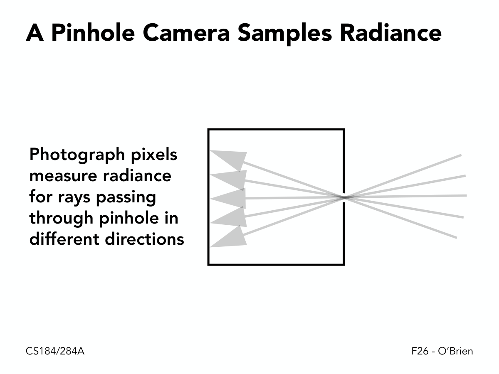

</details>

## 10. 相机像素为何与辐亮度有关？

理想针孔相机为每个像素方向选取场景射线；真实镜头则收集有限孔径、像素区域与曝光时间上的光。准确的像素测量是这些变量的积分，不能把“采样 L”理解成传感器直接存 W/(m² sr)。

两平面光场用光线穿过两个平面的位置参数化光线。一张相机图像只取其中一个视点切片，多个视点才足以重聚焦或改变观察位置。

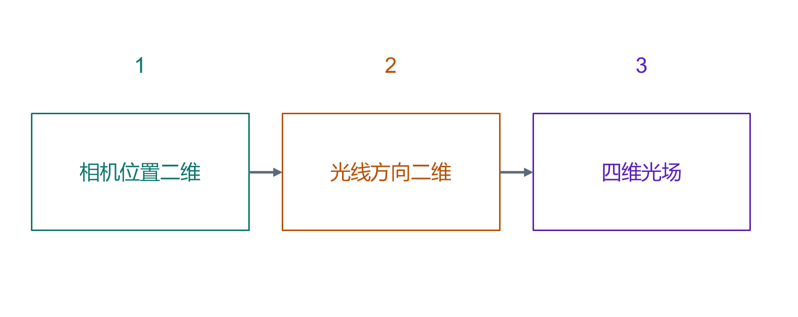

*读图：相机位置二维 → 光线方向二维 → 四维光场。箭头表示本节的推理或处理顺序，具体条件见正文。*

### 先读符号与条件

| 符号 / 条件 | 含义 |
| --- | --- |
| u,v | 第一个平面坐标 |
| s,t | 第二个平面坐标 |
| 假设 | 几何光学且光线可穿过两平面 |

### 核心关系与推导入口

以下关系使用上述条件；标为教学简化或补充的内容是为理解而推导，不是逐字转录课件。

$$
L=L(u,v,s,t)
$$

### 🔧 手算 10：把关系落到数字上

2×3 个相机位置，每个位置采 4×5 个方向，总共存 120 个光线样本。改成单相机只剩 20 个；120/20=6 恰等于视点数。

| 检查步骤 | 操作 |
| --- | --- |
| 输入 | 先从例子中抄下给定量及单位，不引入未给定的数值。 |
| 计算 | 按本节关系求中间量，再得到结果；不要在第一步就做显示裁剪或整数舍入。 |
| 回查 | 改成单相机只剩 20 个；120/20=6 恰等于视点数。 |
| 适用边界 | 4D 是参数维数，不是四维空间；自由空间方向可用两个角度表示。 |

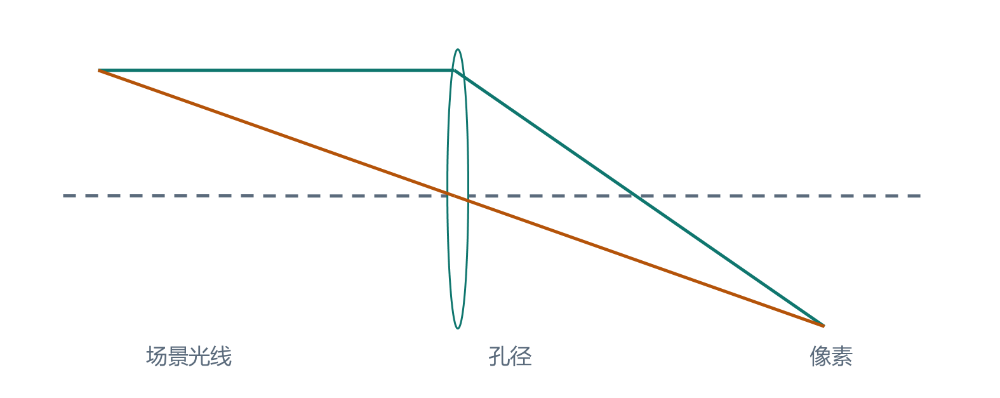

*相机像素需要考虑有限孔径与面积积分，针孔只是简化。*

### ⚠️ 易错点：先识别症状与假设

4D 是参数维数，不是四维空间；自由空间方向可用两个角度表示。

### 停下来解释一次

**问题：一个全景图等于完整光场吗？**

<details>
<summary>展开参考回答</summary>

不。全景图通常只覆盖一个位置的所有方向，缺少位置变化带来的视差。

</details>

<details>
<summary>展开原课件关键页，对照术语与图形</summary>

#### Measuring Radiance

*PDF p49 · 对应本节：相机像素为何与辐亮度有关？*


#### A Pinhole Camera Samples Radiance

*PDF p50 · 对应本节：相机像素为何与辐亮度有关？*


#### Spherical Gantry ⇒ 4D Light Field

*PDF p51 · 对应本节：相机像素为何与辐亮度有关？*

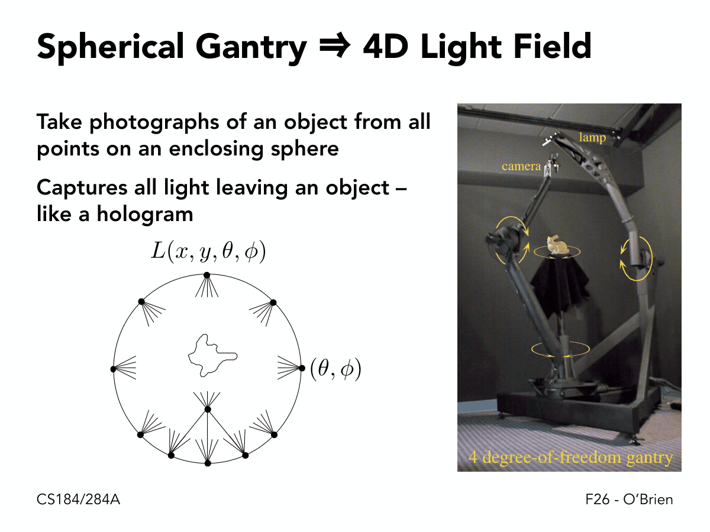

#### Multi-Camera Array ⇒ 4D Light Field

*PDF p52 · 对应本节：相机像素为何与辐亮度有关？*

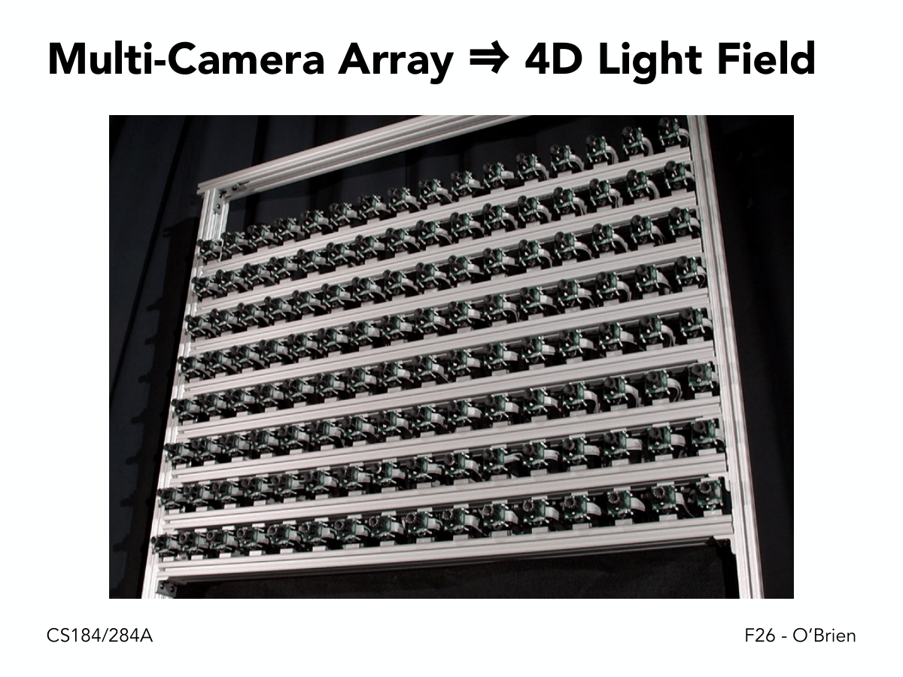

#### Two-Plane Light Field

*PDF p53 · 对应本节：相机像素为何与辐亮度有关？*

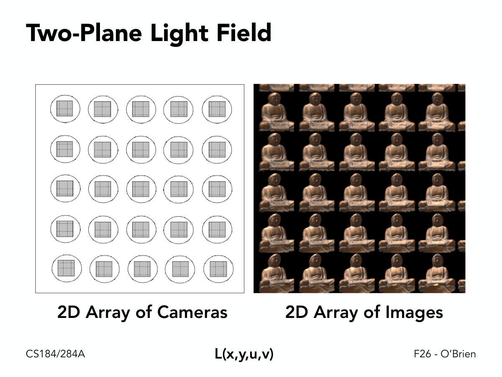

</details>

## 11. 为什么瓦特与流明不能混用？

辐射度量按物理功率计量，光度量按人眼明视觉敏感度对光谱加权。相同可见辐射功率，波长不同也会产生不同光通量。

课堂灯泡标注的流明是感知加权的总量，不能直接填进以瓦特为单位的渲染代码。若只学 RGB 渲染，也应注明它是颜色近似，不能自动做精确光谱换算。

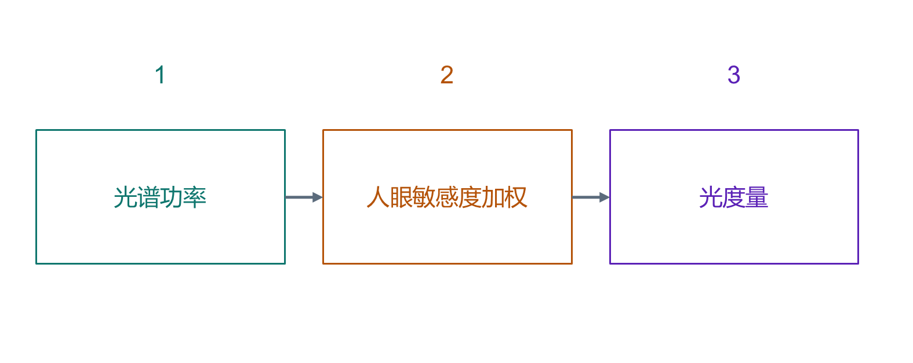

*读图：光谱功率 → 人眼敏感度加权 → 光度量。箭头表示本节的推理或处理顺序，具体条件见正文。*

### 先读符号与条件

| 符号 / 条件 | 含义 |
| --- | --- |
| Phi_v | 光通量 lm |
| V | 明视觉效率函数 |
| Phi_e,lambda | 光谱辐射通量 |
| 683 | 555 nm 标准峰值换算系数 |

### 核心关系与推导入口

以下关系使用上述条件；标为教学简化或补充的内容是为理解而推导，不是逐字转录课件。

$$
\Phi_v=683\int V(\lambda)\Phi_{e,\lambda}(\lambda)\,d\lambda
$$

### 🔧 手算 11：把关系落到数字上

理想 555 nm 单色光功率 0.01 W，对应 6.83 lm。反算 6.83/683=0.01 W；若换波长，必须再乘该波长的 V 值。

| 检查步骤 | 操作 |
| --- | --- |
| 输入 | 先从例子中抄下给定量及单位，不引入未给定的数值。 |
| 计算 | 按本节关系求中间量，再得到结果；不要在第一步就做显示裁剪或整数舍入。 |
| 回查 | 反算 6.83/683=0.01 W；若换波长，必须再乘该波长的 V 值。 |
| 适用边界 | 不能用“所有光都是 683 lm/W”换算普通白光；电功率的 lm/W 又是另一种效率。 |


*两条示意光谱有不同波段分布，光度量必须再乘视觉敏感度。*

### ⚠️ 易错点：先识别症状与假设

不能用“所有光都是 683 lm/W”换算普通白光；电功率的 lm/W 又是另一种效率。

### 停下来解释一次

**问题：lux 与 nit 是否是同一种亮度单位？**

<details>
<summary>展开参考回答</summary>

不是。lux 是照度 lm/m²；nit 是亮度 cd/m²，仍含方向密度含义。

</details>

<details>
<summary>展开原课件关键页，对照术语与图形</summary>

#### Photometry

*PDF p9 · 对应本节：为什么瓦特与流明不能混用？*


#### Modern LED Light

*PDF p24 · 对应本节：为什么瓦特与流明不能混用？*


#### Spectral Power Distribution - More in Color Lectures

*PDF p25 · 对应本节：为什么瓦特与流明不能混用？*


#### Radiometry & Photometry

*PDF p54 · 对应本节：为什么瓦特与流明不能混用？*


#### Radiometric & Photometric Terms & Units

*PDF p55 · 对应本节：为什么瓦特与流明不能混用？*


</details>

## 12. 怎样把单位检查变成调试工具？

把渲染公式的每一项都标上单位，可以发现漏除 PDF、漏乘面积或重复乘距离因子等错误。单位正确不是充分条件，但单位错误足以否决公式。

还要用三个极限检查：光源功率乘二，结果应乘二；背面余弦不应给负能量；均匀半球应能还原 πL。下一讲的采样估计器必须保留同一个积分的单位。


*读图：标注每项单位 → 检查积分测度 → 检查比例与边界。箭头表示本节的推理或处理顺序，具体条件见正文。*

### 先读符号与条件

| 符号 / 条件 | 含义 |
| --- | --- |
| 方括号 | 量纲 |
| cos theta | 无量纲 |
| 积分测度 | 不能省略的单位来源 |

### 核心关系与推导入口

以下关系使用上述条件；标为教学简化或补充的内容是为理解而推导，不是逐字转录课件。

$$
[L\cos\theta\,d\omega]=\frac{W}{m^2\,sr}\,sr=\frac{W}{m^2}
$$

### 🔧 手算 12：把关系落到数字上

L=3、方向范围 0.4 sr、cosθ≈0.5，近似 E=0.6 W/m²。功率翻倍使 L=6，E=1.2；1.2/0.6=2。

| 检查步骤 | 操作 |
| --- | --- |
| 输入 | 先从例子中抄下给定量及单位，不引入未给定的数值。 |
| 计算 | 按本节关系求中间量，再得到结果；不要在第一步就做显示裁剪或整数舍入。 |
| 回查 | 功率翻倍使 L=6，E=1.2；1.2/0.6=2。 |
| 适用边界 | 量纲通过不能检查法线是否朝反、可见性是否漏测；还需几何与数值对照。 |

### ⚠️ 易错点：先识别症状与假设

量纲通过不能检查法线是否朝反、可见性是否漏测；还需几何与数值对照。

### 停下来解释一次

**问题：为什么不能把每个采样方向的 L 直接相加？**

<details>
<summary>展开参考回答</summary>

那不是半球积分。必须乘相应积分权重，Monte Carlo 中通常是 cosθ/(N p(ω))。

</details>

<details>
<summary>展开原课件关键页，对照术语与图形</summary>

#### Radiometric & Photometric Terms & Units

*PDF p3 · 对应本节：怎样把单位检查变成调试工具？*


#### Irradiance from the Environment

*PDF p45 · 对应本节：怎样把单位检查变成调试工具？*


#### Radiometric & Photometric Terms & Units

*PDF p55 · 对应本节：怎样把单位检查变成调试工具？*


</details>

## 13. 把十二个数值例子连成检查顺序

先手算再运行。随仓库提供的 `scripts/cs184-numerical-checks.py` 是小模型验证，不依赖 GPU，也不修改服务器配置。它不能替代完整渲染场景或模拟系统的验证。

| 顺序 | 本节关系 | 最容易漏掉的约定 |
| --- | --- | --- |
| 1 | 为何“亮度”这个词不够用？ | 时间 t：秒 |
| 2 | 为什么要有立体角？ | omega：立体角，sr |
| 3 | 点光源向每个方向分多少功率？ | iso：各向同性假设 |
| 4 | 功率落到面积上会怎样？ | r：距离 |
| 5 | 为什么辐亮度要除以投影面积？ | domega：方向区域 |
| 6 | 入射与出射为什么要分开写？ | theta_i：与法线夹角 |
| 7 | 把所有方向加起来为何出现 π？ | 积分结果：投影后的半球立体角为 pi |
| 8 | 有限圆盘光源怎样照亮表面？ | L：恒定发射辐亮度 |
| 9 | 无损空间中什么量保持不变？ | 跨折射率界面：此式不能直接照搬 |
| 10 | 相机像素为何与辐亮度有关？ | 假设：几何光学且光线可穿过两平面 |
| 11 | 为什么瓦特与流明不能混用？ | 683：555 nm 标准峰值换算系数 |
| 12 | 怎样把单位检查变成调试工具？ | 积分测度：不能省略的单位来源 |

### 复现实验的最小记录

| 记录项 | 用途 |
| --- | --- |
| 固定输入 | 相同几何、材质、网格或信号，避免一次改变多个因素。 |
| 参数与单位 | 包括采样数、步长、分辨率、角度单位、颜色空间。 |
| 输出量 | 保留线性值、误差或状态，再生成展示图。 |
| 参考 | 解析解、手算或高精度结果必须说明来源。 |
| 失败样例 | 边界和极端条件是检查假设的入口。 |

## 14. 实现排查：把公式错误与系统错误分开

本节列出由模型和手算能够判断的排查方向；没有把尚未写出的完整应用测试说成已完成。最小数值检查的真实执行结果见本次发布核对报告。

### 阶段 1：第 1–4 节

| 涉及关系 | 错误机制 / 修正方向 |
| --- | --- |
| 为何“亮度”这个词不够用？ | 灯泡的电功率不等于辐射光功率；散热与驱动损耗不能当作可见光输入。 |
| 为什么要有立体角？ | 立体角不是平面角的平方；单位写 sr，几何定义用球面面积比例。 |
| 点光源向每个方向分多少功率？ | “所有方向均匀”不是只除以半球 2π；若只向半球发射，必须明确新模型。 |
| 功率落到面积上会怎样？ | 背面余弦为负不能产生负照明；单面表面通常截断为零。 |

### 阶段 2：第 5–8 节

| 涉及关系 | 错误机制 / 修正方向 |
| --- | --- |
| 为什么辐亮度要除以投影面积？ | 把 irradiance 与 radiance 都叫“亮度”会丢失方向信息；变量命名应保留 E 与 L 的区别。 |
| 入射与出射为什么要分开写？ | 沿射线方向与“指向来源的入射方向”相差一个负号；最常见症状是半球判断把所有灯都剔除了。 |
| 把所有方向加起来为何出现 π？ | 积分 dω 与积分 dθdφ 不一样；漏掉 sinθ 会导致方向密度错误。 |
| 有限圆盘光源怎样照亮表面？ | 该式不适用于任意倾斜圆盘或有遮挡的情况；此时需重新积分或采样。 |

### 阶段 3：第 9–12 节

| 涉及关系 | 错误机制 / 修正方向 |
| --- | --- |
| 无损空间中什么量保持不变？ | 玻璃、雾和吸收介质会改变传播关系；“永远不衰减”不是普遍定律。 |
| 相机像素为何与辐亮度有关？ | 4D 是参数维数，不是四维空间；自由空间方向可用两个角度表示。 |
| 为什么瓦特与流明不能混用？ | 不能用“所有光都是 683 lm/W”换算普通白光；电功率的 lm/W 又是另一种效率。 |
| 怎样把单位检查变成调试工具？ | 量纲通过不能检查法线是否朝反、可见性是否漏测；还需几何与数值对照。 |

## 15. 跨讲连接：同一工具在哪些尺度重复出现？

| 前置工具 | 在整门课里的用途 | 回查 |
| --- | --- | --- |
| 采样与积分 | 像素、光源、孔径、时间、方向都需要有限样本估计连续量。 | [L03](/notes/cs184-03-sampling-aliasing/) / [L15](/notes/cs184-15-monte-carlo-integration/) |
| 坐标与线性代数 | 相机、法线、骨架与局部速度都需要一致的参考系。 | [L04–05](/notes/cs184-04-05-transforms/) |
| 几何表示 | 可见性、接触、遮挡与网格邻域依赖可靠的几何关系。 | [L11–12](/notes/cs184-11-12-meshes-geometry/) |
| 物理量与单位 | 把颜色值、概率密度、力和能量区别开，防止错误补偿。 | [L14](/notes/cs184-14-radiometry/) |
| 颜色与显示 | 展示图不等于线性数据；显示变换会改变视觉比较。 | [L19–20](/notes/cs184-19-20-color-science/) |

回头看，许多错误并非来自复杂公式，而是来自“同一个词指了不同的量”：方向密度与概率、位置与方向、线性颜色与编码颜色、稳定与准确。先说清对象，再选择算法。

## 16. 自测：能否不看公式说清楚？

### 自测 1. 把 12 J 直接作为点光源强度会少什么？

<details>
<summary>参考答案</summary>

少了时间和方向的定义，单位也不匹配；点光源强度通常以 W/sr 表示。

</details>

### 自测 2. 远处物体面积不变，立体角如何变化？

<details>
<summary>参考答案</summary>

小面元近似下按距离平方反比变化，并且还要乘面元相对视线的投影余弦。

</details>

### 自测 3. 灯具朝下照，是否仍能用 Phi/4π 求任意方向强度？

<details>
<summary>参考答案</summary>

不能，那只是各向同性特例；要读取或建模角度分布。

</details>

### 自测 4. 距离翻倍且保持朝向，辐照度变成多少？

<details>
<summary>参考答案</summary>

理想点光源与无遮挡条件下变成四分之一；扩展光源近场不能直接套此整体公式。

</details>

### 自测 5. L 相同是否意味着两个面积不同的灯总功率相同？

<details>
<summary>参考答案</summary>

不。还要对面积和发射方向积分；更大的同辐亮度面光源通常总功率更大。

</details>

### 自测 6. Li 与 Lo 的单位相同，能否设置为相等？

<details>
<summary>参考答案</summary>

一般不能。只有特定传播关系连接两点时有相应等式，表面处还要考虑材质和发射。

</details>

### 自测 7. 均匀半球光照为什么不是 2πL？

<details>
<summary>参考答案</summary>

接收表面只截取各方向的投影贡献，余弦权重把半球积分从 2π 降到 π。

</details>

### 自测 8. 当圆盘很远时，这个公式符合平方衰减吗？

<details>
<summary>参考答案</summary>

符合。d 远大于 R 时分母近似 d²，E 近似 LπR²/d²。

</details>

### 自测 9. 远处面光源看起来更小与 L 守恒矛盾吗？

<details>
<summary>参考答案</summary>

不矛盾。角域变小影响积分范围，L 是角域内部的密度。

</details>

### 自测 10. 一个全景图等于完整光场吗？

<details>
<summary>参考答案</summary>

不。全景图通常只覆盖一个位置的所有方向，缺少位置变化带来的视差。

</details>

### 自测 11. lux 与 nit 是否是同一种亮度单位？

<details>
<summary>参考答案</summary>

不是。lux 是照度 lm/m²；nit 是亮度 cd/m²，仍含方向密度含义。

</details>

### 自测 12. 为什么不能把每个采样方向的 L 直接相加？

<details>
<summary>参考答案</summary>

那不是半球积分。必须乘相应积分权重，Monte Carlo 中通常是 cosθ/(N p(ω))。

</details>

### 自测 13. 第 1 节的数值例子，哪一项假设不能悄悄删掉？

<details>
<summary>参考答案与反例入口</summary>

灯泡的电功率不等于辐射光功率；散热与驱动损耗不能当作可见光输入。

再复算本节的例子：恒定功率 6 W 持续 4 秒，能量 Q=24 J。反算 24/4=6 W。若一半时间关闭，平均功率为 3 W。

</details>

### 自测 14. 第 2 节的数值例子，哪一项假设不能悄悄删掉？

<details>
<summary>参考答案与反例入口</summary>

立体角不是平面角的平方；单位写 sr，几何定义用球面面积比例。

再复算本节的例子：半径 2 米球面上一块面积 1 平方米的区域，立体角为 1/4 sr。同方向区域换到半径 4 米，面积变成 4 平方米，仍为 4/16=1/4 sr。

</details>

### 自测 15. 第 3 节的数值例子，哪一项假设不能悄悄删掉？

<details>
<summary>参考答案与反例入口</summary>

“所有方向均匀”不是只除以半球 2π；若只向半球发射，必须明确新模型。

再复算本节的例子：各向同性光源通量 8π W，强度为 2 W/sr。一个 0.1 sr 小锥收到约 0.2 W；对整个球积分 2×4π=8π W。

</details>

### 自测 16. 第 4 节的数值例子，哪一项假设不能悄悄删掉？

<details>
<summary>参考答案与反例入口</summary>

背面余弦为负不能产生负照明；单面表面通常截断为零。

再复算本节的例子：I=8 W/sr，r=2 米，θ=60°，E=8×0.5/4=1 W/m²。距离改为 4 米得到 0.25；乘面积 2 平方米得功率约 0.5 W（小面近似）。

</details>

### 自测 17. 第 5 节的数值例子，哪一项假设不能悄悄删掉？

<details>
<summary>参考答案与反例入口</summary>

把 irradiance 与 radiance 都叫“亮度”会丢失方向信息；变量命名应保留 E 与 L 的区别。

再复算本节的例子：微小通量 0.02 W，面积 0.1 m²，cosθ=0.5，方向范围 0.2 sr，L=2 W/(m² sr)。回乘 2×0.1×0.5×0.2=0.02。

</details>

### 自测 18. 第 6 节的数值例子，哪一项假设不能悄悄删掉？

<details>
<summary>参考答案与反例入口</summary>

沿射线方向与“指向来源的入射方向”相差一个负号；最常见症状是半球判断把所有灯都剔除了。

再复算本节的例子：Li=4，cosθ=0.5，dω=0.1，得到 dE=0.2 W/m²。由 dE/(cosθ dω) 反求仍为 4。

</details>

### 自测 19. 第 7 节的数值例子，哪一项假设不能悄悄删掉？

<details>
<summary>参考答案与反例入口</summary>

积分 dω 与积分 dθdφ 不一样；漏掉 sinθ 会导致方向密度错误。

再复算本节的例子：L0=2 时 E=2π≈6.283。若错误只乘半球面积会得 4π，正好多一倍；检查 cosθ 平均值 1/2 可再次得到 2π。

</details>

### 自测 20. 第 8 节的数值例子，哪一项假设不能悄悄删掉？

<details>
<summary>参考答案与反例入口</summary>

该式不适用于任意倾斜圆盘或有遮挡的情况；此时需重新积分或采样。

再复算本节的例子：R=1、d=1、L=2，E=π。d=√3 时 E=π/2；代入角度 α=30°，2π×1/4 也得 π/2。

</details>

### 自测 21. 第 9 节的数值例子，哪一项假设不能悄悄删掉？

<details>
<summary>参考答案与反例入口</summary>

玻璃、雾和吸收介质会改变传播关系；“永远不衰减”不是普遍定律。

再复算本节的例子：沿真空射线初始 L=5，前进 1 米与 2 米都仍为 5。若灯所占立体角从 0.2 缩到 0.05 sr，近法线照度从约 1 降为 0.25。

</details>

### 自测 22. 第 10 节的数值例子，哪一项假设不能悄悄删掉？

<details>
<summary>参考答案与反例入口</summary>

4D 是参数维数，不是四维空间；自由空间方向可用两个角度表示。

再复算本节的例子：2×3 个相机位置，每个位置采 4×5 个方向，总共存 120 个光线样本。改成单相机只剩 20 个；120/20=6 恰等于视点数。

</details>

### 自测 23. 第 11 节的数值例子，哪一项假设不能悄悄删掉？

<details>
<summary>参考答案与反例入口</summary>

不能用“所有光都是 683 lm/W”换算普通白光；电功率的 lm/W 又是另一种效率。

再复算本节的例子：理想 555 nm 单色光功率 0.01 W，对应 6.83 lm。反算 6.83/683=0.01 W；若换波长，必须再乘该波长的 V 值。

</details>

### 自测 24. 第 12 节的数值例子，哪一项假设不能悄悄删掉？

<details>
<summary>参考答案与反例入口</summary>

量纲通过不能检查法线是否朝反、可见性是否漏测；还需几何与数值对照。

再复算本节的例子：L=3、方向范围 0.4 sr、cosθ≈0.5，近似 E=0.6 W/m²。功率翻倍使 L=6，E=1.2；1.2/0.6=2。

</details>

### 自测 25. 本讲的输入、输出和中间表示各是什么？

<details>
<summary>参考答案</summary>

能量 → 每秒通过多少 → 分到哪些方向 → 落到多大面积 → 单位投影面积与方向上的光 → 半球积分。请沿箭头逐项解释，尤其说清中间表示的单位、坐标或概率测度；只复述名词不算掌握。

</details>

### 自测 26. 能否只用一张“看起来正确”的图片证明实现正确？

<details>
<summary>参考答案</summary>

不能。需要将关键关系拆成可预测的小输入，检查数值、边界与对照；随机方法还要区分一次结果与统计期望，显示图还需区分编码与原始数据。

</details>

## 17. 带走的结论与仍需练习的内容

- 少了时间和方向的定义，单位也不匹配；点光源强度通常以 W/sr 表示。
- 小面元近似下按距离平方反比变化，并且还要乘面元相对视线的投影余弦。
- 不能，那只是各向同性特例；要读取或建模角度分布。
- 理想点光源与无遮挡条件下变成四分之一；扩展光源近场不能直接套此整体公式。
- 不。还要对面积和发射方向积分；更大的同辐亮度面光源通常总功率更大。
- 一般不能。只有特定传播关系连接两点时有相应等式，表面处还要考虑材质和发射。
- 接收表面只截取各方向的投影贡献，余弦权重把半球积分从 2π 降到 π。
- 符合。d 远大于 R 时分母近似 d²，E 近似 LπR²/d²。
- 不矛盾。角域变小影响积分范围，L 是角域内部的密度。
- 不。全景图通常只覆盖一个位置的所有方向，缺少位置变化带来的视差。
- 不是。lux 是照度 lm/m²；nit 是亮度 cd/m²，仍含方向密度含义。
- 那不是半球积分。必须乘相应积分权重，Monte Carlo 中通常是 cosθ/(N p(ω))。

| 层次 | 已经说明 | 还需动手验证 |
| --- | --- | --- |
| 概念 | 本篇十二个问题、公式与原页对应。 | 用自己的话重新解释，并给出一个反例。 |
| 数值 | 正文手算与解析小模型。 | 改变一个输入，预测再运行。 |
| 系统 | 指出实现条件和典型错误。 | 完整应用需另外检查场景、性能和边界。 |

## 18. 整门课闭环与继续阅读

| 讲义 | 起点问题 | 得到的工具或终点 |
| --- | --- | --- |
| [L01 · 导论](/notes/cs184-01-introduction/) | 这门课在求什么？ | 从场景到像素与感知 |
| [L02 · 三角形与覆盖](/notes/cs184-02-drawing-triangles/) | 像素由哪些图元覆盖？ | 半平面判定与插值 |
| [L03 · 采样与抗锯齿](/notes/cs184-03-sampling-aliasing/) | 离散图像为何锯齿？ | 区域积分、过滤与采样 |
| [L04–05 · 变换](/notes/cs184-04-05-transforms/) | 怎样放置物体和相机？ | 坐标系、矩阵与投影 |
| [L06–07 · 纹理](/notes/cs184-06-07-texture-mapping/) | 表面参数如何随位置变化？ | UV、过滤与像素足迹 |
| [L08–09 · 着色](/notes/cs184-08-09-rasterization-shading/) | 看见哪个表面、怎样着色？ | 深度、管线与局部照明 |
| [L10 · 曲线曲面](/notes/cs184-10-bezier-curves-surfaces/) | 怎样控制连续形状？ | 插值、逼近与连续性 |
| [L11–12 · 几何](/notes/cs184-11-12-meshes-geometry/) | 复杂表面如何表示和操作？ | 网格、拓扑与几何处理 |
| [L13 · 光线追踪](/notes/cs184-13-ray-tracing-acceleration/) | 光线怎样快速找到最近表面？ | 求交与 BVH |
| [第 14 讲](/notes/cs184-14-radiometry/) | 能量 | 半球积分 |
| [第 15 讲](/notes/cs184-15-monte-carlo-integration/) | 像素是积分 | 降低方差 |
| [第 16–17 讲](/notes/cs184-16-17-global-illumination/) | 命中表面 | 加权累积与终止 |
| [春季 L18](/notes/cs184-18-material-modeling/) | 材质是散射规律 | 更细结构与体积传播 |
| [春季 L19–20](/notes/cs184-19-20-color-science/) | 光谱进入眼睛 | 线性运算与显示 |
| [春季 L21–23](/notes/cs184-21-23-animation/) | 表达运动意图 | 从末端目标反求关节 |
| [春季 L24](/notes/cs184-24-physical-simulation/) | 选择状态 | 施加碰撞和约束 |
| [春季 L25](/notes/cs184-25-fluid-simulation/) | 粒子或网格表示 | 边界与数值误差 |
| [春季 L26–27](/notes/cs184-26-27-virtual-reality/) | 人眼需要哪些线索 | 全景与光场 |
| [补充 A](/notes/cs184-supplement-cameras-lenses/) | 视场与透视 | 真实镜头与传感器 |
| [补充 B](/notes/cs184-supplement-image-processing/) | 图像是离散信号 | 频率量化与压缩 |

春季 L18–27 与夏季补充专题保留本地文件标识，**不冒充不存在的秋季同编号讲次**。可以按上表顺序学习，也可在相机、颜色、采样之间按依赖往返。

## 19. 原课件全页索引与来源

[原课件文件与版本记录](https://github.com/Teddy-Yangjiale/CS184/blob/main/CS184_2026/fa26/lectures/L14-radiometry.pdf) · [课程官网](https://cs184.eecs.berkeley.edu/fa26/)

文件：`L14-radiometry.pdf`；PDF 页数：56；SHA-256：`cf8e289c8a063a856425f5f9888a88f6347801c29132f01e19e2225f5e4c79f9`。

“正文核对”表示本篇实际引用该页截图；“索引保留”包括演示、行政信息、补充、致谢与重复构建页，不表示逐页都有独立讲解。原视频的运动过程不能由静态 PDF 截图完整复现。

| PDF 页 | 原页可提取标题 | 本篇使用 |
| --- | --- | --- |
| 1 | Computer Graphics and Imaging | 索引保留 |
| 2 | Radiometry | 正文核对 |
| 3 | Radiometric & Photometric Terms & Units | 正文核对 |
| 4 | Visible electromagnetic spectrum | 索引保留 |
| 5 | Lights: How Do They Work? | 索引保留 |
| 6 | Flux – What’s the Density of Photons Flowing Through a Sensor? | 索引保留 |
| 7 | Radiant Energy and Flux (Power) | 正文核对 |
| 8 | Radiant Energy and Flux (Power) | 正文核对 |
| 9 | Photometry | 正文核对 |
| 10 | Example Light Measurements of Interest | 索引保留 |
| 11 | Radiant Intensity | 正文核对 |
| 12 | Radiant Intensity | 正文核对 |
| 13 | Angles and Solid Angles | 正文核对 |
| 14 | Angles and Solid Angles | 正文核对 |
| 15 | Solid Angles in Practice | 索引保留 |
| 16 | Solid Angles in Practice | 索引保留 |
| 17 | Differential Solid Angles | 索引保留 |
| 18 | Differential Solid Angles | 正文核对 |
| 19 | Differential Solid Angles | 索引保留 |
| 20 | Differential Solid Angles | 正文核对 |
| 21 | Differential Solid Angles | 正文核对 |
| 22 | as a direction vector | 索引保留 |
| 23 | Isotropic Point Source | 正文核对 |
| 24 | Modern LED Light | 正文核对 |
| 25 | Spectral Power Distribution - More in Color Lectures | 正文核对 |
| 26 | Goniometric Diagrams | 索引保留 |
| 27 | Light Fixture Measurements - Goniometric Diagram | 索引保留 |
| 28 | PH Artichoke Lamps in Rivercenter for the Performing Arts, Georgia | 索引保留 |
| 29 | Rendering with Goniometric Diagrams | 索引保留 |
| 30 | Irradiance | 正文核对 |
| 31 | Irradiance | 正文核对 |
| 32 | Typical Values of Illuminance [lm/m2] | 索引保留 |
| 33 | Irradiance at surface is proportional to cosine of angle | 正文核对 |
| 34 | Why Do We Have Seasons? | 索引保留 |
| 35 | Irradiance Falloff | 正文核对 |
| 36 | Radiance | 正文核对 |
| 37 | Radiance | 正文核对 |
| 38 | Surface Radiance | 正文核对 |
| 39 | Incident Surface Radiance | 正文核对 |
| 40 | Exiting Surface Radiance | 正文核对 |
| 41 | Incident & Exiting Surface Radiance Differ! | 正文核对 |
| 42 | Field Radiance or Light Field | 正文核对 |
| 43 | Typical Values of Luminance [cd/m2] | 索引保留 |
| 44 | Calculating with Radiance | 正文核对 |
| 45 | Irradiance from the Environment | 正文核对 |
| 46 | Irradiance from Uniform Hemispherical Light | 正文核对 |
| 47 | Irradiance from a Uniform Area Source | 正文核对 |
| 48 | Uniform Disk Source Overhead | 正文核对 |
| 49 | Measuring Radiance | 正文核对 |
| 50 | A Pinhole Camera Samples Radiance | 正文核对 |
| 51 | Spherical Gantry ⇒ 4D Light Field | 正文核对 |
| 52 | Multi-Camera Array ⇒ 4D Light Field | 正文核对 |
| 53 | Two-Plane Light Field | 正文核对 |
| 54 | Radiometry & Photometry | 正文核对 |
| 55 | Radiometric & Photometric Terms & Units | 正文核对 |
| 56 | Acknowledgments | 索引保留 |
