> UC Berkeley · CS184/284A · Fall 2026 · 文件标识 `L15-monte-carlo-integration.pdf`。
> 本文的 **pN 一律是 PDF 的第 N 页**，不是封面讲次或页脚旧编号。文件名与封面可能不同，以下均按文件和页码回查。

## 0. 先抓住这一条推理链

```text
像素是积分
    ↓
高维规则网格太贵
    ↓
按概率抽样
    ↓
除以抽样密度
    ↓
保持期望
    ↓
降低方差
```

这篇笔记的阅读顺序是：先理解输入和输出，再确认公式的条件，最后用小数值检查。
正文将课件概念、补充推导和教学例子分开；示意图中的理想几何与数字不冒充真实实验测量。

| 内容 | 本文提供什么 |
|---|---|
| 来源 | Fall 2026，PDF 共 113 页；正文选择 48 张关键页 |
| 图解 | 12 张概念关系图 + 12 张几何或数值图，均有原生可编辑 PPTX |
| 手算 | 16 个教学例子；深入部分展开输入、中间量、回代、反例与代码 |
| 复习 | 30 道自测及答案，末尾保留全页索引 |
| 运行证据 | 数值核对脚本覆盖解析小模型，不代表完整渲染器或模拟器已经实现 |

[下载本篇 24 张可编辑图解（PPTX 与操作 JSON）](/notes/cs184/figures/15-editable.zip)

### 课件与推导的使用边界

课件截图用于对照原始定义与几何；正文用中文解释关系，并提供必要的修正与推导。
后续专题按本地文件的学期和编号组织，不假定它们与秋季一一对应。
若只做第一遍学习，先读每节前两段和数值例子，再展开原页核对。

### 与前面哪一讲接上

先回顾[相关前置讲义](/notes/cs184-14-radiometry/)。本篇在已有表示与数学工具上增加新变量或新约束，而不是另起一套互不相关的公式。

## 1. 为什么不一直细分网格？

上讲把辐照度写成半球积分，第三讲把像素写成面积平均；镜头、时间和反弹方向继续增加积分维数。规则网格若每维用 k 个点，总数是 k 的维数次方。

Monte Carlo 用随机点估计积分，典型独立样本误差随 N 的平方根下降。这个指数不显式依赖维数，但常数项依赖函数方差，不能理解为高维问题自动变容易。

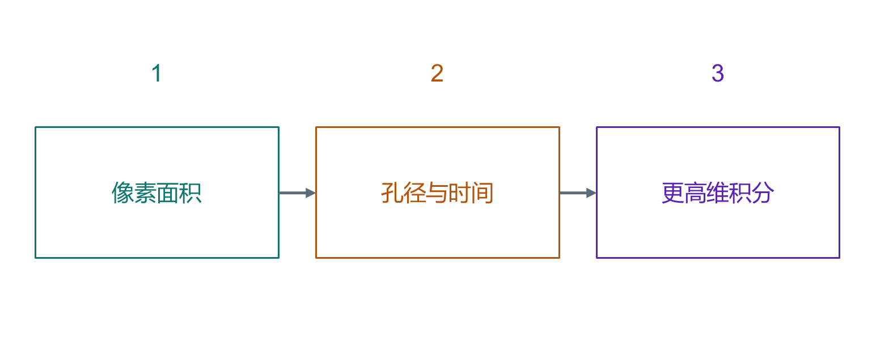

*读图：像素面积 → 孔径与时间 → 更高维积分。箭头表示本节的推理或处理顺序，具体条件见正文。*

### 先读符号与条件

| 符号 / 条件 | 含义 |
| --- | --- |
| k | 每维采样数 |
| d | 积分维数 |
| N | 总样本数 |

### 核心关系与推导入口

以下关系使用上述条件；标为教学简化或补充的内容是为理解而推导，不是逐字转录课件。

$$
N_{grid}=k^d
$$

### 🔧 手算 1：把关系落到数字上

每维 8 点，二维需 64，五维需 32768，比例 512。代回 8³=512，新增三维正好放大 512 倍。

| 检查步骤 | 操作 |
| --- | --- |
| 输入 | 先从例子中抄下给定量及单位，不引入未给定的数值。 |
| 计算 | 按本节关系求中间量，再得到结果；不要在第一步就做显示裁剪或整数舍入。 |
| 回查 | 代回 8³=512，新增三维正好放大 512 倍。 |
| 适用边界 | “不依赖维数”只指常见收敛阶；窄光源、遮挡与高光仍会显著增大方差。 |

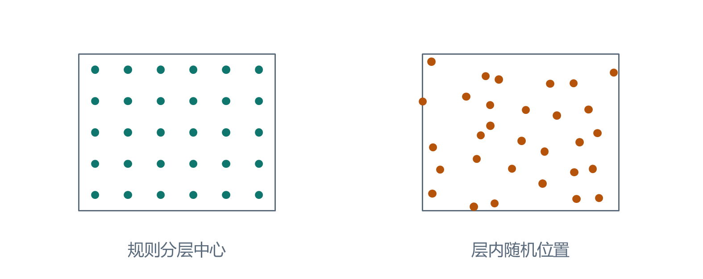

*两组样本都覆盖同一方形，右侧加入层内随机性以打散规律。*

### ⚠️ 易错点：先识别症状与假设

“不依赖维数”只指常见收敛阶；窄光源、遮挡与高光仍会显著增大方差。

### 停下来解释一次

**问题：为什么五维相机积分不是五个独立的一维平均相乘？**

<details>
<summary>展开参考回答</summary>

被积函数通常耦合这些变量，例如遮挡随孔径与时间变化，不能一般地拆成乘积。

</details>

<details>
<summary>展开原课件关键页，对照术语与图形</summary>

#### Numerical Integration: e.g. Trapezoidal Rule

*PDF p3 · 对应本节：为什么不一直细分网格？*

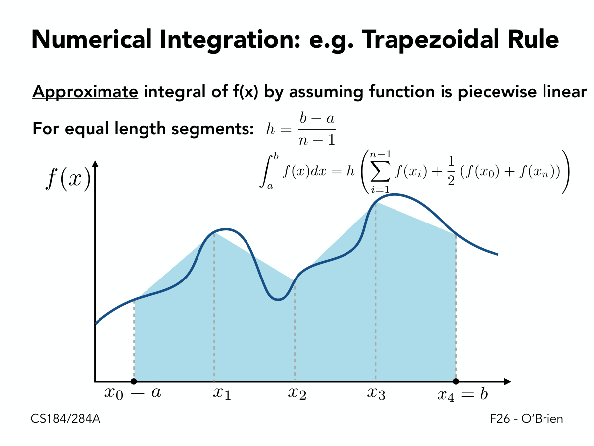

#### 2D Integral: Recall Antialiasing By Area Sampling

*PDF p6 · 对应本节：为什么不一直细分网格？*

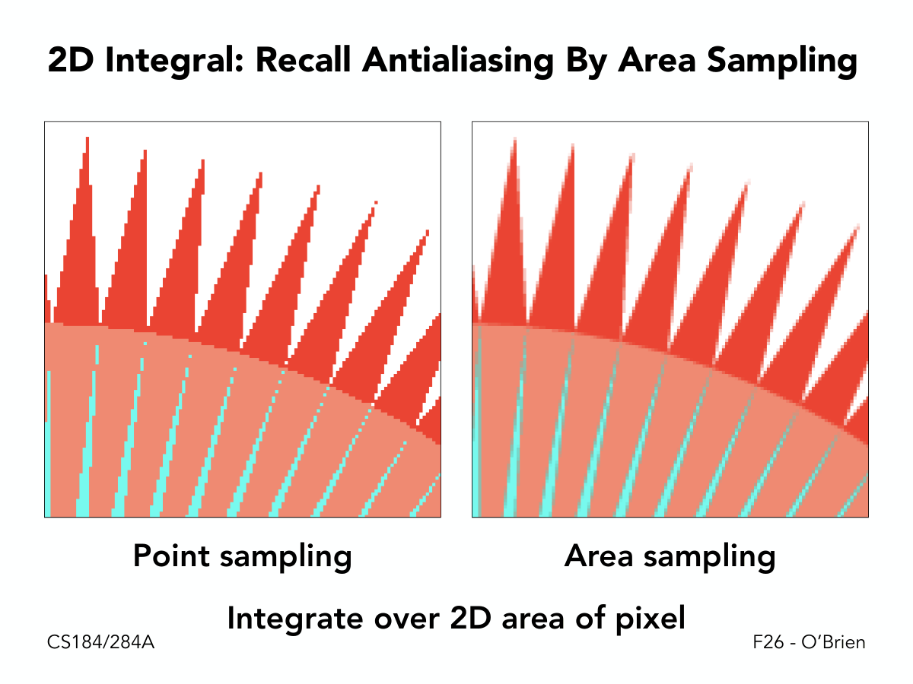

#### 2D Integral: Irradiance from the Environment

*PDF p7 · 对应本节：为什么不一直细分网格？*

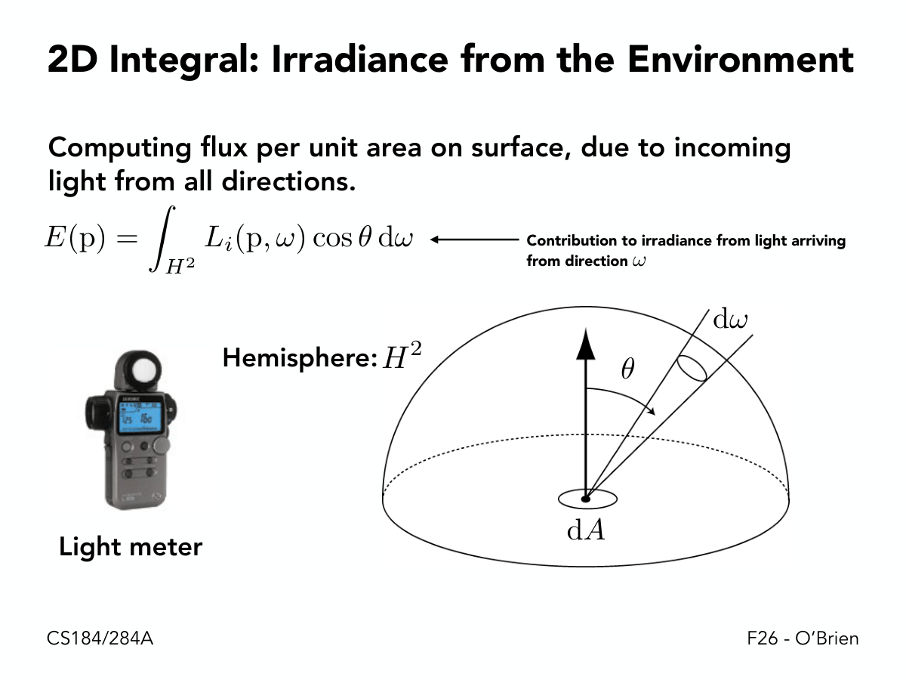

#### 3D Integral: Motion Blur

*PDF p8 · 对应本节：为什么不一直细分网格？*

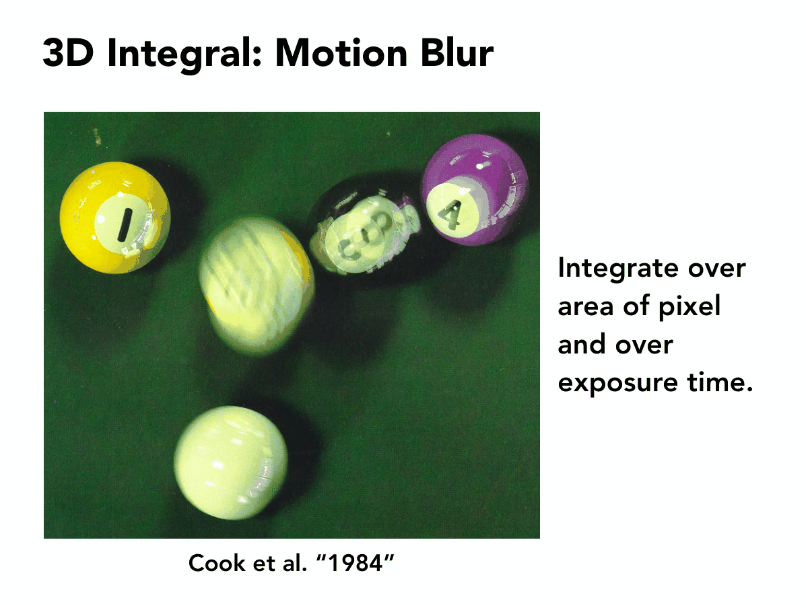

#### 5D Integral: Real Camera Pixel Exposure

*PDF p9 · 对应本节：为什么不一直细分网格？*

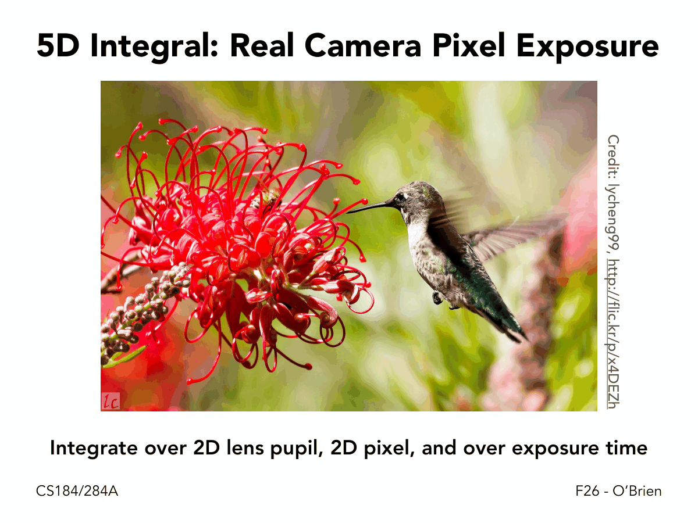

#### High-Dimensional Integration

*PDF p14 · 对应本节：为什么不一直细分网格？*

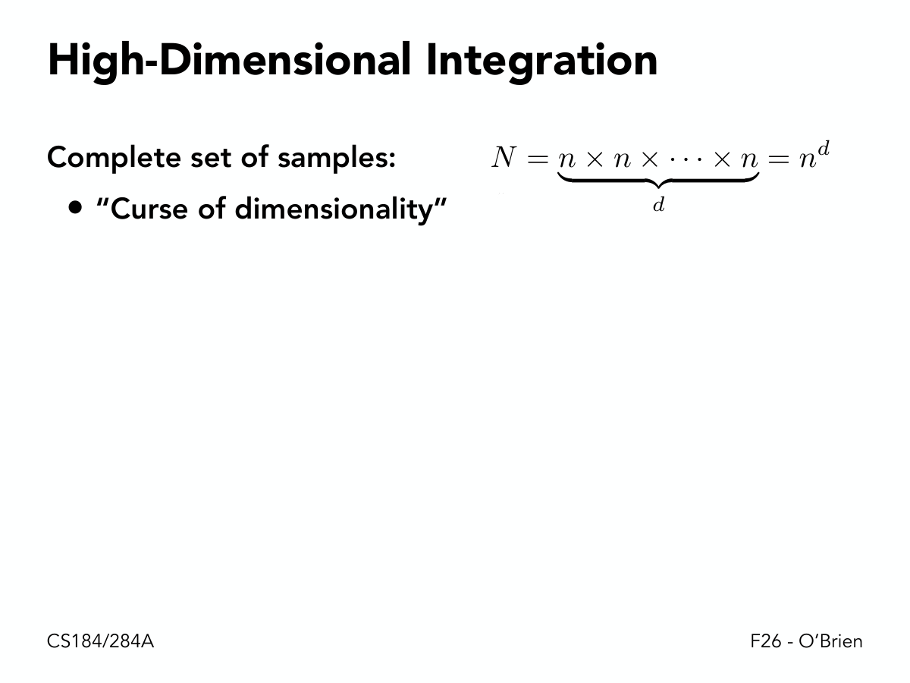

#### High-Dimensional Integration

*PDF p18 · 对应本节：为什么不一直细分网格？*

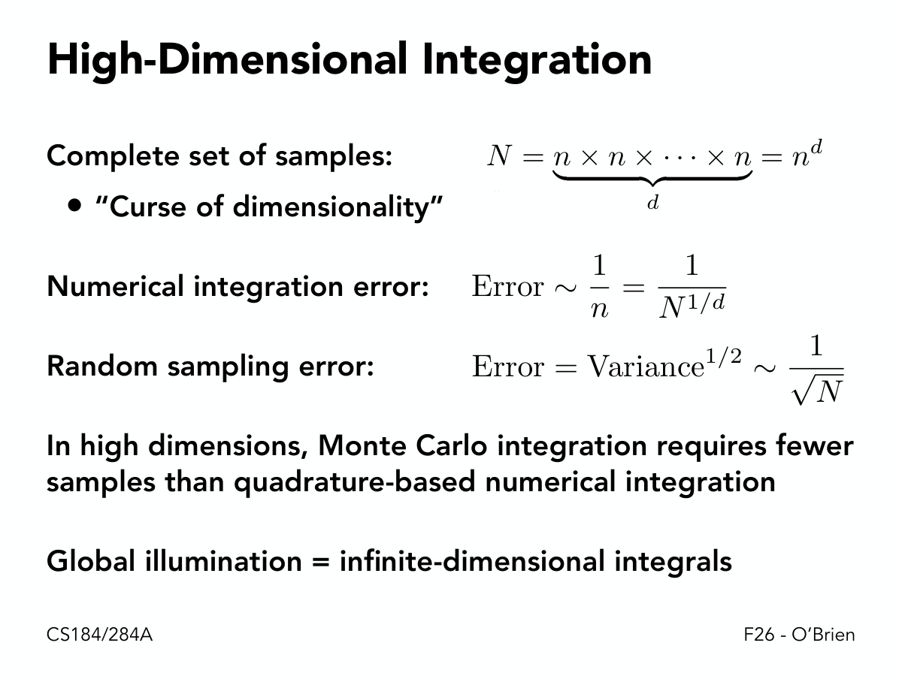

</details>

## 2. 概率密度与概率有什么区别？

连续随机变量在单点上的概率通常为零，PDF 表示每单位区间的概率密度。某一区间的概率是密度积分；PDF 可以大于 1，只要总积分为 1。

期望则是函数值按密度加权。理解这一点，才能看懂为什么采到罕见方向后要给它更大的权重，而不是把“密度小”误认为“贡献应该小”。

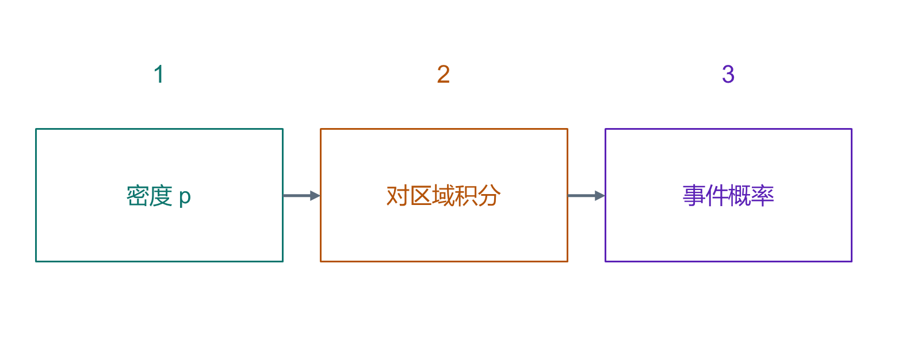

*读图：密度 p → 对区域积分 → 事件概率。箭头表示本节的推理或处理顺序，具体条件见正文。*

### 先读符号与条件

| 符号 / 条件 | 含义 |
| --- | --- |
| p | 概率密度 |
| A | 积分域内事件 |
| g | 随机变量的函数 |

### 核心关系与推导入口

以下关系使用上述条件；标为教学简化或补充的内容是为理解而推导，不是逐字转录课件。

$$
\Pr(X\in A)=\int_A p(x)dx,\qquad \mathbb E[g(X)]=\int g(x)p(x)dx
$$

### 🔧 手算 2：把关系落到数字上

区间 [0,0.25] 上均匀分布的密度为 4。落在 [0,0.1] 的概率为 4×0.1=0.4；全域积分 4×0.25=1。

| 检查步骤 | 操作 |
| --- | --- |
| 输入 | 先从例子中抄下给定量及单位，不引入未给定的数值。 |
| 计算 | 按本节关系求中间量，再得到结果；不要在第一步就做显示裁剪或整数舍入。 |
| 回查 | 落在 [0,0.1] 的概率为 4×0.1=0.4；全域积分 4×0.25=1。 |
| 适用边界 | 把密度硬截断到 1 会改变分布和估计器；方向 PDF 的单位可为 sr⁻¹。 |

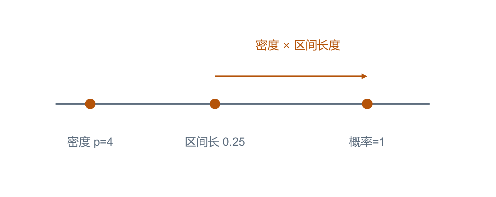

*概率密度可以大于一，密度乘区间长度才是概率。*

### ⚠️ 易错点：先识别症状与假设

把密度硬截断到 1 会改变分布和估计器；方向 PDF 的单位可为 sr⁻¹。

### 停下来解释一次

**问题：PDF 数值 4 是否违反概率不能超过 1？**

<details>
<summary>展开参考回答</summary>

不违反。密度不是概率；需要与区间长度或其他测度相乘。

</details>

<details>
<summary>展开原课件关键页，对照术语与图形</summary>

#### Random Variables

*PDF p28 · 对应本节：概率密度与概率有什么区别？*

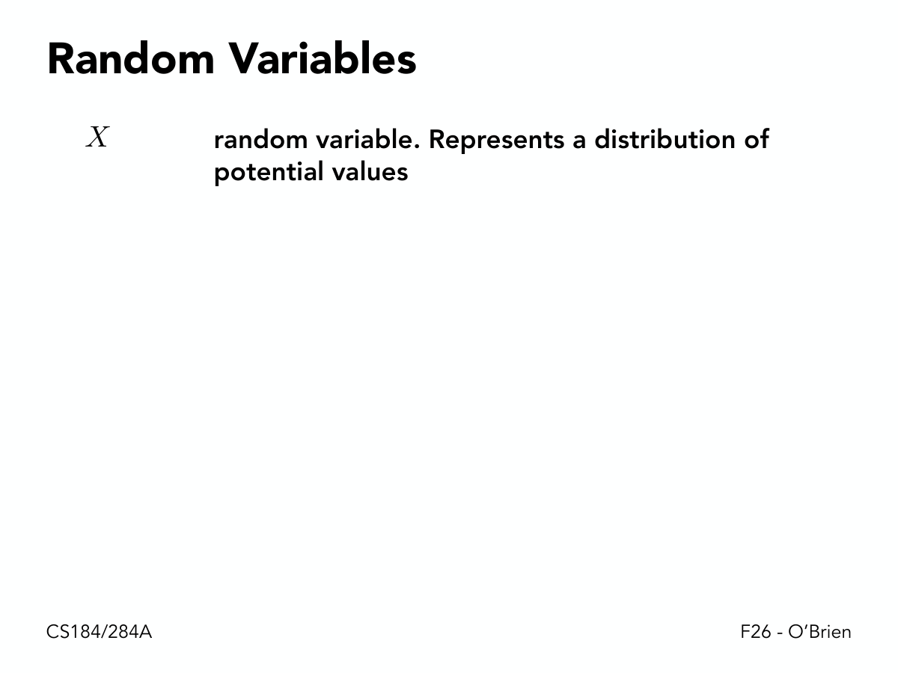

#### Probability Distribution Function (PDF)

*PDF p32 · 对应本节：概率密度与概率有什么区别？*

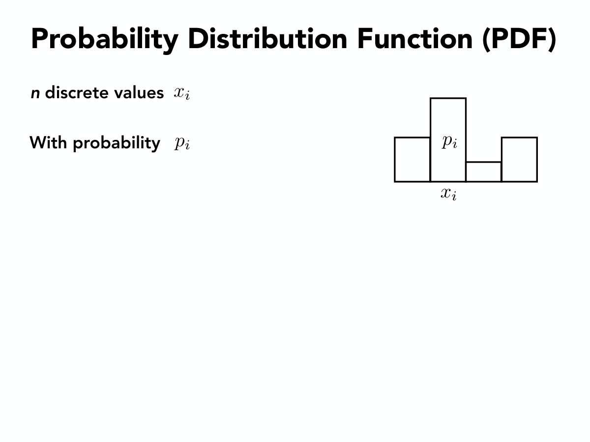

#### Continuous Probability Distribution Function

*PDF p40 · 对应本节：概率密度与概率有什么区别？*

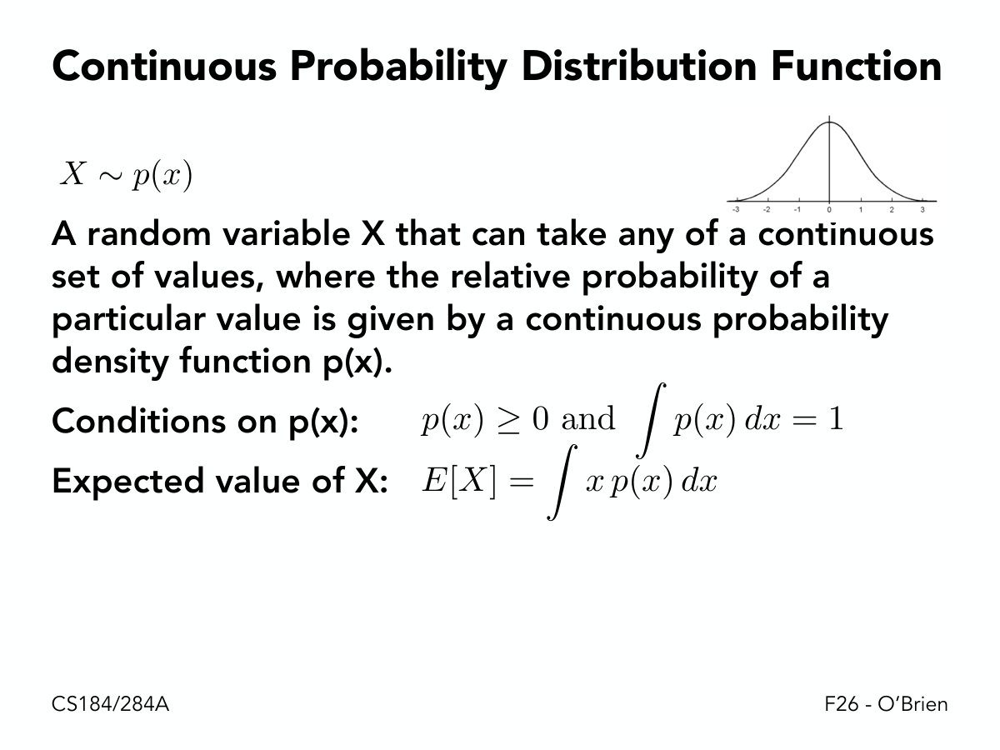

#### Function of a Random Variable

*PDF p41 · 对应本节：概率密度与概率有什么区别？*

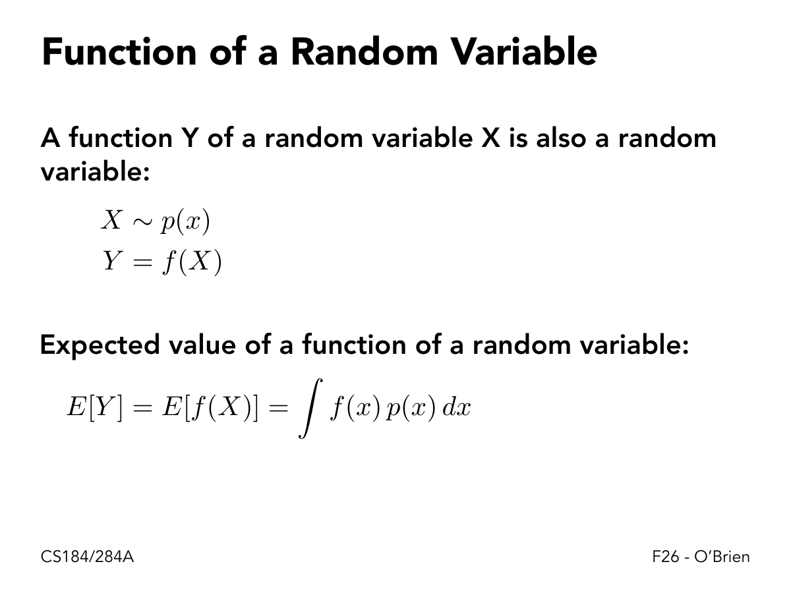

</details>

## 3. 为什么一定要除以 PDF？

希望求的是 f 对整个区域的积分，但随机样本来自 p。样本平均天然逼近 ∫g p，因此令 g=f/p，就能把抽样密度抵消。

必须确保 f 非零的区域都有被采到的机会；只对“看起来重要”的区域采样而完全排除其他非零区域，会产生偏差。所有 PDF 都必须对应同一个积分测度。

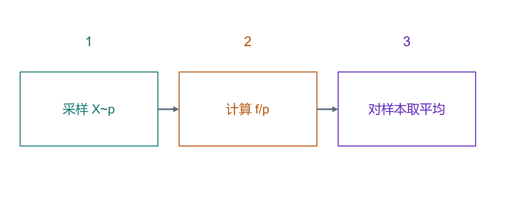

*读图：采样 X~p → 计算 f/p → 对样本取平均。箭头表示本节的推理或处理顺序，具体条件见正文。*

### 先读符号与条件

| 符号 / 条件 | 含义 |
| --- | --- |
| f | 被积函数 |
| p | 归一化 PDF |
| N | 样本数 |
| 条件 | f 非零处 p 必须非零（几乎处处） |

### 核心关系与推导入口

以下关系使用上述条件；标为教学简化或补充的内容是为理解而推导，不是逐字转录课件。

$$
\widehat I_N=\frac1N\sum_{i=1}^{N}\frac{f(X_i)}{p(X_i)},\quad X_i\sim p
$$

### 🔧 手算 3：把关系落到数字上

积分 ∫₀² x dx，均匀 p=1/2。取教学样本 0.25、1.75，估计为 ((0.25/0.5)+(1.75/0.5))/2=2，解析积分也是 2。

| 检查步骤 | 操作 |
| --- | --- |
| 输入 | 先从例子中抄下给定量及单位，不引入未给定的数值。 |
| 计算 | 按本节关系求中间量，再得到结果；不要在第一步就做显示裁剪或整数舍入。 |
| 回查 | 取教学样本 0.25、1.75，估计为 ((0.25/0.5)+(1.75/0.5))/2=2，解析积分也是 2。 |
| 适用边界 | 这组样本恰好命中真值不证明每次都精确；随机换一组通常会有误差。 |

### ⚠️ 易错点：先识别症状与假设

这组样本恰好命中真值不证明每次都精确；随机换一组通常会有误差。

### 停下来解释一次

**问题：若区间长为 2，能否直接平均 f？**

<details>
<summary>展开参考回答</summary>

不能。均匀密度是 1/2，必须乘区间长度 2；单位区间才恰好省略这个因子。

</details>

<details>
<summary>展开原课件关键页，对照术语与图形</summary>

#### Monte Carlo Integration

*PDF p43 · 对应本节：为什么一定要除以 PDF？*

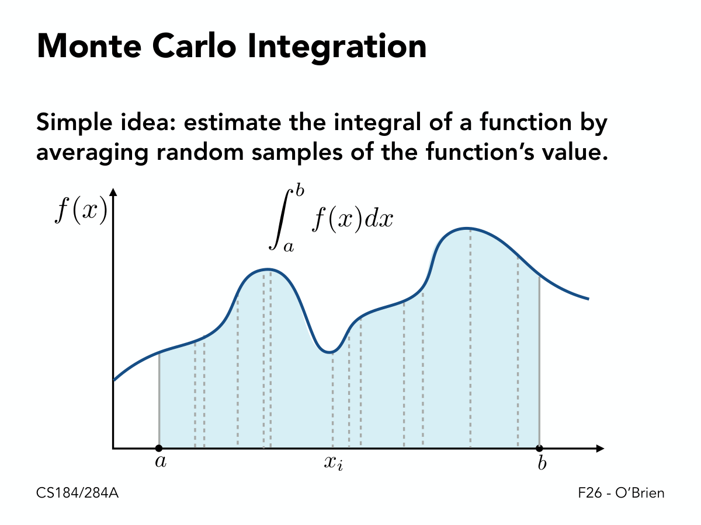

#### Monte Carlo Integration

*PDF p44 · 对应本节：为什么一定要除以 PDF？*

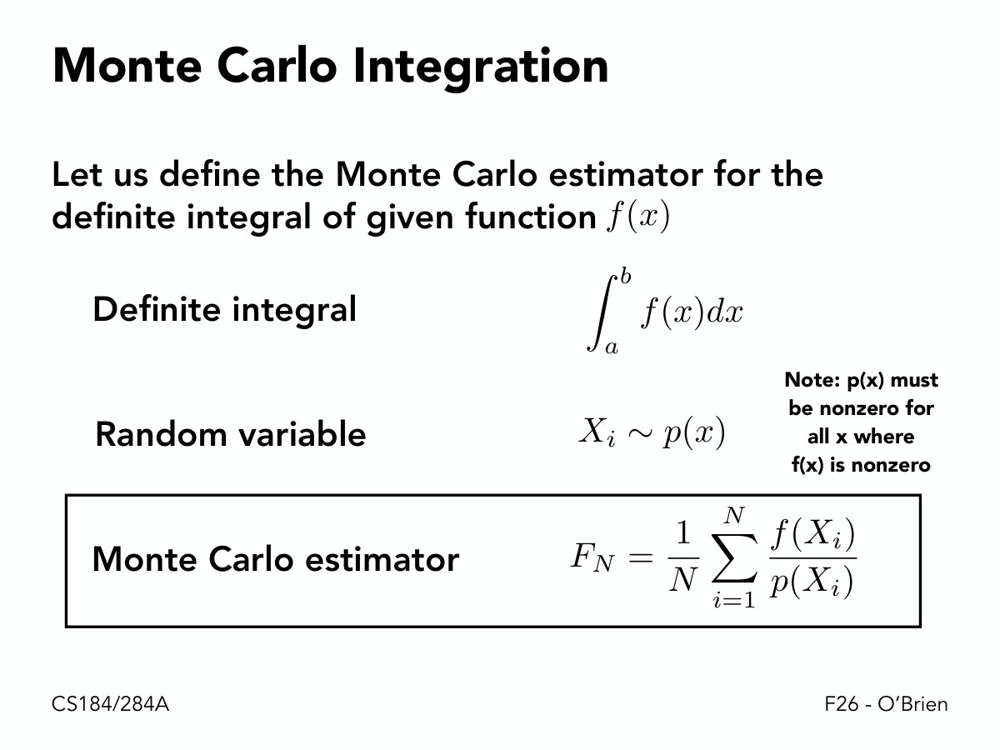

#### Example: Basic Monte Carlo Estimator

*PDF p45 · 对应本节：为什么一定要除以 PDF？*

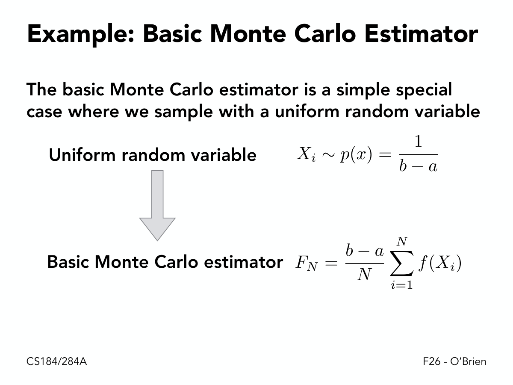

#### Example: Basic Monte Carlo Estimator

*PDF p48 · 对应本节：为什么一定要除以 PDF？*

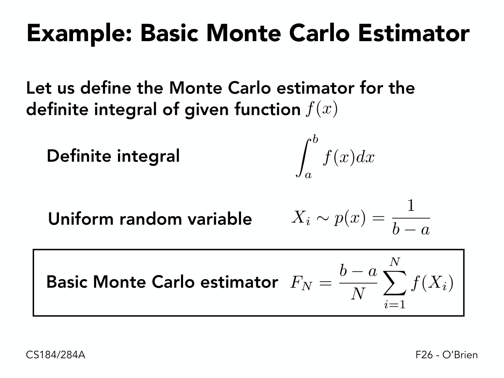

</details>

## 4. 无偏究竟保证了什么？

无偏意味着重复独立实验得到的估计值，其期望等于目标积分。它不保证某一次图像正确、不保证误差小，也不保证图像显示出来后看上去平均一样。

证明只用期望线性与积分抵消；方差推导才需要样本独立等条件。把“无偏”和“独立”混作一件事，容易错误解释分层或相关采样。

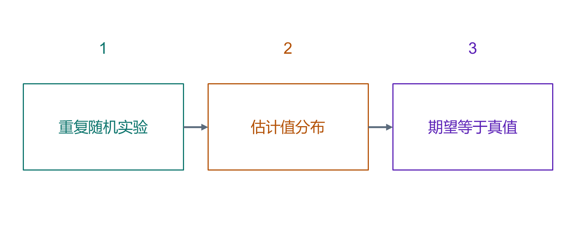

*读图：重复随机实验 → 估计值分布 → 期望等于真值。箭头表示本节的推理或处理顺序，具体条件见正文。*

### 先读符号与条件

| 符号 / 条件 | 含义 |
| --- | --- |
| I | 真实积分 |
| 期望 | 对整个采样随机过程求平均 |
| 前提 | 积分存在且支持覆盖充分 |

### 核心关系与推导入口

以下关系使用上述条件；标为教学简化或补充的内容是为理解而推导，不是逐字转录课件。

$$
\mathbb E[\widehat I_N]=\frac1N\sum_i\int\frac{f(x)}{p(x)}p(x)dx=I
$$

### 🔧 手算 4：把关系落到数字上

估计器以一半概率输出 0、一半输出 2，期望为 1，无偏估计目标 1；每一次绝对误差却都是 1。平方误差期望也为 1。

| 检查步骤 | 操作 |
| --- | --- |
| 输入 | 先从例子中抄下给定量及单位，不引入未给定的数值。 |
| 计算 | 按本节关系求中间量，再得到结果；不要在第一步就做显示裁剪或整数舍入。 |
| 回查 | 平方误差期望也为 1。 |
| 适用边界 | 把一次低样本图像偏暗直接判为有偏不可靠；少量极亮样本可能在显示裁剪后不可见。 |

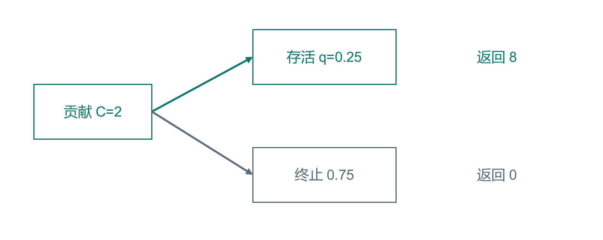

*概率变小需要补偿权重，期望仍为 2；这是后续轮盘的基础。*

### ⚠️ 易错点：先识别症状与假设

把一次低样本图像偏暗直接判为有偏不可靠；少量极亮样本可能在显示裁剪后不可见。

### 停下来解释一次

**问题：无偏估计能否比有偏估计的均方误差更大？**

<details>
<summary>展开参考回答</summary>

能。均方误差是方差加偏差平方；降低一点偏差不一定抵消很大的方差。

</details>

<details>
<summary>展开原课件关键页，对照术语与图形</summary>

#### Unbiased Estimator

*PDF p49 · 对应本节：无偏究竟保证了什么？*

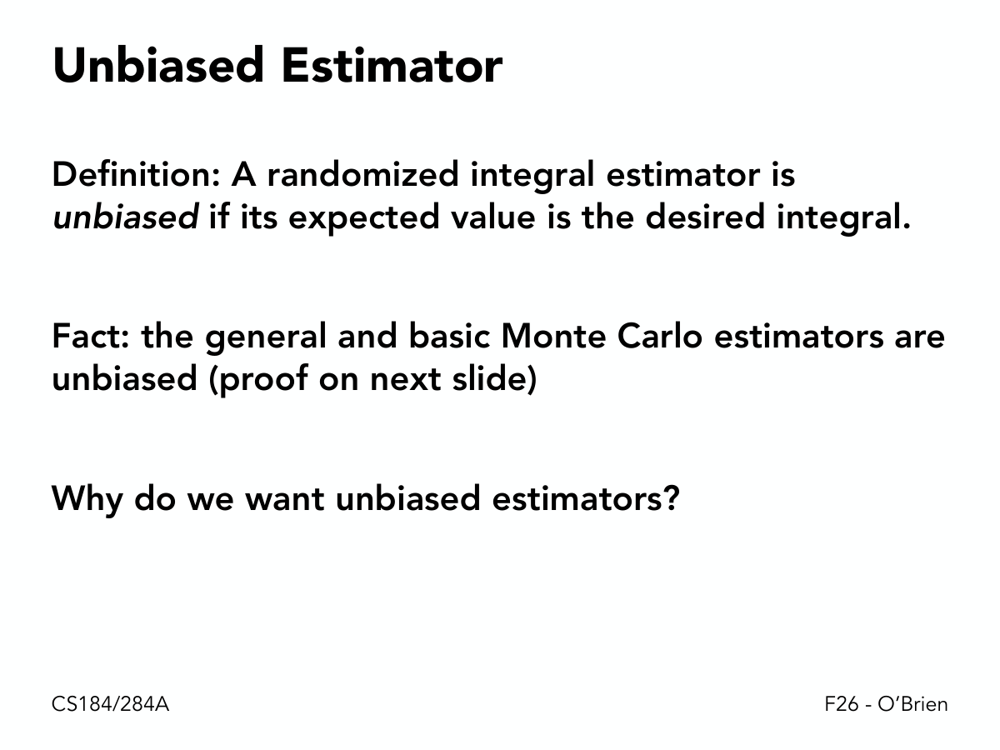

#### Proof That Monte Carlo Estimator Is Unbiased

*PDF p50 · 对应本节：无偏究竟保证了什么？*

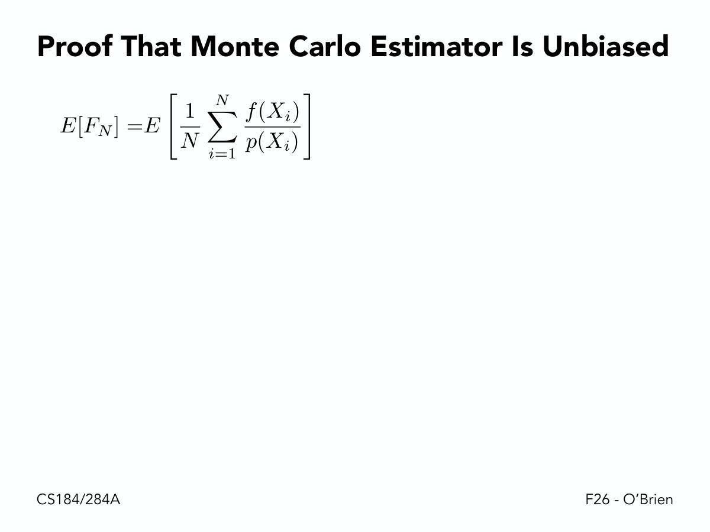

#### Proof That Monte Carlo Estimator Is Unbiased

*PDF p56 · 对应本节：无偏究竟保证了什么？*

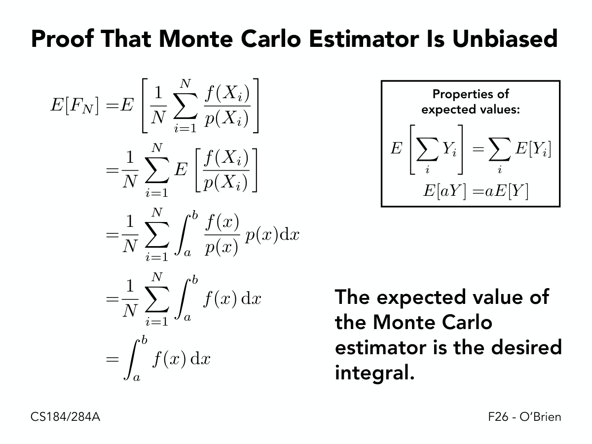

#### Variance of a Random Variable

*PDF p57 · 对应本节：无偏究竟保证了什么？*

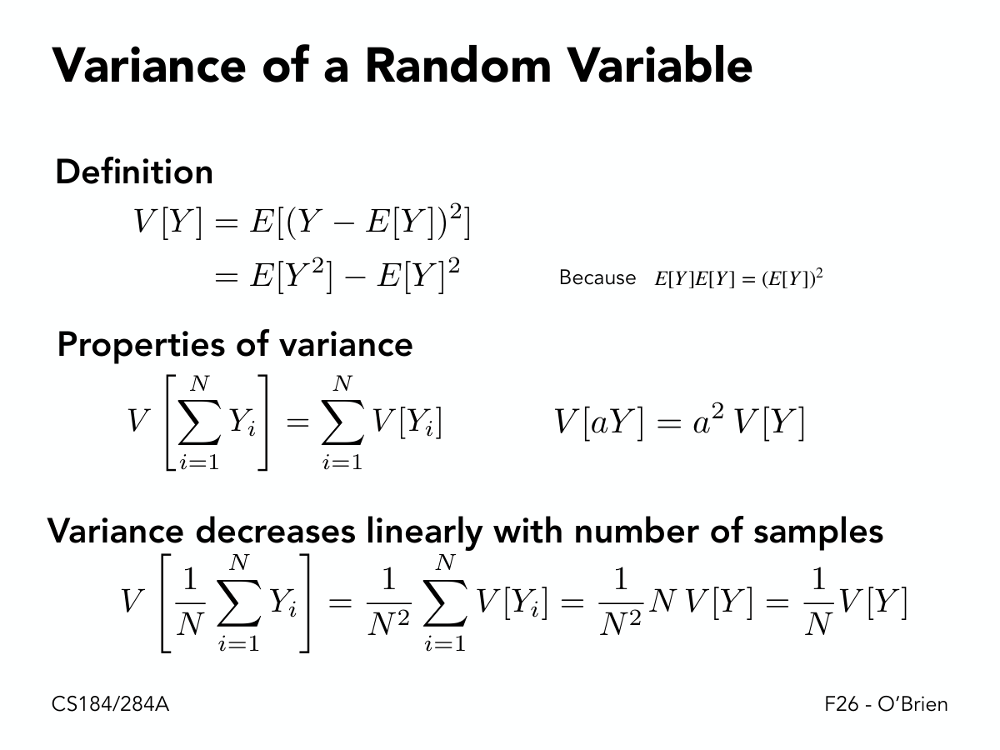

</details>

## 5. 多采多少才会更干净？

对独立同分布的贡献 Yi，平均值方差是单样本方差除 N，标准差则除 √N。图像噪声幅度通常与标准差更接近，所以样本数翻倍并不会把噪声减半。

误差分布可能重尾，少量异常大贡献让经验方差很不稳定。评价时应固定场景与估计器，报告样本数、误差指标和参考结果来源。

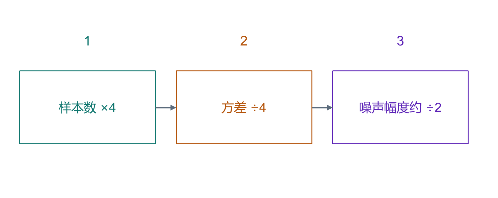

*读图：样本数 ×4 → 方差 ÷4 → 噪声幅度约 ÷2。箭头表示本节的推理或处理顺序，具体条件见正文。*

### 先读符号与条件

| 符号 / 条件 | 含义 |
| --- | --- |
| sigma² | 单样本贡献方差 |
| N | 独立样本数 |
| 条件 | 有限方差 |

### 核心关系与推导入口

以下关系使用上述条件；标为教学简化或补充的内容是为理解而推导，不是逐字转录课件。

$$
\operatorname{Var}(\widehat I_N)=\frac{\sigma^2}{N},\qquad \operatorname{Std}(\widehat I_N)=\frac\sigma{\sqrt N}
$$

### 🔧 手算 5：把关系落到数字上

N=16 时标准差 0.2，N=64 时预期为 0.1。反算 (0.2/0.1)²=4，对应样本增长四倍。

| 检查步骤 | 操作 |
| --- | --- |
| 输入 | 先从例子中抄下给定量及单位，不引入未给定的数值。 |
| 计算 | 按本节关系求中间量，再得到结果；不要在第一步就做显示裁剪或整数舍入。 |
| 回查 | 反算 (0.2/0.1)²=4，对应样本增长四倍。 |
| 适用边界 | 只增样本无法修复漏除 PDF 或漏光源等偏差；错误会稳定到错误答案。 |

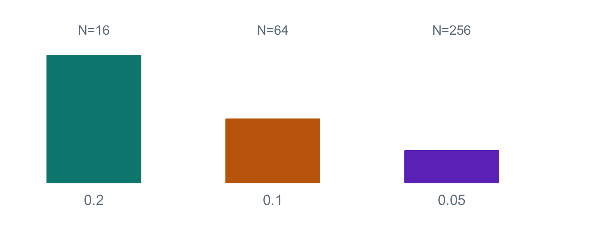

*独立有限方差样本增加四倍，标准差约减半。*

### ⚠️ 易错点：先识别症状与假设

只增样本无法修复漏除 PDF 或漏光源等偏差；错误会稳定到错误答案。

### 停下来解释一次

**问题：样本从 100 增到 400，噪声理论上下降多少？**

<details>
<summary>展开参考回答</summary>

独立、有限方差且其他条件相同时，标准差约减半。

</details>

<details>
<summary>展开原课件关键页，对照术语与图形</summary>

#### Variance of a Random Variable

*PDF p57 · 对应本节：多采多少才会更干净？*


#### More Random Samples Reduces Variance

*PDF p58 · 对应本节：多采多少才会更干净？*

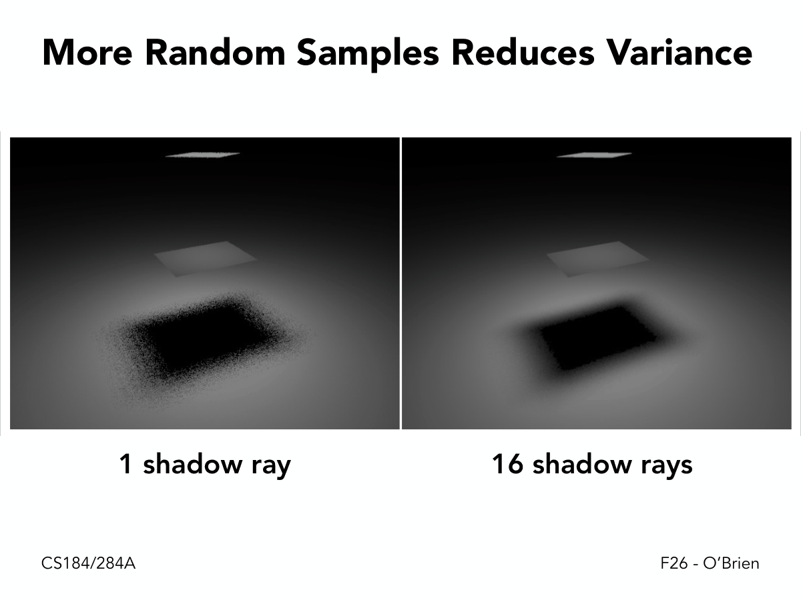

#### 1 Area Light Sample

*PDF p59 · 对应本节：多采多少才会更干净？*

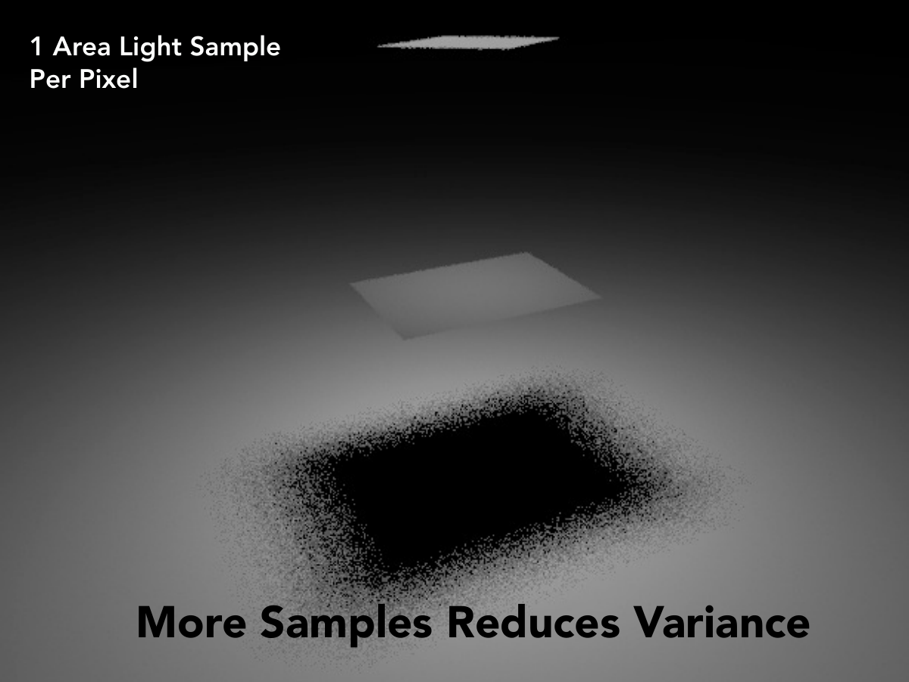

#### 16 Area Light Samples

*PDF p60 · 对应本节：多采多少才会更干净？*

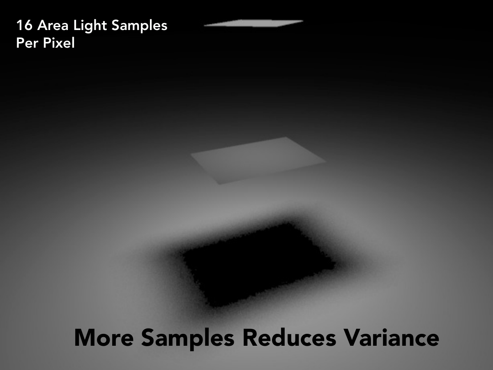

</details>

## 6. 重要性采样为什么有用？

让 p 接近被积函数幅度，可让 f/p 更平坦。极端理想情况下，非负 f 的归一化形状就是 PDF，每个样本都给同一个积分值，方差为零。

现实中完整 f 包括未知可见性和递归照明，事先不知道它；因此使用 BRDF、光源方向或环境亮度作为近似。采样策略的好坏要看最终加权贡献是否稳定。

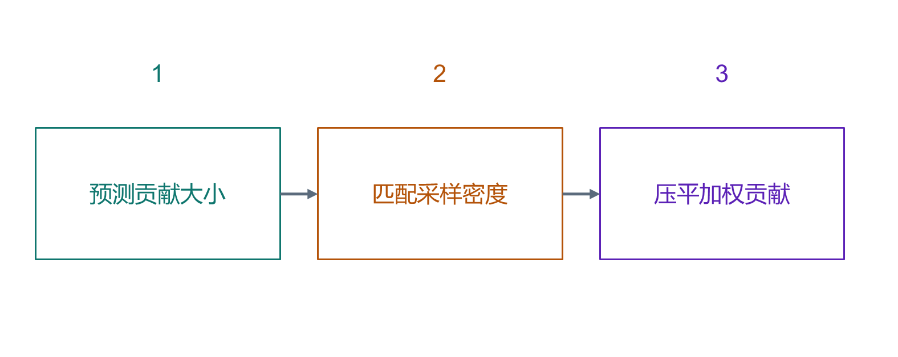

*读图：预测贡献大小 → 匹配采样密度 → 压平加权贡献。箭头表示本节的推理或处理顺序，具体条件见正文。*

### 先读符号与条件

| 符号 / 条件 | 含义 |
| --- | --- |
| I | 未知归一化积分 |
| 理想 PDF | 主要用于理解而非直接求解 |
| f/p | 最终贡献 |

### 核心关系与推导入口

以下关系使用上述条件；标为教学简化或补充的内容是为理解而推导，不是逐字转录课件。

$$
p(x)=\frac{f(x)}{I}\quad(f\ge0)\ \Longrightarrow\ \frac{f(x)}{p(x)}=I
$$

### 🔧 手算 6：把关系落到数字上

f(x)=2x，x∈[0,1]，积分为 1；选择 p=2x，则任意 x>0 的贡献都是 1。取 x=0.2 得 0.4/0.4=1。

| 检查步骤 | 操作 |
| --- | --- |
| 输入 | 先从例子中抄下给定量及单位，不引入未给定的数值。 |
| 计算 | 按本节关系求中间量，再得到结果；不要在第一步就做显示裁剪或整数舍入。 |
| 回查 | 取 x=0.2 得 0.4/0.4=1。 |
| 适用边界 | 只偏向高值区域却不除 PDF 会让亮区重复计权，结果变亮。 |

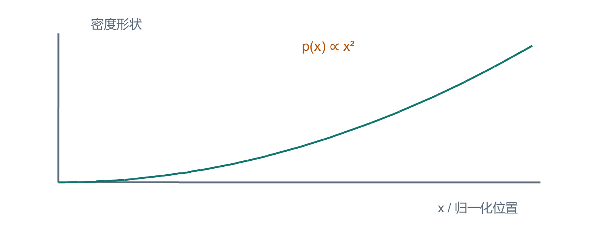

*重要性采样让大贡献区域更常出现，但贡献必须除以实际 PDF。*

### ⚠️ 易错点：先识别症状与假设

只偏向高值区域却不除 PDF 会让亮区重复计权，结果变亮。

### 停下来解释一次

**问题：为什么实际不能总用 p=f/I？**

<details>
<summary>展开参考回答</summary>

因为采样前通常不知道 f 的完整形状和归一化常数 I，而 I 正是待求量。

</details>

<details>
<summary>展开原课件关键页，对照术语与图形</summary>

#### Importance Sampling

*PDF p74 · 对应本节：重要性采样为什么有用？*

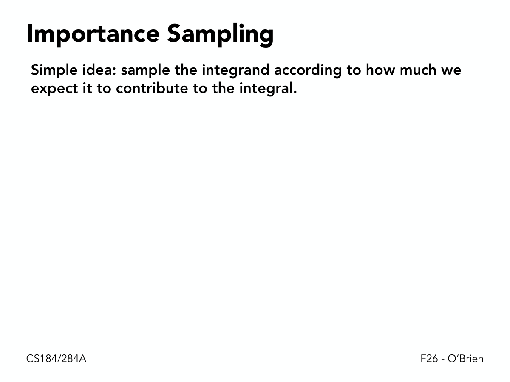

#### Many Importance Sampling Strategies

*PDF p82 · 对应本节：重要性采样为什么有用？*

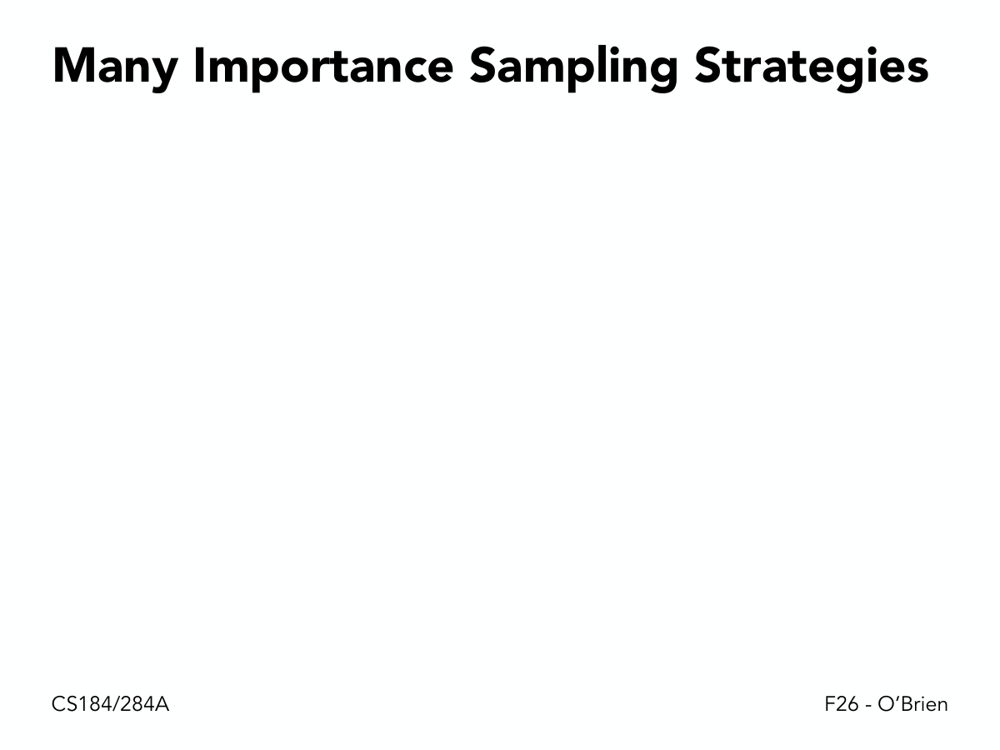

#### Effect of Sampling Distribution “Fit”

*PDF p86 · 对应本节：重要性采样为什么有用？*

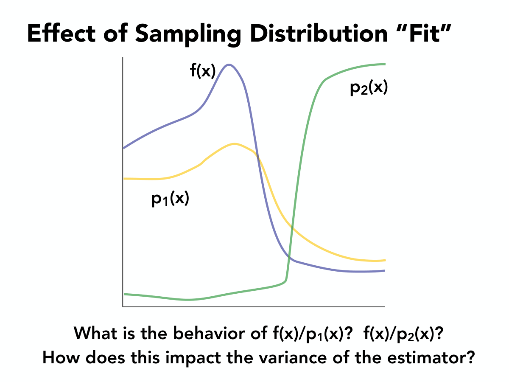

</details>

## 7. 采半球与采光源差在哪里？

均匀半球采样很通用，但小灯只占极小方向区域，大多数光线打不到灯。对面光源直接抽取表面位置，再发阴影光线检查可见性，能减少这类零贡献样本。

两种方法不是在积分不同的物理现象，而是用不同参数化求同一直接光积分。光源采样还必须检查光源正反面，以及采样点到接收点之间是否被遮挡。

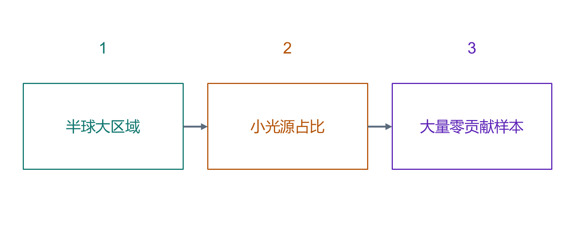

*读图：半球大区域 → 小光源占比 → 大量零贡献样本。箭头表示本节的推理或处理顺序，具体条件见正文。*

### 先读符号与条件

| 符号 / 条件 | 含义 |
| --- | --- |
| p_omega | 立体角 PDF |
| 均匀半球 | 1/(2pi) |
| n | 接收点法线 |

### 核心关系与推导入口

以下关系使用上述条件；标为教学简化或补充的内容是为理解而推导，不是逐字转录课件。

$$
\widehat E=\frac1N\sum_i\frac{L_i(\omega_i)\max(0,n\cdot\omega_i)}{p_\omega(\omega_i)}
$$

### 🔧 手算 7：把关系落到数字上

灯占 0.02 sr，均匀半球单次命中概率约 0.02/(2π)=0.00318。100 次预期命中约 0.318 次，而不是每次都能采到灯。

| 检查步骤 | 操作 |
| --- | --- |
| 输入 | 先从例子中抄下给定量及单位，不引入未给定的数值。 |
| 计算 | 按本节关系求中间量，再得到结果；不要在第一步就做显示裁剪或整数舍入。 |
| 回查 | 100 次预期命中约 0.318 次，而不是每次都能采到灯。 |
| 适用边界 | “预期命中 0.318 次”不是会出现 0.318 条光线；实际计数是整数，期望可为小数。 |

### ⚠️ 易错点：先识别症状与假设

“预期命中 0.318 次”不是会出现 0.318 条光线；实际计数是整数，期望可为小数。

### 停下来解释一次

**问题：光源采样能完全解决阴影噪声吗？**

<details>
<summary>展开参考回答</summary>

不能。部分遮挡、复杂 BRDF 或多个灯仍造成贡献变化，但通常比盲采小灯高效。

</details>

<details>
<summary>展开原课件关键页，对照术语与图形</summary>

#### Direct Lighting (Irradiance) Estimate

*PDF p65 · 对应本节：采半球与采光源差在哪里？*

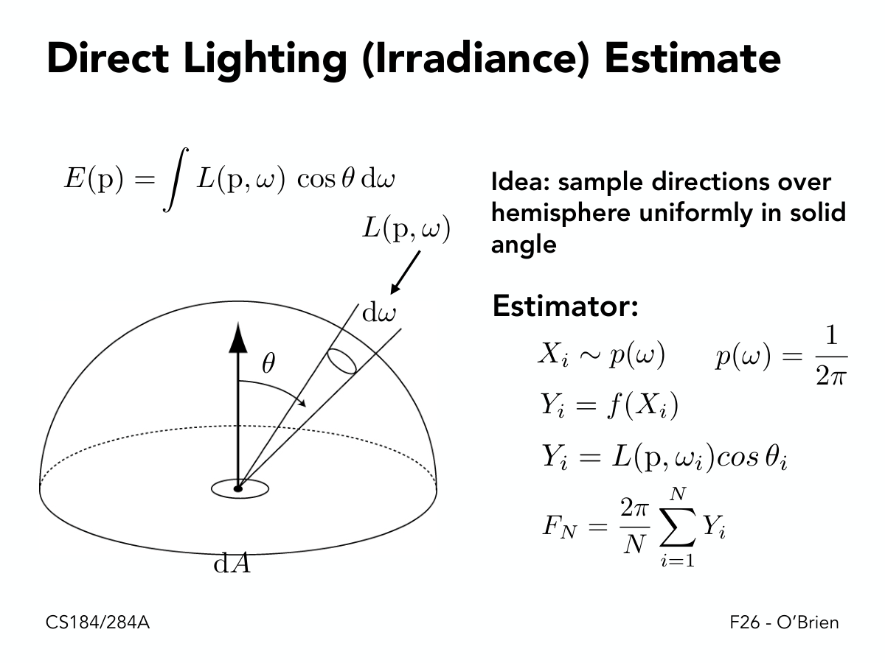

#### Direct Lighting (Irradiance) Estimate

*PDF p66 · 对应本节：采半球与采光源差在哪里？*

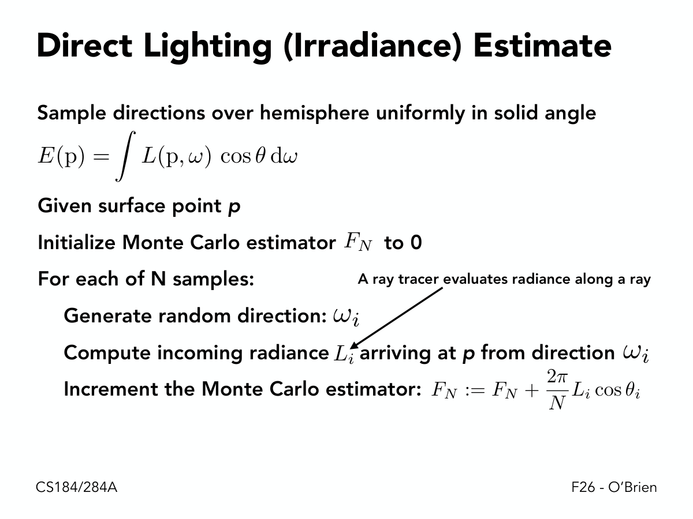

#### Direct Lighting - Solid Angle Sampling

*PDF p67 · 对应本节：采半球与采光源差在哪里？*

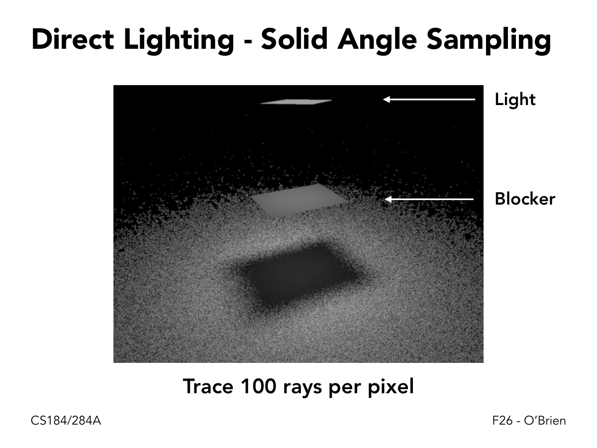

#### The MC estimator uses different random

*PDF p69 · 对应本节：采半球与采光源差在哪里？*

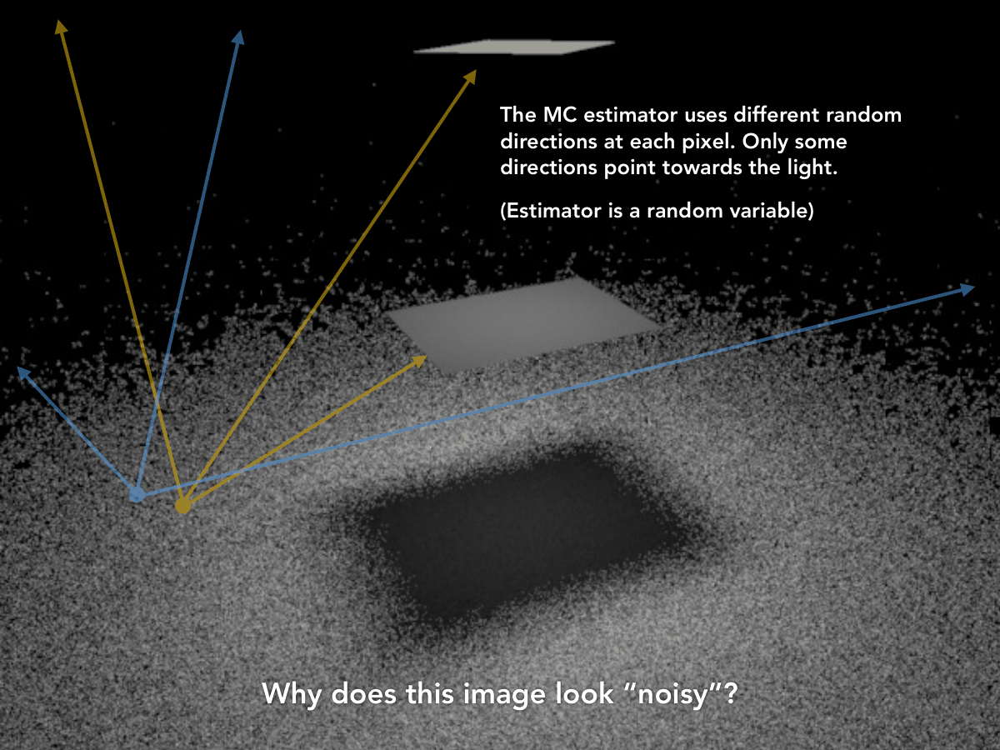

#### Observation: incoming radiance is zero

*PDF p70 · 对应本节：采半球与采光源差在哪里？*

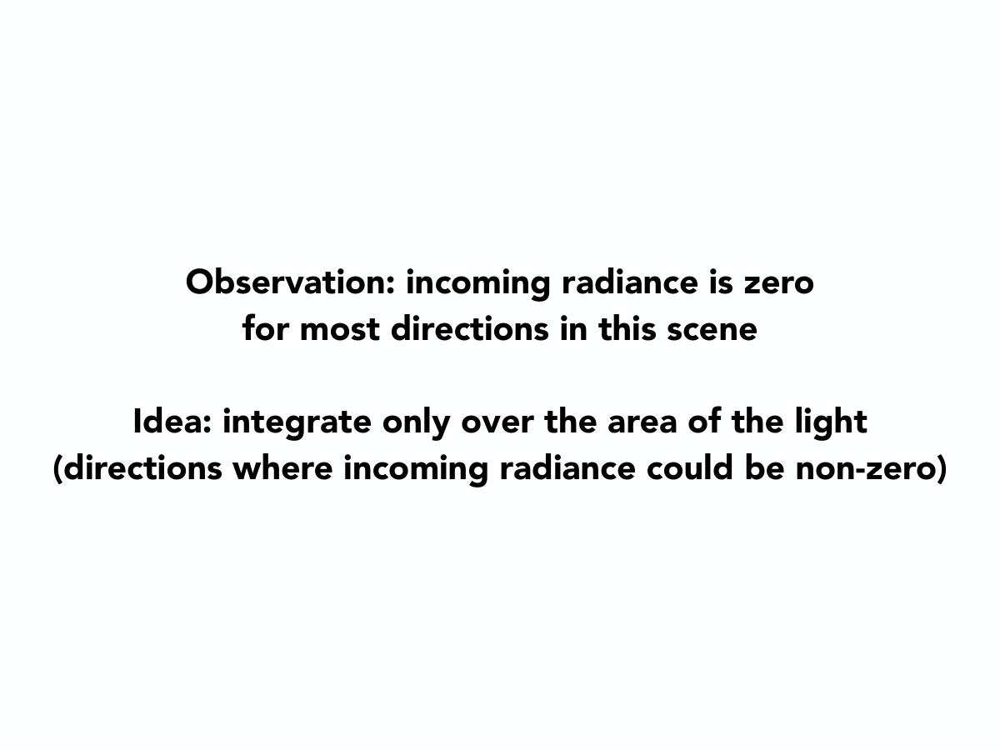

#### If no occlusion is present, all directions chosen in computing estimate “hit” the light source.

*PDF p71 · 对应本节：采半球与采光源差在哪里？*

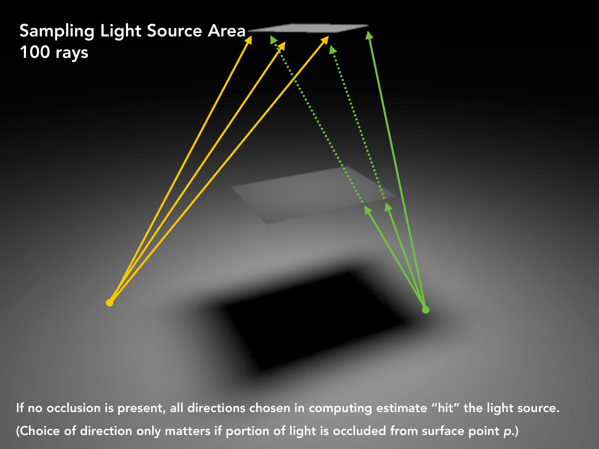

#### Solid Angle Sampling vs Light Area Sampling

*PDF p72 · 对应本节：采半球与采光源差在哪里？*

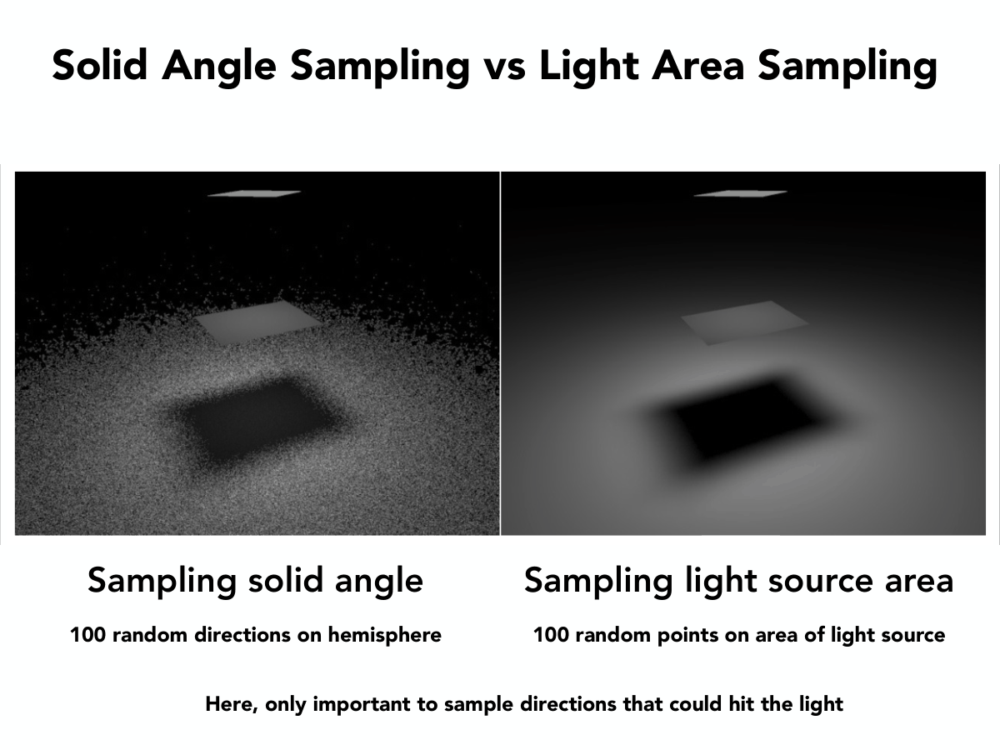

</details>

## 8. 面积 PDF 如何变成方向 PDF？

光源小面元在接收点张成 dω=cosθL dA/r²。密度变换要求同一事件概率不变：pωdω=pAdA。因而方向密度等于面积密度乘 r²/cosθL。

如果使用面积积分，被积函数里必须出现两端余弦、距离平方和可见性；如果先把 PDF 换成方向密度，光源端几何因子已进入 PDF，不能重复乘一次。

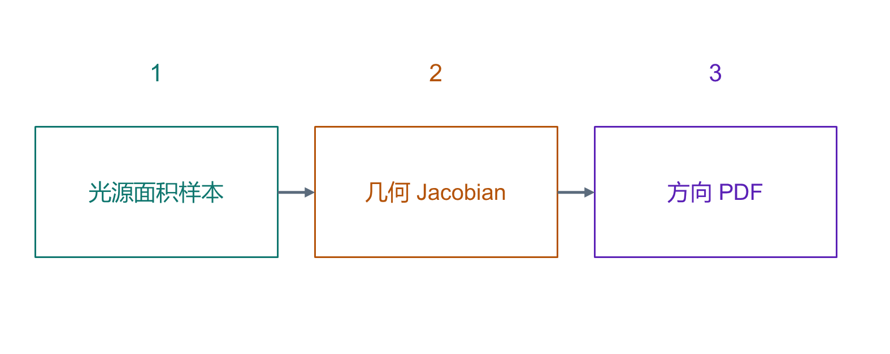

*读图：光源面积样本 → 几何 Jacobian → 方向 PDF。箭头表示本节的推理或处理顺序，具体条件见正文。*

### 先读符号与条件

| 符号 / 条件 | 含义 |
| --- | --- |
| p_A | m⁻² |
| 光源端余弦 | 绝对值用于测度，单面发射另判朝向 |
| r | 两点距离 |

### 核心关系与推导入口

以下关系使用上述条件；标为教学简化或补充的内容是为理解而推导，不是逐字转录课件。

$$
d\omega=\frac{\lvert n_L\cdot(-\omega)\rvert}{r^2}dA,\qquad p_\omega=p_A\frac{r^2}{\lvert n_L\cdot(-\omega)\rvert}
$$

### 🔧 手算 8：把关系落到数字上

面积 PDF=0.5 m⁻²，r=2 米，光源余弦 0.5，方向 PDF=4 sr⁻¹。取 dA=0.01，则 dω=0.00125，两边概率都为 0.005。

| 检查步骤 | 操作 |
| --- | --- |
| 输入 | 先从例子中抄下给定量及单位，不引入未给定的数值。 |
| 计算 | 按本节关系求中间量，再得到结果；不要在第一步就做显示裁剪或整数舍入。 |
| 回查 | 取 dA=0.01，则 dω=0.00125，两边概率都为 0.005。 |
| 适用边界 | 混用 pA 和 pω 的症状通常是亮度随灯的距离或面积异常变化。 |

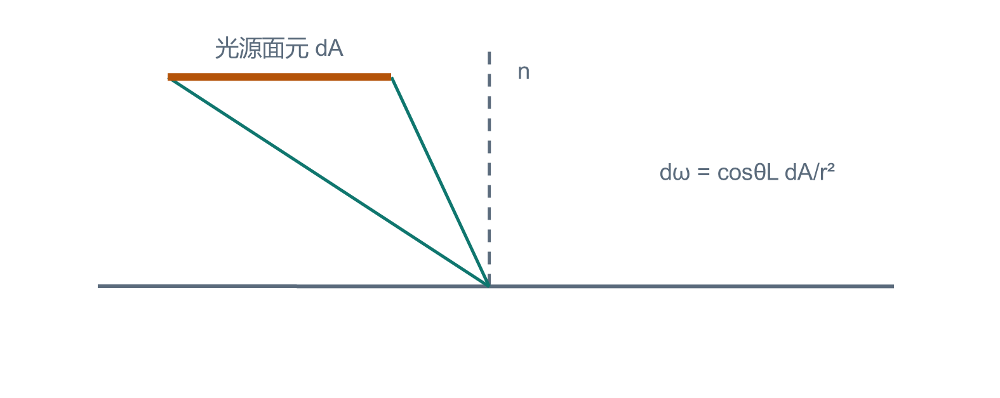

*面积样本与立体角样本由几何 Jacobian 连接。*

### ⚠️ 易错点：先识别症状与假设

混用 pA 和 pω 的症状通常是亮度随灯的距离或面积异常变化。

### 停下来解释一次

**问题：为什么这个 PDF 可以大于 1？**

<details>
<summary>展开参考回答</summary>

它是每单位立体角的密度；乘实际小立体角后才得到不超过 1 的概率。

</details>

<details>
<summary>展开原课件关键页，对照术语与图形</summary>

#### Changing Basis of Integration: Sampling Hemisphere

*PDF p88 · 对应本节：面积 PDF 如何变成方向 PDF？*

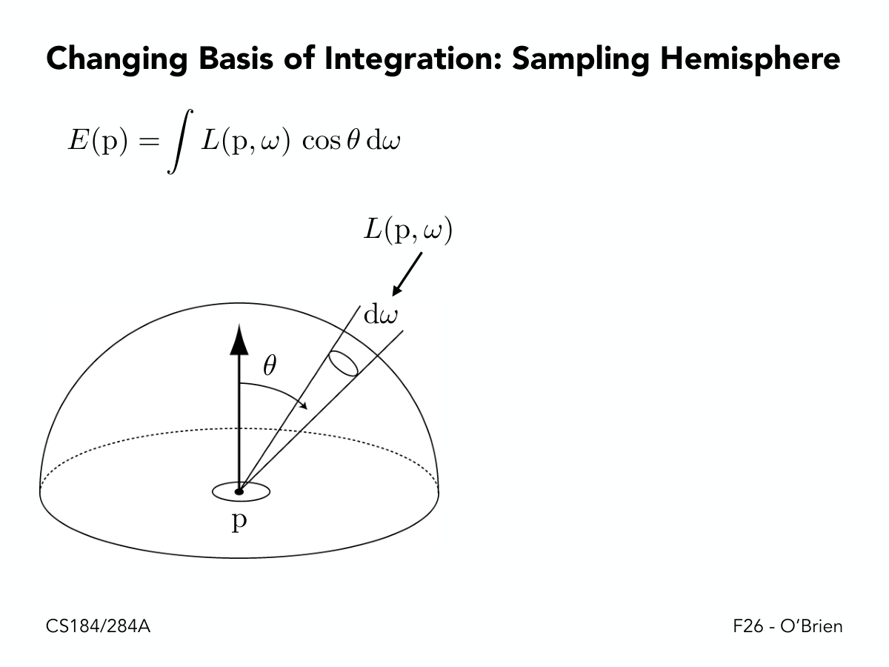

#### Changing Basis of Integration: Sampling Light Source Area

*PDF p89 · 对应本节：面积 PDF 如何变成方向 PDF？*


#### Changing Basis of Integration: Sampling Light Source Area

*PDF p90 · 对应本节：面积 PDF 如何变成方向 PDF？*

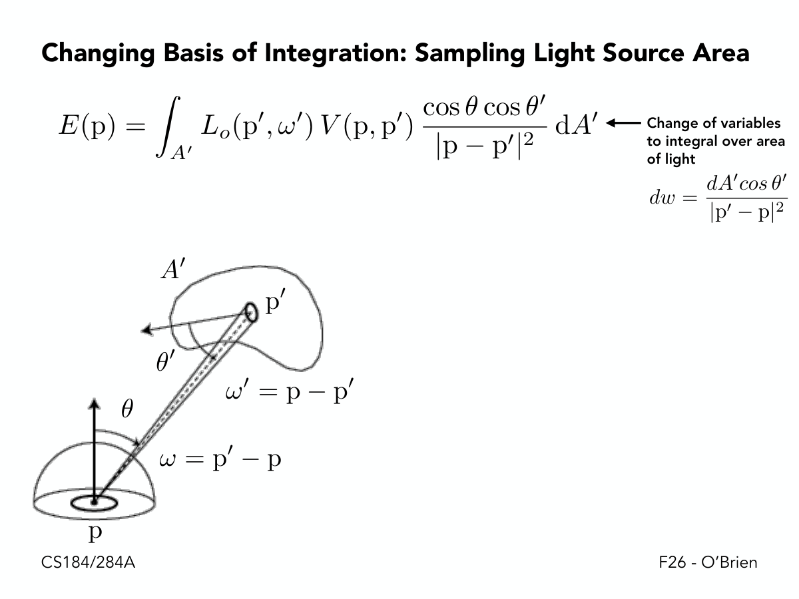

#### Monte Carlo Estimate by Sampling Light Source Area

*PDF p93 · 对应本节：面积 PDF 如何变成方向 PDF？*

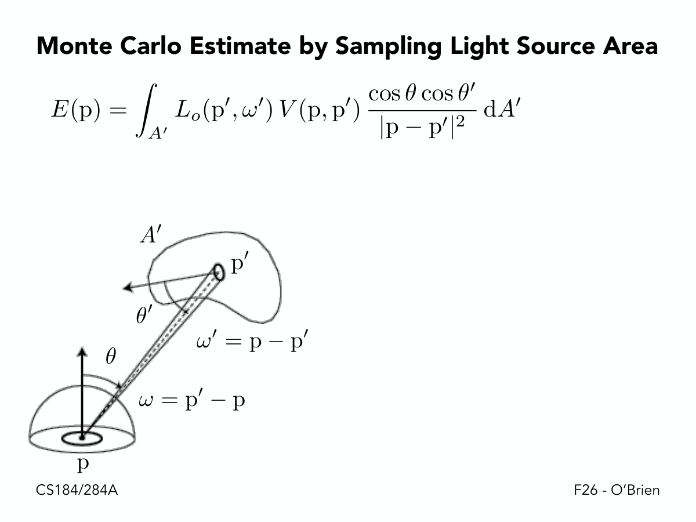

#### Monte Carlo Estimate by Sampling Light Source Area

*PDF p95 · 对应本节：面积 PDF 如何变成方向 PDF？*

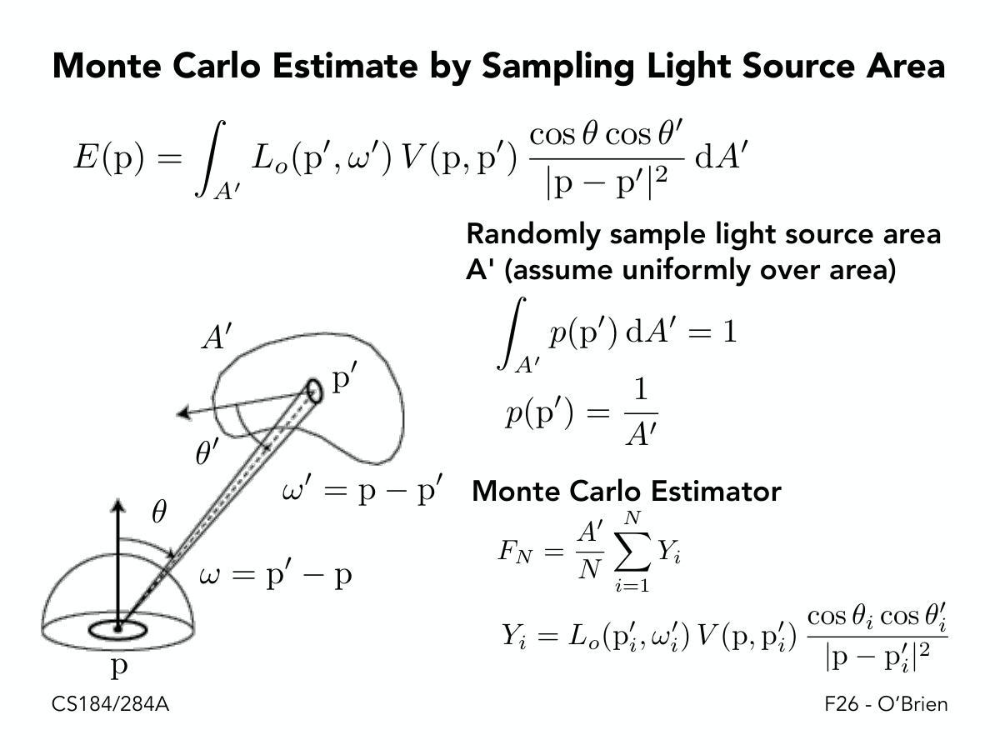

</details>

## 9. 给定 PDF，随机数怎样变成样本？

首先把 PDF 积分成 CDF，CDF 把位置映射成累计概率；再把均匀随机数 ξ 通过 CDF 反函数映回位置。稀疏区域会被拉开，密集区域会被压缩。

课件在 [0,2] 上按 x² 采样：先求归一化常数，得到 p=3x²/8，再积分得到 x³/8。不要省略归一化，否则反函数无法覆盖正确范围。


*读图：均匀随机数 ξ → 逆累计分布 → 目标分布样本 X。箭头表示本节的推理或处理顺序，具体条件见正文。*

### 先读符号与条件

| 符号 / 条件 | 含义 |
| --- | --- |
| xi | 均匀随机数 [0,1) |
| X | 目标样本 [0,2) |
| F | CDF 而非 PDF |

### 核心关系与推导入口

以下关系使用上述条件；标为教学简化或补充的内容是为理解而推导，不是逐字转录课件。

$$
F(x)=\frac{x^3}{8},\qquad X=F^{-1}(\xi)=2\xi^{1/3}
$$

### 🔧 手算 9：把关系落到数字上

ξ=1/8，则 X=1。代回 F(1)=1/8；ξ→1 时 X→2，边界一致。

| 检查步骤 | 操作 |
| --- | --- |
| 输入 | 先从例子中抄下给定量及单位，不引入未给定的数值。 |
| 计算 | 按本节关系求中间量，再得到结果；不要在第一步就做显示裁剪或整数舍入。 |
| 回查 | 代回 F(1)=1/8；ξ→1 时 X→2，边界一致。 |
| 适用边界 | CDF 不是 PDF 的倒数；F⁻¹ 表示函数反解，不能写成 1/F。 |

### ⚠️ 易错点：先识别症状与假设

CDF 不是 PDF 的倒数；F⁻¹ 表示函数反解，不能写成 1/F。

### 停下来解释一次

**问题：只知道 PDF 数值表还可以采样吗？**

<details>
<summary>展开参考回答</summary>

可以。归一化离散权重、累加成 CDF，再查找 ξ 所在区间；连续区间内部还需相应插值。

</details>

<details>
<summary>展开原课件关键页，对照术语与图形</summary>

#### How to Draw Samples From a

*PDF p97 · 对应本节：给定 PDF，随机数怎样变成样本？*


#### Cumulative Density Function (CDF) - Continuous Case

*PDF p102 · 对应本节：给定 PDF，随机数怎样变成样本？*


#### Sampling Continuous PDF Using Its CDF

*PDF p103 · 对应本节：给定 PDF，随机数怎样变成样本？*


#### Example: Sample Proportional to x2

*PDF p104 · 对应本节：给定 PDF，随机数怎样变成样本？*


#### Example: Sample Proportional to x2

*PDF p107 · 对应本节：给定 PDF，随机数怎样变成样本？*


</details>

## 10. 为什么半径均匀会挤在圆心？

圆盘环带面积与半径成正比；若每个等厚环带分到相同数量样本，外圈面积大却密度更低。正确面积均匀采样要求半径 CDF 为 r²/R²。

因此 r=R√ξ，角度独立均匀。镜头孔径和圆盘面光源都会用到它；这是检查“参数均匀不等于几何均匀”的最直观例子。


*读图：等面积概率 → 半径取平方根 → 均匀圆盘样本。箭头表示本节的推理或处理顺序，具体条件见正文。*

### 先读符号与条件

| 符号 / 条件 | 含义 |
| --- | --- |
| R | 圆盘半径 |
| xi1,xi2 | 独立均匀数 |
| 面积 PDF | 1/(pi R²) |

### 核心关系与推导入口

以下关系使用上述条件；标为教学简化或补充的内容是为理解而推导，不是逐字转录课件。

$$
r=R\sqrt{\xi_1},\qquad \phi=2\pi\xi_2
$$

### 🔧 手算 10：把关系落到数字上

R=1，ξ1=1/4，r=1/2。半径 1/2 内面积占比是 1/4，与 CDF 一致；错误 r=ξ 会把一半样本放进四分之一面积。

| 检查步骤 | 操作 |
| --- | --- |
| 输入 | 先从例子中抄下给定量及单位，不引入未给定的数值。 |
| 计算 | 按本节关系求中间量，再得到结果；不要在第一步就做显示裁剪或整数舍入。 |
| 回查 | 半径 1/2 内面积占比是 1/4，与 CDF 一致；错误 r=ξ 会把一半样本放进四分之一面积。 |
| 适用边界 | 不能只看散点“似乎随机”；应统计不同面积区域中的样本比例。 |


*平方根半径映射使圆盘采样按面积均匀。*


*相同数量的圆盘样本，半径均匀会让圆心附近过密。*

### ⚠️ 易错点：先识别症状与假设

不能只看散点“似乎随机”；应统计不同面积区域中的样本比例。

### 停下来解释一次

**问题：圆盘中心附近应该没有样本吗？**

<details>
<summary>展开参考回答</summary>

不是。中心区域有与其面积成比例的概率，只是不该过密。

</details>

<details>
<summary>展开原课件关键页，对照术语与图形</summary>

#### Random Sampling of

*PDF p108 · 对应本节：为什么半径均匀会挤在圆心？*


#### Sampling Unit Circle: Simple but Wrong Method

*PDF p109 · 对应本节：为什么半径均匀会挤在圆心？*


#### Need to Sample Uniformly in Area

*PDF p110 · 对应本节：为什么半径均匀会挤在圆心？*


#### Rejection Sampling Circle’s Area

*PDF p111 · 对应本节：为什么半径均匀会挤在圆心？*


</details>

## 11. 半球均匀与余弦加权怎样区分？

均匀半球方向密度为 1/(2π)，可令 z=ξ1、方位角均匀。余弦加权则让法线附近更密集，方向 PDF 为 cosθ/π，适合漫反射中的余弦因子。

余弦采样是根据本讲原理补充的教学推导：先在单位圆盘均匀采点，再投到上半球。两种采样都合法，关键是返回与实际分布一致的 PDF。


*读图：圆盘面积均匀 → 投影到半球 → 余弦方向密度。箭头表示本节的推理或处理顺序，具体条件见正文。*

### 先读符号与条件

| 符号 / 条件 | 含义 |
| --- | --- |
| rho | 漫反射反照率 |
| p_cos | 立体角密度 |
| 适用 | 非零余弦方向 |

### 核心关系与推导入口

以下关系使用上述条件；标为教学简化或补充的内容是为理解而推导，不是逐字转录课件。

$$
p_{cos}(\omega)=\frac{\cos\theta}{\pi},\qquad \frac{(\rho/\pi)\cos\theta}{p_{cos}(\omega)}=\rho
$$

### 🔧 手算 11：把关系落到数字上

ρ=0.8，cosθ=0.5，则 BRDF×cos=0.4/π，PDF=0.5/π，比值 0.8。换 cosθ=0.2 仍为 0.8。

| 检查步骤 | 操作 |
| --- | --- |
| 输入 | 先从例子中抄下给定量及单位，不引入未给定的数值。 |
| 计算 | 按本节关系求中间量，再得到结果；不要在第一步就做显示裁剪或整数舍入。 |
| 回查 | 换 cosθ=0.2 仍为 0.8。 |
| 适用边界 | 实际生成均匀半球，却返回 cos/π，会使估计有偏；采样器与 PDF 必须成对检查。 |

### ⚠️ 易错点：先识别症状与假设

实际生成均匀半球，却返回 cos/π，会使估计有偏；采样器与 PDF 必须成对检查。

### 停下来解释一次

**问题：为何余弦采样不意味着所有材质都最优？**

<details>
<summary>展开参考回答</summary>

高光 BRDF、局部亮光源与可见性可能决定主要变化，余弦只是被积函数的一部分。

</details>

<details>
<summary>展开原课件关键页，对照术语与图形</summary>

#### Uniform Sampling of Hemisphere

*PDF p112 · 对应本节：半球均匀与余弦加权怎样区分？*


</details>

## 12. 如何判断随机图像出了哪类错误？

先区分偏差与方差，再区分采样域和 PDF。常数函数、均匀半球和单个面光源能给解析或交叉验证结果，适合做最小实验。

分层采样保证空间覆盖，重要性采样改变密度，两者可组合。去噪器改变最终图像统计，不能把去噪后平滑等同于积分器无偏或已经收敛。


*读图：解析小场景 → 重复采样统计 → 区分偏差与方差。箭头表示本节的推理或处理顺序，具体条件见正文。*

### 先读符号与条件

| 符号 / 条件 | 含义 |
| --- | --- |
| MSE | 均方误差 |
| Bias | 期望与真值之差 |
| 比较对象 | 同一个物理积分 |

### 核心关系与推导入口

以下关系使用上述条件；标为教学简化或补充的内容是为理解而推导，不是逐字转录课件。

$$
\operatorname{MSE}=\operatorname{Var}(\widehat I)+\operatorname{Bias}(\widehat I)^2
$$

### 🔧 手算 12：把关系落到数字上

估计器 A 方差 0.04、偏差 0，MSE=0.04；B 方差 0.01、偏差 0.1，MSE=0.02。B 此时 MSE 更小，但不能声称无偏。

| 检查步骤 | 操作 |
| --- | --- |
| 输入 | 先从例子中抄下给定量及单位，不引入未给定的数值。 |
| 计算 | 按本节关系求中间量，再得到结果；不要在第一步就做显示裁剪或整数舍入。 |
| 回查 | B 此时 MSE 更小，但不能声称无偏。 |
| 适用边界 | 固定随机种子方便复现，不等于统计独立；评估误差趋势应再换多个种子。 |

### ⚠️ 易错点：先识别症状与假设

固定随机种子方便复现，不等于统计独立；评估误差趋势应再换多个种子。

### 停下来解释一次

**问题：噪声随样本数降低，但平均亮度不对，先查什么？**

<details>
<summary>展开参考回答</summary>

先查测度、PDF、遗漏光路和颜色编码；增加样本只能降低随机误差。

</details>

<details>
<summary>展开原课件关键页，对照术语与图形</summary>

#### More Random Samples Reduces Variance

*PDF p58 · 对应本节：如何判断随机图像出了哪类错误？*


#### Solid Angle Sampling vs Light Area Sampling

*PDF p72 · 对应本节：如何判断随机图像出了哪类错误？*


#### Effect of Sampling Distribution “Fit”

*PDF p86 · 对应本节：如何判断随机图像出了哪类错误？*


#### Solid Angle Sampling vs Light Area Sampling

*PDF p96 · 对应本节：如何判断随机图像出了哪类错误？*


</details>

## 深入 1. 由期望恒等式推导重要性采样与方差

本节是根据前文课件主题展开的**补充推导与独立教学实验**，数值不是课件测量结果。

回查原课件：p28、p32、p40、p41、p43、p44、p45、p48、p49、p50、p56、p57、p58、p59、p60、p74、p82、p86。

除以 PDF 不是对不均匀样本的经验补丁，而是为了让随机变量的期望恢复原积分。用 f(x)=2x 这个可以手算的例子，我们能同时推导无偏性、方差和一个零方差特例，并解释为什么真实渲染很难直接获得这个特例。

### 先固定问题的边界

- **积分域**：x∈[0,1]，I=∫2x dx=1。
- **支持集**：只要 f 非零，采样密度 p 必须为正；孤立的零测度端点可单独处理。
- **随机样本**：N 个独立同分布样本；相关样本的方差不能直接除以 N。

### 从定义逐步推到可计算形式

**第 1 步。** 从期望定义开始，将待积函数除以采样密度。密度相乘抵消后，恢复的是同一测度下的积分。

$$
\mathbb E_p\!\left[\frac{f(X)}{p(X)}\right]=\int_0^1\frac{f(x)}{p(x)}p(x)\,dx=I
$$

**第 2 步。** 独立样本平均仍无偏，且独立性使交叉协方差为零。

$$
\widehat I_N=\frac1N\sum_i\frac{f(X_i)}{p(X_i)},\qquad\operatorname{Var}(\widehat I_N)=\operatorname{Var}(f/p)/N
$$

**第 3 步。** 展开二阶矩，密度只抵消一次。因此很小的 p 会在 f 较大时制造大贡献。

$$
\operatorname{Var}(f/p)=\int_0^1\frac{f(x)^2}{p(x)}dx-I^2
$$

**第 4 步。** 均匀采样 p=1 时，二阶矩为 4/3，减去 I² 得 1/3。

$$
\operatorname{Var}(2X)=\int_0^1 4x^2dx-1=\frac13
$$

**第 5 步。** 选择 p(x)=2x 后，每个非零样本的贡献恒为 1。此时没有随机波动，但构造密度已经利用了被积函数的形状与归一化。

$$
\frac{f(x)}{p(x)}=1,\qquad\operatorname{Var}(f/p)=0
$$


*柱形表示均匀采样的四个样本贡献 0.2、0.6、1.2、1.8；水平参照线表示本例重要性采样的每个贡献都等于 1。比较的是加权贡献，不是样本位置的直方图。*

### 🔧 手算 13：由期望恒等式推导重要性采样与方差

| 已知量 | 数值与含义 |
| --- | --- |
| 均匀样本 | 0.1、0.3、0.6、0.9 |
| 样本贡献 | 0.2、0.6、1.2、1.8 |
| 重要性采样 | p(x)=2x，CDF 为 x² |
| 样本数 | N=4 |

1. 均匀估计为 (0.2+0.6+1.2+1.8)/4=0.95。

2. 这一次误差为 −0.05，不与无偏性矛盾。

3. 用均匀随机数 ξ 生成 X=√ξ，即可采到 p(x)=2x。

4. 对 ξ=0.25，X=0.5，f=1，p=1，贡献为 1。

5. 对 ξ=0.81，X=0.9，f=1.8，p=1.8，贡献仍为 1。

6. 均匀采样 N=4 的理论标准差为 √(1/12)≈0.288675，不等于这一次的绝对误差 0.05。

### 回代与第二条验证路线

直接积分 2x 得到 1，与重要性样本逐项结果一致。

对于 N 个均匀样本，标准差随 √N 缩放；要降低到原来的 1/2，样本应增加到 4 倍，而非 2 倍。

### 改变一个条件，原结论还成立吗？

如果 p 在 x>0.5 上为零，将永远漏掉那部分积分，增加样本也无法修复。

对有正有负的函数，p∝|f| 不会自动零方差；贡献的符号仍会波动。这个例子的 f≥0 是关键条件。

### 真正运行一次：保留正确与错误对照

下列程序只依赖 Python 标准库，复制到一个文件即可运行。断言验证本节明确给出的解析关系；它不替代完整场景测试。

```python
from math import sqrt,isclose
from random import Random
u=[.1,.3,.6,.9]
uniform=sum(2*x for x in u)/len(u)
importance=[(2*sqrt(t))/(2*sqrt(t)) for t in (.04,.25,.49,.81)]
assert isclose(uniform,.95)
assert all(v==1 for v in importance)
rng=Random(184); trials=3000; n=16
means=[sum(2*rng.random() for _ in range(n))/n for _ in range(trials)]
mean=sum(means)/trials
variance=sum((v-mean)**2 for v in means)/(trials-1)
assert abs(mean-1)<.02
assert abs(variance-1/(3*n))<.003
print('one uniform estimate =',uniform)
print('importance contributions =',importance)
print('empirical mean / variance =',round(mean,6),round(variance,6))
```

实际运行输出：

```text
one uniform estimate = 0.95
importance contributions = [1.0, 1.0, 1.0, 1.0]
empirical mean / variance = 1.004274 0.020701
```

### 实现坑：从可观察症状回到原因

**症状：** 采样越集中，画面平均亮度越改变；或者只比较一张图就宣称某算法无偏。

**定位与修正：** 检查采样器与 PDF 是否对应同一分布。上例用 √ξ 改了采样位置，也必须使用 2x 的密度；只改样本而保留 p=1 会系统性偏亮。

### 自测 27. 既然 p=f/I 能零方差，为什么不总这样做？

<details>
<summary>推理与答案</summary>

因为归一化需要未知积分 I，且真实可见性、光源、BRDF 的乘积往往难以直接抽样。重要性采样通常选择易采样的近似，保留正确权重，而不是假装已经知道完整积分。

</details>

## 深入 2. 逆变换为什么在圆盘上产生平方根

本节是根据前文课件主题展开的**补充推导与独立教学实验**，数值不是课件测量结果。

回查原课件：p97、p102、p103、p104、p107、p108、p109、p110、p111、p112。

“半径均匀”不等于“面积均匀”，原因是外圈同样宽的圆环包含更大面积。推导时先求圆心到半径 r 内的累计概率，再反解随机数，便不必背一个没有来历的平方根。

### 先固定问题的边界

- **目标**：单位圆盘内相对面积均匀，面积密度 pA=1/π。
- **随机源**：ξ1、ξ2 相互独立，位于 [0,1)。
- **输出**：先求极坐标，再变为笛卡尔坐标；不是把 p(r) 当作 pA。

### 从定义逐步推到可计算形式

**第 1 步。** 半径 r 内的面积占整个圆盘的比例就是累计概率。

$$
F_R(r)=\frac{\pi r^2}{\pi}=r^2
$$

**第 2 步。** 让均匀随机数等于累计概率，再求逆函数。

$$
\xi_1=F_R(r)\quad\Rightarrow\quad r=\sqrt{\xi_1}
$$

**第 3 步。** 圆环面积随半径增长，所以半径的一维密度是 2r，而非常数。

$$
p_R(r)=\frac{dF_R}{dr}=2r
$$

**第 4 步。** 方位角均匀且独立。极坐标到面积的 Jacobian 为 r，转换后面积密度恢复常数。

$$
p_A=\frac{p_R(r)p_\phi(\phi)}r=\frac{2r}{2\pi r}=\frac1\pi
$$

**第 5 步。** 若误用 r=ξ，则内半径 1/2 的圆盘被分到一半样本，但它只有总面积的四分之一。

$$
P_{correct}(R\le1/2)=1/4,\qquad P_{wrong}(R\le1/2)=1/2
$$


*比较半径为 1/2 的内圆：错误采样给它一半样本，面积均匀采样只给四分之一，旁边用圆环面积说明原因。*

### 🔧 手算 14：逆变换为什么在圆盘上产生平方根

| 已知量 | 数值与含义 |
| --- | --- |
| 随机数 | ξ1=0.25，ξ2=0.125 |
| 目标半径 | r=0.5 |
| 方位角 | φ=π/4 |
| 笛卡尔坐标 | x=r cosφ，y=r sinφ |

1. 半径 √0.25=0.5。

2. φ=2π×0.125=π/4。

3. x=y=0.5/√2≈0.353553。

4. 检查 x²+y²=0.25，恢复 r²。

5. 正确分布 E[r²]=∫0¹r²·2r dr=1/2。

6. 错误的半径均匀分布 E[r²]=∫0¹r²dr=1/3，因此样本整体更靠近中心。

### 回代与第二条验证路线

将 r² 映回 ξ，正确采样的 r² 应均匀；这是比只看散点图更容易量化的检查。

程序用分层的一维中点集合检查二阶矩，避免一次随机散点的视觉偶然性。

### 改变一个条件，原结论还成立吗？

r=0 处极坐标角度没有唯一意义，但该点面积测度为零；实现仍应避免手动计算 0/0 的 PDF。

均匀圆盘投影到半球后得到的是余弦方向密度，不是均匀半球密度；换空间还需新的 Jacobian。

### 真正运行一次：保留正确与错误对照

下列程序只依赖 Python 标准库，复制到一个文件即可运行。断言验证本节明确给出的解析关系；它不替代完整场景测试。

```python
from math import sqrt,pi,cos,sin,isclose
u,v=.25,.125
r=sqrt(u); phi=2*pi*v
x,y=r*cos(phi),r*sin(phi)
assert isclose(x*x+y*y,u)
n=10000
values=[(i+.5)/n for i in range(n)]
correct_r2=sum(values)/n
wrong_r2=sum(t*t for t in values)/n
assert isclose(correct_r2,.5)
assert abs(wrong_r2-1/3)<1e-8
correct_inner=sum(sqrt(t)<.5 for t in values)/n
wrong_inner=sum(t<.5 for t in values)/n
assert correct_inner==.25 and wrong_inner==.5
print('point =',round(x,6),round(y,6))
print('inner fraction correct / wrong =',correct_inner,wrong_inner)
print('E[r^2] correct / wrong =',correct_r2,round(wrong_r2,6))
```

实际运行输出：

```text
point = 0.353553 0.353553
inner fraction correct / wrong = 0.25 0.5
E[r^2] correct / wrong = 0.5 0.333333
```

### 实现坑：从可观察症状回到原因

**症状：** 镜头样本集中在光圈中央，景深模糊核中心过密；或者圆盘面积灯中心区域被过度采样却没有补偿权重。

**定位与修正：** 统计内半径 1/2 的样本占比。正确应为 1/4，误用半径均匀则约为 1/2。若有意使用非均匀分布，也可以，但必须返回它真实的面积 PDF。

### 自测 28. 如果半径变为 R=3，正确 r 怎样生成，面积 PDF 怎样变化？

<details>
<summary>推理与答案</summary>

r=3√ξ，方位角不变；面积变为 9π，pA=1/(9π)。半径密度是 2r/9，不是仍然写成 2r。

</details>

## 深入 3. 同一条光路，面积 PDF 与方向 PDF 必须给同一个答案

本节是根据前文课件主题展开的**补充推导与独立教学实验**，数值不是课件测量结果。

回查原课件：p65、p66、p67、p69、p70、p71、p72、p88、p89、p90、p93、p95。

采到一个面光源点之后，渲染方程却是在方向空间积分。把 pA 直接塞进分母，量纲看似只是一个数字，结果却会随着距离和光源倾斜程度漂移。这里沿两条等价路线写完整估计器，再逐项对照。

### 先固定问题的边界

- **面光源**：均匀抽取面积 A 上的点，pA=1/A。
- **局部条件**：单次样本的距离 r 和两个余弦已知，无遮挡。
- **非奇异**：光源余弦 cy>0；理想点光源或镜面 delta 不按普通面积密度处理。

### 从定义逐步推到可计算形式

**第 1 步。** 概率在换坐标后保持相同；只改变密度与微元的分配。

$$
p_A(y)dA=p_\omega(\omega)d\omega
$$

**第 2 步。** 将上一讲的 dω=cy dA/r² 代入，得到方向密度。

$$
p_\omega=p_A\frac{r^2}{c_y}
$$

**第 3 步。** 方向空间的一次 Monte Carlo 贡献为 BRDF、入射辐亮度和接收余弦的乘积，再除方向 PDF。

$$
\widehat L_{angle}=\frac{f_r L_e c_x}{p_\omega}
$$

**第 4 步。** 把 pω 换成 pA，恢复带两个余弦和距离平方的面积形式。

$$
\widehat L_{area}=\frac{f_r L_e c_x c_y}{r^2p_A}
$$

**第 5 步。** 若先随机选择一盏灯，还要把选中该灯的离散概率乘入联合密度。

$$
p_{joint}(k,y)=q_k p_A(y\mid k)
$$


*同一个光源面元分别标注面积微元与方向锥，两条计算路线在相同样本处汇合为 0.213333。*

### 🔧 手算 15：同一条光路，面积 PDF 与方向 PDF 必须给同一个答案

| 已知量 | 数值与含义 |
| --- | --- |
| 面积与密度 | A=2 m²，pA=0.5 m⁻² |
| 几何 | r=3 m，cx=0.8，cy=0.6 |
| 材质与光源 | fr=0.2 sr⁻¹，Le=10 |
| 选灯概率 | 先只考虑 q=1 |

1. pω=0.5×9/0.6=7.5 sr⁻¹。密度大于 1 没有问题，概率还需要乘方向区域。

2. 分子 fr Le cx=0.2×10×0.8=1.6。

3. 方向估计为 1.6/7.5=0.213333。

4. 面积估计为 0.2×10×0.8×0.6/(9×0.5)=0.213333。

5. 若错用 pA 作方向 PDF，结果为 1.6/0.5=3.2，高估 15 倍。

6. 若有两盏灯且本灯选中概率 1/2，条件贡献要再除 1/2；取期望后才恢复全体灯贡献。

### 回代与第二条验证路线

两种估计器逐样本相等，而不只是平均后接近。这使换元测试不受随机噪声干扰。

把 r 翻倍、其他给定量不变，pω 乘四，单样本面积贡献除四；这是局部几何检查。

### 改变一个条件，原结论还成立吗？

pω 接近掠射处可能很大；不能简单截断 PDF 再保持权重不变，否则改变了估计器。

若按光源功率选灯，qk 不等于 1/灯数；必须使用实际选择概率，不是某个默认常数。

### 真正运行一次：保留正确与错误对照

下列程序只依赖 Python 标准库，复制到一个文件即可运行。断言验证本节明确给出的解析关系；它不替代完整场景测试。

```python
from math import isclose
pA,r,cx,cy=.5,3.,.8,.6
fr,Le=.2,10.
pW=pA*r*r/cy
angle=fr*Le*cx/pW
area=fr*Le*cx*cy/(r*r*pA)
wrong=fr*Le*cx/pA
assert isclose(angle,area)
assert isclose(wrong/angle,15)
q=.5
conditional=area/q
assert isclose(q*conditional,area)
print('pA / pW =',pA,pW)
print('angle / area =',round(angle,6),round(area,6))
print('wrong measure ratio =',wrong/angle)
```

实际运行输出：

```text
pA / pW = 0.5 7.5
angle / area = 0.213333 0.213333
wrong measure ratio = 15.0
```

### 实现坑：从可观察症状回到原因

**症状：** 灯越远或越斜，直接光照与参考结果的误差比例越大；增加灯数量后整体亮度反而下降。

**定位与修正：** 第一个症状检查面积到方向换元，第二个检查选灯概率。给概率变量命名为 p_area、p_solid_angle、p_light，能比一个通用 pdf 名字更快定位问题。

### 自测 29. pω=7.5 大于 1 是否说明概率不合法？

<details>
<summary>推理与答案</summary>

不。PDF 是相对测度的密度，可以大于 1；在足够小的方向区域上积分才是概率。是否合法取决于非负、归一化和支持集，而非逐点小于 1。

</details>

## 深入 4. 分层采样怎样减少方差，以及何时证明失效

本节是根据前文课件主题展开的**补充推导与独立教学实验**，数值不是课件测量结果。

回查原课件：p3、p6、p7、p8、p9、p14、p18、p49、p50、p56、p57、p58、p59、p60、p72、p86、p96。

随机抖动常被描述成“把规则网格变随机”。更有用的理解是：先保证每个区域都被覆盖，再只随机化区域内部的位置。对线性函数，方差可以精确算出来；对尖锐不连续函数，优势则不能照搬同一个幂次。

### 先固定问题的边界

- **目标**：I=∫₀¹x dx=1/2。
- **划分**：N 个等长区间，每个区间独立抽一个均匀样本。
- **比较**：总样本数同为 N，不改变被积函数或输出权重。

### 从定义逐步推到可计算形式

**第 1 步。** 普通独立均匀样本有方差 1/12，平均 N 个后除以 N。

$$
\operatorname{Var}(\widehat I_{iid})=\frac1{12N}
$$

**第 2 步。** 第 i 个分层样本在一个宽度 1/N 的区间内，其方差按长度平方缩小。

$$
X_i=\frac{i+U_i}{N},\qquad\operatorname{Var}(X_i)=\frac1{12N^2}
$$

**第 3 步。** 平均的权重仍为 1/N；不同层内随机数独立，所以方差相加。

$$
\operatorname{Var}\left(\frac1N\sum_iX_i\right)=\frac1{N^2}\sum_i\frac1{12N^2}=\frac1{12N^3}
$$

**第 4 步。** 分层估计的期望由每个区间中点相加得到，恰为 1/2。

$$
\mathbb E[\widehat I_{strat}]=\frac1N\sum_{i=0}^{N-1}\frac{i+1/2}{N}=\frac12
$$

**第 5 步。** 这个 N⁻³ 是线性一维特例的方差，不是任意高维路径追踪的普遍收敛率。

$$
\frac{\operatorname{Var}(\widehat I_{iid})}{\operatorname{Var}(\widehat I_{strat})}=N^2
$$


*相同样本预算下，普通随机样本可能扎堆；分层约束每个区间一个样本，缩小每个局部随机变量的变化范围。*

### 🔧 手算 16：分层采样怎样减少方差，以及何时证明失效

| 已知量 | 数值与含义 |
| --- | --- |
| 样本数 | N=4 |
| 层内随机数 | 0.2、0.8、0.4、0.6 |
| 普通方差 | 1/48 |
| 分层方差 | 1/768 |

1. 分层位置为 0.05、0.45、0.6、0.9。

2. 平均值为 2/4=0.5，这次恰好等于积分。

3. 普通估计的理论标准差为 √(1/48)≈0.144338。

4. 分层估计的理论标准差为 √(1/768)≈0.036084。

5. 方差相差 16 倍，标准差相差 4 倍。

6. 将同一个随机数重复用于所有层，会产生相关性；此时不能沿用独立层方差求和。

### 回代与第二条验证路线

程序重复很多批实验，分别计算两种估计器的样本方差，与解析公式作有容差的核对。

还应检查每批确实有 N 个样本，并且每个样本落在指定层；“随机数足够多”不等于“分层正确”。

### 改变一个条件，原结论还成立吗？

对阶跃函数，只有跨越跳变的层有不确定性，但误差阶与光滑线性例子不同。

在高维里把每个轴都分成 N 份会导致 N^d 个格子；分层设计必须考虑总预算，不能隐藏维数成本。

### 真正运行一次：保留正确与错误对照

下列程序只依赖 Python 标准库，复制到一个文件即可运行。断言验证本节明确给出的解析关系；它不替代完整场景测试。

```python
from random import Random
from math import isclose
rng=Random(15); n=4; trials=5000
iid=[]; strat=[]
for _ in range(trials):
    iid.append(sum(rng.random() for _ in range(n))/n)
    samples=[(i+rng.random())/n for i in range(n)]
    assert all(i/n<=x<(i+1)/n for i,x in enumerate(samples))
    strat.append(sum(samples)/n)
def variance(xs):
    m=sum(xs)/len(xs)
    return sum((x-m)**2 for x in xs)/(len(xs)-1)
vi,vs=variance(iid),variance(strat)
assert abs(vi-1/(12*n))<.002
assert abs(vs-1/(12*n**3))<.00015
print('iid variance =',round(vi,6))
print('stratified variance =',round(vs,6))
print('analytic variance ratio =',n*n)
```

实际运行输出：

```text
iid variance = 0.020881
stratified variance = 0.001286
analytic variance ratio = 16
```

### 实现坑：从可观察症状回到原因

**症状：** 声称使用分层采样，但某些层空缺、某些层重复；或者用共同随机偏移后仍套独立样本方差公式。

**定位与修正：** 先记录层编号，再验证每层恰好一个样本。共同随机数可能是一种合法设计，但相关项必须重新分析，不能用本实验的独立层理论作证据。

### 自测 30. 这次四个样本恰好平均到 0.5，能否说明该方法零方差？

<details>
<summary>推理与答案</summary>

不能。一组随机数碰巧抵消误差不代表所有组都如此；这里解析方差明确为 1/768。零方差需要每次估计都相同，而不是某一张图恰好准确。

</details>

## 深入练习的跨讲连接：这些工具会在哪里再出现？

| 相关讲次 | 借用的工具 | 本次实际使用位置 |
| --- | --- | --- |
| [L03](/notes/cs184-03-sampling-aliasing/) | 采样位置 | 规则与随机采样有不同误差结构 |
| [L14](/notes/cs184-14-radiometry/) | 积分测度 | 面积与立体角的 PDF 必须配套 |
| [L16–17](/notes/cs184-16-17-global-illumination/) | 路径概率 | 单次重要性权重扩展为多跳乘积 |
| [相机](/notes/cs184-supplement-cameras-lenses/) | 圆盘抽样 | 用面积均匀样本覆盖光圈 |

### 回头看才明白

1. 无偏性是重复实验的均值性质，不能从一张好看的图或一次精确命中推断。

2. 分层减少空间空缺，但它的理论收益依赖维数和函数平滑性，不是所有积分都享受同一幂次。

3. 样本位置、PDF 和积分测度应作为一个整体接口设计，三者分开修改最容易引入偏差。

### 这组实验已经验证什么，还差什么

| 证据 | 可以支持的结论 | 下一步 |
| --- | --- | --- |
| 逐步推导与回代 | 在明确假设下，数值和关系一致 | 改变一个假设，重新预测边界行为 |
| 本篇四段实际运行的程序 | 小模型和故障对照可复现 | 接入完整项目后继续核对坐标、单位和输入范围 |
| 原生图解 | 几何与数值对应关系可检查 | 不把示意图当成真实设备或场景的测量 |

## 13. 把基础数值例子连成检查顺序

先手算再运行。随仓库提供的 `scripts/cs184-numerical-checks.py` 是小模型验证，不依赖 GPU，也不修改服务器配置。它不能替代完整渲染场景或模拟系统的验证。

| 顺序 | 本节关系 | 最容易漏掉的约定 |
| --- | --- | --- |
| 1 | 为什么不一直细分网格？ | N：总样本数 |
| 2 | 概率密度与概率有什么区别？ | g：随机变量的函数 |
| 3 | 为什么一定要除以 PDF？ | 条件：f 非零处 p 必须非零（几乎处处） |
| 4 | 无偏究竟保证了什么？ | 前提：积分存在且支持覆盖充分 |
| 5 | 多采多少才会更干净？ | 条件：有限方差 |
| 6 | 重要性采样为什么有用？ | f/p：最终贡献 |
| 7 | 采半球与采光源差在哪里？ | n：接收点法线 |
| 8 | 面积 PDF 如何变成方向 PDF？ | r：两点距离 |
| 9 | 给定 PDF，随机数怎样变成样本？ | F：CDF 而非 PDF |
| 10 | 为什么半径均匀会挤在圆心？ | 面积 PDF：1/(pi R²) |
| 11 | 半球均匀与余弦加权怎样区分？ | 适用：非零余弦方向 |
| 12 | 如何判断随机图像出了哪类错误？ | 比较对象：同一个物理积分 |

### 复现实验的最小记录

| 记录项 | 用途 |
| --- | --- |
| 固定输入 | 相同几何、材质、网格或信号，避免一次改变多个因素。 |
| 参数与单位 | 包括采样数、步长、分辨率、角度单位、颜色空间。 |
| 输出量 | 保留线性值、误差或状态，再生成展示图。 |
| 参考 | 解析解、手算或高精度结果必须说明来源。 |
| 失败样例 | 边界和极端条件是检查假设的入口。 |

## 14. 实现排查：把公式错误与系统错误分开

本节列出由模型和手算能够判断的排查方向；没有把尚未写出的完整应用测试说成已完成。最小数值检查的真实执行结果见本次发布核对报告。

### 阶段 1：第 1–4 节

| 涉及关系 | 错误机制 / 修正方向 |
| --- | --- |
| 为什么不一直细分网格？ | “不依赖维数”只指常见收敛阶；窄光源、遮挡与高光仍会显著增大方差。 |
| 概率密度与概率有什么区别？ | 把密度硬截断到 1 会改变分布和估计器；方向 PDF 的单位可为 sr⁻¹。 |
| 为什么一定要除以 PDF？ | 这组样本恰好命中真值不证明每次都精确；随机换一组通常会有误差。 |
| 无偏究竟保证了什么？ | 把一次低样本图像偏暗直接判为有偏不可靠；少量极亮样本可能在显示裁剪后不可见。 |

### 阶段 2：第 5–8 节

| 涉及关系 | 错误机制 / 修正方向 |
| --- | --- |
| 多采多少才会更干净？ | 只增样本无法修复漏除 PDF 或漏光源等偏差；错误会稳定到错误答案。 |
| 重要性采样为什么有用？ | 只偏向高值区域却不除 PDF 会让亮区重复计权，结果变亮。 |
| 采半球与采光源差在哪里？ | “预期命中 0.318 次”不是会出现 0.318 条光线；实际计数是整数，期望可为小数。 |
| 面积 PDF 如何变成方向 PDF？ | 混用 pA 和 pω 的症状通常是亮度随灯的距离或面积异常变化。 |

### 阶段 3：第 9–12 节

| 涉及关系 | 错误机制 / 修正方向 |
| --- | --- |
| 给定 PDF，随机数怎样变成样本？ | CDF 不是 PDF 的倒数；F⁻¹ 表示函数反解，不能写成 1/F。 |
| 为什么半径均匀会挤在圆心？ | 不能只看散点“似乎随机”；应统计不同面积区域中的样本比例。 |
| 半球均匀与余弦加权怎样区分？ | 实际生成均匀半球，却返回 cos/π，会使估计有偏；采样器与 PDF 必须成对检查。 |
| 如何判断随机图像出了哪类错误？ | 固定随机种子方便复现，不等于统计独立；评估误差趋势应再换多个种子。 |

## 15. 跨讲连接：同一工具在哪些尺度重复出现？

| 前置工具 | 在整门课里的用途 | 回查 |
| --- | --- | --- |
| 采样与积分 | 像素、光源、孔径、时间、方向都需要有限样本估计连续量。 | [L03](/notes/cs184-03-sampling-aliasing/) / [L15](/notes/cs184-15-monte-carlo-integration/) |
| 坐标与线性代数 | 相机、法线、骨架与局部速度都需要一致的参考系。 | [L04–05](/notes/cs184-04-05-transforms/) |
| 几何表示 | 可见性、接触、遮挡与网格邻域依赖可靠的几何关系。 | [L11–12](/notes/cs184-11-12-meshes-geometry/) |
| 物理量与单位 | 把颜色值、概率密度、力和能量区别开，防止错误补偿。 | [L14](/notes/cs184-14-radiometry/) |
| 颜色与显示 | 展示图不等于线性数据；显示变换会改变视觉比较。 | [L19–20](/notes/cs184-19-20-color-science/) |

回头看，许多错误并非来自复杂公式，而是来自“同一个词指了不同的量”：方向密度与概率、位置与方向、线性颜色与编码颜色、稳定与准确。先说清对象，再选择算法。

## 16. 自测：能否不看公式说清楚？

### 自测 1. 为什么五维相机积分不是五个独立的一维平均相乘？

<details>
<summary>参考答案</summary>

被积函数通常耦合这些变量，例如遮挡随孔径与时间变化，不能一般地拆成乘积。

</details>

### 自测 2. PDF 数值 4 是否违反概率不能超过 1？

<details>
<summary>参考答案</summary>

不违反。密度不是概率；需要与区间长度或其他测度相乘。

</details>

### 自测 3. 若区间长为 2，能否直接平均 f？

<details>
<summary>参考答案</summary>

不能。均匀密度是 1/2，必须乘区间长度 2；单位区间才恰好省略这个因子。

</details>

### 自测 4. 无偏估计能否比有偏估计的均方误差更大？

<details>
<summary>参考答案</summary>

能。均方误差是方差加偏差平方；降低一点偏差不一定抵消很大的方差。

</details>

### 自测 5. 样本从 100 增到 400，噪声理论上下降多少？

<details>
<summary>参考答案</summary>

独立、有限方差且其他条件相同时，标准差约减半。

</details>

### 自测 6. 为什么实际不能总用 p=f/I？

<details>
<summary>参考答案</summary>

因为采样前通常不知道 f 的完整形状和归一化常数 I，而 I 正是待求量。

</details>

### 自测 7. 光源采样能完全解决阴影噪声吗？

<details>
<summary>参考答案</summary>

不能。部分遮挡、复杂 BRDF 或多个灯仍造成贡献变化，但通常比盲采小灯高效。

</details>

### 自测 8. 为什么这个 PDF 可以大于 1？

<details>
<summary>参考答案</summary>

它是每单位立体角的密度；乘实际小立体角后才得到不超过 1 的概率。

</details>

### 自测 9. 只知道 PDF 数值表还可以采样吗？

<details>
<summary>参考答案</summary>

可以。归一化离散权重、累加成 CDF，再查找 ξ 所在区间；连续区间内部还需相应插值。

</details>

### 自测 10. 圆盘中心附近应该没有样本吗？

<details>
<summary>参考答案</summary>

不是。中心区域有与其面积成比例的概率，只是不该过密。

</details>

### 自测 11. 为何余弦采样不意味着所有材质都最优？

<details>
<summary>参考答案</summary>

高光 BRDF、局部亮光源与可见性可能决定主要变化，余弦只是被积函数的一部分。

</details>

### 自测 12. 噪声随样本数降低，但平均亮度不对，先查什么？

<details>
<summary>参考答案</summary>

先查测度、PDF、遗漏光路和颜色编码；增加样本只能降低随机误差。

</details>

### 自测 13. 第 1 节的数值例子，哪一项假设不能悄悄删掉？

<details>
<summary>参考答案与反例入口</summary>

“不依赖维数”只指常见收敛阶；窄光源、遮挡与高光仍会显著增大方差。

再复算本节的例子：每维 8 点，二维需 64，五维需 32768，比例 512。代回 8³=512，新增三维正好放大 512 倍。

</details>

### 自测 14. 第 2 节的数值例子，哪一项假设不能悄悄删掉？

<details>
<summary>参考答案与反例入口</summary>

把密度硬截断到 1 会改变分布和估计器；方向 PDF 的单位可为 sr⁻¹。

再复算本节的例子：区间 [0,0.25] 上均匀分布的密度为 4。落在 [0,0.1] 的概率为 4×0.1=0.4；全域积分 4×0.25=1。

</details>

### 自测 15. 第 3 节的数值例子，哪一项假设不能悄悄删掉？

<details>
<summary>参考答案与反例入口</summary>

这组样本恰好命中真值不证明每次都精确；随机换一组通常会有误差。

再复算本节的例子：积分 ∫₀² x dx，均匀 p=1/2。取教学样本 0.25、1.75，估计为 ((0.25/0.5)+(1.75/0.5))/2=2，解析积分也是 2。

</details>

### 自测 16. 第 4 节的数值例子，哪一项假设不能悄悄删掉？

<details>
<summary>参考答案与反例入口</summary>

把一次低样本图像偏暗直接判为有偏不可靠；少量极亮样本可能在显示裁剪后不可见。

再复算本节的例子：估计器以一半概率输出 0、一半输出 2，期望为 1，无偏估计目标 1；每一次绝对误差却都是 1。平方误差期望也为 1。

</details>

### 自测 17. 第 5 节的数值例子，哪一项假设不能悄悄删掉？

<details>
<summary>参考答案与反例入口</summary>

只增样本无法修复漏除 PDF 或漏光源等偏差；错误会稳定到错误答案。

再复算本节的例子：N=16 时标准差 0.2，N=64 时预期为 0.1。反算 (0.2/0.1)²=4，对应样本增长四倍。

</details>

### 自测 18. 第 6 节的数值例子，哪一项假设不能悄悄删掉？

<details>
<summary>参考答案与反例入口</summary>

只偏向高值区域却不除 PDF 会让亮区重复计权，结果变亮。

再复算本节的例子：f(x)=2x，x∈[0,1]，积分为 1；选择 p=2x，则任意 x>0 的贡献都是 1。取 x=0.2 得 0.4/0.4=1。

</details>

### 自测 19. 第 7 节的数值例子，哪一项假设不能悄悄删掉？

<details>
<summary>参考答案与反例入口</summary>

“预期命中 0.318 次”不是会出现 0.318 条光线；实际计数是整数，期望可为小数。

再复算本节的例子：灯占 0.02 sr，均匀半球单次命中概率约 0.02/(2π)=0.00318。100 次预期命中约 0.318 次，而不是每次都能采到灯。

</details>

### 自测 20. 第 8 节的数值例子，哪一项假设不能悄悄删掉？

<details>
<summary>参考答案与反例入口</summary>

混用 pA 和 pω 的症状通常是亮度随灯的距离或面积异常变化。

再复算本节的例子：面积 PDF=0.5 m⁻²，r=2 米，光源余弦 0.5，方向 PDF=4 sr⁻¹。取 dA=0.01，则 dω=0.00125，两边概率都为 0.005。

</details>

### 自测 21. 第 9 节的数值例子，哪一项假设不能悄悄删掉？

<details>
<summary>参考答案与反例入口</summary>

CDF 不是 PDF 的倒数；F⁻¹ 表示函数反解，不能写成 1/F。

再复算本节的例子：ξ=1/8，则 X=1。代回 F(1)=1/8；ξ→1 时 X→2，边界一致。

</details>

### 自测 22. 第 10 节的数值例子，哪一项假设不能悄悄删掉？

<details>
<summary>参考答案与反例入口</summary>

不能只看散点“似乎随机”；应统计不同面积区域中的样本比例。

再复算本节的例子：R=1，ξ1=1/4，r=1/2。半径 1/2 内面积占比是 1/4，与 CDF 一致；错误 r=ξ 会把一半样本放进四分之一面积。

</details>

### 自测 23. 第 11 节的数值例子，哪一项假设不能悄悄删掉？

<details>
<summary>参考答案与反例入口</summary>

实际生成均匀半球，却返回 cos/π，会使估计有偏；采样器与 PDF 必须成对检查。

再复算本节的例子：ρ=0.8，cosθ=0.5，则 BRDF×cos=0.4/π，PDF=0.5/π，比值 0.8。换 cosθ=0.2 仍为 0.8。

</details>

### 自测 24. 第 12 节的数值例子，哪一项假设不能悄悄删掉？

<details>
<summary>参考答案与反例入口</summary>

固定随机种子方便复现，不等于统计独立；评估误差趋势应再换多个种子。

再复算本节的例子：估计器 A 方差 0.04、偏差 0，MSE=0.04；B 方差 0.01、偏差 0.1，MSE=0.02。B 此时 MSE 更小，但不能声称无偏。

</details>

### 自测 25. 本讲的输入、输出和中间表示各是什么？

<details>
<summary>参考答案</summary>

像素是积分 → 高维规则网格太贵 → 按概率抽样 → 除以抽样密度 → 保持期望 → 降低方差。请沿箭头逐项解释，尤其说清中间表示的单位、坐标或概率测度；只复述名词不算掌握。

</details>

### 自测 26. 能否只用一张“看起来正确”的图片证明实现正确？

<details>
<summary>参考答案</summary>

不能。需要将关键关系拆成可预测的小输入，检查数值、边界与对照；随机方法还要区分一次结果与统计期望，显示图还需区分编码与原始数据。

</details>

## 17. 带走的结论与仍需练习的内容

- 被积函数通常耦合这些变量，例如遮挡随孔径与时间变化，不能一般地拆成乘积。
- 不违反。密度不是概率；需要与区间长度或其他测度相乘。
- 不能。均匀密度是 1/2，必须乘区间长度 2；单位区间才恰好省略这个因子。
- 能。均方误差是方差加偏差平方；降低一点偏差不一定抵消很大的方差。
- 独立、有限方差且其他条件相同时，标准差约减半。
- 因为采样前通常不知道 f 的完整形状和归一化常数 I，而 I 正是待求量。
- 不能。部分遮挡、复杂 BRDF 或多个灯仍造成贡献变化，但通常比盲采小灯高效。
- 它是每单位立体角的密度；乘实际小立体角后才得到不超过 1 的概率。
- 可以。归一化离散权重、累加成 CDF，再查找 ξ 所在区间；连续区间内部还需相应插值。
- 不是。中心区域有与其面积成比例的概率，只是不该过密。
- 高光 BRDF、局部亮光源与可见性可能决定主要变化，余弦只是被积函数的一部分。
- 先查测度、PDF、遗漏光路和颜色编码；增加样本只能降低随机误差。

| 层次 | 已经说明 | 还需动手验证 |
| --- | --- | --- |
| 概念 | 本篇十二个问题、公式与原页对应。 | 用自己的话重新解释，并给出一个反例。 |
| 数值 | 正文手算与解析小模型。 | 改变一个输入，预测再运行。 |
| 系统 | 指出实现条件和典型错误。 | 完整应用需另外检查场景、性能和边界。 |

## 18. 整门课闭环与继续阅读

| 讲义 | 起点问题 | 得到的工具或终点 |
| --- | --- | --- |
| [L01 · 导论](/notes/cs184-01-introduction/) | 这门课在求什么？ | 从场景到像素与感知 |
| [L02 · 三角形与覆盖](/notes/cs184-02-drawing-triangles/) | 像素由哪些图元覆盖？ | 半平面判定与插值 |
| [L03 · 采样与抗锯齿](/notes/cs184-03-sampling-aliasing/) | 离散图像为何锯齿？ | 区域积分、过滤与采样 |
| [L04–05 · 变换](/notes/cs184-04-05-transforms/) | 怎样放置物体和相机？ | 坐标系、矩阵与投影 |
| [L06–07 · 纹理](/notes/cs184-06-07-texture-mapping/) | 表面参数如何随位置变化？ | UV、过滤与像素足迹 |
| [L08–09 · 着色](/notes/cs184-08-09-rasterization-shading/) | 看见哪个表面、怎样着色？ | 深度、管线与局部照明 |
| [L10 · 曲线曲面](/notes/cs184-10-bezier-curves-surfaces/) | 怎样控制连续形状？ | 插值、逼近与连续性 |
| [L11–12 · 几何](/notes/cs184-11-12-meshes-geometry/) | 复杂表面如何表示和操作？ | 网格、拓扑与几何处理 |
| [L13 · 光线追踪](/notes/cs184-13-ray-tracing-acceleration/) | 光线怎样快速找到最近表面？ | 求交与 BVH |
| [第 14 讲](/notes/cs184-14-radiometry/) | 能量 | 半球积分 |
| [第 15 讲](/notes/cs184-15-monte-carlo-integration/) | 像素是积分 | 降低方差 |
| [第 16–17 讲](/notes/cs184-16-17-global-illumination/) | 命中表面 | 加权累积与终止 |
| [春季 L18](/notes/cs184-18-material-modeling/) | 材质是散射规律 | 更细结构与体积传播 |
| [春季 L19–20](/notes/cs184-19-20-color-science/) | 光谱进入眼睛 | 线性运算与显示 |
| [春季 L21–23](/notes/cs184-21-23-animation/) | 表达运动意图 | 从末端目标反求关节 |
| [春季 L24](/notes/cs184-24-physical-simulation/) | 选择状态 | 施加碰撞和约束 |
| [春季 L25](/notes/cs184-25-fluid-simulation/) | 粒子或网格表示 | 边界与数值误差 |
| [春季 L26–27](/notes/cs184-26-27-virtual-reality/) | 人眼需要哪些线索 | 全景与光场 |
| [补充 A](/notes/cs184-supplement-cameras-lenses/) | 视场与透视 | 真实镜头与传感器 |
| [补充 B](/notes/cs184-supplement-image-processing/) | 图像是离散信号 | 频率量化与压缩 |

春季 L18–27 与夏季补充专题保留本地文件标识，**不冒充不存在的秋季同编号讲次**。可以按上表顺序学习，也可在相机、颜色、采样之间按依赖往返。

## 19. 原课件全页索引与来源

[原课件文件与版本记录](https://github.com/Teddy-Yangjiale/CS184/blob/main/CS184_2026/fa26/lectures/L15-monte-carlo-integration.pdf) · [课程官网](https://cs184.eecs.berkeley.edu/fa26/)

文件：`L15-monte-carlo-integration.pdf`；PDF 页数：113；SHA-256：`95c7b95c551b45e59dd4b26e013e5fd49184b2edcc30f430fdba0c8607186786`。

“正文核对”表示本篇实际引用该页截图；“索引保留”包括演示、行政信息、补充、致谢与重复构建页，不表示逐页都有独立讲解。原视频的运动过程不能由静态 PDF 截图完整复现。

| PDF 页 | 原页可提取标题 | 本篇使用 |
| --- | --- | --- |
| 1 | Computer Graphics and Imaging | 索引保留 |
| 2 | Definite Integral as “Area under the Curve” | 索引保留 |
| 3 | Numerical Integration: e.g. Trapezoidal Rule | 正文核对 |
| 4 | Multi-Dimensional Integrals | 索引保留 |
| 5 | 2D Integral: Recall Antialiasing By Area Sampling | 索引保留 |
| 6 | 2D Integral: Recall Antialiasing By Area Sampling | 正文核对 |
| 7 | 2D Integral: Irradiance from the Environment | 正文核对 |
| 8 | 3D Integral: Motion Blur | 正文核对 |
| 9 | 5D Integral: Real Camera Pixel Exposure | 正文核对 |
| 10 | 5D Integral: Real Camera Pixel Exposure | 索引保留 |
| 11 | 5D Integral: Real Camera Pixel Exposure | 索引保留 |
| 12 | The Curse of Dimensionality | 索引保留 |
| 13 | High-Dimensional Integration | 索引保留 |
| 14 | High-Dimensional Integration | 正文核对 |
| 15 | High-Dimensional Integration | 索引保留 |
| 16 | High-Dimensional Integration | 索引保留 |
| 17 | High-Dimensional Integration | 索引保留 |
| 18 | High-Dimensional Integration | 正文核对 |
| 19 | Example: Discrete vs Monte Carlo - Shadows | 索引保留 |
| 20 | Example: Discrete vs Monte Carlo - Shadows | 索引保留 |
| 21 | Example: Discrete vs Monte Carlo - Shadows | 索引保留 |
| 22 | Overview: Monte Carlo Integration | 索引保留 |
| 23 | Overview: Monte Carlo Integration | 索引保留 |
| 24 | Overview: Monte Carlo Integration | 索引保留 |
| 25 | Overview: Monte Carlo Integration | 索引保留 |
| 26 | Probability Review | 索引保留 |
| 27 | Random Variables | 索引保留 |
| 28 | Random Variables | 正文核对 |
| 29 | Random Variables | 索引保留 |
| 30 | Random Variables | 索引保留 |
| 31 | Probability Distribution Function (PDF) | 索引保留 |
| 32 | Probability Distribution Function (PDF) | 正文核对 |
| 33 | Probability Distribution Function (PDF) | 索引保留 |
| 34 | Probability Distribution Function (PDF) | 索引保留 |
| 35 | Expected Value of a Random Variable | 索引保留 |
| 36 | Expected Value of a Random Variable | 索引保留 |
| 37 | Expected Value of a Random Variable | 索引保留 |
| 38 | Expected Value of a Random Variable | 索引保留 |
| 39 | Expected Value of a Random Variable | 索引保留 |
| 40 | Continuous Probability Distribution Function | 正文核对 |
| 41 | Function of a Random Variable | 正文核对 |
| 42 | Monte Carlo Integration | 索引保留 |
| 43 | Monte Carlo Integration | 正文核对 |
| 44 | Monte Carlo Integration | 正文核对 |
| 45 | Example: Basic Monte Carlo Estimator | 正文核对 |
| 46 | Example: Basic Monte Carlo Estimator | 索引保留 |
| 47 | Example: Basic Monte Carlo Estimator | 索引保留 |
| 48 | Example: Basic Monte Carlo Estimator | 正文核对 |
| 49 | Unbiased Estimator | 正文核对 |
| 50 | Proof That Monte Carlo Estimator Is Unbiased | 正文核对 |
| 51 | Proof That Monte Carlo Estimator Is Unbiased | 索引保留 |
| 52 | Proof That Monte Carlo Estimator Is Unbiased | 索引保留 |
| 53 | Proof That Monte Carlo Estimator Is Unbiased | 索引保留 |
| 54 | Proof That Monte Carlo Estimator Is Unbiased | 索引保留 |
| 55 | Proof That Monte Carlo Estimator Is Unbiased | 索引保留 |
| 56 | Proof That Monte Carlo Estimator Is Unbiased | 正文核对 |
| 57 | Variance of a Random Variable | 正文核对 |
| 58 | More Random Samples Reduces Variance | 正文核对 |
| 59 | 1 Area Light Sample | 正文核对 |
| 60 | 16 Area Light Samples | 正文核对 |
| 61 | Definite Integral Can Be N-Dimensional | 索引保留 |
| 62 | Definite Integral Can Be N-Dimensional | 索引保留 |
| 63 | Definite Integral Can Be N-Dimensional | 索引保留 |
| 64 | Example: Monte Carlo Estimate | 索引保留 |
| 65 | Direct Lighting (Irradiance) Estimate | 正文核对 |
| 66 | Direct Lighting (Irradiance) Estimate | 正文核对 |
| 67 | Direct Lighting - Solid Angle Sampling | 正文核对 |
| 68 | Hemispherical Solid Angle | 索引保留 |
| 69 | The MC estimator uses different random | 正文核对 |
| 70 | Observation: incoming radiance is zero | 正文核对 |
| 71 | If no occlusion is present, all directions chosen in computing estimate “hit” the light source. | 正文核对 |
| 72 | Solid Angle Sampling vs Light Area Sampling | 正文核对 |
| 73 | Importance Sampling | 索引保留 |
| 74 | Importance Sampling | 正文核对 |
| 75 | Importance Sampling | 索引保留 |
| 76 | Importance Sampling | 索引保留 |
| 77 | Importance Sampling | 索引保留 |
| 78 | Importance Sampling | 索引保留 |
| 79 | Importance Sampling | 索引保留 |
| 80 | Importance Sampling | 索引保留 |
| 81 | Importance Sampling | 索引保留 |
| 82 | Many Importance Sampling Strategies | 正文核对 |
| 83 | Many Importance Sampling Strategies | 索引保留 |
| 84 | Many Importance Sampling Strategies | 索引保留 |
| 85 | Many Importance Sampling Strategies | 索引保留 |
| 86 | Effect of Sampling Distribution “Fit” | 正文核对 |
| 87 | Solid Angle Sampling vs Light Area Sampling | 索引保留 |
| 88 | Changing Basis of Integration: Sampling Hemisphere | 正文核对 |
| 89 | Changing Basis of Integration: Sampling Light Source Area | 正文核对 |
| 90 | Changing Basis of Integration: Sampling Light Source Area | 正文核对 |
| 91 | Changing Basis of Integration: Sampling Light Source Area | 索引保留 |
| 92 | Changing Basis of Integration: Sampling Light Source Area | 索引保留 |
| 93 | Monte Carlo Estimate by Sampling Light Source Area | 正文核对 |
| 94 | Monte Carlo Estimate by Sampling Light Source Area | 索引保留 |
| 95 | Monte Carlo Estimate by Sampling Light Source Area | 正文核对 |
| 96 | Solid Angle Sampling vs Light Area Sampling | 正文核对 |
| 97 | How to Draw Samples From a | 正文核对 |
| 98 | Task: Draw A Random Value From a Given PDF | 索引保留 |
| 99 | Task: Draw A Random Value From a Given PDF | 索引保留 |
| 100 | Task: Draw A Random Value From a Given PDF | 索引保留 |
| 101 | Task: Draw A Random Value From a Given PDF | 索引保留 |
| 102 | Cumulative Density Function (CDF) - Continuous Case | 正文核对 |
| 103 | Sampling Continuous PDF Using Its CDF | 正文核对 |
| 104 | Example: Sample Proportional to x2 | 正文核对 |
| 105 | Example: Sample Proportional to x2 | 索引保留 |
| 106 | Example: Sample Proportional to x2 | 索引保留 |
| 107 | Example: Sample Proportional to x2 | 正文核对 |
| 108 | Random Sampling of | 正文核对 |
| 109 | Sampling Unit Circle: Simple but Wrong Method | 正文核对 |
| 110 | Need to Sample Uniformly in Area | 正文核对 |
| 111 | Rejection Sampling Circle’s Area | 正文核对 |
| 112 | Uniform Sampling of Hemisphere | 正文核对 |
| 113 | Acknowledgments | 索引保留 |
