> UC Berkeley · CS184/284A · Spring 2026 · 文件标识 `SP26-L18-material-modeling.pdf`。
> 本文的 **pN 一律是 PDF 的第 N 页**，不是封面讲次或页脚旧编号。文件名与封面可能不同，以下均按文件和页码回查。

## 0. 先抓住这一条推理链

```text
材质是散射规律
    ↓
理想反射与折射
    ↓
Fresnel 分能量
    ↓
微表面分方向
    ↓
更细结构与体积传播
```

这篇笔记的阅读顺序是：先理解输入和输出，再确认公式的条件，最后用小数值检查。
正文将课件概念、补充推导和教学例子分开；示意图中的理想几何与数字不冒充真实实验测量。

| 内容 | 本文提供什么 |
|---|---|
| 来源 | Spring 2026，PDF 共 118 页；正文选择 71 张关键页 |
| 图解 | 12 张概念关系图 + 8 张几何或数值图，均有原生可编辑 PPTX |
| 手算 | 12 个带输入、结果和回代检查的教学例子 |
| 复习 | 26 道自测及答案，末尾保留全页索引 |
| 运行证据 | 数值核对脚本覆盖解析小模型，不代表完整渲染器或模拟器已经实现 |

[下载本篇 20 张可编辑图解（PPTX 与操作 JSON）](/notes/cs184/figures/18-editable.zip)

### 课件与推导的使用边界

课件截图用于对照原始定义与几何；正文用中文解释关系，并提供必要的修正与推导。
后续专题按本地文件的学期和编号组织，不假定它们与秋季一一对应。
若只做第一遍学习，先读每节前两段和数值例子，再展开原页核对。

### 与前面哪一讲接上

先回顾[相关前置讲义](/notes/cs184-16-17-global-illumination/)。本篇在已有表示与数学工具上增加新变量或新约束，而不是另起一套互不相关的公式。

## 1. 为什么一个颜色不足以描述材质？

路径追踪器需要查询表面怎样把入射光分配给出射方向。同一个 RGB 颜色可以对应漫反射油漆、金属或有色玻璃，它们的方向与透射规律完全不同。

BRDF 适合表面反射，BSDF 同时包含反射和透射；皮肤、玉石等还可能在一个位置入射、另一位置出射。先确定作用范围，再选择模型参数。

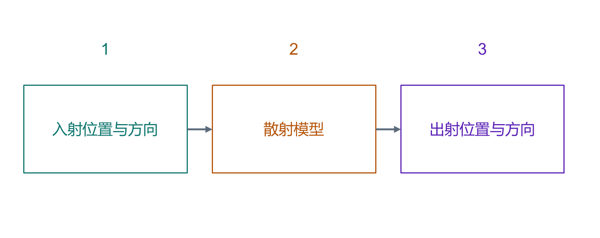

*读图：入射位置与方向 → 散射模型 → 出射位置与方向。箭头表示本节的推理或处理顺序，具体条件见正文。*

### 先读符号与条件

| 符号 / 条件 | 含义 |
| --- | --- |
| rho | 漫反射反照率 |
| fr | sr⁻¹ |
| 假设 | 不含自发光与透射 |

### 核心关系与推导入口

以下关系使用上述条件；标为教学简化或补充的内容是为理解而推导，不是逐字转录课件。

$$
f_{diffuse}=\rho/\pi
$$

### 🔧 手算 1：把关系落到数字上

ρ=0.5，均匀入射 L=4，则出射为 2；按 E=4π、fr=0.5/π 回算同样为 2。

| 检查步骤 | 操作 |
| --- | --- |
| 输入 | 先从例子中抄下给定量及单位，不引入未给定的数值。 |
| 计算 | 按本节关系求中间量，再得到结果；不要在第一步就做显示裁剪或整数舍入。 |
| 回查 | ρ=0.5，均匀入射 L=4，则出射为 2；按 E=4π、fr=0.5/π 回算同样为 2。 |
| 适用边界 | 把 RGB 当 BRDF 常数而不除 π，会使反射能量超出预期。 |

### ⚠️ 易错点：先识别症状与假设

把 RGB 当 BRDF 常数而不除 π，会使反射能量超出预期。

### 停下来解释一次

**问题：材质与纹理是否是同义词？**

<details>
<summary>展开参考回答</summary>

不是。纹理让参数随位置变化；材质定义如何使用这些参数计算散射。

</details>

<details>
<summary>展开原课件关键页，对照术语与图形</summary>

#### What is Material in Computer Graphics?

*PDF p2 · 对应本节：为什么一个颜色不足以描述材质？*

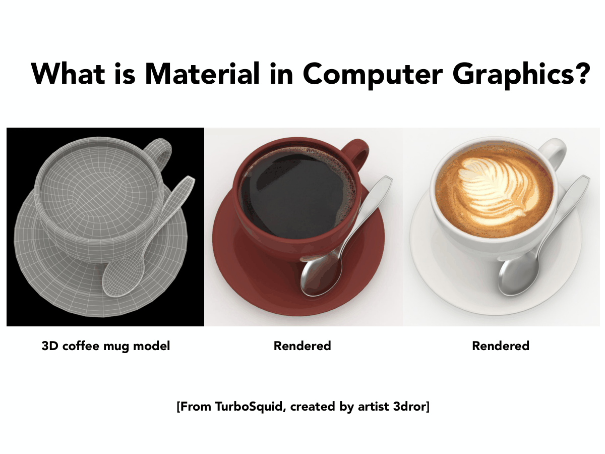

#### Material == BRDF

*PDF p3 · 对应本节：为什么一个颜色不足以描述材质？*

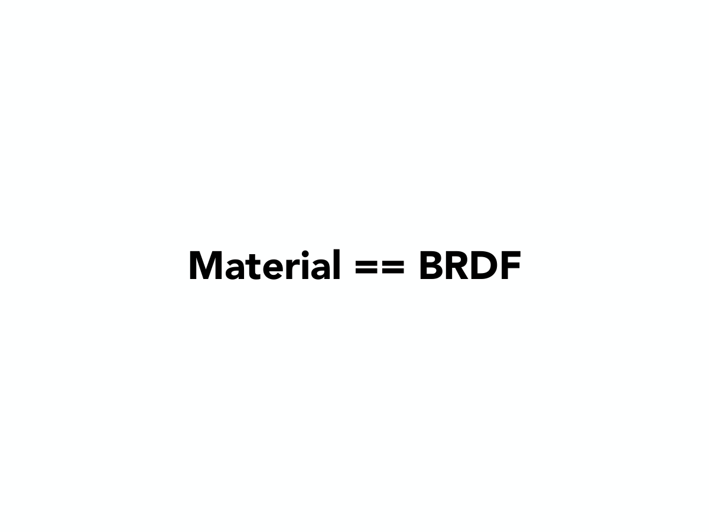

#### Uniform colored diffuse BRDF

*PDF p5 · 对应本节：为什么一个颜色不足以描述材质？*

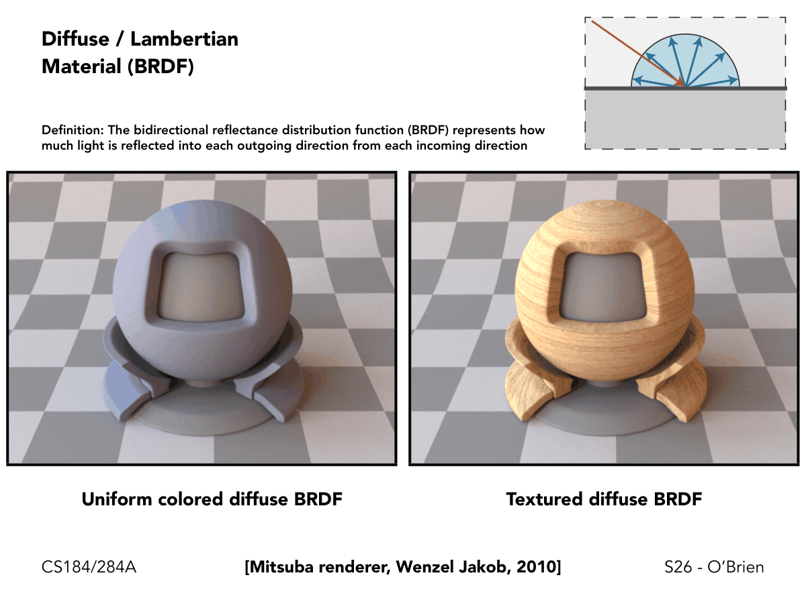

#### Light is equally reflected in each output direction

*PDF p6 · 对应本节：为什么一个颜色不足以描述材质？*

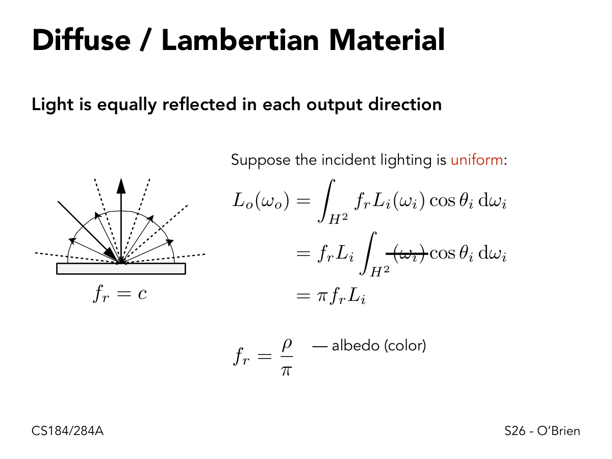

#### Glossy material (BRDF)

*PDF p8 · 对应本节：为什么一个颜色不足以描述材质？*

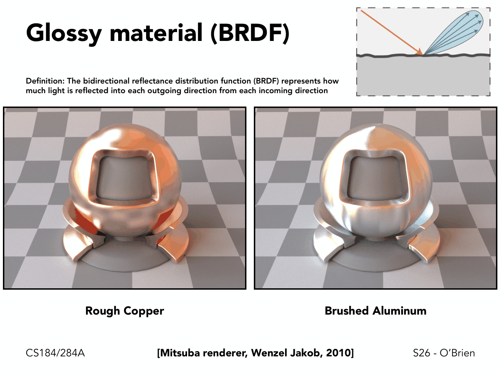

#### Ideal reflective material (BRDF)

*PDF p10 · 对应本节：为什么一个颜色不足以描述材质？*

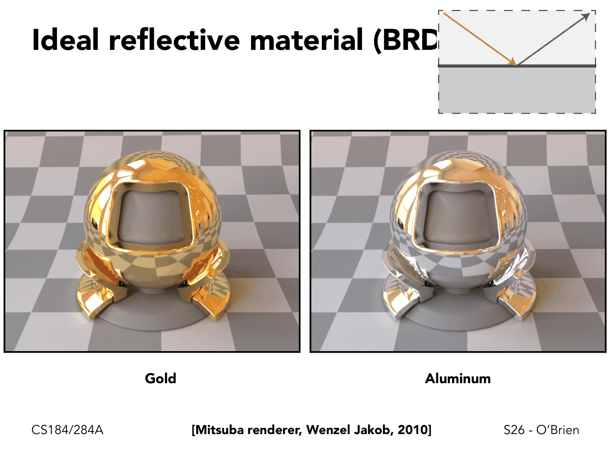

#### Ideal reflective / refractive

*PDF p12 · 对应本节：为什么一个颜色不足以描述材质？*

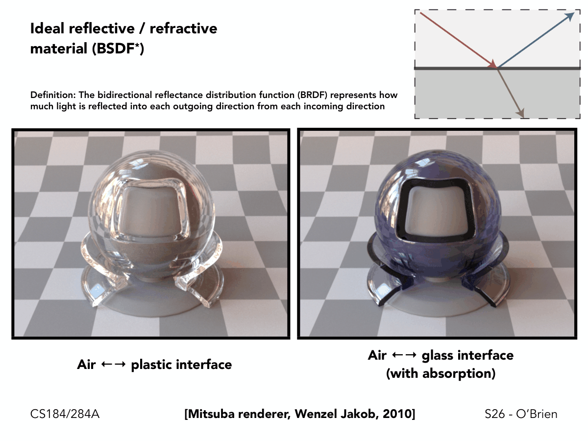

</details>

## 2. 镜面方向怎样由向量求出？

采用入射方向 wi 指向光来源、法线 n 为单位向量的约定，把 wi 分解为法线分量与切向分量。反射后法线分量不变，切向分量反号。

完美镜面只允许一个出射方向，其数学描述含 delta 分布。渲染时专门生成该方向，不能在整个半球均匀抽方向后等待“恰好命中”。

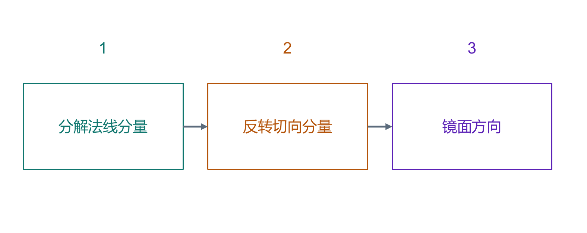

*读图：分解法线分量 → 反转切向分量 → 镜面方向。箭头表示本节的推理或处理顺序，具体条件见正文。*

### 先读符号与条件

| 符号 / 条件 | 含义 |
| --- | --- |
| n | 单位法线 |
| wi | 从表面指向来源 |
| wo | 从表面指向反射去向 |

### 核心关系与推导入口

以下关系使用上述条件；标为教学简化或补充的内容是为理解而推导，不是逐字转录课件。

$$
\omega_o=2(n\cdot\omega_i)n-\omega_i
$$

### 🔧 手算 2：把关系落到数字上

n=(0,1)，wi=(0.6,0.8)，反射 wo=(-0.6,0.8)。长度平方仍为 1；两方向法线分量均为 0.8。

| 检查步骤 | 操作 |
| --- | --- |
| 输入 | 先从例子中抄下给定量及单位，不引入未给定的数值。 |
| 计算 | 按本节关系求中间量，再得到结果；不要在第一步就做显示裁剪或整数舍入。 |
| 回查 | 长度平方仍为 1；两方向法线分量均为 0.8。 |
| 适用边界 | 若代码使用朝表面飞来的传播向量 d，公式应为 d-2(d·n)n，不能混用两套符号。 |

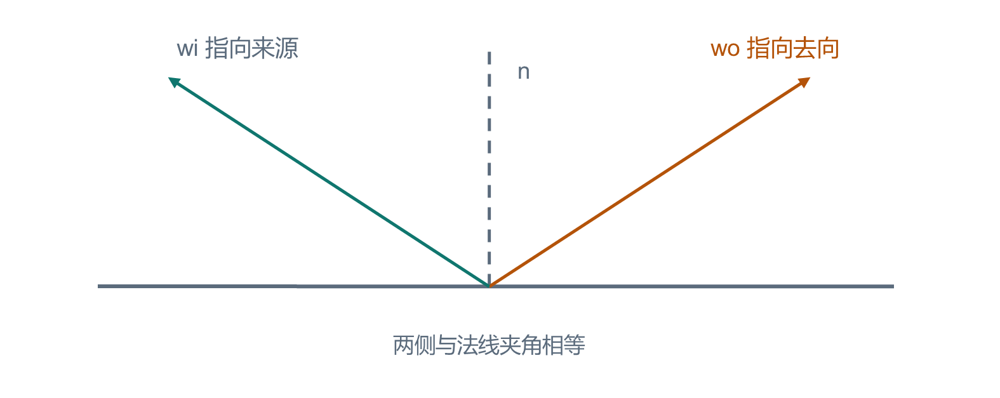

*理想镜面保持法线分量、翻转切向分量。*

### ⚠️ 易错点：先识别症状与假设

若代码使用朝表面飞来的传播向量 d，公式应为 d-2(d·n)n，不能混用两套符号。

### 停下来解释一次

**问题：法线没归一化会发生什么？**

<details>
<summary>展开参考回答</summary>

投影系数错误，结果方向和长度都可能错，继而影响求交与能量。

</details>

<details>
<summary>展开原课件关键页，对照术语与图形</summary>

#### Ideal Reflection and Refraction

*PDF p13 · 对应本节：镜面方向怎样由向量求出？*

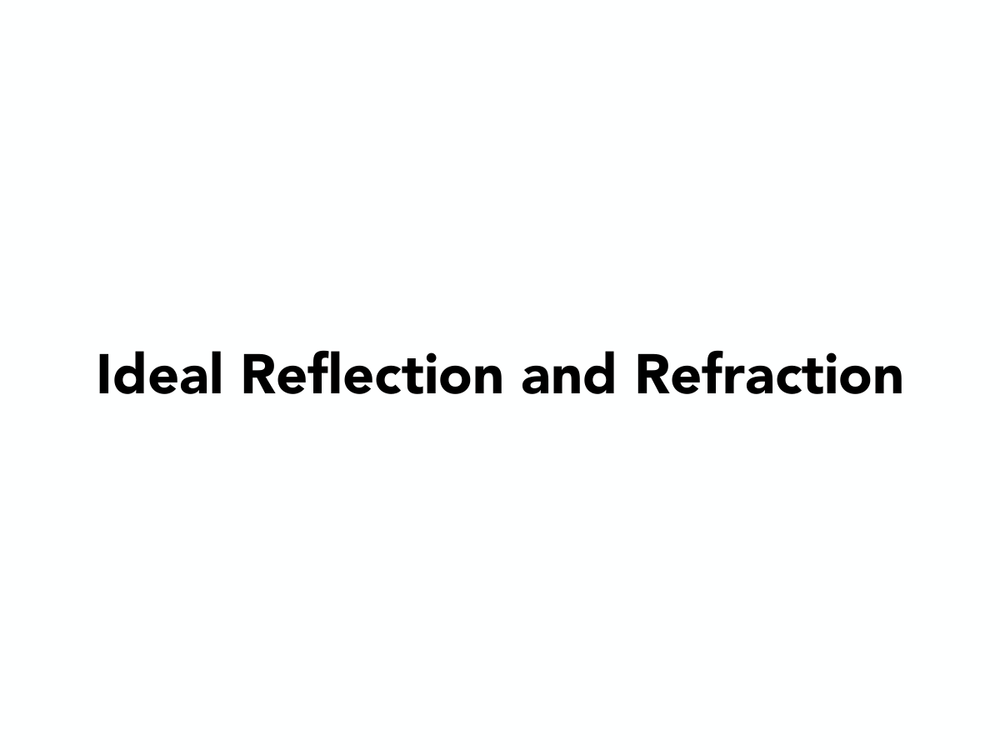

#### Perfect Specular Reflection

*PDF p14 · 对应本节：镜面方向怎样由向量求出？*

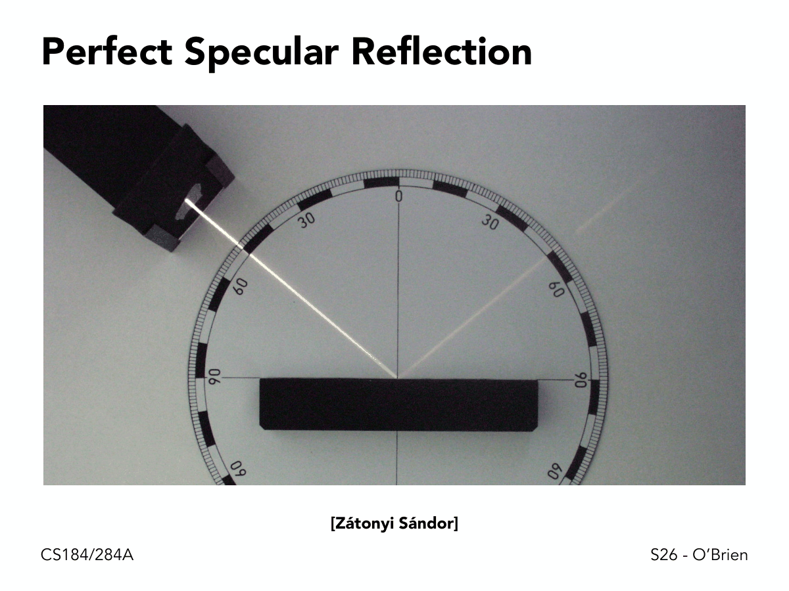

#### Perfect Specular Reflection

*PDF p15 · 对应本节：镜面方向怎样由向量求出？*

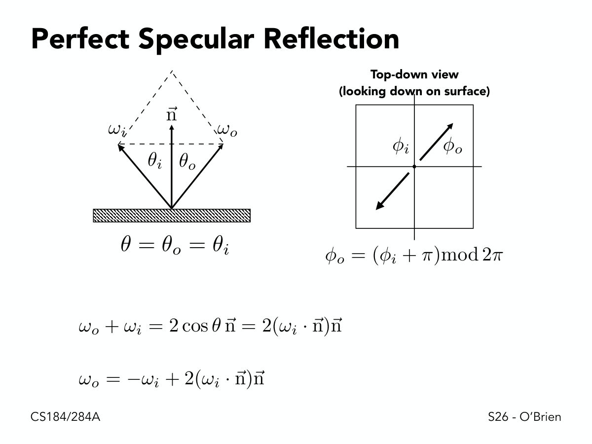

#### Specular Reflection & the Reflection Equation

*PDF p16 · 对应本节：镜面方向怎样由向量求出？*

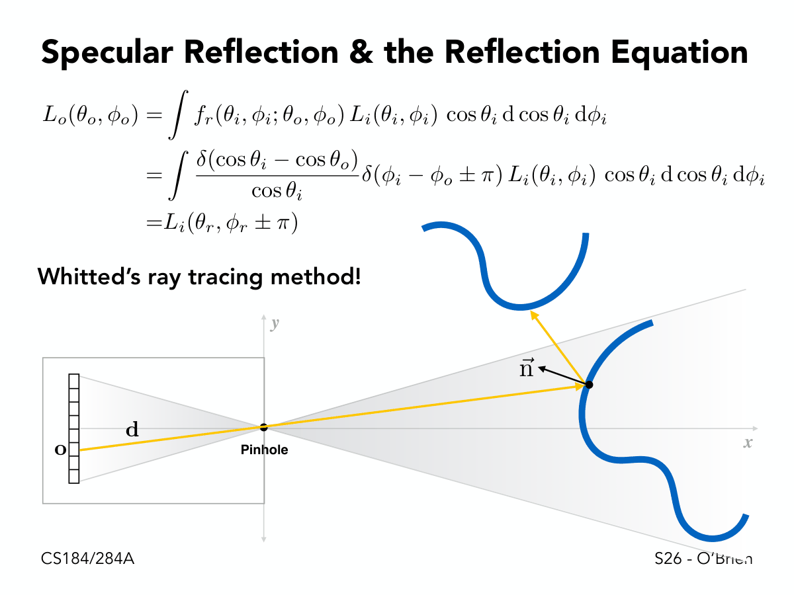

#### Perfect Specular Reflection BRDF

*PDF p17 · 对应本节：镜面方向怎样由向量求出？*

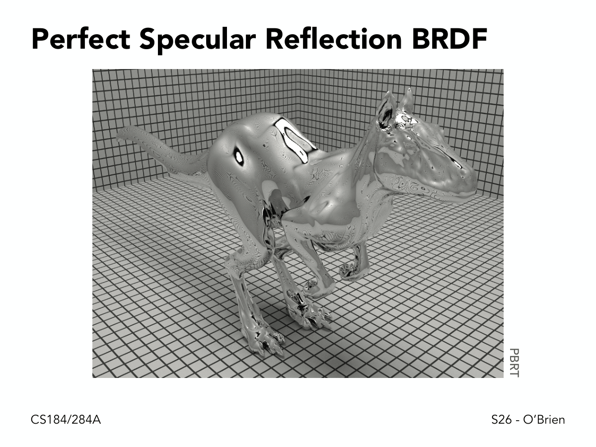

</details>

## 3. 折射为什么向法线靠近或远离？

Snell 定律把两侧折射率与角度正弦联系起来。光进入更高折射率介质时，透射角更小；离开高折射率介质时，角度变大。

公式中的角度都相对法线，法线朝向和介质次序需随进出界面切换。先判断入射来自哪一侧，再决定 ηi 与 ηt，而不是永远把外侧当空气。

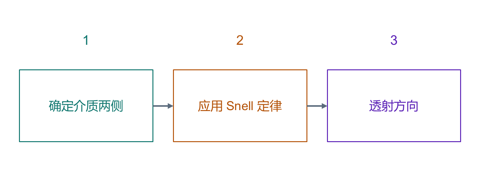

*读图：确定介质两侧 → 应用 Snell 定律 → 透射方向。箭头表示本节的推理或处理顺序，具体条件见正文。*

### 先读符号与条件

| 符号 / 条件 | 含义 |
| --- | --- |
| eta_i,eta_t | 两侧折射率 |
| theta_i,theta_t | 相对各自法线的角度 |
| 基础模型 | 各向同性介质 |

### 核心关系与推导入口

以下关系使用上述条件；标为教学简化或补充的内容是为理解而推导，不是逐字转录课件。

$$
\eta_i\sin\theta_i=\eta_t\sin\theta_t
$$

### 🔧 手算 3：把关系落到数字上

从空气 1 进入玻璃 1.5，入射 30°，sinθt=1/3，θt≈19.471°。回代 1.5×1/3=0.5=sin30°。

| 检查步骤 | 操作 |
| --- | --- |
| 输入 | 先从例子中抄下给定量及单位，不引入未给定的数值。 |
| 计算 | 按本节关系求中间量，再得到结果；不要在第一步就做显示裁剪或整数舍入。 |
| 回查 | 回代 1.5×1/3=0.5=sin30°。 |
| 适用边界 | 用角度数值直接喂给需要弧度的 sin 会得到错误方向；统一角度单位。 |

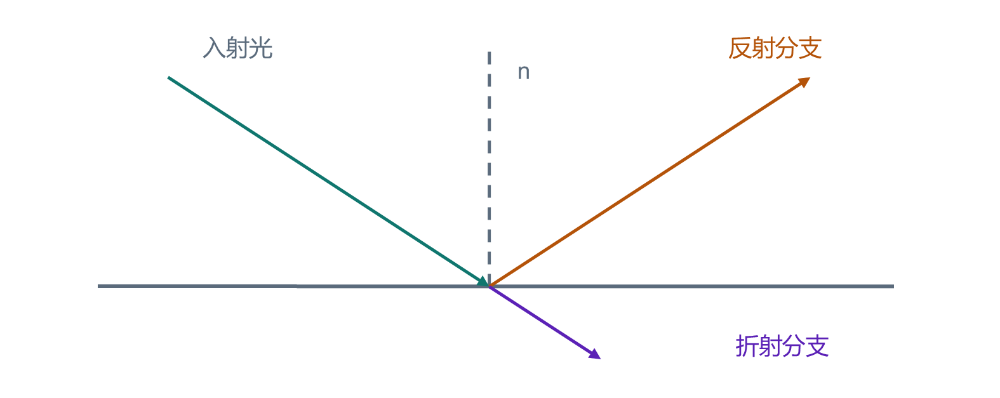

*界面将能量分配给反射与透射；折射线只作方向示意。*

### ⚠️ 易错点：先识别症状与假设

用角度数值直接喂给需要弧度的 sin 会得到错误方向；统一角度单位。

### 停下来解释一次

**问题：折射率更高就意味着光必然全部透射吗？**

<details>
<summary>展开参考回答</summary>

不。方向由 Snell 决定，反射与透射能量比例还由 Fresnel 决定。

</details>

<details>
<summary>展开原课件关键页，对照术语与图形</summary>

#### Specular Refraction

*PDF p18 · 对应本节：折射为什么向法线靠近或远离？*

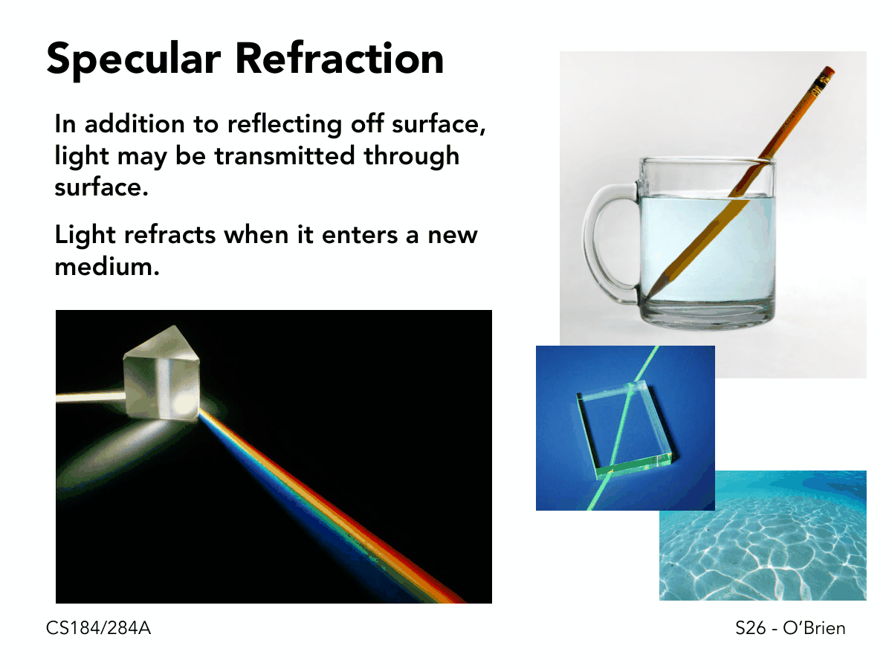

#### Snell’s Law

*PDF p19 · 对应本节：折射为什么向法线靠近或远离？*

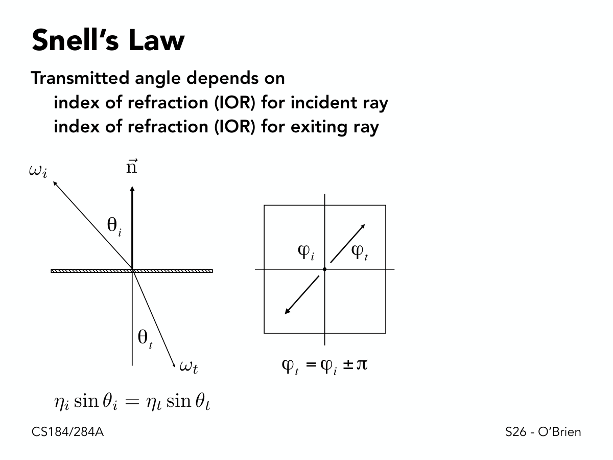

#### Snell’s Law

*PDF p20 · 对应本节：折射为什么向法线靠近或远离？*

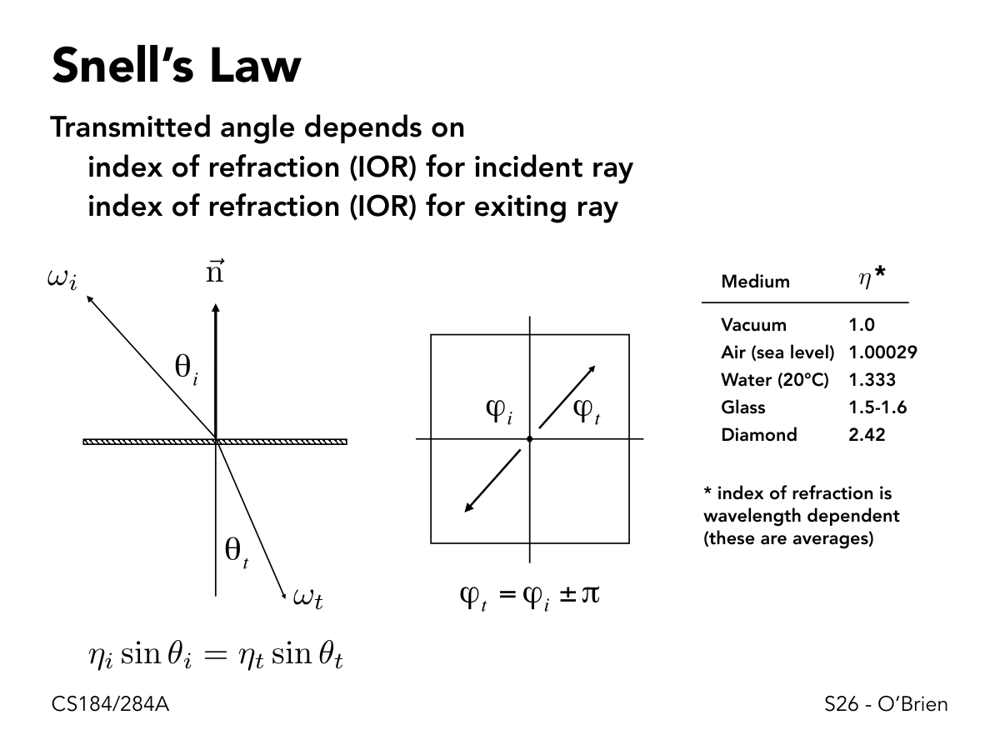

#### Law of Refraction

*PDF p21 · 对应本节：折射为什么向法线靠近或远离？*

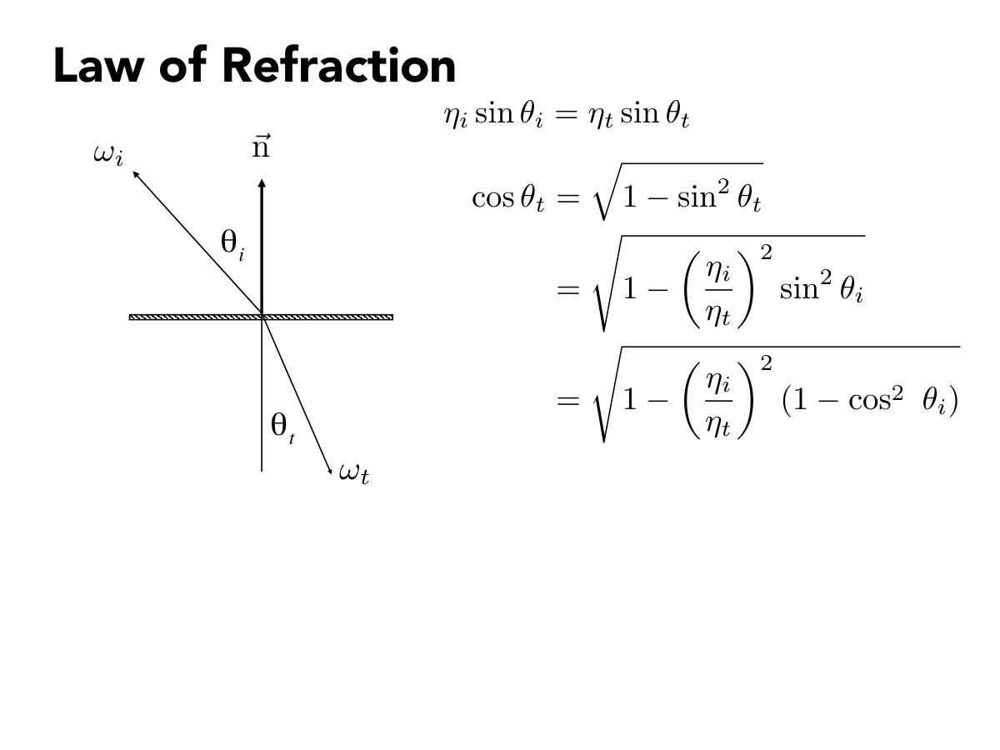

#### Law of Refraction

*PDF p22 · 对应本节：折射为什么向法线靠近或远离？*

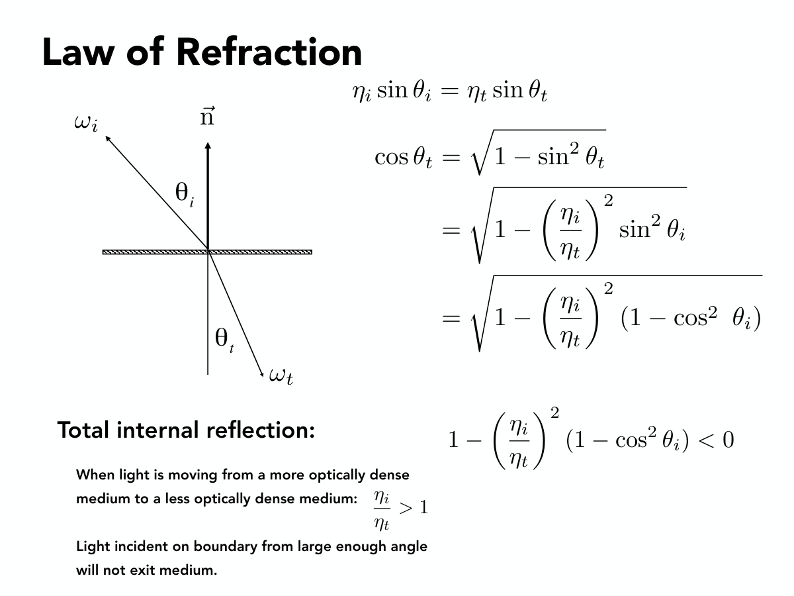

#### Refracted Rays

*PDF p23 · 对应本节：折射为什么向法线靠近或远离？*

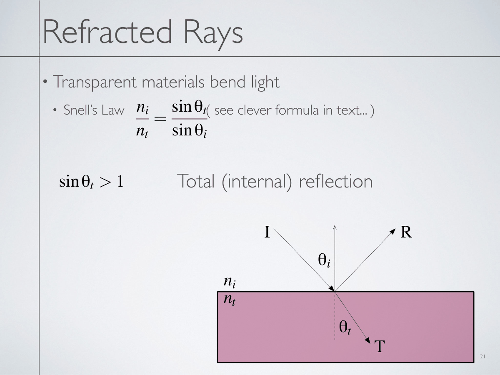

</details>

## 4. 全反射为何只能从一侧发生？

当 ηi>ηt 且入射角足够大时，Snell 要求 sinθt>1，不存在实数透射方向，于是发生全内反射。临界角满足 sinθc=ηt/ηi。

实现中应先算根号内部值，判为全反射后直接走反射分支；不能让 sqrt 负数变成 NaN，再指望后续 clamp 修复。

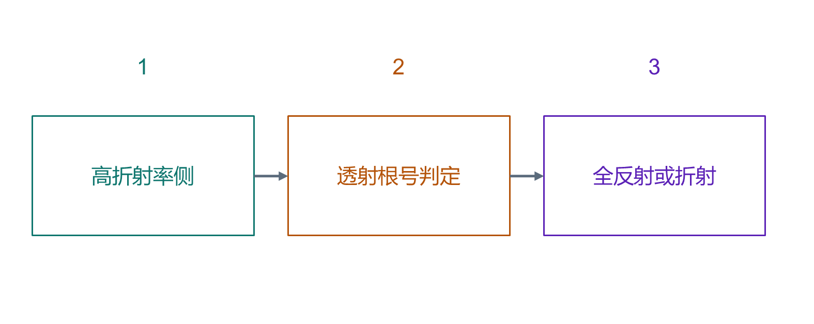

*读图：高折射率侧 → 透射根号判定 → 全反射或折射。箭头表示本节的推理或处理顺序，具体条件见正文。*

### 先读符号与条件

| 符号 / 条件 | 含义 |
| --- | --- |
| theta_c | 临界角 |
| eta_i | 入射侧较大折射率 |
| 前提 | 理想无吸收介质界面 |

### 核心关系与推导入口

以下关系使用上述条件；标为教学简化或补充的内容是为理解而推导，不是逐字转录课件。

$$
\theta_c=\arcsin(\eta_t/\eta_i),\qquad \eta_i>\eta_t
$$

### 🔧 手算 4：把关系落到数字上

玻璃 1.5 到空气 1，临界角约 41.810°。入射 60° 时 sinθt≈1.299>1；入射 30° 时为 0.75，可透射。

| 检查步骤 | 操作 |
| --- | --- |
| 输入 | 先从例子中抄下给定量及单位，不引入未给定的数值。 |
| 计算 | 按本节关系求中间量，再得到结果；不要在第一步就做显示裁剪或整数舍入。 |
| 回查 | 入射 60° 时 sinθt≈1.299>1；入射 30° 时为 0.75，可透射。 |
| 适用边界 | 空气进入玻璃不会发生这种全内反射；进出介质标错会让玻璃像镜子一样。 |

### ⚠️ 易错点：先识别症状与假设

空气进入玻璃不会发生这种全内反射；进出介质标错会让玻璃像镜子一样。

### 停下来解释一次

**问题：全反射时还应该给透射光线一个极小权重吗？**

<details>
<summary>展开参考回答</summary>

理想模型中不应，应取消不存在的透射事件。

</details>

<details>
<summary>展开原课件关键页，对照术语与图形</summary>

#### Refracted Rays

*PDF p23 · 对应本节：全反射为何只能从一侧发生？*


#### Snell’s Window/Circle

*PDF p25 · 对应本节：全反射为何只能从一侧发生？*

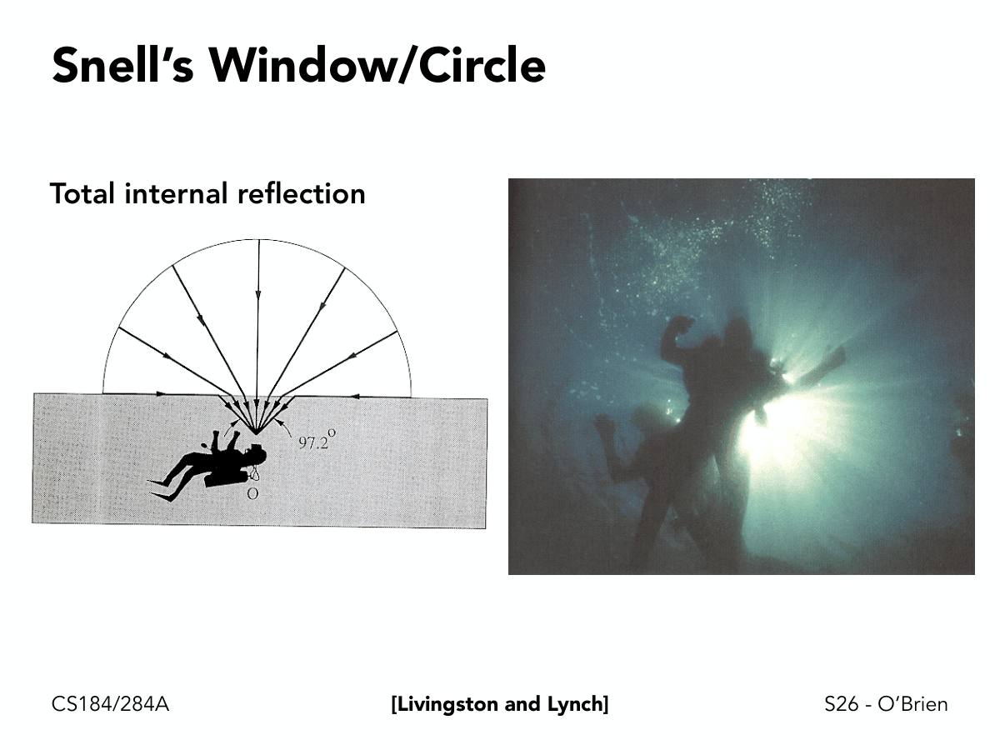

</details>

## 5. Fresnel 为什么让掠射方向更亮？

Fresnel 描述界面的反射比例随角度、波长与偏振变化。Schlick 是常用近似，法向入射为 F0，接近掠射时趋近 1。

原页 p24 将相应公式写成 kt，标题又谈透射，容易混淆；这里明确将其记为反射率 F。对理想无损界面，功率透射比例与反射互补；跨折射率的辐亮度传输还要处理测度因子，不能简单把所有 BSDF 值都当功率比例。

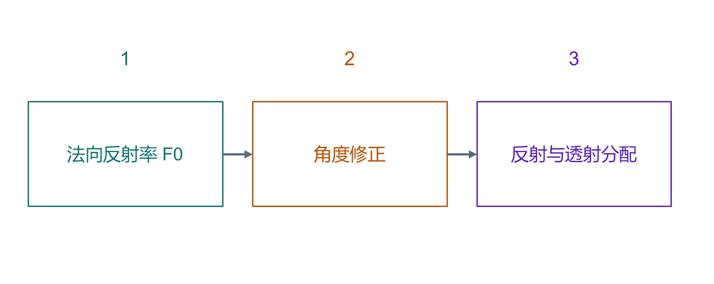

*读图：法向反射率 F0 → 角度修正 → 反射与透射分配。箭头表示本节的推理或处理顺序，具体条件见正文。*

### 先读符号与条件

| 符号 / 条件 | 含义 |
| --- | --- |
| F | 反射功率比例 |
| F0 | 法向值 |
| 范围 | 这里讨论常见介电界面近似，非全反射替代公式 |

### 核心关系与推导入口

以下关系使用上述条件；标为教学简化或补充的内容是为理解而推导，不是逐字转录课件。

$$
F(\theta)\approx F_0+(1-F_0)(1-\cos\theta)^5,\qquad F_0=\left(\frac{\eta_i-\eta_t}{\eta_i+\eta_t}\right)^2
$$

### 🔧 手算 5：把关系落到数字上

空气与 1.5 玻璃，F0=0.04；cosθ=0.5 时 F=0.04+0.96/32=0.07。法向 cos=1 代回得 0.04，掠射 cos=0 得 1。

| 检查步骤 | 操作 |
| --- | --- |
| 输入 | 先从例子中抄下给定量及单位，不引入未给定的数值。 |
| 计算 | 按本节关系求中间量，再得到结果；不要在第一步就做显示裁剪或整数舍入。 |
| 回查 | 法向 cos=1 代回得 0.04，掠射 cos=0 得 1。 |
| 适用边界 | 先判全反射；不要让近似公式给不允许的透射事件留下概率。 |

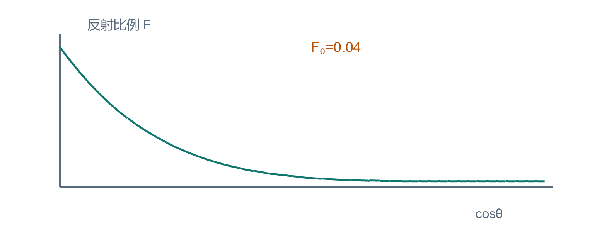

*Schlick 近似在法向为 0.04，掠射趋于 1；横轴是余弦而非角度。*

### ⚠️ 易错点：先识别症状与假设

先判全反射；不要让近似公式给不允许的透射事件留下概率。

### 停下来解释一次

**问题：为什么窗户斜着看更像镜子？**

<details>
<summary>展开参考回答</summary>

掠射时反射比例上升，透过的场景相对更弱。

</details>

<details>
<summary>展开原课件关键页，对照术语与图形</summary>

#### Refracted Rays

*PDF p24 · 对应本节：Fresnel 为什么让掠射方向更亮？*

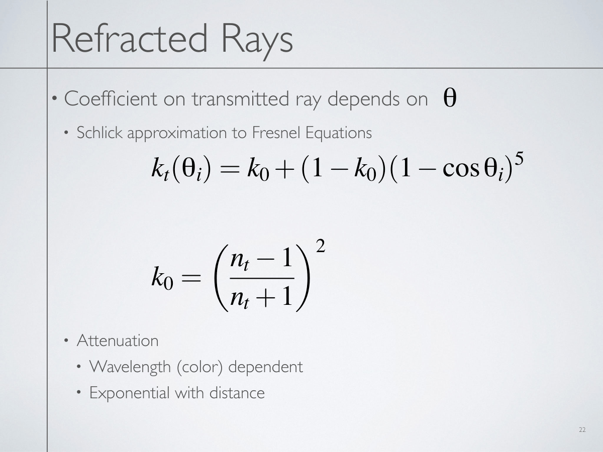

#### Fresnel Reflection & Transmission

*PDF p26 · 对应本节：Fresnel 为什么让掠射方向更亮？*

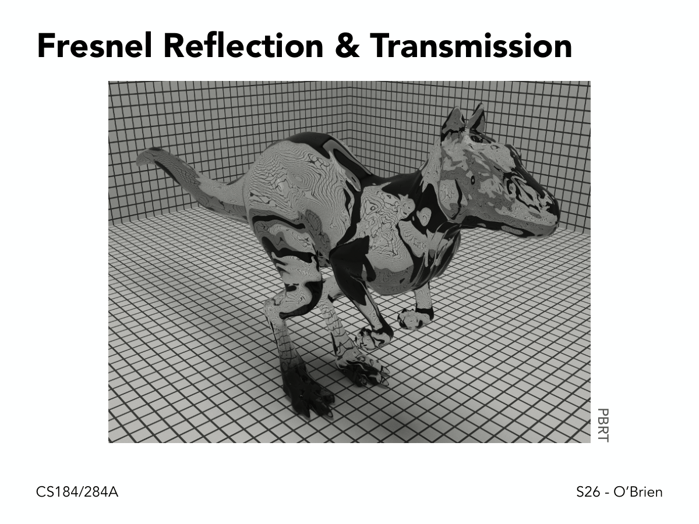

#### Fresnel Reflection Term

*PDF p38 · 对应本节：Fresnel 为什么让掠射方向更亮？*

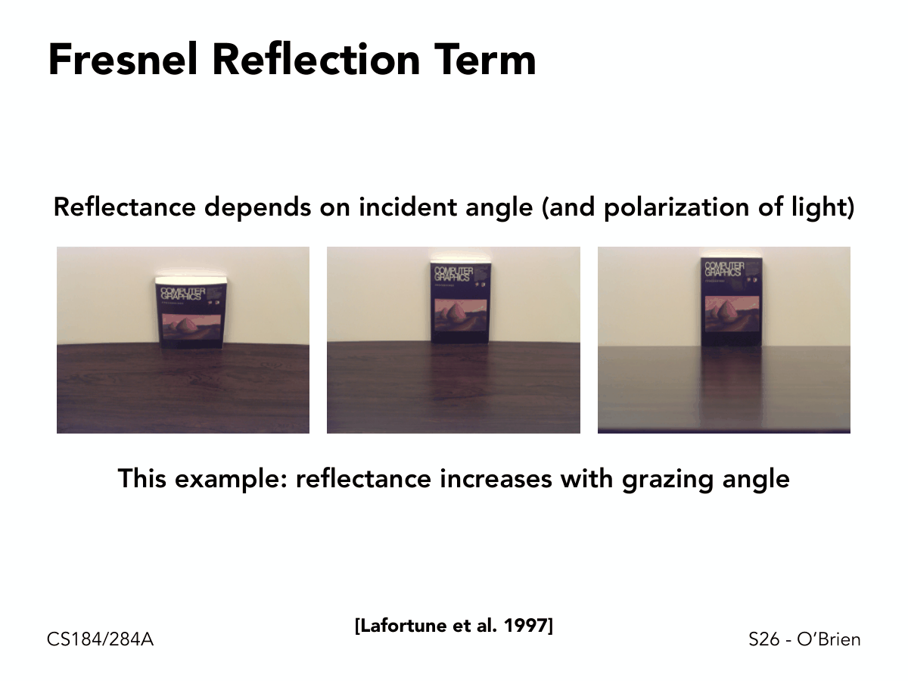

#### Fresnel Term (Dielectric,    =1.5)

*PDF p39 · 对应本节：Fresnel 为什么让掠射方向更亮？*

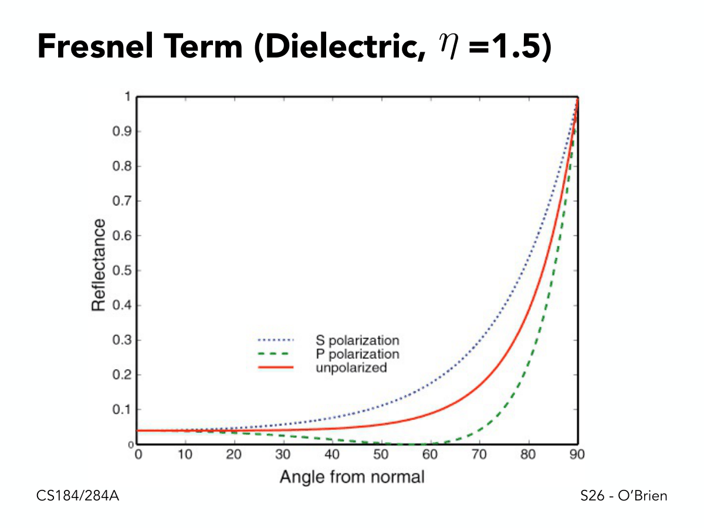

#### Fresnel Term (Conductor)

*PDF p40 · 对应本节：Fresnel 为什么让掠射方向更亮？*

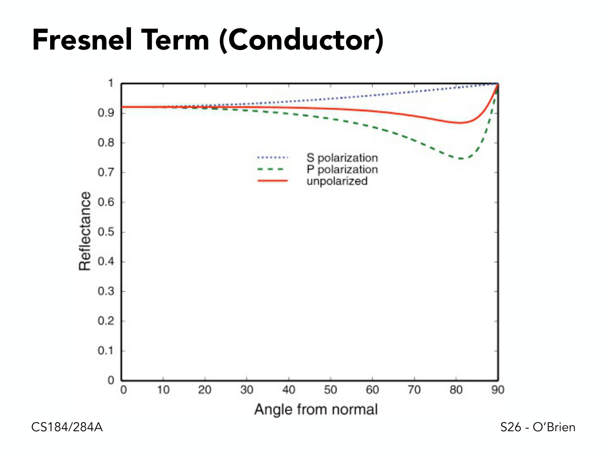

</details>

## 6. 粗糙表面为何还能由小镜子组成？

微表面模型把宏观表面视作许多微小镜面。只有法线接近半程向量 h 的微面，能把 wi 反射到 wo；法线分布 D 决定这种微面有多少。

F 表示单个微面的反射比例，G 表示微面间遮蔽与掩蔽。三者职责不同：粗糙度主要改变方向分布，并不简单等于给最终颜色乘一个暗化系数。

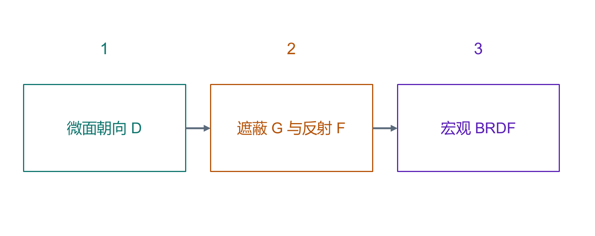

*读图：微面朝向 D → 遮蔽 G 与反射 F → 宏观 BRDF。箭头表示本节的推理或处理顺序，具体条件见正文。*

### 先读符号与条件

| 符号 / 条件 | 含义 |
| --- | --- |
| D | 微面法线分布 |
| G | 遮蔽掩蔽 |
| F | Fresnel |
| 条件 | 反射且两方向在正确半球 |

### 核心关系与推导入口

以下关系使用上述条件；标为教学简化或补充的内容是为理解而推导，不是逐字转录课件。

$$
f_r=\frac{F(\omega_i,h)D(h)G(\omega_i,\omega_o,h)}{4(n\cdot\omega_i)(n\cdot\omega_o)},\quad h=\frac{\omega_i+\omega_o}{\|\omega_i+\omega_o\|}
$$

### 🔧 手算 6：把关系落到数字上

取 F=0.04、D=2、G=0.8、两余弦均 0.5，分子 0.064、分母 1，所以 fr=0.064 sr⁻¹。回乘分母得到原分子。

| 检查步骤 | 操作 |
| --- | --- |
| 输入 | 先从例子中抄下给定量及单位，不引入未给定的数值。 |
| 计算 | 按本节关系求中间量，再得到结果；不要在第一步就做显示裁剪或整数舍入。 |
| 回查 | 回乘分母得到原分子。 |
| 适用边界 | D 通常不是“对普通立体角积分为 1”的任意 PDF；其法线分布有投影面积归一化。 |

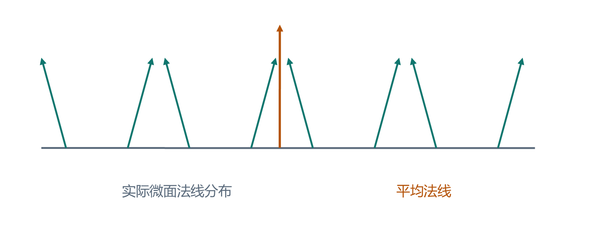

*用平均法线替换分布会丢失能够把光反射到指定方向的微面统计。*

### ⚠️ 易错点：先识别症状与假设

D 通常不是“对普通立体角积分为 1”的任意 PDF；其法线分布有投影面积归一化。

### 停下来解释一次

**问题：粗糙度增大一定让所有方向更暗吗？**

<details>
<summary>展开参考回答</summary>

不。通常高光变宽、峰值降低，部分离开高光中心的方向反而变亮。

</details>

<details>
<summary>展开原课件关键页，对照术语与图形</summary>

#### Microfacet Material Model

*PDF p27 · 对应本节：粗糙表面为何还能由小镜子组成？*

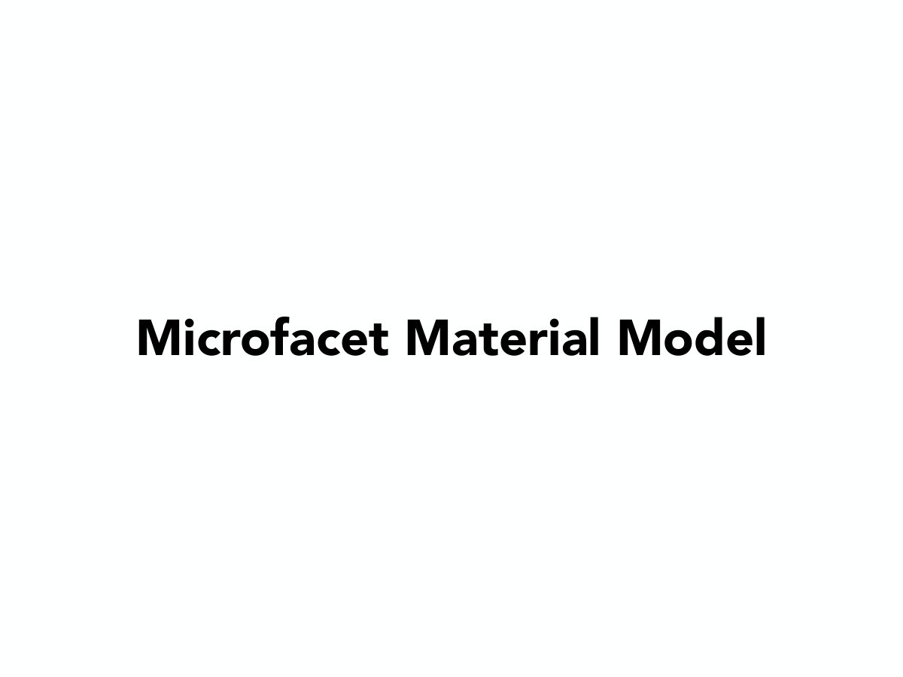

#### Microfacet Theory

*PDF p29 · 对应本节：粗糙表面为何还能由小镜子组成？*

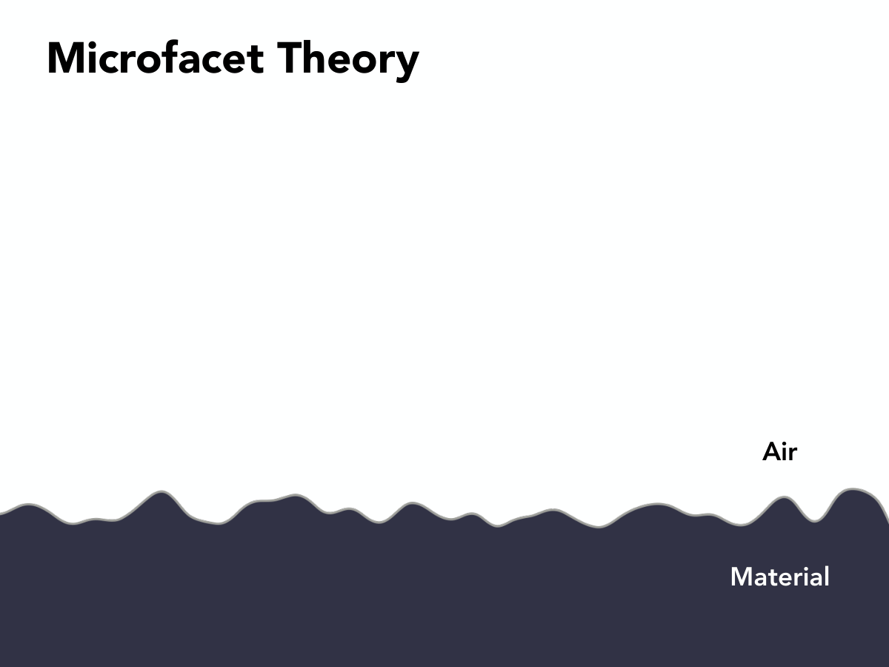

#### Microfacet Theory

*PDF p31 · 对应本节：粗糙表面为何还能由小镜子组成？*

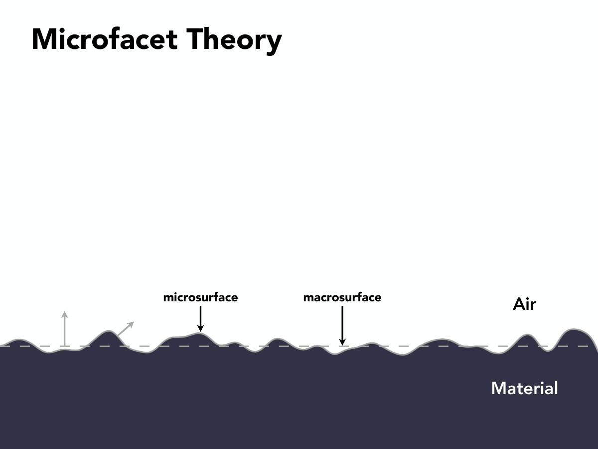

#### Microfacet Theory

*PDF p32 · 对应本节：粗糙表面为何还能由小镜子组成？*

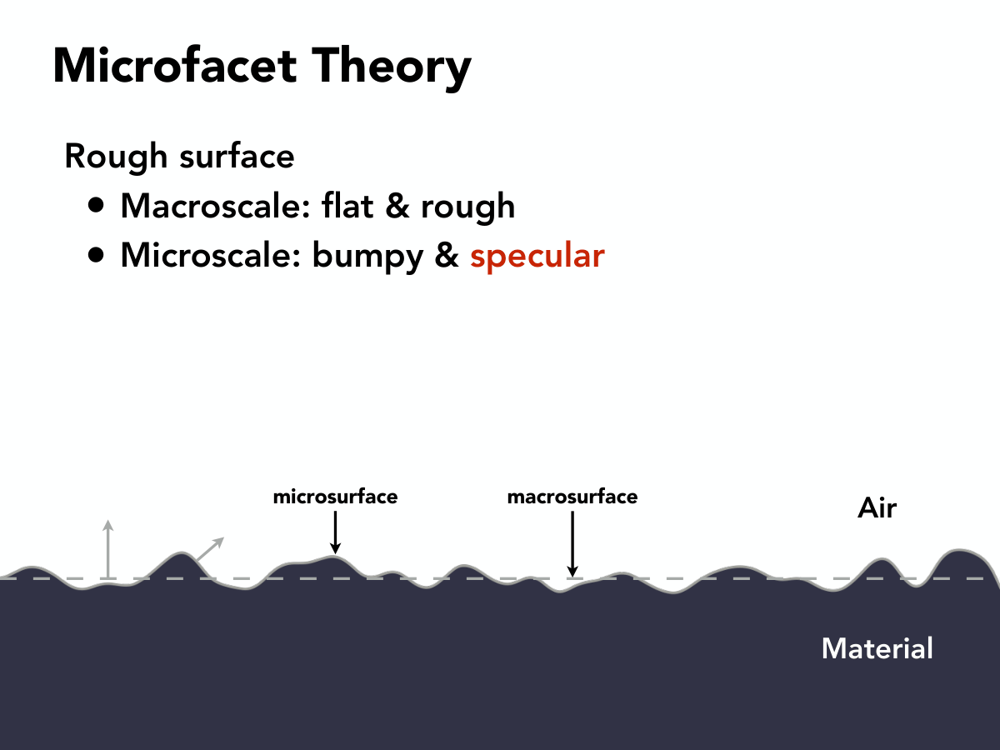

#### • Key: the distribution of microfacets’ normals

*PDF p34 · 对应本节：粗糙表面为何还能由小镜子组成？*

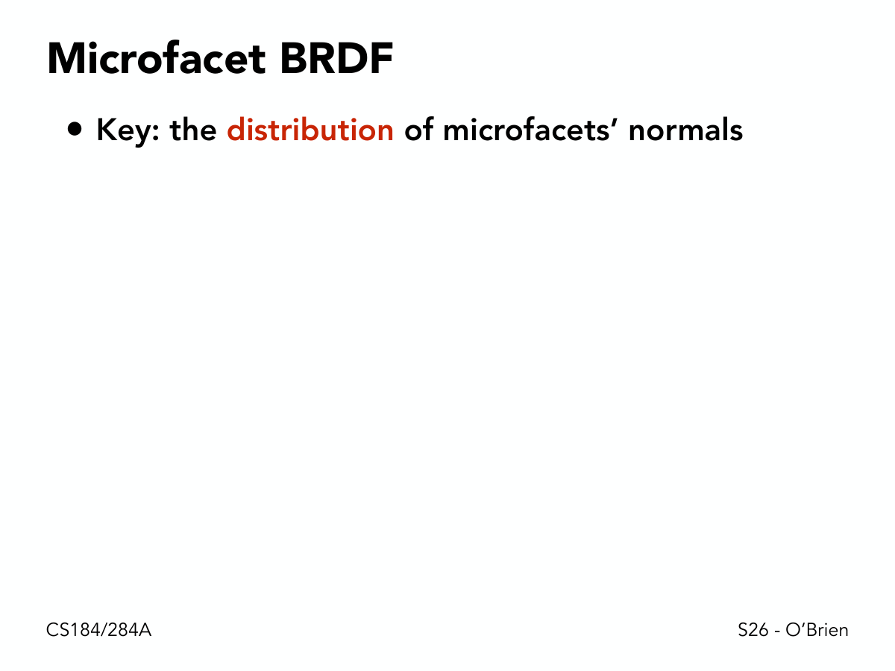

#### • Key: the distribution of microfacets’ normals

*PDF p35 · 对应本节：粗糙表面为何还能由小镜子组成？*

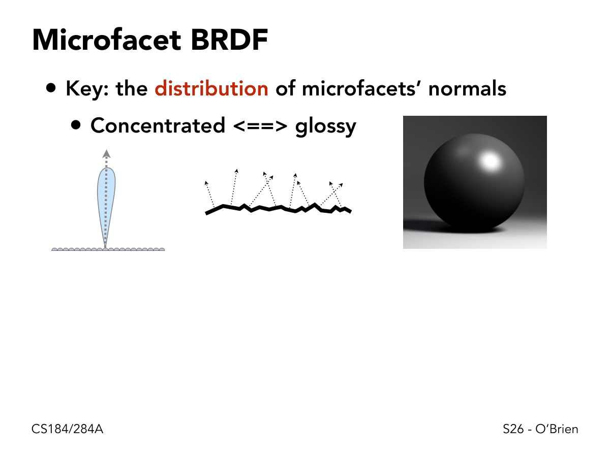

#### • What kind of microfacets reflect wi to wo?

*PDF p37 · 对应本节：粗糙表面为何还能由小镜子组成？*

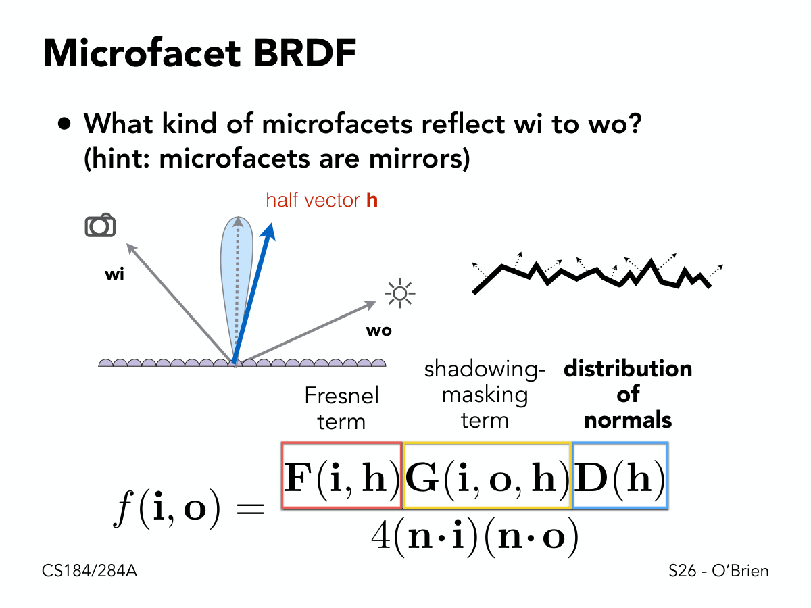

</details>

## 7. 各向异性为什么需要切线方向？

各向同性意味着绕宏观法线旋转入射与出射方向时，材质响应不变。拉丝金属等有方向性微结构，旋转切线方向会改变高光形状。

只存一个法线不足以描述各向异性，要建立切线、副切线、法线坐标系。纹理 UV 的方向、镜像与接缝会影响这个坐标系，进而影响高光连续性。

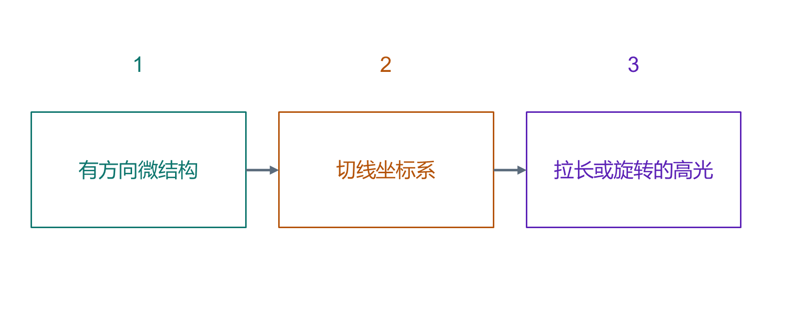

*读图：有方向微结构 → 切线坐标系 → 拉长或旋转的高光。箭头表示本节的推理或处理顺序，具体条件见正文。*

### 先读符号与条件

| 符号 / 条件 | 含义 |
| --- | --- |
| t,b,n | 正交单位切线基 |
| omega | 世界方向 |
| 各向异性 | 区分 t 与 b |

### 核心关系与推导入口

以下关系使用上述条件；标为教学简化或补充的内容是为理解而推导，不是逐字转录课件。

$$
\omega_{local}=(\omega\cdot t,\omega\cdot b,\omega\cdot n)
$$

### 🔧 手算 7：把关系落到数字上

t=(1,0,0)、b=(0,1,0)、n=(0,0,1)，ω=(0.6,0,0.8)，局部坐标不变。交换 t 与 b 后变成 (0,0.6,0.8)，方向性模型会区别处理。

| 检查步骤 | 操作 |
| --- | --- |
| 输入 | 先从例子中抄下给定量及单位，不引入未给定的数值。 |
| 计算 | 按本节关系求中间量，再得到结果；不要在第一步就做显示裁剪或整数舍入。 |
| 回查 | 交换 t 与 b 后变成 (0,0.6,0.8)，方向性模型会区别处理。 |
| 适用边界 | 切线不正交会使材质随模型变换异常改变；先验证基的正交性。 |

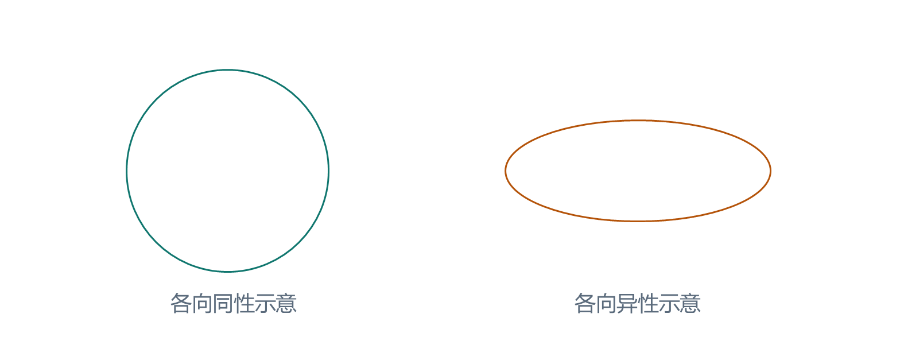

*方向性结构可拉长高光；图形只表达形状差异，不是 BRDF 测量。*

### ⚠️ 易错点：先识别症状与假设

切线不正交会使材质随模型变换异常改变；先验证基的正交性。

### 停下来解释一次

**问题：各向异性等于纹理颜色随方向变化吗？**

<details>
<summary>展开参考回答</summary>

不等同。即使底色均匀，散射方向分布也可各向异性。

</details>

<details>
<summary>展开原课件关键页，对照术语与图形</summary>

#### Anisotropic BRDFs

*PDF p45 · 对应本节：各向异性为什么需要切线方向？*

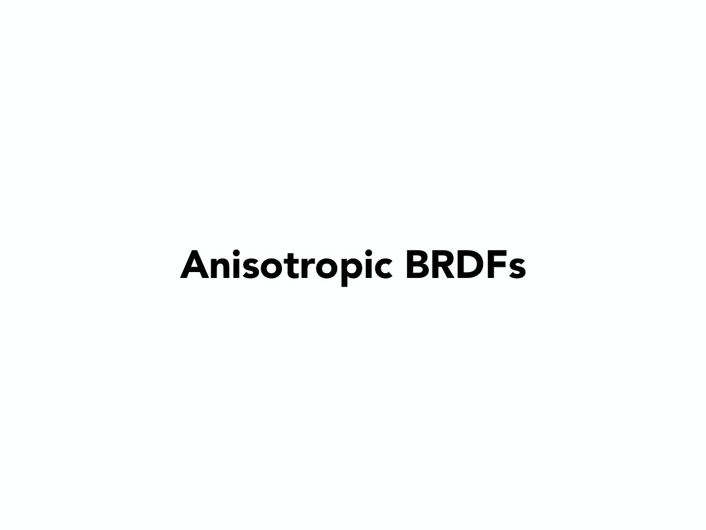

#### Isotropic vs Anisotropic Reflection

*PDF p46 · 对应本节：各向异性为什么需要切线方向？*

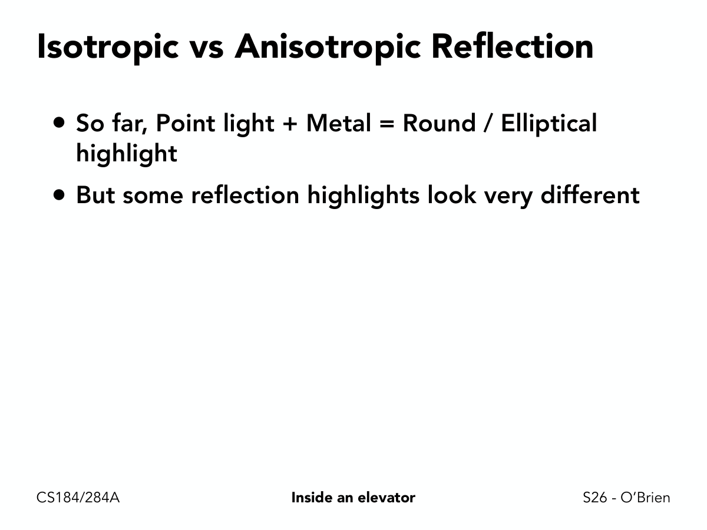

#### Isotropic vs Anisotropic Reflection

*PDF p48 · 对应本节：各向异性为什么需要切线方向？*

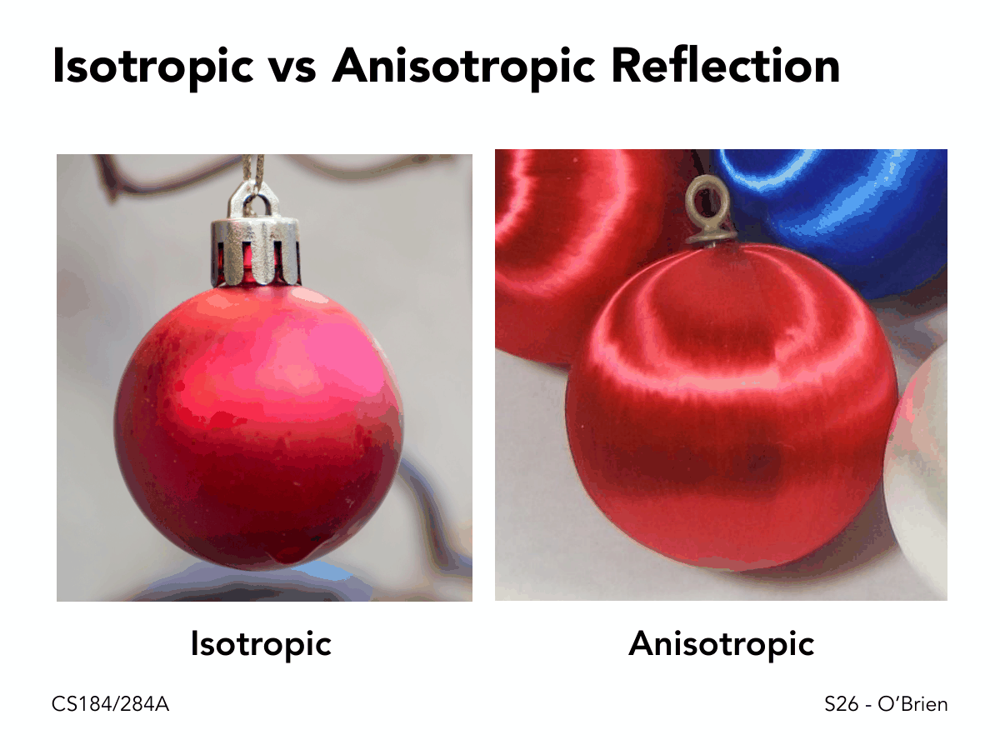

#### Anisotropic BRDF: Brushed Metal

*PDF p49 · 对应本节：各向异性为什么需要切线方向？*

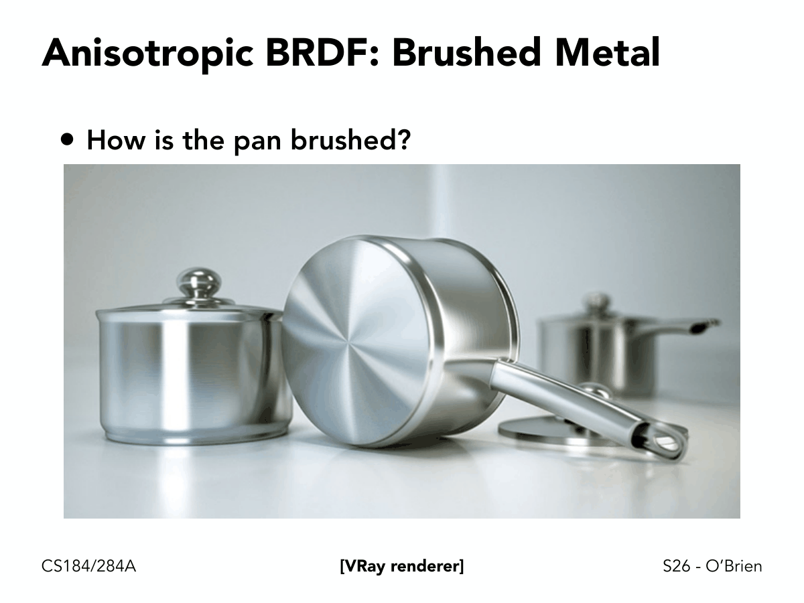

#### Isotropic / Anisotropic Materials (BRDFs)

*PDF p50 · 对应本节：各向异性为什么需要切线方向？*

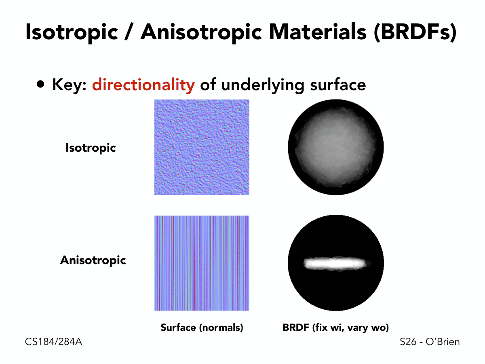

#### Reflection independent of azimuthal angle φ

*PDF p51 · 对应本节：各向异性为什么需要切线方向？*

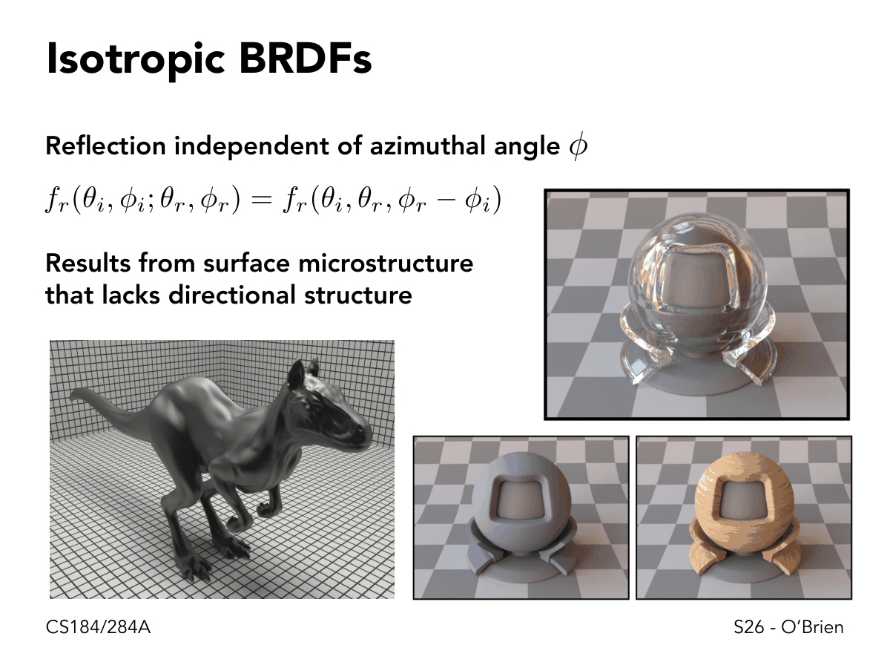

#### Reflection depends on azimuthal angle φ

*PDF p52 · 对应本节：各向异性为什么需要切线方向？*

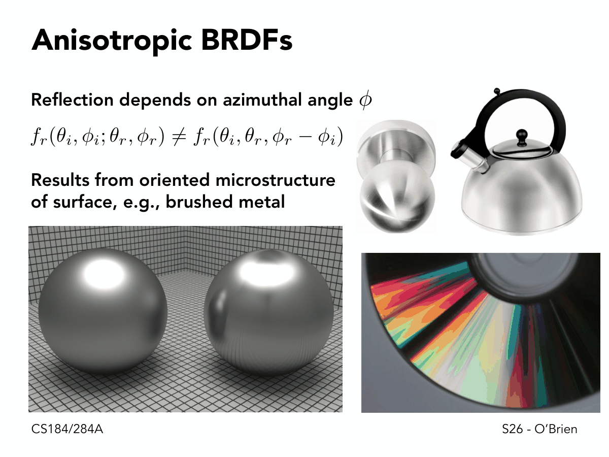

</details>

## 8. 为什么统计粗糙度会丢失闪光？

普通微表面模型对像素覆盖的微面做统计平均。若一个像素只覆盖少数强反射微片，实际法线分布是稀疏的，平均模型会抹掉闪烁亮点。

金属薄片、海面波峰和细法线纹理涉及多个尺度。观察距离变远后，一个像素汇集更多细节，此时统计模型更合适；这再次连接到像素足迹与采样。


*读图：少量离散微片 → 像素足迹扩大 → 统计法线分布。箭头表示本节的推理或处理顺序，具体条件见正文。*

### 先读符号与条件

| 符号 / 条件 | 含义 |
| --- | --- |
| n | 局部微面法线 |
| D | 分布 |
| 像素足迹 | 决定被平均的面积 |

### 核心关系与推导入口

以下关系使用上述条件；标为教学简化或补充的内容是为理解而推导，不是逐字转录课件。

$$
\bar n\ \text{不能替代完整法线分布 }D(n)
$$

### 🔧 手算 8：把关系落到数字上

两个法线分别为 (±0.6,0,0.8)，平均后归一化得到 (0,0,1)。但实际没有法线正好朝正上方的微片；用平均法线会创造错误镜面方向。

| 检查步骤 | 操作 |
| --- | --- |
| 输入 | 先从例子中抄下给定量及单位，不引入未给定的数值。 |
| 计算 | 按本节关系求中间量，再得到结果；不要在第一步就做显示裁剪或整数舍入。 |
| 回查 | 但实际没有法线正好朝正上方的微片；用平均法线会创造错误镜面方向。 |
| 适用边界 | 直接平均法线后当作原粗糙度，不保留分布变化，会让缩小纹理的高光能量错误。 |

### ⚠️ 易错点：先识别症状与假设

直接平均法线后当作原粗糙度，不保留分布变化，会让缩小纹理的高光能量错误。

### 停下来解释一次

**问题：闪光是否只是随机噪点？**

<details>
<summary>展开参考回答</summary>

不是。真实微结构可产生稳定的视角相关闪光，渲染采样噪声则是估计误差。

</details>

<details>
<summary>展开原课件关键页，对照术语与图形</summary>

#### Detailed / Glinty Material

*PDF p58 · 对应本节：为什么统计粗糙度会丢失闪光？*


#### Why details?

*PDF p59 · 对应本节：为什么统计粗糙度会丢失闪光？*


#### Why details?

*PDF p61 · 对应本节：为什么统计粗糙度会丢失闪光？*


#### Recap: Microfacet BRDF

*PDF p65 · 对应本节：为什么统计粗糙度会丢失闪光？*


#### Statistical NDF vs. Actual NDF

*PDF p66 · 对应本节：为什么统计粗糙度会丢失闪光？*


#### isotropic noise

*PDF p67 · 对应本节：为什么统计粗糙度会丢失闪光？*


#### Different Details

*PDF p69 · 对应本节：为什么统计粗糙度会丢失闪光？*


#### Ocean waves

*PDF p71 · 对应本节：为什么统计粗糙度会丢失闪光？*


</details>

## 9. 头发为什么不是普通细圆柱？

头发的表面与内部结构会让光反射、透射并在内部反弹，产生多个方向性亮带。课件从 Kajiya–Kay 的简化高光，过渡到区分多种光路的毛发模型。

先理解 R、TT、TRT 分别代表表面反射、穿透、一次内部反射后的透出，再看详细散射公式。对于初学者，重点是“同一个入射方向可对应几类传播事件”，而非背整套参数。


*读图：表面反射 R → 穿透 TT → 内部反射 TRT。箭头表示本节的推理或处理顺序，具体条件见正文。*

### 先读符号与条件

| 符号 / 条件 | 含义 |
| --- | --- |
| R | 最终反射功率比例 |
| T | 最终透射比例 |
| A | 吸收比例 |
| 注意 | 不是完整毛发 BRDF |

### 核心关系与推导入口

以下关系使用上述条件；标为教学简化或补充的内容是为理解而推导，不是逐字转录课件。

$$
1=R+T+A\quad\text{（简化能量账本）}
$$

### 🔧 手算 9：把关系落到数字上

若入射能量 10、反射 2、透射 5，则吸收为 3；比例 0.2+0.5+0.3=1。这仅检查能量，不决定各方向分布。

| 检查步骤 | 操作 |
| --- | --- |
| 输入 | 先从例子中抄下给定量及单位，不引入未给定的数值。 |
| 计算 | 按本节关系求中间量，再得到结果；不要在第一步就做显示裁剪或整数舍入。 |
| 回查 | 这仅检查能量，不决定各方向分布。 |
| 适用边界 | 把多次透射事件当成互相独立的全部能量，会重复分配功率。 |


*毛发和次表面材料包含内部传播，不能只看一次表面反射。*

### ⚠️ 易错点：先识别症状与假设

把多次透射事件当成互相独立的全部能量，会重复分配功率。

### 停下来解释一次

**问题：为什么染发会改变不止一个高光颜色？**

<details>
<summary>展开参考回答</summary>

光在内部经历不同长度和次数的传播，吸收对各类光路作用不同。

</details>

<details>
<summary>展开原课件关键页，对照术语与图形</summary>

#### Hair / Fur Appearance Models

*PDF p73 · 对应本节：头发为什么不是普通细圆柱？*


#### Hair Appearance

*PDF p74 · 对应本节：头发为什么不是普通细圆柱？*


#### Kajiya-Kay Model

*PDF p75 · 对应本节：头发为什么不是普通细圆柱？*


#### Marschner Model

*PDF p77 · 对应本节：头发为什么不是普通细圆柱？*


#### Marschner Model

*PDF p78 · 对应本节：头发为什么不是普通细圆柱？*


#### Marschner Model

*PDF p85 · 对应本节：头发为什么不是普通细圆柱？*


#### Marschner model

*PDF p86 · 对应本节：头发为什么不是普通细圆柱？*


</details>

## 10. 雾中的光为何不能只追表面？

参与介质在传播途中吸收与散射，事件不再只发生在表面。要同时抽样“走多远”和“向哪里散射”，并处理沿途透过率。

相函数描述体积散射的角度分布；它与表面 BRDF 的测度不同，没有同样的表面投影余弦。均匀介质的 Beer 衰减是本节用于理解的教学推导。


*读图：沿途消光 → 体积散射事件 → 新的传播方向。箭头表示本节的推理或处理顺序，具体条件见正文。*

### 先读符号与条件

| 符号 / 条件 | 含义 |
| --- | --- |
| sigma_a | 吸收系数 |
| 条件或约定 | m⁻¹ |
|  sigma_s | 散射系数 |
| 条件或约定 | m⁻¹ |
| T | 未发生消光事件的比例 |

### 核心关系与推导入口

以下关系使用上述条件；标为教学简化或补充的内容是为理解而推导，不是逐字转录课件。

$$
T(d)=e^{-\sigma_t d},\qquad \sigma_t=\sigma_a+\sigma_s
$$

### 🔧 手算 10：把关系落到数字上

σt=0.5 m⁻¹、d=2 m，T=e⁻¹≈0.367879。两段各 1 米透过率相乘 e⁻⁰·⁵×e⁻⁰·⁵=e⁻¹。

| 检查步骤 | 操作 |
| --- | --- |
| 输入 | 先从例子中抄下给定量及单位，不引入未给定的数值。 |
| 计算 | 按本节关系求中间量，再得到结果；不要在第一步就做显示裁剪或整数舍入。 |
| 回查 | 两段各 1 米透过率相乘 e⁻⁰·⁵×e⁻⁰·⁵=e⁻¹。 |
| 适用边界 | 散射离开当前光束不等于能量全部被吸收；还有其他方向散射进来的贡献。 |


*均匀介质示例用 σt d=3x，传播距离增加使未消光比例指数下降。*

### ⚠️ 易错点：先识别症状与假设

散射离开当前光束不等于能量全部被吸收；还有其他方向散射进来的贡献。

### 停下来解释一次

**问题：雾越厚是否只需把物体颜色乘更小系数？**

<details>
<summary>展开参考回答</summary>

不够。还要加散射进入视线的光，否则无法表现亮雾和光束。

</details>

<details>
<summary>展开原课件关键页，对照术语与图形</summary>

#### Participating Media

*PDF p87 · 对应本节：雾中的光为何不能只追表面？*


#### Participating Media: Fog

*PDF p88 · 对应本节：雾中的光为何不能只追表面？*


#### Participating Media: Cloud

*PDF p89 · 对应本节：雾中的光为何不能只追表面？*


#### Participating Media

*PDF p90 · 对应本节：雾中的光为何不能只追表面？*


#### Participating Media: Rendering

*PDF p91 · 对应本节：雾中的光为何不能只追表面？*


#### Participating Media: Application

*PDF p93 · 对应本节：雾中的光为何不能只追表面？*


</details>

## 11. 皮肤与玉石为何需要跨位置散射？

BRDF 假设光在同一点进入并离开；次表面散射中，光进入内部后可能从附近另一点离开。BSSRDF 因而同时依赖入射和出射的位置与方向。

蜡烛、耳朵逆光和玉石的柔和外观与这种空间扩散有关。它不是简单把表面 RGB 模糊一下，因为边界、厚度、遮挡和入射方向仍然影响结果。


*读图：位置 xi 入射 → 内部传播 → 位置 xo 出射。箭头表示本节的推理或处理顺序，具体条件见正文。*

### 先读符号与条件

| 符号 / 条件 | 含义 |
| --- | --- |
| S | BSSRDF |
| xi,xo | 不同表面位置 |
| 积分 | 方向与面积都要包含 |

### 核心关系与推导入口

以下关系使用上述条件；标为教学简化或补充的内容是为理解而推导，不是逐字转录课件。

$$
L_o(x_o,\omega_o)=\int_A\int_{H^2}S(x_i,\omega_i,x_o,\omega_o)L_i\cos\theta_i\,d\omega_i\,dA_i
$$

### 🔧 手算 11：把关系落到数字上

简化离散扩散核权重 (0.2,0.6,0.2)，输入 (0,10,0)，中心得到 6。三个输出若边界处理正确，总和仍为 10；漏掉边界能量则不守恒。

| 检查步骤 | 操作 |
| --- | --- |
| 输入 | 先从例子中抄下给定量及单位，不引入未给定的数值。 |
| 计算 | 按本节关系求中间量，再得到结果；不要在第一步就做显示裁剪或整数舍入。 |
| 回查 | 三个输出若边界处理正确，总和仍为 10；漏掉边界能量则不守恒。 |
| 适用边界 | 该离散例只是空间扩散直觉，不是完整 BSSRDF 实现或物理验证。 |


*BSSRDF 连接两个位置，BRDF 只在同一位置描述散射。*

### ⚠️ 易错点：先识别症状与假设

该离散例只是空间扩散直觉，不是完整 BSSRDF 实现或物理验证。

### 停下来解释一次

**问题：BRDF 为什么不能表达跨位置散射？**

<details>
<summary>展开参考回答</summary>

它没有独立的第二个表面位置变量，模型假设本身就把空间传播压缩掉了。

</details>

<details>
<summary>展开原课件关键页，对照术语与图形</summary>

#### Translucent Material

*PDF p95 · 对应本节：皮肤与玉石为何需要跨位置散射？*


#### Translucent Material: Jade

*PDF p96 · 对应本节：皮肤与玉石为何需要跨位置散射？*


#### Subsurface Scattering

*PDF p98 · 对应本节：皮肤与玉石为何需要跨位置散射？*


#### ▪BSSRDF: generalization of BRDF; exitant radiance at one

*PDF p99 · 对应本节：皮肤与玉石为何需要跨位置散射？*


#### BRDF

*PDF p100 · 对应本节：皮肤与玉石为何需要跨位置散射？*


#### BSSRDF

*PDF p101 · 对应本节：皮肤与玉石为何需要跨位置散射？*


#### BRDF vs BSSRDF

*PDF p102 · 对应本节：皮肤与玉石为何需要跨位置散射？*


</details>

## 12. 程序化材质该怎样验收？

程序化纹理通过函数生成细节，省去逐像素存储，但仍需要过滤。高频噪声缩到远处会混叠，参数尺度必须与物体坐标、世界坐标或 UV 的选择一致。

验收材料时固定灯光、相机与显示变换，分别扫角度、粗糙度、尺度和折射率。白炉测试等能量检查是教学扩展：它比“这个球看起来挺真实”更能暴露模型问题。


*读图：空间坐标 → 程序化参数 → 经过过滤的散射模型。箭头表示本节的推理或处理顺序，具体条件见正文。*

### 先读符号与条件

| 符号 / 条件 | 含义 |
| --- | --- |
| k | 空间频率 |
| a | 幅度 |
| b | 偏置 |
| 坐标选择 | 影响纹理是否随物体运动 |

### 核心关系与推导入口

以下关系使用上述条件；标为教学简化或补充的内容是为理解而推导，不是逐字转录课件。

$$
f(x)=a\sin(2\pi kx)+b
$$

### 🔧 手算 12：把关系落到数字上

a=0.2、b=0.5，输出范围 [0.3,0.7]；x=0 与 x=1/k 输出都为 0.5，验证周期为 1/k。

| 检查步骤 | 操作 |
| --- | --- |
| 输入 | 先从例子中抄下给定量及单位，不引入未给定的数值。 |
| 计算 | 按本节关系求中间量，再得到结果；不要在第一步就做显示裁剪或整数舍入。 |
| 回查 | a=0.2、b=0.5，输出范围 [0.3,0.7]；x=0 与 x=1/k 输出都为 0.5，验证周期为 1/k。 |
| 适用边界 | 数值参数纹理不要当颜色做 gamma 解码；程序化频率也要随像素足迹过滤。 |

### ⚠️ 易错点：先识别症状与假设

数值参数纹理不要当颜色做 gamma 解码；程序化频率也要随像素足迹过滤。

### 停下来解释一次

**问题：改变照明后材质看起来不同，能否直接判定模型有错？**

<details>
<summary>展开参考回答</summary>

不能。外观本来依赖照明，应固定或系统扫描光照，再与模型预期比较。

</details>

<details>
<summary>展开原课件关键页，对照术语与图形</summary>

#### Procedural Appearance

*PDF p106 · 对应本节：程序化材质该怎样验收？*


#### Procedural Appearance

*PDF p107 · 对应本节：程序化材质该怎样验收？*


#### Procedural Appearance

*PDF p113 · 对应本节：程序化材质该怎样验收？*


#### Procedural Appearance

*PDF p114 · 对应本节：程序化材质该怎样验收？*


#### Procedural Appearance

*PDF p118 · 对应本节：程序化材质该怎样验收？*


</details>

## 13. 把十二个数值例子连成检查顺序

先手算再运行。随仓库提供的 `scripts/cs184-numerical-checks.py` 是小模型验证，不依赖 GPU，也不修改服务器配置。它不能替代完整渲染场景或模拟系统的验证。

| 顺序 | 本节关系 | 最容易漏掉的约定 |
| --- | --- | --- |
| 1 | 为什么一个颜色不足以描述材质？ | 假设：不含自发光与透射 |
| 2 | 镜面方向怎样由向量求出？ | wo：从表面指向反射去向 |
| 3 | 折射为什么向法线靠近或远离？ | 基础模型：各向同性介质 |
| 4 | 全反射为何只能从一侧发生？ | 前提：理想无吸收介质界面 |
| 5 | Fresnel 为什么让掠射方向更亮？ | 范围：这里讨论常见介电界面近似，非全反射替代公式 |
| 6 | 粗糙表面为何还能由小镜子组成？ | 条件：反射且两方向在正确半球 |
| 7 | 各向异性为什么需要切线方向？ | 各向异性：区分 t 与 b |
| 8 | 为什么统计粗糙度会丢失闪光？ | 像素足迹：决定被平均的面积 |
| 9 | 头发为什么不是普通细圆柱？ | 注意：不是完整毛发 BRDF |
| 10 | 雾中的光为何不能只追表面？ | T：未发生消光事件的比例 |
| 11 | 皮肤与玉石为何需要跨位置散射？ | 积分：方向与面积都要包含 |
| 12 | 程序化材质该怎样验收？ | 坐标选择：影响纹理是否随物体运动 |

### 复现实验的最小记录

| 记录项 | 用途 |
| --- | --- |
| 固定输入 | 相同几何、材质、网格或信号，避免一次改变多个因素。 |
| 参数与单位 | 包括采样数、步长、分辨率、角度单位、颜色空间。 |
| 输出量 | 保留线性值、误差或状态，再生成展示图。 |
| 参考 | 解析解、手算或高精度结果必须说明来源。 |
| 失败样例 | 边界和极端条件是检查假设的入口。 |

## 14. 实现排查：把公式错误与系统错误分开

本节列出由模型和手算能够判断的排查方向；没有把尚未写出的完整应用测试说成已完成。最小数值检查的真实执行结果见本次发布核对报告。

### 阶段 1：第 1–4 节

| 涉及关系 | 错误机制 / 修正方向 |
| --- | --- |
| 为什么一个颜色不足以描述材质？ | 把 RGB 当 BRDF 常数而不除 π，会使反射能量超出预期。 |
| 镜面方向怎样由向量求出？ | 若代码使用朝表面飞来的传播向量 d，公式应为 d-2(d·n)n，不能混用两套符号。 |
| 折射为什么向法线靠近或远离？ | 用角度数值直接喂给需要弧度的 sin 会得到错误方向；统一角度单位。 |
| 全反射为何只能从一侧发生？ | 空气进入玻璃不会发生这种全内反射；进出介质标错会让玻璃像镜子一样。 |

### 阶段 2：第 5–8 节

| 涉及关系 | 错误机制 / 修正方向 |
| --- | --- |
| Fresnel 为什么让掠射方向更亮？ | 先判全反射；不要让近似公式给不允许的透射事件留下概率。 |
| 粗糙表面为何还能由小镜子组成？ | D 通常不是“对普通立体角积分为 1”的任意 PDF；其法线分布有投影面积归一化。 |
| 各向异性为什么需要切线方向？ | 切线不正交会使材质随模型变换异常改变；先验证基的正交性。 |
| 为什么统计粗糙度会丢失闪光？ | 直接平均法线后当作原粗糙度，不保留分布变化，会让缩小纹理的高光能量错误。 |

### 阶段 3：第 9–12 节

| 涉及关系 | 错误机制 / 修正方向 |
| --- | --- |
| 头发为什么不是普通细圆柱？ | 把多次透射事件当成互相独立的全部能量，会重复分配功率。 |
| 雾中的光为何不能只追表面？ | 散射离开当前光束不等于能量全部被吸收；还有其他方向散射进来的贡献。 |
| 皮肤与玉石为何需要跨位置散射？ | 该离散例只是空间扩散直觉，不是完整 BSSRDF 实现或物理验证。 |
| 程序化材质该怎样验收？ | 数值参数纹理不要当颜色做 gamma 解码；程序化频率也要随像素足迹过滤。 |

## 15. 跨讲连接：同一工具在哪些尺度重复出现？

| 前置工具 | 在整门课里的用途 | 回查 |
| --- | --- | --- |
| 采样与积分 | 像素、光源、孔径、时间、方向都需要有限样本估计连续量。 | [L03](/notes/cs184-03-sampling-aliasing/) / [L15](/notes/cs184-15-monte-carlo-integration/) |
| 坐标与线性代数 | 相机、法线、骨架与局部速度都需要一致的参考系。 | [L04–05](/notes/cs184-04-05-transforms/) |
| 几何表示 | 可见性、接触、遮挡与网格邻域依赖可靠的几何关系。 | [L11–12](/notes/cs184-11-12-meshes-geometry/) |
| 物理量与单位 | 把颜色值、概率密度、力和能量区别开，防止错误补偿。 | [L14](/notes/cs184-14-radiometry/) |
| 颜色与显示 | 展示图不等于线性数据；显示变换会改变视觉比较。 | [L19–20](/notes/cs184-19-20-color-science/) |

回头看，许多错误并非来自复杂公式，而是来自“同一个词指了不同的量”：方向密度与概率、位置与方向、线性颜色与编码颜色、稳定与准确。先说清对象，再选择算法。

## 16. 自测：能否不看公式说清楚？

### 自测 1. 材质与纹理是否是同义词？

<details>
<summary>参考答案</summary>

不是。纹理让参数随位置变化；材质定义如何使用这些参数计算散射。

</details>

### 自测 2. 法线没归一化会发生什么？

<details>
<summary>参考答案</summary>

投影系数错误，结果方向和长度都可能错，继而影响求交与能量。

</details>

### 自测 3. 折射率更高就意味着光必然全部透射吗？

<details>
<summary>参考答案</summary>

不。方向由 Snell 决定，反射与透射能量比例还由 Fresnel 决定。

</details>

### 自测 4. 全反射时还应该给透射光线一个极小权重吗？

<details>
<summary>参考答案</summary>

理想模型中不应，应取消不存在的透射事件。

</details>

### 自测 5. 为什么窗户斜着看更像镜子？

<details>
<summary>参考答案</summary>

掠射时反射比例上升，透过的场景相对更弱。

</details>

### 自测 6. 粗糙度增大一定让所有方向更暗吗？

<details>
<summary>参考答案</summary>

不。通常高光变宽、峰值降低，部分离开高光中心的方向反而变亮。

</details>

### 自测 7. 各向异性等于纹理颜色随方向变化吗？

<details>
<summary>参考答案</summary>

不等同。即使底色均匀，散射方向分布也可各向异性。

</details>

### 自测 8. 闪光是否只是随机噪点？

<details>
<summary>参考答案</summary>

不是。真实微结构可产生稳定的视角相关闪光，渲染采样噪声则是估计误差。

</details>

### 自测 9. 为什么染发会改变不止一个高光颜色？

<details>
<summary>参考答案</summary>

光在内部经历不同长度和次数的传播，吸收对各类光路作用不同。

</details>

### 自测 10. 雾越厚是否只需把物体颜色乘更小系数？

<details>
<summary>参考答案</summary>

不够。还要加散射进入视线的光，否则无法表现亮雾和光束。

</details>

### 自测 11. BRDF 为什么不能表达跨位置散射？

<details>
<summary>参考答案</summary>

它没有独立的第二个表面位置变量，模型假设本身就把空间传播压缩掉了。

</details>

### 自测 12. 改变照明后材质看起来不同，能否直接判定模型有错？

<details>
<summary>参考答案</summary>

不能。外观本来依赖照明，应固定或系统扫描光照，再与模型预期比较。

</details>

### 自测 13. 第 1 节的数值例子，哪一项假设不能悄悄删掉？

<details>
<summary>参考答案与反例入口</summary>

把 RGB 当 BRDF 常数而不除 π，会使反射能量超出预期。

再复算本节的例子：ρ=0.5，均匀入射 L=4，则出射为 2；按 E=4π、fr=0.5/π 回算同样为 2。

</details>

### 自测 14. 第 2 节的数值例子，哪一项假设不能悄悄删掉？

<details>
<summary>参考答案与反例入口</summary>

若代码使用朝表面飞来的传播向量 d，公式应为 d-2(d·n)n，不能混用两套符号。

再复算本节的例子：n=(0,1)，wi=(0.6,0.8)，反射 wo=(-0.6,0.8)。长度平方仍为 1；两方向法线分量均为 0.8。

</details>

### 自测 15. 第 3 节的数值例子，哪一项假设不能悄悄删掉？

<details>
<summary>参考答案与反例入口</summary>

用角度数值直接喂给需要弧度的 sin 会得到错误方向；统一角度单位。

再复算本节的例子：从空气 1 进入玻璃 1.5，入射 30°，sinθt=1/3，θt≈19.471°。回代 1.5×1/3=0.5=sin30°。

</details>

### 自测 16. 第 4 节的数值例子，哪一项假设不能悄悄删掉？

<details>
<summary>参考答案与反例入口</summary>

空气进入玻璃不会发生这种全内反射；进出介质标错会让玻璃像镜子一样。

再复算本节的例子：玻璃 1.5 到空气 1，临界角约 41.810°。入射 60° 时 sinθt≈1.299>1；入射 30° 时为 0.75，可透射。

</details>

### 自测 17. 第 5 节的数值例子，哪一项假设不能悄悄删掉？

<details>
<summary>参考答案与反例入口</summary>

先判全反射；不要让近似公式给不允许的透射事件留下概率。

再复算本节的例子：空气与 1.5 玻璃，F0=0.04；cosθ=0.5 时 F=0.04+0.96/32=0.07。法向 cos=1 代回得 0.04，掠射 cos=0 得 1。

</details>

### 自测 18. 第 6 节的数值例子，哪一项假设不能悄悄删掉？

<details>
<summary>参考答案与反例入口</summary>

D 通常不是“对普通立体角积分为 1”的任意 PDF；其法线分布有投影面积归一化。

再复算本节的例子：取 F=0.04、D=2、G=0.8、两余弦均 0.5，分子 0.064、分母 1，所以 fr=0.064 sr⁻¹。回乘分母得到原分子。

</details>

### 自测 19. 第 7 节的数值例子，哪一项假设不能悄悄删掉？

<details>
<summary>参考答案与反例入口</summary>

切线不正交会使材质随模型变换异常改变；先验证基的正交性。

再复算本节的例子：t=(1,0,0)、b=(0,1,0)、n=(0,0,1)，ω=(0.6,0,0.8)，局部坐标不变。交换 t 与 b 后变成 (0,0.6,0.8)，方向性模型会区别处理。

</details>

### 自测 20. 第 8 节的数值例子，哪一项假设不能悄悄删掉？

<details>
<summary>参考答案与反例入口</summary>

直接平均法线后当作原粗糙度，不保留分布变化，会让缩小纹理的高光能量错误。

再复算本节的例子：两个法线分别为 (±0.6,0,0.8)，平均后归一化得到 (0,0,1)。但实际没有法线正好朝正上方的微片；用平均法线会创造错误镜面方向。

</details>

### 自测 21. 第 9 节的数值例子，哪一项假设不能悄悄删掉？

<details>
<summary>参考答案与反例入口</summary>

把多次透射事件当成互相独立的全部能量，会重复分配功率。

再复算本节的例子：若入射能量 10、反射 2、透射 5，则吸收为 3；比例 0.2+0.5+0.3=1。这仅检查能量，不决定各方向分布。

</details>

### 自测 22. 第 10 节的数值例子，哪一项假设不能悄悄删掉？

<details>
<summary>参考答案与反例入口</summary>

散射离开当前光束不等于能量全部被吸收；还有其他方向散射进来的贡献。

再复算本节的例子：σt=0.5 m⁻¹、d=2 m，T=e⁻¹≈0.367879。两段各 1 米透过率相乘 e⁻⁰·⁵×e⁻⁰·⁵=e⁻¹。

</details>

### 自测 23. 第 11 节的数值例子，哪一项假设不能悄悄删掉？

<details>
<summary>参考答案与反例入口</summary>

该离散例只是空间扩散直觉，不是完整 BSSRDF 实现或物理验证。

再复算本节的例子：简化离散扩散核权重 (0.2,0.6,0.2)，输入 (0,10,0)，中心得到 6。三个输出若边界处理正确，总和仍为 10；漏掉边界能量则不守恒。

</details>

### 自测 24. 第 12 节的数值例子，哪一项假设不能悄悄删掉？

<details>
<summary>参考答案与反例入口</summary>

数值参数纹理不要当颜色做 gamma 解码；程序化频率也要随像素足迹过滤。

再复算本节的例子：a=0.2、b=0.5，输出范围 [0.3,0.7]；x=0 与 x=1/k 输出都为 0.5，验证周期为 1/k。

</details>

### 自测 25. 本讲的输入、输出和中间表示各是什么？

<details>
<summary>参考答案</summary>

材质是散射规律 → 理想反射与折射 → Fresnel 分能量 → 微表面分方向 → 更细结构与体积传播。请沿箭头逐项解释，尤其说清中间表示的单位、坐标或概率测度；只复述名词不算掌握。

</details>

### 自测 26. 能否只用一张“看起来正确”的图片证明实现正确？

<details>
<summary>参考答案</summary>

不能。需要将关键关系拆成可预测的小输入，检查数值、边界与对照；随机方法还要区分一次结果与统计期望，显示图还需区分编码与原始数据。

</details>

## 17. 带走的结论与仍需练习的内容

- 不是。纹理让参数随位置变化；材质定义如何使用这些参数计算散射。
- 投影系数错误，结果方向和长度都可能错，继而影响求交与能量。
- 不。方向由 Snell 决定，反射与透射能量比例还由 Fresnel 决定。
- 理想模型中不应，应取消不存在的透射事件。
- 掠射时反射比例上升，透过的场景相对更弱。
- 不。通常高光变宽、峰值降低，部分离开高光中心的方向反而变亮。
- 不等同。即使底色均匀，散射方向分布也可各向异性。
- 不是。真实微结构可产生稳定的视角相关闪光，渲染采样噪声则是估计误差。
- 光在内部经历不同长度和次数的传播，吸收对各类光路作用不同。
- 不够。还要加散射进入视线的光，否则无法表现亮雾和光束。
- 它没有独立的第二个表面位置变量，模型假设本身就把空间传播压缩掉了。
- 不能。外观本来依赖照明，应固定或系统扫描光照，再与模型预期比较。

| 层次 | 已经说明 | 还需动手验证 |
| --- | --- | --- |
| 概念 | 本篇十二个问题、公式与原页对应。 | 用自己的话重新解释，并给出一个反例。 |
| 数值 | 正文手算与解析小模型。 | 改变一个输入，预测再运行。 |
| 系统 | 指出实现条件和典型错误。 | 完整应用需另外检查场景、性能和边界。 |

## 18. 整门课闭环与继续阅读

| 讲义 | 起点问题 | 得到的工具或终点 |
| --- | --- | --- |
| [L01 · 导论](/notes/cs184-01-introduction/) | 这门课在求什么？ | 从场景到像素与感知 |
| [L02 · 三角形与覆盖](/notes/cs184-02-drawing-triangles/) | 像素由哪些图元覆盖？ | 半平面判定与插值 |
| [L03 · 采样与抗锯齿](/notes/cs184-03-sampling-aliasing/) | 离散图像为何锯齿？ | 区域积分、过滤与采样 |
| [L04–05 · 变换](/notes/cs184-04-05-transforms/) | 怎样放置物体和相机？ | 坐标系、矩阵与投影 |
| [L06–07 · 纹理](/notes/cs184-06-07-texture-mapping/) | 表面参数如何随位置变化？ | UV、过滤与像素足迹 |
| [L08–09 · 着色](/notes/cs184-08-09-rasterization-shading/) | 看见哪个表面、怎样着色？ | 深度、管线与局部照明 |
| [L10 · 曲线曲面](/notes/cs184-10-bezier-curves-surfaces/) | 怎样控制连续形状？ | 插值、逼近与连续性 |
| [L11–12 · 几何](/notes/cs184-11-12-meshes-geometry/) | 复杂表面如何表示和操作？ | 网格、拓扑与几何处理 |
| [L13 · 光线追踪](/notes/cs184-13-ray-tracing-acceleration/) | 光线怎样快速找到最近表面？ | 求交与 BVH |
| [第 14 讲](/notes/cs184-14-radiometry/) | 能量 | 半球积分 |
| [第 15 讲](/notes/cs184-15-monte-carlo-integration/) | 像素是积分 | 降低方差 |
| [第 16–17 讲](/notes/cs184-16-17-global-illumination/) | 命中表面 | 加权累积与终止 |
| [春季 L18](/notes/cs184-18-material-modeling/) | 材质是散射规律 | 更细结构与体积传播 |
| [春季 L19–20](/notes/cs184-19-20-color-science/) | 光谱进入眼睛 | 线性运算与显示 |
| [春季 L21–23](/notes/cs184-21-23-animation/) | 表达运动意图 | 从末端目标反求关节 |
| [春季 L24](/notes/cs184-24-physical-simulation/) | 选择状态 | 施加碰撞和约束 |
| [春季 L25](/notes/cs184-25-fluid-simulation/) | 粒子或网格表示 | 边界与数值误差 |
| [春季 L26–27](/notes/cs184-26-27-virtual-reality/) | 人眼需要哪些线索 | 全景与光场 |
| [补充 A](/notes/cs184-supplement-cameras-lenses/) | 视场与透视 | 真实镜头与传感器 |
| [补充 B](/notes/cs184-supplement-image-processing/) | 图像是离散信号 | 频率量化与压缩 |

春季 L18–27 与夏季补充专题保留本地文件标识，**不冒充不存在的秋季同编号讲次**。可以按上表顺序学习，也可在相机、颜色、采样之间按依赖往返。

## 19. 原课件全页索引与来源

[原课件文件与版本记录](https://github.com/Teddy-Yangjiale/CS184/blob/main/CS184_2026/sp26/lectures/SP26-L18-material-modeling.pdf) · [课程官网](https://cs184.eecs.berkeley.edu/sp26/)

文件：`SP26-L18-material-modeling.pdf`；PDF 页数：118；SHA-256：`81494c46050496eb826b488d8e4ce86be53046635cd997f7669ad2c4b72d9981`。

“正文核对”表示本篇实际引用该页截图；“索引保留”包括演示、行政信息、补充、致谢与重复构建页，不表示逐页都有独立讲解。原视频的运动过程不能由静态 PDF 截图完整复现。

| PDF 页 | 原页可提取标题 | 本篇使用 |
| --- | --- | --- |
| 1 | Computer Graphics and Imaging | 索引保留 |
| 2 | What is Material in Computer Graphics? | 正文核对 |
| 3 | Material == BRDF | 正文核对 |
| 4 | What is this material? | 索引保留 |
| 5 | Uniform colored diffuse BRDF | 正文核对 |
| 6 | Light is equally reflected in each output direction | 正文核对 |
| 7 | What is this material? | 索引保留 |
| 8 | Glossy material (BRDF) | 正文核对 |
| 9 | What is this material? | 索引保留 |
| 10 | Ideal reflective material (BRDF) | 正文核对 |
| 11 | What is this material? | 索引保留 |
| 12 | Ideal reflective / refractive | 正文核对 |
| 13 | Ideal Reflection and Refraction | 正文核对 |
| 14 | Perfect Specular Reflection | 正文核对 |
| 15 | Perfect Specular Reflection | 正文核对 |
| 16 | Specular Reflection & the Reflection Equation | 正文核对 |
| 17 | Perfect Specular Reflection BRDF | 正文核对 |
| 18 | Specular Refraction | 正文核对 |
| 19 | Snell’s Law | 正文核对 |
| 20 | Snell’s Law | 正文核对 |
| 21 | Law of Refraction | 正文核对 |
| 22 | Law of Refraction | 正文核对 |
| 23 | Refracted Rays | 正文核对 |
| 24 | Refracted Rays | 正文核对 |
| 25 | Snell’s Window/Circle | 正文核对 |
| 26 | Fresnel Reflection & Transmission | 正文核对 |
| 27 | Microfacet Material Model | 正文核对 |
| 28 | Microfacet Reflection | 索引保留 |
| 29 | Microfacet Theory | 正文核对 |
| 30 | Microfacet Theory | 索引保留 |
| 31 | Microfacet Theory | 正文核对 |
| 32 | Microfacet Theory | 正文核对 |
| 33 | Microfacet Theory | 索引保留 |
| 34 | • Key: the distribution of microfacets’ normals | 正文核对 |
| 35 | • Key: the distribution of microfacets’ normals | 正文核对 |
| 36 | • Key: the distribution of microfacets’ normals | 索引保留 |
| 37 | • What kind of microfacets reflect wi to wo? | 正文核对 |
| 38 | Fresnel Reflection Term | 正文核对 |
| 39 | Fresnel Term (Dielectric,    =1.5) | 正文核对 |
| 40 | Fresnel Term (Conductor) | 正文核对 |
| 41 | Microfacet BRDF: Examples | 索引保留 |
| 42 | Microfacet BRDF: Examples | 索引保留 |
| 43 | Microfacet BRDF: Examples | 索引保留 |
| 44 | Microfacet BRDF: Examples | 索引保留 |
| 45 | Anisotropic BRDFs | 正文核对 |
| 46 | Isotropic vs Anisotropic Reflection | 正文核对 |
| 47 | Isotropic vs Anisotropic Reflection | 索引保留 |
| 48 | Isotropic vs Anisotropic Reflection | 正文核对 |
| 49 | Anisotropic BRDF: Brushed Metal | 正文核对 |
| 50 | Isotropic / Anisotropic Materials (BRDFs) | 正文核对 |
| 51 | Reflection independent of azimuthal angle φ | 正文核对 |
| 52 | Reflection depends on azimuthal angle φ | 正文核对 |
| 53 | Anisotropic BRDF: Nylon | 索引保留 |
| 54 | Anisotropic BRDF: Velvet | 索引保留 |
| 55 | Anisotropic BRDF: Velvet | 索引保留 |
| 56 | Anisotropic BRDF: Velvet | 索引保留 |
| 57 | Sampling of Advanced | 索引保留 |
| 58 | Detailed / Glinty Material | 正文核对 |
| 59 | Why details? | 正文核对 |
| 60 | Why details? | 索引保留 |
| 61 | Why details? | 正文核对 |
| 62 | Why details? | 索引保留 |
| 63 | Why details? | 索引保留 |
| 64 | Why details? | 索引保留 |
| 65 | Recap: Microfacet BRDF | 正文核对 |
| 66 | Statistical NDF vs. Actual NDF | 正文核对 |
| 67 | isotropic noise | 正文核对 |
| 68 | isotropic noise | 索引保留 |
| 69 | Different Details | 正文核对 |
| 70 | Different Details | 索引保留 |
| 71 | Ocean waves | 正文核对 |
| 72 | Ocean waves | 索引保留 |
| 73 | Hair / Fur Appearance Models | 正文核对 |
| 74 | Hair Appearance | 正文核对 |
| 75 | Kajiya-Kay Model | 正文核对 |
| 76 | Kajiya-Kay Model | 索引保留 |
| 77 | Marschner Model | 正文核对 |
| 78 | Marschner Model | 正文核对 |
| 79 | Marschner Model | 索引保留 |
| 80 | Marschner Model | 索引保留 |
| 81 | Marschner Model | 索引保留 |
| 82 | Marschner Model | 索引保留 |
| 83 | Marschner Model | 索引保留 |
| 84 | Marschner Model | 索引保留 |
| 85 | Marschner Model | 正文核对 |
| 86 | Marschner model | 正文核对 |
| 87 | Participating Media | 正文核对 |
| 88 | Participating Media: Fog | 正文核对 |
| 89 | Participating Media: Cloud | 正文核对 |
| 90 | Participating Media | 正文核对 |
| 91 | Participating Media: Rendering | 正文核对 |
| 92 | [Big Hero 6, 2014 Disney] | 索引保留 |
| 93 | Participating Media: Application | 正文核对 |
| 94 | Participating Media: Application | 索引保留 |
| 95 | Translucent Material | 正文核对 |
| 96 | Translucent Material: Jade | 正文核对 |
| 97 | Translucent Material: Jellyfish | 索引保留 |
| 98 | Subsurface Scattering | 正文核对 |
| 99 | ▪BSSRDF: generalization of BRDF; exitant radiance at one | 正文核对 |
| 100 | BRDF | 正文核对 |
| 101 | BSSRDF | 正文核对 |
| 102 | BRDF vs BSSRDF | 正文核对 |
| 103 | BRDF vs BSSRDF | 索引保留 |
| 104 | Acknowledgments | 索引保留 |
| 105 | Extra | 索引保留 |
| 106 | Procedural Appearance | 正文核对 |
| 107 | Procedural Appearance | 正文核对 |
| 108 | Procedural Appearance | 索引保留 |
| 109 | Procedural Appearance | 索引保留 |
| 110 | Procedural Appearance | 索引保留 |
| 111 | Procedural Appearance | 索引保留 |
| 112 | Procedural Appearance | 索引保留 |
| 113 | Procedural Appearance | 正文核对 |
| 114 | Procedural Appearance | 正文核对 |
| 115 | Procedural Appearance | 索引保留 |
| 116 | Procedural Appearance | 索引保留 |
| 117 | Procedural Appearance | 索引保留 |
| 118 | Procedural Appearance | 正文核对 |

外部核对：[PBRT 4e：镜面反射与透射](https://pbr-book.org/4ed/Reflection_Models/Specular_Reflection_and_Transmission)。用于核对反射/透射方向和界面散射的区分；正文其余内容主要依据所列课件。
