> UC Berkeley · CS184/284A · Spring 2026 · 文件标识 `SP26-L24-physical-simulation.pdf`。
> 本文的 **pN 一律是 PDF 的第 N 页**，不是封面讲次或页脚旧编号。文件名与封面可能不同，以下均按文件和页码回查。

## 0. 先抓住这一条推理链

```text
选择状态
    ↓
建立受力
    ↓
写成微分方程
    ↓
离散时间
    ↓
分析稳定性
    ↓
施加碰撞和约束
```

这篇笔记的阅读顺序是：先理解输入和输出，再确认公式的条件，最后用小数值检查。
正文将课件概念、补充推导和教学例子分开；示意图中的理想几何与数字不冒充真实实验测量。

| 内容 | 本文提供什么 |
|---|---|
| 来源 | Spring 2026，PDF 共 116 页；正文选择 57 张关键页 |
| 图解 | 12 张概念关系图 + 12 张几何或数值图，均有原生可编辑 PPTX |
| 手算 | 16 个教学例子；深入部分展开输入、中间量、回代、反例与代码 |
| 复习 | 30 道自测及答案，末尾保留全页索引 |
| 运行证据 | 数值核对脚本覆盖解析小模型，不代表完整渲染器或模拟器已经实现 |

[下载本篇 24 张可编辑图解（PPTX 与操作 JSON）](/notes/cs184/figures/24-editable.zip)

### 课件与推导的使用边界

课件截图用于对照原始定义与几何；正文用中文解释关系，并提供必要的修正与推导。
后续专题按本地文件的学期和编号组织，不假定它们与秋季一一对应。
若只做第一遍学习，先读每节前两段和数值例子，再展开原页核对。

### 与前面哪一讲接上

先回顾[相关前置讲义](/notes/cs184-21-23-animation/)。本篇在已有表示与数学工具上增加新变量或新约束，而不是另起一套互不相关的公式。

## 1. 模拟从哪些状态开始？

动画课可以直接控制姿态，物理模拟则从状态和力推下一时刻。粒子常用位置 x、速度 v、质量 m，合力决定加速度。

将二阶位置方程改写为一阶状态系统后，显式、隐式和其他积分器都可以用同一接口。渲染只读取状态，显示帧率不应偷偷改变模拟单位。

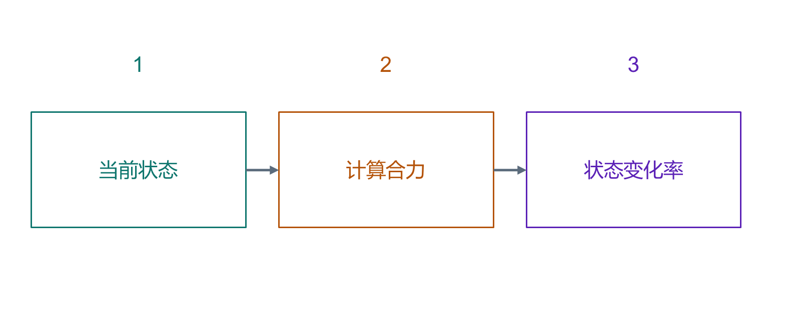

*读图：当前状态 → 计算合力 → 状态变化率。箭头表示本节的推理或处理顺序，具体条件见正文。*

### 先读符号与条件

| 符号 / 条件 | 含义 |
| --- | --- |
| x | m |
| v | m/s |
| F | N |
| m | kg |
| 状态 | 位置与速度一起更新 |

### 核心关系与推导入口

以下关系使用上述条件；标为教学简化或补充的内容是为理解而推导，不是逐字转录课件。

$$
\dot x=v,\qquad \dot v=F(x,v,t)/m
$$

### 🔧 手算 1：把关系落到数字上

m=2 kg、F=6 N，加速度 3 m/s²。0.1 秒内速度变化近似 0.3 m/s；用 mΔv/Δt 得回 6 N。

| 检查步骤 | 操作 |
| --- | --- |
| 输入 | 先从例子中抄下给定量及单位，不引入未给定的数值。 |
| 计算 | 按本节关系求中间量，再得到结果；不要在第一步就做显示裁剪或整数舍入。 |
| 回查 | 0.1 秒内速度变化近似 0.3 m/s；用 mΔv/Δt 得回 6 N。 |
| 适用边界 | 质量为零不能直接做除法；固定点一般用逆质量零表示并跳过动力学更新。 |

### ⚠️ 易错点：先识别症状与假设

质量为零不能直接做除法；固定点一般用逆质量零表示并跳过动力学更新。

### 停下来解释一次

**问题：相同重力场中质量加倍，加速度是否加倍？**

<details>
<summary>展开参考回答</summary>

不。重力也随质量加倍，F/m 仍为相同的 g。

</details>

<details>
<summary>展开原课件关键页，对照术语与图形</summary>

#### Physically Based Animation

*PDF p2 · 对应本节：模拟从哪些状态开始？*

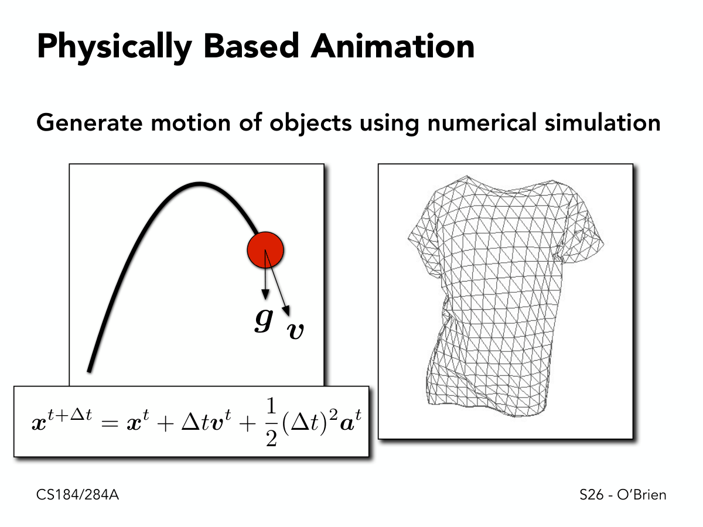

#### Particle Systems

*PDF p7 · 对应本节：模拟从哪些状态开始？*

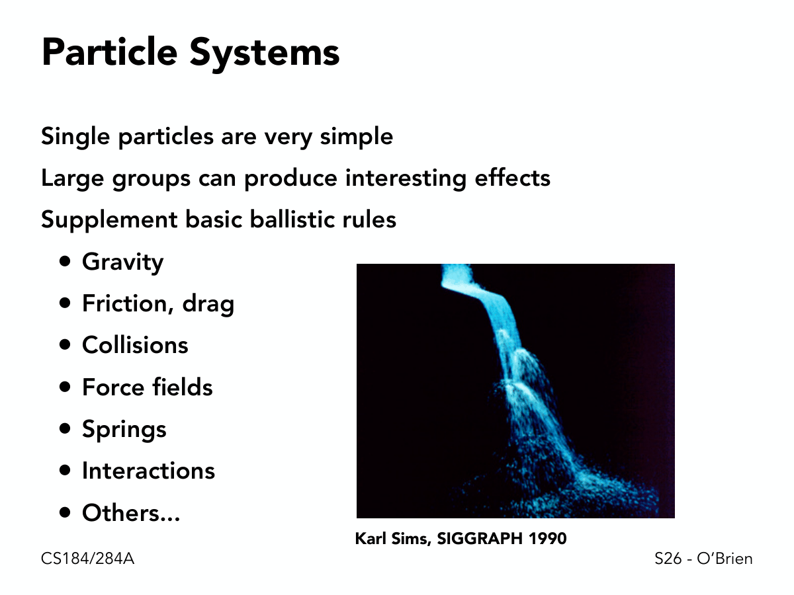

#### • Single particles are very simple

*PDF p10 · 对应本节：模拟从哪些状态开始？*

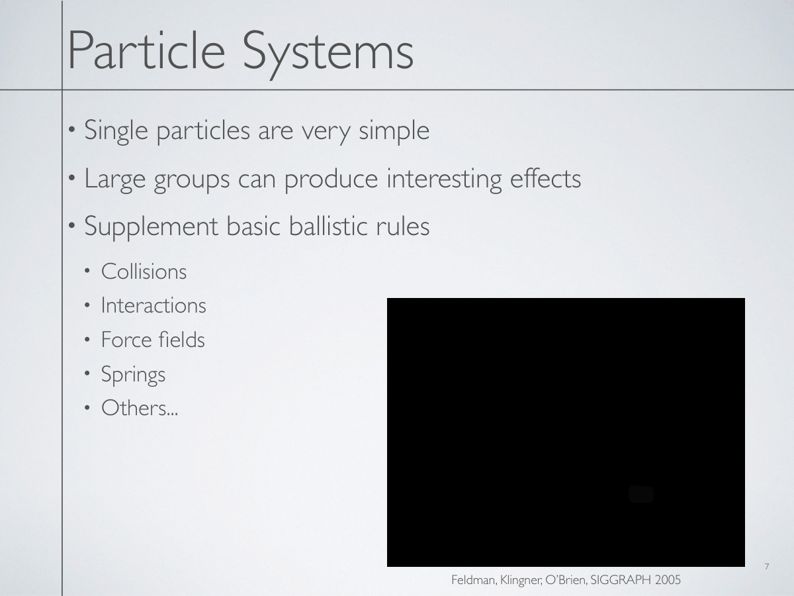

#### Basic Particles

*PDF p12 · 对应本节：模拟从哪些状态开始？*

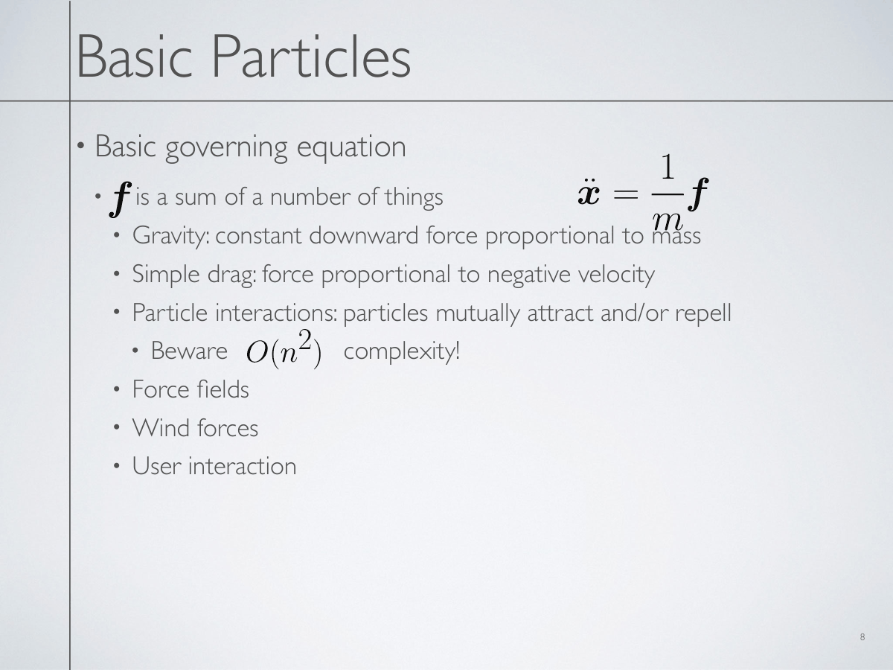

#### Dot Notation for Derivatives

*PDF p13 · 对应本节：模拟从哪些状态开始？*

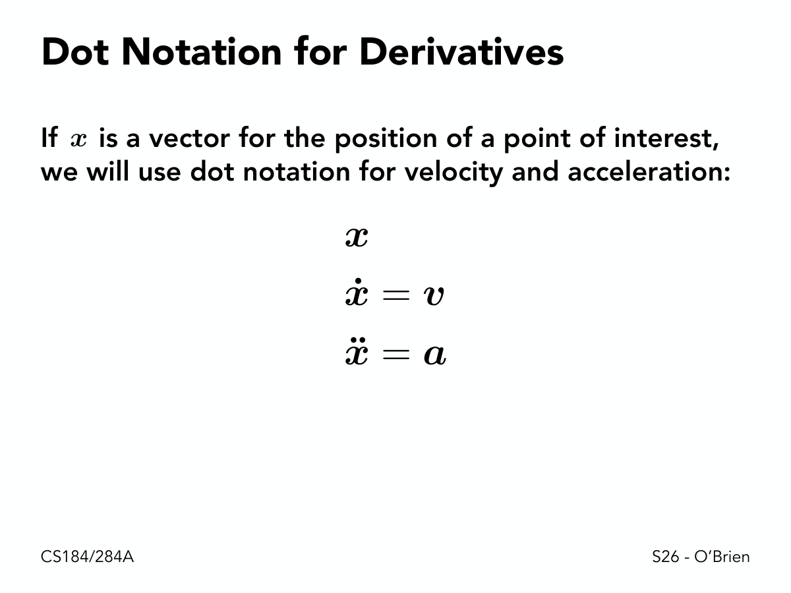

#### Simple Gravity

*PDF p14 · 对应本节：模拟从哪些状态开始？*

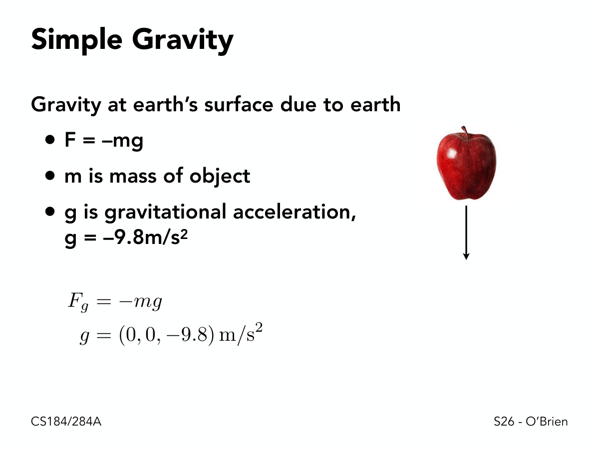

</details>

## 2. 弹簧为什么要有静止长度？

零静止长度弹簧总想把两点拉到一起，非零静止长度则在长度超过 l0 时拉回、短于 l0 时推开。力方向沿连线，大小由伸长量决定。

先明确力作用在哪个端点，再写符号。两端内力应相反，才能保证系统整体动量不凭空变化；零长度附近需要防止方向归一化除零。


*读图：当前长度 → 减去静止长度 → 成对恢复力。箭头表示本节的推理或处理顺序，具体条件见正文。*

### 先读符号与条件

| 符号 / 条件 | 含义 |
| --- | --- |
| k | N/m |
| ell0 | 静止长度 |
| Fa | 作用于 a 的力 |

### 核心关系与推导入口

以下关系使用上述条件；标为教学简化或补充的内容是为理解而推导，不是逐字转录课件。

$$
F_a=k(\ell-\ell_0)\frac{b-a}{\ell},\quad F_b=-F_a,\quad\ell=\|b-a\|
$$

### 🔧 手算 2：把关系落到数字上

a=0、b=1.2 m、l0=1 m、k=100 N/m，则 Fa=+20 N、Fb=-20 N，合力为零。压缩到 0.8 m 时 Fa=-20 N。

| 检查步骤 | 操作 |
| --- | --- |
| 输入 | 先从例子中抄下给定量及单位，不引入未给定的数值。 |
| 计算 | 按本节关系求中间量，再得到结果；不要在第一步就做显示裁剪或整数舍入。 |
| 回查 | 压缩到 0.8 m 时 Fa=-20 N。 |
| 适用边界 | 把方向或伸长量符号写反，弹簧会越拉越远；用伸长和压缩两个例子同时检查。 |

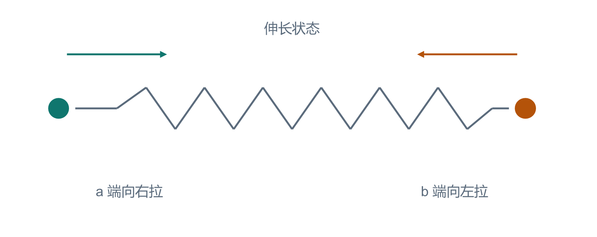

*弹簧内力成对反向；压缩时两端受力反转。*

### ⚠️ 易错点：先识别症状与假设

把方向或伸长量符号写反，弹簧会越拉越远；用伸长和压缩两个例子同时检查。

### 停下来解释一次

**问题：力为零时弹簧是否一定长度为零？**

<details>
<summary>展开参考回答</summary>

不是。非零静止长度弹簧在长度等于 l0 时恢复力为零。

</details>

<details>
<summary>展开原课件关键页，对照术语与图形</summary>

#### A Simple Spring

*PDF p28 · 对应本节：弹簧为什么要有静止长度？*

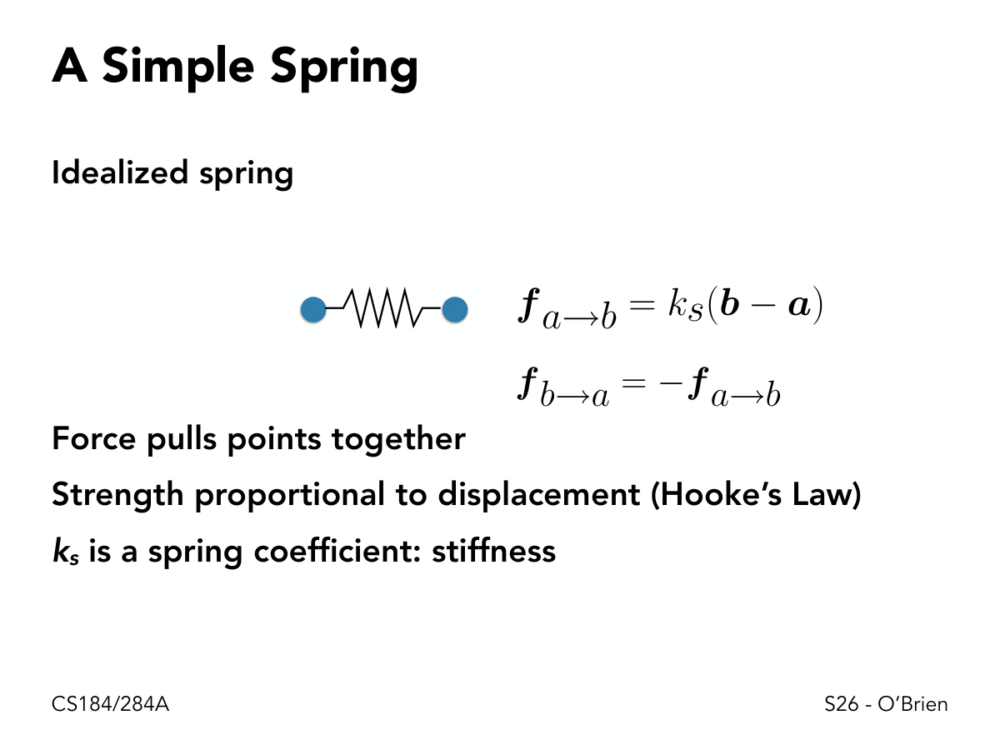

#### A Simple Spring

*PDF p30 · 对应本节：弹簧为什么要有静止长度？*

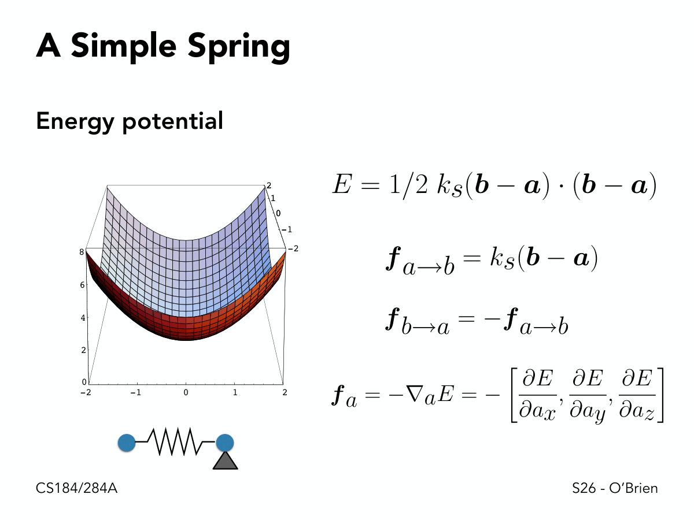

#### A Simple Spring

*PDF p31 · 对应本节：弹簧为什么要有静止长度？*

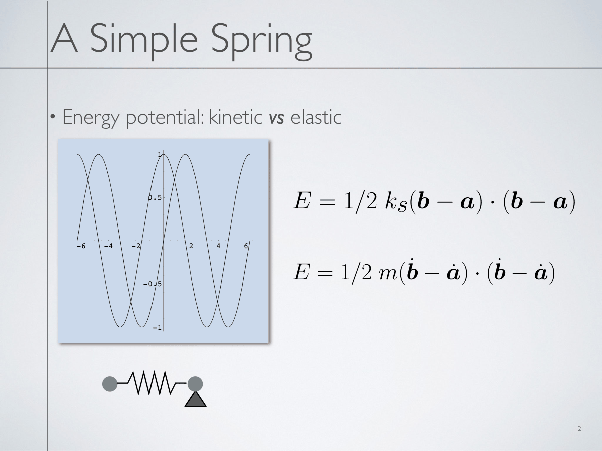

#### Non-Zero Length Spring

*PDF p32 · 对应本节：弹簧为什么要有静止长度？*

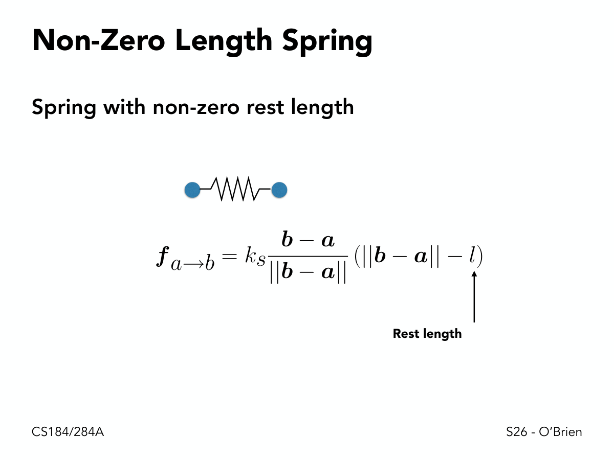

#### Non-Zero Length Springs

*PDF p34 · 对应本节：弹簧为什么要有静止长度？*

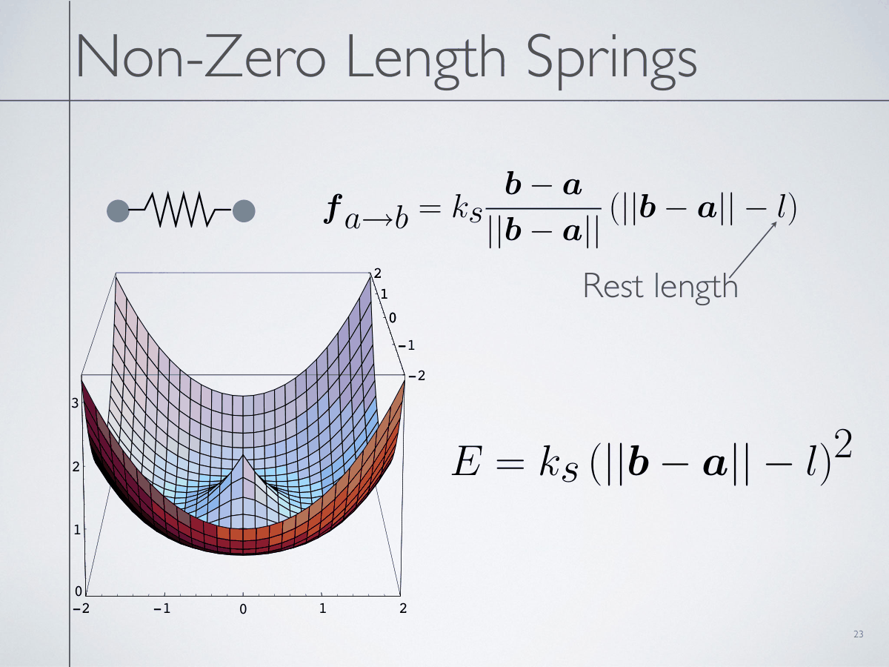

#### Comments on Springs

*PDF p35 · 对应本节：弹簧为什么要有静止长度？*

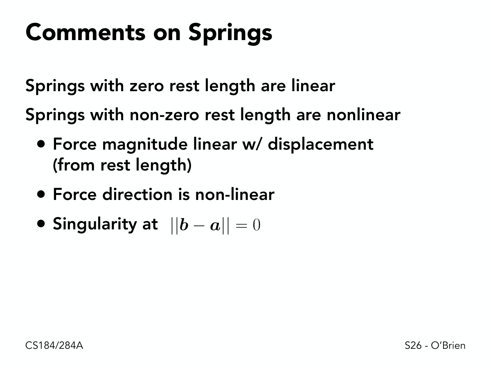

</details>

## 3. 阻尼为什么要区分整体运动与相对运动？

简单阻力 -cv 会减慢粒子相对世界的运动；弹簧内部阻尼只惩罚两端沿弹簧方向的相对速度，因此整体平移不应被削弱。

以 e=(b-a)/长度为方向、Fa 为 a 端受力，内部阻尼写成 c((vb-va)·e)e，另一端取反。这个符号可由总功率不大于零验证，比死记课件中的端点下标更可靠。


*读图：两端相对速度 → 投影到弹簧方向 → 只耗散内部运动。箭头表示本节的推理或处理顺序，具体条件见正文。*

### 先读符号与条件

| 符号 / 条件 | 含义 |
| --- | --- |
| c | 阻尼系数 |
| P | 两端力做功率之和 |
| e | 单位弹簧方向 |

### 核心关系与推导入口

以下关系使用上述条件；标为教学简化或补充的内容是为理解而推导，不是逐字转录课件。

$$
F_{a,d}=c[(v_b-v_a)\cdot e]e,\qquad P_d=-c[(v_b-v_a)\cdot e]^2\le0
$$

### 🔧 手算 3：把关系落到数字上

一维 va=0、vb=2、c=3，Fa=6、Fb=-6，总功率 6×0-6×2=-12。若两端都以 2 移动，相对速度零，阻尼力也为零。

| 检查步骤 | 操作 |
| --- | --- |
| 输入 | 先从例子中抄下给定量及单位，不引入未给定的数值。 |
| 计算 | 按本节关系求中间量，再得到结果；不要在第一步就做显示裁剪或整数舍入。 |
| 回查 | 若两端都以 2 移动，相对速度零，阻尼力也为零。 |
| 适用边界 | 内部阻尼符号反了会注入能量；课件不同端点标记下需重新推功率。 |


*内部阻尼只惩罚相对伸缩，不应阻止刚体平移。*

### ⚠️ 易错点：先识别症状与假设

内部阻尼符号反了会注入能量；课件不同端点标记下需重新推功率。

### 停下来解释一次

**问题：内部阻尼会阻止整个系统刚体平移吗？**

<details>
<summary>展开参考回答</summary>

理想成对相对速度阻尼不会，整体平移不改变弹簧长度。

</details>

<details>
<summary>展开原课件关键页，对照术语与图形</summary>

#### Simple Motion Damping

*PDF p36 · 对应本节：阻尼为什么要区分整体运动与相对运动？*

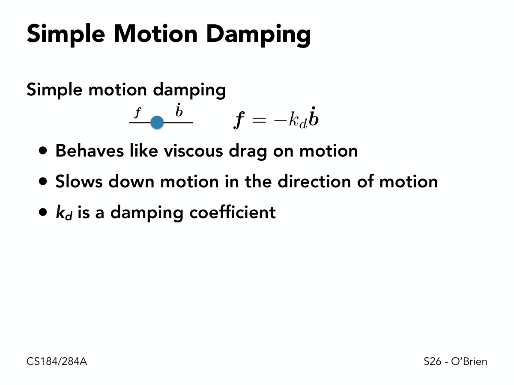

#### Simple Motion Damping

*PDF p37 · 对应本节：阻尼为什么要区分整体运动与相对运动？*

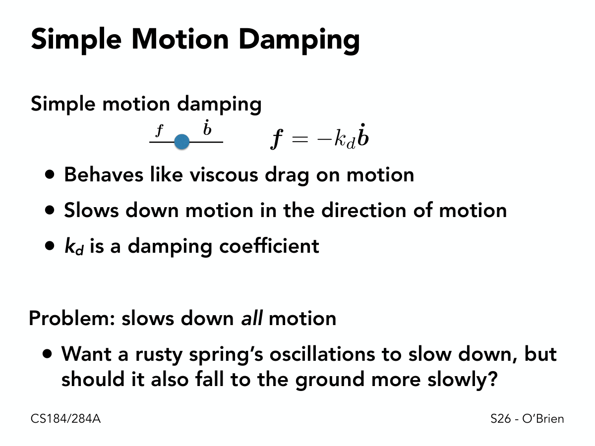

#### Internal Damping for Spring

*PDF p38 · 对应本节：阻尼为什么要区分整体运动与相对运动？*

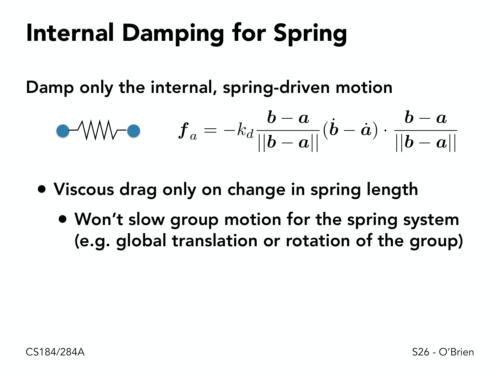

</details>

## 4. 网格变细为什么材料会变硬或变软？

把同一个物体分成更多弹簧并继续使用相同 k，会改变整体等效刚度与质量分布。分辨率不是只改变外观，还改变离散模型。

应从长度、截面积、应变或连续材料参数出发缩放离散参数。只有水平和竖直边的方格可能容易剪切，加斜向弹簧才能约束另一类变形。

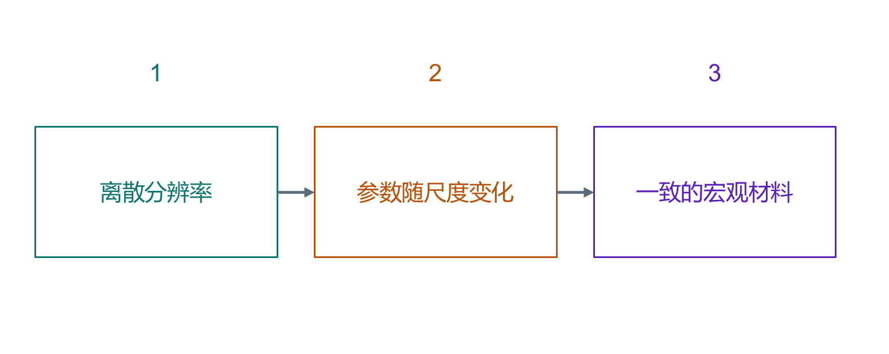

*读图：离散分辨率 → 参数随尺度变化 → 一致的宏观材料。箭头表示本节的推理或处理顺序，具体条件见正文。*

### 先读符号与条件

| 符号 / 条件 | 含义 |
| --- | --- |
| epsilon | 应变 |
| 串联刚度 | 一维教学模型 |
| 适用 | 小形变线性弹簧 |

### 核心关系与推导入口

以下关系使用上述条件；标为教学简化或补充的内容是为理解而推导，不是逐字转录课件。

$$
\varepsilon=\frac{\ell-\ell_0}{\ell_0},\qquad k_{series}=\left(\sum_i\frac1{k_i}\right)^{-1}
$$

### 🔧 手算 4：把关系落到数字上

原弹簧 k=10，拆成两段串联要各取 k=20，等效为 1/(1/20+1/20)=10。若各取 10，整体变为 5。

| 检查步骤 | 操作 |
| --- | --- |
| 输入 | 先从例子中抄下给定量及单位，不引入未给定的数值。 |
| 计算 | 按本节关系求中间量，再得到结果；不要在第一步就做显示裁剪或整数舍入。 |
| 回查 | 若各取 10，整体变为 5。 |
| 适用边界 | 布料参数缩放不能一律照搬一维串联公式；还要看拓扑、面积与弯曲模型。 |

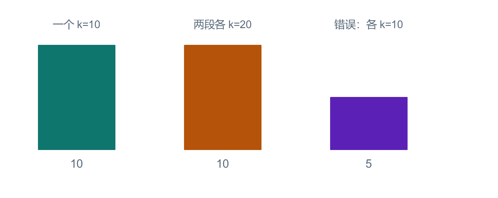

*一维串联模型中，细分时需调整弹簧常数以保持整体刚度。*

### ⚠️ 易错点：先识别症状与假设

布料参数缩放不能一律照搬一维串联公式；还要看拓扑、面积与弯曲模型。

### 停下来解释一次

**问题：更多弹簧是否自然意味着更真实？**

<details>
<summary>展开参考回答</summary>

不。若材料参数与约束不一致，只是更精细地模拟错误材料。

</details>

<details>
<summary>展开原课件关键页，对照术语与图形</summary>

#### Spring Constants

*PDF p39 · 对应本节：网格变细为什么材料会变硬或变软？*

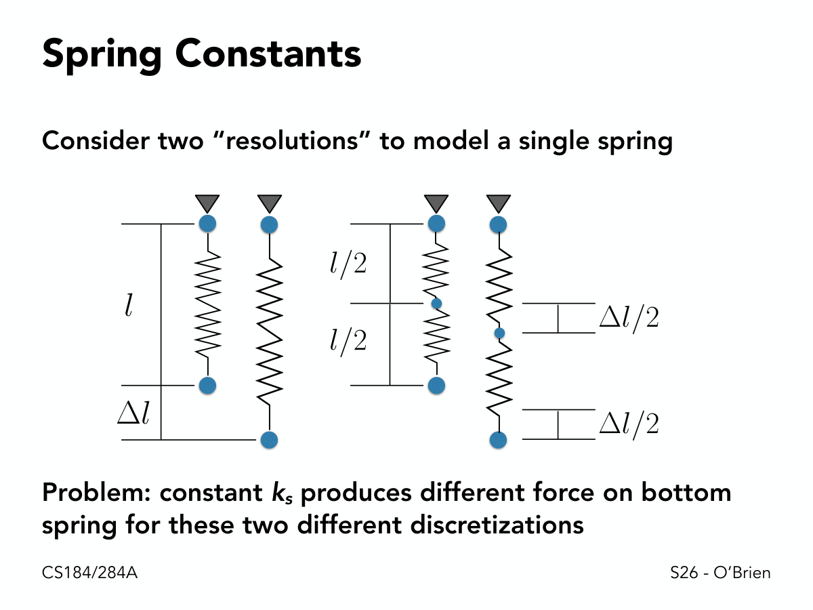

#### Spring Constants

*PDF p40 · 对应本节：网格变细为什么材料会变硬或变软？*

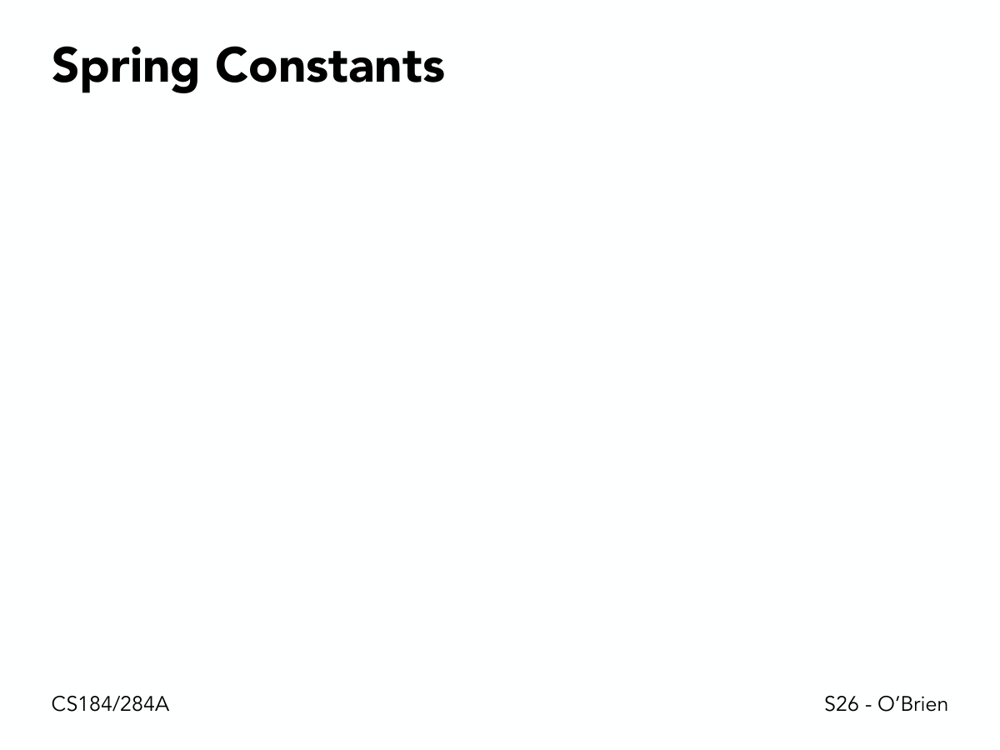

#### Spring Constants

*PDF p41 · 对应本节：网格变细为什么材料会变硬或变软？*

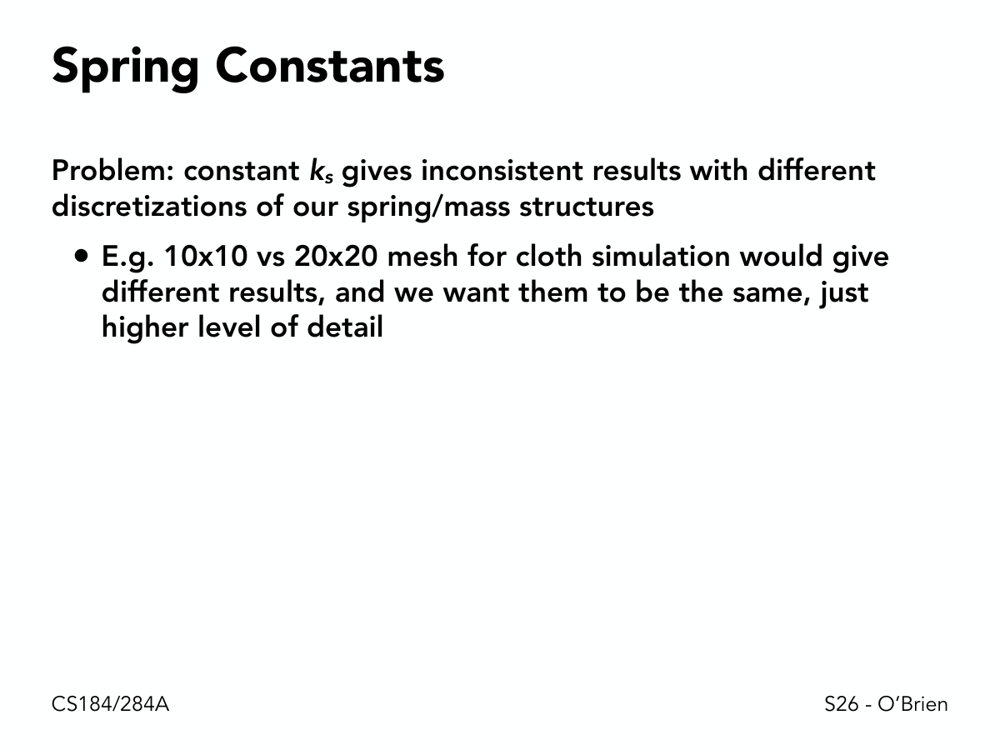

#### Spring Constants

*PDF p42 · 对应本节：网格变细为什么材料会变硬或变软？*

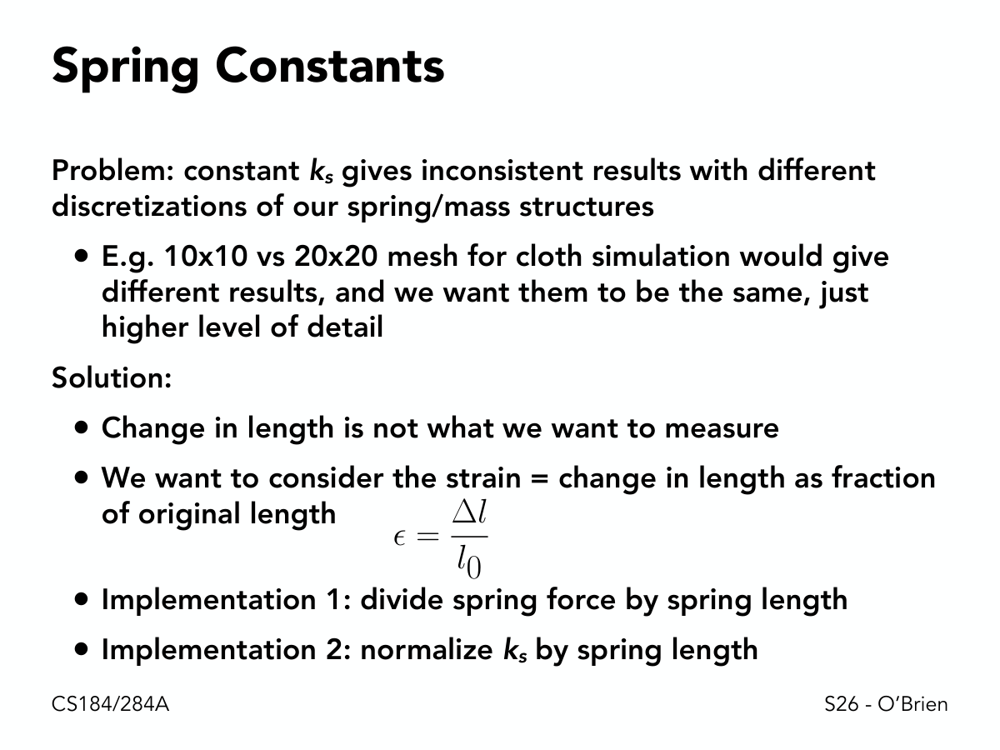

#### Structures from Springs

*PDF p43 · 对应本节：网格变细为什么材料会变硬或变软？*

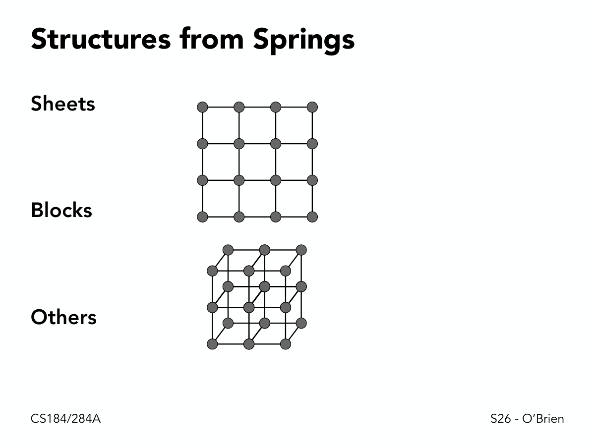

#### Structures from Springs

*PDF p44 · 对应本节：网格变细为什么材料会变硬或变软？*

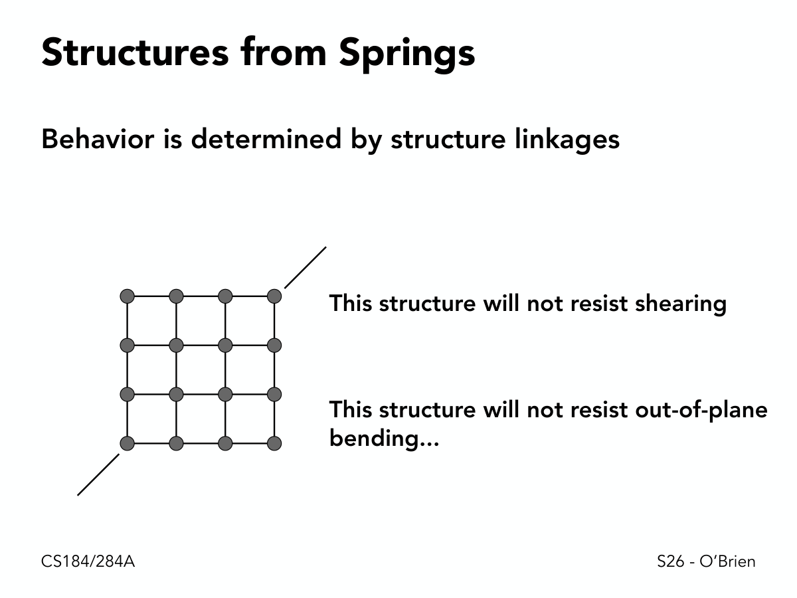

#### Behavior is determined by structure linkages

*PDF p45 · 对应本节：网格变细为什么材料会变硬或变软？*

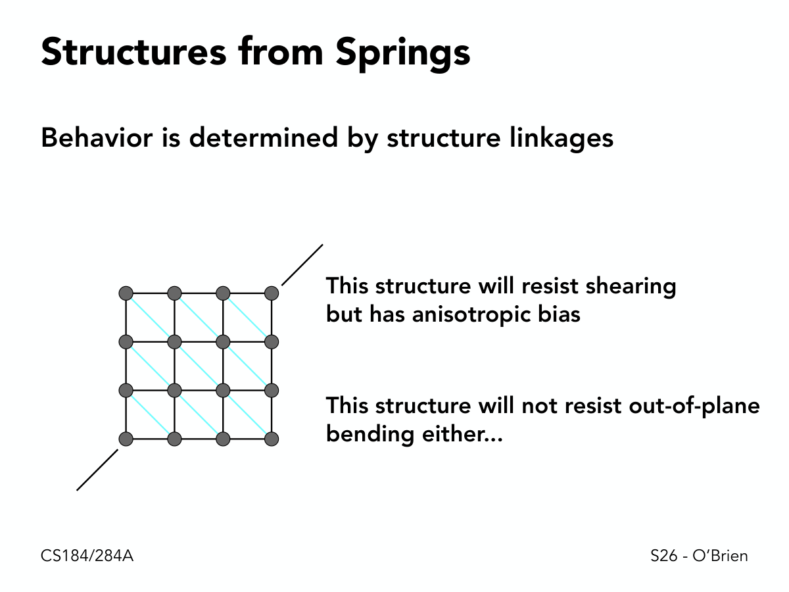

#### Edge Springs

*PDF p48 · 对应本节：网格变细为什么材料会变硬或变软？*

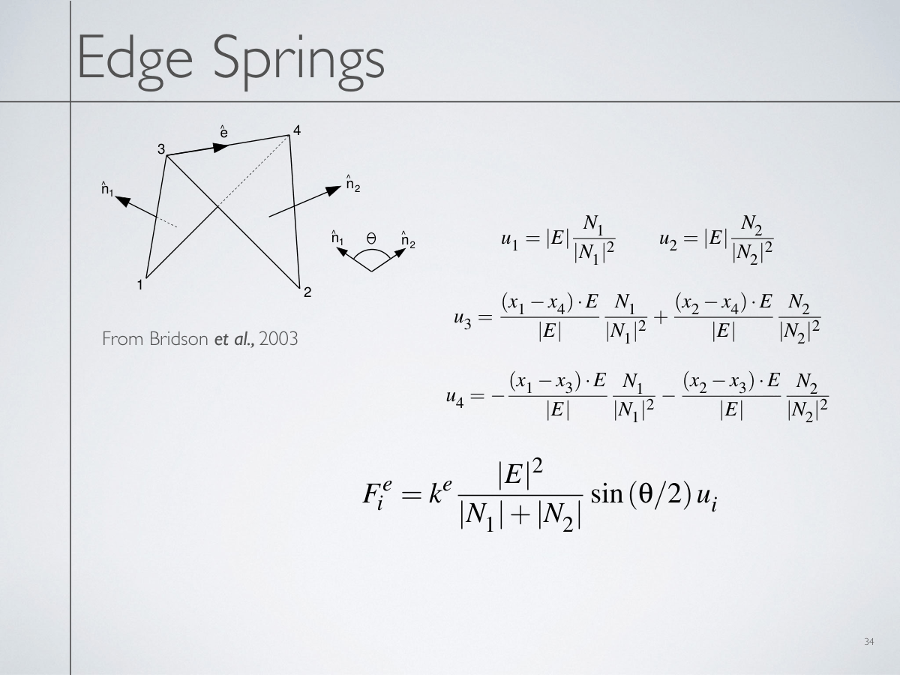

</details>

## 5. 显式 Euler 一步究竟做了什么？

显式 Euler 用旧状态的导数预测新状态。位置用旧速度，速度用旧位置和旧速度算出的加速度；必须保留旧值，避免不知不觉改成其他积分器。

它是局部切线近似，一步截断误差会随时间累积。小步可以减小有限时间误差，但某些无阻尼振荡系统对任何非零步长都会长期增能。

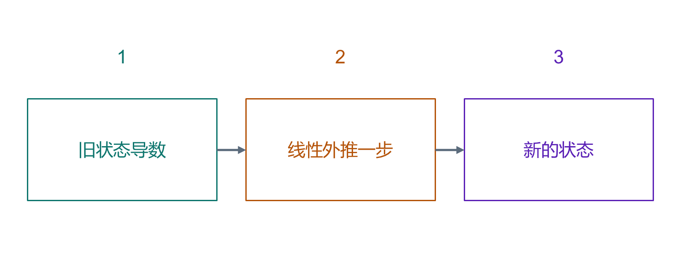

*读图：旧状态导数 → 线性外推一步 → 新的状态。箭头表示本节的推理或处理顺序，具体条件见正文。*

### 先读符号与条件

| 符号 / 条件 | 含义 |
| --- | --- |
| h | 时间步长 |
| 下标 n | 旧状态 |
| 更新顺序 | 两式都读旧值 |

### 核心关系与推导入口

以下关系使用上述条件；标为教学简化或补充的内容是为理解而推导，不是逐字转录课件。

$$
x_{n+1}=x_n+h v_n,\qquad v_{n+1}=v_n+h a_n
$$

### 🔧 手算 5：把关系落到数字上

x=1、v=0、a=-1、h=0.1，则 x'=1、v'=-0.1。若先更新 v 再用新 v 更新位置，会得到 x'=0.99，是另一方法。

| 检查步骤 | 操作 |
| --- | --- |
| 输入 | 先从例子中抄下给定量及单位，不引入未给定的数值。 |
| 计算 | 按本节关系求中间量，再得到结果；不要在第一步就做显示裁剪或整数舍入。 |
| 回查 | 若先更新 v 再用新 v 更新位置，会得到 x'=0.99，是另一方法。 |
| 适用边界 | 代码语句顺序决定数学方法，不能都叫“Euler”而不注明。 |

### ⚠️ 易错点：先识别症状与假设

代码语句顺序决定数学方法，不能都叫“Euler”而不注明。

### 停下来解释一次

**问题：Euler 方法是不是直接精确求解牛顿定律？**

<details>
<summary>展开参考回答</summary>

不是。定律定义连续模型，积分器只是有限步长下的数值近似。

</details>

<details>
<summary>展开原课件关键页，对照术语与图形</summary>

#### Euler’s Method

*PDF p58 · 对应本节：显式 Euler 一步究竟做了什么？*

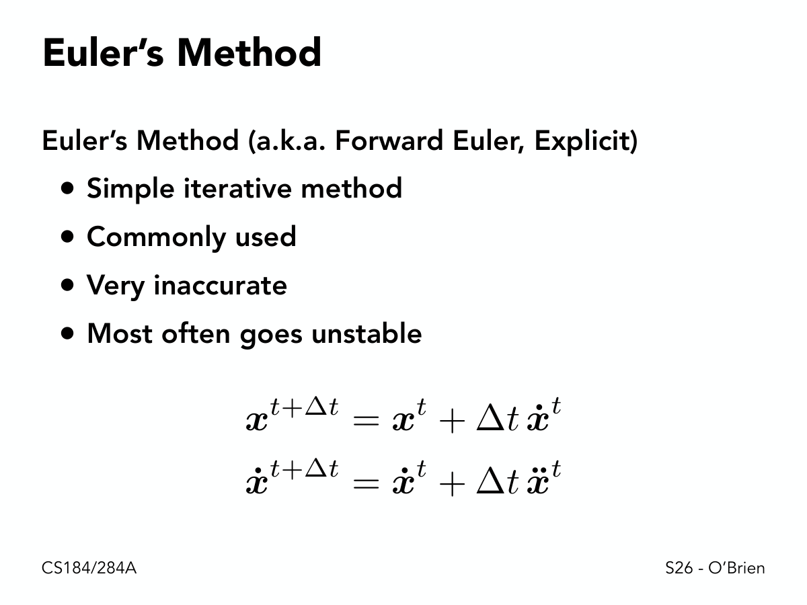

#### Single Particle Simulation

*PDF p59 · 对应本节：显式 Euler 一步究竟做了什么？*

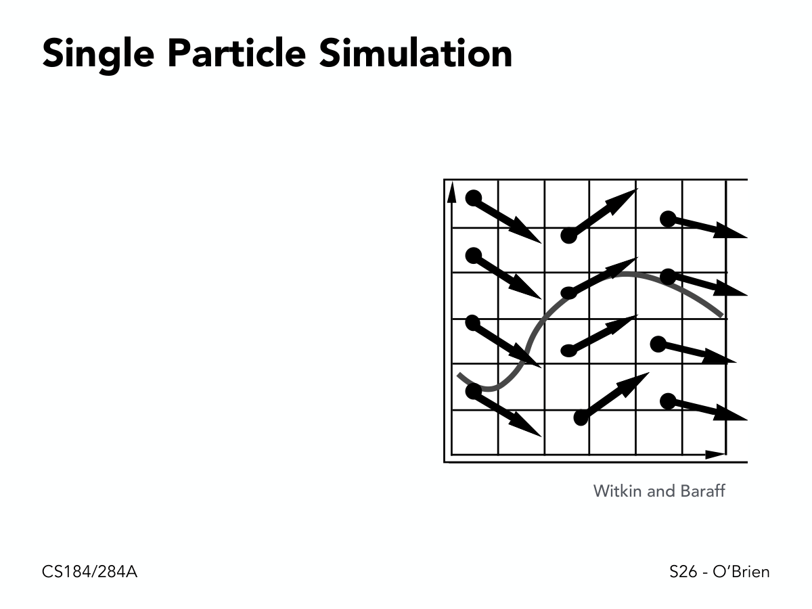

#### Ordinary Differential Equation (ODE)

*PDF p65 · 对应本节：显式 Euler 一步究竟做了什么？*

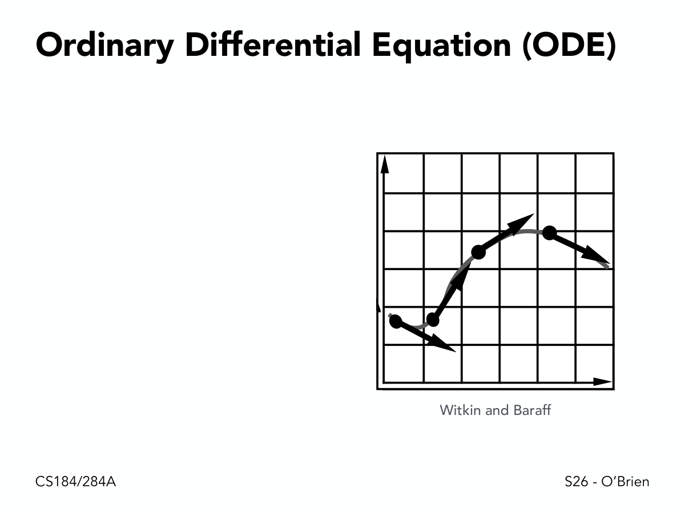

#### Ordinary Differential Equation (ODE)

*PDF p66 · 对应本节：显式 Euler 一步究竟做了什么？*

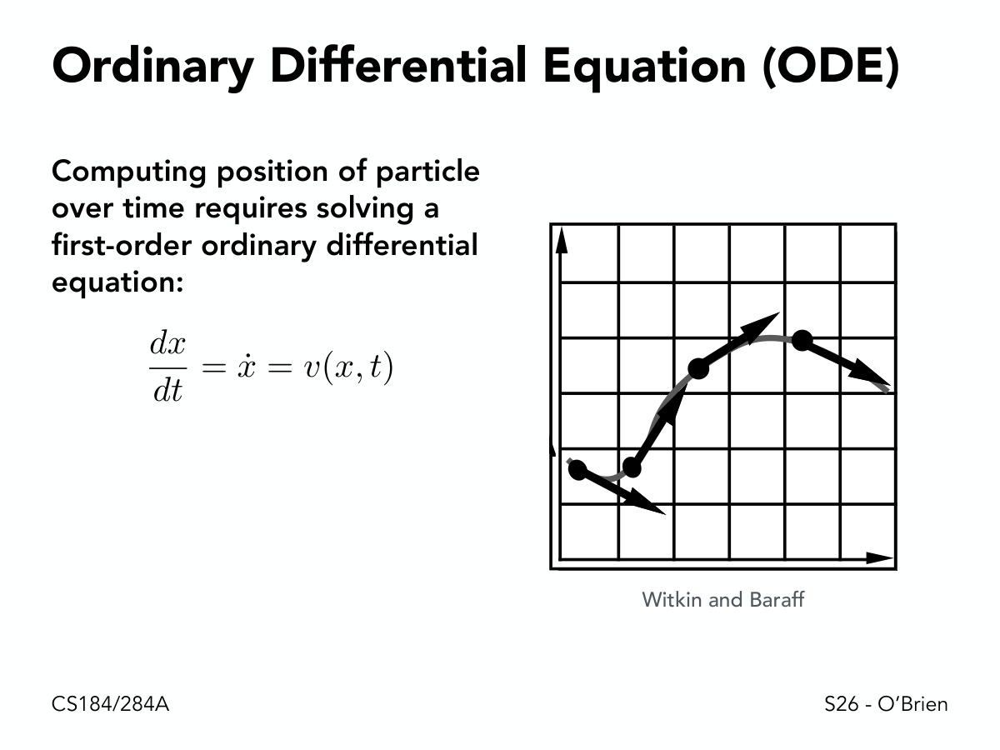

#### Solving for Particle Position

*PDF p69 · 对应本节：显式 Euler 一步究竟做了什么？*

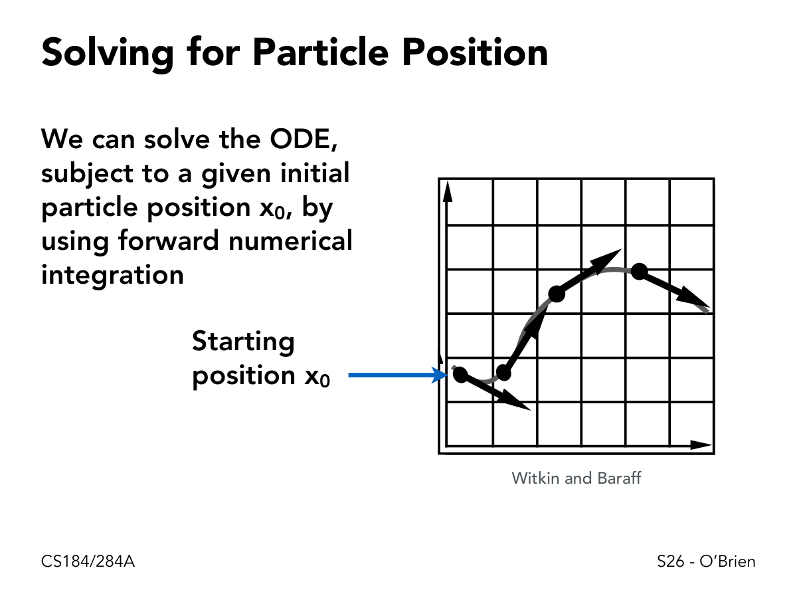

</details>

## 6. 为什么一个无阻尼弹簧会自己加速？

对 x''=-ω²x，显式 Euler 的状态更新会让相空间轨迹向外螺旋。力在一步内已经变化，算法仍使用旧力，导致离散能量系统性增加。

这说明“爆炸”不一定是物理方程错，也可能是积分器与步长不适合。缩步可延缓长期增能，却不能把无阻尼振子的显式 Euler 变成真正能量守恒方法。


*读图：旧力被保持 → 离散能量增加 → 振幅逐渐扩大。箭头表示本节的推理或处理顺序，具体条件见正文。*

### 先读符号与条件

| 符号 / 条件 | 含义 |
| --- | --- |
| omega² | k/m |
| E | 单位质量能量 |
| 前提 | 线性无阻尼振子与显式 Euler |

### 核心关系与推导入口

以下关系使用上述条件；标为教学简化或补充的内容是为理解而推导，不是逐字转录课件。

$$
E_{n+1}=(1+h^2\omega^2)E_n,\qquad E=\frac12(v^2+\omega^2x^2)
$$

### 🔧 手算 6：把关系落到数字上

ω=1、h=0.1、x=1、v=0，初能 0.5，新能 (1²+0.1²)/2=0.505，增长因子 1.01。100 步因子约 2.705。

| 检查步骤 | 操作 |
| --- | --- |
| 输入 | 先从例子中抄下给定量及单位，不引入未给定的数值。 |
| 计算 | 按本节关系求中间量，再得到结果；不要在第一步就做显示裁剪或整数舍入。 |
| 回查 | 100 步因子约 2.705。 |
| 适用边界 | 添加很强阻尼可能掩盖积分错误，但会改变物理效果；应先辨认能量增长机制。 |


*同一无阻尼振子、h=0.1、160 步，轨迹展示增能、近似有界与数值耗散；横纵是位置与速度相图。*

### ⚠️ 易错点：先识别症状与假设

添加很强阻尼可能掩盖积分错误，但会改变物理效果；应先辨认能量增长机制。

### 停下来解释一次

**问题：把步长减半能使这一增长因子怎样变化？**

<details>
<summary>展开参考回答</summary>

单步增长项 h²ω² 变为四分之一；但相同总时长需要更多步，仍要分析累计误差。

</details>

<details>
<summary>展开原课件关键页，对照术语与图形</summary>

#### Euler’s Method - Errors

*PDF p70 · 对应本节：为什么一个无阻尼弹簧会自己加速？*

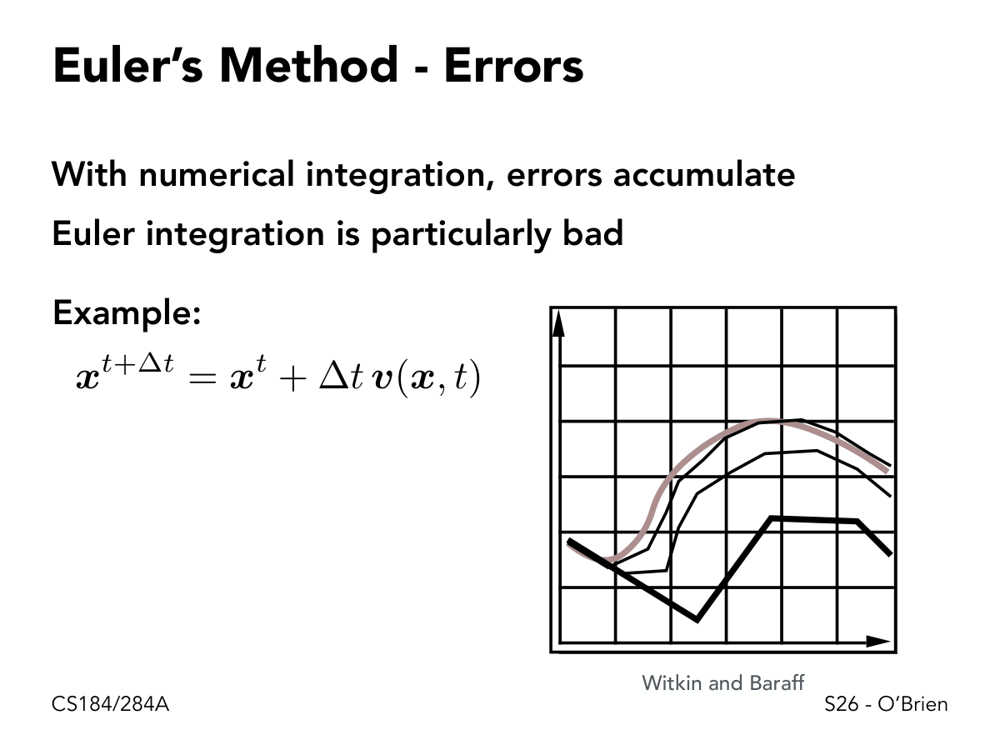

#### Errors and Instability

*PDF p74 · 对应本节：为什么一个无阻尼弹簧会自己加速？*

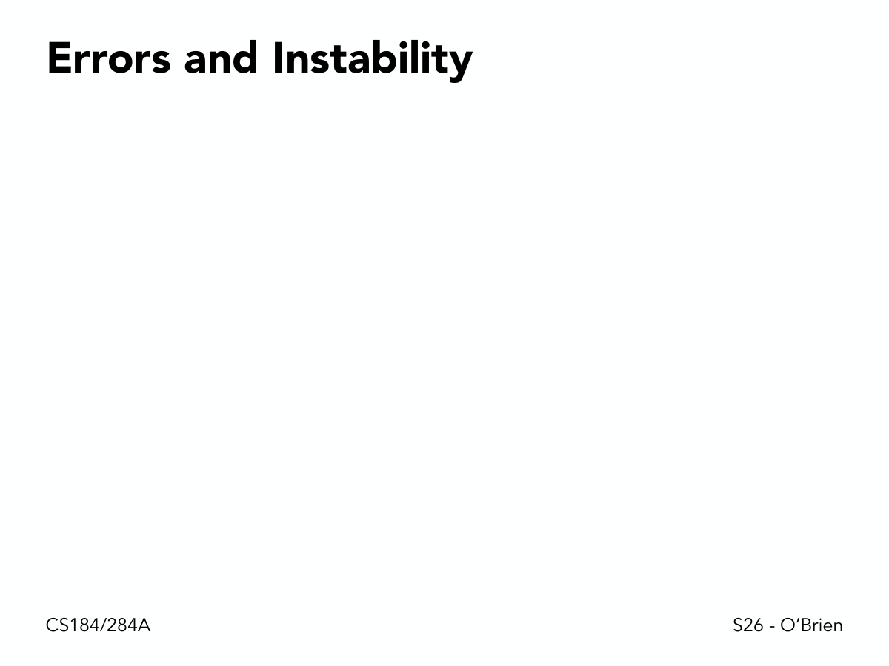

#### Errors and Instability

*PDF p75 · 对应本节：为什么一个无阻尼弹簧会自己加速？*

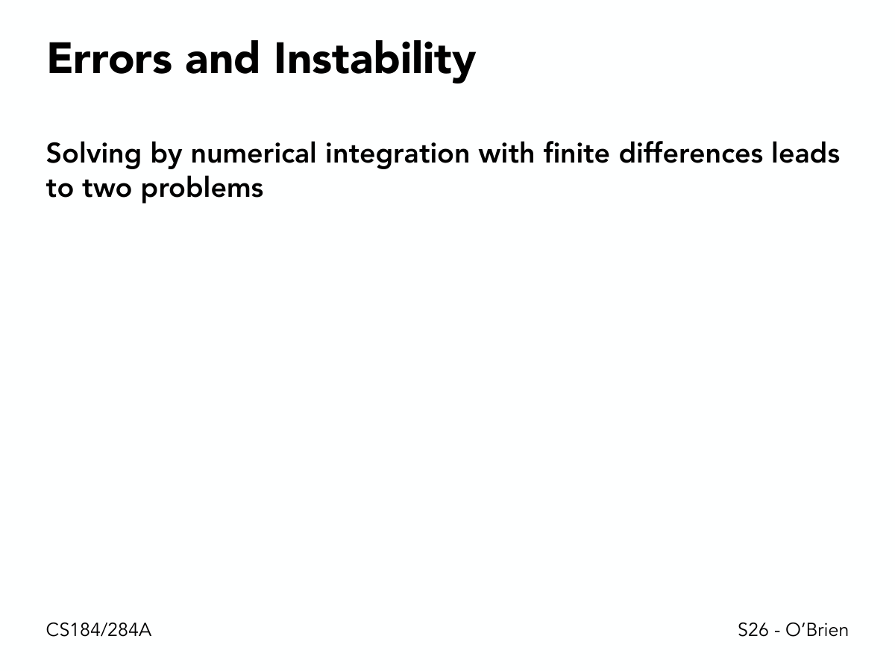

#### Instability of Forward Euler Method

*PDF p78 · 对应本节：为什么一个无阻尼弹簧会自己加速？*

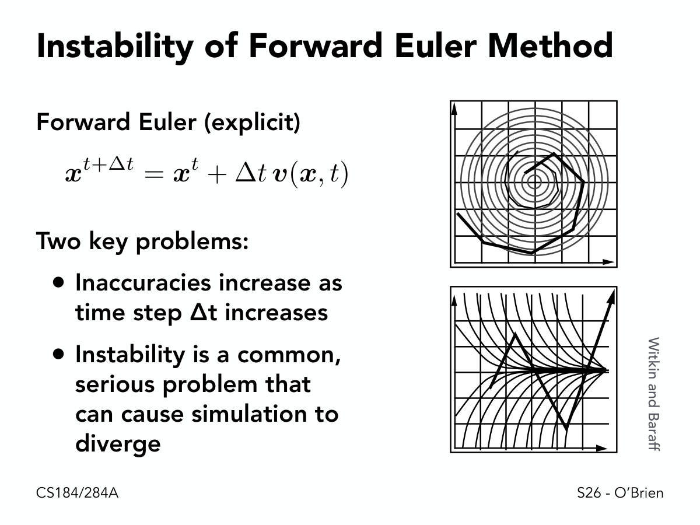

#### Instability Example (Spring)

*PDF p79 · 对应本节：为什么一个无阻尼弹簧会自己加速？*

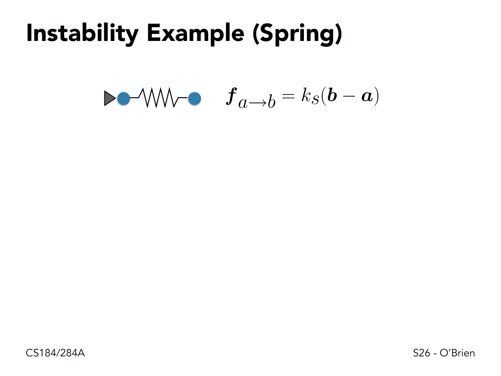

#### Instability Example (Spring)

*PDF p80 · 对应本节：为什么一个无阻尼弹簧会自己加速？*

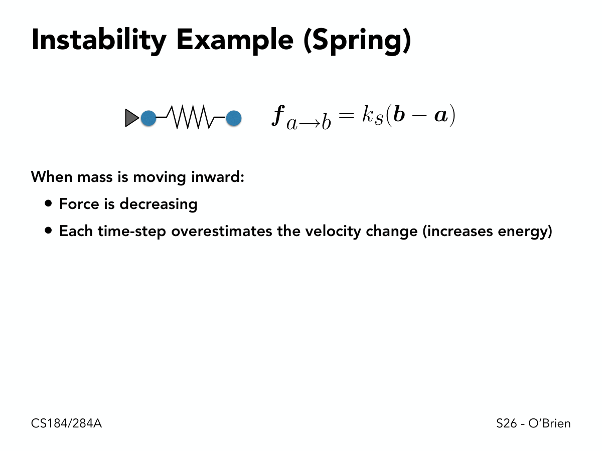

#### Instability Example (Spring)

*PDF p83 · 对应本节：为什么一个无阻尼弹簧会自己加速？*

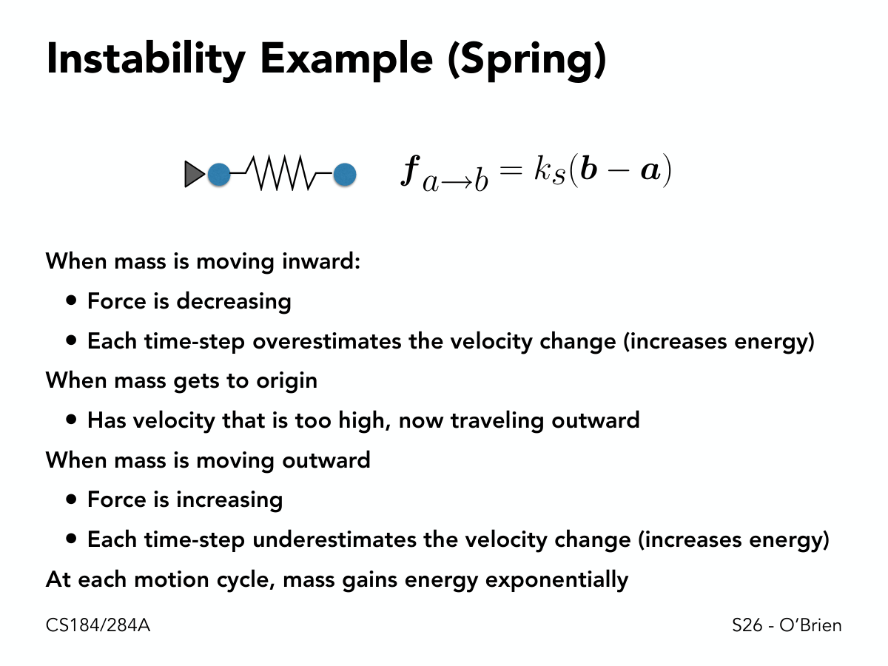

</details>

## 7. 改进与半隐式方法差在哪里？

课件的 modified Euler 使用起点与预测终点信息修正斜率；实践中还常见先更新速度再更新位置的半隐式 Euler。名称相近不代表公式相同。

对振荡系统，半隐式方法在一定步长范围内通常比显式 Euler 稳定，但不能宣称任意大步都安全。比较时应列出具体更新式和同一能量曲线。


*读图：先更新速度 → 用新速度更新位置 → 改变离散稳定性。箭头表示本节的推理或处理顺序，具体条件见正文。*

### 先读符号与条件

| 符号 / 条件 | 含义 |
| --- | --- |
| 方法 | 半隐式 Euler，教学补充 |
| h | 步长 |
| 线性振子稳定范围 | 0<h omega<2 |

### 核心关系与推导入口

以下关系使用上述条件；标为教学简化或补充的内容是为理解而推导，不是逐字转录课件。

$$
v_{n+1}=v_n-h\omega^2x_n,\qquad x_{n+1}=x_n+h v_{n+1}
$$

### 🔧 手算 7：把关系落到数字上

x=1、v=0、ω=1、h=0.1，则 v'=-0.1、x'=0.99，新能 0.49505。它不是精确守恒，但与显式第一步增能不同。

| 检查步骤 | 操作 |
| --- | --- |
| 输入 | 先从例子中抄下给定量及单位，不引入未给定的数值。 |
| 计算 | 按本节关系求中间量，再得到结果；不要在第一步就做显示裁剪或整数舍入。 |
| 回查 | 它不是精确守恒，但与显式第一步增能不同。 |
| 适用边界 | 不要把一次能量下降当作长期稳定证明；需分析更新矩阵或观察长时间界限。 |

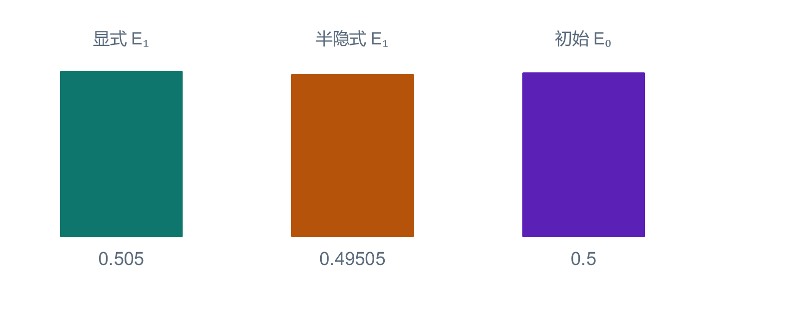

*相同初值 x=1,v=0,h=0.1 下的一步能量，不能用单步结果替代长期稳定分析。*

### ⚠️ 易错点：先识别症状与假设

不要把一次能量下降当作长期稳定证明；需分析更新矩阵或观察长时间界限。

### 停下来解释一次

**问题：半隐式 Euler 与隐式 Euler 是否相同？**

<details>
<summary>展开参考回答</summary>

不是。前者仍可显式逐项计算，后者通常需求解未来状态方程。

</details>

<details>
<summary>展开原课件关键页，对照术语与图形</summary>

#### Some Methods to Combat Instability

*PDF p84 · 对应本节：改进与半隐式方法差在哪里？*

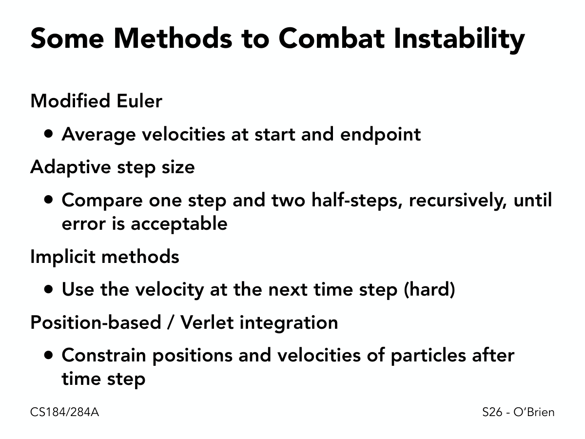

#### Modified Euler

*PDF p85 · 对应本节：改进与半隐式方法差在哪里？*

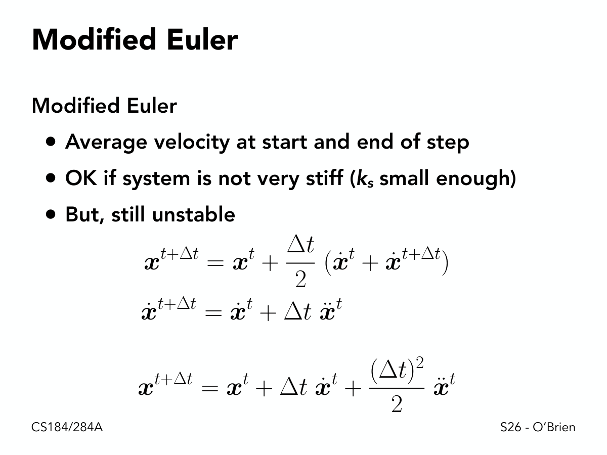

#### Midpoint Method

*PDF p86 · 对应本节：改进与半隐式方法差在哪里？*

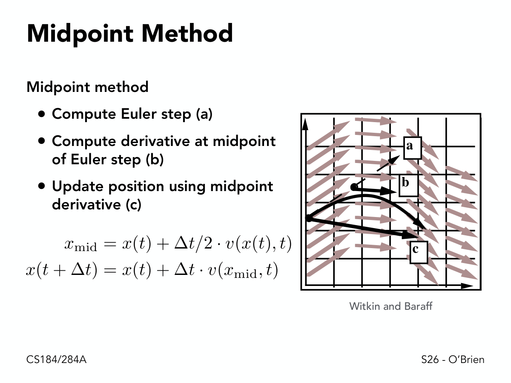

</details>

## 8. 自适应步长为什么要比较两种结果？

一次大步和两次半步对同一个终点给出不同近似，差值可以估计局部误差趋势。误差太大就缩小步长，小到足够安全才接受。

自适应不是只看粒子速度；刚性力、碰撞与约束也可能要求更小步。真正的误差估计还依赖积分器阶数，不能把差值无条件当精确误差。

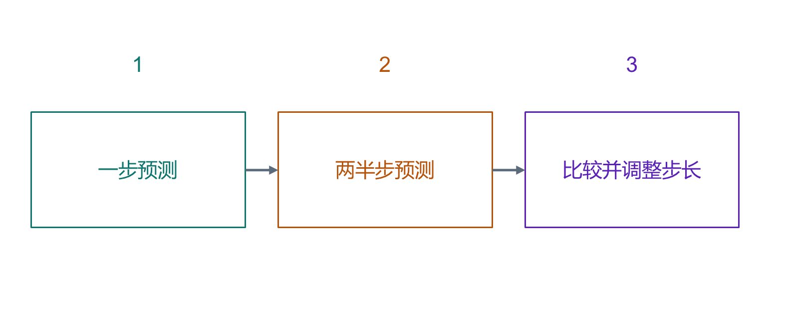

*读图：一步预测 → 两半步预测 → 比较并调整步长。箭头表示本节的推理或处理顺序，具体条件见正文。*

### 先读符号与条件

| 符号 / 条件 | 含义 |
| --- | --- |
| y | 完整状态 |
| 两个结果 | 相同起点与终点 |
| 用途 | 步长控制指标 |

### 核心关系与推导入口

以下关系使用上述条件；标为教学简化或补充的内容是为理解而推导，不是逐字转录课件。

$$
e_{local}\approx\|y_{h}-y_{h/2,h/2}\|
$$

### 🔧 手算 8：把关系落到数字上

一步结果 1.02，两半步结果 1.005，差为 0.015。容差 0.01 时应拒绝或缩步；容差不是“每秒总误差”。

| 检查步骤 | 操作 |
| --- | --- |
| 输入 | 先从例子中抄下给定量及单位，不引入未给定的数值。 |
| 计算 | 按本节关系求中间量，再得到结果；不要在第一步就做显示裁剪或整数舍入。 |
| 回查 | 容差 0.01 时应拒绝或缩步；容差不是“每秒总误差”。 |
| 适用边界 | 只比较位置可能漏掉速度误差；不同量的尺度也需归一化。 |

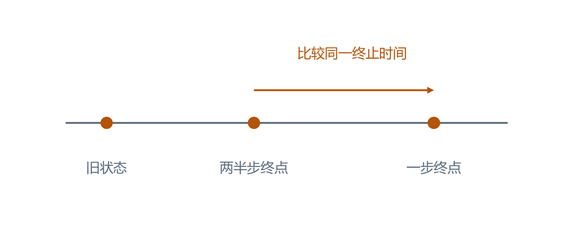

*自适应步长比较同起点同终点的两种离散近似，而不是比较不同时间的位置。*

### ⚠️ 易错点：先识别症状与假设

只比较位置可能漏掉速度误差；不同量的尺度也需归一化。

### 停下来解释一次

**问题：自适应方法能自动发现所有碰撞吗？**

<details>
<summary>展开参考回答</summary>

不能保证。离散碰撞检测仍可能隧穿，需要合适的连续检测或步长约束。

</details>

<details>
<summary>展开原课件关键页，对照术语与图形</summary>

#### Adaptive Step Size

*PDF p87 · 对应本节：自适应步长为什么要比较两种结果？*

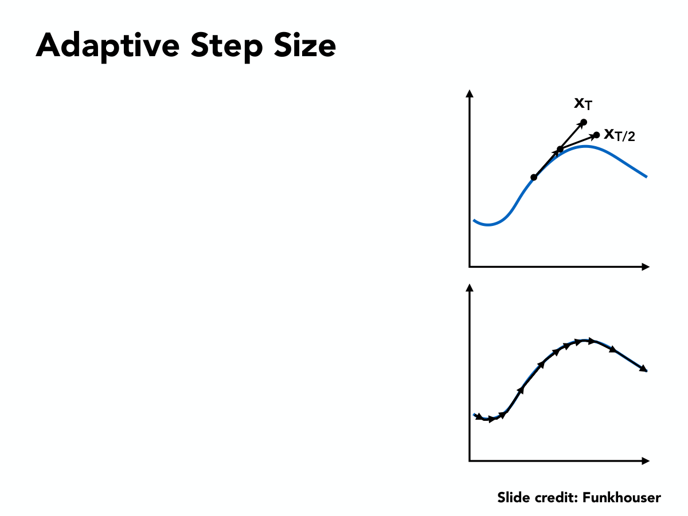

#### Adaptive Step Size

*PDF p88 · 对应本节：自适应步长为什么要比较两种结果？*

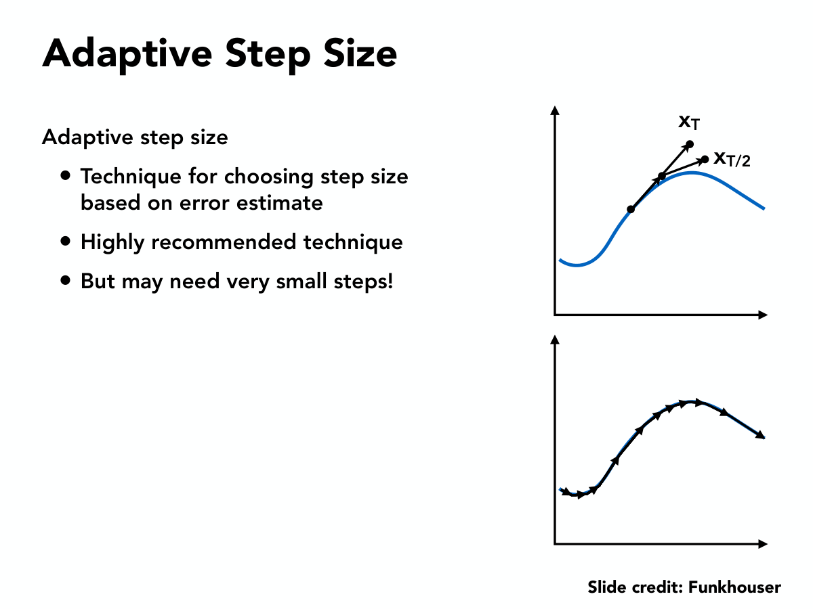

#### Adaptive Step Size

*PDF p89 · 对应本节：自适应步长为什么要比较两种结果？*

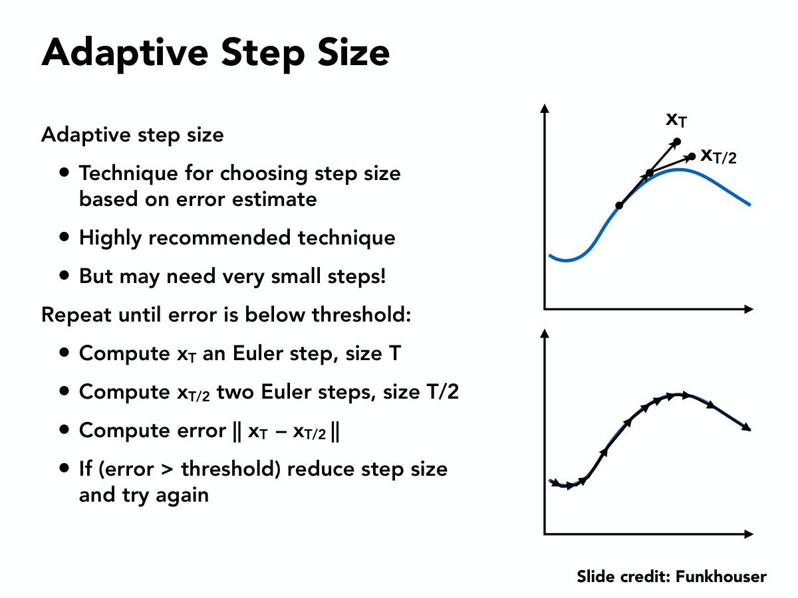

</details>

## 9. 隐式 Euler 为什么要解方程？

隐式 Euler 使用未来状态的导数，未知量出现在等式两边，必须解线性或非线性系统。它能抑制某些刚性系统的数值爆炸，但会引入数值阻尼。

“无条件稳定”需要说明系统与稳定性定义，绝不等于任意步长都准确。一个钟摆用过大步长可能稳定地停住，画面不爆炸但动力学已经不对。

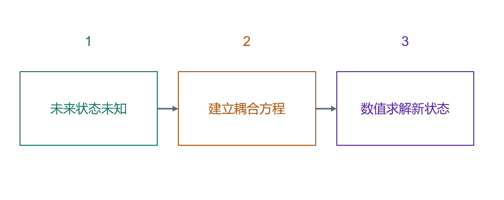

*读图：未来状态未知 → 建立耦合方程 → 数值求解新状态。箭头表示本节的推理或处理顺序，具体条件见正文。*

### 先读符号与条件

| 符号 / 条件 | 含义 |
| --- | --- |
| 公式 | 由线性振子的隐式 Euler 联立消元 |
| 非线性系统 | 通常迭代求解 |

### 核心关系与推导入口

以下关系使用上述条件；标为教学简化或补充的内容是为理解而推导，不是逐字转录课件。

$$
x_{n+1}=\frac{x_n+h v_n}{1+h^2\omega^2},\qquad v_{n+1}=v_n-h\omega^2x_{n+1}
$$

### 🔧 手算 9：把关系落到数字上

x=1、v=0、ω=1、h=1，得到 x'=0.5、v'=-0.5，能量 0.25，原来为 0.5。代入 x'=1+v'=0.5 验证。

| 检查步骤 | 操作 |
| --- | --- |
| 输入 | 先从例子中抄下给定量及单位，不引入未给定的数值。 |
| 计算 | 按本节关系求中间量，再得到结果；不要在第一步就做显示裁剪或整数舍入。 |
| 回查 | 代入 x'=1+v'=0.5 验证。 |
| 适用边界 | 求解器没收敛就接受未来状态，可能既不准确也不稳定；应监测残差。 |

### ⚠️ 易错点：先识别症状与假设

求解器没收敛就接受未来状态，可能既不准确也不稳定；应监测残差。

### 停下来解释一次

**问题：隐式方法更稳定是否意味着总是首选？**

<details>
<summary>展开参考回答</summary>

不。求解成本、阻尼、实现复杂度和目标效果共同决定选择。

</details>

<details>
<summary>展开原课件关键页，对照术语与图形</summary>

#### Implicit methods

*PDF p90 · 对应本节：隐式 Euler 为什么要解方程？*


#### Implicit methods

*PDF p91 · 对应本节：隐式 Euler 为什么要解方程？*


#### Implicit Euler Method

*PDF p92 · 对应本节：隐式 Euler 为什么要解方程？*


</details>

## 10. 位置约束怎样把布料拉回合法状态？

位置式方法先预测位置，再投影满足长度、碰撞等约束，最后用位置变化重建速度。它强调约束满足与视觉稳定，不能直接等同于准确求解某个连续弹性模型。

约束迭代次数、顺序、时间步长和质量都会影响结果；固定点逆质量为零，把所有修正分给可移动点。Verlet 与 PBD 相关但不是同一个概念。


*读图：预测位置 → 约束投影 → 由新位置重建速度。箭头表示本节的推理或处理顺序，具体条件见正文。*

### 先读符号与条件

| 符号 / 条件 | 含义 |
| --- | --- |
| p | 预测并修正的位置 |
| h | 时间步长 |
| 约束投影 | 先于速度重建 |

### 核心关系与推导入口

以下关系使用上述条件；标为教学简化或补充的内容是为理解而推导，不是逐字转录课件。

$$
v_{n+1}=\frac{p_{corrected}-x_n}{h}
$$

### 🔧 手算 10：把关系落到数字上

两等质量点在 0 和 1.4，目标距离 1，各向内移动 0.2，得到 0.2 和 1.2。新距离 1，质心仍为 0.7。

| 检查步骤 | 操作 |
| --- | --- |
| 输入 | 先从例子中抄下给定量及单位，不引入未给定的数值。 |
| 计算 | 按本节关系求中间量，再得到结果；不要在第一步就做显示裁剪或整数舍入。 |
| 回查 | 新距离 1，质心仍为 0.7。 |
| 适用边界 | 只修位置不修速度，会让下一帧重新冲回非法状态并产生抖动。 |


*两端各移动 0.2，将距离 1.4 修回 1，同时保持质心。*

### ⚠️ 易错点：先识别症状与假设

只修位置不修速度，会让下一帧重新冲回非法状态并产生抖动。

### 停下来解释一次

**问题：固定一端时还能两边各修一半吗？**

<details>
<summary>展开参考回答</summary>

不能。固定端保持不动，修正按逆质量分配给可动端。

</details>

<details>
<summary>展开原课件关键页，对照术语与图形</summary>

#### Strain Limiting

*PDF p49 · 对应本节：位置约束怎样把布料拉回合法状态？*


#### Strain Limiting

*PDF p50 · 对应本节：位置约束怎样把布料拉回合法状态？*


#### Position-Based / Verlet Integration

*PDF p93 · 对应本节：位置约束怎样把布料拉回合法状态？*


#### Position-Based / Verlet Integration

*PDF p94 · 对应本节：位置约束怎样把布料拉回合法状态？*


</details>

## 11. 碰撞与群体行为怎样加入同一框架？

粒子系统可以加碰撞约束，也可以用局部规则模拟群体。鸟群常用聚合、分离与速度对齐；它们是行为模型，不是每项都来自真实物理力。

碰撞响应应明确法向与切向处理，恢复系数控制法向反弹，摩擦处理切向。渲染粒子的形状并不改变其动力学模型，球体外观不保证碰撞也按球处理。


*读图：局部邻域与接触 → 附加力或约束 → 统一时间推进。箭头表示本节的推理或处理顺序，具体条件见正文。*

### 先读符号与条件

| 符号 / 条件 | 含义 |
| --- | --- |
| vn | 撞击前法向速度 |
| e | 恢复系数 |
| 忽略 | 旋转与复杂接触耦合 |

### 核心关系与推导入口

以下关系使用上述条件；标为教学简化或补充的内容是为理解而推导，不是逐字转录课件。

$$
v_n'=-e v_n,\qquad 0\le e\le1
$$

### 🔧 手算 11：把关系落到数字上

向地面法向速度 -4 m/s、e=0.5，反弹 +2 m/s。法向动能比为 (2/4)²=1/4，其余能量被耗散。

| 检查步骤 | 操作 |
| --- | --- |
| 输入 | 先从例子中抄下给定量及单位，不引入未给定的数值。 |
| 计算 | 按本节关系求中间量，再得到结果；不要在第一步就做显示裁剪或整数舍入。 |
| 回查 | 法向动能比为 (2/4)²=1/4，其余能量被耗散。 |
| 适用边界 | 只翻转全部速度会连切向运动一起反向；应先分解法向与切向。 |


*碰撞响应需分解法向和切向，不能简单翻转整个速度向量。*

### ⚠️ 易错点：先识别症状与假设

只翻转全部速度会连切向运动一起反向；应先分解法向与切向。

### 停下来解释一次

**问题：鸟群规则能否当作生物行为的精确证明？**

<details>
<summary>展开参考回答</summary>

不能。它是产生某些集体运动特征的计算模型，适用性需要额外验证。

</details>

<details>
<summary>展开原课件关键页，对照术语与图形</summary>

#### Other Particle Systems

*PDF p95 · 对应本节：碰撞与群体行为怎样加入同一框架？*


#### Example: Granular Materials

*PDF p98 · 对应本节：碰撞与群体行为怎样加入同一框架？*


#### Example: Flocking Birds

*PDF p100 · 对应本节：碰撞与群体行为怎样加入同一框架？*


#### Simulated Flocking as an ODE

*PDF p102 · 对应本节：碰撞与群体行为怎样加入同一框架？*


#### Simulated Flocking as an ODE

*PDF p108 · 对应本节：碰撞与群体行为怎样加入同一框架？*


#### Example: Crowds

*PDF p110 · 对应本节：碰撞与群体行为怎样加入同一框架？*


#### Example: Crowds + “Rock” Dynamics

*PDF p112 · 对应本节：碰撞与群体行为怎样加入同一框架？*


</details>

## 12. 稳定、准确、守恒如何分开验收？

稳定指误差不失控，准确指接近目标连续解，守恒则检查特定不变量。三者相关但不能互换。无外力系统检查动量，保守弹簧检查能量，阻尼系统则检查能量不应上升。

建议先跑单粒子自由落体、单弹簧与双粒子内力，再扩到布料。随笔记的脚本验证这些小模型，不宣称已经完成高质量布料求解器。


*读图：解析小模型 → 误差与不变量 → 复杂场景验证。箭头表示本节的推理或处理顺序，具体条件见正文。*

### 先读符号与条件

| 符号 / 条件 | 含义 |
| --- | --- |
| a | 恒定加速度 |
| 解析解 | 用于数值误差对照 |
| 条件 | 没有碰撞与其他力 |

### 核心关系与推导入口

以下关系使用上述条件；标为教学简化或补充的内容是为理解而推导，不是逐字转录课件。

$$
x(t)=x_0+v_0t+\tfrac12at^2
$$

### 🔧 手算 12：把关系落到数字上

x0=0、v0=0、a=-10、t=0.2，精确位移 -0.2 米。一步显式 Euler 位置仍 0；两步 h=0.1 得 -0.1，能看出缩步改善但仍有误差。

| 检查步骤 | 操作 |
| --- | --- |
| 输入 | 先从例子中抄下给定量及单位，不引入未给定的数值。 |
| 计算 | 按本节关系求中间量，再得到结果；不要在第一步就做显示裁剪或整数舍入。 |
| 回查 | 一步显式 Euler 位置仍 0；两步 h=0.1 得 -0.1，能看出缩步改善但仍有误差。 |
| 适用边界 | 截图看着平稳不能证明积分正确；记录轨迹、误差与能量才可区分机制。 |

### ⚠️ 易错点：先识别症状与假设

截图看着平稳不能证明积分正确；记录轨迹、误差与能量才可区分机制。

### 停下来解释一次

**问题：为什么不先用一整件衣服调积分器？**

<details>
<summary>展开参考回答</summary>

复杂约束会掩盖错误来源，最小模型更容易判断力、符号、时间步和求解器各自的问题。

</details>

<details>
<summary>展开原课件关键页，对照术语与图形</summary>

#### Errors and Instability

*PDF p74 · 对应本节：稳定、准确、守恒如何分开验收？*


#### Errors and Instability

*PDF p75 · 对应本节：稳定、准确、守恒如何分开验收？*


#### Just Scratching the Surface…

*PDF p114 · 对应本节：稳定、准确、守恒如何分开验收？*


#### Things to Remember

*PDF p115 · 对应本节：稳定、准确、守恒如何分开验收？*


</details>

## 深入 1. 显式 Euler 的能量增长为何与时间步无关地存在

本节是根据前文课件主题展开的**补充推导与独立教学实验**，数值不是课件测量结果。

回查原课件：p58、p59、p65、p66、p69、p70、p74、p75、p78、p79、p80、p83、p114、p115。

无阻尼弹簧在连续时间中能量守恒，显式 Euler 却会每步增加能量。这里直接展开一步更新后的能量，不靠长动画猜测原因。结论是：减小步长可以减慢错误积累，却不能使任意固定非零步长下的显式 Euler 变成无阻尼振子的长期稳定方法。

### 先固定问题的边界

- **系统**：质量 m=1、弹簧刚度 k=1，平衡位置为 0。
- **状态**：位置 x、速度 v，能量 E=(x²+v²)/2。
- **更新**：所有右侧必须使用旧状态，不能混入半隐式更新。

### 从定义逐步推到可计算形式

**第 1 步。** 运动方程给出位置和速度的导数，频率已经归一化为 1。

$$
\dot x=v,\qquad\dot v=-x
$$

**第 2 步。** 显式 Euler 用旧导数跨一个步长 h。

$$
x_{n+1}=x_n+hv_n,\qquad v_{n+1}=v_n-hx_n
$$

**第 3 步。** 展开新能量，两个交叉项 2hxv 和 −2hxv 抵消，但两个 h² 项都是正数。

$$
2E_{n+1}=(x+hv)^2+(v-hx)^2=(1+h^2)(x^2+v^2)
$$

**第 4 步。** 于是每一步能量乘 1+h²。只要 h 非零、初始能量非零，就严格增加。

$$
E_{n+1}=(1+h^2)E_n
$$

**第 5 步。** 固定总时长 T≈nh 时，总放大率是 (1+h²)^n。减小 h 会改善有限时长误差，但不会改变每步增能的符号。

$$
E_n=(1+h^2)^nE_0
$$


*相空间中的显式 Euler 从能量圆的切线向外迈步，每一步都落在更大的能量圆上。*

### 🔧 手算 13：显式 Euler 的能量增长为何与时间步无关地存在

| 已知量 | 数值与含义 |
| --- | --- |
| 初值 | x0=1，v0=0，E0=0.5 |
| 步长 | h=0.1 |
| 一步 | x1=1，v1=−0.1 |
| 100 步 | 总时间 10 |

1. 一步能量为 (1+0.01)/2=0.505。

2. 相对增长为 1%，与 1+h²=1.01 一致。

3. 100 步能量为 0.5×1.01¹⁰⁰≈1.352407。

4. 连续精确解在 t=10 仍应为能量 0.5。

5. 程序若先更新 v 再用新 v 更新 x，就已经换成半隐式，不能拿它的结果验证显式公式。

6. 将 h=0.05、步数改为 200，固定总时长仍为 10，能量误差减小但未归零。

### 回代与第二条验证路线

逐步模拟与闭式能量倍率应逐项一致；这比只看曲线是否振荡更可靠。

交换 x、v 的初始分配而保持 E0 相同，显式方法的能量倍率仍相同，说明错误来自更新算子而非特定相位。

### 改变一个条件，原结论还成立吗？

有物理阻尼时，数值误差可能被衰减掩盖；“没爆炸”不能证明积分准确。

刚度提高到 k 时自然频率变为 √k，真正控制误差的是 h√k，不是只看 h 的十进制大小。

### 真正运行一次：保留正确与错误对照

下列程序只依赖 Python 标准库，复制到一个文件即可运行。断言验证本节明确给出的解析关系；它不替代完整场景测试。

```python
from math import isclose
def explicit(x,v,h,steps):
    for _ in range(steps):
        x,v=x+h*v,v-h*x
    return (x*x+v*v)/2
h=.1; n=100
energy=explicit(1.,0.,h,n)
expected=.5*(1+h*h)**n
assert isclose(energy,expected,rel_tol=1e-12)
fine=explicit(1.,0.,.05,200)
assert .5<fine<energy
assert isclose(explicit(0.,1.,h,n),energy)
print('100-step energy =',round(energy,6))
print('half-step, same duration =',round(fine,6))
print('exact energy =',.5)
```

实际运行输出：

```text
100-step energy = 1.352407
half-step, same duration = 0.823846
exact energy = 0.5
```

### 实现坑：从可观察症状回到原因

**症状：** 弹簧没有外力却越摆越大，减少步长后只是更晚爆炸。

**定位与修正：** 先核对是否正是 (1+h²)^n 的数值增能。若吻合，错误属于方法稳定性而非力方向；加入任意阻尼可以隐藏症状，却会改变物理模型。

### 自测 27. 只测试一步误差很小，能否批准长期布料模拟？

<details>
<summary>推理与答案</summary>

不能。一小步的增能会反复积累，而且布料存在比可见整体摆动更高频的模式。还需固定总时间、不同网格刚度和长期能量行为的检查。

</details>

## 深入 2. 半隐式与隐式更新各付出了什么代价

本节是根据前文课件主题展开的**补充推导与独立教学实验**，数值不是课件测量结果。

回查原课件：p74、p75、p84、p85、p86、p90、p91、p92、p114、p115。

“隐式更稳定”不等于“隐式更准确”。对同一个归一化振子，我们可以写出两个更新矩阵：半隐式保持某个修改后的二次量，但真实能量振荡；隐式 Euler 则每步耗散能量。二者避免爆炸的方式不同。

### 先固定问题的边界

- **系统**：仍取 x′=v、v′=−x，m=k=1。
- **半隐式**：先用旧 x 更新 v，再用新 v 更新 x。
- **隐式**：位置和速度都使用新状态导数，需联立求解。

### 从定义逐步推到可计算形式

**第 1 步。** 半隐式的顺序必须写清，否则一句“Euler”会掩盖不同算法。

$$
v_{n+1}=v_n-hx_n,\qquad x_{n+1}=x_n+hv_{n+1}
$$

**第 2 步。** 其更新矩阵行列式为 1，迹为 2−h²；0<h<2 时特征值在单位圆上。

$$
A_s=\begin{bmatrix}1-h^2&h\\-h&1\end{bmatrix},\quad\det A_s=1
$$

**第 3 步。** 半隐式精确保留修改后的二次量，真实能量一般并非常数。该二次量在 h<2 时正定。

$$
\widetilde E=\tfrac12(x^2+v^2-hxv)
$$

**第 4 步。** 隐式 Euler 联立两个新状态方程，解出带 1+h² 分母的更新。

$$
x_{n+1}=\frac{x_n+hv_n}{1+h^2},\qquad v_{n+1}=\frac{v_n-hx_n}{1+h^2}
$$

**第 5 步。** 隐式能量每步除以 1+h²，因此稳定的代价是数值阻尼。

$$
E_{n+1}=E_n/(1+h^2)
$$


*三条相空间轨迹分别向外、沿修改能量椭圆、向内移动，对照增能、近守恒与数值耗散的不同机制。*

### 🔧 手算 14：半隐式与隐式更新各付出了什么代价

| 已知量 | 数值与含义 |
| --- | --- |
| 初值 | (x,v)=(1,0) |
| 步长 | h=0.5 |
| 半隐式一步 | v=−0.5，x=0.75 |
| 隐式一步 | x=0.8，v=−0.4 |

1. 半隐式真实能量为 (0.75²+0.5²)/2=0.40625。

2. 修改后能量为 (0.5625+0.25−0.5×0.75×(−0.5))/2=0.5。

3. 隐式真实能量为 (0.64+0.16)/2=0.4。

4. 隐式能量倍率 0.4/0.5=0.8，正好等于 1/(1+0.25)。

5. 半隐式后续真实能量上下波动，不是每步都下降。

6. 把 h 提到 2 以上，半隐式也可能发散，因此“半隐式永远稳定”不成立。

### 回代与第二条验证路线

长期检查半隐式修改能量守恒，与隐式闭式耗散倍率对应。

同时记录真实能量，不要只展示某个保持不变的量就声称原系统能量守恒。

### 改变一个条件，原结论还成立吗？

本稳定区间只针对当前线性振子；复杂约束、碰撞和非线性力不能直接沿用 h<2 的数字。

隐式求解若迭代未收敛，其实际行为还受残差与停止准则影响，不能只按理想精确解分析。

### 真正运行一次：保留正确与错误对照

下列程序只依赖 Python 标准库，复制到一个文件即可运行。断言验证本节明确给出的解析关系；它不替代完整场景测试。

```python
from math import isclose
h=.5; x,v=1.,0.
modified=[]; energies=[]
for _ in range(100):
    v=v-h*x
    x=x+h*v
    energies.append((x*x+v*v)/2)
    modified.append((x*x+v*v-h*x*v)/2)
assert all(isclose(e,.5,abs_tol=1e-12) for e in modified)
assert max(energies)-min(energies)>.05
xi,vi=1.,0.
for _ in range(10):
    xi,vi=(xi+h*vi)/(1+h*h),(vi-h*xi)/(1+h*h)
implicit_energy=(xi*xi+vi*vi)/2
assert isclose(implicit_energy,.5/(1+h*h)**10)
print('semi-implicit energy range =',round(min(energies),6),round(max(energies),6))
print('implicit 10-step energy =',round(implicit_energy,6))
```

实际运行输出：

```text
semi-implicit energy range = 0.40009 0.666659
implicit 10-step energy = 0.053687
```

### 实现坑：从可观察症状回到原因

**症状：** 模拟不再爆炸但振动很快消失，或者把半隐式的能量振荡误判为单调耗散。

**定位与修正：** 按更新顺序区分方法，再对照各自不变量和能量曲线。这里的两种结果都可能“看着稳定”，但与连续无阻尼系统的差异完全不同。

### 自测 28. 隐式方法允许很大步长，是否意味着可以任意降低模拟频率？

<details>
<summary>推理与答案</summary>

不能。大步长可能稳定却严重阻尼、相位错误或漏掉碰撞事件。稳定只限制错误不会无限放大，并不保证捕捉了你关心的运动细节。

</details>

## 深入 3. 距离约束为什么按逆质量分摊修正

本节是根据前文课件主题展开的**补充推导与独立教学实验**，数值不是课件测量结果。

回查原课件：p28、p30、p31、p32、p34、p35、p49、p50、p93、p94。

位置约束把拉长的连杆恢复到指定长度，但两端应该各移动多少不能随意决定。轻粒子更容易移动，固定粒子不应被移动。通过最小化质量加权的位移代价，可以直接推导逆质量权重，而不必把“各修一半”当成普遍规则。

### 先固定问题的边界

- **约束**：两点间距离应为 l0；这里只做一维共线的精确例子。
- **质量**：m1、m2>0，逆质量 wi=1/mi；固定点用 w=0。
- **目标**：仅做位置投影，不声称同时守恒原速度与总能量。

### 从定义逐步推到可计算形式

**第 1 步。** 设当前从 x1 指向 x2 的单位方向为 n，长度误差 C=l−l0。正 C 表示拉长。

$$
C=\|x_2-x_1\|-l_0,\qquad n=\frac{x_2-x_1}{\|x_2-x_1\|}
$$

**第 2 步。** 沿连线移动，设两端修正分别为 a n、−b n，必须满足 a+b=C。

$$
\Delta x_1=an,\quad\Delta x_2=-bn,\quad a+b=C
$$

**第 3 步。** 最小化质量加权的位移平方，可由拉格朗日乘子得 m1a=m2b。

$$
\min_{a+b=C}\frac12(m_1a^2+m_2b^2)
$$

**第 4 步。** 解出修正与逆质量成正比。固定点逆质量为零时自然不移动。

$$
a=\frac{w_1}{w_1+w_2}C,\qquad b=\frac{w_2}{w_1+w_2}C
$$

**第 5 步。** 对于两点有限质量，质量加权位置和保持不变，因此质心不因内部投影平移。

$$
m_1\Delta x_1+m_2\Delta x_2=0
$$


*同一条拉长连杆，两端按逆质量移动不同距离；与各移动一半的结果并排，标出质心是否漂移。*

### 🔧 手算 15：距离约束为什么按逆质量分摊修正

| 已知量 | 数值与含义 |
| --- | --- |
| 初始位置 | x1=0，x2=3 |
| 目标长度 | l0=1 |
| 质量 | m1=1，m2=3 |
| 逆质量 | w1=1，w2=1/3 |

1. 误差 C=3−1=2。

2. a=1/(4/3)×2=1.5。

3. b=(1/3)/(4/3)×2=0.5。

4. 新位置为 x1=1.5、x2=2.5，距离恢复为 1。

5. 原质心 (1×0+3×3)/4=2.25，新质心 (1×1.5+3×2.5)/4=2.25。

6. 若各移动 1，新位置为 (1,2)，质心变成 1.75，内部约束凭空改变了整体位置。

### 回代与第二条验证路线

长度约束与质心不变分别验证两个独立条件。

把第二点设为固定，第二点位移应为零，第一点承担全部长度修正。

### 改变一个条件，原结论还成立吗？

两点重合时单位方向未定义；需要上一步方向、其他约束或专门的退化处理。

多约束逐次投影会相互影响，迭代次数与顺序影响残差；单约束一次精确不代表整张布料一次就满足全部约束。

### 真正运行一次：保留正确与错误对照

下列程序只依赖 Python 标准库，复制到一个文件即可运行。断言验证本节明确给出的解析关系；它不替代完整场景测试。

```python
from math import isclose
def project(x1,x2,l0,w1,w2):
    length=abs(x2-x1)
    if length==0 or w1+w2==0: raise ValueError('degenerate constraint')
    n=1 if x2>x1 else -1
    C=length-l0
    return x1+n*w1*C/(w1+w2),x2-n*w2*C/(w1+w2)
a,b=project(0.,3.,1.,1.,1/3)
assert isclose(b-a,1)
assert isclose((a+3*b)/4,2.25)
fixed=project(0.,3.,1.,1.,0.)
assert fixed==(2.,3.)
wrong=(1.,2.)
assert not isclose((wrong[0]+3*wrong[1])/4,2.25)
print('projected =',a,b,'center of mass =',(a+3*b)/4)
print('fixed endpoint =',fixed)
```

实际运行输出：

```text
projected = 1.5 2.5 center of mass = 2.25
fixed endpoint = (2.0, 3.0)
```

### 实现坑：从可观察症状回到原因

**症状：** 布料被内部约束修正后整体漂移，或者固定顶点仍被拉动。

**定位与修正：** 先检查权重是否用了质量而非逆质量，以及固定点是否设成零逆质量。程序的错误“各一半”虽然满足长度，却违反质心条件，说明只检查约束值不够。

### 自测 29. 投影满足长度且保持质心，是否足以证明机械能守恒？

<details>
<summary>推理与答案</summary>

不足。位置被直接改变，速度如何更新会影响动能，弹性势能也可能被删除。位置约束方法的目标与精确 Hamiltonian 积分不同，需要单独说明速度重建和阻尼。

</details>

## 深入 4. 一步与两个半步怎样估计局部误差

本节是根据前文课件主题展开的**补充推导与独立教学实验**，数值不是课件测量结果。

回查原课件：p74、p75、p87、p88、p89、p114、p115。

自适应步长不是“看起来快就用大步”。一种基础做法是对同一初始状态分别走一个整步、两个半步，利用两者差异估计离散误差。这里选指数衰减方程，既有闭式解，也能精确看出局部误差与全局误差不是同一个阶。

### 先固定问题的边界

- **方程**：y′=−y，y(0)=1，精确解 e⁻ᵗ。
- **方法**：显式 Euler，一步阶数为 1。
- **估计**：比较相同总时间 h 的整步与两个半步，不比较不同终点。

### 从定义逐步推到可计算形式

**第 1 步。** 一个整步用初始斜率，得到 yfull=(1−h)y。

$$
y_{full}=(1-h)y
$$

**第 2 步。** 两个半步第二次使用中间状态，得到平方因子。

$$
y_{half}=(1-h/2)^2y
$$

**第 3 步。** 两者差异为 h²y/4，说明局部一步误差的主导量随 h² 缩放。

$$
y_{half}-y_{full}=\frac{h^2}{4}y
$$

**第 4 步。** 对一阶方法，两个半步的局部主误差约为整步的一半；Richardson 外推可消去主导项。

$$
y_{extra}=2y_{half}-y_{full}
$$

**第 5 步。** 若按局部差异控制步长，比例更新使用平方根；它不是固定总时长下全局误差的线性缩放。

$$
h_{new}\approx h\sqrt{\frac{tol}{|y_{half}-y_{full}|}}
$$


*相同终点的整步与两半步形成两个近似值；差距用于估计误差，旁边标出精确解和外推值的位置。*

### 🔧 手算 16：一步与两个半步怎样估计局部误差

| 已知量 | 数值与含义 |
| --- | --- |
| 当前值 | y=1 |
| 整步 | h=0.2 |
| 两个半步 | 各 0.1 |
| 局部容差 | tol=0.0025，不含安全系数 |

1. 整步得到 0.8。

2. 两个半步得到 0.9²=0.81。

3. 差值为 0.01，等于 h²/4。

4. 精确 e⁻⁰·²≈0.818731，两半步比整步更接近，但仍有误差。

5. 外推为 2×0.81−0.8=0.82，误差约 0.001269。

6. 要把差异从 0.01 降到 0.0025，建议步长乘 √(1/4)=1/2，得到 hnew=0.1。

### 回代与第二条验证路线

使用精确指数解分别检查三种结果，不能仅以两种近似彼此接近就证明正确。

把 h 减半，差值应减为四分之一；程序直接验证这个局部阶。

### 改变一个条件，原结论还成立吗？

碰撞、摩擦切换等不光滑事件会破坏平滑误差展开；此时还需事件定位。

如果两个实现共享同一种系统错误，它们可能彼此很接近却都错，因此解析小模型仍是必要的独立参考。

### 真正运行一次：保留正确与错误对照

下列程序只依赖 Python 标准库，复制到一个文件即可运行。断言验证本节明确给出的解析关系；它不替代完整场景测试。

```python
from math import exp,isclose,sqrt
def pair(h,y=1.):
    return (1-h)*y,(1-h/2)**2*y
h=.2
full,half=pair(h)
delta=abs(half-full)
fine_full,fine_half=pair(h/2)
assert isclose(delta,.01)
assert isclose(abs(fine_half-fine_full),delta/4)
extra=2*half-full
assert abs(extra-exp(-h))<abs(half-exp(-h))
new_h=h*sqrt(.0025/delta)
assert isclose(new_h,.1)
print('full / half / extrapolated =',full,half,extra)
print('exact =',round(exp(-h),6),'new step =',round(new_h,6))
```

实际运行输出：

```text
full / half / extrapolated = 0.8 0.81 0.8200000000000001
exact = 0.818731 new step = 0.1
```

### 实现坑：从可观察症状回到原因

**症状：** 减小步长没有按预期改善误差，或自适应器在碰撞时反复放大、缩小步长。

**定位与修正：** 先用这个平滑指数例检查步长控制的指数和比较终点。平滑例通过后，再针对事件不连续设计额外限制；不要把一个局部估计器当作所有动力系统的质量证明。

### 自测 30. 两半步与整步差值为零，能否断言误差为零？

<details>
<summary>推理与答案</summary>

不能。例如两种路径都受到相同的裁剪、错误力或精度饱和影响时，差值也可能为零。应结合独立解析解、尺度变化与实际残差判断。

</details>

## 深入练习的跨讲连接：这些工具会在哪里再出现？

| 相关讲次 | 借用的工具 | 本次实际使用位置 |
| --- | --- | --- |
| [L21–23](/notes/cs184-21-23-animation/) | 状态与时间 | 关键帧控制与物理状态更新的关系 |
| [L11–12](/notes/cs184-11-12-meshes-geometry/) | 离散结构 | 网格刚度与高频模式影响步长 |
| [L25](/notes/cs184-25-fluid-simulation/) | 约束投影 | 距离约束与无散度约束都需残差检查 |
| [相机](/notes/cs184-supplement-cameras-lenses/) | 曝光时间 | 物理子步与成像时间积分不能混为一帧 |

### 回头看才明白

1. 稳定、准确和守恒是三个验收轴；隐式振子稳定却耗散，半隐式也只保留修改后的能量。

2. 位置投影满足几何约束，不自动保证速度或机械能正确；每个被修改的状态都要有更新规则。

3. 步长误差估计依赖光滑性，碰撞等事件需要额外处理，不能靠调小一个统一阈值解释全部问题。

### 这组实验已经验证什么，还差什么

| 证据 | 可以支持的结论 | 下一步 |
| --- | --- | --- |
| 逐步推导与回代 | 在明确假设下，数值和关系一致 | 改变一个假设，重新预测边界行为 |
| 本篇四段实际运行的程序 | 小模型和故障对照可复现 | 接入完整项目后继续核对坐标、单位和输入范围 |
| 原生图解 | 几何与数值对应关系可检查 | 不把示意图当成真实设备或场景的测量 |

## 13. 把基础数值例子连成检查顺序

先手算再运行。随仓库提供的 `scripts/cs184-numerical-checks.py` 是小模型验证，不依赖 GPU，也不修改服务器配置。它不能替代完整渲染场景或模拟系统的验证。

| 顺序 | 本节关系 | 最容易漏掉的约定 |
| --- | --- | --- |
| 1 | 模拟从哪些状态开始？ | 状态：位置与速度一起更新 |
| 2 | 弹簧为什么要有静止长度？ | Fa：作用于 a 的力 |
| 3 | 阻尼为什么要区分整体运动与相对运动？ | e：单位弹簧方向 |
| 4 | 网格变细为什么材料会变硬或变软？ | 适用：小形变线性弹簧 |
| 5 | 显式 Euler 一步究竟做了什么？ | 更新顺序：两式都读旧值 |
| 6 | 为什么一个无阻尼弹簧会自己加速？ | 前提：线性无阻尼振子与显式 Euler |
| 7 | 改进与半隐式方法差在哪里？ | 线性振子稳定范围：0<h omega<2 |
| 8 | 自适应步长为什么要比较两种结果？ | 用途：步长控制指标 |
| 9 | 隐式 Euler 为什么要解方程？ | 非线性系统：通常迭代求解 |
| 10 | 位置约束怎样把布料拉回合法状态？ | 约束投影：先于速度重建 |
| 11 | 碰撞与群体行为怎样加入同一框架？ | 忽略：旋转与复杂接触耦合 |
| 12 | 稳定、准确、守恒如何分开验收？ | 条件：没有碰撞与其他力 |

### 复现实验的最小记录

| 记录项 | 用途 |
| --- | --- |
| 固定输入 | 相同几何、材质、网格或信号，避免一次改变多个因素。 |
| 参数与单位 | 包括采样数、步长、分辨率、角度单位、颜色空间。 |
| 输出量 | 保留线性值、误差或状态，再生成展示图。 |
| 参考 | 解析解、手算或高精度结果必须说明来源。 |
| 失败样例 | 边界和极端条件是检查假设的入口。 |

## 14. 实现排查：把公式错误与系统错误分开

本节列出由模型和手算能够判断的排查方向；没有把尚未写出的完整应用测试说成已完成。最小数值检查的真实执行结果见本次发布核对报告。

### 阶段 1：第 1–4 节

| 涉及关系 | 错误机制 / 修正方向 |
| --- | --- |
| 模拟从哪些状态开始？ | 质量为零不能直接做除法；固定点一般用逆质量零表示并跳过动力学更新。 |
| 弹簧为什么要有静止长度？ | 把方向或伸长量符号写反，弹簧会越拉越远；用伸长和压缩两个例子同时检查。 |
| 阻尼为什么要区分整体运动与相对运动？ | 内部阻尼符号反了会注入能量；课件不同端点标记下需重新推功率。 |
| 网格变细为什么材料会变硬或变软？ | 布料参数缩放不能一律照搬一维串联公式；还要看拓扑、面积与弯曲模型。 |

### 阶段 2：第 5–8 节

| 涉及关系 | 错误机制 / 修正方向 |
| --- | --- |
| 显式 Euler 一步究竟做了什么？ | 代码语句顺序决定数学方法，不能都叫“Euler”而不注明。 |
| 为什么一个无阻尼弹簧会自己加速？ | 添加很强阻尼可能掩盖积分错误，但会改变物理效果；应先辨认能量增长机制。 |
| 改进与半隐式方法差在哪里？ | 不要把一次能量下降当作长期稳定证明；需分析更新矩阵或观察长时间界限。 |
| 自适应步长为什么要比较两种结果？ | 只比较位置可能漏掉速度误差；不同量的尺度也需归一化。 |

### 阶段 3：第 9–12 节

| 涉及关系 | 错误机制 / 修正方向 |
| --- | --- |
| 隐式 Euler 为什么要解方程？ | 求解器没收敛就接受未来状态，可能既不准确也不稳定；应监测残差。 |
| 位置约束怎样把布料拉回合法状态？ | 只修位置不修速度，会让下一帧重新冲回非法状态并产生抖动。 |
| 碰撞与群体行为怎样加入同一框架？ | 只翻转全部速度会连切向运动一起反向；应先分解法向与切向。 |
| 稳定、准确、守恒如何分开验收？ | 截图看着平稳不能证明积分正确；记录轨迹、误差与能量才可区分机制。 |

## 15. 跨讲连接：同一工具在哪些尺度重复出现？

| 前置工具 | 在整门课里的用途 | 回查 |
| --- | --- | --- |
| 采样与积分 | 像素、光源、孔径、时间、方向都需要有限样本估计连续量。 | [L03](/notes/cs184-03-sampling-aliasing/) / [L15](/notes/cs184-15-monte-carlo-integration/) |
| 坐标与线性代数 | 相机、法线、骨架与局部速度都需要一致的参考系。 | [L04–05](/notes/cs184-04-05-transforms/) |
| 几何表示 | 可见性、接触、遮挡与网格邻域依赖可靠的几何关系。 | [L11–12](/notes/cs184-11-12-meshes-geometry/) |
| 物理量与单位 | 把颜色值、概率密度、力和能量区别开，防止错误补偿。 | [L14](/notes/cs184-14-radiometry/) |
| 颜色与显示 | 展示图不等于线性数据；显示变换会改变视觉比较。 | [L19–20](/notes/cs184-19-20-color-science/) |

回头看，许多错误并非来自复杂公式，而是来自“同一个词指了不同的量”：方向密度与概率、位置与方向、线性颜色与编码颜色、稳定与准确。先说清对象，再选择算法。

## 16. 自测：能否不看公式说清楚？

### 自测 1. 相同重力场中质量加倍，加速度是否加倍？

<details>
<summary>参考答案</summary>

不。重力也随质量加倍，F/m 仍为相同的 g。

</details>

### 自测 2. 力为零时弹簧是否一定长度为零？

<details>
<summary>参考答案</summary>

不是。非零静止长度弹簧在长度等于 l0 时恢复力为零。

</details>

### 自测 3. 内部阻尼会阻止整个系统刚体平移吗？

<details>
<summary>参考答案</summary>

理想成对相对速度阻尼不会，整体平移不改变弹簧长度。

</details>

### 自测 4. 更多弹簧是否自然意味着更真实？

<details>
<summary>参考答案</summary>

不。若材料参数与约束不一致，只是更精细地模拟错误材料。

</details>

### 自测 5. Euler 方法是不是直接精确求解牛顿定律？

<details>
<summary>参考答案</summary>

不是。定律定义连续模型，积分器只是有限步长下的数值近似。

</details>

### 自测 6. 把步长减半能使这一增长因子怎样变化？

<details>
<summary>参考答案</summary>

单步增长项 h²ω² 变为四分之一；但相同总时长需要更多步，仍要分析累计误差。

</details>

### 自测 7. 半隐式 Euler 与隐式 Euler 是否相同？

<details>
<summary>参考答案</summary>

不是。前者仍可显式逐项计算，后者通常需求解未来状态方程。

</details>

### 自测 8. 自适应方法能自动发现所有碰撞吗？

<details>
<summary>参考答案</summary>

不能保证。离散碰撞检测仍可能隧穿，需要合适的连续检测或步长约束。

</details>

### 自测 9. 隐式方法更稳定是否意味着总是首选？

<details>
<summary>参考答案</summary>

不。求解成本、阻尼、实现复杂度和目标效果共同决定选择。

</details>

### 自测 10. 固定一端时还能两边各修一半吗？

<details>
<summary>参考答案</summary>

不能。固定端保持不动，修正按逆质量分配给可动端。

</details>

### 自测 11. 鸟群规则能否当作生物行为的精确证明？

<details>
<summary>参考答案</summary>

不能。它是产生某些集体运动特征的计算模型，适用性需要额外验证。

</details>

### 自测 12. 为什么不先用一整件衣服调积分器？

<details>
<summary>参考答案</summary>

复杂约束会掩盖错误来源，最小模型更容易判断力、符号、时间步和求解器各自的问题。

</details>

### 自测 13. 第 1 节的数值例子，哪一项假设不能悄悄删掉？

<details>
<summary>参考答案与反例入口</summary>

质量为零不能直接做除法；固定点一般用逆质量零表示并跳过动力学更新。

再复算本节的例子：m=2 kg、F=6 N，加速度 3 m/s²。0.1 秒内速度变化近似 0.3 m/s；用 mΔv/Δt 得回 6 N。

</details>

### 自测 14. 第 2 节的数值例子，哪一项假设不能悄悄删掉？

<details>
<summary>参考答案与反例入口</summary>

把方向或伸长量符号写反，弹簧会越拉越远；用伸长和压缩两个例子同时检查。

再复算本节的例子：a=0、b=1.2 m、l0=1 m、k=100 N/m，则 Fa=+20 N、Fb=-20 N，合力为零。压缩到 0.8 m 时 Fa=-20 N。

</details>

### 自测 15. 第 3 节的数值例子，哪一项假设不能悄悄删掉？

<details>
<summary>参考答案与反例入口</summary>

内部阻尼符号反了会注入能量；课件不同端点标记下需重新推功率。

再复算本节的例子：一维 va=0、vb=2、c=3，Fa=6、Fb=-6，总功率 6×0-6×2=-12。若两端都以 2 移动，相对速度零，阻尼力也为零。

</details>

### 自测 16. 第 4 节的数值例子，哪一项假设不能悄悄删掉？

<details>
<summary>参考答案与反例入口</summary>

布料参数缩放不能一律照搬一维串联公式；还要看拓扑、面积与弯曲模型。

再复算本节的例子：原弹簧 k=10，拆成两段串联要各取 k=20，等效为 1/(1/20+1/20)=10。若各取 10，整体变为 5。

</details>

### 自测 17. 第 5 节的数值例子，哪一项假设不能悄悄删掉？

<details>
<summary>参考答案与反例入口</summary>

代码语句顺序决定数学方法，不能都叫“Euler”而不注明。

再复算本节的例子：x=1、v=0、a=-1、h=0.1，则 x'=1、v'=-0.1。若先更新 v 再用新 v 更新位置，会得到 x'=0.99，是另一方法。

</details>

### 自测 18. 第 6 节的数值例子，哪一项假设不能悄悄删掉？

<details>
<summary>参考答案与反例入口</summary>

添加很强阻尼可能掩盖积分错误，但会改变物理效果；应先辨认能量增长机制。

再复算本节的例子：ω=1、h=0.1、x=1、v=0，初能 0.5，新能 (1²+0.1²)/2=0.505，增长因子 1.01。100 步因子约 2.705。

</details>

### 自测 19. 第 7 节的数值例子，哪一项假设不能悄悄删掉？

<details>
<summary>参考答案与反例入口</summary>

不要把一次能量下降当作长期稳定证明；需分析更新矩阵或观察长时间界限。

再复算本节的例子：x=1、v=0、ω=1、h=0.1，则 v'=-0.1、x'=0.99，新能 0.49505。它不是精确守恒，但与显式第一步增能不同。

</details>

### 自测 20. 第 8 节的数值例子，哪一项假设不能悄悄删掉？

<details>
<summary>参考答案与反例入口</summary>

只比较位置可能漏掉速度误差；不同量的尺度也需归一化。

再复算本节的例子：一步结果 1.02，两半步结果 1.005，差为 0.015。容差 0.01 时应拒绝或缩步；容差不是“每秒总误差”。

</details>

### 自测 21. 第 9 节的数值例子，哪一项假设不能悄悄删掉？

<details>
<summary>参考答案与反例入口</summary>

求解器没收敛就接受未来状态，可能既不准确也不稳定；应监测残差。

再复算本节的例子：x=1、v=0、ω=1、h=1，得到 x'=0.5、v'=-0.5，能量 0.25，原来为 0.5。代入 x'=1+v'=0.5 验证。

</details>

### 自测 22. 第 10 节的数值例子，哪一项假设不能悄悄删掉？

<details>
<summary>参考答案与反例入口</summary>

只修位置不修速度，会让下一帧重新冲回非法状态并产生抖动。

再复算本节的例子：两等质量点在 0 和 1.4，目标距离 1，各向内移动 0.2，得到 0.2 和 1.2。新距离 1，质心仍为 0.7。

</details>

### 自测 23. 第 11 节的数值例子，哪一项假设不能悄悄删掉？

<details>
<summary>参考答案与反例入口</summary>

只翻转全部速度会连切向运动一起反向；应先分解法向与切向。

再复算本节的例子：向地面法向速度 -4 m/s、e=0.5，反弹 +2 m/s。法向动能比为 (2/4)²=1/4，其余能量被耗散。

</details>

### 自测 24. 第 12 节的数值例子，哪一项假设不能悄悄删掉？

<details>
<summary>参考答案与反例入口</summary>

截图看着平稳不能证明积分正确；记录轨迹、误差与能量才可区分机制。

再复算本节的例子：x0=0、v0=0、a=-10、t=0.2，精确位移 -0.2 米。一步显式 Euler 位置仍 0；两步 h=0.1 得 -0.1，能看出缩步改善但仍有误差。

</details>

### 自测 25. 本讲的输入、输出和中间表示各是什么？

<details>
<summary>参考答案</summary>

选择状态 → 建立受力 → 写成微分方程 → 离散时间 → 分析稳定性 → 施加碰撞和约束。请沿箭头逐项解释，尤其说清中间表示的单位、坐标或概率测度；只复述名词不算掌握。

</details>

### 自测 26. 能否只用一张“看起来正确”的图片证明实现正确？

<details>
<summary>参考答案</summary>

不能。需要将关键关系拆成可预测的小输入，检查数值、边界与对照；随机方法还要区分一次结果与统计期望，显示图还需区分编码与原始数据。

</details>

## 17. 带走的结论与仍需练习的内容

- 不。重力也随质量加倍，F/m 仍为相同的 g。
- 不是。非零静止长度弹簧在长度等于 l0 时恢复力为零。
- 理想成对相对速度阻尼不会，整体平移不改变弹簧长度。
- 不。若材料参数与约束不一致，只是更精细地模拟错误材料。
- 不是。定律定义连续模型，积分器只是有限步长下的数值近似。
- 单步增长项 h²ω² 变为四分之一；但相同总时长需要更多步，仍要分析累计误差。
- 不是。前者仍可显式逐项计算，后者通常需求解未来状态方程。
- 不能保证。离散碰撞检测仍可能隧穿，需要合适的连续检测或步长约束。
- 不。求解成本、阻尼、实现复杂度和目标效果共同决定选择。
- 不能。固定端保持不动，修正按逆质量分配给可动端。
- 不能。它是产生某些集体运动特征的计算模型，适用性需要额外验证。
- 复杂约束会掩盖错误来源，最小模型更容易判断力、符号、时间步和求解器各自的问题。

| 层次 | 已经说明 | 还需动手验证 |
| --- | --- | --- |
| 概念 | 本篇十二个问题、公式与原页对应。 | 用自己的话重新解释，并给出一个反例。 |
| 数值 | 正文手算与解析小模型。 | 改变一个输入，预测再运行。 |
| 系统 | 指出实现条件和典型错误。 | 完整应用需另外检查场景、性能和边界。 |

## 18. 整门课闭环与继续阅读

| 讲义 | 起点问题 | 得到的工具或终点 |
| --- | --- | --- |
| [L01 · 导论](/notes/cs184-01-introduction/) | 这门课在求什么？ | 从场景到像素与感知 |
| [L02 · 三角形与覆盖](/notes/cs184-02-drawing-triangles/) | 像素由哪些图元覆盖？ | 半平面判定与插值 |
| [L03 · 采样与抗锯齿](/notes/cs184-03-sampling-aliasing/) | 离散图像为何锯齿？ | 区域积分、过滤与采样 |
| [L04–05 · 变换](/notes/cs184-04-05-transforms/) | 怎样放置物体和相机？ | 坐标系、矩阵与投影 |
| [L06–07 · 纹理](/notes/cs184-06-07-texture-mapping/) | 表面参数如何随位置变化？ | UV、过滤与像素足迹 |
| [L08–09 · 着色](/notes/cs184-08-09-rasterization-shading/) | 看见哪个表面、怎样着色？ | 深度、管线与局部照明 |
| [L10 · 曲线曲面](/notes/cs184-10-bezier-curves-surfaces/) | 怎样控制连续形状？ | 插值、逼近与连续性 |
| [L11–12 · 几何](/notes/cs184-11-12-meshes-geometry/) | 复杂表面如何表示和操作？ | 网格、拓扑与几何处理 |
| [L13 · 光线追踪](/notes/cs184-13-ray-tracing-acceleration/) | 光线怎样快速找到最近表面？ | 求交与 BVH |
| [第 14 讲](/notes/cs184-14-radiometry/) | 能量 | 半球积分 |
| [第 15 讲](/notes/cs184-15-monte-carlo-integration/) | 像素是积分 | 降低方差 |
| [第 16–17 讲](/notes/cs184-16-17-global-illumination/) | 命中表面 | 加权累积与终止 |
| [春季 L18](/notes/cs184-18-material-modeling/) | 材质是散射规律 | 更细结构与体积传播 |
| [春季 L19–20](/notes/cs184-19-20-color-science/) | 光谱进入眼睛 | 线性运算与显示 |
| [春季 L21–23](/notes/cs184-21-23-animation/) | 表达运动意图 | 从末端目标反求关节 |
| [春季 L24](/notes/cs184-24-physical-simulation/) | 选择状态 | 施加碰撞和约束 |
| [春季 L25](/notes/cs184-25-fluid-simulation/) | 粒子或网格表示 | 边界与数值误差 |
| [春季 L26–27](/notes/cs184-26-27-virtual-reality/) | 人眼需要哪些线索 | 全景与光场 |
| [补充 A](/notes/cs184-supplement-cameras-lenses/) | 视场与透视 | 真实镜头与传感器 |
| [补充 B](/notes/cs184-supplement-image-processing/) | 图像是离散信号 | 频率量化与压缩 |

春季 L18–27 与夏季补充专题保留本地文件标识，**不冒充不存在的秋季同编号讲次**。可以按上表顺序学习，也可在相机、颜色、采样之间按依赖往返。

## 19. 原课件全页索引与来源

[原课件文件与版本记录](https://github.com/Teddy-Yangjiale/CS184/blob/main/CS184_2026/sp26/lectures/SP26-L24-physical-simulation.pdf) · [课程官网](https://cs184.eecs.berkeley.edu/sp26/)

文件：`SP26-L24-physical-simulation.pdf`；PDF 页数：116；SHA-256：`2c230f50f39789dc28cf54d26d74f8d4b509fc97b88728e625730107f7fc3721`。

“正文核对”表示本篇实际引用该页截图；“索引保留”包括演示、行政信息、补充、致谢与重复构建页，不表示逐页都有独立讲解。原视频的运动过程不能由静态 PDF 截图完整复现。

| PDF 页 | 原页可提取标题 | 本篇使用 |
| --- | --- | --- |
| 1 | Computer Graphics and Imaging | 索引保留 |
| 2 | Physically Based Animation | 正文核对 |
| 3 | Example: Cloth Simulation | 索引保留 |
| 4 | Example: Cloth Simulation | 索引保留 |
| 5 | Example: Fluids | 索引保留 |
| 6 | Example: Fluids | 索引保留 |
| 7 | Particle Systems | 正文核对 |
| 8 | 图像或演示页（请以原页视觉内容为准） | 索引保留 |
| 9 | 图像或演示页（请以原页视觉内容为准） | 索引保留 |
| 10 | • Single particles are very simple | 正文核对 |
| 11 | • Single particles are very simple | 索引保留 |
| 12 | Basic Particles | 正文核对 |
| 13 | Dot Notation for Derivatives | 正文核对 |
| 14 | Simple Gravity | 正文核对 |
| 15 | Gravitational Attraction | 索引保留 |
| 16 | Example: Galaxy Simulation | 索引保留 |
| 17 | Example: Galaxy Simulation | 索引保留 |
| 18 | Rendering Particles | 索引保留 |
| 19 | Mass + Spring Systems: | 索引保留 |
| 20 | Example: Mass Spring Mesh | 索引保留 |
| 21 | Example: Mass Spring Mesh | 索引保留 |
| 22 | Example: Mass Spring Rope | 索引保留 |
| 23 | Example: Mass Spring Rope | 索引保留 |
| 24 | Example: Hair | 索引保留 |
| 25 | Example: Hair | 索引保留 |
| 26 | Huamin Wang, Ravi Ramamoorthi, and James F. O'Brien. "Data-Driven Elastic Models for Cloth: Modeling and | 索引保留 |
| 27 | Huamin Wang, Ravi Ramamoorthi, and James F. O'Brien. "Data-Driven Elastic Models for Cloth: Modeling and | 索引保留 |
| 28 | A Simple Spring | 正文核对 |
| 29 | A Simple Spring | 索引保留 |
| 30 | A Simple Spring | 正文核对 |
| 31 | A Simple Spring | 正文核对 |
| 32 | Non-Zero Length Spring | 正文核对 |
| 33 | Non-Zero Length Spring | 索引保留 |
| 34 | Non-Zero Length Springs | 正文核对 |
| 35 | Comments on Springs | 正文核对 |
| 36 | Simple Motion Damping | 正文核对 |
| 37 | Simple Motion Damping | 正文核对 |
| 38 | Internal Damping for Spring | 正文核对 |
| 39 | Spring Constants | 正文核对 |
| 40 | Spring Constants | 正文核对 |
| 41 | Spring Constants | 正文核对 |
| 42 | Spring Constants | 正文核对 |
| 43 | Structures from Springs | 正文核对 |
| 44 | Structures from Springs | 正文核对 |
| 45 | Behavior is determined by structure linkages | 正文核对 |
| 46 | Structures from Springs | 索引保留 |
| 47 | Structures from Springs | 索引保留 |
| 48 | Edge Springs | 正文核对 |
| 49 | Strain Limiting | 正文核对 |
| 50 | Strain Limiting | 正文核对 |
| 51 | Adaptive Simulation | 索引保留 |
| 52 | Adaptive Simulation | 索引保留 |
| 53 | Example: Mass Spring Dress + Character | 索引保留 |
| 54 | Example: Mass Spring Dress + Character | 索引保留 |
| 55 | Aside: FEM (Finite Element Method) Instead of Springs | 索引保留 |
| 56 | Aside: FEM (Finite Element Method) Instead of Springs | 索引保留 |
| 57 | Combating Instability | 索引保留 |
| 58 | Euler’s Method | 正文核对 |
| 59 | Single Particle Simulation | 正文核对 |
| 60 | Single Particle Simulation | 索引保留 |
| 61 | Single Particle Simulation | 索引保留 |
| 62 | Single Particle Simulation | 索引保留 |
| 63 | Single Particle Simulation | 索引保留 |
| 64 | Single Particle Simulation | 索引保留 |
| 65 | Ordinary Differential Equation (ODE) | 正文核对 |
| 66 | Ordinary Differential Equation (ODE) | 正文核对 |
| 67 | Ordinary Differential Equation (ODE) | 索引保留 |
| 68 | Ordinary Differential Equation (ODE) | 索引保留 |
| 69 | Solving for Particle Position | 正文核对 |
| 70 | Euler’s Method - Errors | 正文核对 |
| 71 | Euler’s Method - Errors | 索引保留 |
| 72 | Euler’s Method - Errors | 索引保留 |
| 73 | Euler’s Method - Errors | 索引保留 |
| 74 | Errors and Instability | 正文核对 |
| 75 | Errors and Instability | 正文核对 |
| 76 | Errors and Instability | 索引保留 |
| 77 | Errors and Instability | 索引保留 |
| 78 | Instability of Forward Euler Method | 正文核对 |
| 79 | Instability Example (Spring) | 正文核对 |
| 80 | Instability Example (Spring) | 正文核对 |
| 81 | Instability Example (Spring) | 索引保留 |
| 82 | Instability Example (Spring) | 索引保留 |
| 83 | Instability Example (Spring) | 正文核对 |
| 84 | Some Methods to Combat Instability | 正文核对 |
| 85 | Modified Euler | 正文核对 |
| 86 | Midpoint Method | 正文核对 |
| 87 | Adaptive Step Size | 正文核对 |
| 88 | Adaptive Step Size | 正文核对 |
| 89 | Adaptive Step Size | 正文核对 |
| 90 | Implicit methods | 正文核对 |
| 91 | Implicit methods | 正文核对 |
| 92 | Implicit Euler Method | 正文核对 |
| 93 | Position-Based / Verlet Integration | 正文核对 |
| 94 | Position-Based / Verlet Integration | 正文核对 |
| 95 | Other Particle Systems | 正文核对 |
| 96 | Example: Particle-Based Fluids | 索引保留 |
| 97 | Example: Particle-Based Fluids | 索引保留 |
| 98 | Example: Granular Materials | 正文核对 |
| 99 | Example: Granular Materials | 索引保留 |
| 100 | Example: Flocking Birds | 正文核对 |
| 101 | Example: Flocking Birds | 索引保留 |
| 102 | Simulated Flocking as an ODE | 正文核对 |
| 103 | Simulated Flocking as an ODE | 索引保留 |
| 104 | Simulated Flocking as an ODE | 索引保留 |
| 105 | Simulated Flocking as an ODE | 索引保留 |
| 106 | Simulated Flocking as an ODE | 索引保留 |
| 107 | Simulated Flocking as an ODE | 索引保留 |
| 108 | Simulated Flocking as an ODE | 正文核对 |
| 109 | Simulated Flocking as an ODE | 索引保留 |
| 110 | Example: Crowds | 正文核对 |
| 111 | Example: Crowds | 索引保留 |
| 112 | Example: Crowds + “Rock” Dynamics | 正文核对 |
| 113 | Example: Crowds + “Rock” Dynamics | 索引保留 |
| 114 | Just Scratching the Surface… | 正文核对 |
| 115 | Things to Remember | 正文核对 |
| 116 | Acknowledgments | 索引保留 |
