> UC Berkeley · CS184/284A · Spring 2026 · 文件标识 `SP26-L25-fluid-simulation.pdf`。
> 本文的 **pN 一律是 PDF 的第 N 页**，不是封面讲次或页脚旧编号。文件名与封面可能不同，以下均按文件和页码回查。

## 0. 先抓住这一条推理链

```text
粒子或网格表示
    ↓
速度与标量场
    ↓
物质被平流搬运
    ↓
力改变速度
    ↓
压力消除散度
    ↓
边界与数值误差
```

这篇笔记的阅读顺序是：先理解输入和输出，再确认公式的条件，最后用小数值检查。
正文将课件概念、补充推导和教学例子分开；示意图中的理想几何与数字不冒充真实实验测量。

| 内容 | 本文提供什么 |
|---|---|
| 来源 | Spring 2026，PDF 共 56 页；正文选择 42 张关键页 |
| 图解 | 12 张概念关系图 + 8 张几何或数值图，均有原生可编辑 PPTX |
| 手算 | 12 个带输入、结果和回代检查的教学例子 |
| 复习 | 26 道自测及答案，末尾保留全页索引 |
| 运行证据 | 数值核对脚本覆盖解析小模型，不代表完整渲染器或模拟器已经实现 |

[下载本篇 20 张可编辑图解（PPTX 与操作 JSON）](/notes/cs184/figures/25-editable.zip)

### 课件与推导的使用边界

课件截图用于对照原始定义与几何；正文用中文解释关系，并提供必要的修正与推导。
后续专题按本地文件的学期和编号组织，不假定它们与秋季一一对应。
若只做第一遍学习，先读每节前两段和数值例子，再展开原页核对。

### 与前面哪一讲接上

先回顾[相关前置讲义](/notes/cs184-24-physical-simulation/)。本篇在已有表示与数学工具上增加新变量或新约束，而不是另起一套互不相关的公式。

## 1. 为什么液体需要场的视角？

上讲跟踪粒子位置，本讲还可以固定网格，记录每个位置的流速、密度或温度。跟随物质是 Lagrangian 视角，固定观察地点是 Eulerian 视角。

两种表示回答的问题不同，也可混合。网格擅长求空间导数与压力，粒子擅长跟随物质；选择表示会影响边界、质量守恒与小尺度细节。

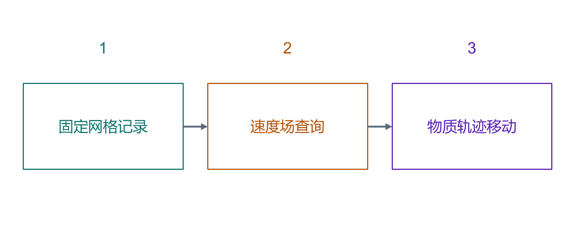

*读图：固定网格记录 → 速度场查询 → 物质轨迹移动。箭头表示本节的推理或处理顺序，具体条件见正文。*

### 先读符号与条件

| 符号 / 条件 | 含义 |
| --- | --- |
| u | 空间速度场 |
| x(t) | 某物质粒子轨迹 |
| 两者 | 场与轨迹不是同一个变量 |

### 核心关系与推导入口

以下关系使用上述条件；标为教学简化或补充的内容是为理解而推导，不是逐字转录课件。

$$
u=u(x,t),\qquad \frac{dx}{dt}=u(x(t),t)
$$

### 🔧 手算 1：把关系落到数字上

一维恒速场 u=2 m/s，粒子初始 x=1，0.3 秒后 x=1.6。固定位置 x=1 的网格仍在原处，只记录经过它的流体速度。

| 检查步骤 | 操作 |
| --- | --- |
| 输入 | 先从例子中抄下给定量及单位，不引入未给定的数值。 |
| 计算 | 按本节关系求中间量，再得到结果；不要在第一步就做显示裁剪或整数舍入。 |
| 回查 | 固定位置 x=1 的网格仍在原处，只记录经过它的流体速度。 |
| 适用边界 | 把网格单元位置当成流体粒子位置，会混淆平流与网格移动。 |

### ⚠️ 易错点：先识别症状与假设

把网格单元位置当成流体粒子位置，会混淆平流与网格移动。

### 停下来解释一次

**问题：Eulerian 模拟中的网格必须随水一起动吗？**

<details>
<summary>展开参考回答</summary>

不必，固定网格正是它的基本思路之一。

</details>

<details>
<summary>展开原课件关键页，对照术语与图形</summary>

#### Example: Fluids

*PDF p2 · 对应本节：为什么液体需要场的视角？*

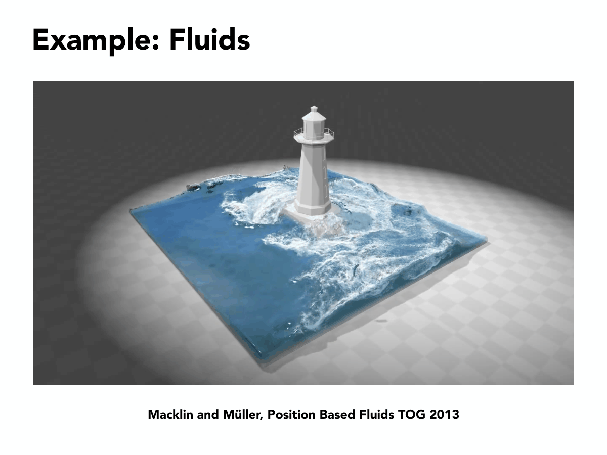

#### Problem Setup

*PDF p4 · 对应本节：为什么液体需要场的视角？*

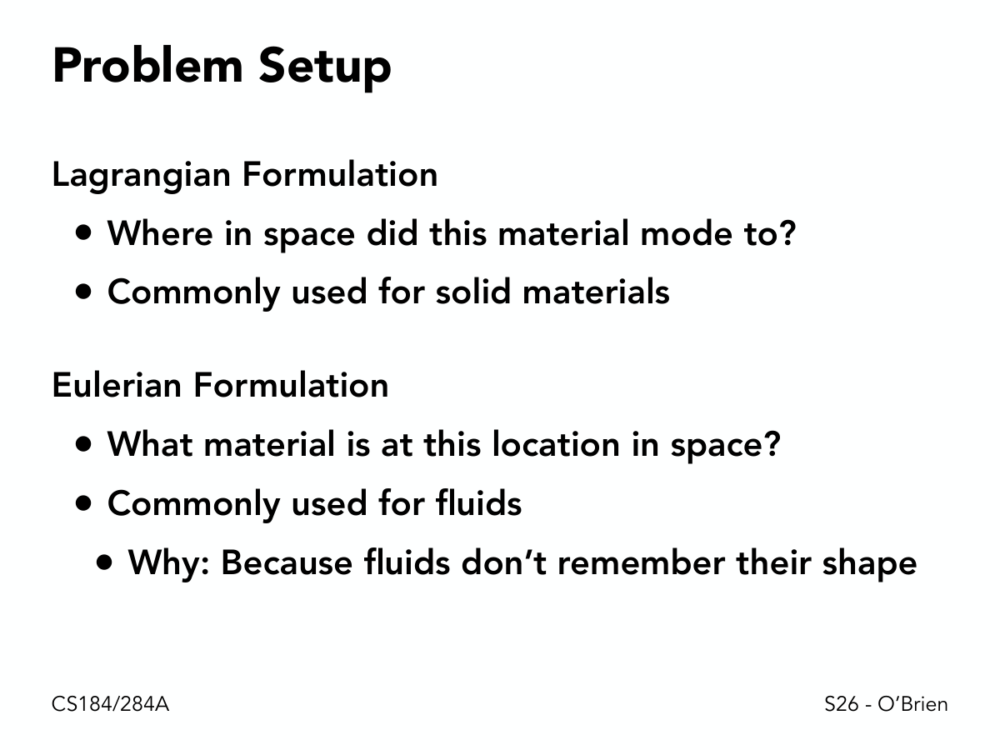

#### Problem Discretization

*PDF p5 · 对应本节：为什么液体需要场的视角？*

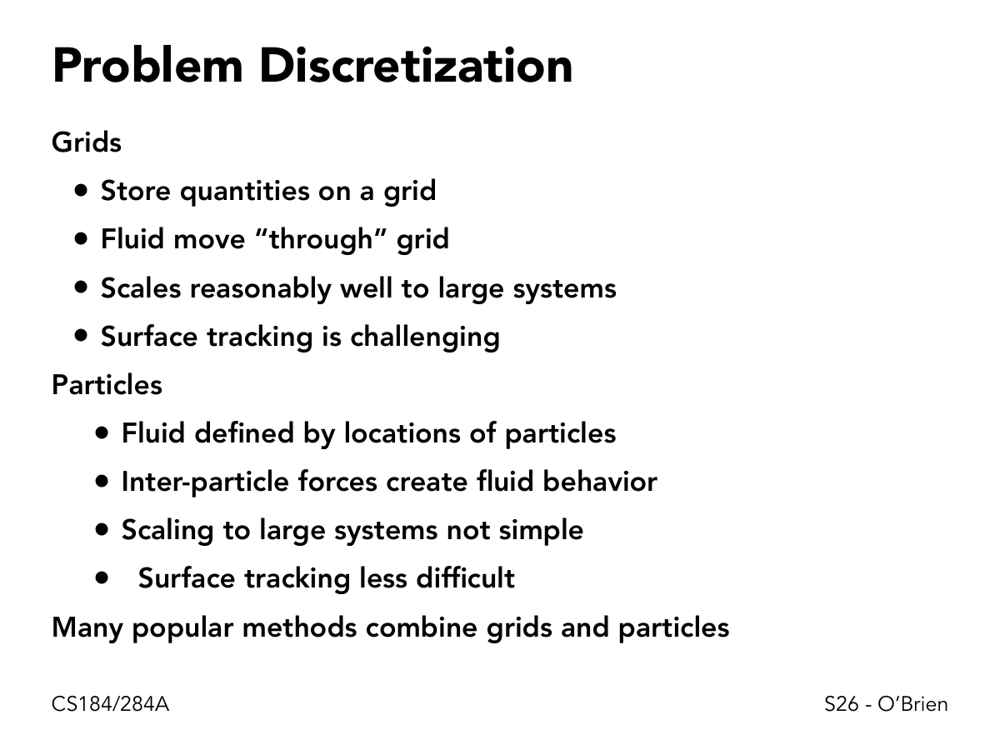

#### Fluid Grid

*PDF p6 · 对应本节：为什么液体需要场的视角？*

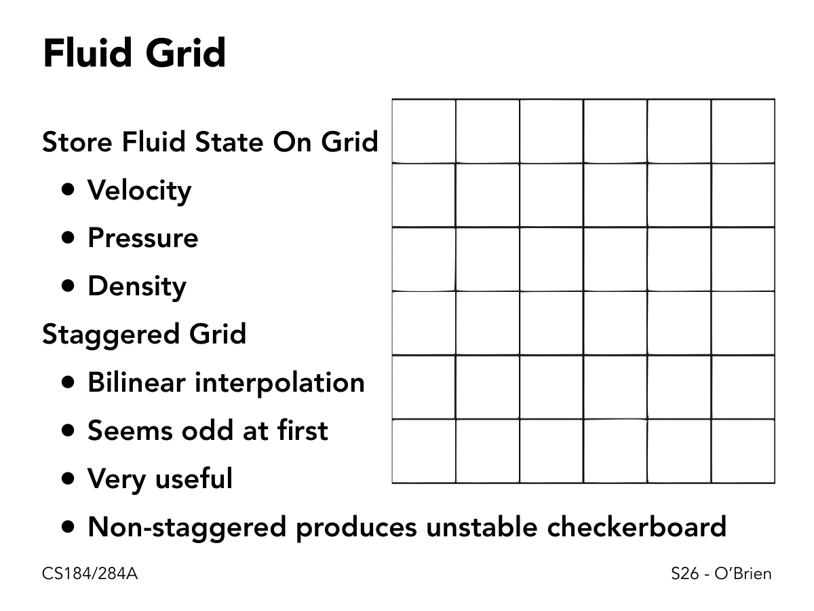

#### Fluid Grid

*PDF p8 · 对应本节：为什么液体需要场的视角？*

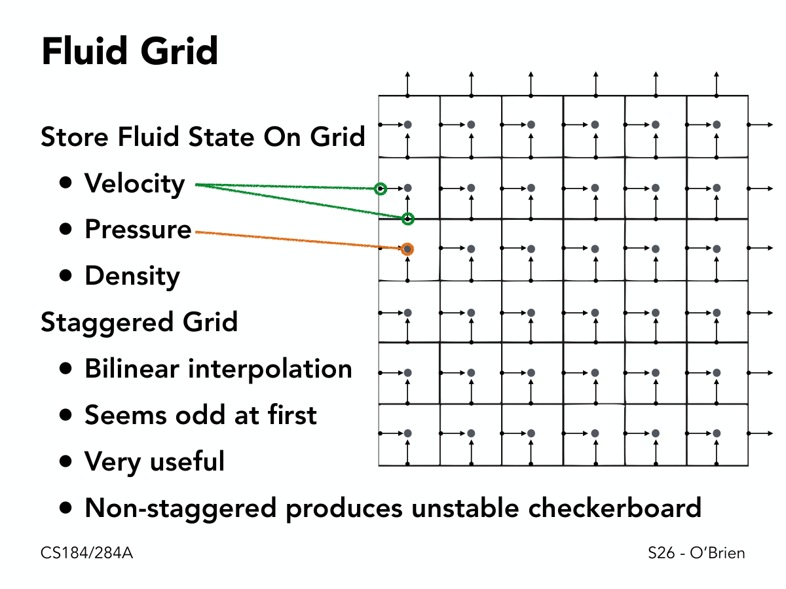

</details>

## 2. 交错网格为什么把速度放在面上？

压力适合放单元中心，法向速度分量适合放单元面，因为散度直接比较各面的流入流出。这样压力差与面速度修正能自然配对。

不是把完整速度向量全放在每一个面上：二维 u 分量位于竖直面，v 分量位于水平面。插值时必须考虑它们不同的采样位置。

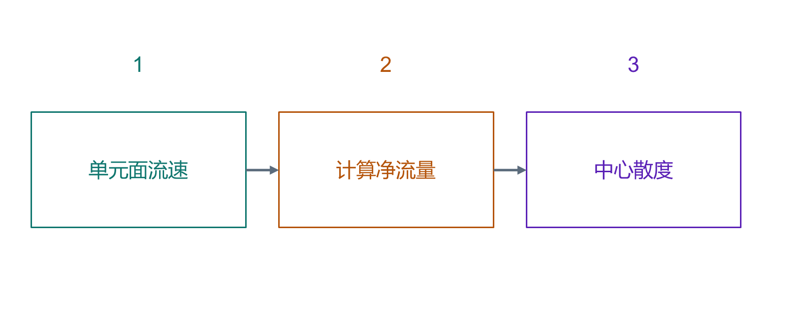

*读图：单元面流速 → 计算净流量 → 中心散度。箭头表示本节的推理或处理顺序，具体条件见正文。*

### 先读符号与条件

| 符号 / 条件 | 含义 |
| --- | --- |
| h | 方格边长 |
| uR,uL | 左右面法向速度 |
| vT,vB | 上下对应分量 |

### 核心关系与推导入口

以下关系使用上述条件；标为教学简化或补充的内容是为理解而推导，不是逐字转录课件。

$$
\nabla\cdot u\approx\frac{u_R-u_L+v_T-v_B}{h}
$$

### 🔧 手算 2：把关系落到数字上

h=1，右 3、左 1、上 2、下 2，散度为 2。若把右速度改为 1，净流出变零。

| 检查步骤 | 操作 |
| --- | --- |
| 输入 | 先从例子中抄下给定量及单位，不引入未给定的数值。 |
| 计算 | 按本节关系求中间量，再得到结果；不要在第一步就做显示裁剪或整数舍入。 |
| 回查 | 若把右速度改为 1，净流出变零。 |
| 适用边界 | 把面速度当中心值求差分会错位，压力投影可能留下棋盘纹或残余散度。 |

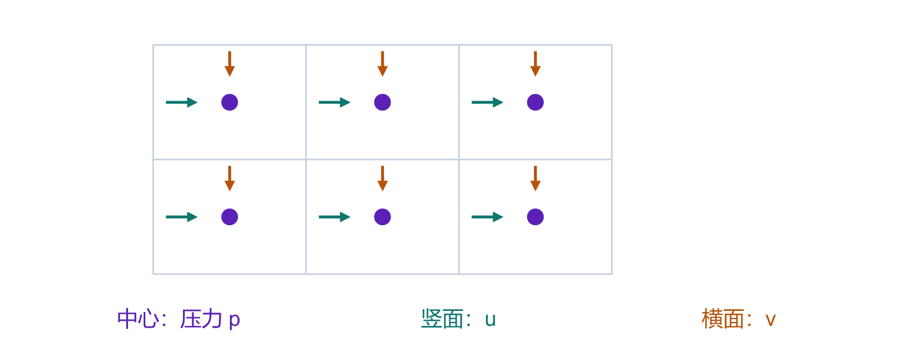

*交错网格把压力放中心，两个速度分量放对应单元面。*

### ⚠️ 易错点：先识别症状与假设

把面速度当中心值求差分会错位，压力投影可能留下棋盘纹或残余散度。

### 停下来解释一次

**问题：一个单元内速度不为零，散度能否为零？**

<details>
<summary>展开参考回答</summary>

能。流入与流出平衡即可，均匀平移就是例子。

</details>

<details>
<summary>展开原课件关键页，对照术语与图形</summary>

#### Fluid Grid

*PDF p6 · 对应本节：交错网格为什么把速度放在面上？*


#### Fluid Grid

*PDF p9 · 对应本节：交错网格为什么把速度放在面上？*

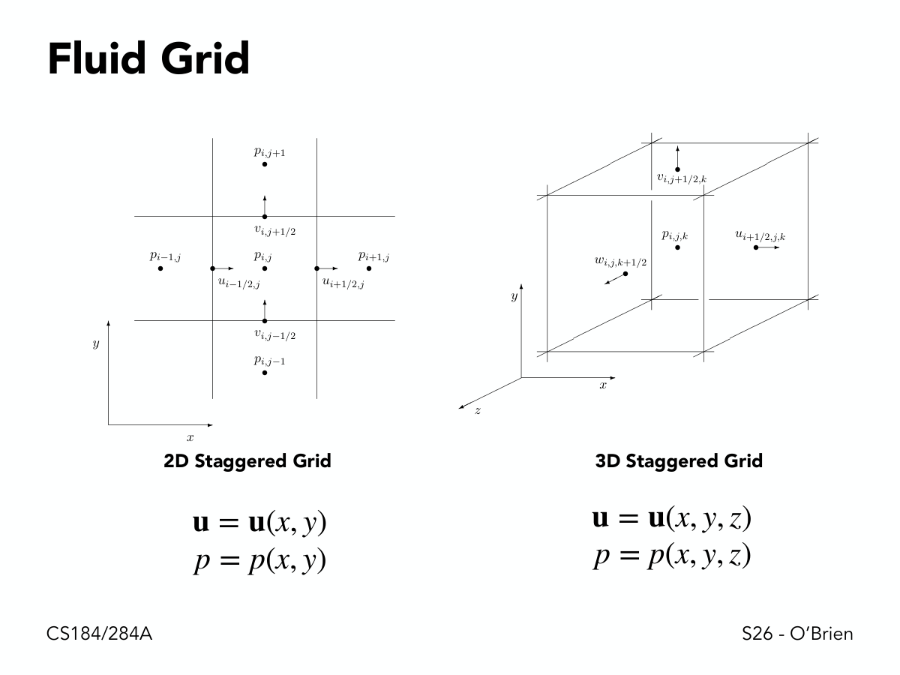

#### Fluid Grid

*PDF p10 · 对应本节：交错网格为什么把速度放在面上？*

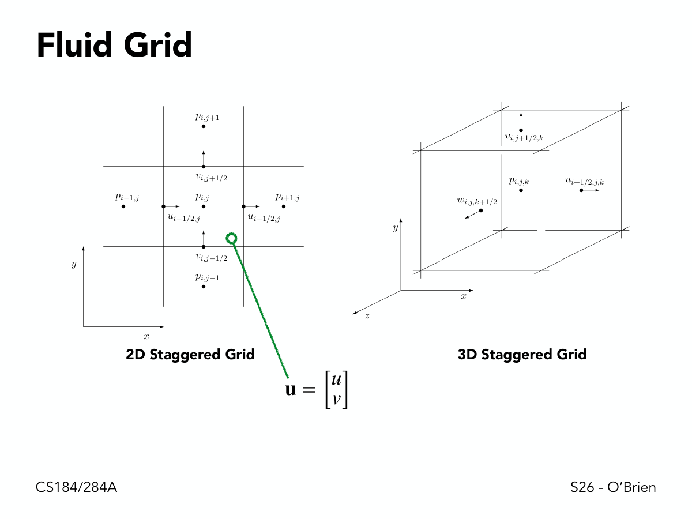

#### Fluid Grid

*PDF p11 · 对应本节：交错网格为什么把速度放在面上？*

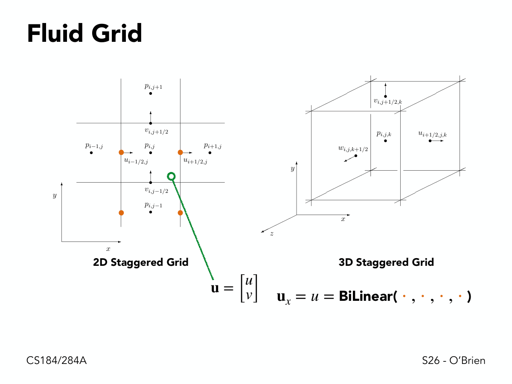

#### Fluid Grid

*PDF p12 · 对应本节：交错网格为什么把速度放在面上？*

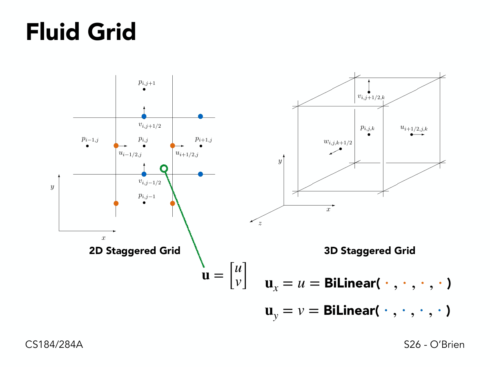

</details>

## 3. 梯度、散度、旋度分别问什么？

梯度把标量场变成指向最大增长方向的向量；散度问局部有没有净流出；旋度问局部是否有旋转趋势。三者不能只凭箭头图“看起来在动”互相替代。

拉普拉斯衡量相对邻域的变化，用于扩散和压力 Poisson 方程。二维旋度可用垂直平面的标量表示，不等于速度向量本身。

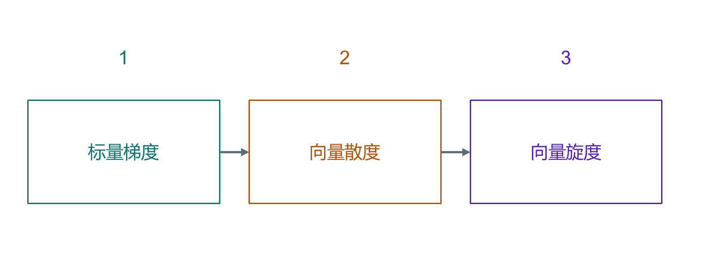

*读图：标量梯度 → 向量散度 → 向量旋度。箭头表示本节的推理或处理顺序，具体条件见正文。*

### 先读符号与条件

| 符号 / 条件 | 含义 |
| --- | --- |
| u | 二维速度场 |
| 散度与旋度 | 不同导数组合 |
| 坐标 | 本文 x 向右 y 向上 |

### 核心关系与推导入口

以下关系使用上述条件；标为教学简化或补充的内容是为理解而推导，不是逐字转录课件。

$$
\nabla\cdot u=\partial_xu_x+\partial_yu_y,\qquad (\nabla\times u)_z=\partial_xu_y-\partial_yu_x
$$

### 🔧 手算 3：把关系落到数字上

u=(-y,x)，散度为 0+0=0，旋度为 1-(-1)=2。它能旋转却不膨胀，直接反驳“旋转就是散度”。

| 检查步骤 | 操作 |
| --- | --- |
| 输入 | 先从例子中抄下给定量及单位，不引入未给定的数值。 |
| 计算 | 按本节关系求中间量，再得到结果；不要在第一步就做显示裁剪或整数舍入。 |
| 回查 | 它能旋转却不膨胀，直接反驳“旋转就是散度”。 |
| 适用边界 | 压力梯度是向量，压力拉普拉斯是标量；这个类型检查能发现课件后面的笔误。 |

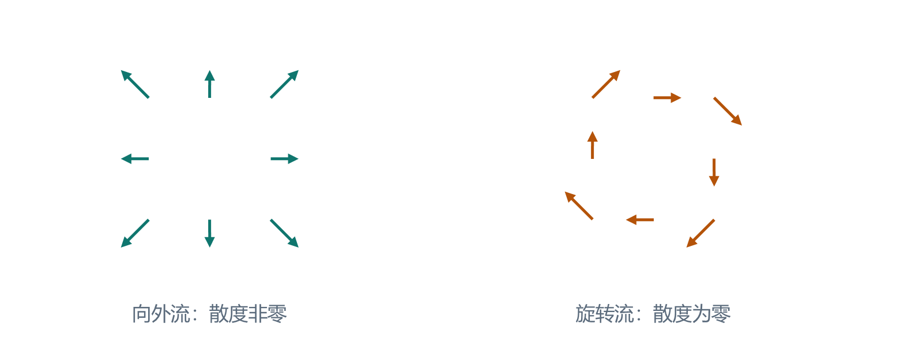

*旋转与膨胀是不同导数性质，旋涡可以满足不可压缩约束。*

### ⚠️ 易错点：先识别症状与假设

压力梯度是向量，压力拉普拉斯是标量；这个类型检查能发现课件后面的笔误。

### 停下来解释一次

**问题：不可压缩流能否有旋涡？**

<details>
<summary>展开参考回答</summary>

能。不可压缩约束是散度为零，不是旋度为零。

</details>

<details>
<summary>展开原课件关键页，对照术语与图形</summary>

#### Vector Fields

*PDF p13 · 对应本节：梯度、散度、旋度分别问什么？*

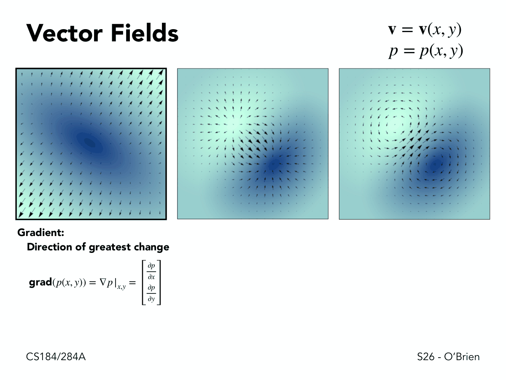

#### Vector Fields

*PDF p14 · 对应本节：梯度、散度、旋度分别问什么？*

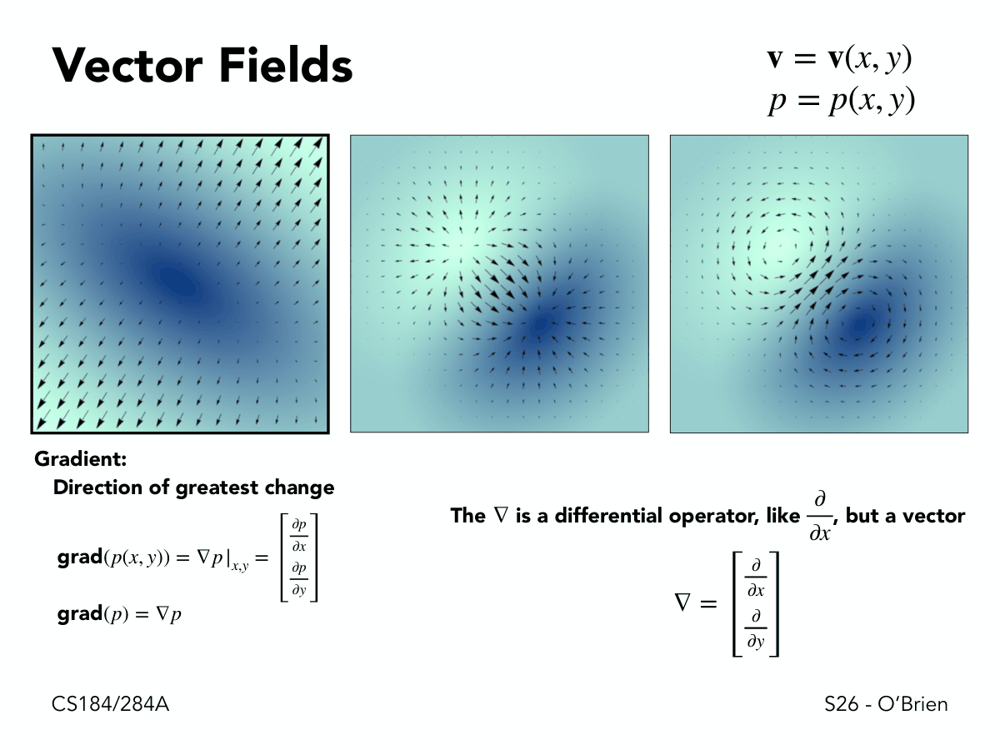

#### Vector Fields

*PDF p15 · 对应本节：梯度、散度、旋度分别问什么？*

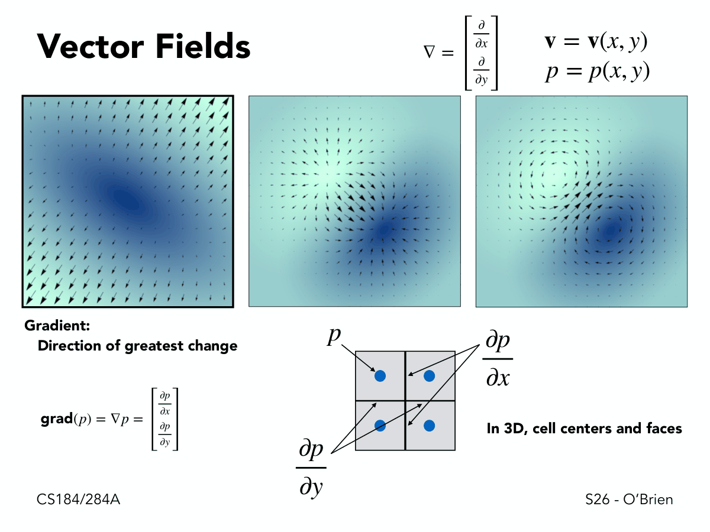

#### Vector Fields

*PDF p16 · 对应本节：梯度、散度、旋度分别问什么？*

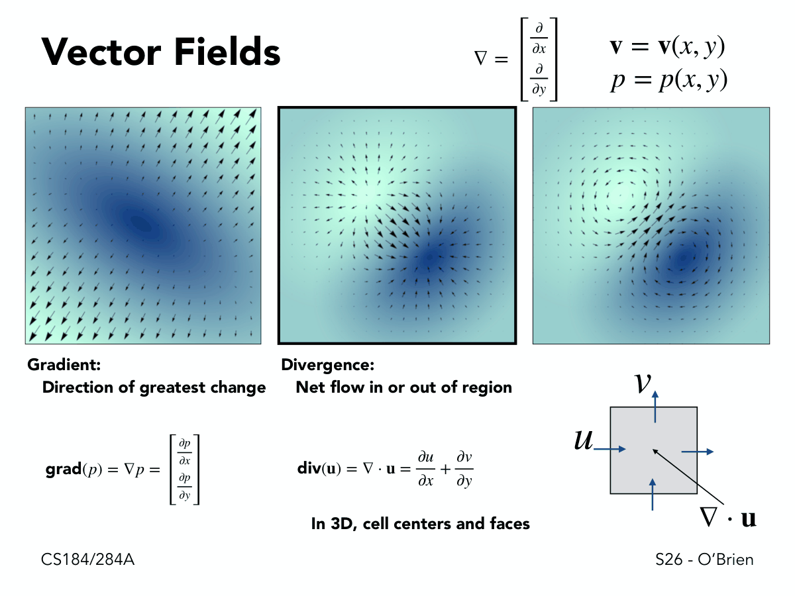

#### Vector Fields

*PDF p17 · 对应本节：梯度、散度、旋度分别问什么？*

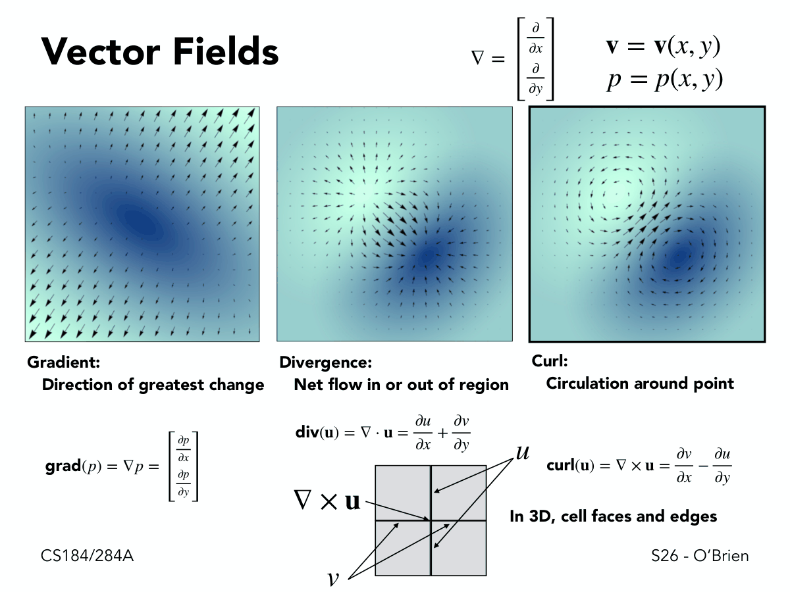

#### Vector Fields

*PDF p18 · 对应本节：梯度、散度、旋度分别问什么？*

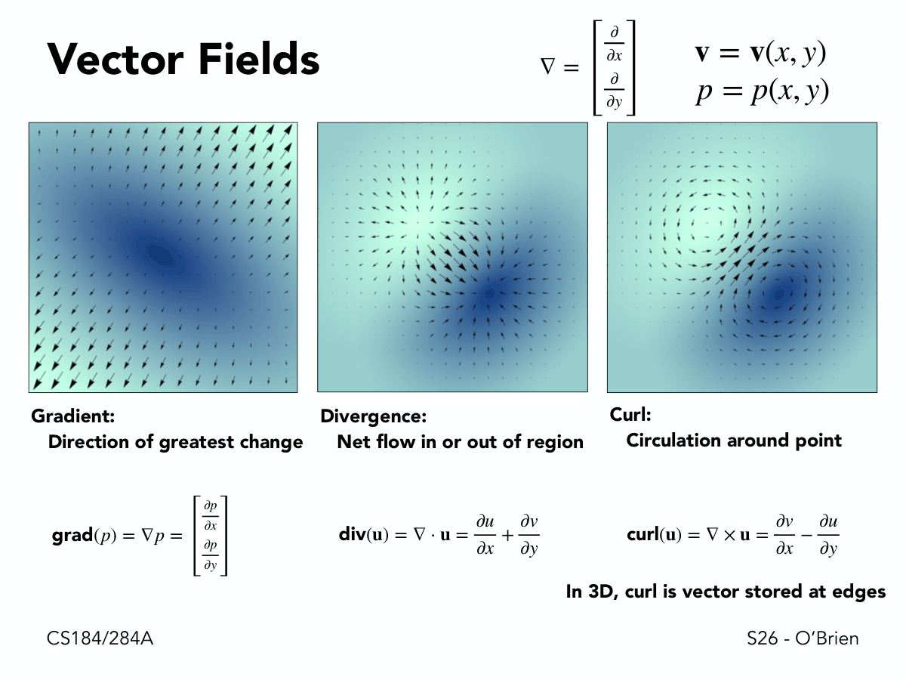

#### Vector Fields

*PDF p19 · 对应本节：梯度、散度、旋度分别问什么？*

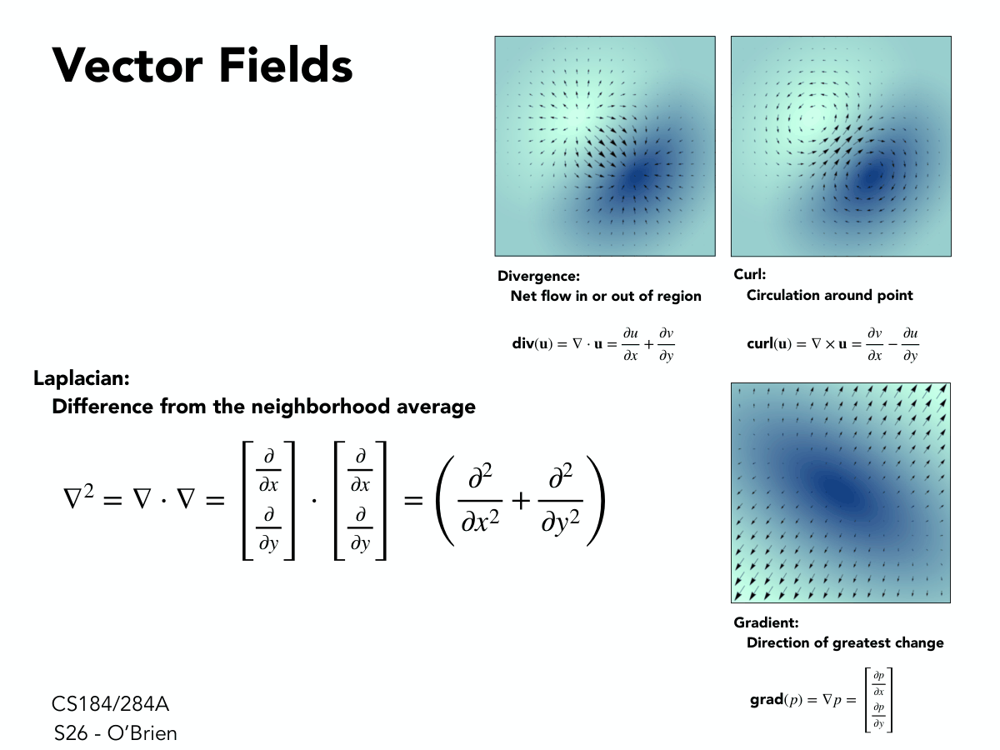

</details>

## 4. Navier–Stokes 每一项在做什么？

速度变化由平流、压力、黏性和外力共同组成。平流搬运已有速度，压力推动流体，黏性平滑速度差，重力等外力提供加速度。

课件以 ν 表示黏性并在式中再除 ρ；常见资料又用 ν 表示运动黏度。本文统一使用 μ 为动力黏度、ν=μ/ρ 为运动黏度，避免同符号不同定义。

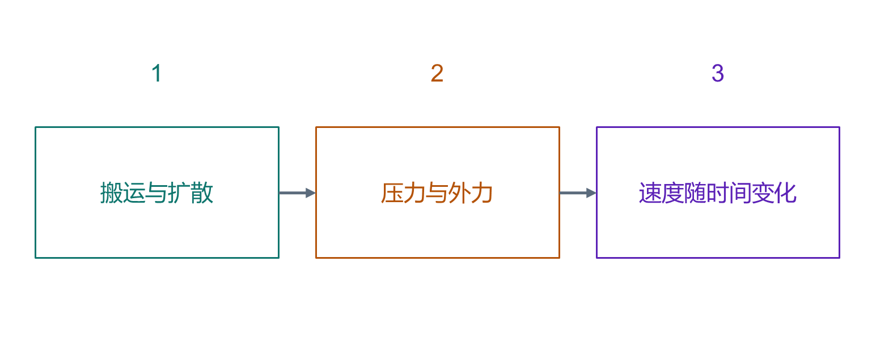

*读图：搬运与扩散 → 压力与外力 → 速度随时间变化。箭头表示本节的推理或处理顺序，具体条件见正文。*

### 先读符号与条件

| 符号 / 条件 | 含义 |
| --- | --- |
| rho | 质量密度 |
| p | 压力 |
| nu | 运动黏度 m²/s |
| f | 单位质量外力，即加速度 |

### 核心关系与推导入口

以下关系使用上述条件；标为教学简化或补充的内容是为理解而推导，不是逐字转录课件。

$$
\partial_tu=-(u\cdot\nabla)u-\frac1\rho\nabla p+\nu\nabla^2u+f
$$

### 🔧 手算 4：把关系落到数字上

只有恒定外力 f=(0,-10)、h=0.1 秒，速度从 (1,0) 变为 (1,-1)。变化除以步长恢复 (0,-10)。

| 检查步骤 | 操作 |
| --- | --- |
| 输入 | 先从例子中抄下给定量及单位，不引入未给定的数值。 |
| 计算 | 按本节关系求中间量，再得到结果；不要在第一步就做显示裁剪或整数舍入。 |
| 回查 | 变化除以步长恢复 (0,-10)。 |
| 适用边界 | 如果 f 已经是加速度，不要再除密度；若存的是单位体积力，则需要除 ρ。 |

### ⚠️ 易错点：先识别症状与假设

如果 f 已经是加速度，不要再除密度；若存的是单位体积力，则需要除 ρ。

### 停下来解释一次

**问题：不可压缩是否意味着流体静止？**

<details>
<summary>展开参考回答</summary>

不是，它约束体积变化，而非速度大小。

</details>

<details>
<summary>展开原课件关键页，对照术语与图形</summary>

#### Navier–Stokes Equations (N-SE)

*PDF p21 · 对应本节：Navier–Stokes 每一项在做什么？*

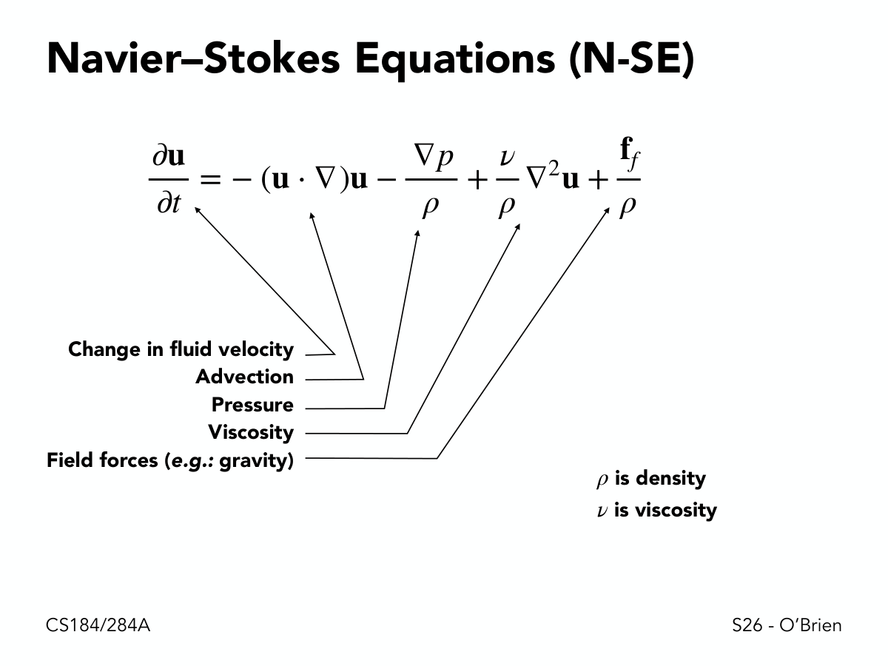

#### Bad Solver

*PDF p22 · 对应本节：Navier–Stokes 每一项在做什么？*

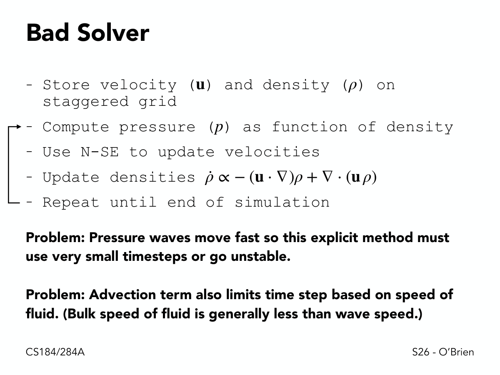

#### Incompressible Fluids

*PDF p24 · 对应本节：Navier–Stokes 每一项在做什么？*

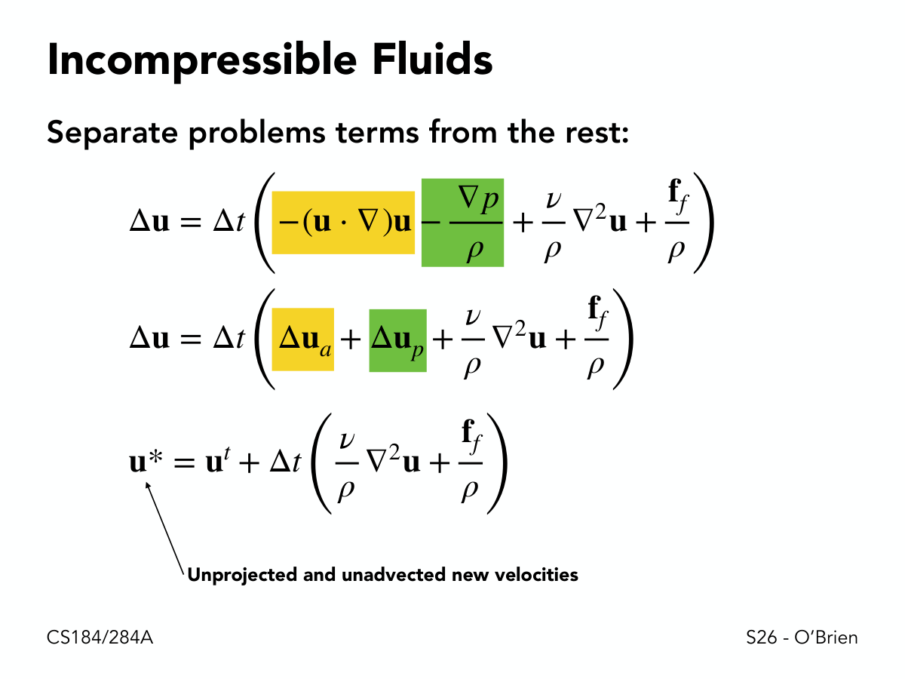

</details>

## 5. 平流为什么可以沿轨迹回溯？

固定目标网格位置，向过去回溯一小步找到流体从哪里来，再读取旧场的值。这是半拉格朗日方法的核心：固定输出位置，追随输入物质。

每个目标都能得到值，避免简单前向搬运出现空洞；但插值带来数值扩散。追踪速度和被搬运字段要来自一致时刻，不能边写边读污染旧状态。

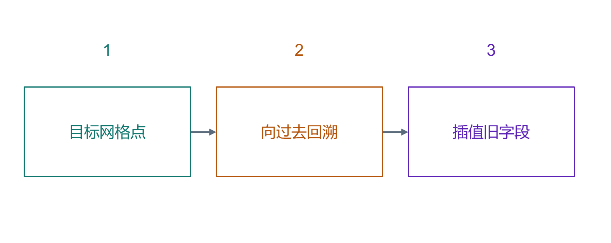

*读图：目标网格点 → 向过去回溯 → 插值旧字段。箭头表示本节的推理或处理顺序，具体条件见正文。*

### 先读符号与条件

| 符号 / 条件 | 含义 |
| --- | --- |
| q | 烟雾浓度、温度或速度分量 |
| h | 时间步长 |
| 回溯 | 这里是一阶近似 |

### 核心关系与推导入口

以下关系使用上述条件；标为教学简化或补充的内容是为理解而推导，不是逐字转录课件。

$$
q^{n+1}(x)\approx q^n(x-hu^n(x))
$$

### 🔧 手算 5：把关系落到数字上

一维目标 x=2，速度 0.5，步长 1，回溯到 1.5。若旧 q(1)=2、q(2)=4，线性插值得 3；回查权重各 1/2。

| 检查步骤 | 操作 |
| --- | --- |
| 输入 | 先从例子中抄下给定量及单位，不引入未给定的数值。 |
| 计算 | 按本节关系求中间量，再得到结果；不要在第一步就做显示裁剪或整数舍入。 |
| 回查 | 若旧 q(1)=2、q(2)=4，线性插值得 3；回查权重各 1/2。 |
| 适用边界 | 把回溯写成 x+hu 会反向搬运；用匀速平移一团烟的测试即可发现。 |

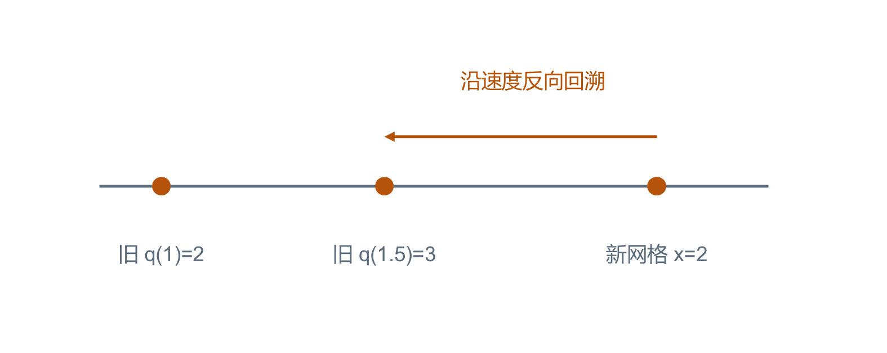

*目标位置回溯到旧时刻的来源，再插值旧字段。*

### ⚠️ 易错点：先识别症状与假设

把回溯写成 x+hu 会反向搬运；用匀速平移一团烟的测试即可发现。

### 停下来解释一次

**问题：半拉格朗日方法为什么会让烟越算越糊？**

<details>
<summary>展开参考回答</summary>

反复插值会衰减高频细节，即使不显式加入黏性也存在数值扩散。

</details>

<details>
<summary>展开原课件关键页，对照术语与图形</summary>

#### Semi-Lagrangian Advection

*PDF p30 · 对应本节：平流为什么可以沿轨迹回溯？*

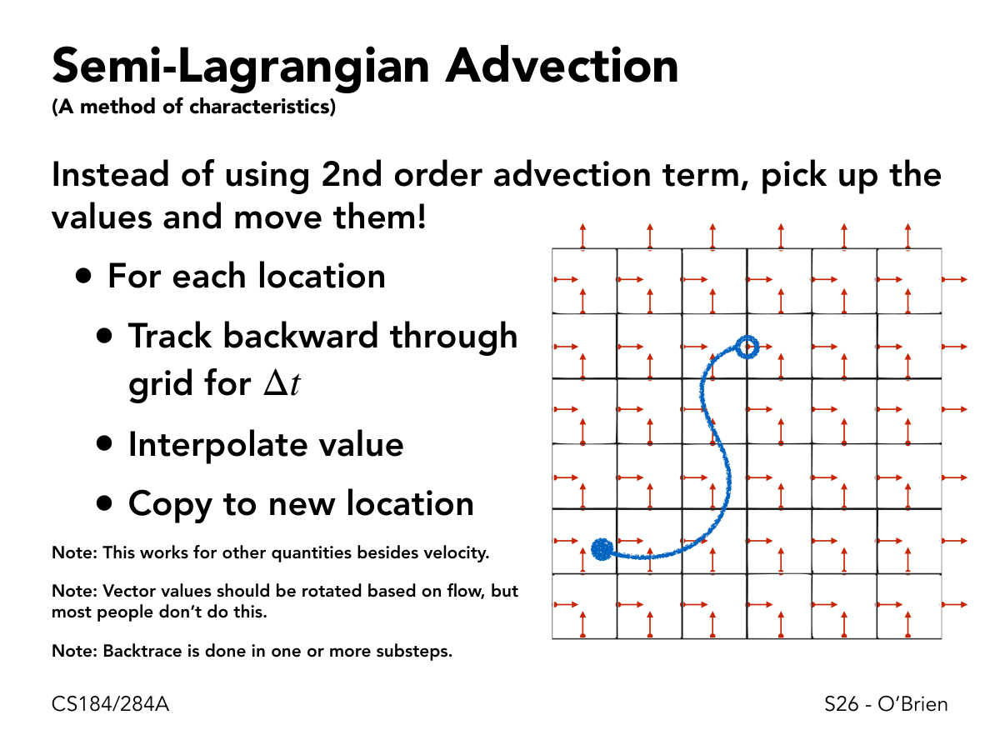

#### Semi-Lagrangian Advection

*PDF p31 · 对应本节：平流为什么可以沿轨迹回溯？*

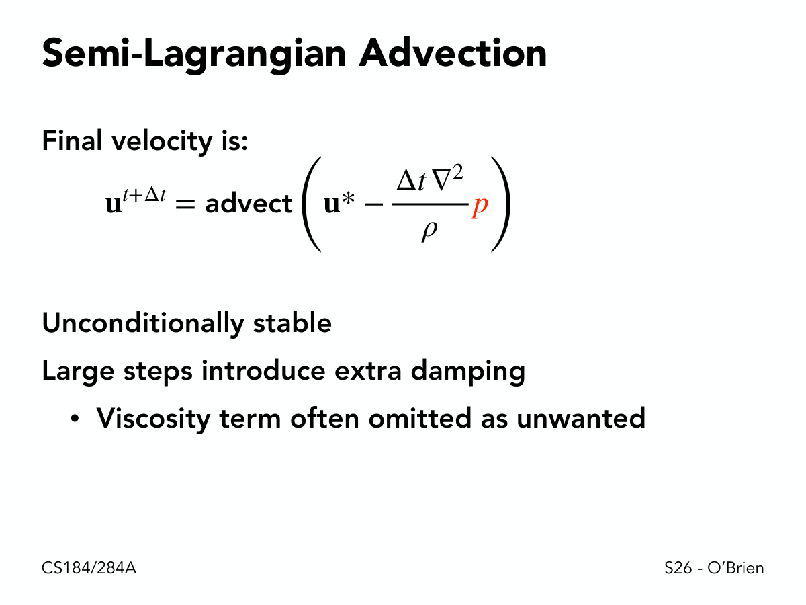

</details>

## 6. 不可压缩为何变成压力约束？

先算不满足约束的临时速度 u*，再减去压力梯度，使最终速度散度为零。压力在这里充当满足体积约束的修正，而非任意附加的颜色或标量。

将速度修正式代入散度条件，就得到压力 Poisson 方程。密度常数才能把 1/ρ 从导数外提出；变密度问题需保留系数。

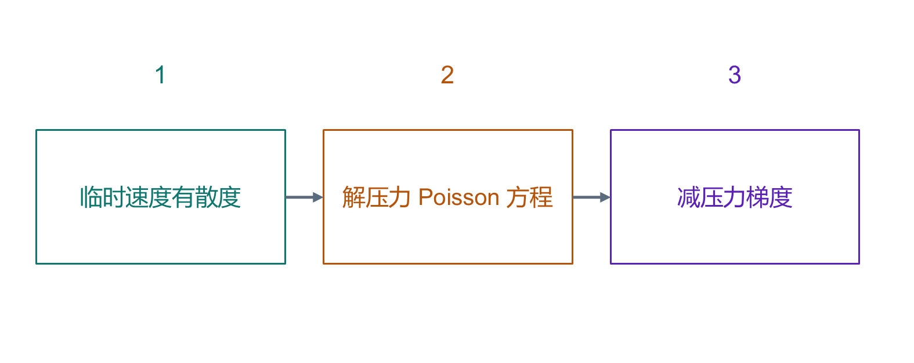

*读图：临时速度有散度 → 解压力 Poisson 方程 → 减压力梯度。箭头表示本节的推理或处理顺序，具体条件见正文。*

### 先读符号与条件

| 符号 / 条件 | 含义 |
| --- | --- |
| u* | 临时速度 |
| u' | 投影后速度 |
| h | 时间步长 |
| 条件 | rho 常数 |

### 核心关系与推导入口

以下关系使用上述条件；标为教学简化或补充的内容是为理解而推导，不是逐字转录课件。

$$
u'=u^*-\frac h\rho\nabla p,\qquad \nabla^2p=\frac\rho h\nabla\cdot u^*
$$

### 🔧 手算 6：把关系落到数字上

ρ=2、h=0.5、临时散度 3，则压力拉普拉斯需为 12。代回新散度 3-(0.5/2)×12=0。

| 检查步骤 | 操作 |
| --- | --- |
| 输入 | 先从例子中抄下给定量及单位，不引入未给定的数值。 |
| 计算 | 按本节关系求中间量，再得到结果；不要在第一步就做显示裁剪或整数舍入。 |
| 回查 | 代回新散度 3-(0.5/2)×12=0。 |
| 适用边界 | 这里求得的是压力的空间分布，不是逐单元独立减一个常数速度。 |

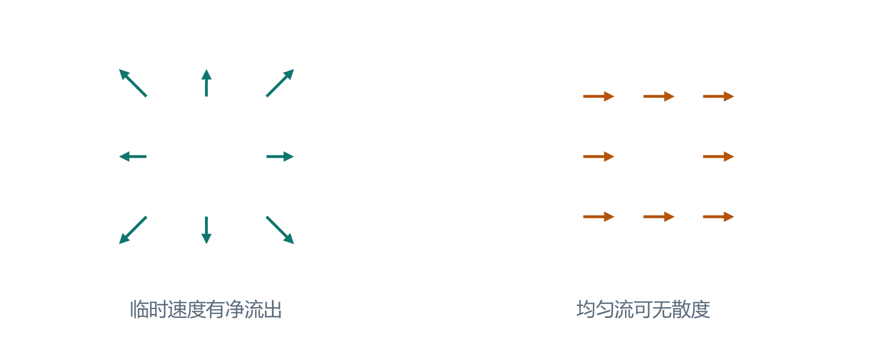

*压力投影消除散度，不是把整个速度场清零；左右仅示意两类场。*

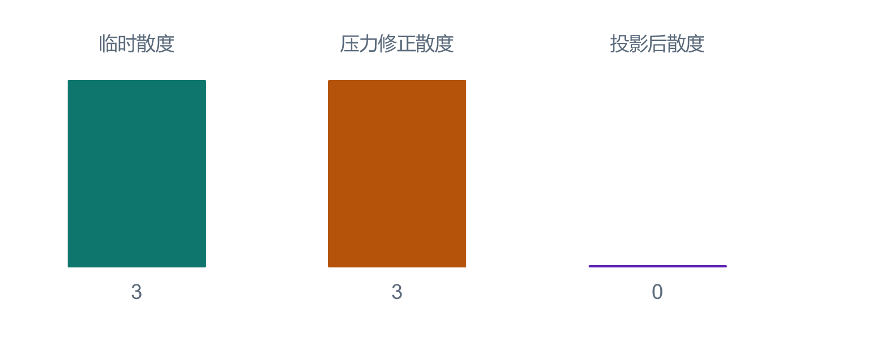

*正文数值例为 3-3=0，最后一列在基线上标记精确零。*

### ⚠️ 易错点：先识别症状与假设

这里求得的是压力的空间分布，不是逐单元独立减一个常数速度。

### 停下来解释一次

**问题：压力投影为何涉及全局求解？**

<details>
<summary>展开参考回答</summary>

相邻单元共享面流量，修正一个单元会影响邻居，约束是耦合的。

</details>

<details>
<summary>展开原课件关键页，对照术语与图形</summary>

#### Incompressible Fluids

*PDF p23 · 对应本节：不可压缩为何变成压力约束？*

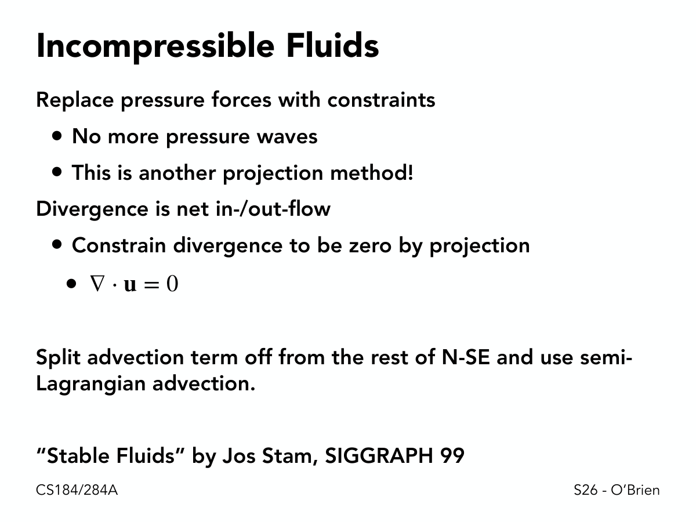

#### Incompressible Fluids

*PDF p24 · 对应本节：不可压缩为何变成压力约束？*


#### Incompressible Fluids

*PDF p25 · 对应本节：不可压缩为何变成压力约束？*

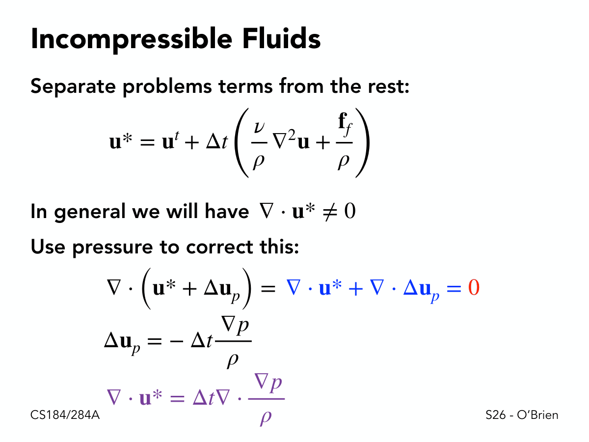

#### Incompressible Fluids

*PDF p26 · 对应本节：不可压缩为何变成压力约束？*

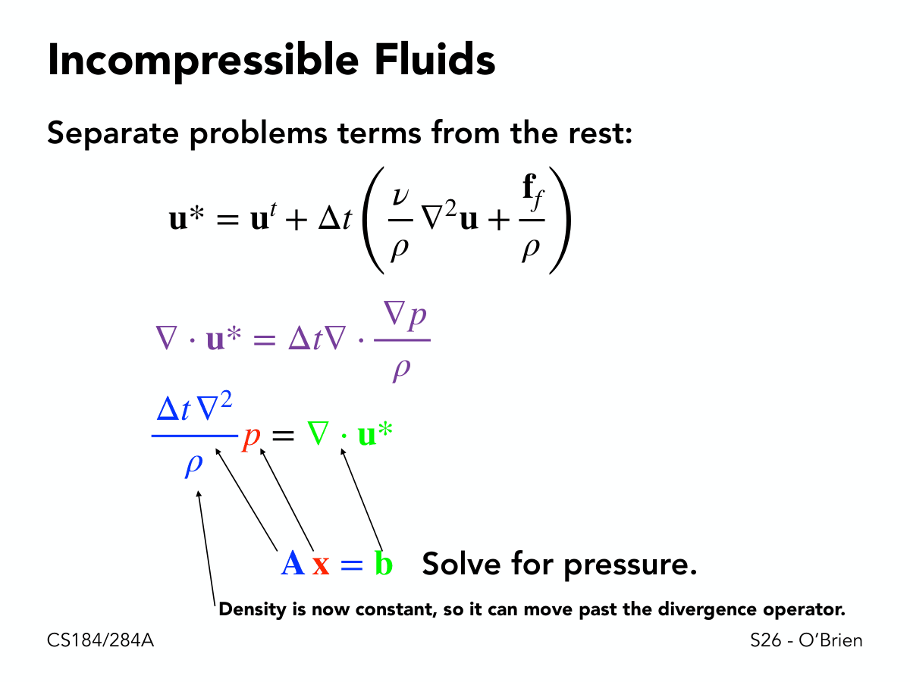

</details>

## 7. 课件压力修正式哪里需要订正？

原页 p27 与 p31 的速度修正项写成 ∇²p，但速度是向量、∇²p 是标量，类型与单位都不匹配。由 p26 的散度方程回推，应当减 ∇p。

保留原页是为了可核对，不意味着照抄其笔误。判断方法是先写动量方程，再取散度，而不是把已经取过散度的式子直接当成速度更新。


*读图：动量方程用梯度 → 取散度得到拉普拉斯 → 解后仍用梯度修速度。箭头表示本节的推理或处理顺序，具体条件见正文。*

### 先读符号与条件

| 符号 / 条件 | 含义 |
| --- | --- |
| gradient | 一阶空间导数，向量 |
| Laplacian | 二阶导数组合，标量 |
| 证据 | 原页截图与方程推导 |

### 核心关系与推导入口

以下关系使用上述条件；标为教学简化或补充的内容是为理解而推导，不是逐字转录课件。

$$
\underbrace{u'}_{\text{vector}}=\underbrace{u^*}_{\text{vector}}-\frac h\rho\underbrace{\nabla p}_{\text{vector}}
$$

### 🔧 手算 7：把关系落到数字上

p(x,y)=x²+y²，在 (1,2) 梯度为 (2,4)，拉普拉斯为 4。若 h/ρ=0.1，速度应减 (0.2,0.4)，不能减标量 0.4。

| 检查步骤 | 操作 |
| --- | --- |
| 输入 | 先从例子中抄下给定量及单位，不引入未给定的数值。 |
| 计算 | 按本节关系求中间量，再得到结果；不要在第一步就做显示裁剪或整数舍入。 |
| 回查 | 若 h/ρ=0.1，速度应减 (0.2,0.4)，不能减标量 0.4。 |
| 适用边界 | 代码中若把 scalar 自动广播到两个速度分量，程序可能不报错，但物理方向完全错误。 |

### ⚠️ 易错点：先识别症状与假设

代码中若把 scalar 自动广播到两个速度分量，程序可能不报错，但物理方向完全错误。

### 停下来解释一次

**问题：为什么量纲和向量类型都要检查？**

<details>
<summary>展开参考回答</summary>

单位一致仍可能方向类型错误；两个检查相互补充。

</details>

<details>
<summary>展开原课件关键页，对照术语与图形</summary>

#### Incompressible Fluids

*PDF p26 · 对应本节：课件压力修正式哪里需要订正？*


#### Incompressible Fluids

*PDF p27 · 对应本节：课件压力修正式哪里需要订正？*

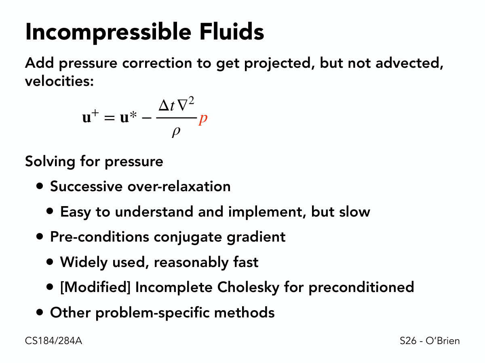

#### Incompressible Fluids

*PDF p28 · 对应本节：课件压力修正式哪里需要订正？*

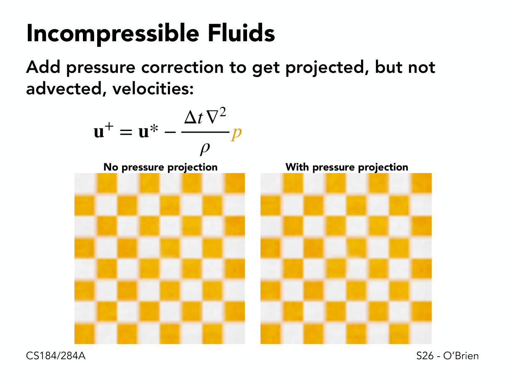

#### Semi-Lagrangian Advection

*PDF p31 · 对应本节：课件压力修正式哪里需要订正？*


</details>

## 8. Poisson 方程离散后怎样求解？

规则网格用相邻压力差近似拉普拉斯，所有单元组成稀疏线性系统。Jacobi、SOR、共轭梯度等方法解决的是同一耦合约束，效率与适用条件不同。

纯 Neumann 边界下压力可差一个常数，需要固定参考或去均值，并检查兼容条件。不能把任意矩阵都交给要求对称正定的求解器。

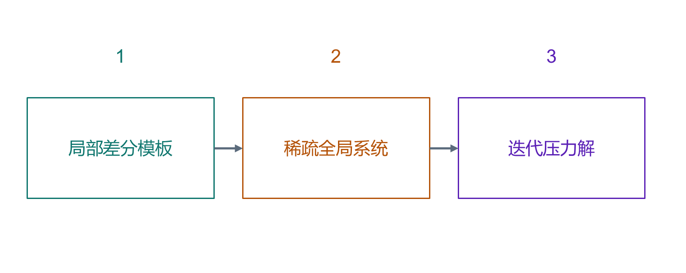

*读图：局部差分模板 → 稀疏全局系统 → 迭代压力解。箭头表示本节的推理或处理顺序，具体条件见正文。*

### 先读符号与条件

| 符号 / 条件 | 含义 |
| --- | --- |
| hx | 网格空间步长，区别于时间 h |
| b | rho/h 乘散度 |
| 中心 | 二维五点模板 |

### 核心关系与推导入口

以下关系使用上述条件；标为教学简化或补充的内容是为理解而推导，不是逐字转录课件。

$$
\frac{p_L+p_R+p_T+p_B-4p_C}{h_x^2}=b_C
$$

### 🔧 手算 8：把关系落到数字上

hx=1，邻居压力全为 2，b=0，则中心应为 2。代回 2+2+2+2-4×2=0；若中心为 1，残差为 4。

| 检查步骤 | 操作 |
| --- | --- |
| 输入 | 先从例子中抄下给定量及单位，不引入未给定的数值。 |
| 计算 | 按本节关系求中间量，再得到结果；不要在第一步就做显示裁剪或整数舍入。 |
| 回查 | 代回 2+2+2+2-4×2=0；若中心为 1，残差为 4。 |
| 适用边界 | 残差小不代表边界正确；压力常数零空间与不通量条件必须显式处理。 |


*二维压力拉普拉斯的五点模板，中心与邻居共同构成耦合方程。*

### ⚠️ 易错点：先识别症状与假设

残差小不代表边界正确；压力常数零空间与不通量条件必须显式处理。

### 停下来解释一次

**问题：为什么所有压力加同一个常数不改变速度修正？**

<details>
<summary>展开参考回答</summary>

因为常数的梯度为零，速度只依赖压力差。

</details>

<details>
<summary>展开原课件关键页，对照术语与图形</summary>

#### Incompressible Fluids

*PDF p26 · 对应本节：Poisson 方程离散后怎样求解？*


#### Incompressible Fluids

*PDF p27 · 对应本节：Poisson 方程离散后怎样求解？*


</details>

## 9. “稳定流体”是否就不会损失体积？

半拉格朗日插值通常具有良好的幅值稳定性，但大步会增加扩散，且不自动保证严格质量守恒。压力投影与平流拆分顺序也影响最后的散度。

课件先投影再平流的示意应按其流程理解；实现若在平流后再次投影，则应说明是另一种常见分裂安排。稳定只说明不容易数值爆炸，不等于精确输运。

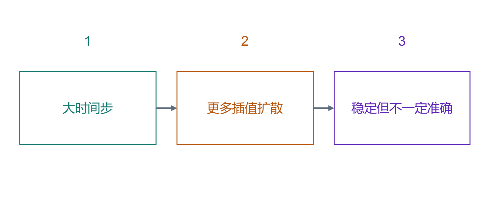

*读图：大时间步 → 更多插值扩散 → 稳定但不一定准确。箭头表示本节的推理或处理顺序，具体条件见正文。*

### 先读符号与条件

| 符号 / 条件 | 含义 |
| --- | --- |
| w | 插值权重 |
| 凸组合 | 保持值在邻域范围内 |
| 注意 | 不等于全域总量守恒 |

### 核心关系与推导入口

以下关系使用上述条件；标为教学简化或补充的内容是为理解而推导，不是逐字转录课件。

$$
q'=\sum_i w_iq_i,\qquad w_i\ge0,\quad\sum_iw_i=1
$$

### 🔧 手算 9：把关系落到数字上

q 为 0 和 1，权重 0.25、0.75，则 q'=0.75，不超出 [0,1]。但多个目标可能重复采同一旧区域，全局和不能由此保证。

| 检查步骤 | 操作 |
| --- | --- |
| 输入 | 先从例子中抄下给定量及单位，不引入未给定的数值。 |
| 计算 | 按本节关系求中间量，再得到结果；不要在第一步就做显示裁剪或整数舍入。 |
| 回查 | 但多个目标可能重复采同一旧区域，全局和不能由此保证。 |
| 适用边界 | 把“不会产生新极值”当作“不会损失质量”是不同性质的混淆。 |

### ⚠️ 易错点：先识别症状与假设

把“不会产生新极值”当作“不会损失质量”是不同性质的混淆。

### 停下来解释一次

**问题：减小时间步能否自动消除所有数值扩散？**

<details>
<summary>展开参考回答</summary>

不能自动保证，插值格式、网格分辨率和误差补偿方法也影响扩散。

</details>

<details>
<summary>展开原课件关键页，对照术语与图形</summary>

#### Semi-Lagrangian Advection

*PDF p31 · 对应本节：“稳定流体”是否就不会损失体积？*


#### Stable Fluids

*PDF p32 · 对应本节：“稳定流体”是否就不会损失体积？*

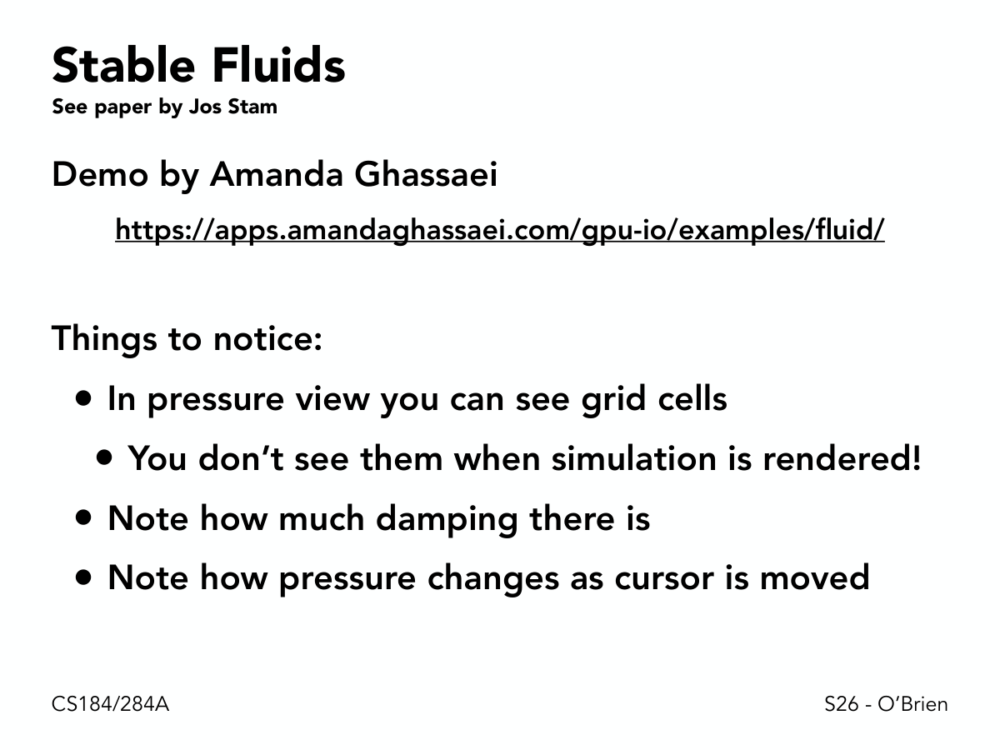

</details>

## 10. 边界条件为何决定水会不会穿墙？

固体壁面需要控制法向速度，开放边界与自由表面的压力条件也不同。散度模板必须与边界面实际通量配套，否则内部求解再精确也会漏水或抽水。

这部分是从课件投影框架补充的实现说明，原课件没有完整列出所有边界算法。先做封闭箱子、单入口出口，再做复杂障碍物，便于分离边界错误。


*读图：识别固体面 → 限制法向通量 → 匹配压力边界。箭头表示本节的推理或处理顺序，具体条件见正文。*

### 先读符号与条件

| 符号 / 条件 | 含义 |
| --- | --- |
| n | 壁面法线 |
| uwall | 壁面速度 |
| 条件 | 不可穿透，切向条件需另定 |

### 核心关系与推导入口

以下关系使用上述条件；标为教学简化或补充的内容是为理解而推导，不是逐字转录课件。

$$
u\cdot n=u_{wall}\cdot n
$$

### 🔧 手算 10：把关系落到数字上

静止墙 n=(1,0)，流体速度 (2,3)，法向分量应修为 0，得到 (0,3) 是自由滑移示意；不能把两分量都置零当作同一边界。

| 检查步骤 | 操作 |
| --- | --- |
| 输入 | 先从例子中抄下给定量及单位，不引入未给定的数值。 |
| 计算 | 按本节关系求中间量，再得到结果；不要在第一步就做显示裁剪或整数舍入。 |
| 回查 | 静止墙 n=(1,0)，流体速度 (2,3)，法向分量应修为 0，得到 (0,3) 是自由滑移示意；不能把两分量都置零当作同一边界。 |
| 适用边界 | 无滑移与自由滑移不同；错误混用会改变涡量与耗散。 |

### ⚠️ 易错点：先识别症状与假设

无滑移与自由滑移不同；错误混用会改变涡量与耗散。

### 停下来解释一次

**问题：静止墙附近切向速度一定是零吗？**

<details>
<summary>展开参考回答</summary>

要看采用的物理边界模型；无滑移是零，自由滑移则不要求。

</details>

<details>
<summary>展开原课件关键页，对照术语与图形</summary>

#### Problem Discretization

*PDF p5 · 对应本节：边界条件为何决定水会不会穿墙？*


#### Incompressible Fluids

*PDF p23 · 对应本节：边界条件为何决定水会不会穿墙？*


#### Incompressible Fluids

*PDF p27 · 对应本节：边界条件为何决定水会不会穿墙？*


</details>

## 11. 黏弹性为什么既像固体又像流体？

理想弹性保存可恢复形变，理想流体可以持续流动，塑性在屈服后留下永久形变。黏弹性模型需要保存额外应变状态，再让它随流体输运并贡献应力。

课件后半是 284A 扩展概览，包含屈服、塑性流动与热效应。基础笔记重点解释状态与机制，不把简化一维式子当成完整三维本构模型。

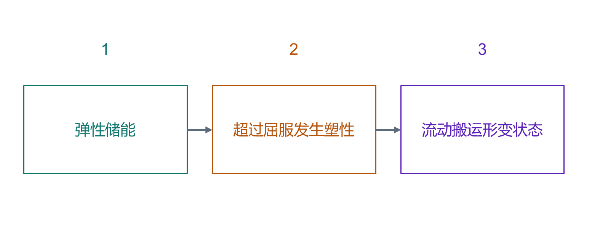

*读图：弹性储能 → 超过屈服发生塑性 → 流动搬运形变状态。箭头表示本节的推理或处理顺序，具体条件见正文。*

### 先读符号与条件

| 符号 / 条件 | 含义 |
| --- | --- |
| sigma | 应力 Pa |
| E | Young 模量 Pa |
| epsilon | 无量纲应变 |
| 范围 | 小形变线弹性 |

### 核心关系与推导入口

以下关系使用上述条件；标为教学简化或补充的内容是为理解而推导，不是逐字转录课件。

$$
\sigma=E\varepsilon\quad\text{（一维线弹性教学模型）}
$$

### 🔧 手算 11：把关系落到数字上

E=1000 Pa、ε=0.02，应力 20 Pa。若卸载可回到 ε=0，是弹性示意；若留下 0.01，则还需塑性状态解释。

| 检查步骤 | 操作 |
| --- | --- |
| 输入 | 先从例子中抄下给定量及单位，不引入未给定的数值。 |
| 计算 | 按本节关系求中间量，再得到结果；不要在第一步就做显示裁剪或整数舍入。 |
| 回查 | 若卸载可回到 ε=0，是弹性示意；若留下 0.01，则还需塑性状态解释。 |
| 适用边界 | 只降低黏度无法自动产生弹性回弹，需要储存可恢复形变的状态。 |

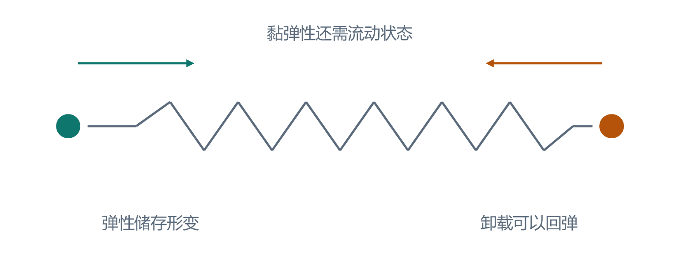

*弹性需要可恢复形变状态，单纯黏性系数不能产生同样回弹机制。*

### ⚠️ 易错点：先识别症状与假设

只降低黏度无法自动产生弹性回弹，需要储存可恢复形变的状态。

### 停下来解释一次

**问题：黏性与弹性是不是只差一个数值大小？**

<details>
<summary>展开参考回答</summary>

不是。前者与形变速率相关并耗散，后者与可恢复形变相关并储能。

</details>

<details>
<summary>展开原课件关键页，对照术语与图形</summary>

#### Viscoelasticity

*PDF p33 · 对应本节：黏弹性为什么既像固体又像流体？*

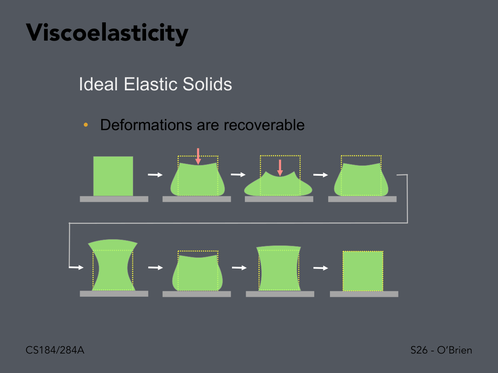

#### Viscoelasticity

*PDF p34 · 对应本节：黏弹性为什么既像固体又像流体？*

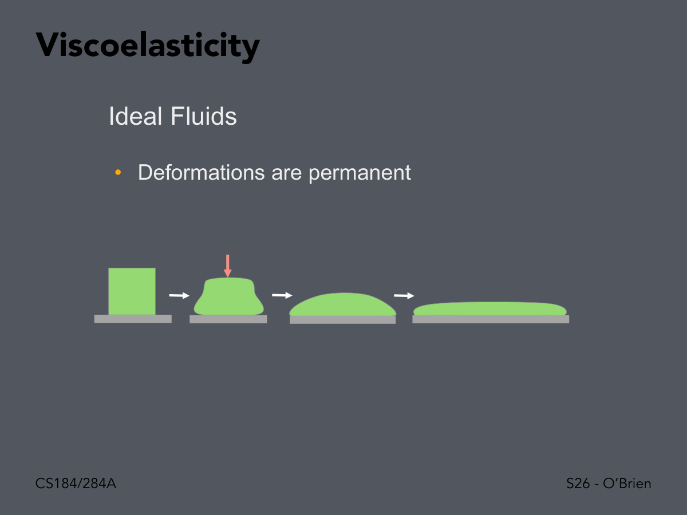

#### Viscoelasticity

*PDF p35 · 对应本节：黏弹性为什么既像固体又像流体？*

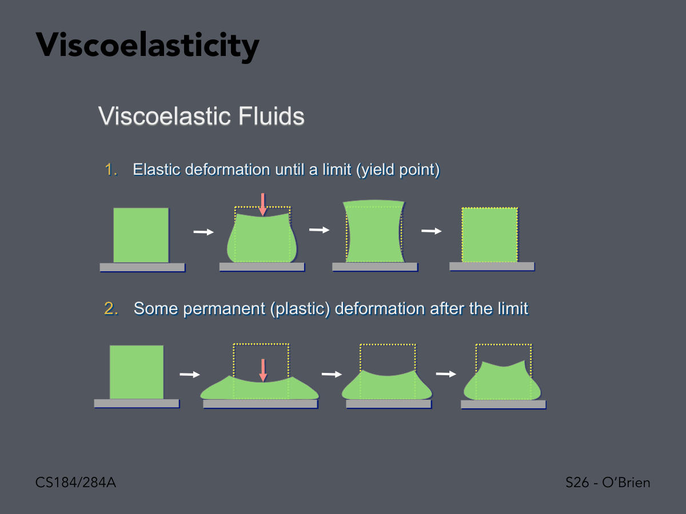

#### Viscoelasticity

*PDF p36 · 对应本节：黏弹性为什么既像固体又像流体？*

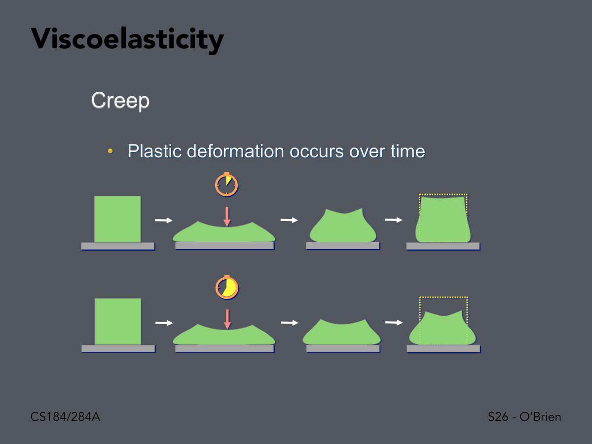

#### Viscoelasticity

*PDF p37 · 对应本节：黏弹性为什么既像固体又像流体？*

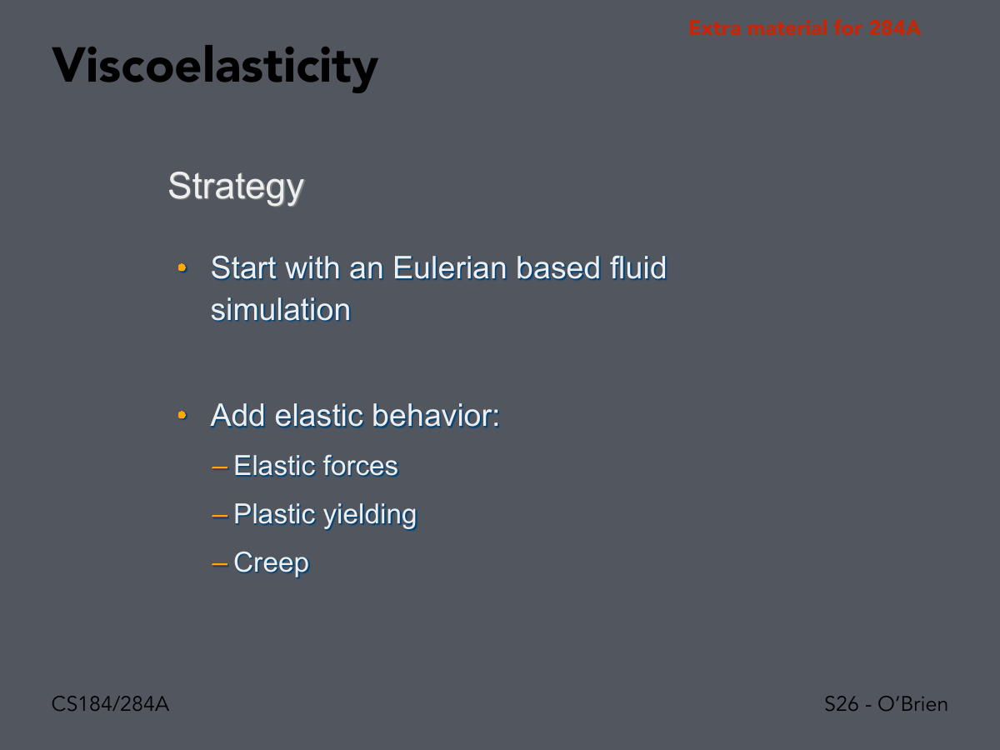

#### Viscoelasticity

*PDF p39 · 对应本节：黏弹性为什么既像固体又像流体？*

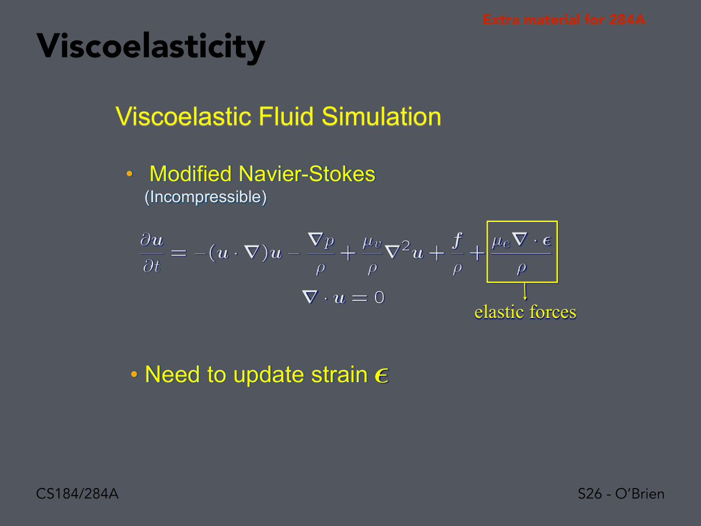

#### Viscoelasticity

*PDF p40 · 对应本节：黏弹性为什么既像固体又像流体？*

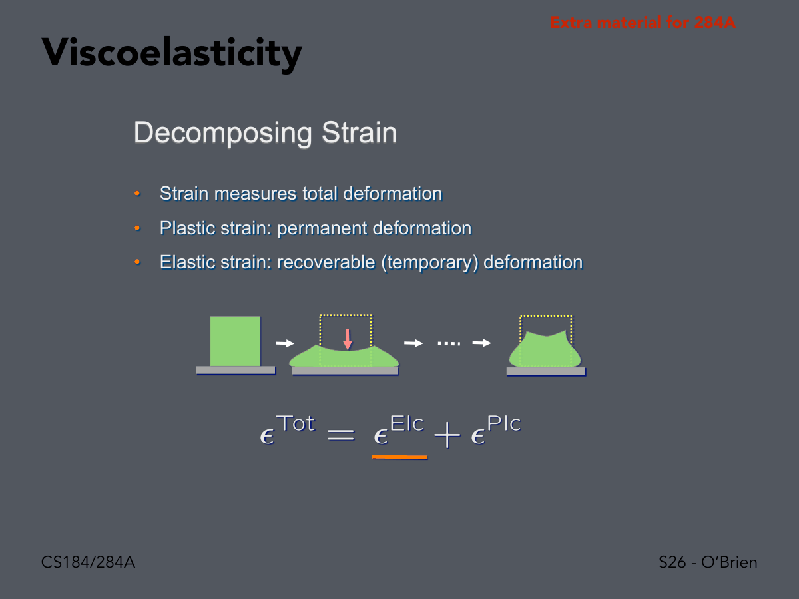

#### Viscoelasticity

*PDF p42 · 对应本节：黏弹性为什么既像固体又像流体？*

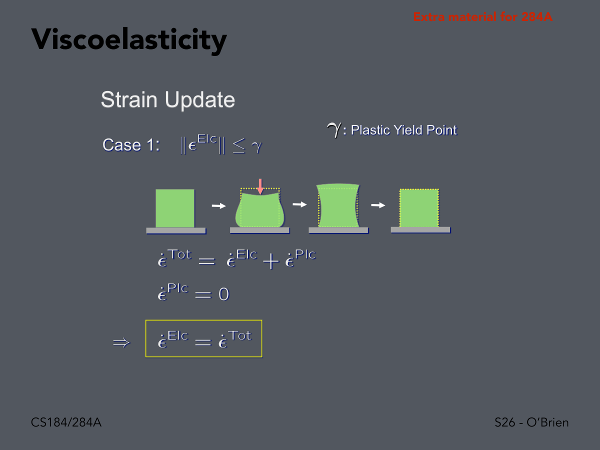

#### Viscoelasticity

*PDF p43 · 对应本节：黏弹性为什么既像固体又像流体？*


#### Other Effects: Melting

*PDF p48 · 对应本节：黏弹性为什么既像固体又像流体？*


#### Other Effects: Strain Heating

*PDF p50 · 对应本节：黏弹性为什么既像固体又像流体？*


</details>

## 12. 粒子流体与网格方法怎样比较？

粒子法用邻域核估计密度和力，网格法在固定空间求导和投影，混合法在两者之间交换数据。它们有不同的噪声、守恒、边界与计算成本，不存在脱离任务的统一优胜者。

验收应记录散度、质量或体积、动能、边界通量与分辨率敏感性。随笔记附带的解析场检查只验证导数与投影代数，不能替代真实流体求解器测试。


*读图：粒子与网格表示 → 不同数值误差 → 共同物理量验收。箭头表示本节的推理或处理顺序，具体条件见正文。*

### 先读符号与条件

| 符号 / 条件 | 含义 |
| --- | --- |
| 网格 | 单元密度乘体积 |
| 粒子 | 粒子质量求和 |
| 边界 | 开放系统需计流入流出 |

### 核心关系与推导入口

以下关系使用上述条件；标为教学简化或补充的内容是为理解而推导，不是逐字转录课件。

$$
M=\sum_i\rho_iV_i\quad\text{或}\quad M=\sum_jm_j
$$

### 🔧 手算 12：把关系落到数字上

4 个单元各体积 0.5、密度 2，总质量为 4。若一单元密度错误降为 1，总质量降为 3.5，损失 12.5%。

| 检查步骤 | 操作 |
| --- | --- |
| 输入 | 先从例子中抄下给定量及单位，不引入未给定的数值。 |
| 计算 | 按本节关系求中间量，再得到结果；不要在第一步就做显示裁剪或整数舍入。 |
| 回查 | 若一单元密度错误降为 1，总质量降为 3.5，损失 12.5%。 |
| 适用边界 | 烟雾视觉浓度不总等同流体质量密度；别拿同名 density 字段不加区分地做守恒检查。 |


*质量账本比截图更能发现数值损失，此例损失 12.5%。*

### ⚠️ 易错点：先识别症状与假设

烟雾视觉浓度不总等同流体质量密度；别拿同名 density 字段不加区分地做守恒检查。

### 停下来解释一次

**问题：画面看着不漏水能证明质量守恒吗？**

<details>
<summary>展开参考回答</summary>

不能。需要数值记录并考虑开放边界的质量通量。

</details>

<details>
<summary>展开原课件关键页，对照术语与图形</summary>

#### Other Methods

*PDF p53 · 对应本节：粒子流体与网格方法怎样比较？*


#### Other Methods

*PDF p54 · 对应本节：粒子流体与网格方法怎样比较？*


#### Other Methods

*PDF p55 · 对应本节：粒子流体与网格方法怎样比较？*


#### Acknowledgments

*PDF p56 · 对应本节：粒子流体与网格方法怎样比较？*


</details>

## 13. 把十二个数值例子连成检查顺序

先手算再运行。随仓库提供的 `scripts/cs184-numerical-checks.py` 是小模型验证，不依赖 GPU，也不修改服务器配置。它不能替代完整渲染场景或模拟系统的验证。

| 顺序 | 本节关系 | 最容易漏掉的约定 |
| --- | --- | --- |
| 1 | 为什么液体需要场的视角？ | 两者：场与轨迹不是同一个变量 |
| 2 | 交错网格为什么把速度放在面上？ | vT,vB：上下对应分量 |
| 3 | 梯度、散度、旋度分别问什么？ | 坐标：本文 x 向右 y 向上 |
| 4 | Navier–Stokes 每一项在做什么？ | f：单位质量外力，即加速度 |
| 5 | 平流为什么可以沿轨迹回溯？ | 回溯：这里是一阶近似 |
| 6 | 不可压缩为何变成压力约束？ | 条件：rho 常数 |
| 7 | 课件压力修正式哪里需要订正？ | 证据：原页截图与方程推导 |
| 8 | Poisson 方程离散后怎样求解？ | 中心：二维五点模板 |
| 9 | “稳定流体”是否就不会损失体积？ | 注意：不等于全域总量守恒 |
| 10 | 边界条件为何决定水会不会穿墙？ | 条件：不可穿透，切向条件需另定 |
| 11 | 黏弹性为什么既像固体又像流体？ | 范围：小形变线弹性 |
| 12 | 粒子流体与网格方法怎样比较？ | 边界：开放系统需计流入流出 |

### 复现实验的最小记录

| 记录项 | 用途 |
| --- | --- |
| 固定输入 | 相同几何、材质、网格或信号，避免一次改变多个因素。 |
| 参数与单位 | 包括采样数、步长、分辨率、角度单位、颜色空间。 |
| 输出量 | 保留线性值、误差或状态，再生成展示图。 |
| 参考 | 解析解、手算或高精度结果必须说明来源。 |
| 失败样例 | 边界和极端条件是检查假设的入口。 |

## 14. 实现排查：把公式错误与系统错误分开

本节列出由模型和手算能够判断的排查方向；没有把尚未写出的完整应用测试说成已完成。最小数值检查的真实执行结果见本次发布核对报告。

### 阶段 1：第 1–4 节

| 涉及关系 | 错误机制 / 修正方向 |
| --- | --- |
| 为什么液体需要场的视角？ | 把网格单元位置当成流体粒子位置，会混淆平流与网格移动。 |
| 交错网格为什么把速度放在面上？ | 把面速度当中心值求差分会错位，压力投影可能留下棋盘纹或残余散度。 |
| 梯度、散度、旋度分别问什么？ | 压力梯度是向量，压力拉普拉斯是标量；这个类型检查能发现课件后面的笔误。 |
| Navier–Stokes 每一项在做什么？ | 如果 f 已经是加速度，不要再除密度；若存的是单位体积力，则需要除 ρ。 |

### 阶段 2：第 5–8 节

| 涉及关系 | 错误机制 / 修正方向 |
| --- | --- |
| 平流为什么可以沿轨迹回溯？ | 把回溯写成 x+hu 会反向搬运；用匀速平移一团烟的测试即可发现。 |
| 不可压缩为何变成压力约束？ | 这里求得的是压力的空间分布，不是逐单元独立减一个常数速度。 |
| 课件压力修正式哪里需要订正？ | 代码中若把 scalar 自动广播到两个速度分量，程序可能不报错，但物理方向完全错误。 |
| Poisson 方程离散后怎样求解？ | 残差小不代表边界正确；压力常数零空间与不通量条件必须显式处理。 |

### 阶段 3：第 9–12 节

| 涉及关系 | 错误机制 / 修正方向 |
| --- | --- |
| “稳定流体”是否就不会损失体积？ | 把“不会产生新极值”当作“不会损失质量”是不同性质的混淆。 |
| 边界条件为何决定水会不会穿墙？ | 无滑移与自由滑移不同；错误混用会改变涡量与耗散。 |
| 黏弹性为什么既像固体又像流体？ | 只降低黏度无法自动产生弹性回弹，需要储存可恢复形变的状态。 |
| 粒子流体与网格方法怎样比较？ | 烟雾视觉浓度不总等同流体质量密度；别拿同名 density 字段不加区分地做守恒检查。 |

## 15. 跨讲连接：同一工具在哪些尺度重复出现？

| 前置工具 | 在整门课里的用途 | 回查 |
| --- | --- | --- |
| 采样与积分 | 像素、光源、孔径、时间、方向都需要有限样本估计连续量。 | [L03](/notes/cs184-03-sampling-aliasing/) / [L15](/notes/cs184-15-monte-carlo-integration/) |
| 坐标与线性代数 | 相机、法线、骨架与局部速度都需要一致的参考系。 | [L04–05](/notes/cs184-04-05-transforms/) |
| 几何表示 | 可见性、接触、遮挡与网格邻域依赖可靠的几何关系。 | [L11–12](/notes/cs184-11-12-meshes-geometry/) |
| 物理量与单位 | 把颜色值、概率密度、力和能量区别开，防止错误补偿。 | [L14](/notes/cs184-14-radiometry/) |
| 颜色与显示 | 展示图不等于线性数据；显示变换会改变视觉比较。 | [L19–20](/notes/cs184-19-20-color-science/) |

回头看，许多错误并非来自复杂公式，而是来自“同一个词指了不同的量”：方向密度与概率、位置与方向、线性颜色与编码颜色、稳定与准确。先说清对象，再选择算法。

## 16. 自测：能否不看公式说清楚？

### 自测 1. Eulerian 模拟中的网格必须随水一起动吗？

<details>
<summary>参考答案</summary>

不必，固定网格正是它的基本思路之一。

</details>

### 自测 2. 一个单元内速度不为零，散度能否为零？

<details>
<summary>参考答案</summary>

能。流入与流出平衡即可，均匀平移就是例子。

</details>

### 自测 3. 不可压缩流能否有旋涡？

<details>
<summary>参考答案</summary>

能。不可压缩约束是散度为零，不是旋度为零。

</details>

### 自测 4. 不可压缩是否意味着流体静止？

<details>
<summary>参考答案</summary>

不是，它约束体积变化，而非速度大小。

</details>

### 自测 5. 半拉格朗日方法为什么会让烟越算越糊？

<details>
<summary>参考答案</summary>

反复插值会衰减高频细节，即使不显式加入黏性也存在数值扩散。

</details>

### 自测 6. 压力投影为何涉及全局求解？

<details>
<summary>参考答案</summary>

相邻单元共享面流量，修正一个单元会影响邻居，约束是耦合的。

</details>

### 自测 7. 为什么量纲和向量类型都要检查？

<details>
<summary>参考答案</summary>

单位一致仍可能方向类型错误；两个检查相互补充。

</details>

### 自测 8. 为什么所有压力加同一个常数不改变速度修正？

<details>
<summary>参考答案</summary>

因为常数的梯度为零，速度只依赖压力差。

</details>

### 自测 9. 减小时间步能否自动消除所有数值扩散？

<details>
<summary>参考答案</summary>

不能自动保证，插值格式、网格分辨率和误差补偿方法也影响扩散。

</details>

### 自测 10. 静止墙附近切向速度一定是零吗？

<details>
<summary>参考答案</summary>

要看采用的物理边界模型；无滑移是零，自由滑移则不要求。

</details>

### 自测 11. 黏性与弹性是不是只差一个数值大小？

<details>
<summary>参考答案</summary>

不是。前者与形变速率相关并耗散，后者与可恢复形变相关并储能。

</details>

### 自测 12. 画面看着不漏水能证明质量守恒吗？

<details>
<summary>参考答案</summary>

不能。需要数值记录并考虑开放边界的质量通量。

</details>

### 自测 13. 第 1 节的数值例子，哪一项假设不能悄悄删掉？

<details>
<summary>参考答案与反例入口</summary>

把网格单元位置当成流体粒子位置，会混淆平流与网格移动。

再复算本节的例子：一维恒速场 u=2 m/s，粒子初始 x=1，0.3 秒后 x=1.6。固定位置 x=1 的网格仍在原处，只记录经过它的流体速度。

</details>

### 自测 14. 第 2 节的数值例子，哪一项假设不能悄悄删掉？

<details>
<summary>参考答案与反例入口</summary>

把面速度当中心值求差分会错位，压力投影可能留下棋盘纹或残余散度。

再复算本节的例子：h=1，右 3、左 1、上 2、下 2，散度为 2。若把右速度改为 1，净流出变零。

</details>

### 自测 15. 第 3 节的数值例子，哪一项假设不能悄悄删掉？

<details>
<summary>参考答案与反例入口</summary>

压力梯度是向量，压力拉普拉斯是标量；这个类型检查能发现课件后面的笔误。

再复算本节的例子：u=(-y,x)，散度为 0+0=0，旋度为 1-(-1)=2。它能旋转却不膨胀，直接反驳“旋转就是散度”。

</details>

### 自测 16. 第 4 节的数值例子，哪一项假设不能悄悄删掉？

<details>
<summary>参考答案与反例入口</summary>

如果 f 已经是加速度，不要再除密度；若存的是单位体积力，则需要除 ρ。

再复算本节的例子：只有恒定外力 f=(0,-10)、h=0.1 秒，速度从 (1,0) 变为 (1,-1)。变化除以步长恢复 (0,-10)。

</details>

### 自测 17. 第 5 节的数值例子，哪一项假设不能悄悄删掉？

<details>
<summary>参考答案与反例入口</summary>

把回溯写成 x+hu 会反向搬运；用匀速平移一团烟的测试即可发现。

再复算本节的例子：一维目标 x=2，速度 0.5，步长 1，回溯到 1.5。若旧 q(1)=2、q(2)=4，线性插值得 3；回查权重各 1/2。

</details>

### 自测 18. 第 6 节的数值例子，哪一项假设不能悄悄删掉？

<details>
<summary>参考答案与反例入口</summary>

这里求得的是压力的空间分布，不是逐单元独立减一个常数速度。

再复算本节的例子：ρ=2、h=0.5、临时散度 3，则压力拉普拉斯需为 12。代回新散度 3-(0.5/2)×12=0。

</details>

### 自测 19. 第 7 节的数值例子，哪一项假设不能悄悄删掉？

<details>
<summary>参考答案与反例入口</summary>

代码中若把 scalar 自动广播到两个速度分量，程序可能不报错，但物理方向完全错误。

再复算本节的例子：p(x,y)=x²+y²，在 (1,2) 梯度为 (2,4)，拉普拉斯为 4。若 h/ρ=0.1，速度应减 (0.2,0.4)，不能减标量 0.4。

</details>

### 自测 20. 第 8 节的数值例子，哪一项假设不能悄悄删掉？

<details>
<summary>参考答案与反例入口</summary>

残差小不代表边界正确；压力常数零空间与不通量条件必须显式处理。

再复算本节的例子：hx=1，邻居压力全为 2，b=0，则中心应为 2。代回 2+2+2+2-4×2=0；若中心为 1，残差为 4。

</details>

### 自测 21. 第 9 节的数值例子，哪一项假设不能悄悄删掉？

<details>
<summary>参考答案与反例入口</summary>

把“不会产生新极值”当作“不会损失质量”是不同性质的混淆。

再复算本节的例子：q 为 0 和 1，权重 0.25、0.75，则 q'=0.75，不超出 [0,1]。但多个目标可能重复采同一旧区域，全局和不能由此保证。

</details>

### 自测 22. 第 10 节的数值例子，哪一项假设不能悄悄删掉？

<details>
<summary>参考答案与反例入口</summary>

无滑移与自由滑移不同；错误混用会改变涡量与耗散。

再复算本节的例子：静止墙 n=(1,0)，流体速度 (2,3)，法向分量应修为 0，得到 (0,3) 是自由滑移示意；不能把两分量都置零当作同一边界。

</details>

### 自测 23. 第 11 节的数值例子，哪一项假设不能悄悄删掉？

<details>
<summary>参考答案与反例入口</summary>

只降低黏度无法自动产生弹性回弹，需要储存可恢复形变的状态。

再复算本节的例子：E=1000 Pa、ε=0.02，应力 20 Pa。若卸载可回到 ε=0，是弹性示意；若留下 0.01，则还需塑性状态解释。

</details>

### 自测 24. 第 12 节的数值例子，哪一项假设不能悄悄删掉？

<details>
<summary>参考答案与反例入口</summary>

烟雾视觉浓度不总等同流体质量密度；别拿同名 density 字段不加区分地做守恒检查。

再复算本节的例子：4 个单元各体积 0.5、密度 2，总质量为 4。若一单元密度错误降为 1，总质量降为 3.5，损失 12.5%。

</details>

### 自测 25. 本讲的输入、输出和中间表示各是什么？

<details>
<summary>参考答案</summary>

粒子或网格表示 → 速度与标量场 → 物质被平流搬运 → 力改变速度 → 压力消除散度 → 边界与数值误差。请沿箭头逐项解释，尤其说清中间表示的单位、坐标或概率测度；只复述名词不算掌握。

</details>

### 自测 26. 能否只用一张“看起来正确”的图片证明实现正确？

<details>
<summary>参考答案</summary>

不能。需要将关键关系拆成可预测的小输入，检查数值、边界与对照；随机方法还要区分一次结果与统计期望，显示图还需区分编码与原始数据。

</details>

## 17. 带走的结论与仍需练习的内容

- 不必，固定网格正是它的基本思路之一。
- 能。流入与流出平衡即可，均匀平移就是例子。
- 能。不可压缩约束是散度为零，不是旋度为零。
- 不是，它约束体积变化，而非速度大小。
- 反复插值会衰减高频细节，即使不显式加入黏性也存在数值扩散。
- 相邻单元共享面流量，修正一个单元会影响邻居，约束是耦合的。
- 单位一致仍可能方向类型错误；两个检查相互补充。
- 因为常数的梯度为零，速度只依赖压力差。
- 不能自动保证，插值格式、网格分辨率和误差补偿方法也影响扩散。
- 要看采用的物理边界模型；无滑移是零，自由滑移则不要求。
- 不是。前者与形变速率相关并耗散，后者与可恢复形变相关并储能。
- 不能。需要数值记录并考虑开放边界的质量通量。

| 层次 | 已经说明 | 还需动手验证 |
| --- | --- | --- |
| 概念 | 本篇十二个问题、公式与原页对应。 | 用自己的话重新解释，并给出一个反例。 |
| 数值 | 正文手算与解析小模型。 | 改变一个输入，预测再运行。 |
| 系统 | 指出实现条件和典型错误。 | 完整应用需另外检查场景、性能和边界。 |

## 18. 整门课闭环与继续阅读

| 讲义 | 起点问题 | 得到的工具或终点 |
| --- | --- | --- |
| [L01 · 导论](/notes/cs184-01-introduction/) | 这门课在求什么？ | 从场景到像素与感知 |
| [L02 · 三角形与覆盖](/notes/cs184-02-drawing-triangles/) | 像素由哪些图元覆盖？ | 半平面判定与插值 |
| [L03 · 采样与抗锯齿](/notes/cs184-03-sampling-aliasing/) | 离散图像为何锯齿？ | 区域积分、过滤与采样 |
| [L04–05 · 变换](/notes/cs184-04-05-transforms/) | 怎样放置物体和相机？ | 坐标系、矩阵与投影 |
| [L06–07 · 纹理](/notes/cs184-06-07-texture-mapping/) | 表面参数如何随位置变化？ | UV、过滤与像素足迹 |
| [L08–09 · 着色](/notes/cs184-08-09-rasterization-shading/) | 看见哪个表面、怎样着色？ | 深度、管线与局部照明 |
| [L10 · 曲线曲面](/notes/cs184-10-bezier-curves-surfaces/) | 怎样控制连续形状？ | 插值、逼近与连续性 |
| [L11–12 · 几何](/notes/cs184-11-12-meshes-geometry/) | 复杂表面如何表示和操作？ | 网格、拓扑与几何处理 |
| [L13 · 光线追踪](/notes/cs184-13-ray-tracing-acceleration/) | 光线怎样快速找到最近表面？ | 求交与 BVH |
| [第 14 讲](/notes/cs184-14-radiometry/) | 能量 | 半球积分 |
| [第 15 讲](/notes/cs184-15-monte-carlo-integration/) | 像素是积分 | 降低方差 |
| [第 16–17 讲](/notes/cs184-16-17-global-illumination/) | 命中表面 | 加权累积与终止 |
| [春季 L18](/notes/cs184-18-material-modeling/) | 材质是散射规律 | 更细结构与体积传播 |
| [春季 L19–20](/notes/cs184-19-20-color-science/) | 光谱进入眼睛 | 线性运算与显示 |
| [春季 L21–23](/notes/cs184-21-23-animation/) | 表达运动意图 | 从末端目标反求关节 |
| [春季 L24](/notes/cs184-24-physical-simulation/) | 选择状态 | 施加碰撞和约束 |
| [春季 L25](/notes/cs184-25-fluid-simulation/) | 粒子或网格表示 | 边界与数值误差 |
| [春季 L26–27](/notes/cs184-26-27-virtual-reality/) | 人眼需要哪些线索 | 全景与光场 |
| [补充 A](/notes/cs184-supplement-cameras-lenses/) | 视场与透视 | 真实镜头与传感器 |
| [补充 B](/notes/cs184-supplement-image-processing/) | 图像是离散信号 | 频率量化与压缩 |

春季 L18–27 与夏季补充专题保留本地文件标识，**不冒充不存在的秋季同编号讲次**。可以按上表顺序学习，也可在相机、颜色、采样之间按依赖往返。

## 19. 原课件全页索引与来源

[原课件文件与版本记录](https://github.com/Teddy-Yangjiale/CS184/blob/main/CS184_2026/sp26/lectures/SP26-L25-fluid-simulation.pdf) · [课程官网](https://cs184.eecs.berkeley.edu/sp26/)

文件：`SP26-L25-fluid-simulation.pdf`；PDF 页数：56；SHA-256：`b53b92ca0e611099dc2c98dbee24dcca6fd42de4a4e265b191ceceb81c29061d`。

“正文核对”表示本篇实际引用该页截图；“索引保留”包括演示、行政信息、补充、致谢与重复构建页，不表示逐页都有独立讲解。原视频的运动过程不能由静态 PDF 截图完整复现。

| PDF 页 | 原页可提取标题 | 本篇使用 |
| --- | --- | --- |
| 1 | Computer Graphics and Imaging | 索引保留 |
| 2 | Example: Fluids | 正文核对 |
| 3 | Example: Fluids | 索引保留 |
| 4 | Problem Setup | 正文核对 |
| 5 | Problem Discretization | 正文核对 |
| 6 | Fluid Grid | 正文核对 |
| 7 | Fluid Grid | 索引保留 |
| 8 | Fluid Grid | 正文核对 |
| 9 | Fluid Grid | 正文核对 |
| 10 | Fluid Grid | 正文核对 |
| 11 | Fluid Grid | 正文核对 |
| 12 | Fluid Grid | 正文核对 |
| 13 | Vector Fields | 正文核对 |
| 14 | Vector Fields | 正文核对 |
| 15 | Vector Fields | 正文核对 |
| 16 | Vector Fields | 正文核对 |
| 17 | Vector Fields | 正文核对 |
| 18 | Vector Fields | 正文核对 |
| 19 | Vector Fields | 正文核对 |
| 20 | Vector Fields | 索引保留 |
| 21 | Navier–Stokes Equations (N-SE) | 正文核对 |
| 22 | Bad Solver | 正文核对 |
| 23 | Incompressible Fluids | 正文核对 |
| 24 | Incompressible Fluids | 正文核对 |
| 25 | Incompressible Fluids | 正文核对 |
| 26 | Incompressible Fluids | 正文核对 |
| 27 | Incompressible Fluids | 正文核对 |
| 28 | Incompressible Fluids | 正文核对 |
| 29 | Incompressible Fluids | 索引保留 |
| 30 | Semi-Lagrangian Advection | 正文核对 |
| 31 | Semi-Lagrangian Advection | 正文核对 |
| 32 | Stable Fluids | 正文核对 |
| 33 | Viscoelasticity | 正文核对 |
| 34 | Viscoelasticity | 正文核对 |
| 35 | Viscoelasticity | 正文核对 |
| 36 | Viscoelasticity | 正文核对 |
| 37 | Viscoelasticity | 正文核对 |
| 38 | Viscoelasticity | 索引保留 |
| 39 | Viscoelasticity | 正文核对 |
| 40 | Viscoelasticity | 正文核对 |
| 41 | Viscoelasticity | 索引保留 |
| 42 | Viscoelasticity | 正文核对 |
| 43 | Viscoelasticity | 正文核对 |
| 44 | Viscoelasticity | 索引保留 |
| 45 | Viscoelasticity | 索引保留 |
| 46 | Viscoelasticity | 索引保留 |
| 47 | Viscoelasticity | 索引保留 |
| 48 | Other Effects: Melting | 正文核对 |
| 49 | Other Effects: Melting | 索引保留 |
| 50 | Other Effects: Strain Heating | 正文核对 |
| 51 | Other Effects: Strain Heating | 索引保留 |
| 52 | Other Effects: Strain Heating | 索引保留 |
| 53 | Other Methods | 正文核对 |
| 54 | Other Methods | 正文核对 |
| 55 | Other Methods | 正文核对 |
| 56 | Acknowledgments | 正文核对 |
