> UC Berkeley · CS184/284A · Summer 2026 · 文件标识 `SU26-L22-image-processing.pdf`。
> 本文的 **pN 一律是 PDF 的第 N 页**，不是封面讲次或页脚旧编号。文件名与封面可能不同，以下均按文件和页码回查。

## 0. 先抓住这一条推理链

```text
图像是离散信号
    ↓
线性滤波
    ↓
梯度与锐化
    ↓
利用可分离性
    ↓
数据依赖过滤
    ↓
频率量化与压缩
```

这篇笔记的阅读顺序是：先理解输入和输出，再确认公式的条件，最后用小数值检查。
正文将课件概念、补充推导和教学例子分开；示意图中的理想几何与数字不冒充真实实验测量。

| 内容 | 本文提供什么 |
|---|---|
| 来源 | Summer 2026，PDF 共 61 页；正文选择 54 张关键页 |
| 图解 | 12 张概念关系图 + 8 张几何或数值图，均有原生可编辑 PPTX |
| 手算 | 12 个带输入、结果和回代检查的教学例子 |
| 复习 | 26 道自测及答案，末尾保留全页索引 |
| 运行证据 | 数值核对脚本覆盖解析小模型，不代表完整渲染器或模拟器已经实现 |

[下载本篇 20 张可编辑图解（PPTX 与操作 JSON）](/notes/cs184/figures/91-editable.zip)

### 课件与推导的使用边界

课件截图用于对照原始定义与几何；正文用中文解释关系，并提供必要的修正与推导。
后续专题按本地文件的学期和编号组织，不假定它们与秋季一一对应。
若只做第一遍学习，先读每节前两段和数值例子，再展开原页核对。

### 与前面哪一讲接上

先回顾[相关前置讲义](/notes/cs184-03-sampling-aliasing/)。本篇在已有表示与数学工具上增加新变量或新约束，而不是另起一套互不相关的公式。

## 1. 图像处理为什么回到采样与颜色？

渲染输出以后，缩放、去噪、压缩和显示仍在处理离散图像。每种操作都隐含空间尺度、边界与颜色编码假设，第三讲的采样和颜色课的线性空间因此再次出现。

先问输出代表什么量：物理光量平均通常在线性颜色中做，而 JPEG 等编码流程有自己的非线性色彩约定。不能把“所有处理都线性化”当作无条件规则。


*读图：确定图像语义 → 选择处理算子 → 解释输出与误差。箭头表示本节的推理或处理顺序，具体条件见正文。*

### 先读符号与条件

| 符号 / 条件 | 含义 |
| --- | --- |
| I | 离散图像 |
| F | 处理算子 |
| 线性与非线性 | 需要逐算子判断 |

### 核心关系与推导入口

以下关系使用上述条件；标为教学简化或补充的内容是为理解而推导，不是逐字转录课件。

$$
I_{out}=\mathcal F(I_{in})
$$

### 🔧 手算 1：把关系落到数字上

像素 (0,1) 的算术均值为 0.5；若它们是 γ=2.2 编码的黑白，物理平均对应编码约 0.72974。相同数组操作含义取决于数据空间。

| 检查步骤 | 操作 |
| --- | --- |
| 输入 | 先从例子中抄下给定量及单位，不引入未给定的数值。 |
| 计算 | 按本节关系求中间量，再得到结果；不要在第一步就做显示裁剪或整数舍入。 |
| 回查 | 相同数组操作含义取决于数据空间。 |
| 适用边界 | 不知道输入是线性 RGB、编码 RGB 还是参数图时，不应盲目做颜色解码。 |

### ⚠️ 易错点：先识别症状与假设

不知道输入是线性 RGB、编码 RGB 还是参数图时，不应盲目做颜色解码。

### 停下来解释一次

**问题：为什么图像数值相同的两份文件可能显示不同？**

<details>
<summary>展开参考回答</summary>

颜色配置、传递函数和显示解释可能不同，数组之外的元数据也有意义。

</details>

<details>
<summary>展开原课件关键页，对照术语与图形</summary>

#### Case Study: JPEG Compression

*PDF p2 · 对应本节：图像处理为什么回到采样与颜色？*


#### JPEG Compression: The Big Ideas

*PDF p3 · 对应本节：图像处理为什么回到采样与颜色？*

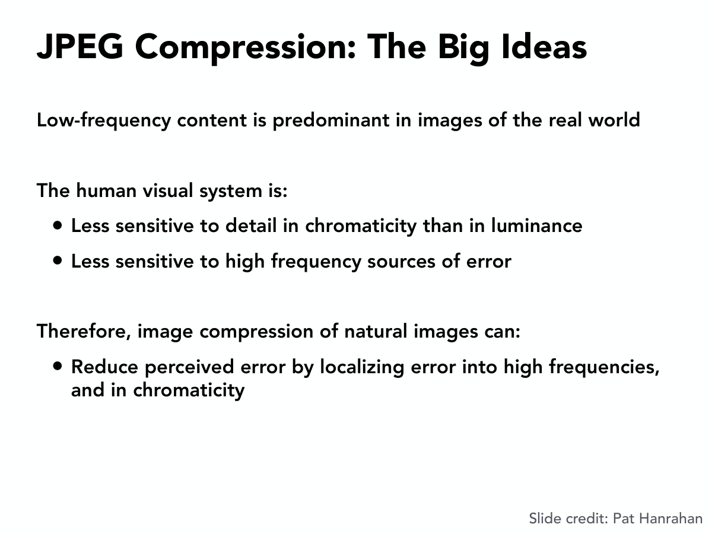

#### Y’CbCr Color Space

*PDF p4 · 对应本节：图像处理为什么回到采样与颜色？*

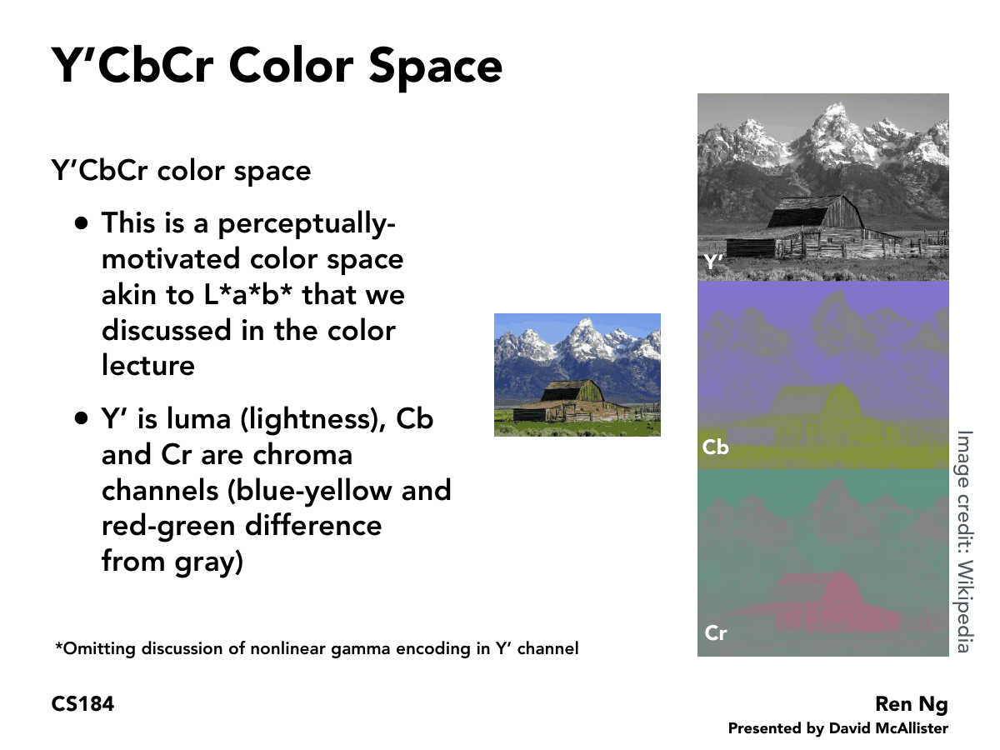

#### Theme: Exploit Perception in Visual Computing

*PDF p20 · 对应本节：图像处理为什么回到采样与颜色？*

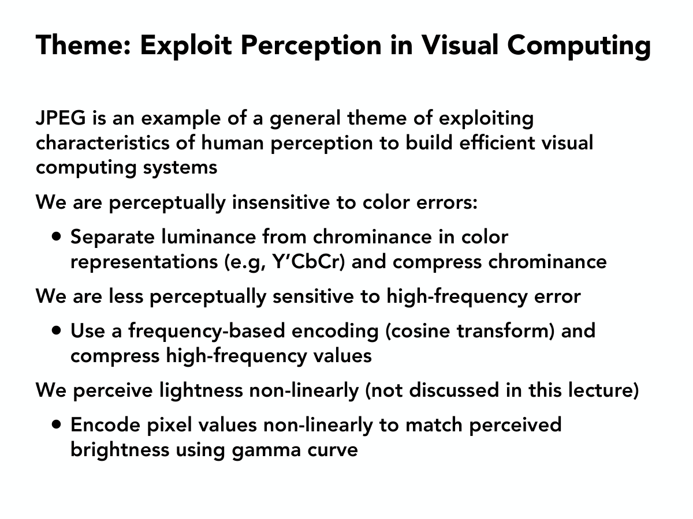

#### Basic Image Processing Operations

*PDF p22 · 对应本节：图像处理为什么回到采样与颜色？*

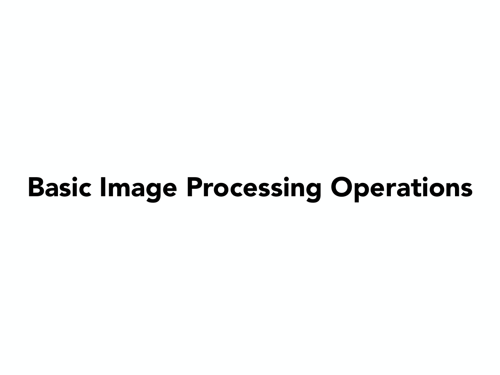

#### Example Image Processing Operations

*PDF p23 · 对应本节：图像处理为什么回到采样与颜色？*

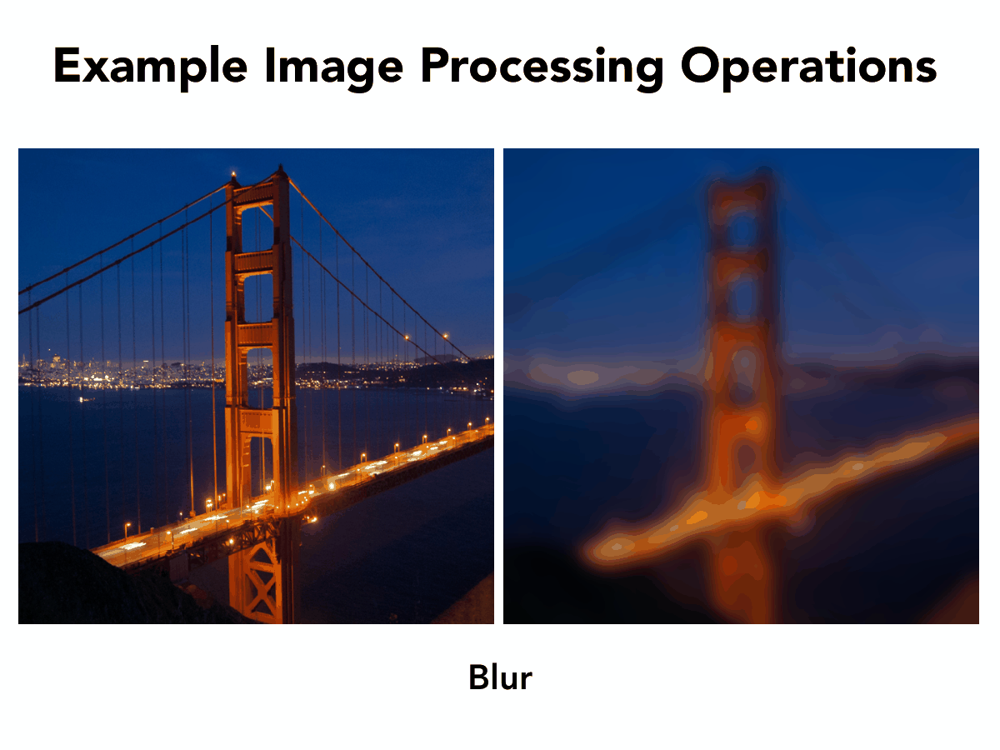

#### Example Image Processing Operations

*PDF p24 · 对应本节：图像处理为什么回到采样与颜色？*

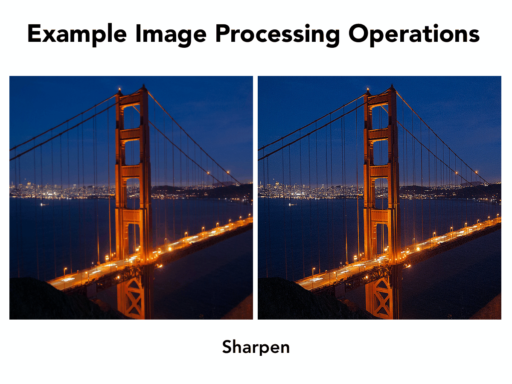

#### Edge Detection

*PDF p25 · 对应本节：图像处理为什么回到采样与颜色？*

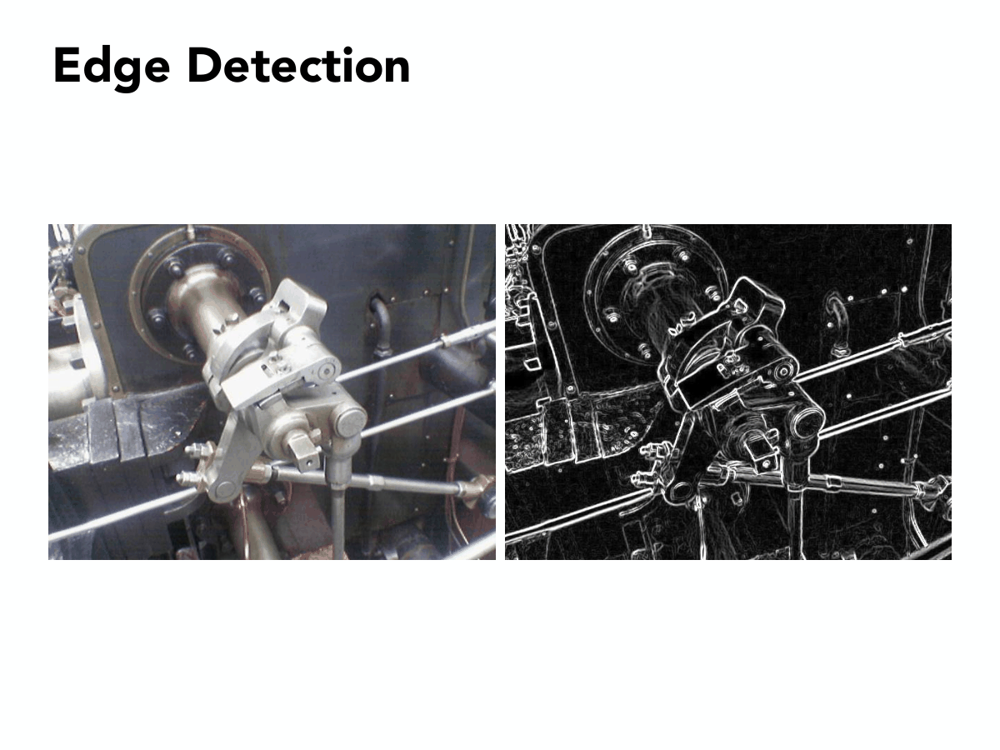

#### A “Smarter” Blur (Preserves Crisp Edges)

*PDF p26 · 对应本节：图像处理为什么回到采样与颜色？*

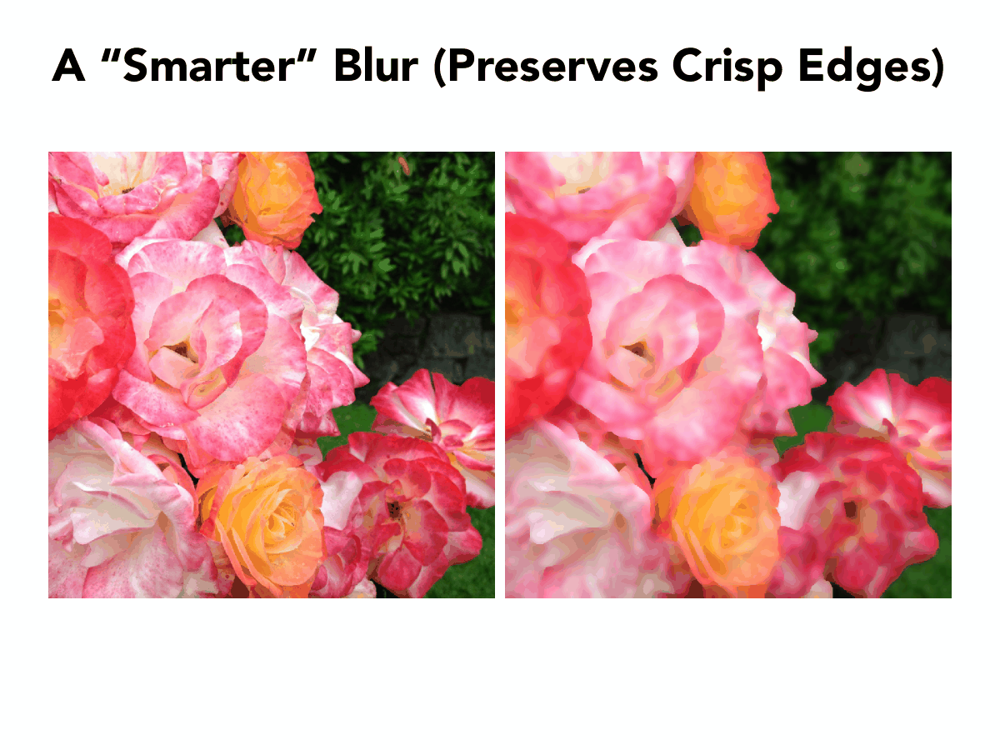

#### Denoising

*PDF p27 · 对应本节：图像处理为什么回到采样与颜色？*

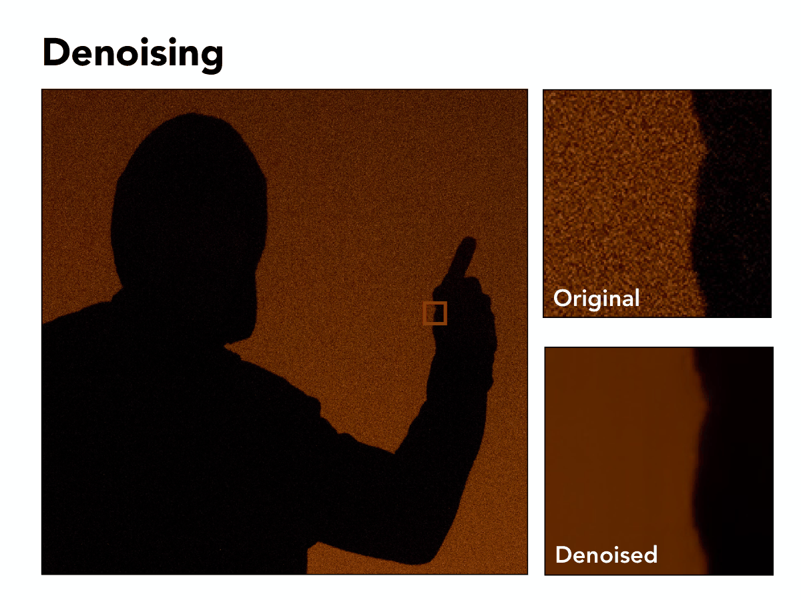

</details>

## 2. 卷积怎样把邻域变成一个输出？

离散卷积把邻域值乘核权重后相加。数学卷积会翻转核，很多图像库实际实现相关；对对称模糊核两者相同，对方向导数核则可能差一个符号。

边界没有完整邻域，需要明确零填充、复制、镜像或周期规则。相同核配不同边界能产生不同边缘结果，不应误以为算法不确定。

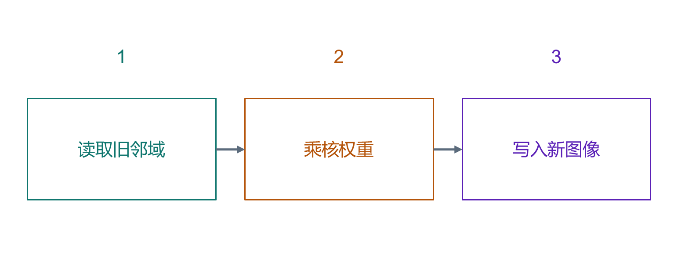

*读图：读取旧邻域 → 乘核权重 → 写入新图像。箭头表示本节的推理或处理顺序，具体条件见正文。*

### 先读符号与条件

| 符号 / 条件 | 含义 |
| --- | --- |
| k | 卷积核 |
| I | 旧图像 |
| 输出 | 应写入独立缓冲避免污染输入 |

### 核心关系与推导入口

以下关系使用上述条件；标为教学简化或补充的内容是为理解而推导，不是逐字转录课件。

$$
I'(x,y)=\sum_{i,j}k(i,j)I(x-i,y-j)
$$

### 🔧 手算 2：把关系落到数字上

一维对称核 (1/4,1/2,1/4) 作用邻域 (0,2,4)，输出 2。常数输入全为 3，输出 3×(1/4+1/2+1/4)=3。

| 检查步骤 | 操作 |
| --- | --- |
| 输入 | 先从例子中抄下给定量及单位，不引入未给定的数值。 |
| 计算 | 按本节关系求中间量，再得到结果；不要在第一步就做显示裁剪或整数舍入。 |
| 回查 | 常数输入全为 3，输出 3×(1/4+1/2+1/4)=3。 |
| 适用边界 | 原地逐像素更新会让后面像素使用已滤波值，结果依赖遍历顺序。 |

### ⚠️ 易错点：先识别症状与假设

原地逐像素更新会让后面像素使用已滤波值，结果依赖遍历顺序。

### 停下来解释一次

**问题：核权重和为 1 能保证什么？**

<details>
<summary>展开参考回答</summary>

对完整邻域和合适边界，常数图像保持常数；不能单凭此保证保边或无振铃。

</details>

<details>
<summary>展开原课件关键页，对照术语与图形</summary>

#### Review: Convolution

*PDF p28 · 对应本节：卷积怎样把邻域变成一个输出？*

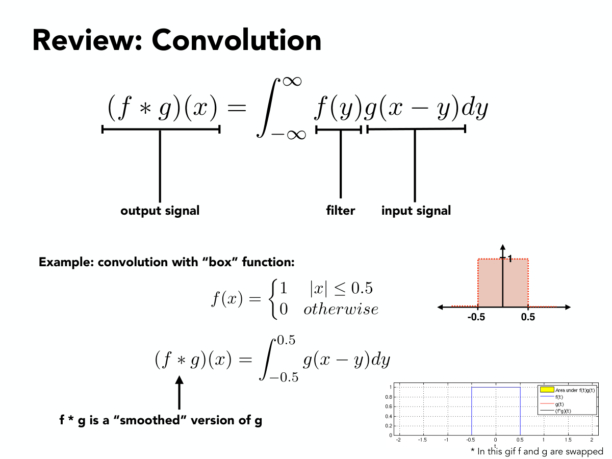

#### Discrete 2D Convolution

*PDF p29 · 对应本节：卷积怎样把邻域变成一个输出？*

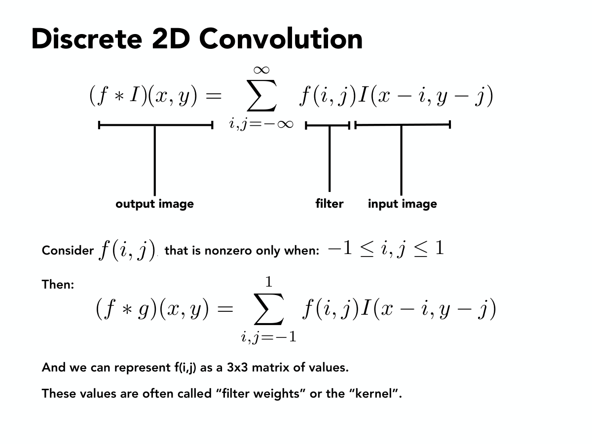

#### Simple 3x3 Box Blur

*PDF p30 · 对应本节：卷积怎样把邻域变成一个输出？*

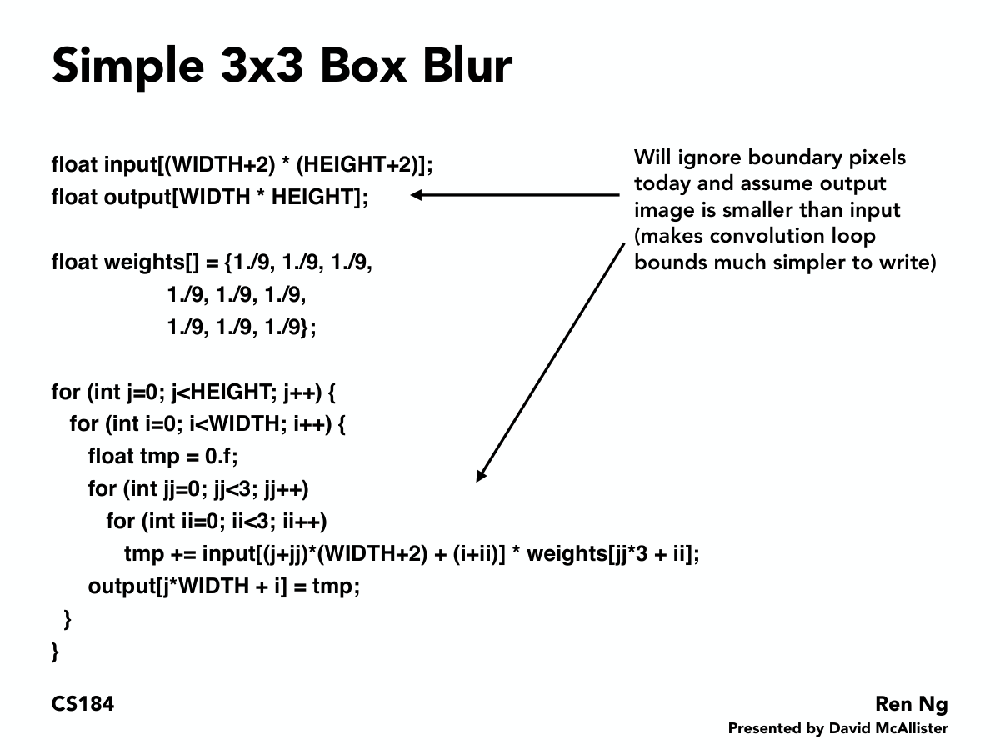

</details>

## 3. 均值与 Gaussian 为什么模糊得不同？

均值核对窗口内每个位置同权，Gaussian 随距离衰减。两者都可抑制高频，但频率响应与边缘行为不同，不能只以窗口尺寸判断效果相同。

离散 Gaussian 需要有限截断并重新归一化；σ 控制尺度，窗口应覆盖足够范围。平滑能降噪，也会损失细节，这个取舍是滤波本身的结果。

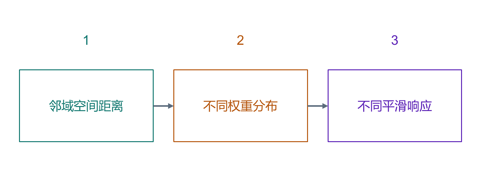

*读图：邻域空间距离 → 不同权重分布 → 不同平滑响应。箭头表示本节的推理或处理顺序，具体条件见正文。*

### 先读符号与条件

| 符号 / 条件 | 含义 |
| --- | --- |
| sigma | 空间尺度 |
| 比例常数 | 离散归一化得到 |
| 窗口 | 截断范围 |

### 核心关系与推导入口

以下关系使用上述条件；标为教学简化或补充的内容是为理解而推导，不是逐字转录课件。

$$
G(x,y)\propto e^{-(x^2+y^2)/(2\sigma^2)},\qquad\sum G=1
$$

### 🔧 手算 3：把关系落到数字上

一维权重 (1,2,1) 归一化为 (1/4,1/2,1/4)。邻域 (0,4,0) 输出 2；三点均值则 4/3。中心权重差解释结果。

| 检查步骤 | 操作 |
| --- | --- |
| 输入 | 先从例子中抄下给定量及单位，不引入未给定的数值。 |
| 计算 | 按本节关系求中间量，再得到结果；不要在第一步就做显示裁剪或整数舍入。 |
| 回查 | 中心权重差解释结果。 |
| 适用边界 | 只把连续归一化常数代入截断离散核，权重和未必精确为 1。 |

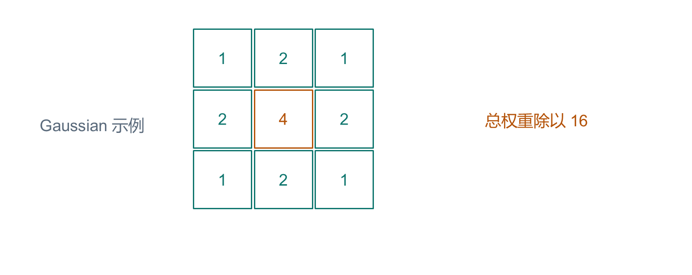

*可分离的 3×3 Gaussian 型平滑核是两个 [1,2,1]/4 的外积。*

### ⚠️ 易错点：先识别症状与假设

只把连续归一化常数代入截断离散核，权重和未必精确为 1。

### 停下来解释一次

**问题：扩大核一定比增大 σ 等价吗？**

<details>
<summary>展开参考回答</summary>

不。只扩大截断窗口而不改 σ，可能只纳入微小尾部；两者参数含义不同。

</details>

<details>
<summary>展开原课件关键页，对照术语与图形</summary>

#### Simple 3x3 Box Blur

*PDF p30 · 对应本节：均值与 Gaussian 为什么模糊得不同？*


#### 7x7 Box Blur

*PDF p31 · 对应本节：均值与 Gaussian 为什么模糊得不同？*

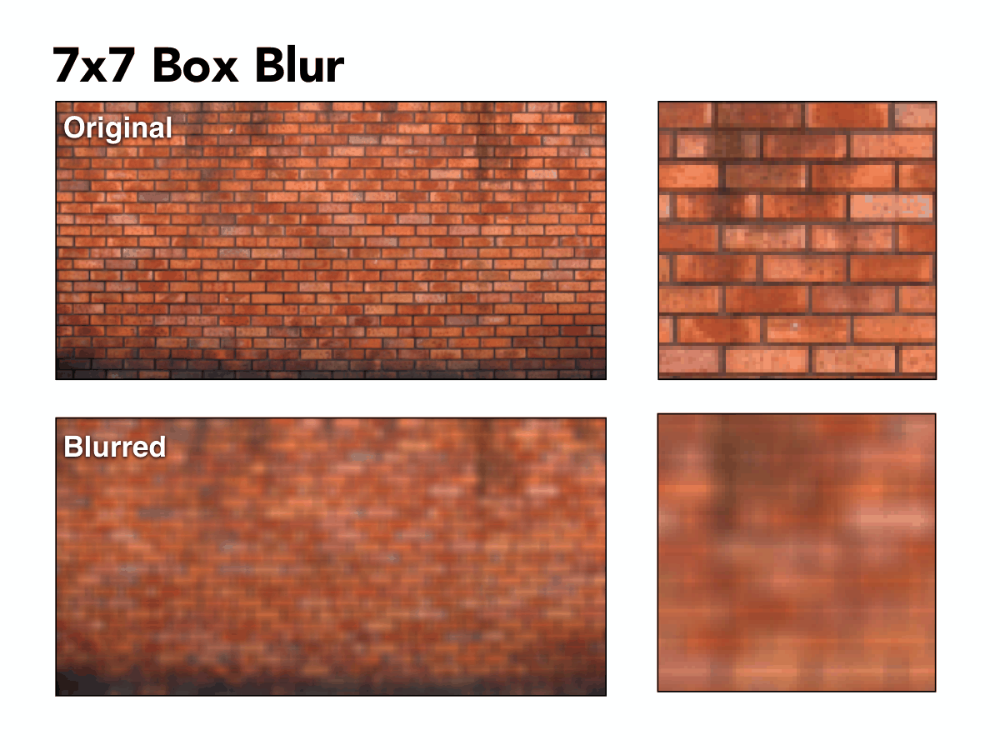

#### Gaussian Blur

*PDF p32 · 对应本节：均值与 Gaussian 为什么模糊得不同？*

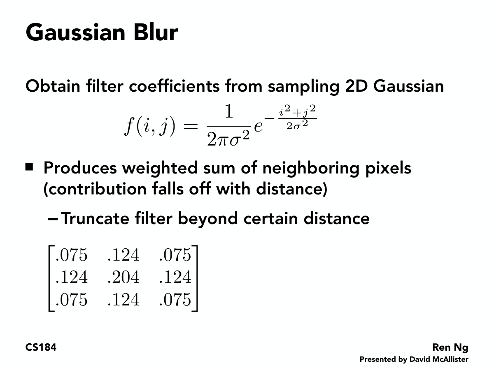

#### 7x7 Gaussian Blur

*PDF p33 · 对应本节：均值与 Gaussian 为什么模糊得不同？*

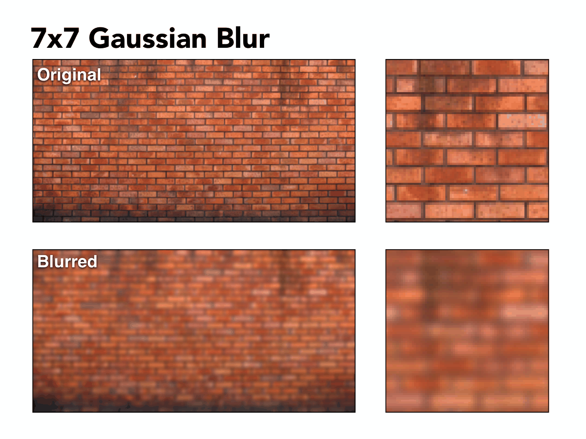

#### Compare: 7x7 Box Blur

*PDF p34 · 对应本节：均值与 Gaussian 为什么模糊得不同？*

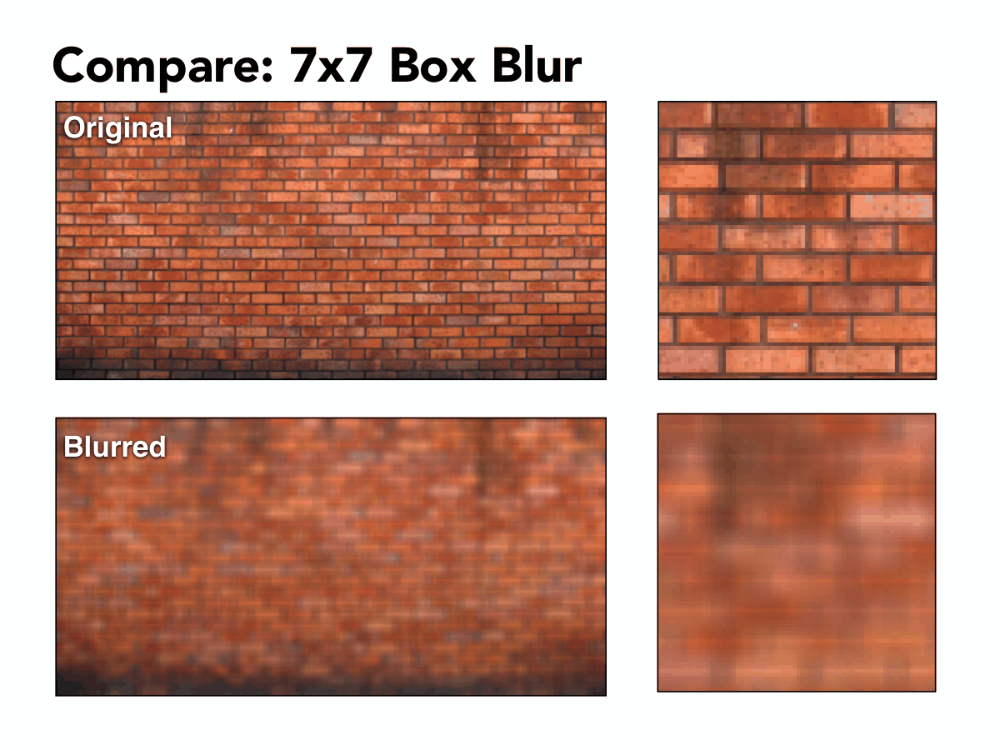

</details>

## 4. 锐化为何可能出现过冲？

锐化增强原图与低频部分之间的差，强调边缘和细节。核中负权重能产生超出原输入范围的结果，所以处理时应先用足够精度，最后再决定显示映射或裁剪。

锐化不能恢复已经丢失的信息，常会同时增强噪声。课件中心 5、四邻 -1 的核权重和为 1，保持常数但提升局部差异。

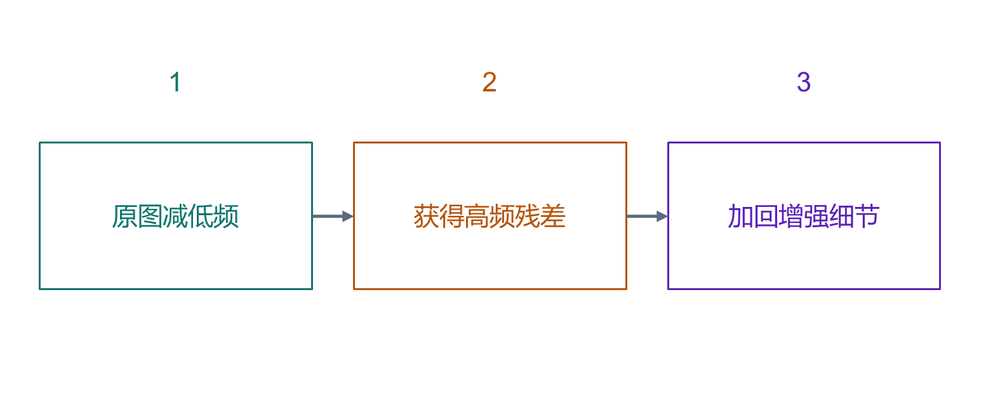

*读图：原图减低频 → 获得高频残差 → 加回增强细节。箭头表示本节的推理或处理顺序，具体条件见正文。*

### 先读符号与条件

| 符号 / 条件 | 含义 |
| --- | --- |
| G | 低通核 |
| alpha | 锐化强度 |
| I-G*I | 高频残差 |

### 核心关系与推导入口

以下关系使用上述条件；标为教学简化或补充的内容是为理解而推导，不是逐字转录课件。

$$
I'=I+\alpha(I-G*I)
$$

### 🔧 手算 4：把关系落到数字上

中心像素 10，四邻都是 8，课件核输出 5×10-4×8=18，超过原局部最大值 10。若全为 10，则输出 10。

| 检查步骤 | 操作 |
| --- | --- |
| 输入 | 先从例子中抄下给定量及单位，不引入未给定的数值。 |
| 计算 | 按本节关系求中间量，再得到结果；不要在第一步就做显示裁剪或整数舍入。 |
| 回查 | 若全为 10，则输出 10。 |
| 适用边界 | 使用无符号 8 位直接做负权重运算会溢出或提前截断；先转浮点或更宽整数。 |

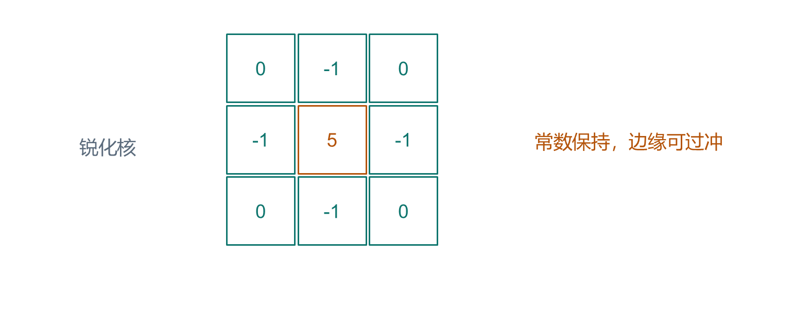

*中心 5、四邻 -1 的锐化核权重和为 1，但负权重能使输出超出输入范围。*

### ⚠️ 易错点：先识别症状与假设

使用无符号 8 位直接做负权重运算会溢出或提前截断；先转浮点或更宽整数。

### 停下来解释一次

**问题：锐化后边缘更明显能证明分辨率提高吗？**

<details>
<summary>展开参考回答</summary>

不能。对比增强与恢复真实高频信息是不同事情。

</details>

<details>
<summary>展开原课件关键页，对照术语与图形</summary>

#### What Does Convolution with this Filter Do?

*PDF p35 · 对应本节：锐化为何可能出现过冲？*

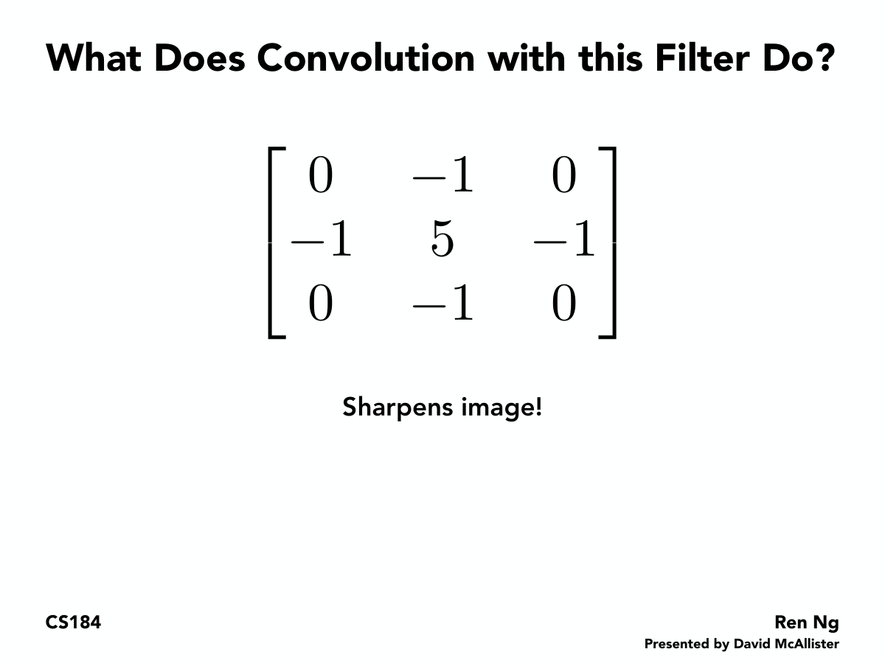

#### 3x3 Sharpen Filter

*PDF p36 · 对应本节：锐化为何可能出现过冲？*

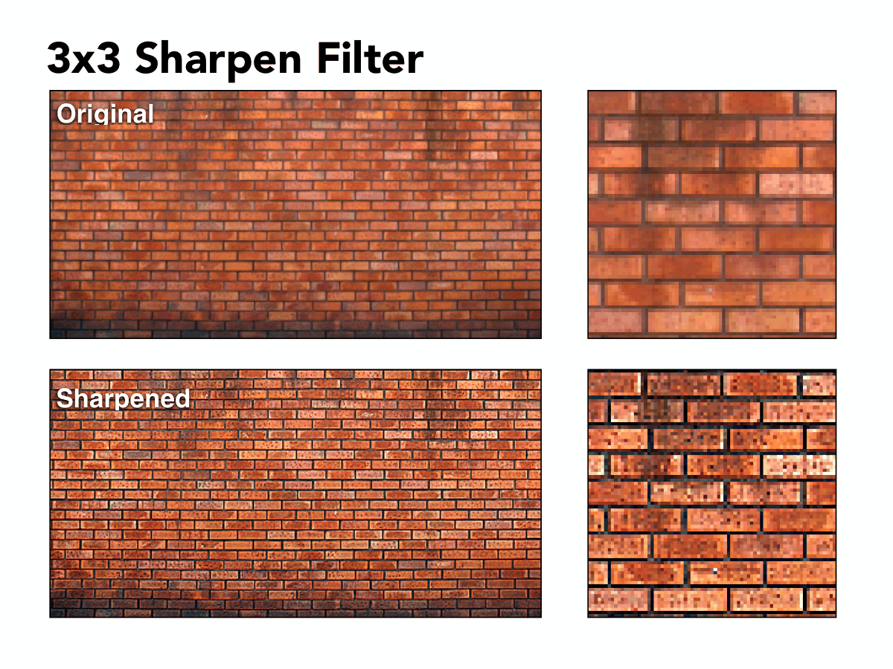

</details>

## 5. Sobel 为什么同时含差分和平滑？

Sobel 的一个方向做差分，垂直方向做加权平滑，比纯相邻差分更能抑制部分噪声。Gx、Gy 组成梯度向量，其模长表示边缘强度，方向指向强度增长方向。

图像 y 往往向下，数学坐标却常向上，再加相关与卷积的核翻转，方向符号容易混淆。若只看模长，错误可能被掩盖。

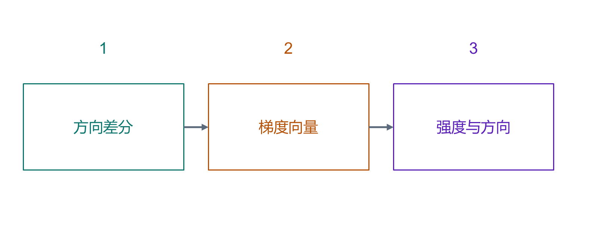

*读图：方向差分 → 梯度向量 → 强度与方向。箭头表示本节的推理或处理顺序，具体条件见正文。*

### 先读符号与条件

| 符号 / 条件 | 含义 |
| --- | --- |
| Gx,Gy | 约定下的两个导数估计 |
| theta | 梯度方向，不是边缘切线方向 |

### 核心关系与推导入口

以下关系使用上述条件；标为教学简化或补充的内容是为理解而推导，不是逐字转录课件。

$$
G=\sqrt{G_x^2+G_y^2},\qquad\theta=\operatorname{atan2}(G_y,G_x)
$$

### 🔧 手算 5：把关系落到数字上

Gx=3、Gy=4，模长为 5，方向约 53.13°。回算 5cosθ=3、5sinθ=4。边缘切线与梯度相差 90°。

| 检查步骤 | 操作 |
| --- | --- |
| 输入 | 先从例子中抄下给定量及单位，不引入未给定的数值。 |
| 计算 | 按本节关系求中间量，再得到结果；不要在第一步就做显示裁剪或整数舍入。 |
| 回查 | 边缘切线与梯度相差 90°。 |
| 适用边界 | 不要只用 atan(Gy/Gx)，它丢象限并在 Gx=0 时出问题。 |

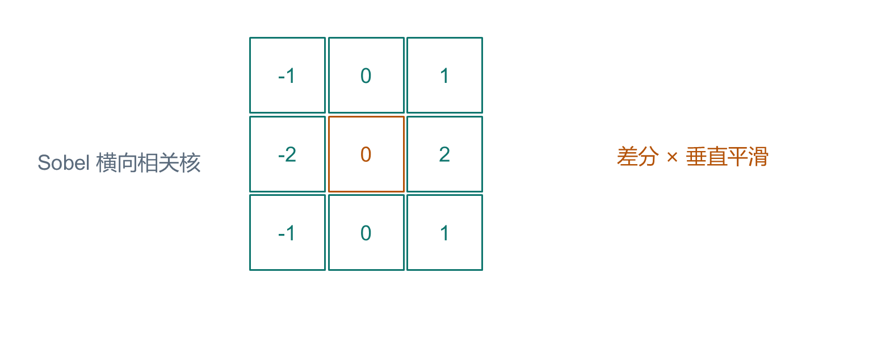

*按相关运算解释的 Sobel 横向核；数学卷积翻核会改变导数符号。*

### ⚠️ 易错点：先识别症状与假设

不要只用 atan(Gy/Gx)，它丢象限并在 Gx=0 时出问题。

### 停下来解释一次

**问题：竖直边缘主要对应哪种强度变化？**

<details>
<summary>展开参考回答</summary>

通常是沿水平方向变化，因此 Gx 较大；须确认坐标和核约定。

</details>

<details>
<summary>展开原课件关键页，对照术语与图形</summary>

#### What Does Convolution with these Filters Do?

*PDF p37 · 对应本节：Sobel 为什么同时含差分和平滑？*

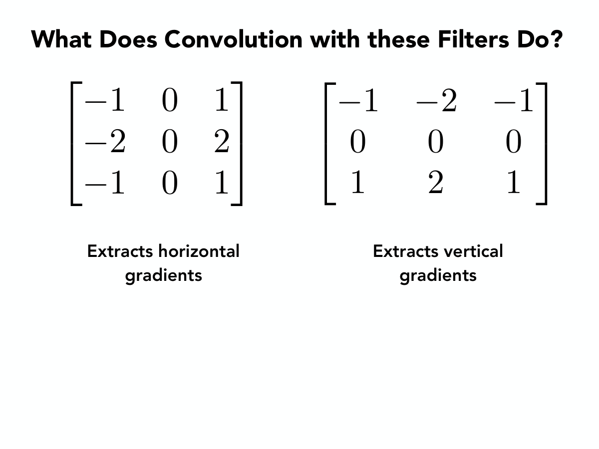

#### Gradient Detection Filters

*PDF p38 · 对应本节：Sobel 为什么同时含差分和平滑？*

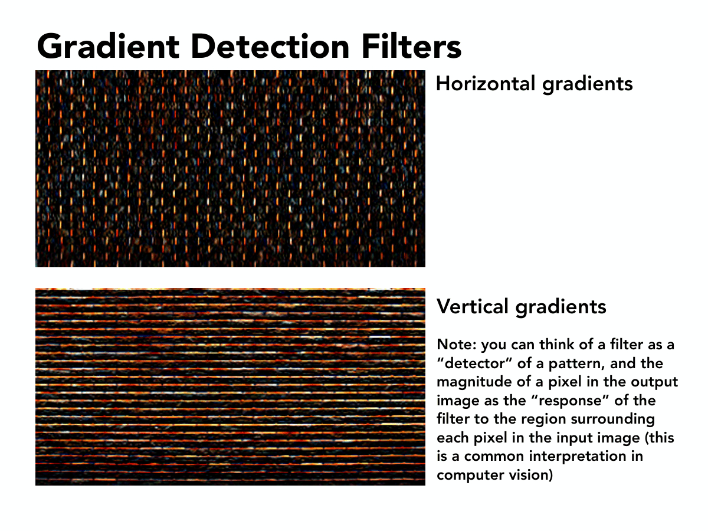

#### Sobel Edge Detection

*PDF p39 · 对应本节：Sobel 为什么同时含差分和平滑？*

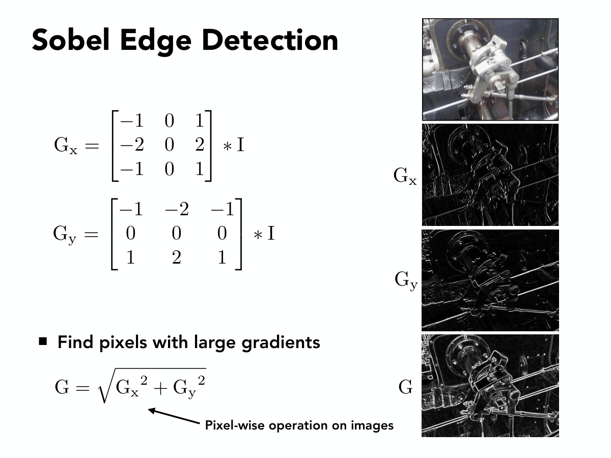

</details>

## 6. 可分离核怎样减少计算？

若二维核可写成两个一维核外积，二维卷积就能分成先横后纵。每像素从 k² 次采样降到约 2k，代价是一个中间缓冲。

不是所有二维核都可分离；离散 Gaussian 与 box 常可分离，任意艺术效果核未必。FFT 对大核可能有优势，但边界、填充与变换开销必须计入。

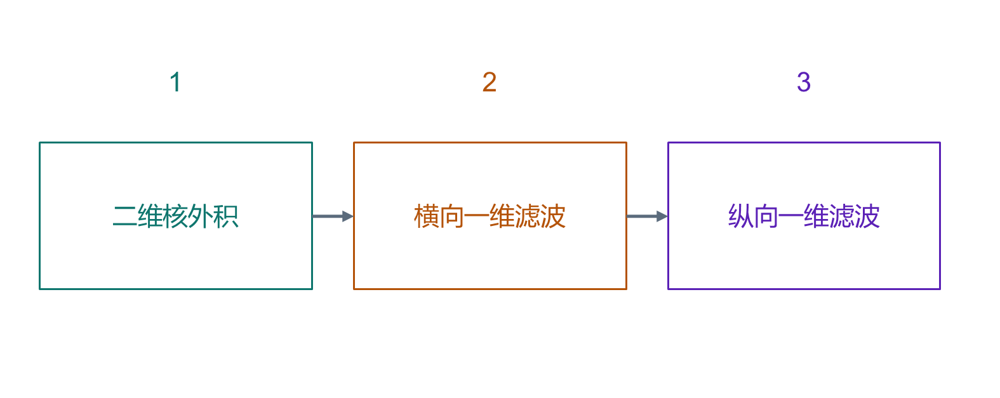

*读图：二维核外积 → 横向一维滤波 → 纵向一维滤波。箭头表示本节的推理或处理顺序，具体条件见正文。*

### 先读符号与条件

| 符号 / 条件 | 含义 |
| --- | --- |
| W,H | 图像大小 |
| k | 核边长 |
| 隐藏常数 | 两个一维 pass |

### 核心关系与推导入口

以下关系使用上述条件；标为教学简化或补充的内容是为理解而推导，不是逐字转录课件。

$$
k(x,y)=a(x)b(y),\qquad O(WHk^2)\to O(WHk)
$$

### 🔧 手算 6：把关系落到数字上

k=15，直接每像素 225 次权重累加，两次一维约 30 次，理论算术比例 7.5。若只算一次一维 15，会少做一个方向。

| 检查步骤 | 操作 |
| --- | --- |
| 输入 | 先从例子中抄下给定量及单位，不引入未给定的数值。 |
| 计算 | 按本节关系求中间量，再得到结果；不要在第一步就做显示裁剪或整数舍入。 |
| 回查 | 若只算一次一维 15，会少做一个方向。 |
| 适用边界 | 速度比还受内存与实现影响，7.5 是操作数比，不是实测性能承诺。 |

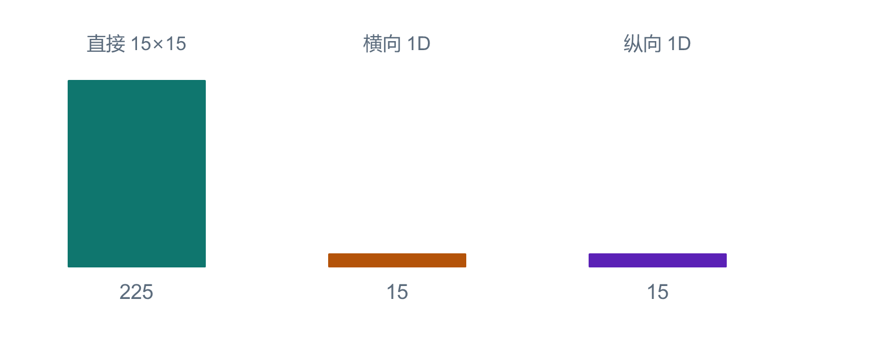

*每像素累加数由 225 降至 15+15=30，操作数比为 7.5，非实测加速比。*

### ⚠️ 易错点：先识别症状与假设

速度比还受内存与实现影响，7.5 是操作数比，不是实测性能承诺。

### 停下来解释一次

**问题：怎样快速检查一个小核是否可分离？**

<details>
<summary>展开参考回答</summary>

可看矩阵秩是否为 1，或判断各非零行是否成比例；浮点近似还需误差容限。

</details>

<details>
<summary>展开原课件关键页，对照术语与图形</summary>

#### Algorithmic Cost of

*PDF p40 · 对应本节：可分离核怎样减少计算？*

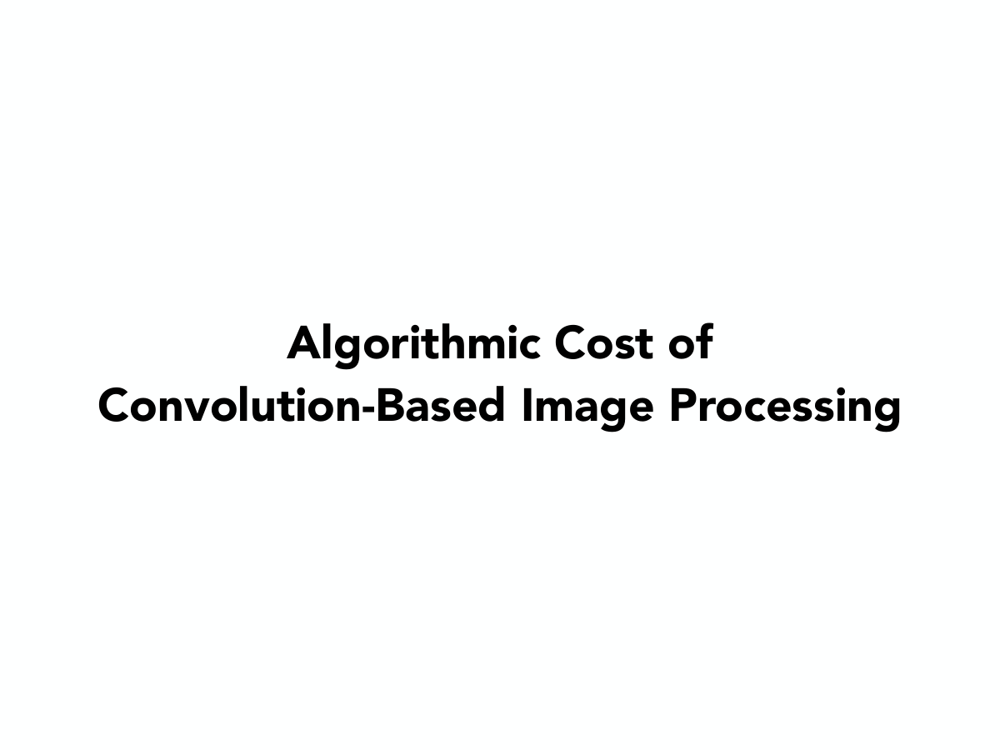

#### Cost of Convolution with N x N Filter?

*PDF p41 · 对应本节：可分离核怎样减少计算？*

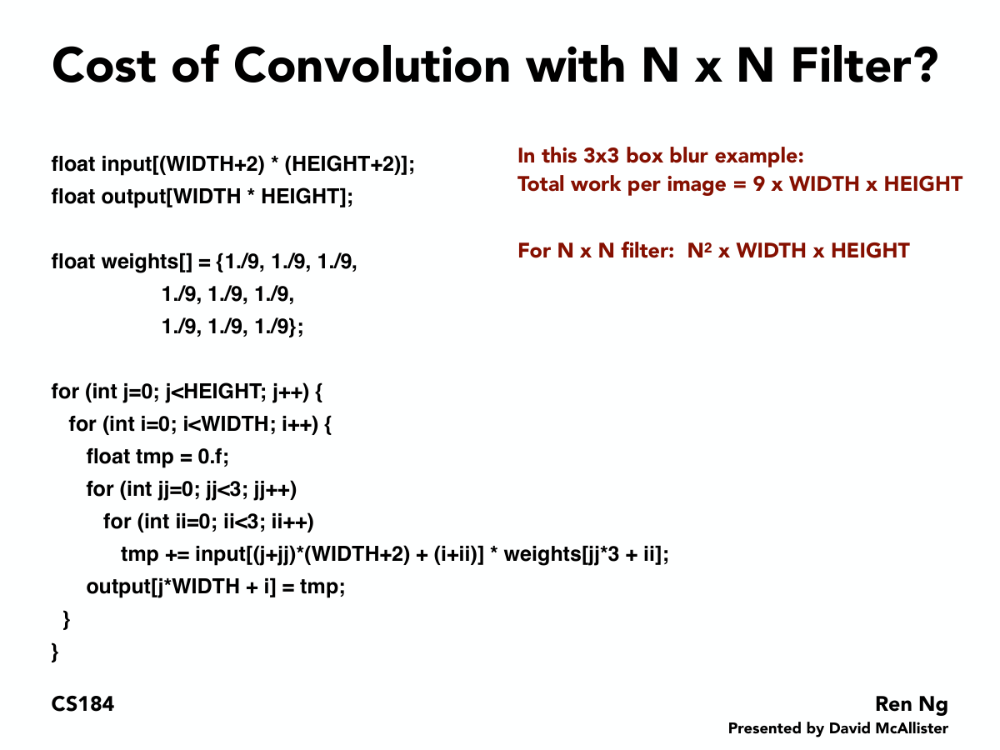

#### Separable Filters

*PDF p42 · 对应本节：可分离核怎样减少计算？*

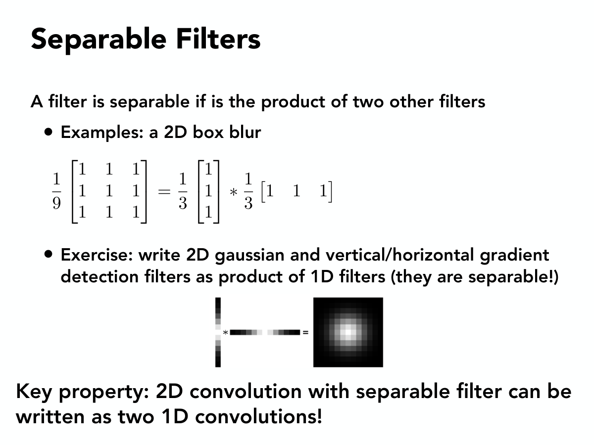

#### Fast 2D Box Blur via Two 1D Convolutions

*PDF p43 · 对应本节：可分离核怎样减少计算？*

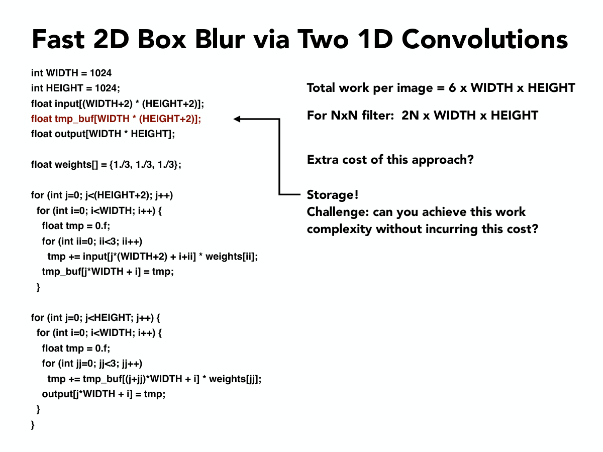

#### Recall: Convolution Theorem

*PDF p44 · 对应本节：可分离核怎样减少计算？*

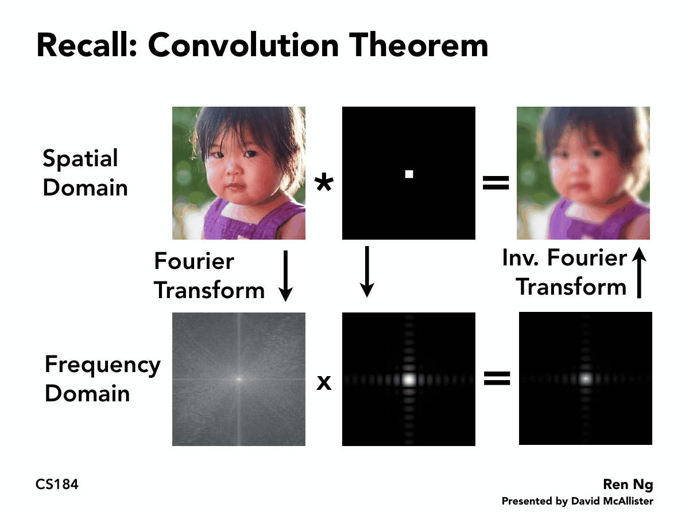

#### Efficiency?

*PDF p45 · 对应本节：可分离核怎样减少计算？*

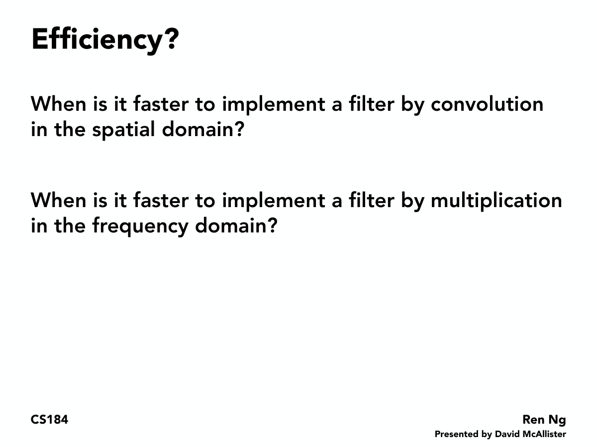

</details>

## 7. 中值为何能去掉孤立脉冲？

中值滤波在邻域排序后取中间值，对少量极端脉冲较鲁棒，但不满足线性叠加。它可能删除细小真实结构，不能称为对所有噪声都最优。

窗口大小决定什么被视为异常。彩色图像逐通道取中值还可能产生原邻域中不存在的颜色，应明确具体策略。

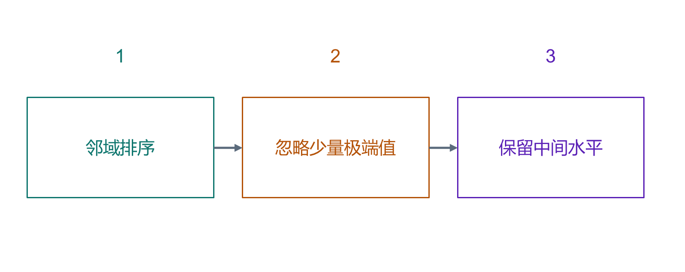

*读图：邻域排序 → 忽略少量极端值 → 保留中间水平。箭头表示本节的推理或处理顺序，具体条件见正文。*

### 先读符号与条件

| 符号 / 条件 | 含义 |
| --- | --- |
| 输入 | 邻域样本 |
| 中值 | 次序统计量 |
| 这里 | 奇数窗口避免偶数定义差异 |

### 核心关系与推导入口

以下关系使用上述条件；标为教学简化或补充的内容是为理解而推导，不是逐字转录课件。

$$
\operatorname{median}(x_1,\ldots,x_n)
$$

### 🔧 手算 7：把关系落到数字上

邻域 (10,11,255,10,9) 排序为 (9,10,10,11,255)，中值 10，均值 59。若 255 是真实细亮点，中值也会将其消除。

| 检查步骤 | 操作 |
| --- | --- |
| 输入 | 先从例子中抄下给定量及单位，不引入未给定的数值。 |
| 计算 | 按本节关系求中间量，再得到结果；不要在第一步就做显示裁剪或整数舍入。 |
| 回查 | 若 255 是真实细亮点，中值也会将其消除。 |
| 适用边界 | 去噪前应先判断噪声类型，不能把所有亮点都当作脉冲错误。 |

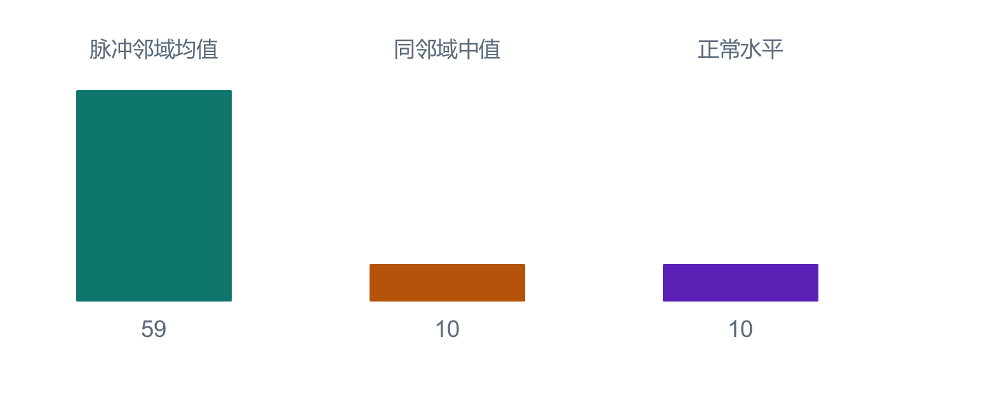

*邻域 [10,11,255,10,9] 的均值被脉冲拉高，中值为 10。*

### ⚠️ 易错点：先识别症状与假设

去噪前应先判断噪声类型，不能把所有亮点都当作脉冲错误。

### 停下来解释一次

**问题：中值滤波能写成固定卷积核吗？**

<details>
<summary>展开参考回答</summary>

一般不能，因为哪个样本被选中依赖输入数据排序。

</details>

<details>
<summary>展开原课件关键页，对照术语与图形</summary>

#### Data-Dependent Filters

*PDF p46 · 对应本节：中值为何能去掉孤立脉冲？*

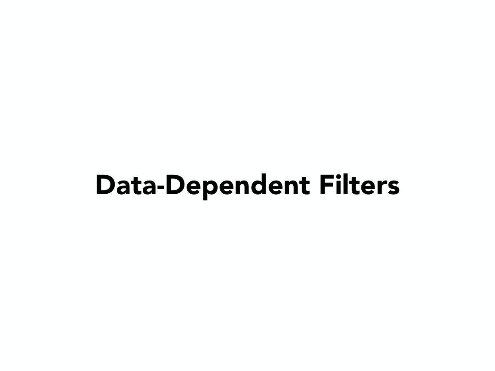

#### Median Filter

*PDF p47 · 对应本节：中值为何能去掉孤立脉冲？*

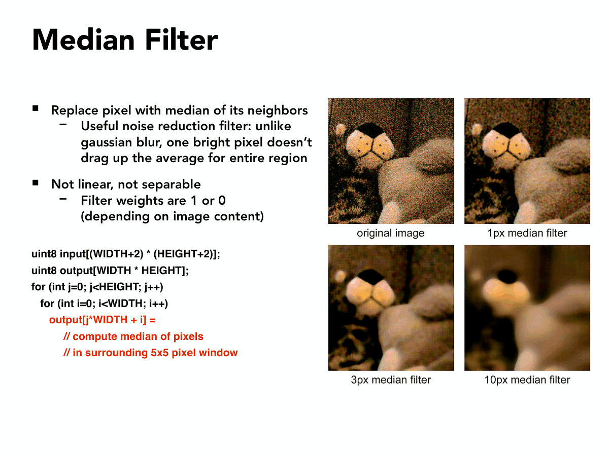

</details>

## 8. 双边滤波为何需要归一化分母？

双边滤波同时考虑空间距离和像素值相似程度：隔着明显边缘的像素权重下降，所以比普通 Gaussian 更能保持边界。

原页 p50 展示加权和但省略归一化。权重随图像变化，必须逐像素除权重和，否则即使常数图也可能改变亮度。本节保留原页并明确补足这一步。

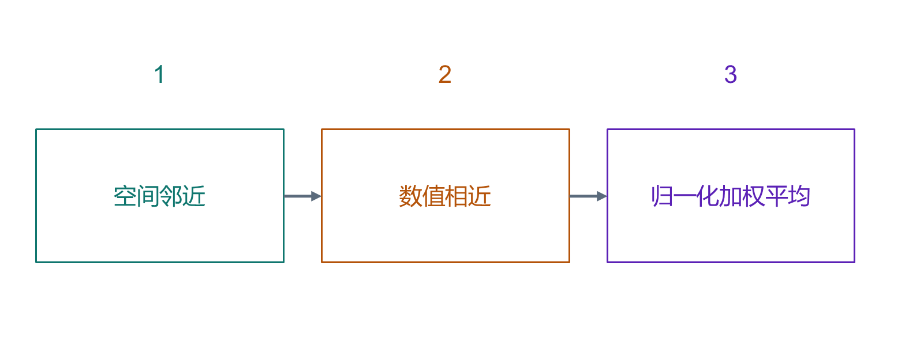

*读图：空间邻近 → 数值相近 → 归一化加权平均。箭头表示本节的推理或处理顺序，具体条件见正文。*

### 先读符号与条件

| 符号 / 条件 | 含义 |
| --- | --- |
| ws | 空间权重 |
| wr | 值域相似度权重 |
| 分母 | 局部归一化，通常含中心点确保非零 |

### 核心关系与推导入口

以下关系使用上述条件；标为教学简化或补充的内容是为理解而推导，不是逐字转录课件。

$$
I'(p)=\frac{\sum_q w_s(p,q)w_r(I(p),I(q))I(q)}{\sum_q w_s(p,q)w_r(I(p),I(q))}
$$

### 🔧 手算 8：把关系落到数字上

两值 10、100，最终权重 1、0.01，输出 (10+1)/1.01≈10.8911。若二者都为 10，则归一化后仍为 10；漏除分母则为 10.1。

| 检查步骤 | 操作 |
| --- | --- |
| 输入 | 先从例子中抄下给定量及单位，不引入未给定的数值。 |
| 计算 | 按本节关系求中间量，再得到结果；不要在第一步就做显示裁剪或整数舍入。 |
| 回查 | 若二者都为 10，则归一化后仍为 10；漏除分母则为 10.1。 |
| 适用边界 | 强噪声可能破坏相似度判断；双边滤波不是保证恢复所有边缘的魔法。 |

### ⚠️ 易错点：先识别症状与假设

强噪声可能破坏相似度判断；双边滤波不是保证恢复所有边缘的魔法。

### 停下来解释一次

**问题：双边滤波为什么不是线性卷积？**

<details>
<summary>展开参考回答</summary>

权重依赖当前图像像素值，换输入就换了算子。

</details>

<details>
<summary>展开原课件关键页，对照术语与图形</summary>

#### Bilateral Filter

*PDF p48 · 对应本节：双边滤波为何需要归一化分母？*

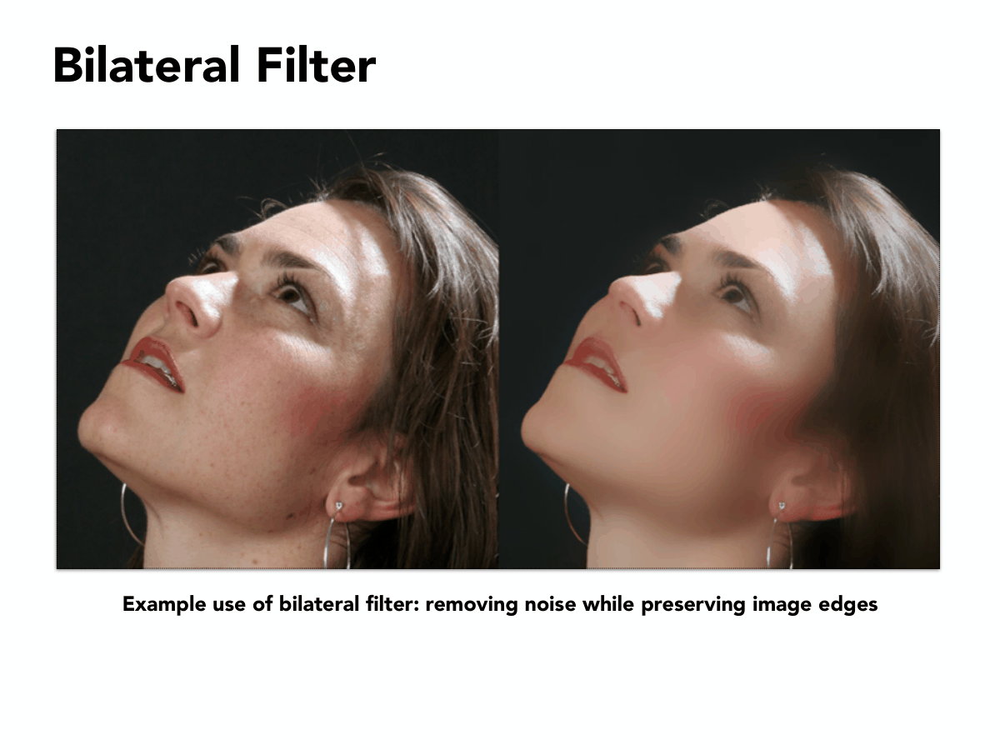

#### Intuition

*PDF p49 · 对应本节：双边滤波为何需要归一化分母？*

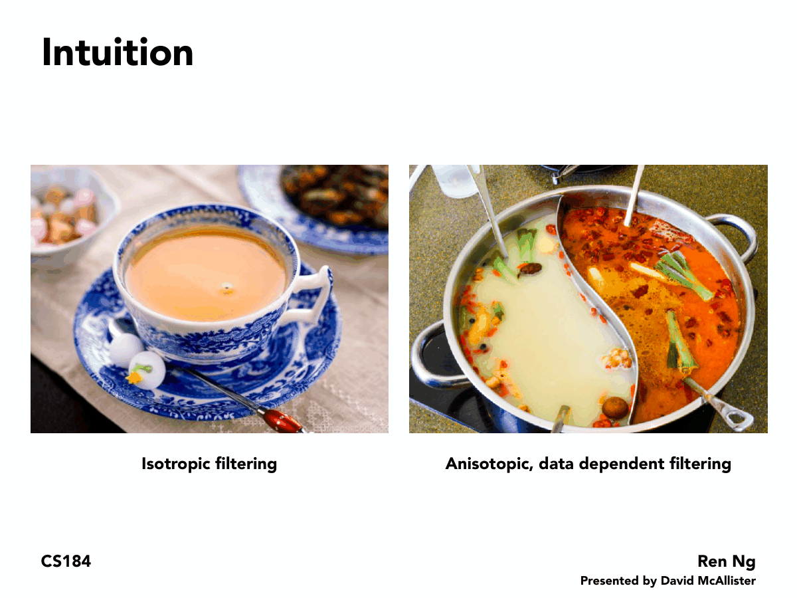

#### Bilateral Filter

*PDF p50 · 对应本节：双边滤波为何需要归一化分母？*

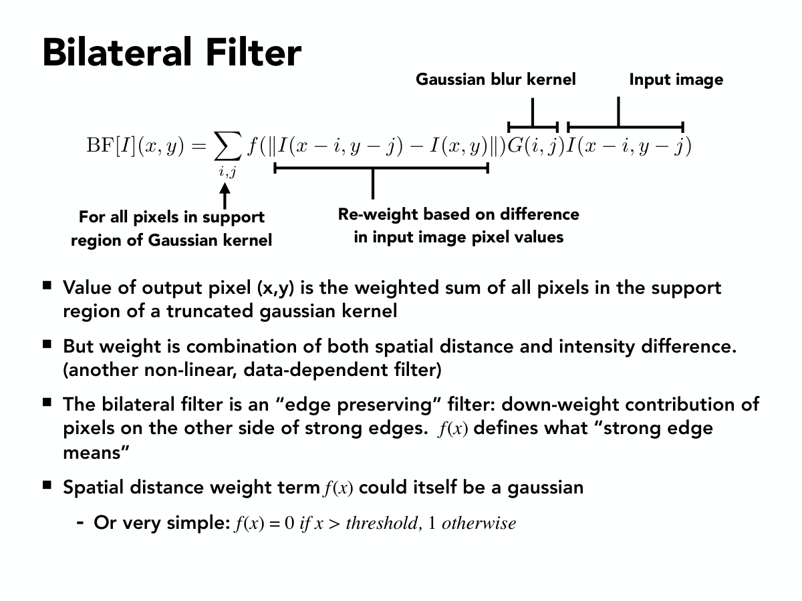

#### Bilateral Filter

*PDF p51 · 对应本节：双边滤波为何需要归一化分母？*

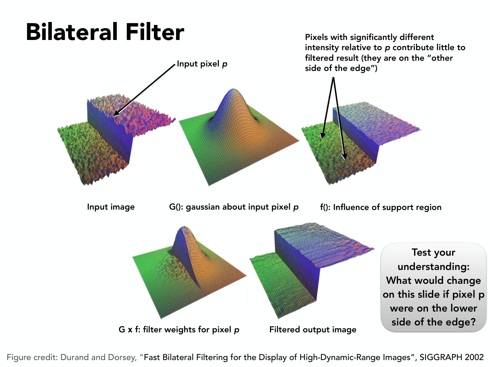

#### Bilateral Filter: Kernel Depends on Image Content

*PDF p52 · 对应本节：双边滤波为何需要归一化分母？*

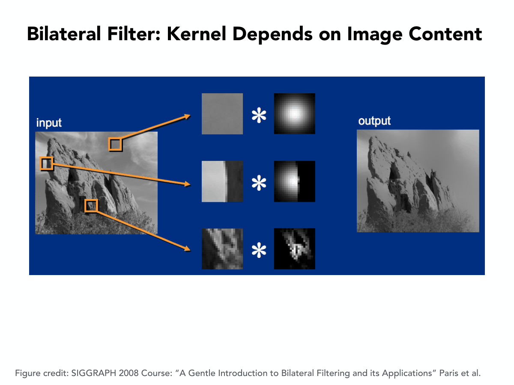

</details>

## 9. JPEG 为什么先分亮度与色度？

JPEG 利用视觉对不同信息的敏感度差异，把编码 RGB 转为亮度样通道 Y′ 和色度通道，再可对色度降采样。Y′ 是 luma，不能直接当物理 luminance Y。

4:2:0 通常在水平和垂直方向各把色度采样减半，亮度保留更高空间分辨率。彩色细字或锐利边界可能暴露这一取舍。


*读图：编码颜色 → 亮度色度分离 → 选择性色度降采样。箭头表示本节的推理或处理顺序，具体条件见正文。*

### 先读符号与条件

| 符号 / 条件 | 含义 |
| --- | --- |
| Y′ | W×H |
| Cb、Cr | 各 W/2×H/2 |
| 假设 | 偶数尺寸，忽略边界补齐 |

### 核心关系与推导入口

以下关系使用上述条件；标为教学简化或补充的内容是为理解而推导，不是逐字转录课件。

$$
N_{420}=WH+2\frac W2\frac H2=1.5WH
$$

### 🔧 手算 9：把关系落到数字上

16×16 区域，亮度 256 个样本，两色度各 64，总计 384；未降采样三通道为 768，样本数减半。

| 检查步骤 | 操作 |
| --- | --- |
| 输入 | 先从例子中抄下给定量及单位，不引入未给定的数值。 |
| 计算 | 按本节关系求中间量，再得到结果；不要在第一步就做显示裁剪或整数舍入。 |
| 回查 | 16×16 区域，亮度 256 个样本，两色度各 64，总计 384；未降采样三通道为 768，样本数减半。 |
| 适用边界 | 4:2:0 不是把所有通道都缩成四分之一；DCT 的每个实际通道块仍是 8×8 样本。 |

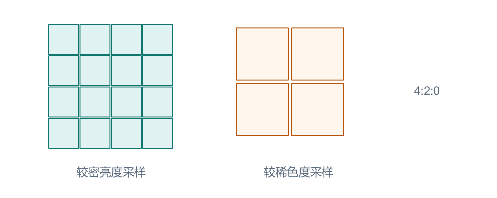

*色度降采样与亮度保留不同空间分辨率，图中方块表示采样区域。*

### ⚠️ 易错点：先识别症状与假设

4:2:0 不是把所有通道都缩成四分之一；DCT 的每个实际通道块仍是 8×8 样本。

### 停下来解释一次

**问题：为何照片压缩好看，彩色小字却容易糊边？**

<details>
<summary>展开参考回答</summary>

小字包含高频色度边缘，色度降采样会直接丢失这些细节。

</details>

<details>
<summary>展开原课件关键页，对照术语与图形</summary>

#### JPEG Compression: The Big Ideas

*PDF p3 · 对应本节：JPEG 为什么先分亮度与色度？*


#### Y’CbCr Color Space

*PDF p4 · 对应本节：JPEG 为什么先分亮度与色度？*


#### Example Image

*PDF p5 · 对应本节：JPEG 为什么先分亮度与色度？*

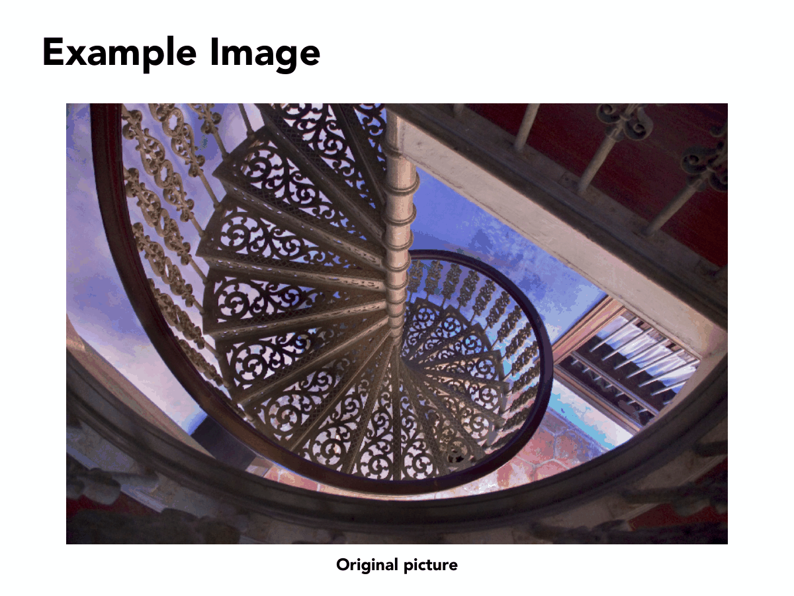

#### Y’ Only (Luma)

*PDF p6 · 对应本节：JPEG 为什么先分亮度与色度？*

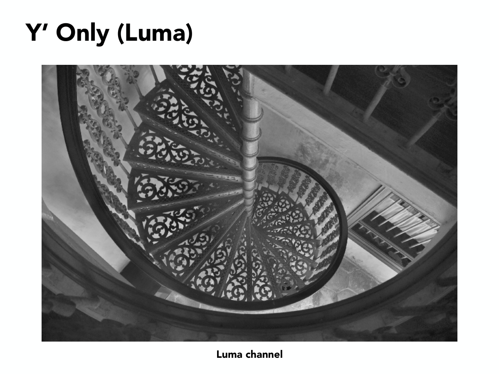

#### CbCr Only (Chroma)

*PDF p8 · 对应本节：JPEG 为什么先分亮度与色度？*

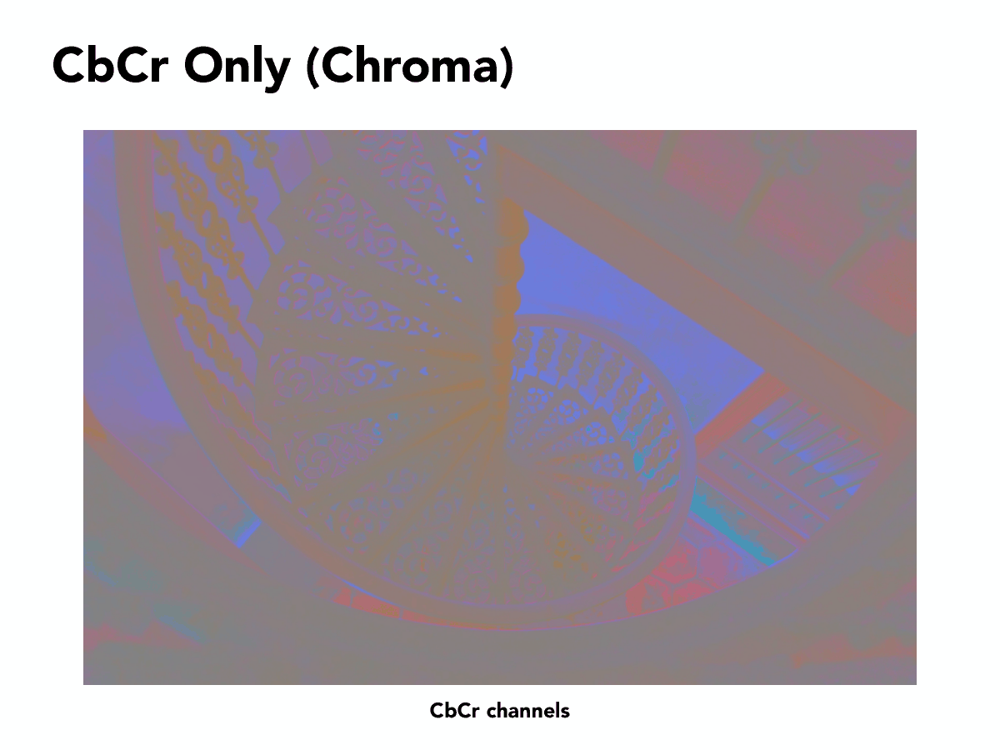

#### Example: Compression in Y’ Channel

*PDF p10 · 对应本节：JPEG 为什么先分亮度与色度？*


#### Example: Compression in CbCr Channels

*PDF p11 · 对应本节：JPEG 为什么先分亮度与色度？*


#### JPEG: Chroma Subsampling in Y’CbCr Space

*PDF p13 · 对应本节：JPEG 为什么先分亮度与色度？*


</details>

## 10. DCT 与量化分别损失了什么？

DCT 只是把 8×8 像素块改写成 64 个频率基系数，理想算术中可逆；主要有损环节是量化和可能的色度降采样。量化用更大步长粗略表示不敏感的高频。

各通道 DCT 都在 8×8 样本块上；4:2:0 的色度块覆盖原图较大的空间区域，不应误写成对实际 16×16 色度数组做同一种 JPEG DCT。


*读图：像素块变换 → 频率系数量化 → 不可逆细节丢失。箭头表示本节的推理或处理顺序，具体条件见正文。*

### 先读符号与条件

| 符号 / 条件 | 含义 |
| --- | --- |
| c | 变换系数 |
| q | 量化步长 |
| 误差 | 舍入规则下通常不超过 q/2 |

### 核心关系与推导入口

以下关系使用上述条件；标为教学简化或补充的内容是为理解而推导，不是逐字转录课件。

$$
\hat c=\operatorname{round}(c/q),\qquad c_{recon}=q\hat c
$$

### 🔧 手算 10：把关系落到数字上

c=23、q=10，量化为 2，重建 20，误差 -3；c=4 时量化 0，细小系数完全消失。23/10=2.3 舍入到 2。

| 检查步骤 | 操作 |
| --- | --- |
| 输入 | 先从例子中抄下给定量及单位，不引入未给定的数值。 |
| 计算 | 按本节关系求中间量，再得到结果；不要在第一步就做显示裁剪或整数舍入。 |
| 回查 | 23/10=2.3 舍入到 2。 |
| 适用边界 | 低 JPEG quality 通常意味着更粗量化，参数的具体映射依实现，不是一个统一物理单位。 |


*量化步长 10 将系数 23 还原成 20，误差为 3；变换本身并非这个损失来源。*

### ⚠️ 易错点：先识别症状与假设

低 JPEG quality 通常意味着更粗量化，参数的具体映射依实现，不是一个统一物理单位。

### 停下来解释一次

**问题：JPEG 是因为使用 DCT 才有损的吗？**

<details>
<summary>展开参考回答</summary>

DCT 本身不是主要有损原因；量化、降采样和有限精度才会丢失信息。

</details>

<details>
<summary>展开原课件关键页，对照术语与图形</summary>

#### JPEG: Discrete Cosine Transform (DCT)

*PDF p14 · 对应本节：DCT 与量化分别损失了什么？*


#### JPEG Quantization: Prioritize Low Frequencies

*PDF p15 · 对应本节：DCT 与量化分别损失了什么？*


#### JPEG: Compression Artifacts

*PDF p16 · 对应本节：DCT 与量化分别损失了什么？*


#### JPEG: Compression Artifacts

*PDF p17 · 对应本节：DCT 与量化分别损失了什么？*


</details>

## 11. 熵编码与反复保存为何不同？

量化后很多高频系数为零，按频率相关顺序扫描能形成长零串，再利用游程与熵编码减少字节。这些编码对量化后的符号可以无损，但不能恢复量化前丢掉的系数。

反复解码、编辑、重新量化可能累积误差，尤其块对齐或参数变化时。对科研渲染中间结果应保存合适的无损或高动态格式，再生成发布版本。


*读图：量化产生零 → 重排与游程 → 熵编码存储。箭头表示本节的推理或处理顺序，具体条件见正文。*

### 先读符号与条件

| 符号 / 条件 | 含义 |
| --- | --- |
| 第一箭头 | 可能有损 |
| 第二箭头 | 对已有符号无损 |
| 总体 | 不能因此称无损图像压缩 |

### 核心关系与推导入口

以下关系使用上述条件；标为教学简化或补充的内容是为理解而推导，不是逐字转录课件。

$$
\text{原像素}\to\text{量化系数}\to\text{无损编码符号}
$$

### 🔧 手算 11：把关系落到数字上

系数序列 (5,0,0,0,2) 可概念性记录为非零 5、连续 3 个零、非零 2；解回序列完全相同，却无法知道原来三个系数是 0.1 还是 0.4。

| 检查步骤 | 操作 |
| --- | --- |
| 输入 | 先从例子中抄下给定量及单位，不引入未给定的数值。 |
| 计算 | 按本节关系求中间量，再得到结果；不要在第一步就做显示裁剪或整数舍入。 |
| 回查 | 系数序列 (5,0,0,0,2) 可概念性记录为非零 5、连续 3 个零、非零 2；解回序列完全相同，却无法知道原来三个系数是 0.1 还是 0.4。 |
| 适用边界 | “Huffman 是无损的”不能推出 JPEG 整体无损；应定位损失发生的阶段。 |

### ⚠️ 易错点：先识别症状与假设

“Huffman 是无损的”不能推出 JPEG 整体无损；应定位损失发生的阶段。

### 停下来解释一次

**问题：把 JPEG 转成 PNG 能恢复压缩前细节吗？**

<details>
<summary>展开参考回答</summary>

不能。PNG 只无损保存当前已解码结果，丢失的信息不会自动回来。

</details>

<details>
<summary>展开原课件关键页，对照术语与图形</summary>

#### Lossless Compression of Quantized DCT Values

*PDF p18 · 对应本节：熵编码与反复保存为何不同？*


#### JPEG Compression Summary

*PDF p19 · 对应本节：熵编码与反复保存为何不同？*


</details>

## 12. 纹理合成怎样从样本生成新区域？

非参数纹理合成比较待生成像素附近的已知邻域与源纹理候选邻域，从相似候选的中心值抽样。它把局部统计相似性转成新图像，而不是简单平铺。

窗口太小可能丢失大结构，太大又可能难以找到匹配；图像补全还需区分已知与未知邻域。现代生成模型不是这份课件算法的同义词，此处按原课件局部匹配机制解释。


*读图：已知目标邻域 → 寻找相似源邻域 → 采样候选中心值。箭头表示本节的推理或处理顺序，具体条件见正文。*

### 先读符号与条件

| 符号 / 条件 | 含义 |
| --- | --- |
| Nknown | 目标邻域中已知位置 |
| wr | 比较权重 |
| q | 源纹理候选中心 |

### 核心关系与推导入口

以下关系使用上述条件；标为教学简化或补充的内容是为理解而推导，不是逐字转录课件。

$$
d(p,q)=\sum_{r\in\mathcal N_{known}}w_r\|I(p+r)-I(q+r)\|^2
$$

### 🔧 手算 12：把关系落到数字上

目标已知邻域 (1,2)，候选 A=(1,3)、B=(2,4)，等权平方距离分别 1 和 5，A 更相似；但仍可在若干近邻中随机选取以避免机械重复。

| 检查步骤 | 操作 |
| --- | --- |
| 输入 | 先从例子中抄下给定量及单位，不引入未给定的数值。 |
| 计算 | 按本节关系求中间量，再得到结果；不要在第一步就做显示裁剪或整数舍入。 |
| 回查 | 目标已知邻域 (1,2)，候选 A=(1,3)、B=(2,4)，等权平方距离分别 1 和 5，A 更相似；但仍可在若干近邻中随机选取以避免机械重复。 |
| 适用边界 | 未知像素不能当零参与普通距离，否则会偏向暗纹理；要使用有效掩码和归一化。 |


*纹理合成通过已知邻域比较候选，不应将未知区域当作零参与距离。*

### ⚠️ 易错点：先识别症状与假设

未知像素不能当零参与普通距离，否则会偏向暗纹理；要使用有效掩码和归一化。

### 停下来解释一次

**问题：局部匹配好是否保证全局结构正确？**

<details>
<summary>展开参考回答</summary>

不保证。长线条、对称与大尺度语义可能超出局部窗口的约束范围。

</details>

<details>
<summary>展开原课件关键页，对照术语与图形</summary>

#### Data-Driven Image Processing:

*PDF p54 · 对应本节：纹理合成怎样从样本生成新区域？*


#### Texture Synthesis

*PDF p55 · 对应本节：纹理合成怎样从样本生成新区域？*


#### Algorithm: Non-Parametric Texture Synthesis

*PDF p56 · 对应本节：纹理合成怎样从样本生成新区域？*


#### Non-Parametric Texture Synthesis

*PDF p57 · 对应本节：纹理合成怎样从样本生成新区域？*


#### More Texture Synthesis Examples

*PDF p58 · 对应本节：纹理合成怎样从样本生成新区域？*


#### Image Completion Example

*PDF p59 · 对应本节：纹理合成怎样从样本生成新区域？*


#### Things to Remember

*PDF p60 · 对应本节：纹理合成怎样从样本生成新区域？*


</details>

## 13. 把十二个数值例子连成检查顺序

先手算再运行。随仓库提供的 `scripts/cs184-numerical-checks.py` 是小模型验证，不依赖 GPU，也不修改服务器配置。它不能替代完整渲染场景或模拟系统的验证。

| 顺序 | 本节关系 | 最容易漏掉的约定 |
| --- | --- | --- |
| 1 | 图像处理为什么回到采样与颜色？ | 线性与非线性：需要逐算子判断 |
| 2 | 卷积怎样把邻域变成一个输出？ | 输出：应写入独立缓冲避免污染输入 |
| 3 | 均值与 Gaussian 为什么模糊得不同？ | 窗口：截断范围 |
| 4 | 锐化为何可能出现过冲？ | I-G*I：高频残差 |
| 5 | Sobel 为什么同时含差分和平滑？ | theta：梯度方向，不是边缘切线方向 |
| 6 | 可分离核怎样减少计算？ | 隐藏常数：两个一维 pass |
| 7 | 中值为何能去掉孤立脉冲？ | 这里：奇数窗口避免偶数定义差异 |
| 8 | 双边滤波为何需要归一化分母？ | 分母：局部归一化，通常含中心点确保非零 |
| 9 | JPEG 为什么先分亮度与色度？ | 假设：偶数尺寸，忽略边界补齐 |
| 10 | DCT 与量化分别损失了什么？ | 误差：舍入规则下通常不超过 q/2 |
| 11 | 熵编码与反复保存为何不同？ | 总体：不能因此称无损图像压缩 |
| 12 | 纹理合成怎样从样本生成新区域？ | q：源纹理候选中心 |

### 复现实验的最小记录

| 记录项 | 用途 |
| --- | --- |
| 固定输入 | 相同几何、材质、网格或信号，避免一次改变多个因素。 |
| 参数与单位 | 包括采样数、步长、分辨率、角度单位、颜色空间。 |
| 输出量 | 保留线性值、误差或状态，再生成展示图。 |
| 参考 | 解析解、手算或高精度结果必须说明来源。 |
| 失败样例 | 边界和极端条件是检查假设的入口。 |

## 14. 实现排查：把公式错误与系统错误分开

本节列出由模型和手算能够判断的排查方向；没有把尚未写出的完整应用测试说成已完成。最小数值检查的真实执行结果见本次发布核对报告。

### 阶段 1：第 1–4 节

| 涉及关系 | 错误机制 / 修正方向 |
| --- | --- |
| 图像处理为什么回到采样与颜色？ | 不知道输入是线性 RGB、编码 RGB 还是参数图时，不应盲目做颜色解码。 |
| 卷积怎样把邻域变成一个输出？ | 原地逐像素更新会让后面像素使用已滤波值，结果依赖遍历顺序。 |
| 均值与 Gaussian 为什么模糊得不同？ | 只把连续归一化常数代入截断离散核，权重和未必精确为 1。 |
| 锐化为何可能出现过冲？ | 使用无符号 8 位直接做负权重运算会溢出或提前截断；先转浮点或更宽整数。 |

### 阶段 2：第 5–8 节

| 涉及关系 | 错误机制 / 修正方向 |
| --- | --- |
| Sobel 为什么同时含差分和平滑？ | 不要只用 atan(Gy/Gx)，它丢象限并在 Gx=0 时出问题。 |
| 可分离核怎样减少计算？ | 速度比还受内存与实现影响，7.5 是操作数比，不是实测性能承诺。 |
| 中值为何能去掉孤立脉冲？ | 去噪前应先判断噪声类型，不能把所有亮点都当作脉冲错误。 |
| 双边滤波为何需要归一化分母？ | 强噪声可能破坏相似度判断；双边滤波不是保证恢复所有边缘的魔法。 |

### 阶段 3：第 9–12 节

| 涉及关系 | 错误机制 / 修正方向 |
| --- | --- |
| JPEG 为什么先分亮度与色度？ | 4:2:0 不是把所有通道都缩成四分之一；DCT 的每个实际通道块仍是 8×8 样本。 |
| DCT 与量化分别损失了什么？ | 低 JPEG quality 通常意味着更粗量化，参数的具体映射依实现，不是一个统一物理单位。 |
| 熵编码与反复保存为何不同？ | “Huffman 是无损的”不能推出 JPEG 整体无损；应定位损失发生的阶段。 |
| 纹理合成怎样从样本生成新区域？ | 未知像素不能当零参与普通距离，否则会偏向暗纹理；要使用有效掩码和归一化。 |

## 15. 跨讲连接：同一工具在哪些尺度重复出现？

| 前置工具 | 在整门课里的用途 | 回查 |
| --- | --- | --- |
| 采样与积分 | 像素、光源、孔径、时间、方向都需要有限样本估计连续量。 | [L03](/notes/cs184-03-sampling-aliasing/) / [L15](/notes/cs184-15-monte-carlo-integration/) |
| 坐标与线性代数 | 相机、法线、骨架与局部速度都需要一致的参考系。 | [L04–05](/notes/cs184-04-05-transforms/) |
| 几何表示 | 可见性、接触、遮挡与网格邻域依赖可靠的几何关系。 | [L11–12](/notes/cs184-11-12-meshes-geometry/) |
| 物理量与单位 | 把颜色值、概率密度、力和能量区别开，防止错误补偿。 | [L14](/notes/cs184-14-radiometry/) |
| 颜色与显示 | 展示图不等于线性数据；显示变换会改变视觉比较。 | [L19–20](/notes/cs184-19-20-color-science/) |

回头看，许多错误并非来自复杂公式，而是来自“同一个词指了不同的量”：方向密度与概率、位置与方向、线性颜色与编码颜色、稳定与准确。先说清对象，再选择算法。

## 16. 自测：能否不看公式说清楚？

### 自测 1. 为什么图像数值相同的两份文件可能显示不同？

<details>
<summary>参考答案</summary>

颜色配置、传递函数和显示解释可能不同，数组之外的元数据也有意义。

</details>

### 自测 2. 核权重和为 1 能保证什么？

<details>
<summary>参考答案</summary>

对完整邻域和合适边界，常数图像保持常数；不能单凭此保证保边或无振铃。

</details>

### 自测 3. 扩大核一定比增大 σ 等价吗？

<details>
<summary>参考答案</summary>

不。只扩大截断窗口而不改 σ，可能只纳入微小尾部；两者参数含义不同。

</details>

### 自测 4. 锐化后边缘更明显能证明分辨率提高吗？

<details>
<summary>参考答案</summary>

不能。对比增强与恢复真实高频信息是不同事情。

</details>

### 自测 5. 竖直边缘主要对应哪种强度变化？

<details>
<summary>参考答案</summary>

通常是沿水平方向变化，因此 Gx 较大；须确认坐标和核约定。

</details>

### 自测 6. 怎样快速检查一个小核是否可分离？

<details>
<summary>参考答案</summary>

可看矩阵秩是否为 1，或判断各非零行是否成比例；浮点近似还需误差容限。

</details>

### 自测 7. 中值滤波能写成固定卷积核吗？

<details>
<summary>参考答案</summary>

一般不能，因为哪个样本被选中依赖输入数据排序。

</details>

### 自测 8. 双边滤波为什么不是线性卷积？

<details>
<summary>参考答案</summary>

权重依赖当前图像像素值，换输入就换了算子。

</details>

### 自测 9. 为何照片压缩好看，彩色小字却容易糊边？

<details>
<summary>参考答案</summary>

小字包含高频色度边缘，色度降采样会直接丢失这些细节。

</details>

### 自测 10. JPEG 是因为使用 DCT 才有损的吗？

<details>
<summary>参考答案</summary>

DCT 本身不是主要有损原因；量化、降采样和有限精度才会丢失信息。

</details>

### 自测 11. 把 JPEG 转成 PNG 能恢复压缩前细节吗？

<details>
<summary>参考答案</summary>

不能。PNG 只无损保存当前已解码结果，丢失的信息不会自动回来。

</details>

### 自测 12. 局部匹配好是否保证全局结构正确？

<details>
<summary>参考答案</summary>

不保证。长线条、对称与大尺度语义可能超出局部窗口的约束范围。

</details>

### 自测 13. 第 1 节的数值例子，哪一项假设不能悄悄删掉？

<details>
<summary>参考答案与反例入口</summary>

不知道输入是线性 RGB、编码 RGB 还是参数图时，不应盲目做颜色解码。

再复算本节的例子：像素 (0,1) 的算术均值为 0.5；若它们是 γ=2.2 编码的黑白，物理平均对应编码约 0.72974。相同数组操作含义取决于数据空间。

</details>

### 自测 14. 第 2 节的数值例子，哪一项假设不能悄悄删掉？

<details>
<summary>参考答案与反例入口</summary>

原地逐像素更新会让后面像素使用已滤波值，结果依赖遍历顺序。

再复算本节的例子：一维对称核 (1/4,1/2,1/4) 作用邻域 (0,2,4)，输出 2。常数输入全为 3，输出 3×(1/4+1/2+1/4)=3。

</details>

### 自测 15. 第 3 节的数值例子，哪一项假设不能悄悄删掉？

<details>
<summary>参考答案与反例入口</summary>

只把连续归一化常数代入截断离散核，权重和未必精确为 1。

再复算本节的例子：一维权重 (1,2,1) 归一化为 (1/4,1/2,1/4)。邻域 (0,4,0) 输出 2；三点均值则 4/3。中心权重差解释结果。

</details>

### 自测 16. 第 4 节的数值例子，哪一项假设不能悄悄删掉？

<details>
<summary>参考答案与反例入口</summary>

使用无符号 8 位直接做负权重运算会溢出或提前截断；先转浮点或更宽整数。

再复算本节的例子：中心像素 10，四邻都是 8，课件核输出 5×10-4×8=18，超过原局部最大值 10。若全为 10，则输出 10。

</details>

### 自测 17. 第 5 节的数值例子，哪一项假设不能悄悄删掉？

<details>
<summary>参考答案与反例入口</summary>

不要只用 atan(Gy/Gx)，它丢象限并在 Gx=0 时出问题。

再复算本节的例子：Gx=3、Gy=4，模长为 5，方向约 53.13°。回算 5cosθ=3、5sinθ=4。边缘切线与梯度相差 90°。

</details>

### 自测 18. 第 6 节的数值例子，哪一项假设不能悄悄删掉？

<details>
<summary>参考答案与反例入口</summary>

速度比还受内存与实现影响，7.5 是操作数比，不是实测性能承诺。

再复算本节的例子：k=15，直接每像素 225 次权重累加，两次一维约 30 次，理论算术比例 7.5。若只算一次一维 15，会少做一个方向。

</details>

### 自测 19. 第 7 节的数值例子，哪一项假设不能悄悄删掉？

<details>
<summary>参考答案与反例入口</summary>

去噪前应先判断噪声类型，不能把所有亮点都当作脉冲错误。

再复算本节的例子：邻域 (10,11,255,10,9) 排序为 (9,10,10,11,255)，中值 10，均值 59。若 255 是真实细亮点，中值也会将其消除。

</details>

### 自测 20. 第 8 节的数值例子，哪一项假设不能悄悄删掉？

<details>
<summary>参考答案与反例入口</summary>

强噪声可能破坏相似度判断；双边滤波不是保证恢复所有边缘的魔法。

再复算本节的例子：两值 10、100，最终权重 1、0.01，输出 (10+1)/1.01≈10.8911。若二者都为 10，则归一化后仍为 10；漏除分母则为 10.1。

</details>

### 自测 21. 第 9 节的数值例子，哪一项假设不能悄悄删掉？

<details>
<summary>参考答案与反例入口</summary>

4:2:0 不是把所有通道都缩成四分之一；DCT 的每个实际通道块仍是 8×8 样本。

再复算本节的例子：16×16 区域，亮度 256 个样本，两色度各 64，总计 384；未降采样三通道为 768，样本数减半。

</details>

### 自测 22. 第 10 节的数值例子，哪一项假设不能悄悄删掉？

<details>
<summary>参考答案与反例入口</summary>

低 JPEG quality 通常意味着更粗量化，参数的具体映射依实现，不是一个统一物理单位。

再复算本节的例子：c=23、q=10，量化为 2，重建 20，误差 -3；c=4 时量化 0，细小系数完全消失。23/10=2.3 舍入到 2。

</details>

### 自测 23. 第 11 节的数值例子，哪一项假设不能悄悄删掉？

<details>
<summary>参考答案与反例入口</summary>

“Huffman 是无损的”不能推出 JPEG 整体无损；应定位损失发生的阶段。

再复算本节的例子：系数序列 (5,0,0,0,2) 可概念性记录为非零 5、连续 3 个零、非零 2；解回序列完全相同，却无法知道原来三个系数是 0.1 还是 0.4。

</details>

### 自测 24. 第 12 节的数值例子，哪一项假设不能悄悄删掉？

<details>
<summary>参考答案与反例入口</summary>

未知像素不能当零参与普通距离，否则会偏向暗纹理；要使用有效掩码和归一化。

再复算本节的例子：目标已知邻域 (1,2)，候选 A=(1,3)、B=(2,4)，等权平方距离分别 1 和 5，A 更相似；但仍可在若干近邻中随机选取以避免机械重复。

</details>

### 自测 25. 本讲的输入、输出和中间表示各是什么？

<details>
<summary>参考答案</summary>

图像是离散信号 → 线性滤波 → 梯度与锐化 → 利用可分离性 → 数据依赖过滤 → 频率量化与压缩。请沿箭头逐项解释，尤其说清中间表示的单位、坐标或概率测度；只复述名词不算掌握。

</details>

### 自测 26. 能否只用一张“看起来正确”的图片证明实现正确？

<details>
<summary>参考答案</summary>

不能。需要将关键关系拆成可预测的小输入，检查数值、边界与对照；随机方法还要区分一次结果与统计期望，显示图还需区分编码与原始数据。

</details>

## 17. 带走的结论与仍需练习的内容

- 颜色配置、传递函数和显示解释可能不同，数组之外的元数据也有意义。
- 对完整邻域和合适边界，常数图像保持常数；不能单凭此保证保边或无振铃。
- 不。只扩大截断窗口而不改 σ，可能只纳入微小尾部；两者参数含义不同。
- 不能。对比增强与恢复真实高频信息是不同事情。
- 通常是沿水平方向变化，因此 Gx 较大；须确认坐标和核约定。
- 可看矩阵秩是否为 1，或判断各非零行是否成比例；浮点近似还需误差容限。
- 一般不能，因为哪个样本被选中依赖输入数据排序。
- 权重依赖当前图像像素值，换输入就换了算子。
- 小字包含高频色度边缘，色度降采样会直接丢失这些细节。
- DCT 本身不是主要有损原因；量化、降采样和有限精度才会丢失信息。
- 不能。PNG 只无损保存当前已解码结果，丢失的信息不会自动回来。
- 不保证。长线条、对称与大尺度语义可能超出局部窗口的约束范围。

| 层次 | 已经说明 | 还需动手验证 |
| --- | --- | --- |
| 概念 | 本篇十二个问题、公式与原页对应。 | 用自己的话重新解释，并给出一个反例。 |
| 数值 | 正文手算与解析小模型。 | 改变一个输入，预测再运行。 |
| 系统 | 指出实现条件和典型错误。 | 完整应用需另外检查场景、性能和边界。 |

## 18. 整门课闭环与继续阅读

| 讲义 | 起点问题 | 得到的工具或终点 |
| --- | --- | --- |
| [L01 · 导论](/notes/cs184-01-introduction/) | 这门课在求什么？ | 从场景到像素与感知 |
| [L02 · 三角形与覆盖](/notes/cs184-02-drawing-triangles/) | 像素由哪些图元覆盖？ | 半平面判定与插值 |
| [L03 · 采样与抗锯齿](/notes/cs184-03-sampling-aliasing/) | 离散图像为何锯齿？ | 区域积分、过滤与采样 |
| [L04–05 · 变换](/notes/cs184-04-05-transforms/) | 怎样放置物体和相机？ | 坐标系、矩阵与投影 |
| [L06–07 · 纹理](/notes/cs184-06-07-texture-mapping/) | 表面参数如何随位置变化？ | UV、过滤与像素足迹 |
| [L08–09 · 着色](/notes/cs184-08-09-rasterization-shading/) | 看见哪个表面、怎样着色？ | 深度、管线与局部照明 |
| [L10 · 曲线曲面](/notes/cs184-10-bezier-curves-surfaces/) | 怎样控制连续形状？ | 插值、逼近与连续性 |
| [L11–12 · 几何](/notes/cs184-11-12-meshes-geometry/) | 复杂表面如何表示和操作？ | 网格、拓扑与几何处理 |
| [L13 · 光线追踪](/notes/cs184-13-ray-tracing-acceleration/) | 光线怎样快速找到最近表面？ | 求交与 BVH |
| [第 14 讲](/notes/cs184-14-radiometry/) | 能量 | 半球积分 |
| [第 15 讲](/notes/cs184-15-monte-carlo-integration/) | 像素是积分 | 降低方差 |
| [第 16–17 讲](/notes/cs184-16-17-global-illumination/) | 命中表面 | 加权累积与终止 |
| [春季 L18](/notes/cs184-18-material-modeling/) | 材质是散射规律 | 更细结构与体积传播 |
| [春季 L19–20](/notes/cs184-19-20-color-science/) | 光谱进入眼睛 | 线性运算与显示 |
| [春季 L21–23](/notes/cs184-21-23-animation/) | 表达运动意图 | 从末端目标反求关节 |
| [春季 L24](/notes/cs184-24-physical-simulation/) | 选择状态 | 施加碰撞和约束 |
| [春季 L25](/notes/cs184-25-fluid-simulation/) | 粒子或网格表示 | 边界与数值误差 |
| [春季 L26–27](/notes/cs184-26-27-virtual-reality/) | 人眼需要哪些线索 | 全景与光场 |
| [补充 A](/notes/cs184-supplement-cameras-lenses/) | 视场与透视 | 真实镜头与传感器 |
| [补充 B](/notes/cs184-supplement-image-processing/) | 图像是离散信号 | 频率量化与压缩 |

春季 L18–27 与夏季补充专题保留本地文件标识，**不冒充不存在的秋季同编号讲次**。可以按上表顺序学习，也可在相机、颜色、采样之间按依赖往返。

## 19. 原课件全页索引与来源

[原课件文件与版本记录](https://github.com/Teddy-Yangjiale/CS184/blob/main/CS184_2026/su26/lectures/SU26-L22-image-processing.pdf) · [课程官网](https://cs184.eecs.berkeley.edu/su26/)

文件：`SU26-L22-image-processing.pdf`；PDF 页数：61；SHA-256：`640e33cc57fca533d077bfd3cee244885e46d1b36027b7ec0b4acf20d701f60c`。

“正文核对”表示本篇实际引用该页截图；“索引保留”包括演示、行政信息、补充、致谢与重复构建页，不表示逐页都有独立讲解。原视频的运动过程不能由静态 PDF 截图完整复现。

| PDF 页 | 原页可提取标题 | 本篇使用 |
| --- | --- | --- |
| 1 | Computer Graphics and Imaging | 索引保留 |
| 2 | Case Study: JPEG Compression | 正文核对 |
| 3 | JPEG Compression: The Big Ideas | 正文核对 |
| 4 | Y’CbCr Color Space | 正文核对 |
| 5 | Example Image | 正文核对 |
| 6 | Y’ Only (Luma) | 正文核对 |
| 7 | Downsampled Y’ | 索引保留 |
| 8 | CbCr Only (Chroma) | 正文核对 |
| 9 | Downsampled CbCr | 索引保留 |
| 10 | Example: Compression in Y’ Channel | 正文核对 |
| 11 | Example: Compression in CbCr Channels | 正文核对 |
| 12 | Original Image | 索引保留 |
| 13 | JPEG: Chroma Subsampling in Y’CbCr Space | 正文核对 |
| 14 | JPEG: Discrete Cosine Transform (DCT) | 正文核对 |
| 15 | JPEG Quantization: Prioritize Low Frequencies | 正文核对 |
| 16 | JPEG: Compression Artifacts | 正文核对 |
| 17 | JPEG: Compression Artifacts | 正文核对 |
| 18 | Lossless Compression of Quantized DCT Values | 正文核对 |
| 19 | JPEG Compression Summary | 正文核对 |
| 20 | Theme: Exploit Perception in Visual Computing | 正文核对 |
| 21 | Attendance Time | 索引保留 |
| 22 | Basic Image Processing Operations | 正文核对 |
| 23 | Example Image Processing Operations | 正文核对 |
| 24 | Example Image Processing Operations | 正文核对 |
| 25 | Edge Detection | 正文核对 |
| 26 | A “Smarter” Blur (Preserves Crisp Edges) | 正文核对 |
| 27 | Denoising | 正文核对 |
| 28 | Review: Convolution | 正文核对 |
| 29 | Discrete 2D Convolution | 正文核对 |
| 30 | Simple 3x3 Box Blur | 正文核对 |
| 31 | 7x7 Box Blur | 正文核对 |
| 32 | Gaussian Blur | 正文核对 |
| 33 | 7x7 Gaussian Blur | 正文核对 |
| 34 | Compare: 7x7 Box Blur | 正文核对 |
| 35 | What Does Convolution with this Filter Do? | 正文核对 |
| 36 | 3x3 Sharpen Filter | 正文核对 |
| 37 | What Does Convolution with these Filters Do? | 正文核对 |
| 38 | Gradient Detection Filters | 正文核对 |
| 39 | Sobel Edge Detection | 正文核对 |
| 40 | Algorithmic Cost of | 正文核对 |
| 41 | Cost of Convolution with N x N Filter? | 正文核对 |
| 42 | Separable Filters | 正文核对 |
| 43 | Fast 2D Box Blur via Two 1D Convolutions | 正文核对 |
| 44 | Recall: Convolution Theorem | 正文核对 |
| 45 | Efficiency? | 正文核对 |
| 46 | Data-Dependent Filters | 正文核对 |
| 47 | Median Filter | 正文核对 |
| 48 | Bilateral Filter | 正文核对 |
| 49 | Intuition | 正文核对 |
| 50 | Bilateral Filter | 正文核对 |
| 51 | Bilateral Filter | 正文核对 |
| 52 | Bilateral Filter: Kernel Depends on Image Content | 正文核对 |
| 53 | Attendance Time | 索引保留 |
| 54 | Data-Driven Image Processing: | 正文核对 |
| 55 | Texture Synthesis | 正文核对 |
| 56 | Algorithm: Non-Parametric Texture Synthesis | 正文核对 |
| 57 | Non-Parametric Texture Synthesis | 正文核对 |
| 58 | More Texture Synthesis Examples | 正文核对 |
| 59 | Image Completion Example | 正文核对 |
| 60 | Things to Remember | 正文核对 |
| 61 | Acknowledgments | 索引保留 |
