> Dosovitskiy 等《An Image is Worth 16×16 Words: Transformers for Image Recognition at Scale》（ICLR 2021）逐图拆解。**每张关键图表都截自原论文**，图下先给原文要点，再补上机制解释、设计动机、手算例子与易错点。关键图附「🖼 逐元素图解」，讲清图里每个方块、每条曲线是什么；每个模块末尾有带详解的练习；文末附录是概念速查、数字速查与面试高频问题。

*15 张论文图表 · 5 张手绘图解 · 7 个模块 · 3 段可运行核查 · 26 道带解析的练习*

> **📌 这一讲在课程中的位置**
>
> [第 11 讲](../vision-11-attention-transformer/)讲的是 Transformer 本身：给它一串向量，注意力怎样让它们互相交换信息。[第 6 讲](../vision-06-classical-cnn/)到[第 9 讲](../vision-09-efficient-cnn/)讲的是 CNN：卷积怎样一层层地从像素里提取局部特征。这一讲把两条线接起来：**能不能不要卷积，直接把一张图片交给 Transformer？** 答案是能，但有一个条件：数据要足够多。这篇论文就是在证明这两句话。
>
> 主线跟着论文的页码走：先看它想证明什么（第 1—2 页），再看模型长什么样（第 3—4 页的图 1 和四个公式），然后是三个规模和它们的账本（第 5 页的表 1），接着是主实验怎样证明"数据量是关键"（第 6—7 页的表 2、图 3—5），最后往模型内部看它学到了什么（第 8—9 页的图 6、7）。[第 13 讲](../vision-13-deit/)讲 DeiT 怎样用更少的数据把它训好。

---

`Part 1 · 论文第 1—2 页`

## 一、这篇论文想证明什么

读一篇论文，先别急着看模型，先弄清它在和谁争论。这篇论文争论的对象是"做视觉必须用卷积"这个 2020 年之前几乎没人怀疑的共识。

#### 封面与摘要　标题就是方法

*An Image is Worth 16x16 Words: Transformers for Image Recognition at Scale*

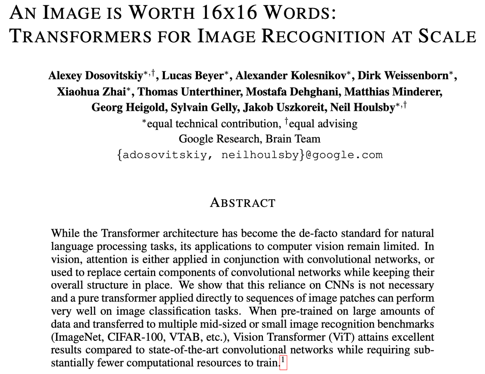

摘要只有四句话，每一句都是一个主张：

| 原文 | 意思 | 本讲哪里展开 |
|---|---|---|
| *its applications to computer vision remain limited. In vision, attention is either applied in conjunction with convolutional networks, or used to replace certain components of convolutional networks while keeping their overall structure in place.* | 之前的视觉注意力工作都没有甩开卷积：要么和卷积搭配，要么只替换 CNN 里的某几层 | 下一页"引言" |
| *We show that this reliance on CNNs is not necessary and a pure transformer applied directly to sequences of image patches can perform very well* | **不需要卷积**。把图切成小块排成序列，直接喂给一个纯 Transformer | 模块二 |
| *When pre-trained on large amounts of data and transferred to multiple mid-sized or small image recognition benchmarks* | 条件：**先在大数据上预训练**，再迁移到小数据集 | 模块四 |
| *attains excellent results compared to state-of-the-art convolutional networks while requiring substantially fewer computational resources to train* | 效果比最好的 CNN 还好，而且训练算力更少 | 模块四的表 2 和图 5 |

**标题里的比喻值得停一下。** "一张图价值 16×16 个词"是对英文谚语 *a picture is worth a thousand words* 的改写。它说的是：把一张图切成 16×16 像素的小块，每个小块当作一个"词"，整张图就是一个"句子"。于是 NLP 里现成的那一整套 Transformer 工具可以原封不动地搬过来。这不是修辞，这就是模型的全部设计。

> **💡 先说清三个会反复出现的词**
>
> - **预训练（pre-train）**：先在一个很大的数据集上训练模型，让它学到通用的视觉特征。
> - **迁移 / 微调（transfer / fine-tune）**：把预训练好的模型拿到另一个（通常小得多的）数据集上，换掉最后的分类层，再训练一会儿。
> - **基准（benchmark）**：大家公认用来比较模型的数据集，比如 ImageNet（128 万张图、1000 类）。论文说"在 ImageNet 上 88.55%"，指的是 1000 类分类的 Top-1 准确率：模型给出的第一个答案正好是正确类别的比例。
>
> 这三个词在[第 5 讲](../vision-05-training/)有完整解释，这里只需记住：**论文比较的不是"从零训练"的结果，而是"大数据预训练 + 迁移"的结果。**

#### 引言　为什么之前没人直接这么干

论文第 1—2 页的引言讲了一段历史，三段话就能概括：

**第一段：NLP 已经证明了 Transformer 越大越好。** BERT、GPT 这些模型的做法是"大语料预训练 + 小任务微调"，模型做到了千亿参数还没见饱和。视觉界想照搬。

**第二段：但像素太多，注意力算不起。** 注意力的计算量和序列长度的平方成正比（回看[第 11 讲](../vision-11-attention-transformer/)的计算账本）。一张 224×224 的图有 50,176 个像素，如果每个像素当一个 token，注意力矩阵就有 $50176^2\approx2.5\times10^9$ 个元素，**每一层、每一个头**都要算一遍。所以之前的工作都在打折扣：只在局部窗口里做注意力、只沿某一个轴做注意力、或者先用 CNN 把图缩小再做注意力。这些方法在数学上都行，但需要特殊的实现，在 GPU/TPU 上跑不快。

**第三段：本文的做法是"改动最少 + 数据最多"。** 不设计任何花哨的注意力，就用标准 Transformer；只在最前面做一件事：把图切成 16×16 的块，于是 50,176 个像素变成 196 个 token，注意力矩阵从 25 亿缩到 $196^2\approx3.8$ 万。然后用比 ImageNet 大一百倍的数据集预训练。

> **⚠️ 引言里最诚实的一句话**
>
> *When trained on mid-sized datasets such as ImageNet without strong regularization, these models yield modest accuracies of a few percentage points below ResNets of comparable size.*
>
> 翻译：在 ImageNet 这种"中等规模"数据上从头训练，ViT 比同等大小的 ResNet **差几个百分点**。作者没有回避这一点，并给出了解释：Transformer 缺少 CNN 自带的两种先验（平移等变性和局部性），所以数据不够时学不好。模块四会看到数据量从 130 万涨到 3 亿时曲线怎样反转。记住这句话，后面读表 2 时才不会把 88.55% 误以为是"ViT 随便一训就比 CNN 强"。

#### 相关工作　离 ViT 最近的一篇

引言之后的"相关工作"里，作者特别点名了 Cordonnier 等人 2020 年的工作：它已经把图切成 2×2 的小块、再在上面做完整的自注意力。ViT 和它的区别只有两点：块更大（16×16，所以能处理中等分辨率的图）、数据更多（证明了大规模预训练能让纯 Transformer 打平甚至超过 CNN）。

这件事提醒我们：**ViT 的贡献不是发明了"切块"，而是用足够的规模证明了"切块 + 标准 Transformer"这条最简单的路走得通。** 读论文时分清"新机制"和"新证据"，是读懂一篇论文的第一步。

### 🖊 本模块练习

1. ★ 为什么不能直接把每个像素当作一个 token 喂给 Transformer？算一下 224×224 的图会有多大的注意力矩阵。

解析

224×224 = 50,176 个像素。注意力矩阵是"每个 token 对每个 token"的分数表，大小是 $50176\times50176\approx2.5\times10^9$，每层每头都要算一遍并存下来。按 FP16 每个数 2 字节，一张矩阵就是 5 GB，12 层 12 头根本放不下。

切成 16×16 的块后只有 196 个 token，矩阵缩到 $196^2=38{,}416$，缩小了六万多倍。**切块的第一个动机不是什么"视觉先验"，就是让注意力算得起。**

2. 摘要里"when pre-trained on large amounts of data"这个条件去掉之后，论文的结论还成立吗？

解析

不成立。引言明确说在 ImageNet（130 万张）上从头训练、不加强正则时，ViT 比同等 ResNet 低几个点。只有在 ImageNet-21k（1400 万张）和 JFT-300M（3 亿张）上预训练，ViT 才追平并超过 CNN。模块四的图 3 就是这条曲线。

所以这篇论文的结论要完整地说："**在足够大的数据上预训练时**，纯 Transformer 可以超过 CNN。"

3. "一张图价值 16×16 个词"里，"词"对应模型里的什么？"句子"呢？

解析

"词"对应一个 16×16×3 的像素块经线性投影后得到的 768 维向量，也就是一个 token；"句子"对应整张图切出的 196 个 token 排成的序列（加上一个 CLS 是 197 个）。NLP 的 Transformer 读一个词序列，ViT 读一个块序列，中间的网络完全一样。

---

`Part 2 · 论文第 3—4 页`

## 二、图 1：从一张图到一个类别

论文的方法部分只有一页半，核心是一张图和四个公式。这一模块把它们逐个拆开，并用一张 4×4 的小图把每一步手算一遍。

#### 图 1　模型总览

*Figure 1: Model overview. We split an image into fixed-size patches, linearly embed each of them, add position embeddings, and feed the resulting sequence of vectors to a standard Transformer encoder. In order to perform classification, we use the standard approach of adding an extra learnable "classification token" to the sequence.*

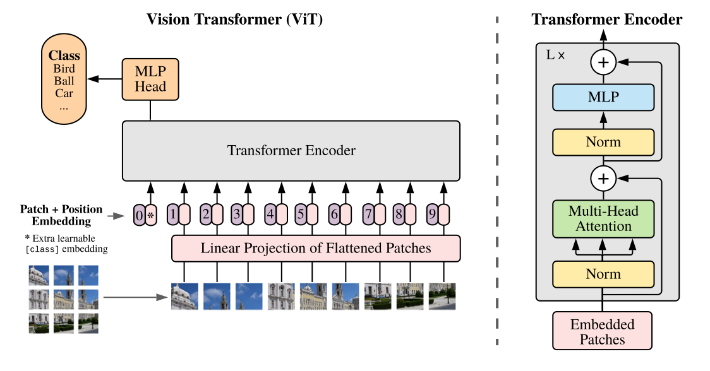

**🖼 逐元素图解**

这张图分左右两半：左半是 ViT 的全貌，右半是把"Transformer Encoder"那个灰框放大。**按数据流动的方向，从左下角读起：**

| 位置 | 图中元素 | 它是什么 |
|---|---|---|
| 左下 | 一张分成 3×3 格的建筑照片 | 输入图像。图里只画了 9 块作示意；真实的 224×224 输入、16×16 的块，有 14×14 = 196 块 |
| 左下 → 中下 | 一排 9 张小图 | 切下来的块（patch），按**从左到右、再从上到下**的顺序排成一行 |
| 中下，粉色长条 | *Linear Projection of Flattened Patches* | 把每个块的 16×16×3 = 768 个像素值拉直成一行，乘同一个矩阵，变成一个 768 维向量。**所有块共用同一个矩阵** |
| 中部，一排紫色圆圈 0* 1 2 … 9 | *Patch + Position Embedding* | 每个块的向量加上一个"位置向量"，告诉模型"你是第几块"。数字就是位置编号 |
| 最左边的 0* | *Extra learnable [class] embedding* | 一个额外的、可学习的向量，排在序列最前面。它不来自任何图块，是模型自己的参数。最后分类就看它 |
| 中部，灰色大框 | *Transformer Encoder* | 标准的 Transformer 编码器，所有 token 在里面互相交换信息。输入 10 个向量，输出 10 个向量 |
| 左上，橙色方块 | *MLP Head* | 分类头。只接收编码器输出的**第 0 个**向量（CLS 的最终状态） |
| 左上，*Class: Bird, Ball, Car…* | 输出 | 每个类别一个分数 |
| 右半，灰色竖框 | *Transformer Encoder* 内部 | 自下而上：Embedded Patches → Norm → Multi-Head Attention → ⊕（残差相加）→ Norm → MLP → ⊕。左边的 *L ×* 表示这个结构重复 L 次（Base 是 12 次） |

**读完这张图，有三件事要特别注意：**

- **Norm 在 Attention 和 MLP 之前**，不是之后。这叫 Pre-LN，是 GPT-2 之后的常见做法，训练更稳。回看[第 11 讲](../vision-11-attention-transformer/)对两种放法的比较。
- **编码器不改变序列长度。** 进去 10 个向量，出来还是 10 个；重复 12 次之后仍然是 10 个。ViT 没有 CNN 那种一层比一层小的特征图。
- **图里的 ⊕ 是残差连接**：把子层的输入直接加到输出上。[第 8 讲](../vision-08-resnet-densenet/)讲过它为什么能让深网络训得动。

> **💡 这张图看起来平平无奇，但它的"平"正是重点**
>
> 右半边那个编码器和 2017 年《Attention is All You Need》的编码器、和 BERT 的编码器几乎一模一样。作者在正文里说得很直白：*In model design we follow the original Transformer as closely as possible. An advantage of this intentionally simple setup is that scalable NLP Transformer architectures – and their efficient implementations – can be used almost out of the box.* 翻译过来就是：我们故意什么都不改，这样 NLP 那边为 Transformer 做的所有优化（高效实现、分布式训练、扩展规律）视觉这边可以直接拿来用。**ViT 真正新的东西只有左下角那几步：切块、拉直、投影。**

#### 跟着算　224×224 怎样变成 197 个 token

把图 1 里"示意的 9 块"换成真实的数字。下面这张图是本讲自己画的，每个方块下面标出了张量的形状：

**🖼 逐元素图解**

| 方块 | 形状 | 对应图 1 里的哪一步 |
|---|---|---|
| 输入图像 | `3×224×224` | 左下角的照片。3 是 RGB 三个通道 |
| 切块 + 展平 | `196×768` | 一排小图。224/16 = 14，14×14 = 196 块；每块 16×16×3 = 768 个数拉成一行 |
| 线性投影 E | `196×768` | 粉色长条。每行乘同一个 768×768 的矩阵。形状没变，但含义变了（下面解释） |
| 拼 CLS，加位置表 | `197×768` | 紫色圆圈那一排。前面拼一个 768 维的 CLS，再给 197 行各加一行位置向量 |
| 12 × Transformer 块 | `197×768 → 197×768` | 灰色大框。12 次重复，形状不变 |
| 最终 LN，取第 0 行 | `768` | 从编码器输出里挑出 CLS 那一行 |
| 分类头 | `1000` | 橙色 MLP Head。ImageNet 有 1000 类 |

**三种常见输入尺寸的 token 数：**

| 输入 | 网格 | 块数 N | 拼 CLS 后 T |
|---|---|---:|---:|
| 224×224，P=16 | 14×14 | 196 | 197 |
| 384×384，P=16 | 24×24 | 576 | 577 |
| 224×224，P=32 | 7×7 | 49 | 50 |

公式很简单：高 H、宽 W、块边长 P，$N = (H/P)\times(W/P) = HW/P^2$。本讲用 **N** 记图块数、**T = N + 1** 记加上 CLS 的序列长度，很多资料把两者混写成 N，算账时会把 CLS 漏掉。

> **⚠️ 两个 768 不是一回事**
>
> "切块 + 展平"之后的 768 是**一块里有多少个像素值**（16×16×3）；"线性投影"之后的 768 是**模型的宽度 D**，是作者选的超参数。ViT-B/16 下两者恰好相等，纯属巧合：换成 ViT-L/16，投影前还是 768，投影后变成 1024。初学时很容易因为"形状没变"以为投影什么都没做；它做了一次完整的矩阵乘法，含义从"像素槽位"变成了"学到的特征"。

#### 公式 (1)–(4)　图 1 的数学版

论文第 4 页用四行公式把图 1 写了一遍：

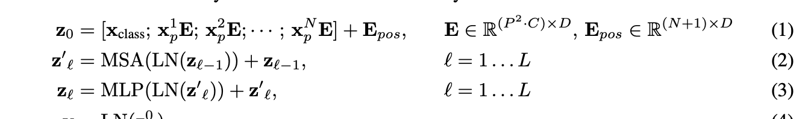

（截图最后一行是 (4)：$\mathbf y=\mathrm{LN}(\mathbf z_L^0)$，被页面排版挤到了下一行。）

**逐符号读公式 (1)：**

$$
\mathbf z_0=[\mathbf x_{\text{class}};\;\mathbf x_p^1\mathbf E;\;\mathbf x_p^2\mathbf E;\;\cdots;\;\mathbf x_p^N\mathbf E]+\mathbf E_{pos},\qquad
\mathbf E\in\mathbb R^{(P^2\cdot C)\times D},\;\mathbf E_{pos}\in\mathbb R^{(N+1)\times D}.
$$

| 符号 | 读法 | 对应图 1 |
|---|---|---|
| $\mathbf x_p^i$ | 第 i 个块拉直后的行向量，长 $P^2C$ = 768 | 一排小图里的第 i 张 |
| $\mathbf E$ | 投影矩阵，$768\times D$，**所有块共用** | 粉色长条 |
| $\mathbf x_p^i\mathbf E$ | 第 i 个块的 token，长 D | 紫色圆圈 i |
| $\mathbf x_{\text{class}}$ | CLS 向量，长 D，可学习 | 紫色圆圈 0* |
| $[\;;\;]$ | 把这些行向量**上下叠起来**，得到 $(N+1)\times D$ 的矩阵 | 那一整排圆圈 |
| $\mathbf E_{pos}$ | 位置表，$(N+1)\times D$，第 i 行加到第 i 个 token 上 | *Position Embedding* |
| $\mathbf z_0$ | 编码器的输入，$(N+1)\times D$ | 进入灰框的那一排箭头 |

**公式 (2)、(3)** 是一个编码器块，对 $\ell=1,\dots,L$：

$$
\mathbf z'_\ell=\mathrm{MSA}(\mathrm{LN}(\mathbf z_{\ell-1}))+\mathbf z_{\ell-1},\qquad
\mathbf z_\ell=\mathrm{MLP}(\mathrm{LN}(\mathbf z'_\ell))+\mathbf z'_\ell .
$$

MSA 是多头自注意力（Multi-head Self-Attention），LN 是层归一化，MLP 是两层全连接、中间用 GELU 激活、中间宽度 4D。每个公式最后那个"$+\mathbf z$"就是图里的 ⊕。注意 LN 包在 MSA 和 MLP **里面**，这就是 Pre-LN。

**公式 (4)** $\mathbf y=\mathrm{LN}(\mathbf z_L^0)$：取最后一层输出的第 0 行（上标 0 就是 CLS 的位置），再做一次 LN，得到整张图的表示 $\mathbf y$。分类头接在 $\mathbf y$ 后面。

> **⚠️ 公式里一共有几处 LN？**
>
> 每个块两处（公式 2、3 里各一个），L 层就是 2L 处；再加公式 (4) 里**单独的一处**，一共 2L + 1。初学者常漏掉最后这一处：Pre-LN 块的输出 $\mathbf z_L$ 是残差相加的结果，**没有被归一化过**，所以作者在取 CLS 之后又加了一个 LN。这个 LN 有自己的参数，算账时要单列（模块三）。

#### 跟着算　切块、拉直、投影，用 4×4 的小图走一遍

真实的 224×224 太大，手算不动。把图缩成 4×4 的灰度图，像素值就写成 1 到 16，块边长 P = 2。下面这张手绘图把图 1 左下角那三步画成了可以逐格核对的样子：

**🖼 逐元素图解**

- **左边 4×4 的格子**：原图，像素值按行是 1…16。四种底色是 P = 2 切出来的四个块：绿色左上、蓝色右上、橙色左下、紫色右下。
- **中间 4×4 的格子**：切块并拉直后的矩阵 $X_p$，一行一个块，按"先左右、后上下"排。第一行是 `1 2 5 6`：左上那个绿色块里的四个像素，先读块内第一行 (1, 2)，再读块内第二行 (5, 6)。**注意不是 `1 2 3 4`**，那是整图的第一行。
- **右边蓝色卡片**：共享投影 E。每一行 4 个输入（2×2×1 = 4），乘一个 4×D 的矩阵加 D 维偏置，得到一个 D 维 token。四行用的是同一个 E。
- **两条箭头**：第一条只是搬动数字（可逆），第二条是矩阵乘法（可能丢信息，也可能不丢，下面说）。

**步骤一：切块。** 用公式写清楚每个像素去了哪里。第 r 行第 s 列的块、块内第 a 行第 b 列的像素，在 $X_p$ 里的位置是

$$
X_p[\,rG_w+s,\;aP+b\,]=I[\,rP+a,\;sP+b\,],
$$

其中 $G_w$ 是每行有几个块（这里是 2）。代入 r = s = 0、(a, b) = (0,0),(0,1),(1,0),(1,1)，得到像素 (0,0),(0,1),(1,0),(1,1)，值是 1, 2, 5, 6。每个像素恰好出现一次，所以这一步可以原样放回，**切块本身不丢任何信息**。

**步骤二：投影。** 取一个 D = 2 的小例子：

$$
E=\begin{bmatrix}1&0\\0&1\\-1&0\\0&-1\end{bmatrix},\qquad b=(1,-1).
$$

第一块 (1, 2, 5, 6) 的 token：第一维 $1\cdot1+2\cdot0+5\cdot(-1)+6\cdot0+1=-3$，第二维 $1\cdot0+2\cdot1+5\cdot0+6\cdot(-1)-1=-5$，得到 $(-3,-5)$。

这个 E 在做什么？第一列是 (1, 0, −1, 0)：块内"左上减左下"；第二列是 (0, 1, 0, −1)："右上减右下"。**它是一个检测上下变化的滤波器**，不是在求平均。其余三块算出来也都是 $(-3,-5)$，因为这张编号图里每个块的上下两行恰好都差 4。

> **💡 投影 ≠ 平均，这就是它比"缩小图片"强的地方**
>
> 有人会想：把一个 16×16 的块变成一个向量，不就是把图缩小 16 倍吗？不是。缩小（平均池化）对块内所有像素用同样的权重，只能保留"这块平均有多亮"；投影矩阵 E 的每一列可以对块内不同位置、不同颜色赋不同权重，所以能表示"左边比右边亮"、"红色比绿色多"这类**块内结构**。两个块 (1,0,0,1) 和 (0,1,1,0) 平均值都是 0.5，池化分不开；用 (1,−1,−1,1) 这一列投影，得到 2 和 −2，分得开。模块五的图 7 左会看到，真实的 ViT 学出来的 E 确实长得像一组边缘和颜色检测器。

**步骤三：它和卷积是同一回事。** 把 E 的每一列重排成一个 P×P×C 的卷积核，用步长 P、不加边的卷积扫过原图，每个输出位置的值和上面的 token 一模一样。所以 [torchvision 的实现](https://docs.pytorch.org/vision/stable/_modules/torchvision/models/vision_transformer.html)直接写了一个 `Conv2d(3, 768, kernel_size=16, stride=16)`。模块六的程序会逐项核对这个等价。

> **⚠️ 等价的只是"第一层"，不要由此说 ViT 是 CNN**
>
> CNN 的特点是一层又一层、带重叠、感受野逐层扩大的局部卷积；ViT 只在最前面做了一次不重叠的局部线性映射，之后每一层都是全局注意力。两者的差别在后面的 12 层里，不在第一层。

**顺便回答"投影丢不丢信息"。** 线性映射可不可逆看它的秩。如果 D 小于输入维数 $P^2C$，E 一定有"零空间"：有些输入变化它完全看不见。用上面的 E，输入差 (1, 0, 1, 0) 乘 E 得 (0, 0)，所以块 (1,2,5,6) 和 (2,2,6,6) 得到同一个 token。但 ViT-B/16 的 E 是 768×768，方阵，**如果满秩就一点信息都不丢**。"一块变一个 token 所以压缩了"这个说法要看 D 和 $P^2C$ 的大小，不能张口就来。

#### CLS　论文从 BERT 借来的一个小技巧

公式 (1) 里那个 $\mathbf x_{\text{class}}$，论文只用一句话带过：*Similar to BERT's [class] token, we prepend a learnable embedding to the sequence of embedded patches, whose state at the output of the Transformer encoder serves as the image representation.* 零基础的读者在这里最容易产生误解，所以多说几句。

**🖼 逐元素图解**

- **左上橙色卡片"共享 CLS c"**：它是模型的 D 个参数，**每张图都用同一个**。它不是标签，不是类别编号，初始时不包含当前图片的任何信息。
- **左下白色卡片"N 个 patch token"**：来自当前这张图，每行一个 D 维向量。
- **中间蓝色卡片"共同编码"**：CLS 和 patch 拼成一条序列，一起过 12 层。关键是"一起"：CLS 不是站在网络外面看 patch，它和 patch 一样产生自己的 Q/K/V，patch 也会读它。
- **右上橙色卡片"全局接口"**：编码器输出的第 0 行，经最终 LN 后接分类头。这就是公式 (4)。
- **右下白色卡片"空间接口"**：另外 N 行 patch 的输出也一直都在，可以按原网格排回 14×14 的特征图，接分割、检测或 VLM 的连接器。分类 ViT 只用上面那个出口，但下面那个出口是后面 DINO、SAM、VLM 复用 ViT 的基础。

**为什么一个"空"向量能代表整张图？** 因为注意力。在第一层里，CLS 的 query 来自与图无关的 c，但它读取的 key 和 value 来自当前图的 196 个 patch，所以第一层的输出就已经依赖图片了；到第 12 层，它已经把整张图的信息汇聚了 12 次。**输入的 c 和输出的"图像表示"是同一个槽位在不同时刻的两个状态**，前者是模型参数，后者才随图片变化。

**跟着算。** 只看一层里的一次注意力。设 CLS 的 query 是零向量，三个 value 分别是 CLS 自己 (0, 0)、patch 1 (3, 0)、patch 2 (0, 6)。query 为零，所有分数都是 0，softmax 之后三个权重各 1/3，输出 $(0+3+0,\;0+0+6)/3=(1,2)$。这个输出已经是图片的函数了（换两个 patch 它就变）。如果忘了 CLS 自己也在候选里，按 1/2 算会得到 (1.5, 3)，错。

> **💡 不用 CLS 行不行？行**
>
> 另一种做法是把 196 个 patch 的输出取平均（全局平均池化，GAP），不要 CLS。论文附录 D.3 做了这个消融，结论是两者效果差不多，**但需要不同的学习率**；用同一套学习率时 GAP 看起来差很多。模块五的图 9 会看到这三条曲线。这是论文里一个很好的"消融实验怎么做才公平"的例子。

### 🖊 本模块练习

4. ★ 图 1 里编码器的输入是 10 个向量，输出是几个？12 层之后呢？分类头用了其中几个？

解析

输出 10 个，12 层之后还是 10 个：Transformer 编码器不改变序列长度，每一层都是"T 个向量进、T 个向量出"。分类头只用第 0 个（CLS）。另外 9 个 patch 的输出在分类任务里被丢掉了，但它们是存在的，稠密任务会用。

这题考的是**ViT 没有下采样**这件事：和 CNN 特征图越来越小完全不同。

5. ★ 224×320 的图、P=16，有多少块？加 CLS 后序列多长？如果有人给你一个 280 行的位置表，能推断出它是 14×20 吗？

解析

224/16 = 14 行，320/16 = 20 列，N = 280，T = 281。

单凭 280 推不出网格：280 = 14×20 = 20×14 = 10×28 = 7×40……每种分解对应不同的二维排列。所以保存模型时必须把网格的高和宽一起存下来，不能只存一条列表。对 280 开平方更是错的（它不是平方数，而且即使是平方数也可能来自长方形网格）。

6. 把 4×4 的图按行拉直成 16 个数再 reshape 成 4×4，得到的是 2×2 切块吗？

解析

不是。按行拉直再 reshape，第一行是 `1 2 3 4`（整图第一行）；正确的第一块是 `1 2 5 6`。

正确做法要先把高和宽各拆成"块编号 × 块内坐标"两个轴：$(4,4)\to(2,2,2,2)$，再把两个"块编号"轴换到前面，最后合并。reshape 只按内存顺序切分，不做轴交换。用编号小图而不是真实照片来检查，一眼就能看出错。

7. ★ 公式 (1) 里的 $\mathbf E$ 和 $\mathbf E_{pos}$ 分别有多少参数（ViT-B/16，224 输入）？哪一个随输入分辨率变化？

解析

$\mathbf E$：$768\times768=589{,}824$，加偏置 768，共 590,592。它只和块大小、通道数、D 有关，**不随分辨率变**。

$\mathbf E_{pos}$：$197\times768=151{,}296$。它的行数是 T，**随分辨率变**：384 输入时是 $577\times768=443{,}136$。

这就是为什么换分辨率只需要处理位置表（模块二末尾的"微调与高分辨率"）。

8. CLS 向量 $\mathbf x_{\text{class}}$ 在 batch 里有 32 张图时有多少个参数？32 个输出的 CLS 状态一样吗？

解析

参数只有 768 个（一份），前向时复制给 32 张图。32 个输出状态各不相同，因为它们各自读了不同的图。反向传播时 32 份梯度加到同一个 c 上。

类比：卷积核在所有图上共享，参数只有一份。

---

`Part 3 · 论文第 4 页`

## 三、归纳偏置、混合模型与高分辨率微调

方法部分剩下的三段话各自回答一个问题：ViT 比 CNN 少了什么（归纳偏置）、能不能和 CNN 搭配（混合模型）、预训练好的模型怎样用到新任务和新分辨率上（微调）。

#### 归纳偏置　ViT 比 CNN 少了什么

论文原文：

*We note that Vision Transformer has much less image-specific inductive bias than CNNs. In CNNs, locality, two-dimensional neighborhood structure, and translation equivariance are baked into each layer throughout the whole model. In ViT, only MLP layers are local and translationally equivariant, while the self-attention layers are global.*

先解释这个词。**归纳偏置（inductive bias）**是模型在看到数据之前就"预设"的假设。假设越强，模型需要的数据越少，但可能限制它学到的东西。CNN 预设了三件事：

| CNN 预设的假设 | 意思 | 为什么对图像合理 |
|---|---|---|
| **局部性（locality）** | 一个输出只看输入的一小块邻域 | 一个像素和它旁边的像素关系最大 |
| **二维邻域结构** | 邻域是二维的方格，不是一维的序列 | 图像本来就是二维的 |
| **平移等变性（translation equivariance）** | 图里的猫往右挪 10 像素，特征图也跟着挪 10 像素 | 猫在哪都是猫 |

这三条**在 CNN 的每一层都成立**。ViT 呢？自注意力是全局的：第一层里任何一个 patch 就能看到所有 patch，没有局部性；位置信息靠位置表学，初始时模型根本不知道"第 5 块在第 6 块左边"。作者原话：*the position embeddings at initialization time carry no information about the 2D positions of the patches and all spatial relations between the patches have to be learned from scratch.*

ViT 里仅存的图像先验只有两处：切块这一步（保留了块内的二维邻域），以及换分辨率时对位置表做二维插值（下面会讲）。

> **💡 为什么"少先验"在小数据上吃亏、在大数据上占便宜**
>
> 先验是"不用学就知道"的东西。数据少时，CNN 靠先验就能学到稳定的规律，ViT 得从数据里自己发现"相邻的块关系更大"，发现不了就过拟合。数据多到一定程度后，先验反而成了枷锁：图像里也有很多**非局部**的关系（天空和地面、左眼和右眼），全局注意力从第一层就能用上，CNN 要堆很多层才能看到。模块五会看到 ViT 浅层确实有一些头在看很远的地方。
>
> 这是一个**机制解释**，不是定理。它预测的是趋势：数据量越大，ViT 相对 CNN 越有利。模块四的图 3、图 4 就是在验证这个趋势。

#### 混合模型　把 CNN 的特征图当作输入

*As an alternative to raw image patches, the input sequence can be formed from feature maps of a CNN. In this hybrid model, the patch embedding projection E is applied to patches extracted from a CNN feature map.*

做法：先用一个 ResNet 处理图片，得到比如 14×14×1024 的特征图，然后把特征图上的每一个位置（1×1 的"块"，1024 维）当作一个 token，投影到 D 维，后面照旧。这时"patch 大小 1×1"指的是特征图上的 1 格，对应原图上一大片区域。论文把它叫 R50+ViT-B/16 之类，意思是 ResNet-50 的前端加 ViT-B。

模块四的图 5 会看到：小模型时混合模型比纯 ViT 好一点（CNN 的先验在算力少时有用），大模型时差距消失。

#### 3.2 微调与高分辨率　换头与位置表插值

*Typically, we pre-train ViT on large datasets, and fine-tune to (smaller) downstream tasks. For this, we remove the pre-trained prediction head and attach a zero-initialized D × K feedforward layer, where K is the number of downstream classes.*

**换头。** 预训练时分类头是 JFT 的 18,000 类，迁移到 CIFAR-10 时只要 10 类，所以把旧头扔掉，换一个新的 $D\times K$ 线性层，而且**初始化为全零**。

零初始化的头听起来会让模型"学不动"：输出全是零，梯度不也是零吗？算一下：

- K 类 logit 全 0，softmax 给每类 1/K，损失是 $\ln K$。
- 交叉熵对 logit 的梯度是 $p-y$（预测概率减真实的 one-hot），不是零。
- 头的权重梯度 $G_W=f^{\top}(p-y)$，f 是 768 维特征，**非零**：头第一步就会动。
- 传回特征的梯度 $G_f=(p-y)W^{\top}$，W 全零，**为零**：骨干第一步不动。
- 第二步 W 已非零，骨干开始收到梯度。

所以零头只是让骨干"晚一步"开始更新，不是冻结。好处是迁移初期骨干不会被一个随机头的乱梯度打乱。

**跟着算：一步 SGD。** 特征 $f=(2,-1)$，K = 3，正确类是第 2 类，学习率 0.1。初始 $p=(1/3,1/3,1/3)$，$p-y=(1/3,-2/3,1/3)$。$G_W=f^{\top}(p-y)$ 是 2×3 矩阵，第一行 $(2/3,-4/3,2/3)$，第二行 $(-1/3,2/3,-1/3)$；$G_b=(1/3,-2/3,1/3)$。更新 $W=-0.1G_W$、$b=-0.1G_b$，再算一次 logit：$fW+b=(-0.2,\;0.4,\;-0.2)$。第 2 类的概率从 1/3 升到 $e^{0.4}/(e^{0.4}+2e^{-0.2})\approx0.477$。模块六的程序会复算这一步。

**高分辨率。** 论文接着说：*It is often beneficial to fine-tune at higher resolution than pre-training. When feeding images of higher resolution, we keep the patch size the same, which results in a larger effective sequence length.* 预训练用 224，微调用 384：块还是 16×16，所以块数从 196 变成 576。模型里哪些东西要跟着变？

| 模块 | 形状和什么有关 | 224 → 384 时 |
|---|---|---|
| 投影矩阵 E | 块大小、通道数、D | **不变** |
| 12 个编码器块 | 只和 D 有关 | **不变** |
| 分类头 | D 和类别数 | **不变** |
| 位置表 $\mathbf E_{pos}$ | 序列长度 T | **197 行 → 577 行，必须处理** |

作者的处理：*We therefore perform 2D interpolation of the pre-trained position embeddings, according to their location in the original image.* 把 196 行位置向量排回 14×14 的网格，用图像插值的办法放大成 24×24，再排回 576 行。

**🖼 逐元素图解**

- **左上橙色卡片"CLS 位置值 99"**：只看一个通道。CLS 那一行的值是 99，它**不参与**插值，沿着橙色横线直接送到右上角"新 CLS 位置仍为 99"。CLS 没有图像坐标，没法插值。
- **左下 2×2 格子 `0 2 / 4 6`**：旧位置表（同一个通道）排回的二维网格。真实模型是 14×14，这里缩成 2×2 便于手算。
- **中间蓝色卡片"二维插值"**：2×2 → 3×3，双线性、端点对齐。
- **右下 3×3 格子 `0 1 2 / 2 3 4 / 4 5 6`**：结果。四个角原样保留，边的中点是两角平均，中心 3 是四角平均。
- **底部两行字**：恢复网格需要知道源网格的高和宽；位置表插值、图片缩放、投影核缩放是三件不同的事。

真实模型有 768 个通道，每个通道各做一遍图里的操作，通道之间不混合。

> **⚠️ "插值"不是一个函数，是一族函数**
>
> 一维的 (0, 2) 放大到 4 个点：**端点对齐**（新坐标 $u\cdot(m-1)/(n-1)$）得到 (0, 2/3, 4/3, 2)；**半像素对齐**（$(u+\tfrac12)m/n-\tfrac12$ 再截断到边界）得到 (0, 1/2, 3/2, 2)。形状一样，数值不同。torchvision 和作者的 JAX 代码用的约定可能不同；加载 checkpoint 时"没报错"不等于"插值方式一致"。模块六的程序把两种约定都算了一遍。

### 🖊 本模块练习

9. ★ 用自己的话说清 CNN 的三种归纳偏置，以及 ViT 里哪些地方还保留着一点图像先验。

解析

局部性（输出只看小邻域）、二维邻域结构（邻域是方格）、平移等变性（输入平移，特征图同样平移），CNN 每一层都有。

ViT 保留的只有两处：切块（块内保留二维邻域，而且所有块共用投影，这是一种弱的局部 + 共享）；换分辨率时对位置表做二维插值（手工告诉模型位置表是二维的）。自注意力层本身是全局的，位置关系全靠学。

10. ★ 零初始化的分类头，第一步骨干的梯度为什么是零？第二步呢？

解析

传回特征的梯度是 $(p-y)W^{\top}$，第一步 W = 0 所以为零。但头自己的梯度 $f^{\top}(p-y)$ 非零，头会更新。第二步 W 已经非零，$(p-y)W^{\top}$ 一般非零，骨干开始更新。

所以零初始化是"让头先动一步"，不是冻结骨干。正文例子一步之后 W 的第二列是 $(2/15,-1/15)$，已经能把梯度传回去了。

11. 224 预训练、384 微调，哪些权重形状变了？如果改成 P = 8（块更小）呢？

解析

224 → 384（P 不变）：只有位置表从 197 行变 577 行，用二维插值处理；E、编码器、分类头都不变。

P = 16 → 8：位置表要从 14×14 插到 28×28；**而且 E 的输入维从 768 变成 $8\times8\times3=192$，形状不同，不能加载**，要重新训练或用专门的核重采样方法。改块大小比改分辨率多动一样东西，而且那样东西没法插值。

12. 2×2 的位置网格 `0 2 / 4 6` 用端点对齐的双线性插值放大到 3×3，中心的值是多少？为什么？

解析

3。新网格中心对应旧坐标 (0.5, 0.5)，正好在四个角的正中间，双线性插值给四个角各 1/4 的权重：$(0+2+4+6)/4=3$。四个角保留原值，边的中点是相邻两角的平均。

---

`Part 4 · 论文第 5 页`

## 四、表 1：三个规模和一本账

这一模块只有一张表，但要把"86M"这个数从头算出来。算完之后你会对"参数"和"计算量"是两本不同的账有清楚的感觉。

#### 表 1　三个规模

*Table 1: Details of Vision Transformer model variants.*

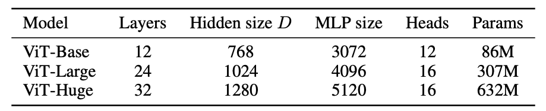

| 列 | 意思 | 它决定了什么 |
|---|---|---|
| **Layers** | 编码器块重复的次数 L | 深度；参数和计算量都正比于 L |
| **Hidden size D** | 每个 token 的向量长度 | 宽度；块内参数正比于 $D^2$ |
| **MLP size** | MLP 中间层的宽度，都是 4D | MLP 的参数 $2\times D\times4D=8D^2$ |
| **Heads** | 注意力头数 | 每头维度 = D / Heads：Base 64、Large 64、Huge 80 |
| **Params** | 总参数 | 下面算 |

Base 和 Large 的配置直接抄自 BERT，Huge 是作者加的。注意表里**没有块大小和输入分辨率**：这两个量不属于"模型规模"，是独立的旋钮。所以论文用 ViT-L/16 这种写法把块大小补上：L 是规模，16 是块边长（像素）。

> **⚠️ B/16 的 16 不是层数，也不是头数**
>
> 第一次读很容易看串：ViT-B/16 是 12 层、12 头、每头 64 维、块边长 16。B/32 的块更大、块数更少、更快但更粗。模型名里也没有输入分辨率，同一个 B/16 喂 224 还是 384，token 数完全不同。

#### 跟着算　86M 是怎么来的

按 ViT-B/16、224 输入、1000 类，逐项数参数：

| 模块 | 怎么算 | 参数 |
|---|---|---:|
| 投影 E + 偏置 | $(16\times16\times3+1)\times768$ | 590,592 |
| CLS | $768$ | 768 |
| 位置表 | $197\times768$ | 151,296 |
| 一个编码器块 | 见下 | 7,087,872 |
| 12 个块 | $12\times7{,}087{,}872$ | 85,054,464 |
| 最终 LN | $2\times768$ | 1,536 |
| 1000 类头 | $(768+1)\times1000$ | 769,000 |
| **合计** | | **86,567,656** |

一个编码器块里：Q、K、V、输出四个 $768\times768$ 矩阵加偏置 $4\times(768^2+768)=2{,}362{,}368$；MLP 两个矩阵 $768\times3072$ 和 $3072\times768$ 加偏置 $=4{,}722{,}432$；两个 LN 各 $2\times768$，共 3,072。加起来 7,087,872。

**98% 的参数在 12 个编码器块里。** 投影、位置表、CLS 加起来不到 1%。表 1 写的 86M 就是这个数四舍五入；换 10 类时头变成 7,690，总数 85,806,346。

同一套算法可以算出表 1 的另外两行：L/16 是 304,326,632，H/14 是 632,045,800。它们和表里的 307M、632M 的差别来自作者计数时包含的头和 representation 层不同，不影响结论。

#### 跟着算　参数和计算量是两本账

把计算量也数一遍，只数矩阵乘加（MAC）：

| 项 | 公式 | B/16，224 |
|---|---|---:|
| 投影 | $N\times768\times D=HWCD$ | 115,605,504 |
| 一个块 | $12TD^2+2T^2D$ | 1,453,954,560 |
| 12 个块 | | 17,447,454,720 |
| 分类头 | $DK$ | 768,000 |
| **合计** | | **17.56 G** |

块里的 $12TD^2$ 是四个投影 ($4TD^2$) 加 MLP ($8TD^2$)，$2T^2D$ 是 $QK^{\top}$ 和 $AV$ 这两次"token 对 token"的乘法。**在 224 分辨率下注意力矩阵那一项只占一个块的 4%**，计算量的大头在四个投影和 MLP。

下面这张手绘图把三种配置放在一起：

**🖼 逐元素图解**

- **左上白卡"R224：14×14 patch + CLS"**：B/16 标准配置，T = 197，参数 86,567,656，约 17.564G MAC，一张注意力矩阵（B=1、12 头、FP16）0.888 MiB。
- **右上蓝卡"R384"**：同一个模型喂 384 的图。T = 577，位置表要插值，MAC 升到约 55.484G，一张注意力矩阵 7.620 MiB。参数只多了位置表那 291,840。
- **下方橙卡"同 R224 改 P32"**：T 只有 50，参数 88,224,232 反而**更多**，MAC 约 4.409G 却只有 B/16 的四分之一。
- **底部那行字**：训练时的显存还包括 MLP 的中间激活、参数、梯度、优化器状态，不能只看注意力矩阵。

> **💡 为什么 B/32 的 token 更少、参数反而更多**
>
> 参数看的是矩阵有多大：P 从 16 变 32，投影 E 的输入维从 768 变成 3072，E 多了 1.77M 参数；位置表从 197 行减到 50 行只省了 113K。计算量看的是矩阵被用了多少次：token 数从 197 降到 50，12 个块的 MAC 从 17.4G 降到 4.3G。**参数量描述模型"有多大"，计算量描述一次前向"算多少"，两者没有直接关系。**

**分辨率翻倍，计算量是 16 倍吗？** 不是。固定 P 时边长翻倍，token 数四倍：投影和 MLP 按 T 走（4 倍），只有注意力矩阵按 $T^2$ 走（16 倍），而它在 224 时只占 4%。224 → 384 的实际数字：T 变成 2.93 倍，总 MAC 变成 3.16 倍。

#### 表 3　训练超参数

*Table 3: Hyperparameters for training. All models are trained with a batch size of 4096 and learning rate warmup of 10k steps.*

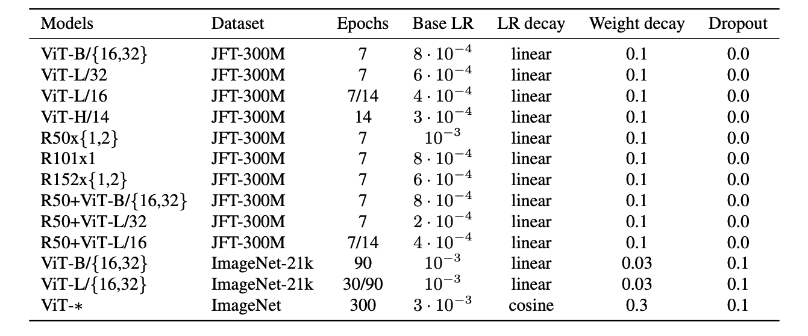

读这张表要抓三件事：

- **数据越少，正则越强。** JFT-300M 上 weight decay 0.1、dropout 0；ImageNet-21k 上 weight decay 0.03、dropout 0.1；ImageNet 上 weight decay 0.3、dropout 0.1、而且要训 300 个 epoch。这和引言"小数据上没有强正则就不行"的说法是一致的。
- **JFT 只训 7 个 epoch。** 3 亿张图过 7 遍 = 21 亿次样本曝光；ImageNet 训 300 遍也才 3.9 亿次。"epoch 数少"不等于"训练量少"。
- **用 Adam 训 ResNet 是反常规的。** 作者在附录 D.1 解释了为什么：在他们的迁移设置下 Adam 比 SGD 好。这提醒我们一行超参数只对应那个实验，不是通用默认值。

### 🖊 本模块练习

13. ★ ViT-B/16 换成 10 类，总参数是多少？位置表和骨干要变吗？

解析

头从 769,000 变成 $(768+1)\times10=7{,}690$，总数 $86{,}567{,}656-769{,}000+7{,}690=85{,}806{,}346$。位置表和骨干都不变，类别数只出现在分类头这一项。

这题考的是把参数公式的每一项和"由谁决定"对应起来：K 只进头，T 只进位置表，D 和 L 进编码器。

14. ★ 同样 224 输入，投影 E 的计算量为什么不随块大小 P 变化？

解析

$N\times(P^2C)\times D=\dfrac{HW}{P^2}\times P^2C\times D=HWCD$，P 约掉了。直觉：每个像素恰好被读一次、乘 D 个权重，和怎么分块无关。成立条件是块不重叠、尺寸整除。

15. 表 3 里 JFT 只训 7 个 epoch，ImageNet 训 300 个，哪个模型见过的样本更多？

解析

JFT：3 亿 × 7 = 21 亿次；ImageNet：128 万 × 300 = 3.8 亿次。JFT 的训练量是 ImageNet 的五倍多。所以比较"训练充分程度"要看总步数或总样本数，不能看 epoch。

16. 一张注意力矩阵在 T=197、12 头、FP16 下只有 0.888 MiB，那训练 ViT-B 为什么还要那么多显存？

解析

反向传播要保存 12 层里每一层的注意力矩阵、token 状态（197×768）、MLP 中间激活（197×3072，一份就 1.15 MiB，比注意力矩阵还大）、LN 的中间值；再加参数、梯度、Adam 的两组动量，按 FP32 约 16 字节/参数，86M 参数就是 1.3 GiB；batch 4096 再乘上去。注意力矩阵只是冰山一角。

---

`Part 5 · 论文第 6—7 页`

## 五、表 2 与图 3、4、5：数据量才是关键变量

这是论文的核心证据。三组实验回答三个问题：ViT 最好能到多好（表 2）；ViT 和 CNN 的强弱怎样随数据量反转（图 3、4）；同样的算力谁更划算（图 5）。

#### 表 2　和最好的 CNN 比

*Table 2: Comparison with state of the art on popular image classification benchmarks. We report mean and standard deviation of the accuracies, averaged over three fine-tuning runs.*

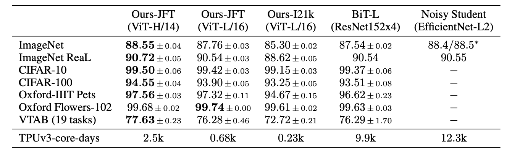

**🖼 逐元素图解**

- **五列是五个模型**，列名的第一行是"谁家的 + 用什么数据预训练"，第二行是模型：
  - *Ours-JFT (ViT-H/14)*：本文最大的模型，在 JFT-300M 上预训练。
  - *Ours-JFT (ViT-L/16)*：本文的 Large，也用 JFT。
  - *Ours-I21k (ViT-L/16)*：同样的 Large，但只用**公开的** ImageNet-21k（1400 万张）预训练。
  - *BiT-L (ResNet152x4)*：当时最强的 CNN 迁移方法，一个加宽四倍的 ResNet-152，**也在 JFT-300M 上预训练**。
  - *Noisy Student (EfficientNet-L2)*：另一个强基线，用半监督方法训的 EfficientNet。
- **前七行是七个下游数据集**，数字是微调后的 Top-1 准确率，± 后面是三次运行的标准差。加粗的是每行最好的。
- **最后一行 TPUv3-core-days**：预训练花的算力，单位是"一个 TPUv3 核跑一天"。ViT-H/14 是 2.5k，BiT-L 是 9.9k，Noisy Student 是 12.3k。

**怎么读结论：**

1. **ViT-H/14 在几乎所有数据集上最高**（ImageNet 88.55、CIFAR-100 94.55、VTAB 77.63），只有 Flowers 上 L/16 略高。
2. **ViT-L/16 vs BiT-L 是最公平的一组比较**：两者用同一份 JFT 预训练，ViT 在每个数据集上都更高或持平，而算力只有 BiT 的 1/15（0.68k vs 9.9k）。
3. **第三列是给"没有 JFT 的人"看的**：只用公开的 ImageNet-21k，ViT-L/16 也能到 85.30，离 BiT-L 不远。作者说这个模型用一台 8 核的 TPUv3 大约 30 天能训出来。

> **⚠️ 不要把 88.55 读成"ViT 比 CNN 强 1 个点"**
>
> 88.55 是 H/14 在 3 亿张私有数据上预训练再迁移的结果。它和 BiT-L 的 87.54 的差别，既有架构的贡献，也有模型大小（632M vs 928M 参数）和训练细节的贡献。这张表证明的是"**在同样的大数据预训练下，ViT 可以做到和最好的 CNN 一样好甚至更好，而且更省算力**"；它不能回答"小数据下谁更好"，那是下面图 3 的事。

#### 图 3 与图 4　数据从 130 万到 3 亿，曲线怎样反转

*Figure 3: Transfer to ImageNet. While large ViT models perform worse than BiT ResNets (shaded area) when pre-trained on small datasets, they shine when pre-trained on larger datasets. Similarly, larger ViT variants overtake smaller ones as the dataset grows.*

*Figure 4: Linear few-shot evaluation on ImageNet versus pre-training size. ResNets perform better with smaller pre-training datasets but plateau sooner than ViT, which performs better with larger pre-training.*

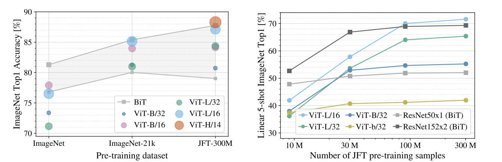

**🖼 逐元素图解**

**左图（图 3）：**

- **横轴**是三个预训练数据集，从小到大：ImageNet（130 万张）、ImageNet-21k（1400 万张）、JFT-300M（3 亿张）。
- **纵轴**是迁移到 ImageNet 后的 Top-1 准确率。
- **灰色阴影带**是 BiT（ResNet）家族的范围：下边是小 ResNet，上边是大 ResNet。
- **彩色圆点**是五个 ViT：B/32、B/16、L/32、L/16、H/14，点越大模型越大。

读法：**看彩色点相对灰带的位置。** 在最左边（ImageNet），所有 ViT 都落在灰带里甚至下方，而且最大的 H/14 反而最差：模型太大、数据太少，过拟合。到中间（21k），ViT 追上灰带上沿。到最右边（JFT），ViT 全部冲出灰带，而且**越大的模型越靠上**，顺序完全反过来了。

**右图（图 4）：**

- **横轴**是 JFT 的子集大小：1000 万、3000 万、1 亿、3 亿张。
- **纵轴**是"linear 5-shot"准确率：冻结预训练好的模型，每类只给 5 张图，训一个线性分类器。这是一种便宜的、用来测"表示本身好不好"的评测，不需要完整微调。
- **实线是 ViT**（L/16、L/32、B/32、b/32，小写 b 是把 B 的宽度减半的小模型），**虚线是 ResNet**（50x1 和 152x2）。

读法：**看曲线的斜率。** ResNet 在 1000 万张时领先（ResNet152x2 的 53 vs ViT-L/16 的 43），但很快变平；ViT 起点低、斜率大，在 1 亿张左右追上，3 亿张时反超。小 ViT（b/32）和小 ResNet（50x1）之间也是同样的故事，只是交叉点更靠右。

> **💡 这两张图就是"归纳偏置 vs 数据"那段话的实验版**
>
> 回看模块三：先验在数据少时是帮助，在数据多时是限制。图 4 把这句话画成了两条曲线的交叉：ResNet 的先验让它起步快但早早饱和，ViT 没有先验所以起步慢但一直在涨。作者在正文里的措辞很克制：*the convolutional inductive bias is useful for smaller datasets, but for larger ones, learning the relevant patterns directly from data is sufficient, even beneficial.*
>
> 图 4 的实验设计也值得学：为了控制变量，**所有子集用同一套超参数**，不额外调正则，就是要看"模型本身"对数据量的反应，而不是调参的本事。

#### 图 5　同样的算力，谁更划算

*Figure 5: Performance versus pre-training compute for different architectures: Vision Transformers, ResNets, and hybrids. Vision Transformers generally outperform ResNets with the same computational budget. Hybrids improve upon pure Transformers for smaller model sizes, but the gap vanishes for larger models.*

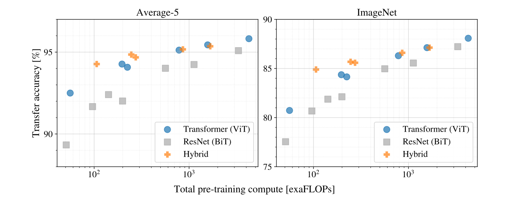

**🖼 逐元素图解**

- **两个子图**：左边是五个数据集的平均迁移准确率（Average-5），右边只看 ImageNet。
- **横轴**是预训练总算力，单位 exaFLOPs（$10^{18}$ 次浮点运算），**对数刻度**：每格是 10 倍。
- **三种点**：蓝圆是纯 ViT，灰方是 ResNet（BiT），橙十字是混合模型（ResNet 前端 + ViT）。每个点是一个模型配置，同一个模型训 7 个和 14 个 epoch 是两个点。

读法：**同一横坐标下，谁更高谁更划算。** 蓝圆几乎处处在灰方上面；作者估计达到同样精度 ViT 只要 ResNet 2 到 4 倍少的算力。橙十字在左边（小算力）略高于蓝圆，到右边和蓝圆重合：**CNN 前端在小模型上有帮助，大模型上没有**。最右上角的蓝圆还在往上走，作者说 ViT *appear not to saturate within the range tried*，这是后来 Scaling ViT 那篇论文的起点。

> **⚠️ 读算力图的两个常见误区**
>
> 1. **横轴是对数**。两个点看起来挨得很近，算力可能差 3 倍。
> 2. **"同样算力"不等于"同样时间"**。exaFLOPs 是理论计算量，真实速度还取决于硬件对这种计算的友好程度。模块五的图 12 会看真实的墙上时钟速度，ViT 在那里的优势比理论值更大，因为矩阵乘法在 TPU 上跑得特别好。

### 🖊 本模块练习

17. ★ 表 2 里哪一组比较最能说明"同样数据下 ViT 比 CNN 划算"？为什么不是和 Noisy Student 比？

解析

ViT-L/16（JFT）对 BiT-L：两者都用 JFT-300M 预训练，ViT 在每个数据集上都不输，而算力是 0.68k 对 9.9k。预训练数据相同，差别才能归到架构和训练方法上。

Noisy Student 用的是半监督方法（ImageNet + 无标签的 JFT），训练范式不同，数据利用方式也不同，比较时混入了太多变量。

18. ★ 图 3 里为什么在 ImageNet 预训练时最大的 ViT-H/14 反而最差？

解析

数据太少、模型太大，过拟合。ViT 没有 CNN 的先验，参数越多越需要数据来约束；130 万张图撑不起 6.3 亿参数。到 JFT-300M 时顺序完全反转，H/14 最好。这正是"大模型需要大数据"在图上的样子。

19. 图 4 的纵轴"linear 5-shot"是什么意思？为什么作者用它而不用完整微调？

解析

冻结预训练模型，每类只给 5 张图，在固定特征上训一个线性分类器。它测的是"预训练学到的表示本身有多好"，不受微调超参数影响，而且便宜（作者要对 4 个子集 × 多个模型做评测，完整微调太贵）。

缺点是绝对数值比微调低很多（图 4 最高才 70 出头），只能看相对趋势。

20. 图 5 里橙色十字（混合模型）在左边高于蓝圆、右边和蓝圆重合，这说明了什么？

解析

CNN 前端提供的局部先验在小模型、小算力时有用（和图 4 里 ResNet 在小数据上领先是同一个道理），模型和算力大了以后，ViT 自己就能学到这些模式，先验的好处消失。这和论文的总论点一致：先验是"数据不够时的替代品"。

---

`Part 6 · 论文第 8—9 页与附录`

## 六、图 6、7 与附录：往模型里看，它学到了什么

前面证明了 ViT 能行。这一模块看作者怎样打开模型检查：第一层学到了什么样的滤波器、位置表学出了什么结构、注意力看多远、CLS 和 GAP 谁更好、真实速度有多快。

#### 图 7 左　第一层的滤波器

*Figure 7 (Left): Filters of the initial linear embedding of RGB values of ViT-L/32.*

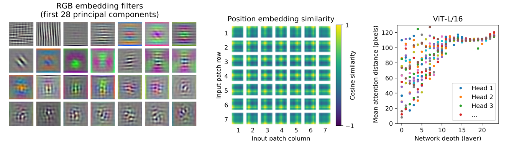

**🖼 逐元素图解（左图）**

- **28 个小方块**，每个是一个 32×32×3 的小图。它们是投影矩阵 E 的**前 28 个主成分**：E 有 1024 列（ViT-L 的 D），每列是一个 3072 维的向量，可以排回 32×32×3 的小图；28 列太多看不过来，作者用 PCA 挑了最主要的 28 个方向。
- **每个小方块长什么样**：有的是黑白条纹（不同方向、不同频率的边缘检测器），有的是彩色斑块（颜色对比），有的是中心亮四周暗的斑点。

**这说明什么？** 回看模块二的那个 4×4 手算：我们说投影 E 的每一列是一个"块内滤波器"，能检测边缘和颜色。这张图证明真实的 ViT 学出来的 E 就是这样的：**和 CNN 第一层学到的 Gabor 样滤波器几乎一样**。也就是说，虽然 ViT 没有卷积，但它在第一层自己学出了卷积网络第一层会学的东西。作者的措辞：*The components resemble plausible basis functions for a low-dimensional representation of the fine structure within each patch.*

#### 图 7 中　位置表学出了二维结构

*Figure 7 (Center): Similarity of position embeddings of ViT-L/32. Tiles show the cosine similarity between the position embedding of the patch with the indicated row and column and the position embeddings of all other patches.*

**🖼 逐元素图解（中图）**

- **外层 7×7 的大格子**：ViT-L/32 在 224 输入下有 7×7 = 49 个块，每个大格子对应一个块的位置（行号、列号标在边上）。
- **每个大格子里又是一张 7×7 的小热图**：这个块的位置向量和**其他 49 个**位置向量的余弦相似度。黄色是 1（完全相同），紫色是 −1。
- **怎么看**：取第 3 行第 4 列那个大格子，里面最亮的点在它自己的位置（第 3 行第 4 列），往外逐渐变暗，而且**同一行和同一列更亮**，形成一个十字。

**这说明什么？** 回看模块三：位置表初始化时是随机的，模型不知道"第 5 块在第 6 块左边"。这张图说明训练之后位置表**自己学出了二维网格结构**：距离近的块位置向量相似，同行同列更相似。模型是从一维的编号 1…49 里，靠数据学出了"这些编号其实排成 7×7"。这解释了为什么作者试了各种更复杂的位置编码都没有提升（下面的表 8）。

#### 图 10 与表 8　位置编码的消融

*Figure 10: Position embeddings of models trained with different hyperparameters.*

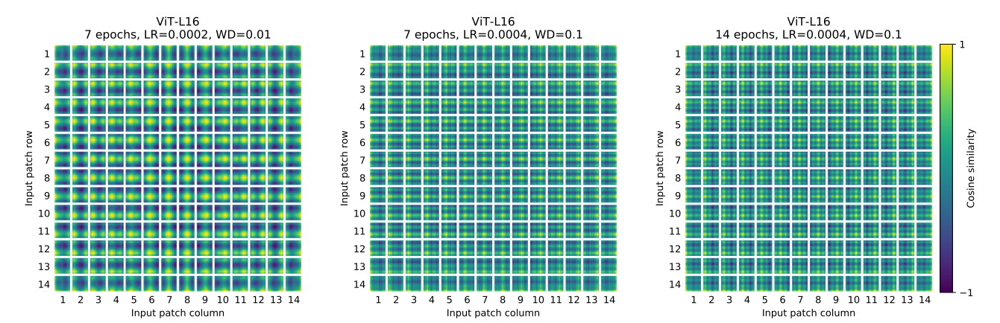

三张图都是 ViT-L/16（14×14 块），只是训练的学习率、weight decay、epoch 不同。**结构相同（都有行列十字），细节不同**：学到的位置表长什么样取决于训练超参数，不是唯一的。这提醒我们不要过度解读某一张位置相似度图的细节。

*Table 8: Results of the ablation study on positional embeddings with ViT-B/16 model evaluated on ImageNet 5-shot linear.*

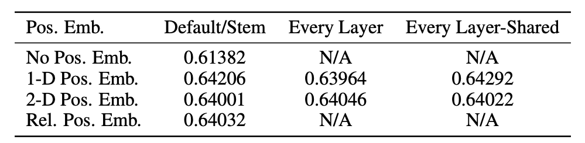

| 行 | 做法 | 5-shot linear |
|---|---|---|
| No Pos. Emb. | 完全不加位置信息，把图当作"一袋块" | 0.614 |
| 1-D Pos. Emb. | 默认做法：按编号 1…196 学一张表 | 0.642 |
| 2-D Pos. Emb. | 行、列各学一张表，拼起来 | 0.640 |
| Rel. Pos. Emb. | 相对位置：只编码两块之间的距离 | 0.640 |

三列是位置信息加在哪里：只在输入处加（默认）、每层都加、每层都加但共享同一张表。

**读法**：没有位置信息差 3 个点，**有位置信息之后怎么加都差不多**。作者的解释是：ViT 在 14×14 的块网格上工作，而不是 224×224 的像素网格，这么小的网格上任何编码方式都容易学。

> **💡 "一袋块"居然还有 61%**
>
> 完全不告诉模型位置，它仍然能靠"图里有哪些块"做到 61% 的 5-shot 准确率。这说明相当一部分分类信息是"有什么"而不是"在哪里"，就像看一堆打乱的拼图碎片也能猜出是什么画。这也是后来很多工作（MAE、token 丢弃）敢于打乱或丢掉块的依据之一。

#### 图 7 右 与 图 11　注意力看多远

*Figure 7 (Right): Size of attended area by head and network depth. Each dot shows the mean attention distance across images for one of 16 heads at one layer.*

先解释这个指标。**注意力距离（attention distance）**：对一个 query 块，把它分给每个 key 块的注意力权重乘以两块之间的像素距离，加起来，就是它"平均看多远"。再对所有 query、所有图取平均，每个头每一层得到一个数。它的作用相当于 CNN 里的"感受野大小"。

**跟着算。** 一维网格上 query 在坐标 0，三个候选块在坐标 0、1、3，注意力权重 (1/2, 1/4, 1/4)。注意力距离 $=\tfrac12\cdot0+\tfrac14\cdot1+\tfrac14\cdot3=1$ 格；P = 16 时是 16 像素，P = 32 时同样的权重是 32 像素。比较不同 P 的模型要换算成像素。

**🖼 逐元素图解（图 7 右图）**

- **横轴**是层数 0 到 23（ViT-L 有 24 层），**纵轴**是平均注意力距离，单位像素（输入 224，所以最大约 120 多像素，差不多是半张图）。
- **每一列（每一层）16 个点**，一个点一个头，颜色区分头。
- **怎么看**：第 0 层的 16 个点从 10 像素到 120 像素散得很开：**有的头只看附近，有的头一开始就看全图**。往右走，点越来越聚到上面：深层所有头都在看全图。

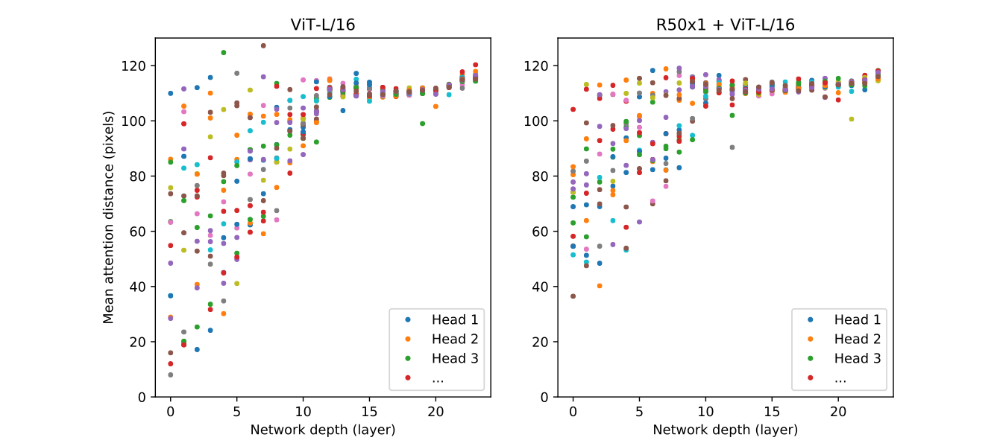

图 11 把纯 ViT-L/16（左）和混合模型 R50+ViT-L/16（右）放在一起。混合模型的浅层点明显更集中在上方：**因为 CNN 前端已经做了局部处理，Transformer 不需要再用"看附近"的头了**。这从另一个方向证明了：纯 ViT 浅层那些"看附近"的头，承担的正是 CNN 早期卷积层的角色。

> **💡 这张图是 ViT 和 CNN 关系的最好注解**
>
> CNN 是"先局部后全局"写死在结构里；ViT 没有写死，但它自己学出了类似的分工：浅层一部分头看局部、一部分头看全局，深层全部看全局。区别在于 ViT **从第一层就有看全局的头**，CNN 要堆到很深才能看到全图。这就是"少先验"在大数据下占便宜的具体机制。

#### 图 6　注意力落在哪里

*Figure 6: Representative examples of attention from the output token to the input space.*

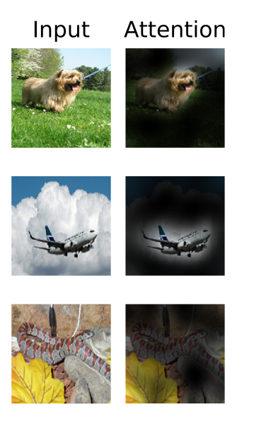

三组图，左边是输入，右边是把 CLS 对各块的注意力叠在原图上：狗、飞机、蛇的区域亮，背景暗。**模型在分类时主要看物体本身，不看背景。**

怎么画出来的：附录 D.8 说用的是 **attention rollout**。单看最后一层的注意力权重不够，因为信息经过了 24 层的传递；rollout 把每一层的注意力矩阵（跨头平均、加上残差再归一化）从第一层到最后一层**连乘**起来，近似"输出的 CLS 从每个输入块里拿了多少"。

**跟着算：顺序不能换。** 两层、两个 token，$A_1=\begin{bmatrix}0&1\\1&0\end{bmatrix}$，$A_2=\begin{bmatrix}1&0\\1&0\end{bmatrix}$。加残差取平均：$\tilde A_1$ 两行都是 $(\tfrac12,\tfrac12)$，$\tilde A_2$ 两行是 $(1,0)$ 和 $(\tfrac12,\tfrac12)$。正确的 $\tilde A_2\tilde A_1$ 两行都是 $(\tfrac12,\tfrac12)$；反过来 $\tilde A_1\tilde A_2$ 两行都是 $(\tfrac34,\tfrac14)$。矩阵乘法不交换，顺序代表"信息先经过哪一层"。

> **⚠️ 注意力图是观察工具，不是因果证明**
>
> rollout 忽略了 value 投影、MLP、LN，只是注意力权重的粗略累积。图 6 亮的地方是"模型读了这里"，不等于"模型靠这里做出判断"。要证明后者，得把那块区域遮掉再看预测变不变。

#### 图 9　CLS 还是平均池化

*Figure 9: Comparison of class-token and global average pooling classifiers. Both work similarly well, but require different learning-rates.*

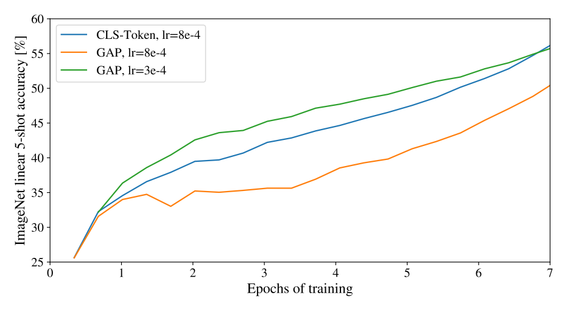

**🖼 逐元素图解**

- **横轴**是训练 epoch（0 到 7），**纵轴**是 ImageNet 5-shot linear 准确率。
- **蓝线**：用 CLS，学习率 8e-4。
- **橙线**：用 GAP（把 196 个块的输出取平均当作图像表示），**同样的**学习率 8e-4。明显落后。
- **绿线**：GAP，学习率降到 3e-4。追上甚至略超蓝线。

**这张图在讲一个方法论问题**：如果只跑蓝线和橙线，你会得出"CLS 比 GAP 好 5 个点"的错误结论。真相是两者需要不同的学习率。**做消融时，每个变体都要单独调参，否则比的是"谁更适应你碰巧选的超参数"。** 这是读论文和写论文都要记住的一课。

#### 图 12　真实速度与显存

*Figure 12: Left: Real wall-clock timings of various architectures across input sizes. ViT models have speed comparable to similar ResNets. Right: Largest per-core batch-size fit on device with various architectures across input sizes. ViT models are clearly more memory-efficient.*

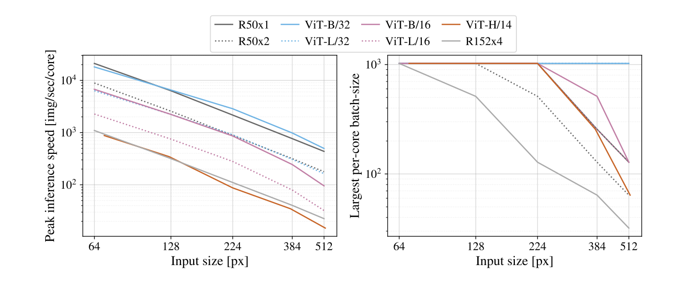

**🖼 逐元素图解**

- **左图**：横轴输入边长（64 到 512，对数），纵轴每个 TPU 核每秒处理的图片数（对数）。所有线都往下走（图越大越慢）；**ViT 的线和同级 ResNet 的线挨在一起**，B/32（浅蓝虚线）最快。
- **右图**：横轴同上，纵轴一个核上能放下的最大 batch。ViT 的线在上面且更平：**同样输入下 ViT 能放的 batch 大得多**。

**和模块四的账本对一下。** 理论上注意力按 $T^2$ 涨，图大了 ViT 应该比 CNN 慢得更快；但左图里直到 384 都没看到这个效应，作者说 *the theoretical bi-quadratic scaling of ViT with image size only barely starts happening for the largest models at the largest resolutions*。原因就是模块四算过的：224 下注意力矩阵只占 4% 的计算。右图的显存优势也和账本一致：ViT 的激活是 $T\times D$ 的二维矩阵，而 ResNet 早期层的特征图又大又厚。

#### 4.6　一个关于自监督的脚注

论文最后一小节做了一个初步实验：模仿 BERT 的"遮词预测"，把 50% 的块遮住，让模型预测被遮块的平均颜色（3 bit，512 种）。ViT-B/16 这样自监督预训练后在 ImageNet 上到 79.9%，比从零训练高 2 个点，但比有监督预训练低 4 个点。作者说这是 *preliminary*，留给未来。

这个脚注后来长成了 MAE（[第 18 讲](../vision-18-masked-modeling/)）：掩码率提到 75%、只把可见块送进编码器、预测像素而不是平均颜色。读到这里能看出：**ViT 这篇论文的价值不只是一个结果，它把 NLP 的整套方法论（大模型 + 大数据 + 自监督）搬进了视觉，后面几讲的每一篇都站在它上面。**

### 🖊 本模块练习

21. ★ 图 7 左边那 28 个小方块是什么？它们为什么长得像 CNN 第一层的滤波器？

解析

投影矩阵 E 的列（每列可以排回一个 32×32×3 的小图）的前 28 个主成分。它们像边缘和颜色检测器，因为 E 的每一列本来就是作用在块内像素上的线性滤波器（模块二的手算已经说明了这一点），而对自然图像最有用的线性滤波器就是边缘、条纹和颜色对比，CNN 第一层学到的也是这些。两种结构、同样的数据，学到了同样的第一层。

22. ★ 表 8 里"No Pos. Emb."比有位置信息差 3 个点，但 1-D、2-D、相对位置三种几乎一样。两个事实分别说明什么？

解析

第一个事实：位置信息有用，纯"一袋块"损失了"在哪里"的信息。

第二个事实：在 14×14 这么小的网格上，只要给模型任何一种位置信息，它都能学出二维结构（图 7 中那张相似度图就是证据），所以编码方式的差别不重要。作者因此用了最简单的 1-D 可学习表。

23. 注意力距离 1 格在 P=16 和 P=32 的模型里是同样的距离吗？图 7 右图里第 0 层的点为什么散得那么开？

解析

不是：1 格分别是 16 和 32 像素，跨 P 比较要换算成像素。

第 0 层散得开是因为不同的头分工不同：有的头看局部（像卷积），有的头从第一层就看全图。这是 ViT 和 CNN 最本质的差别之一：CNN 第一层只能看局部。

24. ★ 如果一篇论文只给出图 9 的蓝线和橙线，你会得出什么错误结论？正确的做法是什么？

解析

错误结论："CLS 比 GAP 好 5 个点，所以 CLS 是更好的设计。"正确做法是对每个变体分别调学习率（绿线），然后比较各自最好的结果；此时两者几乎一样。消融实验里"固定超参数换模块"看起来控制了变量，实际上偏向了超参数碰巧适合的那个模块。

25. 图 12 左图里，为什么 ViT 在 384 以内没有表现出"按 T² 变慢"？

解析

因为注意力矩阵那项在总计算量里占比很小：224 时只占一个块的 4%，384 时约 11%。其余 90% 的计算（四个投影和 MLP）按 T 线性增长，和 CNN 按像素数线性增长是同一个量级。只有分辨率再大很多、T² 项占主导时才会显著变慢。

26. 原论文的 masked patch prediction 和后来的 MAE 有什么不同？

解析

原实验：遮 50%，被遮块用可学习的 mask 向量替代后仍送进编码器，预测被遮块的 3 bit 平均颜色。MAE：遮 75%，**只把可见块送进编码器**（省 3/4 计算），用一个轻量解码器重建被遮块的全部像素。共用 ViT 骨干，但训练目标和计算组织都不同。第 18 讲逐项比较。

---

`Part 7`

## 七、三段可运行核查

下面三段程序只用 Python 标准库，几秒钟跑完。它们核对的是本讲的数学，不训练模型，也不加载任何权重。

### 实验一：切块、卷积等价与投影反传

核对三件事：`unpatchify(patchify(img)) == img`（切块可逆）；同一个 E 排成卷积核后，Linear 和 stride 卷积逐项相等；对全部像素、E 和偏置做中心有限差分，验证梯度公式 $G_E=X_p^{\top}G_Z$、$G_b=\sum_i (G_Z)_i$、$G_{X_p}=G_ZE^{\top}$。主例用两个通道，让通道轴的错误更容易暴露；末尾另外检查 4×4 灰度图的手算和零空间反例。

> **💡 重叠切块时反传要累加**
>
> 把一维信号 $(x_0,x_1,x_2)$ 切成重叠窗口 $(x_0,x_1)$ 和 $(x_1,x_2)$，两窗口的梯度分别是 $(1,2)$ 和 $(3,4)$，回填后原信号梯度是 $(1,5,4)$：共享的 $x_1$ 累加了 2 和 3。下面的程序是不重叠版本，回填直接赋值；换成重叠的 stem 要改成累加。

~~~python
import math

H, W, C, P, D = 4, 4, 2, 2, 3

def patchify(image, p):
    h, w, c = len(image), len(image[0]), len(image[0][0])
    assert h % p == w % p == 0
    return [[image[r*p+a][s*p+b][ch]
             for a in range(p) for b in range(p) for ch in range(c)]
            for r in range(h//p) for s in range(w//p)]

def unpatchify(patches, h, w, c, p):
    image = [[[0.0]*c for _ in range(w)] for _ in range(h)]
    for r in range(h//p):
        for s in range(w//p):
            row = patches[r*(w//p)+s]
            for a in range(p):
                for b in range(p):
                    for ch in range(c):
                        image[r*p+a][s*p+b][ch] = row[(a*p+b)*c+ch]
    return image

def mm(a, b):
    return [[sum(x*y for x, y in zip(row, col))
             for col in zip(*b)] for row in a]

def tr(a):
    return [list(row) for row in zip(*a)]

def project(patches, e, bias):
    return [[x+b for x, b in zip(row, bias)] for row in mm(patches, e)]

def flat_image(image):
    return [x for row in image for pixel in row for x in pixel]

def image_from_flat(xs, h=H, w=W, c=C):
    return [[[xs[(y*w+x)*c+ch] for ch in range(c)]
             for x in range(w)] for y in range(h)]

image = image_from_flat([float(x+1) for x in range(H*W*C)])
patches = patchify(image, P)
assert unpatchify(patches, H, W, C, P) == image
e = [[math.sin(0.3*(i*D+j+1)) for j in range(D)]
     for i in range(P*P*C)]
bias = [0.1, -0.2, 0.3]
z = project(patches, e, bias)

# Wconv[d][c][a][b] matches the chosen HWC flatten order.
kernel = [[[[e[(a*P+b)*C+c][d] for b in range(P)]
             for a in range(P)] for c in range(C)] for d in range(D)]
conv = []
for r in range(H//P):
    for s in range(W//P):
        conv.append([bias[d]+sum(
            kernel[d][c][a][b]*image[r*P+a][s*P+b][c]
            for c in range(C) for a in range(P) for b in range(P))
                     for d in range(D)])
assert max(abs(a-b) for x, y in zip(z, conv)
           for a, b in zip(x, y)) < 1e-12

g = [[0.1*(i+1)*(j-1) for j in range(D)] for i in range(len(patches))]
ge = mm(tr(patches), g)
gb = [sum(row[j] for row in g) for j in range(D)]
gx_patch = mm(g, tr(e))
gx = unpatchify(gx_patch, H, W, C, P)
params = flat_image(image)+[x for row in e for x in row]+bias
grads = flat_image(gx)+[x for row in ge for x in row]+gb
ni, ne = H*W*C, P*P*C*D

def objective(values):
    img = image_from_flat(values[:ni])
    ev = values[ni:ni+ne]
    mat = [ev[i*D:(i+1)*D] for i in range(P*P*C)]
    out = project(patchify(img, P), mat, values[ni+ne:])
    return sum(a*b for x, y in zip(out, g) for a, b in zip(x, y))

worst = 0.0
for i in range(len(params)):
    plus, minus = params[:], params[:]
    plus[i] += 1e-6
    minus[i] -= 1e-6
    numerical = (objective(plus)-objective(minus))/(2e-6)
    worst = max(worst, abs(numerical-grads[i]))
assert worst < 1e-7, worst
print('patchify/unpatchify and Conv2d equivalence: passed')
print('pixel/E/bias gradient max error:', worst)

gray = [[[float(y*4+x+1)] for x in range(4)] for y in range(4)]
small = patchify(gray, 2)
assert small == [[1, 2, 5, 6], [3, 4, 7, 8],
                 [9, 10, 13, 14], [11, 12, 15, 16]]
ep = [[1, 0], [0, 1], [-1, 0], [0, -1]]
assert project(small, ep, [1, -1]) == [[-3, -5]]*4
assert mm([[1, 0, 1, 0]], ep) == [[0, 0]]
print('4x4 hand calculation and null-space example: passed')
~~~

### 实验二：从像素到分类 loss 的微型 ViT 完整反传

一个 4×4 灰度图、P=2、D=4、一个头、一个 Pre-LN 块、MLP 宽 8、三类头的微型 ViT。它完整执行公式 (1)–(4) 再接交叉熵，然后反传到像素、E、CLS、位置表和分类头，对 71 个标量做有限差分。这个检查能暴露漏掉 CLS 路径、位置表路径、Q/K 分支或残差的错误。为控制篇幅，块内线性层的偏置和 LN 的仿射参数省略了。末尾验证模块三的零头结论：零头时骨干梯度为零、头梯度非零，并复算那一步 SGD。

~~~python
import math

# One block, one head, D=4, M=8, 4 image patches plus one CLS.
# Block linear biases and learned LN affine are omitted in this toy only.
D, M, T, K = 4, 8, 5, 3

def tr(a):
    return [list(row) for row in zip(*a)]

def mm(a, b):
    return [[sum(x*y for x, y in zip(row, col))
             for col in zip(*b)] for row in a]

def add(*arrays):
    return [[sum(a[i][j] for a in arrays) for j in range(len(arrays[0][0]))]
            for i in range(len(arrays[0]))]

def mul(a, scale):
    return [[x*scale for x in row] for row in a]

def weights(rows, cols, phase):
    return [[0.2*math.sin(0.37*(i*cols+j+1)+phase)
             for j in range(cols)] for i in range(rows)]

wq, wk, wv, wo = [weights(D, D, phase) for phase in (0.1, 0.4, 0.8, 1.2)]
w1, w2 = weights(D, M, 0.3), weights(M, D, 0.6)

def ln(a):
    out, sigmas = [], []
    for row in a:
        mu = sum(row)/len(row)
        sig = math.sqrt(sum((x-mu)**2 for x in row)/len(row)+1e-4)
        out.append([(x-mu)/sig for x in row])
        sigmas.append(sig)
    return out, (out, sigmas)

def ln_back(g, cache):
    z, sigmas = cache
    out = []
    for gr, zr, sig in zip(g, z, sigmas):
        avg = sum(gr)/len(gr)
        avg_gz = sum(x*y for x, y in zip(gr, zr))/len(gr)
        out.append([(x-avg-y*avg_gz)/sig for x, y in zip(gr, zr)])
    return out

def gelu(x):
    return 0.5*x*(1+math.erf(x/math.sqrt(2)))

def gelu_deriv(x):
    return 0.5*(1+math.erf(x/math.sqrt(2)))+x*math.exp(-x*x/2)/math.sqrt(2*math.pi)

def softmax(row):
    m = max(row)
    ex = [math.exp(x-m) for x in row]
    return [x/sum(ex) for x in ex]

def patches(pixels):
    return [[pixels[(r*2+a)*4+s*2+b] for a in range(2) for b in range(2)]
            for r in range(2) for s in range(2)]

def put_back(rows):
    result = [0.0]*16
    for r in range(2):
        for s in range(2):
            for a in range(2):
                for b in range(2):
                    result[(r*2+a)*4+s*2+b] = rows[r*2+s][a*2+b]
    return result

def forward(pixels, e, cls, pos, head, bias, target=1):
    xp = patches(pixels)
    z0 = add([cls[:]]+mm(xp, e), pos)
    z_in, c0 = ln(z0)
    q, k, v = mm(z_in, wq), mm(z_in, wk), mm(z_in, wv)
    scores = mul(mm(q, tr(k)), 1/math.sqrt(D))
    a = [softmax(row) for row in scores]
    u = add(z0, mm(mm(a, v), wo))
    zu, cu = ln(u)
    h = mm(zu, w1)
    act = [[gelu(x) for x in row] for row in h]
    z1 = add(u, mm(act, w2))
    final, cf = ln(z1)
    feature = final[0]
    logits = [x+b for x, b in zip(mm([feature], head)[0], bias)]
    prob = softmax(logits)
    loss = -math.log(prob[target])
    cache = (xp, z_in, c0, q, k, v, a, cu, h, cf, feature, prob, head, target)
    return loss, cache

def backward(cache, e):
    xp, zin, c0, q, k, v, a, cu, h, cf, f, prob, head, target = cache
    gl = prob[:]
    gl[target] -= 1
    gh = [[x*y for y in gl] for x in f]
    gf = mm([gl], tr(head))[0]
    gfinal = [gf]+[[0.0]*D for _ in range(T-1)]
    gz1 = ln_back(gfinal, cf)
    gact = mm(gz1, tr(w2))
    ghid = [[g*gelu_deriv(x) for g, x in zip(gr, hr)]
            for gr, hr in zip(gact, h)]
    gu = add(gz1, ln_back(mm(ghid, tr(w1)), cu))
    go = mm(gu, tr(wo))
    gv = mm(tr(a), go)
    ga = mm(go, tr(v))
    gs = []
    for ar, gr in zip(a, ga):
        mean = sum(x*y for x, y in zip(ar, gr))
        gs.append([x*(y-mean) for x, y in zip(ar, gr)])
    gq = mul(mm(gs, k), 1/math.sqrt(D))
    gk = mul(mm(tr(gs), q), 1/math.sqrt(D))
    gzin = add(mm(gq, tr(wq)), mm(gk, tr(wk)), mm(gv, tr(wv)))
    gz0 = add(gu, ln_back(gzin, c0))
    ge = mm(tr(xp), gz0[1:])
    gp = mm(gz0[1:], tr(e))
    return put_back(gp), ge, gz0[0], gz0, gh, gl

pixels = [0.1*math.sin(i*0.6)+0.03*i for i in range(16)]
e = weights(4, D, 0.9)
cls = [0.2, -0.1, 0.05, 0.3]
pos = weights(T, D, 1.7)
head = weights(D, K, 0.5)
bias = [0.0, 0.02, -0.01]
flat = lambda a: [x for row in a for x in row]
params = pixels+flat(e)+cls+flat(pos)+flat(head)+bias

def unpack(values):
    at = 0
    def take(n):
        nonlocal at
        block = values[at:at+n]
        at += n
        return block
    pix = take(16)
    ev = take(16)
    emat = [ev[i*D:(i+1)*D] for i in range(4)]
    cv = take(D)
    pv = take(T*D)
    pmat = [pv[i*D:(i+1)*D] for i in range(T)]
    hv = take(D*K)
    hmat = [hv[i*K:(i+1)*K] for i in range(D)]
    bv = take(K)
    assert at == len(values)
    return pix, emat, cv, pmat, hmat, bv

loss, cache = forward(*unpack(params))
gpix, ge, gc, gpos, gh, gb = backward(cache, e)
analytic = gpix+flat(ge)+gc+flat(gpos)+flat(gh)+gb
worst = 0.0
for i in range(len(params)):
    plus, minus = params[:], params[:]
    plus[i] += 1e-6
    minus[i] -= 1e-6
    num = (forward(*unpack(plus))[0]-forward(*unpack(minus))[0])/(2e-6)
    worst = max(worst, abs(num-analytic[i]))
assert worst < 1e-6, worst
assert max(abs(x) for x in gpix) > 1e-8
print('toy ViT loss:', loss)
print('pixels/E/CLS/position/head/bias max gradient error:', worst)
print('checked scalar variables:', len(params))

zero_head = [[0.0]*K for _ in range(D)]
lz, cz = forward(pixels, e, cls, pos, zero_head, [0.0]*K)
gz = backward(cz, e)
assert max(abs(x) for x in gz[0]) == 0
assert max(abs(x) for x in flat(gz[1])) == 0
assert max(abs(x) for x in flat(gz[4])) > 0
assert abs(lz-math.log(K)) < 1e-12
print('zero head: backbone loss gradient zero, head gradient nonzero')

# Exact separate hand calculation for the zero-initialized 2D head.
feature = [2.0, -1.0]
gl = [1/3, -2/3, 1/3]
new_head = [[-0.1*x*y for y in gl] for x in feature]
new_bias = [-0.1*x for x in gl]
logits = [x+b for x, b in zip(mm([feature], new_head)[0], new_bias)]
assert max(abs(x-y) for x, y in zip(logits, [-0.2, 0.4, -0.2])) < 1e-12
print('zero-head hand update probability:', softmax(logits)[1])
~~~

### 实验三：位置插值、精确账本与诊断算术

核对模块三的两种插值约定（2×2 → 3×3、一维 2 → 4）、CLS 单独保留、长方形网格（2×3 → 3×5，显式接收高和宽，不开平方）；然后用模块四的公式复算五个规模的参数和 MAC、换类别和换分辨率的数字、单张注意力矩阵的显存；最后核对模块六的 rollout 顺序和注意力距离。教学插值用截断边界，端点模式下新轴长为 1 时映射到旧坐标 0，这是程序自己的约定。

~~~python
import math

def coordinate(u, old_n, new_n, align_corners):
    if align_corners:
        return 0.0 if new_n == 1 else u*(old_n-1)/(new_n-1)
    return (u+0.5)*old_n/new_n-0.5

def resize(grid, new_h, new_w, align_corners=True):
    h, w = len(grid), len(grid[0])
    out = []
    for y in range(new_h):
        fy = min(max(coordinate(y, h, new_h, align_corners), 0.0), h-1)
        y0, y1 = int(math.floor(fy)), min(int(math.floor(fy))+1, h-1)
        wy = fy-y0
        row = []
        for x in range(new_w):
            fx = min(max(coordinate(x, w, new_w, align_corners), 0.0), w-1)
            x0, x1 = int(math.floor(fx)), min(int(math.floor(fx))+1, w-1)
            wx = fx-x0
            row.append((1-wy)*((1-wx)*grid[y0][x0]+wx*grid[y0][x1])
                       +wy*((1-wx)*grid[y1][x0]+wx*grid[y1][x1]))
        out.append(row)
    return out

grid = [[0.0, 2.0], [4.0, 6.0]]
assert resize(grid, 3, 3) == [[0, 1, 2], [2, 3, 4], [4, 5, 6]]
cls_position = 99.0
new_position = [cls_position]+[x for row in resize(grid, 3, 3) for x in row]
assert new_position[0] == 99 and len(new_position) == 10
assert resize([[0, 2]], 1, 4, False) == [[0, 0.5, 1.5, 2]]
rectangular = resize([[0, 1, 2], [3, 4, 5]], 3, 5)
assert len(rectangular) == 3 and all(len(row) == 5 for row in rectangular)
print('2D resize:', resize(grid, 3, 3))
print('half-pixel 2 to 4:', resize([[0, 2]], 1, 4, False))
print('CLS preserved, rectangular grids supported in this toy')

def ledger(r, p, d, layers, heads, classes=1000):
    assert r % p == 0 and d % heads == 0
    n = (r//p)**2
    t = n+1
    parts = {
        'patch': (3*p*p+1)*d,
        'CLS': d,
        'position': t*d,
        'blocks': layers*(12*d*d+13*d),
        'final LN': 2*d,
        'head': (d+1)*classes,
    }
    mac = n*3*p*p*d+layers*(12*t*d*d+2*t*t*d)+d*classes
    return parts, sum(parts.values()), mac

expected = [86567656, 88224232, 304326632, 306535400, 632045800]
settings = [(16,768,12,12), (32,768,12,12),
            (16,1024,24,16), (32,1024,24,16), (14,1280,32,16)]
for (p, d, l, h), count in zip(settings, expected):
    parts, params, mac = ledger(224, p, d, l, h)
    assert params == count
    print('R224 P', p, 'D', d, 'parts', parts, 'params', params, 'MAC', mac)
assert ledger(224, 16, 768, 12, 12, 10)[1] == 85806346
assert ledger(384, 16, 768, 12, 12)[1] == 86859496
assert ledger(224, 16, 768, 12, 12)[2] == 17563828224
assert ledger(384, 16, 768, 12, 12)[2] == 55484350464
print('R384 B/16 MAC:', ledger(384, 16, 768, 12, 12)[2])
for r in (224,384):
    t=(r//16)**2+1
    print('R',r,'one B1 H12 FP16 A MiB:',12*t*t*2/2**20)

def mm(a,b):
    return [[sum(x*y for x,y in zip(row,col))
             for col in zip(*b)] for row in a]

a1 = [[0.5,0.5],[0.5,0.5]]
a2 = [[1,0],[0.5,0.5]]
assert mm(a2,a1) == [[0.5,0.5],[0.5,0.5]]
assert mm(a1,a2) == [[0.75,0.25],[0.75,0.25]]
assert sum(w*d for w,d in zip([0.5,0.25,0.25],[0,1,3])) == 1
print('rollout order and attention-distance hand calculations: passed')
~~~

三段程序通过之后，**已经核对的**：索引、Linear/卷积等价、从像素到 loss 的完整梯度链、两种插值约定、五个规模的精确账本、零头的第一步行为。**没有核对的**：任何真实 checkpoint 的数值、ImageNet 上的精度、GPU 上的延迟。

---

## 附录 A · 核心概念速查

| 概念 | 一句话 | 出处 |
|---|---|---|
| **16×16 words** | 把图切成 16×16 像素的块，每块当一个"词"，整张图是一个"句子" | 封面 |
| **patch embedding** | 每个块拉直成 768 维，乘同一个矩阵 E；等价于 kernel = stride = 16 的卷积，但只等价这一层 | 图 1、公式 (1) |
| **CLS token** | 一个可学习的向量拼在序列最前面，所有图共用；它的最终状态当作图像表示 | 公式 (1)、(4) |
| **位置表** | $(N+1)\times D$ 的可学习表，加到每个 token 上；换分辨率时二维插值 | 公式 (1)、3.2 节 |
| **Pre-LN 块** | $\mathbf z'=\mathrm{MSA}(\mathrm{LN}(\mathbf z))+\mathbf z$，$\mathbf z''=\mathrm{MLP}(\mathrm{LN}(\mathbf z'))+\mathbf z'$；序列长度不变 | 公式 (2)、(3) |
| **归纳偏置** | CNN 每层都有局部性、二维邻域、平移等变；ViT 只在切块和位置插值处有一点 | 3.1 节 |
| **混合模型** | 把 CNN 特征图上的每个位置当作一个 token | 3.1 节、图 5 |
| **零初始化头** | 迁移时新头全零；第一步头动、骨干不动，第二步起骨干也动 | 3.2 节 |
| **B/16 的账本** | 86,567,656 参数，98% 在 12 个块里；17.56G MAC，注意力矩阵只占 4% | 表 1 |
| **参数 vs 计算** | B/32 参数比 B/16 多、计算只有 1/4；两本账 | 表 1 |
| **数据越少正则越强** | JFT: wd 0.1 / dropout 0；ImageNet: wd 0.3 / dropout 0.1 / 300 epoch | 表 3 |
| **最公平的一组比较** | ViT-L/16 vs BiT-L，同用 JFT，ViT 更高且算力 1/15 | 表 2 |
| **数据量反转** | 130 万张时 ViT 落在 ResNet 带里，3 亿张时全部冲出；交叉点约 1 亿张 | 图 3、4 |
| **算力效率** | 同算力 ViT 高于 ResNet，约省 2–4 倍；混合模型只在小模型有利 | 图 5 |
| **第一层滤波器** | E 的主成分像 Gabor 滤波器，和 CNN 第一层一样 | 图 7 左 |
| **位置表学出二维** | 相似度图呈行列十字；1-D/2-D/相对位置差别不大，无位置差 3 点 | 图 7 中、表 8 |
| **注意力距离** | 浅层有的头看局部、有的看全局；深层全看全局；混合模型浅层更全局 | 图 7 右、图 11 |
| **消融要分别调参** | CLS 和 GAP 用同一学习率差 5 点，各自调好后一样 | 图 9 |
| **真实速度** | 384 以内 ViT 和同级 ResNet 一样快，显存更省 | 图 12 |

## 附录 B · ViT-B/16 数字速查（224 输入、1000 类）

| 量 | 数值 |
|---|---:|
| 块网格 / N / T | 14×14 / 196 / 197 |
| D / L / MLP / 头数 / 每头 | 768 / 12 / 3072 / 12 / 64 |
| 总参数 | 86,567,656 |
| 其中 12 个编码器块 | 85,054,464（一块 7,087,872） |
| 投影 E / CLS / 位置表 | 590,592 / 768 / 151,296 |
| 最终 LN / 分类头 | 1,536 / 769,000 |
| 总 MAC | 17,563,828,224（≈ 17.56G） |
| 注意力矩阵项 $2T^2D$ | 59.6M/块，约 4% |
| 换 10 类 | 85,806,346 |
| 换 384 输入 | 参数 86,859,496；MAC 55,484,350,464（3.16×） |
| B/32 同输入 | 参数 88,224,232；MAC 4,409,186,304 |
| 单张注意力矩阵（B1、12 头、FP16） | 0.888 MiB（T=197）/ 7.620 MiB（T=577） |
| 论文最好成绩 | ViT-H/14（JFT）ImageNet 88.55%，2.5k TPUv3-core-days |

## 附录 C · 面试高频问题

1. **ViT 怎样把图片变成序列？参数在哪里？**
   不重叠切成 16×16 的块，每块拉直成 768 维，乘一个共享的 768×D 矩阵 E。等价于 kernel = stride = 16 的卷积。参数只有 E 和偏置，和块数无关，所以换分辨率不用动它。

2. **CLS token 是什么？为什么一个"空"向量能代表整张图？**
   一个可学习的 D 维向量，所有图共用，拼在序列最前面。它通过注意力读取当前图的 196 个块，12 层之后它的状态汇聚了整张图的信息。输入的 CLS 是参数，输出的 CLS 才随图变化。也可以用 GAP 代替，但要分别调学习率。

3. **ViT 和 CNN 的归纳偏置有什么不同？这导致了什么？**
   CNN 每层都有局部性、二维邻域、平移等变；ViT 只在切块处有一点局部先验，位置关系全靠学。结果是小数据上 ViT 不如 CNN（引言和图 3 左端），大数据上反超（图 3 右端、图 4），因为先验是"数据不够时的替代品"。

4. **ViT-B/16 的 86M 参数主要在哪？计算量呢？**
   98% 在 12 个编码器块（每块 7.09M：四个 768×768 投影 2.36M + MLP 4.72M）。计算量 17.56G MAC，其中注意力矩阵 $QK^{\top}$、$AV$ 只占 4%，大头是投影和 MLP。所以 384 以内 ViT 没有表现出 $T^2$ 的变慢。

5. **为什么 B/32 参数比 B/16 多、速度却快四倍？**
   参数看矩阵形状：E 的输入维从 768 变 3072。计算看矩阵用了多少次：token 从 197 降到 50。参数量和计算量是两本账。

6. **预训练 224、微调 384，要改什么？**
   只有位置表：从 14×14 排回网格，二维插值到 24×24，CLS 那一行单独保留。E、编码器、分类头形状都不变。改块大小则 E 的输入维也变，不能直接加载。

7. **零初始化的分类头会让模型学不动吗？**
   不会。第一步头的梯度 $f^{\top}(p-y)$ 非零，传回骨干的梯度 $(p-y)W^{\top}$ 为零；第二步 W 非零，骨干开始更新。零头只是让骨干晚一步。

8. **论文怎样证明"数据量是关键"？**
   图 3：预训练数据从 ImageNet 到 JFT-300M，ViT 从 ResNet 带的下方冲到上方，大模型从最差变成最好。图 4：在 JFT 子集上，ResNet 起步高但早饱和，ViT 起步低但斜率大，约 1 亿张时交叉。

9. **ViT 学到了什么像 CNN 的东西、什么不像？**
   像：第一层 E 的主成分是 Gabor 样滤波器；位置表学出了二维网格结构；浅层有看局部的头。不像：从第一层起就有看全图的头，CNN 做不到。

10. **图 9 教了什么关于消融实验的道理？**
    换一个模块（CLS → GAP）时必须重新调超参数。固定学习率比较，GAP 差 5 个点；各自调好，两者一样。否则比的是"谁更适应你碰巧选的超参数"。

---

## 原始材料

- [Dosovitskiy 等：An Image Is Worth 16×16 Words](https://arxiv.org/abs/2010.11929)，ICLR 2021。**本讲所有标注"图 N"、"表 N"的截图均来自该论文 arXiv v2 版（2021-06-03），版权归原作者；讲解文字为笔记作者补充。** 4×4 小图、微型 ViT 和四组迁移百分比是本讲构造的教学例子，不是论文数据。
- [Google Research 作者仓库](https://github.com/google-research/vision_transformer)、[模型代码](https://github.com/google-research/vision_transformer/blob/main/vit_jax/models_vit.py)、[规模配置](https://github.com/google-research/vision_transformer/blob/main/vit_jax/configs/models.py)。
- [torchvision ViT 源码](https://docs.pytorch.org/vision/stable/_modules/torchvision/models/vision_transformer.html)：卷积实现的 patch 投影与位置插值辅助函数。
- 后续阅读：[Touvron 等：DeiT](https://arxiv.org/abs/2012.12877)（第 13 讲）；[Steiner 等：How to Train Your ViT?](https://arxiv.org/abs/2106.10270)；[Zhai 等：Scaling Vision Transformers](https://arxiv.org/abs/2106.04560)；[Abnar 与 Zuidema：Quantifying Attention Flow](https://arxiv.org/abs/2005.00928)（图 6 的 rollout 方法）。

*本笔记基于 ViT 原论文整理，截图来自论文 PDF，讲解为笔记作者补充。资料核对日期 2026-10-19。*
