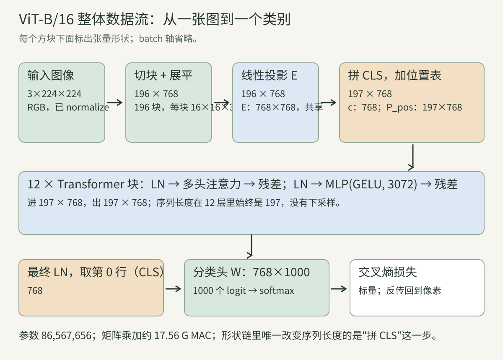
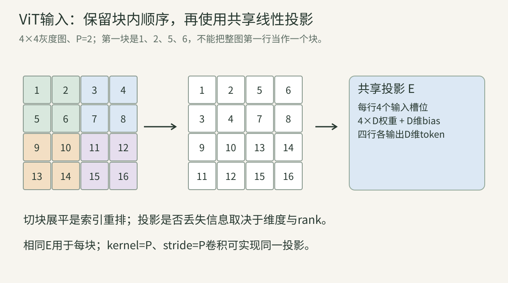
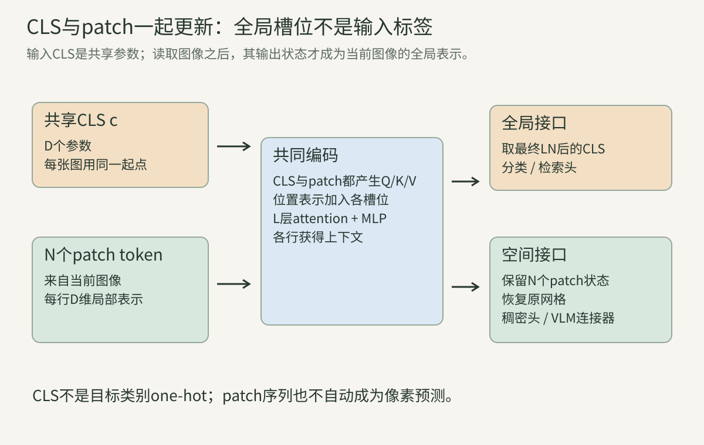
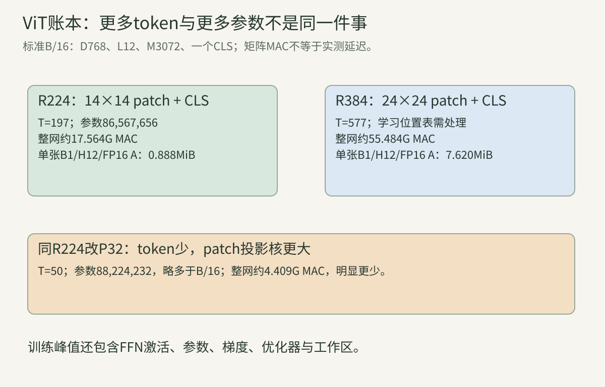
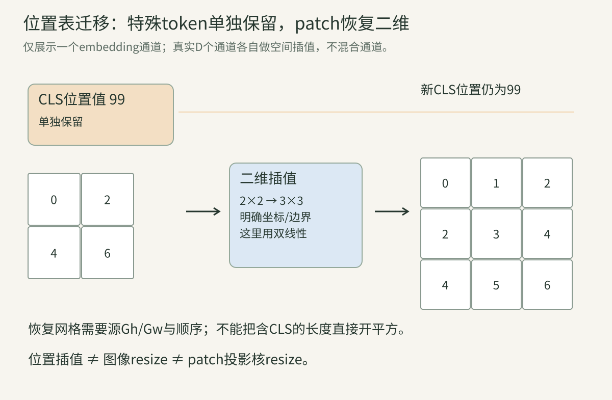
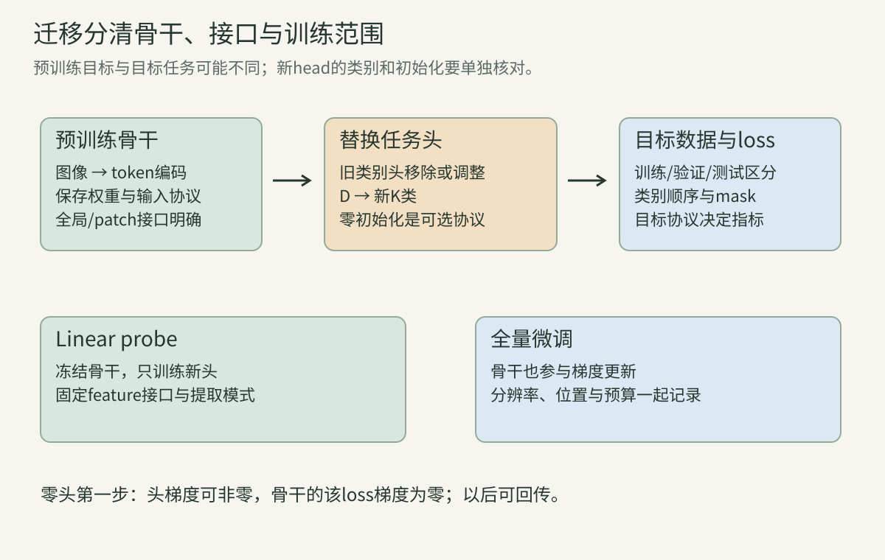

> 面向已经读过[第 11 讲](../vision-11-attention-transformer/)、知道 Q/K/V 和 softmax 怎么算的读者。读完这一讲，你应该能自己画出 ViT-B/16 从像素到损失的完整形状链，手算出它的 86,567,656 个参数，并说清"换分辨率"和"换 patch 大小"分别要改哪些东西。

Vision Transformer（ViT）做的事情用一句话就能说完：**把图像切成 16×16 的小块，每块当作一个"词"，然后交给一个标准的 Transformer 编码器。** 但这句话里每个词都藏着一个必须算清楚的细节：小块怎么切、怎么变成向量、全局信息从哪里读、位置怎么编码、分辨率变了怎么办、"86M 参数"是怎么数出来的。本讲把这些细节一个一个拆开，每个都配一个两三行就能手算完的数字例子。

*6 个模块 · 6 张图解 · 20 余个跟着算 · 3 段可运行核查 · 28 道带解析的练习*

> **📌 这一讲在课程中的位置**
>
> [第 11 讲](../vision-11-attention-transformer/)讲的是 Transformer 本身：给一个已经准备好的序列，注意力怎样让各位置交换信息、完整反传怎么算。这一讲把它放回图像：**输入不再是现成的序列，而是一张有颜色、有二维坐标的图片。** ViT 的全部新东西都在"怎样把图片变成序列"这一步，Transformer 主体几乎没改。
>
> 主线是一条形状链：`3×224×224 的像素 → 196 个 patch → 196×768 的 token → 拼一个 CLS 变成 197×768 → 12 层编码器 → 取 CLS → 1000 个 logit`。模块一、二讲前两步（切块与投影），模块三讲中间三步（CLS 与编码器），模块四把这条链上每一步的参数和计算量数出来，模块五讲分辨率变化时唯一需要动的位置表，模块六讲这个骨干怎样预训练、怎样迁移、原论文证明了什么。[第 13 讲](../vision-13-deit/)接着讲 DeiT 怎样用更少的数据把它训好。



**🖼 逐元素图解**

这张图是本讲的地图，后面每个模块都在放大它的一个方块。先把它读一遍：

| 方块 | 张量形状 | 它做了什么 | 详见 |
|---|---|---|---|
| **输入图像** | `3×224×224` | RGB 三通道，已经按 checkpoint 规定 resize 和 normalize | 模块一 |
| **切块 + 展平** | `196×768` | 224/16 = 14，14×14 = 196 块；每块 16×16×3 = 768 个数排成一行 | 模块一 |
| **线性投影 E** | `196×768` | 每一行乘同一个 768×768 的矩阵。形状没变，但最后一轴的含义从"像素槽位"变成了"学习到的特征" | 模块二 |
| **拼 CLS，加位置表** | `197×768` | 在最前面拼一个可学习向量 c，再给 197 行各加一行位置向量 | 模块三、五 |
| **12 × Transformer 块** | `197×768 → 197×768` | 每块两个 Pre-LN 残差子层；**序列长度 197 在 12 层里从不改变** | 模块三 |
| **最终 LN，取第 0 行** | `768` | 第 0 行就是 CLS 槽位的最终状态 | 模块三 |
| **分类头** | `1000` | 一个 768×1000 的线性层，输出 logit | 模块三、六 |
| **交叉熵** | 标量 | 梯度从这里一路反传回像素 | 模块七的程序会核对 |

**读图时注意两点。** 第一，整条链里只有"拼 CLS"一步改变了序列长度（196 → 197），其余每一步都保持 197 行；ViT 没有 ResNet 那种逐 stage 缩小特征图的操作。第二，"切块 + 展平"和"线性投影"前后张量形状相同（都是 196×768），这是 16×16×3 恰好等于 768 的巧合，不代表投影什么都没做。

---

`Part 1`

## 一、从像素到 token：ViT 到底改变了什么

这一模块回答一个问题：**为什么要把图片切成块？** 答案很朴素：Transformer 的输入必须是"一列向量"，而图片是一个三维数组。切块是把三维数组变成一列向量的最简单办法。但"最简单"不等于"没有细节"，切块的方式决定了后面所有索引、位置和权重的含义。

### 1. 先读懂模型名字：B/16 里的两个数

ViT 的模型名形如 **ViT-B/16、ViT-L/16、ViT-H/14**。斜线前是规模档位（Base / Large / Huge），斜线后是 **patch 的边长，单位是输入像素**。

| 名称 | 层数 L | 宽度 D | MLP 宽度 M | 头数 | 每头维度 | patch 边长 P |
|---|---:|---:|---:|---:|---:|---:|
| ViT-B/16 | 12 | 768 | 3072 | 12 | 64 | 16 |
| ViT-B/32 | 12 | 768 | 3072 | 12 | 64 | 32 |
| ViT-L/16 | 24 | 1024 | 4096 | 16 | 64 | 16 |
| ViT-H/14 | 32 | 1280 | 5120 | 16 | 80 | 14 |

数据来自[作者配置文件](https://github.com/google-research/vision_transformer/blob/main/vit_jax/configs/models.py)。**三个容易读错的地方**：B/16 的 16 不是层数、不是头数、也不是 patch 个数；每头维度不总是 64（H/14 是 80）；模型名字不包含输入分辨率，同一个 B/16 喂 224 或 384 的图，token 数完全不同。

本讲的记号：**N** 表示图像 patch 数，**T = N + 1** 表示拼上 CLS 以后的序列长度。很多资料把两者都写成 N，账本里就会把 CLS 漏掉。

> **💡 为什么名字里要带 patch 大小**
>
> 因为 patch 大小是 ViT 里最重要的"分辨率旋钮"。同一张 224 的图，P=16 得到 196 个 token，P=32 只有 49 个；注意力的计算量按 token 数的平方走，所以 B/32 比 B/16 快四倍左右，代价是每个 token 看到的块更粗。模块四会把这笔账精确算出来。

### 2. patch 是一个有内部顺序的像素块

一个 P×P、C 通道的 patch 含 P²C 个数。对 RGB 和 P=16，就是 16×16×3 = 768 个数。两点要先说清：

- **patch 不是像素，也不是物体。** 固定网格可能把一只狗切成十几块，也可能把两个物体的边界放进同一块。切块只是组织数据，初始 token 没有任何语义，语义来自后面的训练。
- **patch 内部不是一袋无序的像素。** 展平时每个"内部坐标 + 颜色通道"占固定槽位：第 (a, b) 个像素的通道 c 永远落在同一个下标上。后面的投影矩阵可以对不同槽位赋不同权重，所以虽然显式的二维轴没了，块内的空间结构并没有丢。

### 3. 网格怎样决定 patch 数

高 H、宽 W 的图，若都能被 P 整除，不重叠网格有 $G_h = H/P$ 行、$G_w = W/P$ 列，patch 总数

$$
N = G_h G_w = \frac{HW}{P^2}.
$$

按"先行后列"（raster order，从左到右、再从上到下）排列，第 r 行第 s 列的 patch 序号是 $i = rG_w + s$。

**跟着算：三种输入尺寸。**

| 输入 | 网格 | N | 拼 CLS 后 T |
|---|---|---:|---:|
| 224×224，P=16 | 14×14 | 196 | 197 |
| 384×384，P=16 | 24×24 | 576 | 577 |
| 224×320，P=16 | 14×20 | 280 | 281 |

长方形输入在数学上完全可以构造序列；某些库只接受固定正方形输入是接口限制，不是数学限制。

### 4. 形状链先算对

设 batch = 2，RGB 图 224×224，P=16，D=768。沿着图上的方块走一遍：

```
原图（NCHW）        2 × 3 × 224 × 224
切块展平            2 × 196 × 768        ← 768 = 16×16×3，这是"像素槽位"
线性投影            2 × 196 × 768        ← 768 = D，这是"特征坐标"
拼 CLS              2 × 197 × 768
加位置表（广播）    2 × 197 × 768
```

> **⚠️ 两个 768 不是一回事**
>
> 切块后的 768 是"一块里有多少个像素值"，投影后的 768 是"模型宽度 D"。B/16 下两者恰好相等，所以 debug 时光看 shape 发现不了"忘了做投影"这种错误。换成 ViT-L/16，投影前仍是 768、投影后是 1024，就能看出来了。核对 shape 要配合核对数值（模块七的程序就是这么做的）。

### 5. 预处理是模型的一部分

进入切块之前，图片要先解码、处理 EXIF 方向、转到 RGB、resize 或 crop、再按 checkpoint 规定缩放到 0—1 并减均值除方差。这些步骤任何一步不同，patch 里的数值就不同，权重读到的就是另一张图。

| 把任意图变成 224×224 的做法 | 保留的内容 | 形变 |
|---|---|---|
| 短边缩放到 224，中心裁剪 | 中央区域，边缘丢失 | 无 |
| 随机面积裁剪再缩放（训练常用） | 随机局部 | 轻微 |
| 直接拉伸成正方形 | 全图 | 长宽比改变 |

"固定输入 224×224"不等于"随便拉伸到正方形"。训练和推理的预处理也常常不同（训练随机裁剪、推理中心裁剪），复现结果必须把两套都记下来。

### 6. 展平顺序和 token 顺序都要固定

一个 patch 里的 P²C 个数排成一行时有多种顺序。两种常见的：

```
HWC 顺序：u = (a·P + b)·C + c       ← 先内部行 a，再内部列 b，最后通道 c
CHW 顺序：u = c·P² + a·P + b        ← 先通道 c，再内部行、列
```

两种顺序包含同样的数值，但每个槽位对应的像素不同。**投影矩阵 E 的每一行对应一个槽位**，所以权重必须和它训练时的展平顺序配对使用。转换 checkpoint 时可以同步置换 E 的行来保持等价；只换输入顺序、不换权重，函数就变了。token 列表同理：本讲一律用 raster order，改变它就要同步改位置表、mask 和"恢复网格"的操作。



**🖼 逐元素图解**

- **左边 4×4 的格子**是一张 4×4 灰度图，像素值就是 1 到 16（按行编号）。四种底色标出了 P=2 时的四个 patch：绿色左上、蓝色右上、橙色左下、紫色右下。
- **中间 4×4 的格子**是切块并展平后的矩阵 $X_p$：每一行是一个 patch，按 raster order 排列。第一行是 `1 2 5 6`，也就是左上那个绿色块的四个像素按"先内部行、再内部列"展开；**不是** `1 2 3 4`（那是整图的第一行）。
- **右边蓝色卡片**是共享投影 E：每一行 4 个输入槽位（2×2×1 = 4），乘一个 4×D 的矩阵加 D 维 bias，四行各输出一个 D 维 token。"共享"指四行用的是同一个 E。
- **两条箭头**分别是"索引重排"和"线性映射"。第一条可逆（只是搬动数字），第二条是否可逆取决于 E 的维度和秩，模块二会讲。
- **底部两行字**预告模块二的两个结论：切块是重排、投影可以用 kernel = stride = P 的卷积实现。

### 🖊 本模块练习

1. ★ 224×320 的图、P=16，有多少个 patch？拼 CLS 后序列多长？

<details><summary>解析</summary>

网格是 224/16 = 14 行、320/16 = 20 列，N = 14×20 = 280，T = 281。

两个常见错误：算出 224/16 = 14 之后默认网格是 14×14（忘了宽度不同）；或者拿到一个 280 行的位置表，对 280 开平方猜网格形状（280 不是平方数，而且即使是平方数也不能这样猜，见模块五）。

这题考的是：**N 由 H、W、P 三个量共同决定，不能只记"14×14"。**

</details>

2. ★ 把 4×4 的图按行展平成 16 个数，再 reshape 成 4×4，得到的是 2×2 切块吗？

<details><summary>解析</summary>

不是。按行展平后 reshape，第一行是 `1 2 3 4`，即整图第一行；正确的第一个 patch 应该是 `1 2 5 6`。

正确做法要先把两个空间轴各拆成"网格轴 × 块内轴"：$H \to (G_h, P)$、$W \to (G_w, P)$，得到 $(G_h, P, G_w, P)$，再把两个网格轴换到前面变成 $(G_h, G_w, P, P)$，最后合并。reshape 只会按内存顺序切分，不会做轴交换。

这题考的是：**shape 对了不代表索引对了。** 用编号小图检查比用真实照片更容易暴露错轴。

</details>

3. P=16、RGB、D=1024（ViT-L），投影矩阵 E 的形状是什么？patch 数影响它吗？

<details><summary>解析</summary>

输入宽 16×16×3 = 768，输出宽 1024，所以 E 是 768×1024，bias 是 1024。

patch 数 N 只决定 $X_p$ 有多少行，不影响 E 的形状；E 对每一行都一样。所以同一个 E 可以用于 224 和 384 的输入，这是模块五"换分辨率不用动 E"的根源。

</details>

4. 同一张图，用 HWC 和 CHW 两种顺序展平，哪些东西不变、哪些改变？

<details><summary>解析</summary>

不变的：每个 patch 里的 768 个数值本身；patch 的个数和顺序。

改变的：每个数值落在哪个槽位。因此如果 E 是按 HWC 训练的，喂 CHW 展平的输入，E 的第 u 行会乘到另一个像素上，输出完全不同。

修复办法是对 E 的行做同样的置换，而不是改输入。这题考的是：**权重和输入布局是配套的，二者要一起转换。**

</details>

---

`Part 2`

## 二、patch embedding：一层线性层能做什么、不能做什么

这一模块把"切块 + 投影"放大。很多人把 patch embedding 想成"把一块像素平均一下"，这是错的。它是一层可学习的线性映射，能区分块内的位置和颜色；它和一层特定的卷积在数学上完全相同；它可能丢信息，也可能不丢，取决于维度和秩。下面逐条证明。

### 7. patchify 是一次索引重排，因此可逆

用 HWC 布局的图像 I，不重叠切块的完整索引关系是：

$$
x_{\,rG_w+s,\;(aP+b)C+c} \;=\; I_{\,rP+a,\;sP+b,\;c},
\qquad r<G_h,\; s<G_w,\; a<P,\; b<P,\; c<C.
$$

**逐符号读：** 左边下标第一项 $rG_w+s$ 是 patch 的序号（第 r 行第 s 列），第二项 $(aP+b)C+c$ 是块内槽位；右边是原图里对应的像素行 $rP+a$、列 $sP+b$、通道 c。每个原始元素恰好出现一次，所以这一步只是搬动，按同样的索引放回去就能原样恢复原图。模块七的程序会用 `unpatchify(patchify(img)) == img` 核对这一点。

**跟着算：4×4 灰度图切成四块。** 图像按行是 (1,2,3,4)、(5,6,7,8)、(9,10,11,12)、(13,14,15,16)，P=2，C=1：

$$
X_p=\begin{bmatrix}1&2&5&6\\3&4&7&8\\9&10&13&14\\11&12&15&16\end{bmatrix}.
$$

第一个 patch 取 $r=s=0$，四个槽位 $(a,b)$ 依次为 (0,0)、(0,1)、(1,0)、(1,1)，对应像素 (0,0)、(0,1)、(1,0)、(1,1)，即 1、2、5、6。

### 8. 线性投影：每个输出通道都是一个"块内滤波器"

设 $E\in\mathbb R^{P^2C\times D}$、$b\in\mathbb R^D$，第 i 个 patch 的 token 是

$$
z_i = x_i E + b .
$$

E 的第 d 列决定输出的第 d 个特征怎样加权块内 768 个槽位。因为槽位和块内位置一一对应，一列 E 就是一个作用在 16×16×3 小块上的线性滤波器：它可以是"左右差"（竖边检测）、"红减绿"（颜色对比）、或任何线性组合。参数数目是 $(P^2C)D + D$，与 patch 数 N 无关。

> **💡 这里的 "embedding" 和词嵌入不是一回事**
>
> NLP 里的 embedding 是"先给词分配一个离散 ID，再查表"。ViT 的 patch embedding 是对连续像素值的线性映射，没有离散 ID，也没有查表。离散视觉 token（VQ-VAE 那一类）是另一条路线，第 47 讲再讲。

**跟着算：一个二维投影。** 取

$$
E=\begin{bmatrix}1&0\\0&1\\-1&0\\0&-1\end{bmatrix},\qquad b=(1,-1).
$$

第一块 (1,2,5,6)：第一维 $1\cdot1+2\cdot0+5\cdot(-1)+6\cdot0+1=-3$，第二维 $1\cdot0+2\cdot1+5\cdot0+6\cdot(-1)-1=-5$，输出 $(-3,-5)$。其余三块也都输出 $(-3,-5)$，因为这个 E 读的是"上一行减下一行"，而编号图里每个块的上下两行恰好都差 4。**这个投影读的是块内的上下差，不是块的平均值。**

### 9. 共享权重：同一个局部规则用在每一块

196 个 patch 用同一个 E。好处和卷积的权重共享一样：相似的局部纹理在图中任何位置都映射到相似的初始 token，不必给 196 个位置各学一套参数。

共享带来的反传规则：E 的梯度是所有 patch、所有样本贡献之和。设上游梯度 $G_Z$ 与 Z 同形状，

$$
G_E = X_p^{\top} G_Z,\qquad G_b=\sum_i (G_Z)_i,\qquad G_{X_p} = G_Z E^{\top}.
$$

**跟着算：一个 patch 的梯度。** 对第一个 patch $x=(1,2,5,6)$，设上游梯度 $g_z=(2,-1)$。

- 像素梯度 $g_x = g_z E^{\top}$：$E^{\top}$ 的两行是 $(1,0,-1,0)$ 和 $(0,1,0,-1)$，所以 $g_x = 2\cdot(1,0,-1,0)+(-1)\cdot(0,1,0,-1)=(2,-1,-2,1)$。
- 权重梯度 $G_E = x^{\top} g_z$ 是外积，四行依次 $(2,-1)$、$(4,-2)$、$(10,-5)$、$(12,-6)$。
- bias 梯度就是 $g_z=(2,-1)$。

如果第二个 patch 也有上游梯度，它的外积要**加到**同一个 $G_E$ 上，不能覆盖。模块七的程序对全部像素、E 和 bias 做有限差分核对这组公式。

### 10. 它和一层 stride = P 的卷积完全等价

把 E 重排成卷积核 $W_{d,c,a,b}=E_{(aP+b)C+c,\;d}$，用 kernel = P、stride = P、无 padding 的二维卷积，第 (r, s) 个输出位置是

$$
F_{d,r,s}=\sum_{c,a,b} W_{d,c,a,b}\, I_{rP+a,\;sP+b,\;c}+b_d \;=\; z_{\,rG_w+s,\;d}.
$$

右边正是第 8 节的 patch 投影。两种写法逐项相同，所以 [torchvision 的实现](https://docs.pytorch.org/vision/stable/_modules/torchvision/models/vision_transformer.html)直接用一个 `Conv2d(3, D, kernel_size=P, stride=P)` 做输入投影，再把空间轴展平成序列轴。

> **⚠️ 等价的是"这一层"，不是整个网络**
>
> 输入投影用卷积实现，不代表 ViT 是 CNN。CNN 的核心是逐层、重叠、感受野逐步扩大的局部卷积；ViT 只在最前面做一次不重叠的局部线性映射，之后每一层都是全局注意力。两者的归纳偏置差别在后面的层里，不在第一层。

### 11. 它不是平均池化：两个反例

平均池化对块内所有像素用固定的均匀系数，每个通道只保留一个平均值；投影 E 可以对块内不同位置赋不同权重，并产生 D 个不同响应。

**反例一（能区分，池化不能）。** 两个 2×2 灰度块 $(1,0,0,1)$ 和 $(0,1,1,0)$，均值都是 1/2，平均池化分不开。投影向量 $(1,-1,-1,1)^{\top}$ 分别给出 2 和 −2，分得开。

**反例二（先池化再投影不可逆）。** 如果先把块平均成一个数再投影，上面两种排列已经被合并，后面的网络不可能从同一个 1/2 恢复出"对角线"还是"反对角线"。

### 12. 切块可逆，投影不一定：零空间的例子

线性映射可逆与否看秩。若 $D < P^2C$，E 的秩至多为 D，一定存在不同的 patch 映射到同一个 token：所有落在 E 零空间里的输入差都被丢掉。若 $D \ge P^2C$ 且 E 列满秩，投影可以保留全部输入信息，甚至能构造左逆。

**跟着算：零空间反例。** 用第 8 节的 E，输入差 $\Delta x=(1,0,1,0)$ 满足 $\Delta x E=(1-1,\;0)=(0,0)$。所以 $(1,2,5,6)$ 和 $(2,2,6,6)$ 得到同一个 token $(-3,-5)$：这个 E 看不见"第一列整体加一"这种变化。反过来，若 E 是 4×4 单位阵（D=4），四个像素原样保留，没有任何丢失。

> **💡 B/16 的投影不一定在"压缩"**
>
> B/16 的 RGB 块输入维是 768，D 也是 768。只凭"一块像素变成一个 token"不能断言发生了压缩，要看 E 的秩。真正改变信息量的是后面的 LN、非线性、全局汇聚和任务目标。讨论"ViT 丢不丢细节"时，把切块、投影、后续加工三个环节分开说。

### 13. 不能整除时必须选一种边界政策

H 或 W 不能被 P 整除时，有四种处理：resize 到能整除、crop 掉多余边缘、padding 补齐、或者丢弃不足一块的边界。它们保留的内容、patch 数和坐标都不同。

**跟着算：230×230、P=16、无 padding 的卷积。** 输出边长 $\lfloor (230-16)/16\rfloor+1 = 14$，覆盖 224×224，最下面和最右边各 6 行/列像素从未被读取。有些实现会先断言输入尺寸必须整除，不会悄悄 padding；复现时要看清是哪一种。

### 14. 平移偏置：不能用"没有卷积"一句话概括

不重叠切块保留了局部二维邻域，而且输入映射在所有块上共享，这本身就是一种结构偏置。但它和 CNN 的平移等变不同：

- 图像平移**整 P 个像素**（忽略边界），patch 列表只是整体平移一格，token 本身不变。
- 图像平移**1 个像素**，每个块的像素分组都变了，所有 token 都变。
- 再加上绝对位置表、crop、padding，连前一条也不严格成立。

所以更准确的说法是：基础 ViT 比逐层局部卷积的 CNN **少一些**图像专用偏置（逐层局部性、精细平移等变），但不是"完全没有归纳偏置"，也不是"不需要位置信息"。

### 🖊 本模块练习

5. ★ 把 patch 线性层转换成卷积核，索引怎样对应？

<details><summary>解析</summary>

在本讲的 HWC 展平下，$W_{d,c,a,b}=E_{(aP+b)C+c,\;d}$，kernel 和 stride 都是 P，padding 为 0，bias 直接复用。

验证的方法不是看 shape，而是像模块七的程序那样：用同一张编号图分别跑 Linear 和 Conv2d，逐项比较输出，误差应在 1e-12 量级。若 E 是按 CHW 展平训练的，索引映射要换成 $W_{d,c,a,b}=E_{cP^2+aP+b,\;d}$。

这题考的是：**"reshape 权重"本身不对或错，对错取决于 reshape 后每个元素落到的像素是否和训练时一致。**

</details>

6. ★ "一个 patch 变成一个 token"必然损失像素信息吗？

<details><summary>解析</summary>

不必然。分三步看：

1. 切块展平是索引重排，完全可逆。
2. 线性投影：若 $D\ge P^2C$ 且 E 列满秩，可逆；若 $D<P^2C$，必有零空间，零空间里的输入差被丢掉。
3. 后面的 LN、注意力汇聚、分类头会继续改变信息，这是另一回事。

所以回答这个问题要先问"D 和 P²C 哪个大、E 的秩是多少"。B/16 是 768 对 768，不能一句"压缩了"带过。

</details>

7. 多个 patch 共用 E，梯度怎样合并？

<details><summary>解析</summary>

$G_E=\sum_i x_i^{\top} g_i = X_p^{\top} G_Z$，batch 里不同样本也一起求和。本质是：同一个参数在前向里被用了 196×B 次，反向就有 196×B 份贡献，全部相加。

两个典型错误：给每块存一份独立的 E（参数变成 196 倍，而且换分辨率时无法对应）；或者用最后一块的梯度覆盖前面的（相当于只用一块训练）。

</details>

8. 230×230 的输入、P=16、无 padding 的卷积投影，读到了整张图吗？

<details><summary>解析</summary>

没有。输出是 14×14，覆盖 224×224；最右边 6 列和最下面 6 行像素没有进入任何 patch。

如果这 6 行里恰好有关键内容（比如底部的文字），模型根本看不到。所以实际流程要么先 resize 到 224 的整数倍，要么显式 padding 并给 padding 块一个 mask。某些库会直接报错拒绝这种输入，那反而是好事。

</details>

9. 用第 8 节的 E，哪一类输入变化是它完全看不见的？再举一个它能看见的。

<details><summary>解析</summary>

看不见的：任何落在 E 零空间里的变化。E 的两列分别是 $(1,0,-1,0)$ 和 $(0,1,0,-1)$，零空间由 $(1,0,1,0)$ 和 $(0,1,0,1)$ 张成，也就是"上下两行同时加同一个数"。所以给整块加一个常数（亮度整体变化）这个 E 完全看不见。

能看见的：上下两行之差的任何变化，比如把第一行加 1、第二行不动，输出第一维增加 1。

这题考的是：**零空间不是抽象概念，它直接对应"模型对哪种输入变化不敏感"。**

</details>

---

`Part 3`

## 三、CLS 与编码器：token 之间怎样交换信息

切块和投影之后，我们有 196 个互不相识的局部 token。这一模块回答两个问题：**全局信息从哪里读出来**（CLS），以及**196 个 token 怎样互相看见**（编码器）。Transformer 块的公式在第 11 讲已经推过，这里只讲 ViT 特有的约定。

### 15. CLS 是一个学来的"全局读取位置"，不是标签

基础分类 ViT 在 196 个 patch token 前面拼一个可学习向量 $c\in\mathbb R^D$。关于它，先排除三个误解：

- 它**不是**类别标签的 embedding，也不是 one-hot。它是所有图片共享的模型参数，初始时不含任何当前图片的信息。
- 它**不是**每张图各有一份。拼接发生在序列轴：`[c; X_pE + b]` 得到 T = N + 1 行；batch 里 32 张图用的是同一个 c（广播），只增加 D 个参数，不是 32×D。
- 输入的 c 和输出的"全局表示"**不是同一个向量**。c 是起点；经过 12 层注意力读取当前图的 patch 之后，第 0 行的最终状态才依赖图片，分类头读的是这个最终状态。

### 16. CLS 怎样读图：注意力里它只是第 0 行

对任意一头注意力，CLS 对应 query 的第 0 行，key/value 的下标 0 到 N（**包含它自己**）：

$$
O_0=\sum_{j=0}^{N} a_{0j}\, v_j ,\qquad a_{0j}=\operatorname{softmax}_j\!\left(\frac{q_0 k_j^{\top}}{\sqrt d}\right).
$$

第一层里 $q_0$ 来自与图片无关的 c，但 $k_j, v_j$ 来自当前图的 patch，所以 $O_0$ 已经依赖图片。更深的层里 CLS 状态带有图片信息，它发出的 query 也随图变化，读取方式可以逐层调整。

**跟着算：均匀读取。** 只隔离一个注意力子运算。设 CLS 的 query 为零向量，三个 value 分别是 CLS 自己 $(0,0)$、patch1 $(3,0)$、patch2 $(0,6)$。分数全为 0，三个权重各 1/3，输出 $(1,2)$。如果忘了 CLS 自己也是候选，用 1/2 会错算成 $(1.5,3)$。



**🖼 逐元素图解**

- **左上橙色卡片"共享 CLS c"**：D 个参数，每张图都从同一个起点出发。
- **左下白色卡片"N 个 patch token"**：来自当前图像，每行一个 D 维局部表示。
- **两条箭头汇入中间蓝色卡片"共同编码"**：CLS 和 patch 都产生自己的 Q/K/V，位置表加到各自槽位，然后一起过 L 层注意力和 MLP。关键是"共同"：CLS 不是站在网络外面、单向读取 patch 的池化器，它和 patch 同在一条序列里，互为 key/value。
- **右上橙色卡片"全局接口"**：取最终 LN 之后的第 0 行，接分类或检索头。
- **右下白色卡片"空间接口"**：保留 N 个 patch 的最终状态，按原网格恢复成 $G_h\times G_w\times D$，接稠密任务头或 VLM 的连接器。
- **底部那行字**是两个常见误解的否定：CLS 不是 one-hot 标签；patch 输出也不会自动变成像素级预测。

**读图顺序：** 先看两个输入卡片怎样拼成一条序列，再看中间卡片强调"所有行都产生 Q/K/V"，最后注意右侧有两个出口。分类 ViT 只用上面那个出口，但 patch 状态一直都在，这是后面 DINO、SAM、VLM 复用 ViT 的基础。

### 17. patch 的状态也被全局上下文改变

每个 patch 也有自己的 query，可以读别的 patch 和 CLS。所以编码器输出的第 i 个 patch 状态不再只是原块的线性响应，可能包含远处物体和整图上下文。两张图的某个局部块完全相同、周围不同，深层该 patch 的状态可以不同。这对建立长距离关系有利，但也意味着"一个输出 patch 只对应原块里的事实"不再严格成立，稠密任务要另外保证空间对齐。

### 18. CLS 与 GAP 是两种全局接口

| 接口 | 怎么得到全局向量 | 要额外说明的 |
|---|---|---|
| CLS | 取第 0 行的最终状态 | 是否过最终 LN |
| GAP（全局平均池化） | 对 N 个 patch 状态取平均 $f=\frac1N\sum_i z_i$ | LN 在平均前还是后；是否包含特殊 token；padding 块怎么处理 |

GAP 是固定汇聚，但它的输入已经被注意力全局加工过，所以也能拿到复杂的全局信息。原论文附录 D.3 的消融发现：CLS 和 GAP 各自调好学习率之后效果接近，而用同一套超参数时差距很大。**比较两种接口要分别调参，不能拿一个没调过的结果说"GAP 不行"。**

**跟着算：LN 和平均不能交换顺序。** 两个 patch 向量 $x_1=(1,0)$、$x_2=(0,3)$，LN 取 $\gamma=1,\beta=0,\epsilon=0$。

- 先 LN 再平均：$x_1$ 均值 0.5、标准差 0.5，归一化为 $(1,-1)$；$x_2$ 均值 1.5、标准差 1.5，归一化为 $(-1,1)$；平均得 $(0,0)$。
- 先平均再 LN：平均 $(0.5,1.5)$，均值 1、标准差 0.5，归一化为 $(-1,1)$。

两个结果不同。把一个用 CLS 训练的模型在推理时改成平均 patch 输出，也同样不等价于它训练过的接口。

### 19. 从输入到分类头的完整公式

把前面的拼起来。初始序列：

$$
Z_0=\bigl[\,c\,;\;X_pE+b\,\bigr]+P_{pos},\qquad Z_0\in\mathbb R^{T\times D},\; P_{pos}\in\mathbb R^{T\times D}.
$$

方括号是沿序列轴拼接；位置表用**加法**，不是拼接到特征后面。第 l 层（Pre-LN，两个残差子层）：

$$
U_l = Z_{l-1}+\operatorname{MHA}\bigl(\operatorname{LN}_1(Z_{l-1})\bigr),\qquad
Z_l = U_l+\operatorname{MLP}\bigl(\operatorname{LN}_2(U_l)\bigr).
$$

所有状态保持 $B\times T\times D$。每层的 LN、MHA、MLP 参数各自独立，不是同一个块调用 12 次。MLP 是 $\phi(XW_1+b_1)W_2+b_2$，中间宽度 M = 4D，激活 GELU：$\phi(x)=\tfrac12 x\,[1+\operatorname{erf}(x/\sqrt2)]$。最后：

$$
f=\operatorname{LN}_{final}(Z_L)_0,\qquad \text{logits}=fW_{head}+b_{head}.
$$

```
Z0  = concat(c, Xp·E + b) + Ppos         197 × 768
for l in 1..12:
    U  = Z + MHA(LN1(Z))                  197 × 768   ← 12 头，每头 64 维
    Z  = U + MLP(LN2(U))                  197 × 768   ← 中间宽 3072
f   = LN_final(Z)[0]                      768
logits = f · W_head + b_head              1000
```

> **⚠️ "最后一个块里的 LN"和"最终 LN"是两处**
>
> Pre-LN 块的 $\operatorname{LN}_2$ 在 MLP 分支内部，它的输出还要和 U 相加，所以最后一个残差输出 $Z_L$ 并没有被归一化。$\operatorname{LN}_{final}$ 是另一个带参数的模块，账本里要单独算（2D 个参数）。
>
> 同样的原因，"冻结骨干提取特征"时要说清拿的是 $Z_L$、$\operatorname{LN}_{final}(Z_L)$ 的 CLS、还是 patch 行。它们维度都是 768，数值和含义不同。

### 20. ViT 特有的三个约定

**多头不缩小序列。** 宽 D、H 头时每头 d = D/H，Q/K/V 形状 $B\times H\times T\times d$，分数 $B\times H\times T\times T$，汇聚后拼回 $B\times T\times D$。12 层里序列长度一直是 T，没有 ResNet 那样的逐 stage 下采样；Swin/PVT 的层级结构是[第 14 讲](../vision-14-swin-pvt/)的内容。

**没有因果 mask。** 分类时整张图已经给出，patch 之间双向读取，CLS 读所有 patch。套一个语言模型的下三角 mask 会让 patch 依赖 raster 顺序，毫无道理。只有在 padding、多图拼接、在线视频等场景才需要别的 mask。

**hybrid ViT 把 CNN 特征当输入。** 先用 CNN 产生 $C_f\times H_f\times W_f$ 的特征，再把每个特征位置投影成 token。这时"patch 大小 1"指特征网格上的 1 格，不是原图的 1 像素；参数和计算要把 CNN 前端算进去。

**跟着算：头数不等于每头 64 维。** B：768/12 = 64；L：1024/16 = 64；H：1280/16 = 80。H/14 在 224 输入上 patch 网格 16×16 = 256，T = 257。每一项都要从配置和输入一起算，不能背"64"。

### 🖊 本模块练习

10. ★ batch = 32、D = 768，CLS 的参数是 32×768 吗？

<details><summary>解析</summary>

不是，只有 768 个。c 是模型参数，前向时广播到 32 条样本；32 个输出状态各不相同（因为读了不同的图），但 c 的梯度是 32 份贡献之和。

类比：卷积核在 32 张图上共享，参数只有一份。这题考的是**"序列轴上拼接"和"batch 轴上共享"是两件事**。

</details>

11. CLS 的 query 为零向量，序列含 CLS 和两个 patch，注意力权重是多少？

<details><summary>解析</summary>

分数全为 0，候选有 3 个（CLS 自己 + 两个 patch），权重各 1/3。

错误答案 1/2 来自忘记 CLS 自己也在 key/value 里。真实的块里还有投影和 LN，但"候选集合包含自己"这一点不变。

</details>

12. ★ 先 GAP 再 LN，等于先 LN 再 GAP 吗？

<details><summary>解析</summary>

一般不等。LN 对每一行用它自己的均值和方差，是非线性操作；平均是线性的。两者不交换。正文的例子：$(1,0)$ 和 $(0,3)$ 先 LN 再平均得 $(0,0)$，先平均再 LN 得 $(-1,1)$。

工程含义：读别人的 checkpoint 时要查清 pooling 和 LN 的顺序，改错顺序精度会无声下降。

</details>

13. Pre-LN 的最后一个块里已经有两处 LN，为什么还要单算一个最终 LN？

<details><summary>解析</summary>

因为块内的 LN 都在分支里，分支输出要和残差主干相加，主干 $Z_L$ 本身没有被归一化。最终 LN 是独立模块，有自己的 $\gamma,\beta$（2D = 1536 个参数），在架构图和账本里都要单列。

</details>

14. ViT-H 的宽度 1280、16 头，每头多少维？"每头 64"是定义吗？

<details><summary>解析</summary>

1280/16 = 80。"每头 64"只是 B 和 L 的配置，不是 Transformer 的定义；每头维度 d = D/H 要从配置算。用某些融合注意力内核时还要查它支持的 d 列表（常见是 64、128 的倍数），80 未必被支持。

</details>

---

`Part 4`

## 四、账本：86M 参数和 17.6G MAC 是怎么数出来的

这一模块把地图上每个方块的参数量和乘加次数精确算出来。目的不是记住数字，而是建立三条直觉：**参数和计算量是两本不同的账**（B/32 参数比 B/16 多、计算却少四倍）；**分辨率和 patch 大小是两条不同的扩展轴**；**显存不只是一张注意力矩阵**。

### 21. 先说清计数约定

以下按这套约定数：RGB 输入、固定正方形输入 R、不重叠 patch P、一个 CLS、可学习绝对位置表、L 层标准 Pre-LN 编码器、所有线性层带 bias、每层两个带 affine 的 LN、末端一个带 affine 的 LN、直接 D → K 的线性头。不含 `pre_logits` 层、distillation / register token、相对位置 bias、卷积 stem。

总参数：

$$
P_{total}=\underbrace{(CP^2+1)D}_{\text{patch 投影}}+\underbrace{D}_{\text{CLS}}+\underbrace{TD}_{\text{位置表}}+\underbrace{L\,(4D^2+2DM+M+9D)}_{\text{编码器}}+\underbrace{2D}_{\text{最终 LN}}+\underbrace{(D+1)K}_{\text{分类头}} .
$$

编码器一层的 $4D^2+2DM+M+9D$ 拆开是：Q/K/V/O 四个 D×D 矩阵加四个 bias（$4D^2+4D$）、MLP 两个矩阵加两个 bias（$2DM+M+D$）、两个 LN（$4D$）。M = 4D 时一层是 $12D^2+13D$。

### 22. ViT-B/16 逐项核算

取 R = 224、P = 16、D = 768、L = 12、M = 3072、K = 1000，T = 197：

| 模块 | 计算 | 参数数 |
|---|---|---:|
| patch 投影 | $(3\times16^2+1)\times768$ | 590,592 |
| CLS | $768$ | 768 |
| 位置表 | $197\times768$ | 151,296 |
| 一层编码器 | $12\times768^2+13\times768$ | 7,087,872 |
| 十二层编码器 | $12\times7{,}087{,}872$ | 85,054,464 |
| 最终 LN | $2\times768$ | 1,536 |
| 1000 类头 | $(768+1)\times1000$ | 769,000 |
| **整网** | 上面各行相加（"一层"那行是展示，不重复加） | **86,567,656** |

一层里面：MHA 2,362,368，MLP 4,722,432，两个 LN 3,072。**98% 的参数在 12 个编码器块里**，patch 投影和位置表加起来不到 1%。

**跟着算：换类别、换分辨率各动了谁。**

- 1000 类换 10 类：头变成 $(768+1)\times10=7{,}690$，总数减 761,310，得 85,806,346。骨干一个数都不变。
- 224 换 384（P 不变）：位置表从 197×768 变成 577×768，多 291,840，总数 86,859,496。**其余所有模块形状不变**，这就是模块五只需要处理位置表的原因。

### 23. 五个规模的精确参数

同一约定、R = 224、K = 1000：

| 模型 | N | T | 参数 |
|---|---:|---:|---:|
| B/16 | 196 | 197 | 86,567,656 |
| B/32 | 49 | 50 | 88,224,232 |
| L/16 | 196 | 197 | 304,326,632 |
| L/32 | 49 | 50 | 306,535,400 |
| H/14 | 256 | 257 | 632,045,800 |

> **💡 为什么 B/32 的 token 更少、参数反而更多**
>
> P 从 16 变 32，patch 投影的输入宽从 768 变成 3072，E 从 768×768 变成 3072×768，多了 1.77M 参数；位置表从 197 行减到 50 行，只省了 113K。一加一减，B/32 多出约 1.66M。**参数量是"权重矩阵有多大"，和"一次前向算多少"没有直接关系。**

论文里的粗略"86M"可能包含不同的头、representation 层或类别数。本讲的精确数以上面的约定为准，不拿它反推某个没核对过的 checkpoint。

### 24. 乘加次数（MAC）

只数矩阵乘加，不计 bias、激活、LN、softmax、残差：

- patch 投影：$N\cdot CP^2\cdot D = HWCD$。**它不随 P 变化**：P 大了块少，但每块输入宽，两者抵消。
- 编码器一层：$4TD^2$（Q/K/V/O 投影）$+\,2T^2D$（$QK^{\top}$ 和 $AV$）$+\,2TDM$（MLP）。M = 4D 时是 $12TD^2+2T^2D$。
- 分类头：$DK$。

$$
C_{total}=HWCD + L\,(12TD^2+2T^2D) + DK .
$$

**跟着算：B/16 的 17.564G。**

| 项 | 计算 | MAC |
|---|---|---:|
| patch 投影 | $196\times768\times768$ | 115,605,504 |
| 一层编码器 | $12\times197\times768^2+2\times197^2\times768$ | 1,453,954,560 |
| 十二层 | ×12 | 17,447,454,720 |
| 1000 类头 | $768\times1000$ | 768,000 |
| **合计** | | **17,563,828,224 ≈ 17.564G** |

一层里 $QK^{\top}$ 和 $AV$ 那项只有 59.6M，**占一层的 4%**；在 224 分辨率下 ViT 的计算量主要在四个投影和 MLP，不在注意力矩阵本身。这个比例随 T 变大而上升（T = 577 时约 11%）。

B/32 同样输入：patch 投影不变（115.6M），十二层编码器降到 4,292,812,800，总计 4,409,186,304 ≈ 4.41G，**只有 B/16 的四分之一**。原因就是 T 从 197 降到 50。



**🖼 逐元素图解**

- **左上白色卡片"R224：14×14 patch + CLS"**：标准 B/16 在 224 输入下的三个数：T = 197、参数 86,567,656、整网约 17.564G MAC，以及单张注意力矩阵的显存（B=1、12 头、FP16）0.888 MiB。
- **右上蓝色卡片"R384：24×24 patch + CLS"**：同一个模型喂 384 的图。T 变成 577，学习位置表要插值（模块五），MAC 升到约 55.484G，单张注意力矩阵 7.620 MiB。参数只多了位置表那 291,840。
- **下方橙色宽卡片"同 R224 改 P32"**：T 只有 50，参数 88,224,232 略**多**于 B/16，MAC 约 4.409G 明显**少**。这张卡片就是第 23 节那个 💡 的图示。
- **底部那行字**提醒：训练峰值显存还包括 FFN 激活、参数、梯度、优化器状态和工作区，不能只看注意力矩阵（第 26 节）。

**读图顺序：** 横向比较上面两张卡片看"分辨率轴"，纵向比较左上和下方看"patch 轴"。两条轴都改变 T，但一个改变输入像素总量，另一个不改。

### 25. 分辨率和 patch 大小是两条不同的轴

| 操作 | 输入像素总量 | 每个 patch 看到的区域 | E 的形状 | 位置表 |
|---|---|---|---|---|
| 提高分辨率，P 不变 | 增加 | 不变（更细的物体占更多块） | 不变 | 需插值 |
| 减小 P，分辨率不变 | 不变 | 变小 | 改变（输入宽变） | 需插值 |

两者可以得到相同的 T。例如 224/P8 和 448/P16 都有 785 个 token，编码器主体 MAC 相同，但前者看的是同一张 224 图的更小块，后者输入的是四倍像素；patch 投影的 MAC 也不同（$HWCD$ 差四倍）。

**跟着算：B/16 从 224 升到 384。** N 从 196 到 576，T 从 197 到 577。总 MAC 从 17,563,828,224 升到 55,484,350,464，**3.159 倍**。注意力位置对的比值是 $577^2/197^2\approx8.579$，但投影和 MLP 只按 T 一次方增长（约 2.93 倍），所以总量远小于"平方"。

> **⚠️ "分辨率翻倍，计算十六倍"是错的**
>
> 固定 P 时，边长翻倍 → patch 数四倍 → 注意力矩阵十六倍，但投影和 MLP 只有四倍，patch stem 也是四倍。总量按各项相加，在 224 → 448 这个范围里大约是 4 到 5 倍，不是 16 倍。实际延迟还取决于内核、精度、batch 和访存。

### 26. 显存不只是一张注意力矩阵

一层的显式注意力矩阵 A 有 $BHT^2$ 个元素，token 状态有 $BTD$，FFN 中间激活有 $BTM$。训练时还要保存 LN、激活、softmax 的中间结果，以及梯度和优化器状态。

**跟着算：一张 A 和一份 FFN 激活。** B = 1、12 头、FP16：

- T = 197：A 有 $12\times197^2\times2$ 字节 ≈ 0.888 MiB；T = 577 时 ≈ 7.620 MiB。
- FFN 中间激活（M = 3072，T = 197）：$197\times3072\times2/2^{20}\approx1.154$ MiB。

**在 224 分辨率下一份 FFN 激活比一张注意力矩阵还大。** 这不说明 FFN 永远占显存更多（T 大了 A 按平方涨），只说明不能只盯着二次项。粗估优化器状态：FP32 参数 + FP32 梯度 + Adam 两组动量，约 16 字节/参数；混合精度和分片会改变这笔账。

### 🖊 本模块练习

15. ★ B/16 换 10 类，分类头多少参数？整网多少？位置表要变吗？

<details><summary>解析</summary>

头 $(768+1)\times10=7{,}690$；整网 $86{,}567{,}656-769{,}000+7{,}690=85{,}806{,}346$。位置表和骨干都不变，因为类别数只出现在分类头这一项里。

这题考的是：**把总参数公式的每一项和"谁决定它"对应起来**，K 只进分类头，T 只进位置表和计算量，D 和 L 进编码器。

</details>

16. ★ B/32 为什么参数比 B/16 多、MAC 却少？

<details><summary>解析</summary>

参数：patch 投影输入宽从 768 变 3072，E 多 1.77M；位置表从 197 行减到 50 行，只少 113K；净增 1.66M。

MAC：patch 投影不变（$HWCD$ 与 P 无关），编码器按 T 走，T 从 197 降到 50，12 层从 17.45G 降到 4.29G。

一句话：**参数看矩阵形状，计算看矩阵被用了多少次。** 两者是不同函数。

</details>

17. 同样 R 和 D，patch 投影的 MAC 为什么不随 P 变化？什么条件下成立？

<details><summary>解析</summary>

$N\cdot CP^2\cdot D=\frac{HW}{P^2}\cdot CP^2\cdot D=HWCD$，P 约掉了。直觉：每个像素恰好被读一次、乘 D 个权重，和怎么分块无关。

成立条件：不重叠、整除、通道数和 D 不变。改成重叠的卷积 stem 或 padding 后就不成立了。

</details>

18. ★ 图像边长翻倍，整网计算一定十六倍吗？

<details><summary>解析</summary>

不一定。固定 P 时 T 约四倍。各项：patch 投影 ×4（像素四倍），投影和 MLP ×4（按 T），注意力矩阵 ×16（按 T²）。总量是加权和，在 224 → 448 大约 4 到 5 倍（因为 224 时注意力项只占 4%）。

正文 224 → 384 的例子：T 约 2.93 倍，总 MAC 3.159 倍，比 T² 的 8.58 倍小得多。

</details>

19. 单张注意力矩阵的大小等于训练峰值显存吗？

<details><summary>解析</summary>

差得远。还有：12 层每层都有 A、token 状态、FFN 激活和 LN 中间值要保存给反传；参数、梯度、优化器状态约 16 字节/参数（Adam，FP32）；再加分配器碎片和工作区。

B/16、T = 197、B = 1 时一张 A 只有 0.888 MiB，而参数+梯度+优化器就有约 1.3 GiB。使用 FlashAttention 一类内核时 A 甚至不会被完整物化，但其他部分照旧。

</details>

---

`Part 5`

## 五、位置表与分辨率迁移：唯一需要动的那张表

模块四算出：224 换 384 时，除了位置表，所有权重形状都不变。这一模块回答：**位置表是什么、分辨率变了它怎么办、这件事有多少坑。**

### 27. 学习位置表是"槽位 → 向量"的查找表

基础 ViT 的位置表 $P_{pos}\in\mathbb R^{T\times D}$ 每行对应一个序列槽位（第 0 行 CLS，第 1 到 N 行是 raster order 的 patch），初始随机，训练中学习。关于它的三件事：

- 它的数值没有显式的"第几行第几列"分量；模型通过"内容 + 槽位"的配对学会利用空间关系。原论文附录展示了学出来的位置表之间的相似度呈现二维网格结构，这是学到的，不是设计进去的。
- 它对所有图片相同，提供的是"这是第几个槽位"，不是"这张图里物体在哪"。物体在哪仍要从内容里识别。
- 把二维网格排成一维列表只是存储方式。**只要槽位和二维坐标的对应关系固定，模型就能学二维关系；但分辨率一变，就必须把这层对应关系找回来。**

### 28. 位置插值的五个步骤

分辨率变化后 N 变了，旧的 $T_{old}\times D$ 表不能直接加到新序列上。标准处理：

```
1. 分离特殊 token 行       P_pos[0]  单独拿出来
2. 恢复二维网格            P_pos[1:] → G_h_old × G_w_old × D
3. 空间两轴插值            → G_h_new × G_w_new × D   （每个通道独立做，D 个通道互不混合）
4. 展平回 raster 序列      → N_new × D
5. 接回特殊 token          [P_pos[0]; 新 patch 位置]  → T_new × D
```

插值的对象是**位置表**，不是图片像素，也不是投影矩阵 E。图片 resize、位置表 resize、E 的核 resize 是三件不同的事，可以同时发生但要分别记录。



**🖼 逐元素图解**

- **左上橙色卡片"CLS 位置值 99"**：只展示一个 embedding 通道，CLS 这一行的值是 99。它**不参与**下面的空间插值；一条橙色横线把它直接送到右上角的"新 CLS 位置仍为 99"。
- **左下 2×2 格子** `0 2 / 4 6`：旧 patch 位置表（同一个通道）恢复成的二维网格。
- **中间蓝色卡片"二维插值"**：2×2 → 3×3，用双线性、端点对齐的约定。卡片特别写了"明确坐标/边界"，因为约定不同结果就不同（第 29 节）。
- **右下 3×3 格子** `0 1 2 / 2 3 4 / 4 5 6`：插值结果。四个角保留原值，边中点是相邻两角的平均，中心 3 是四角平均。
- **底部两行字**：恢复网格必须知道源 $G_h, G_w$ 和顺序，不能对含 CLS 的长度开平方；位置插值、图像 resize、投影核 resize 是三件事。

**读图顺序：** 先看橙色那条线（CLS 绕过插值），再看蓝色卡片两侧的格子。真实模型有 768 个通道，每个通道各做一遍图里的操作。

**跟着算：2×2 升到 3×3。** 旧表（单通道）$\begin{bmatrix}0&2\\4&6\end{bmatrix}$，端点对齐的双线性：新坐标 $u\in\{0,1,2\}$ 映射到旧坐标 $u\cdot(2-1)/(3-1)=u/2$，即 0、0.5、1。第一行在旧第 0 行上插值得 (0, 1, 2)；中间行是上下两行的平均 (2, 3, 4)；最后一行 (4, 5, 6)。中心的 3 是四角 0、2、4、6 的平均。

### 29. 同样叫"插值"，约定不同结果不同

一维旧位置值 (0, 2) 升到长度 4：

| 约定 | 新坐标映射到旧坐标 | 结果 |
|---|---|---|
| 端点对齐（align_corners=True） | $u\cdot(m-1)/(n-1)$ = 0, 1/3, 2/3, 1 | (0, 2/3, 4/3, 2) |
| 半像素 + clamp（align_corners=False） | $(u+\tfrac12)m/n-\tfrac12$ = −1/4, 1/4, 3/4, 5/4 → clamp 到 [0,1] | (0, 1/2, 3/2, 2) |

形状相同、数值不同。双三次插值还可能产生超出原最小—最大范围的值。torchvision 的位置插值函数和作者 JAX 工具各有自己的约定，**只检查"加载成功"不能证明两个库的位置迁移一致**。模块七的程序用显式的端点对齐规则，并明确标出 clamp 行为。

> **⚠️ 长方形网格不能靠开平方猜**
>
> N = 280 可能来自 14×20，也可能是别的因子组合。只存一条 280×D 的列表、不存源网格尺寸，就无法恢复二维几何。动态长宽比的模型必须分别保存 $G_h$ 和 $G_w$；某些库假设旧网格是正方形并对 N 开平方，喂长方形输入时会无声出错。

### 30. 插值解决的是形状，不是精度

位置插值之后模型"能跑"，但不保证"更准"。更高分辨率带来更多 token、不同的物体尺度分布、更长的注意力分母；没有微调的分辨率外推是一种实验，微调后的是另一种。原论文的做法是**在高分辨率上微调**，而不是直接外推。报告结果时要写清：输入处理、位置策略、是否微调、微调预算。

### 31. 改 patch 大小比改分辨率复杂得多

| 要改的 | 保持 P 改 R | 保持 R 改 P |
|---|---|---|
| 位置表 | 插值 | 插值 |
| patch 投影 E | 不变 | **输入宽变**（$CP^2$），不能原样加载 |
| 每个 token 的视野 | 不变 | 改变 |

改 P 需要对投影核重采样、重新初始化 stem 或专门训练（FlexiViT 那类方法）。加载 checkpoint 时 `strict=False` 会忽略 shape 不匹配的参数，**但不会告诉你哪些参数实际没加载**，迁移前要逐项核对 state dict。

### 🖊 本模块练习

20. ★ 位置插值时 CLS 放在哪里？

<details><summary>解析</summary>

单独拿出来、原样保留，只对 patch 部分恢复网格并插值，最后接回第 0 行。

CLS 没有图像坐标，把它凑进网格（比如把 197 当成 14×14 + 1 以外的某种形状）没有几何意义。torchvision 的插值函数就是先切出第 0 行再处理其余部分。

</details>

21. 一维轴 (0, 2) 升到长度 4，半像素 + clamp 的结果是什么？端点对齐呢？

<details><summary>解析</summary>

半像素：坐标 $(u+0.5)\cdot2/4-0.5$ 得 −0.25, 0.25, 0.75, 1.25，clamp 后 0, 0.25, 0.75, 1，线性插值得 (0, 1/2, 3/2, 2)。

端点对齐：坐标 0, 1/3, 2/3, 1，得 (0, 2/3, 4/3, 2)。

两者形状一样、数值不同。这题考的是：**插值不是一个函数，是一族函数，复现时要写清用的是哪一个。**

</details>

22. 一条 280 行的 patch 位置表，为什么不够推断二维尺寸？

<details><summary>解析</summary>

280 = 14×20 = 20×14 = 10×28 = 7×40 = …，每种因子分解对应不同的网格，插值结果完全不同。所以必须额外保存训练时的 H/W 和 P，或直接保存网格尺寸。对正方形输入（如 196 = 14×14）开平方碰巧可行，但这是巧合不是规则。

</details>

23. P=16 换 P=8，只插值位置表够吗？

<details><summary>解析</summary>

不够。E 的输入宽从 768 变成 $3\times8^2=192$，形状都不同，不能加载；位置表也要从 14×14 插到 28×28。此外每个 token 看到的视野变小，整个网络的统计分布都变了，必须重新训练或用专门的核重采样方法。

这题考的是**第 25 节那张表：改 P 动的东西比改 R 多一项，而且那一项是不可插值的。**

</details>

---

`Part 6`

## 六、预训练、迁移与论文证据

前五个模块讲的是一个确定的函数。这一模块讲怎样得到它的权重、怎样把它用到新任务，以及原论文到底证明了什么。核心一句话：**ViT 是一种架构，不是一种训练目标**。同一个 ViT 可以用类别标签、图文对比、掩码重建或自蒸馏来训练，看到 ViT 三个字母不能推断它是怎么训的。

### 32. 架构不决定监督信号

原论文的主路线是**大规模监督预训练 + 迁移**：在 ImageNet-21k 或 JFT-300M 上用类别标签训练，再换头微调到目标任务。它也做了初步的 masked patch 预测实验（预测被遮块的平均颜色），这是自监督方向的早期证据，但和后来的 MAE 在掩码率、编码器—解码器结构、目标上都不同。[第 18 讲](../vision-18-masked-modeling/)讲 MAE 时再对比。

预训练数据不只有"多少张"，还有覆盖范围、重复、噪声、和目标任务的关系。更多图片若主要是重复或偏离任务，收益不同。

### 33. 换头、零初始化与两种迁移设置



**🖼 逐元素图解**

- **上排三张卡片是迁移的流水线。** 左："预训练骨干"：图像到 token 的编码器，连同权重和它的输入协议（预处理、分辨率）一起保存，全局/patch 两个接口都明确。中（橙色）："替换任务头"：旧的类别头去掉，换成 D → 新 K 类的线性层；零初始化是原论文的做法，但不是唯一选择。右（蓝色）："目标数据与 loss"：训练/验证/测试划分、类别顺序、单标签还是多标签，这些决定了指标怎么算。
- **下排两张卡片是两种设置。** 左："Linear probe"：冻结骨干，只训练新头，用固定的特征接口。右（蓝色）："全量微调"：骨干也更新，分辨率、位置表策略和训练预算要一起记录。
- **底部那行字**是第 34 节的结论：零初始化的头在第一步有非零梯度，骨干对这个 loss 的梯度是零，但从第二步起就能回传。

**读图顺序：** 先沿上排走一遍流水线，再看下排两种设置只在"骨干是否更新"上不同。两种设置回答的是不同问题（第 35 节）。

单标签任务用 softmax + 交叉熵 $\mathcal L=-\log p_y$；多标签任务用逐类 sigmoid + 二元交叉熵。输出同样是 K 个数，含义不同：softmax 的 K 个概率总和为 1，sigmoid 的每个概率独立。换头时类别顺序和损失类型都要重新对应。

### 34. 零初始化的头为什么不会让模型"学不动"

原论文迁移时把新分类头初始化为零：W = 0、b = 0。直觉上会担心"输出全零，梯度不就是零了"。算一下就知道不是。

K 类 logits 全 0，softmax 得 $p=(1/K,\dots,1/K)$，loss 是 $\ln K$。交叉熵对 logit 的梯度 $g=p-y$ 非零，所以

$$
G_W=f^{\top}(p-y)\neq0,\qquad G_b=p-y\neq0,\qquad G_f=(p-y)W^{\top}=0 .
$$

**头的梯度非零，第一步就会更新；特征的梯度为零，所以这一步骨干收不到这个 loss 的梯度。** 下一步 W 非零了，梯度就能传回骨干。零头不是冻结，只是让骨干"晚一步"开始动。

**跟着算：一步 SGD。** 取 $f=(2,-1)$，K = 3，正确类是第 2 类，学习率 0.1。

- 初始 $p=(1/3,1/3,1/3)$，$g=p-y=(1/3,-2/3,1/3)$，loss $=\ln3\approx1.0986$。
- $G_W=f^{\top}g=\begin{bmatrix}2/3&-4/3&2/3\\-1/3&2/3&-1/3\end{bmatrix}$，$G_b=(1/3,-2/3,1/3)$，$G_f=(0,0)$。
- 更新：$W=-0.1\,G_W$，$b=-0.1\,G_b$。新 logits $=fW+b$：第一维 $2\cdot(-1/15)+(-1)\cdot(1/30)-1/30=-0.2$；第二维 $2\cdot(2/15)+(-1)\cdot(-1/15)+1/15=0.4$；第三维同第一维 $-0.2$。
- 第 2 类的概率从 $1/3$ 升到 $e^{0.4}/(e^{0.4}+2e^{-0.2})=e^{0.6}/(e^{0.6}+2)\approx0.4767$。

模块七的程序复算这一步，并在微型 ViT 上验证"零头时骨干梯度恰为零、头梯度非零"。

### 35. linear probe 和全量微调回答不同问题

| 设置 | 更新什么 | 回答的问题 |
|---|---|---|
| linear probe | 只有新的线性头 | 这个固定表示能否被一个线性边界分开目标类别 |
| 全量微调 | 骨干 + 头 | 表示适应目标任务之后能做到多好 |

**跟着算：怎样读四组数。** 教学构造：随机骨干 + probe 40%，预训练骨干 + probe 70%，随机骨干全训 75%，预训练骨干全微调 85%。

- 70 vs 40 说明预训练表示更适合这个线性接口。
- 85 vs 75 说明在这个预算下预训练有帮助。
- **不能**把 85 − 70 = 15 全归为"表示本来缺信息"：全微调还改变了可训练参数范围。

冻结骨干时还要记得切到 eval 模式、固定预处理，否则随机裁剪和 dropout 仍在起作用。

> **⚠️ 分辨率、学习率、预算要一起记**
>
> 迁移时提高分辨率会增加每步计算和显存，常迫使 batch 变小；若同时改了 batch、学习率、累积步数，效果差异就不再只来自更多像素。"同 epoch"不等于"同计算量"，"同 step"不等于"同样本量"，报告时要说清比较的是哪一种。超参数选择不能碰测试集；预训练去重要考虑近重复，不只是文件名。

### 36. 原论文证明了什么、没证明什么

原论文的核心表格比较了不同规模预训练数据下 ViT 和 ResNet 的迁移效果：**小数据（ImageNet-1k）上 ViT 弱于同等 CNN，大数据（JFT-300M）上反超**；JFT 预训练的 H/14 迁移到 ImageNet 达到 88.55%。这个 88.55% 是"大数据预训练 + 迁移"的结果，不是 B/16 在 ImageNet 上从零训练的结果。

> **💡 为什么较弱的图像偏置会影响样本效率**
>
> CNN 的逐层局部共享和平移等变把"可学的函数集合"缩得很小，数据少时更容易学到稳定规律；ViT 的约束更弱，自由度要靠足够的监督才能用到正确的关系上。这是一种机制解释，不是"任何数据量下 CNN 都更好"的定理。[DeiT](https://arxiv.org/abs/2012.12877) 用增强和蒸馏在 ImageNet-1k 上把 ViT 训好，[AugReg](https://arxiv.org/abs/2106.10270) 系统研究了数据、增强、正则、模型大小、预算的相互作用。后续结果没有推翻早期实验，而是改变了它的条件。

读消融时的四个层面：架构、数据、训练配方、输入协议。一次改多项再说"注意力更强"缺少因果区分。对 patch 大小要控制 R/D/L；对分辨率要控制 P 和位置策略；对 CLS/GAP 要分别调学习率；对 hybrid 要计入 CNN 前端。[Scaling ViT](https://arxiv.org/abs/2106.04560) 的扩展规律要区分拟合范围和外推。

### 37. 两个表征诊断工具

**attention distance。** 给每个 patch 一个图像坐标 $r_i$，一头的某个 query 的平均读取距离

$$
d_i=\sum_{j\in\text{patch}} a_{ij}\,\|r_i-r_j\| ,
$$

再按 query、图像、头聚合。原论文用它展示：浅层有些头看得近、有些头看得远，深层普遍看得远。读这个统计要注意单位（patch 格还是像素）和 CLS 的处理（它没有坐标，通常排除并重归一化）。

**跟着算：单位的陷阱。** query 在一维坐标 0，候选 patch 坐标 0、1、3，权重 (1/2, 1/4, 1/4)，平均距离 $0+1/4+3/4=1$ 格。P=16 时是 16 像素，P=32 时同样的权重是 32 像素。比较不同 P 的模型只报"1 格"会隐藏尺度差。

**attention rollout。** 把每层的注意力权重（跨头平均）加上残差再按行归一化 $\widetilde A_l=(A_l+I)/2$，用乘积 $R=\widetilde A_L\cdots\widetilde A_1$ 近似信息跨层的传播路径。它折叠掉了 value 投影、MLP、LN，不是精确的 Jacobian，只是观察读取结构的粗略工具。

**跟着算：乘法顺序。** $A_1=\begin{bmatrix}0&1\\1&0\end{bmatrix}$，$A_2=\begin{bmatrix}1&0\\1&0\end{bmatrix}$。加残差平均后 $\widetilde A_1$ 两行都是 $(1/2,1/2)$，$\widetilde A_2$ 两行是 $(1,0)$ 和 $(1/2,1/2)$。正确顺序 $\widetilde A_2\widetilde A_1$ 两行仍是 $(1/2,1/2)$；反过来 $\widetilde A_1\widetilde A_2$ 两行是 $(3/4,1/4)$。矩阵不交换，顺序表示"信息先经过哪一层"。

### 38. patch 输出能恢复网格，但还不是稠密预测

去掉 CLS 后，把 N×D 按 raster order 恢复成 $G_h\times G_w\times D$，就得到一张步长为 P 的特征图，可以接分割或检测头。每个位置的特征已经带全局上下文，这是 ViT 做稠密任务的起点；但简单上采样只改变采样密度，不会自动生成正确的类别和边界。[第 23 讲](../vision-23-segmentation/)和[第 24 讲](../vision-24-sam/)讲怎样在它上面建稠密头。CLS 是一个 D 维向量，没有 196 个位置，不能 reshape 成特征图。

### 🖊 本模块练习

24. ★ 零初始化的头，第一步骨干梯度为零，为什么骨干后来还能学？

<details><summary>解析</summary>

第一步：$G_f=(p-y)W^{\top}$，W = 0 所以 $G_f=0$；但 $G_W=f^{\top}(p-y)$ 非零，头先动。第二步：W 已非零，$G_f$ 一般非零，梯度回到骨干。所以零头只是"骨干晚一步开始"，不是冻结。

正文例子：一步之后 W 的第二列是 $(2/15,-1/15)$，这时 $G_f$ 就有了非零分量。

这题考的是**把链式法则真的写出来，而不是靠"零乘任何数都是零"的直觉。**

</details>

25. ★ linear probe 70%、全量微调 85%，能说"表示缺了 15% 的信息"吗？

<details><summary>解析</summary>

不能。两者可训练参数范围不同：probe 只有一个线性头，全微调改了整个骨干。15 个点里既有"表示在线性接口下分不开"的部分，也有"骨干适应了目标分布"的部分，无法从两个数里拆开。

要分离这两个因素，至少还需要随机骨干的两组对照（正文的 40% 和 75%），并保持数据、预算、输入协议一致。

</details>

26. "ViT 需要几亿张图才能训好"是定理吗？

<details><summary>解析</summary>

不是。它描述的是原论文那套配方（监督预训练、当时的增强和正则）下的观察。DeiT 在 ImageNet-1k 的 128 万张图上用强增强 + 蒸馏把 ViT-B 训到和 CNN 持平，AugReg 进一步量化了"增强和正则可以在一定程度上替代数据量"。数据量的作用要在明确的配方和预算下讨论。

</details>

27. attention distance 的"1 格"在 P=16 和 P=32 的模型里相同吗？rollout 的两层矩阵能交换顺序吗？

<details><summary>解析</summary>

格距离相同（都是 1），像素距离不同（16 vs 32）。跨 P 比较要统一到像素单位。

rollout 不能交换：正文例子 $\widetilde A_2\widetilde A_1$ 和 $\widetilde A_1\widetilde A_2$ 结果不同。顺序表示信息先过第一层再过第二层；每行和为 1 不会让矩阵变得可交换。

</details>

28. 原 ViT 论文里的 masked patch 预测实验就是 MAE 吗？

<details><summary>解析</summary>

不是。原实验预测被遮块的平均颜色（3 位颜色量化），掩码比例和架构都和 MAE 不同；MAE 用 75% 的高掩码率、只把可见块送进编码器、再用轻量解码器重建像素。共用 ViT 骨干不说明训练范式相同。第 18 讲逐项比较。

</details>

---

`Part 7`

## 七、三段可运行核查

下面三段程序只用 Python 标准库，几秒钟跑完。它们核对的是本讲的数学：索引、等价、梯度、插值和账本。它们不训练模型，也不加载任何权重。

### 实验一：切块、卷积等价与投影反传

核对三件事：`unpatchify(patchify(img)) == img`（第 7 节的可逆性）；同一个 E 排成卷积核后，Linear 和 stride 卷积逐项相等（第 10 节）；对全部像素、E 和 bias 做中心有限差分，验证第 9 节的三个梯度公式。主例用两个通道，让通道轴的错误更容易暴露；末尾另外检查 4×4 灰度图的手算和零空间反例。

> **💡 重叠切块时反传要累加**
>
> 把一维信号 $(x_0,x_1,x_2)$ 切成重叠窗口 $(x_0,x_1)$ 和 $(x_1,x_2)$，两窗口的梯度分别是 $(1,2)$ 和 $(3,4)$，回填后原信号梯度是 $(1,5,4)$：共享的 $x_1$ 累加了 2 和 3。下面的程序是不重叠版本，回填直接赋值；换成重叠的 stem 要改成累加。

~~~python
import math

H, W, C, P, D = 4, 4, 2, 2, 3

def patchify(image, p):
    h, w, c = len(image), len(image[0]), len(image[0][0])
    assert h % p == w % p == 0
    return [[image[r*p+a][s*p+b][ch]
             for a in range(p) for b in range(p) for ch in range(c)]
            for r in range(h//p) for s in range(w//p)]

def unpatchify(patches, h, w, c, p):
    image = [[[0.0]*c for _ in range(w)] for _ in range(h)]
    for r in range(h//p):
        for s in range(w//p):
            row = patches[r*(w//p)+s]
            for a in range(p):
                for b in range(p):
                    for ch in range(c):
                        image[r*p+a][s*p+b][ch] = row[(a*p+b)*c+ch]
    return image

def mm(a, b):
    return [[sum(x*y for x, y in zip(row, col))
             for col in zip(*b)] for row in a]

def tr(a):
    return [list(row) for row in zip(*a)]

def project(patches, e, bias):
    return [[x+b for x, b in zip(row, bias)] for row in mm(patches, e)]

def flat_image(image):
    return [x for row in image for pixel in row for x in pixel]

def image_from_flat(xs, h=H, w=W, c=C):
    return [[[xs[(y*w+x)*c+ch] for ch in range(c)]
             for x in range(w)] for y in range(h)]

image = image_from_flat([float(x+1) for x in range(H*W*C)])
patches = patchify(image, P)
assert unpatchify(patches, H, W, C, P) == image
e = [[math.sin(0.3*(i*D+j+1)) for j in range(D)]
     for i in range(P*P*C)]
bias = [0.1, -0.2, 0.3]
z = project(patches, e, bias)

# Wconv[d][c][a][b] matches the chosen HWC flatten order.
kernel = [[[[e[(a*P+b)*C+c][d] for b in range(P)]
             for a in range(P)] for c in range(C)] for d in range(D)]
conv = []
for r in range(H//P):
    for s in range(W//P):
        conv.append([bias[d]+sum(
            kernel[d][c][a][b]*image[r*P+a][s*P+b][c]
            for c in range(C) for a in range(P) for b in range(P))
                     for d in range(D)])
assert max(abs(a-b) for x, y in zip(z, conv)
           for a, b in zip(x, y)) < 1e-12

g = [[0.1*(i+1)*(j-1) for j in range(D)] for i in range(len(patches))]
ge = mm(tr(patches), g)
gb = [sum(row[j] for row in g) for j in range(D)]
gx_patch = mm(g, tr(e))
gx = unpatchify(gx_patch, H, W, C, P)
params = flat_image(image)+[x for row in e for x in row]+bias
grads = flat_image(gx)+[x for row in ge for x in row]+gb
ni, ne = H*W*C, P*P*C*D

def objective(values):
    img = image_from_flat(values[:ni])
    ev = values[ni:ni+ne]
    mat = [ev[i*D:(i+1)*D] for i in range(P*P*C)]
    out = project(patchify(img, P), mat, values[ni+ne:])
    return sum(a*b for x, y in zip(out, g) for a, b in zip(x, y))

worst = 0.0
for i in range(len(params)):
    plus, minus = params[:], params[:]
    plus[i] += 1e-6
    minus[i] -= 1e-6
    numerical = (objective(plus)-objective(minus))/(2e-6)
    worst = max(worst, abs(numerical-grads[i]))
assert worst < 1e-7, worst
print('patchify/unpatchify and Conv2d equivalence: passed')
print('pixel/E/bias gradient max error:', worst)

gray = [[[float(y*4+x+1)] for x in range(4)] for y in range(4)]
small = patchify(gray, 2)
assert small == [[1, 2, 5, 6], [3, 4, 7, 8],
                 [9, 10, 13, 14], [11, 12, 15, 16]]
ep = [[1, 0], [0, 1], [-1, 0], [0, -1]]
assert project(small, ep, [1, -1]) == [[-3, -5]]*4
assert mm([[1, 0, 1, 0]], ep) == [[0, 0]]
print('4x4 hand calculation and null-space example: passed')
~~~

### 实验二：从像素到分类 loss 的微型 ViT 完整反传

一个 4×4 灰度图、P=2、D=4、一个头、一个 Pre-LN 块、FFN 宽 8、三类头的微型 ViT。它完整执行 patch 投影、拼 CLS、加位置表、LN、Q/K/V、softmax、输出投影、两条残差、GELU MLP、最终 LN 和交叉熵，然后反传到像素、E、CLS、位置表和分类头，对 71 个标量做有限差分。这个检查能暴露漏掉 CLS 路径、位置表共享路径、Q/K 分支或残差的错误。为控制篇幅，块内线性层的 bias 和 LN 的 affine 省略了，块内权重是固定常数（但它们对输入的导数完整参与链路）。末尾验证第 34 节：零头时骨干梯度为零、头梯度非零，并复算那一步 SGD。

~~~python
import math

# One block, one head, D=4, M=8, 4 image patches plus one CLS.
# Block linear biases and learned LN affine are omitted in this toy only.
D, M, T, K = 4, 8, 5, 3

def tr(a):
    return [list(row) for row in zip(*a)]

def mm(a, b):
    return [[sum(x*y for x, y in zip(row, col))
             for col in zip(*b)] for row in a]

def add(*arrays):
    return [[sum(a[i][j] for a in arrays) for j in range(len(arrays[0][0]))]
            for i in range(len(arrays[0]))]

def mul(a, scale):
    return [[x*scale for x in row] for row in a]

def weights(rows, cols, phase):
    return [[0.2*math.sin(0.37*(i*cols+j+1)+phase)
             for j in range(cols)] for i in range(rows)]

wq, wk, wv, wo = [weights(D, D, phase) for phase in (0.1, 0.4, 0.8, 1.2)]
w1, w2 = weights(D, M, 0.3), weights(M, D, 0.6)

def ln(a):
    out, sigmas = [], []
    for row in a:
        mu = sum(row)/len(row)
        sig = math.sqrt(sum((x-mu)**2 for x in row)/len(row)+1e-4)
        out.append([(x-mu)/sig for x in row])
        sigmas.append(sig)
    return out, (out, sigmas)

def ln_back(g, cache):
    z, sigmas = cache
    out = []
    for gr, zr, sig in zip(g, z, sigmas):
        avg = sum(gr)/len(gr)
        avg_gz = sum(x*y for x, y in zip(gr, zr))/len(gr)
        out.append([(x-avg-y*avg_gz)/sig for x, y in zip(gr, zr)])
    return out

def gelu(x):
    return 0.5*x*(1+math.erf(x/math.sqrt(2)))

def gelu_deriv(x):
    return 0.5*(1+math.erf(x/math.sqrt(2)))+x*math.exp(-x*x/2)/math.sqrt(2*math.pi)

def softmax(row):
    m = max(row)
    ex = [math.exp(x-m) for x in row]
    return [x/sum(ex) for x in ex]

def patches(pixels):
    return [[pixels[(r*2+a)*4+s*2+b] for a in range(2) for b in range(2)]
            for r in range(2) for s in range(2)]

def put_back(rows):
    result = [0.0]*16
    for r in range(2):
        for s in range(2):
            for a in range(2):
                for b in range(2):
                    result[(r*2+a)*4+s*2+b] = rows[r*2+s][a*2+b]
    return result

def forward(pixels, e, cls, pos, head, bias, target=1):
    xp = patches(pixels)
    z0 = add([cls[:]]+mm(xp, e), pos)
    z_in, c0 = ln(z0)
    q, k, v = mm(z_in, wq), mm(z_in, wk), mm(z_in, wv)
    scores = mul(mm(q, tr(k)), 1/math.sqrt(D))
    a = [softmax(row) for row in scores]
    u = add(z0, mm(mm(a, v), wo))
    zu, cu = ln(u)
    h = mm(zu, w1)
    act = [[gelu(x) for x in row] for row in h]
    z1 = add(u, mm(act, w2))
    final, cf = ln(z1)
    feature = final[0]
    logits = [x+b for x, b in zip(mm([feature], head)[0], bias)]
    prob = softmax(logits)
    loss = -math.log(prob[target])
    cache = (xp, z_in, c0, q, k, v, a, cu, h, cf, feature, prob, head, target)
    return loss, cache

def backward(cache, e):
    xp, zin, c0, q, k, v, a, cu, h, cf, f, prob, head, target = cache
    gl = prob[:]
    gl[target] -= 1
    gh = [[x*y for y in gl] for x in f]
    gf = mm([gl], tr(head))[0]
    gfinal = [gf]+[[0.0]*D for _ in range(T-1)]
    gz1 = ln_back(gfinal, cf)
    gact = mm(gz1, tr(w2))
    ghid = [[g*gelu_deriv(x) for g, x in zip(gr, hr)]
            for gr, hr in zip(gact, h)]
    gu = add(gz1, ln_back(mm(ghid, tr(w1)), cu))
    go = mm(gu, tr(wo))
    gv = mm(tr(a), go)
    ga = mm(go, tr(v))
    gs = []
    for ar, gr in zip(a, ga):
        mean = sum(x*y for x, y in zip(ar, gr))
        gs.append([x*(y-mean) for x, y in zip(ar, gr)])
    gq = mul(mm(gs, k), 1/math.sqrt(D))
    gk = mul(mm(tr(gs), q), 1/math.sqrt(D))
    gzin = add(mm(gq, tr(wq)), mm(gk, tr(wk)), mm(gv, tr(wv)))
    gz0 = add(gu, ln_back(gzin, c0))
    ge = mm(tr(xp), gz0[1:])
    gp = mm(gz0[1:], tr(e))
    return put_back(gp), ge, gz0[0], gz0, gh, gl

pixels = [0.1*math.sin(i*0.6)+0.03*i for i in range(16)]
e = weights(4, D, 0.9)
cls = [0.2, -0.1, 0.05, 0.3]
pos = weights(T, D, 1.7)
head = weights(D, K, 0.5)
bias = [0.0, 0.02, -0.01]
flat = lambda a: [x for row in a for x in row]
params = pixels+flat(e)+cls+flat(pos)+flat(head)+bias

def unpack(values):
    at = 0
    def take(n):
        nonlocal at
        block = values[at:at+n]
        at += n
        return block
    pix = take(16)
    ev = take(16)
    emat = [ev[i*D:(i+1)*D] for i in range(4)]
    cv = take(D)
    pv = take(T*D)
    pmat = [pv[i*D:(i+1)*D] for i in range(T)]
    hv = take(D*K)
    hmat = [hv[i*K:(i+1)*K] for i in range(D)]
    bv = take(K)
    assert at == len(values)
    return pix, emat, cv, pmat, hmat, bv

loss, cache = forward(*unpack(params))
gpix, ge, gc, gpos, gh, gb = backward(cache, e)
analytic = gpix+flat(ge)+gc+flat(gpos)+flat(gh)+gb
worst = 0.0
for i in range(len(params)):
    plus, minus = params[:], params[:]
    plus[i] += 1e-6
    minus[i] -= 1e-6
    num = (forward(*unpack(plus))[0]-forward(*unpack(minus))[0])/(2e-6)
    worst = max(worst, abs(num-analytic[i]))
assert worst < 1e-6, worst
assert max(abs(x) for x in gpix) > 1e-8
print('toy ViT loss:', loss)
print('pixels/E/CLS/position/head/bias max gradient error:', worst)
print('checked scalar variables:', len(params))

zero_head = [[0.0]*K for _ in range(D)]
lz, cz = forward(pixels, e, cls, pos, zero_head, [0.0]*K)
gz = backward(cz, e)
assert max(abs(x) for x in gz[0]) == 0
assert max(abs(x) for x in flat(gz[1])) == 0
assert max(abs(x) for x in flat(gz[4])) > 0
assert abs(lz-math.log(K)) < 1e-12
print('zero head: backbone loss gradient zero, head gradient nonzero')

# Exact separate hand calculation for the zero-initialized 2D head.
feature = [2.0, -1.0]
gl = [1/3, -2/3, 1/3]
new_head = [[-0.1*x*y for y in gl] for x in feature]
new_bias = [-0.1*x for x in gl]
logits = [x+b for x, b in zip(mm([feature], new_head)[0], new_bias)]
assert max(abs(x-y) for x, y in zip(logits, [-0.2, 0.4, -0.2])) < 1e-12
print('zero-head hand update probability:', softmax(logits)[1])
~~~

### 实验三：位置插值、精确账本与诊断算术

核对第 28、29 节的两种坐标约定（2×2 → 3×3、一维 2 → 4）、CLS 单独保留、长方形网格（2×3 → 3×5，显式接收高和宽，不开平方）；然后用第 21 节的公式复算五个规模的参数和 MAC、换类别和换分辨率的数字、单张注意力矩阵的显存；最后核对第 37 节的 rollout 顺序和 attention distance。教学插值用 clamp 边界，端点模式下新轴长为 1 时映射到旧坐标 0，这是程序自己的约定。

~~~python
import math

def coordinate(u, old_n, new_n, align_corners):
    if align_corners:
        return 0.0 if new_n == 1 else u*(old_n-1)/(new_n-1)
    return (u+0.5)*old_n/new_n-0.5

def resize(grid, new_h, new_w, align_corners=True):
    h, w = len(grid), len(grid[0])
    out = []
    for y in range(new_h):
        fy = min(max(coordinate(y, h, new_h, align_corners), 0.0), h-1)
        y0, y1 = int(math.floor(fy)), min(int(math.floor(fy))+1, h-1)
        wy = fy-y0
        row = []
        for x in range(new_w):
            fx = min(max(coordinate(x, w, new_w, align_corners), 0.0), w-1)
            x0, x1 = int(math.floor(fx)), min(int(math.floor(fx))+1, w-1)
            wx = fx-x0
            row.append((1-wy)*((1-wx)*grid[y0][x0]+wx*grid[y0][x1])
                       +wy*((1-wx)*grid[y1][x0]+wx*grid[y1][x1]))
        out.append(row)
    return out

grid = [[0.0, 2.0], [4.0, 6.0]]
assert resize(grid, 3, 3) == [[0, 1, 2], [2, 3, 4], [4, 5, 6]]
cls_position = 99.0
new_position = [cls_position]+[x for row in resize(grid, 3, 3) for x in row]
assert new_position[0] == 99 and len(new_position) == 10
assert resize([[0, 2]], 1, 4, False) == [[0, 0.5, 1.5, 2]]
rectangular = resize([[0, 1, 2], [3, 4, 5]], 3, 5)
assert len(rectangular) == 3 and all(len(row) == 5 for row in rectangular)
print('2D resize:', resize(grid, 3, 3))
print('half-pixel 2 to 4:', resize([[0, 2]], 1, 4, False))
print('CLS preserved, rectangular grids supported in this toy')

def ledger(r, p, d, layers, heads, classes=1000):
    assert r % p == 0 and d % heads == 0
    n = (r//p)**2
    t = n+1
    parts = {
        'patch': (3*p*p+1)*d,
        'CLS': d,
        'position': t*d,
        'blocks': layers*(12*d*d+13*d),
        'final LN': 2*d,
        'head': (d+1)*classes,
    }
    mac = n*3*p*p*d+layers*(12*t*d*d+2*t*t*d)+d*classes
    return parts, sum(parts.values()), mac

expected = [86567656, 88224232, 304326632, 306535400, 632045800]
settings = [(16,768,12,12), (32,768,12,12),
            (16,1024,24,16), (32,1024,24,16), (14,1280,32,16)]
for (p, d, l, h), count in zip(settings, expected):
    parts, params, mac = ledger(224, p, d, l, h)
    assert params == count
    print('R224 P', p, 'D', d, 'parts', parts, 'params', params, 'MAC', mac)
assert ledger(224, 16, 768, 12, 12, 10)[1] == 85806346
assert ledger(384, 16, 768, 12, 12)[1] == 86859496
assert ledger(224, 16, 768, 12, 12)[2] == 17563828224
assert ledger(384, 16, 768, 12, 12)[2] == 55484350464
print('R384 B/16 MAC:', ledger(384, 16, 768, 12, 12)[2])
for r in (224,384):
    t=(r//16)**2+1
    print('R',r,'one B1 H12 FP16 A MiB:',12*t*t*2/2**20)

def mm(a,b):
    return [[sum(x*y for x,y in zip(row,col))
             for col in zip(*b)] for row in a]

a1 = [[0.5,0.5],[0.5,0.5]]
a2 = [[1,0],[0.5,0.5]]
assert mm(a2,a1) == [[0.5,0.5],[0.5,0.5]]
assert mm(a1,a2) == [[0.75,0.25],[0.75,0.25]]
assert sum(w*d for w,d in zip([0.5,0.25,0.25],[0,1,3])) == 1
print('rollout order and attention-distance hand calculations: passed')
~~~

三段程序通过之后，**已经核对的**：索引、Linear/卷积等价、从像素到 loss 的完整梯度链、两种插值约定、五个规模的精确账本、零头的第一步行为。**没有核对的**：任何真实 checkpoint 的数值、ImageNet 上的精度、GPU 上的延迟。做真实实验时，先用编号小图过一遍 patchify 和位置对应，再核对形状链和分类头，然后检查零头行为、冻结范围和 eval 模式，最后才讨论训练曲线。

---

## 附录 A · 核心概念速查

| 概念 | 一句话 | 出处 |
|---|---|---|
| **B/16** | Base 规模、patch 边长 16 像素；不含输入分辨率信息 | §1 |
| **N 与 T** | N 是图像 patch 数（224/P16 为 196），T = N + 1 含 CLS | §1、§3 |
| **patchify** | 索引重排，每个像素恰好出现一次，可逆 | §7 |
| **patch embedding** | 一层共享的线性映射 $x_iE+b$，对连续像素值，不查表 | §8 |
| **与卷积等价** | kernel = stride = P、无 padding 的 Conv2d，逐项相同；只等价这一层 | §10 |
| **零空间** | $D<P^2C$ 时 E 必有零空间，落在里面的输入变化被丢掉 | §12 |
| **CLS** | 可学习的 D 维共享参数，拼在序列最前面；最终状态才依赖图片 | §15 |
| **CLS 读图** | 注意力第 0 行，候选包含它自己 | §16 |
| **GAP** | 对 N 个 patch 状态平均；和 LN 不交换顺序；与 CLS 要分别调参 | §18 |
| **Pre-LN 块** | $U=Z+\mathrm{MHA}(\mathrm{LN}_1 Z)$，$Z'=U+\mathrm{MLP}(\mathrm{LN}_2 U)$，序列长度不变 | §19 |
| **最终 LN** | 独立模块，2D 个参数；块内 LN 不替代它 | §19 |
| **参数公式** | $(CP^2+1)D+D+TD+L(12D^2+13D)+2D+(D+1)K$（M = 4D） | §21 |
| **MAC 公式** | $HWCD+L(12TD^2+2T^2D)+DK$；patch 投影不随 P 变 | §24 |
| **两条扩展轴** | 改 R：只动位置表；改 P：位置表 + E 的输入宽 | §25、§31 |
| **位置插值五步** | 分离 CLS → 恢复网格 → 两轴插值 → 展平 → 接回 CLS | §28 |
| **插值约定** | 端点对齐 vs 半像素 + clamp，形状同数值异 | §29 |
| **零初始化头** | 第一步头梯度非零、特征梯度为零；第二步起回传骨干 | §34 |
| **probe vs 微调** | 前者问"线性可分吗"，后者问"适应后多好"；不能相减 | §35 |
| **大数据结论的条件** | 小数据 ViT 弱于 CNN、大数据反超，是原配方下的观察；DeiT/AugReg 改变了条件 | §36 |
| **attention distance / rollout** | 读取几何的统计；注意单位和矩阵乘法顺序 | §37 |

## 附录 B · ViT-B/16 数字速查（224 输入、1000 类）

| 量 | 数值 |
|---|---:|
| patch 网格 / N / T | 14×14 / 196 / 197 |
| D / L / M / 头数 / 每头 | 768 / 12 / 3072 / 12 / 64 |
| 总参数 | 86,567,656 |
| 其中编码器 12 层 | 85,054,464（一层 7,087,872） |
| patch 投影 / CLS / 位置表 | 590,592 / 768 / 151,296 |
| 最终 LN / 分类头 | 1,536 / 769,000 |
| 总 MAC | 17,563,828,224（≈ 17.56G） |
| 其中注意力矩阵项 $2T^2D$ | 59.6M/层，约占一层 4% |
| 换 10 类 | 85,806,346 |
| 换 384 输入 | 参数 86,859,496；MAC 55,484,350,464（3.159×） |
| B/32 同输入 | 参数 88,224,232；MAC 4,409,186,304 |
| 单张注意力矩阵（B1、12 头、FP16） | 0.888 MiB（T=197）/ 7.620 MiB（T=577） |
| 一份 FFN 中间激活（T=197、FP16） | 1.154 MiB |

## 附录 C · 面试高频问题

1. **ViT 怎样把图片变成序列？参数在哪里？**
   不重叠切成 P×P 的块，每块展平成 P²C 维向量，乘一个共享的 P²C×D 矩阵。这一步等价于 kernel = stride = P 的卷积。参数只有 E 和 bias，与 patch 数无关。

2. **CLS token 是什么？它和标签有关系吗？**
   一个可学习的 D 维向量，所有图片共享，拼在序列最前面。它和标签没有关系；经过注意力读取 patch 之后，它的最终状态才携带图片信息，分类头读的是这个状态。也可以不用 CLS 而用 GAP，但两者要分别调参。

3. **ViT-B/16 的 86M 参数主要在哪？**
   98% 在 12 个编码器块里（每块 7.09M：四个 D×D 投影 2.36M + MLP 4.72M + LN）。patch 投影 0.59M、位置表 0.15M、分类头 0.77M。

4. **输入分辨率变了，哪些权重要改？**
   只有位置表：分离 CLS、把 patch 部分恢复成二维网格、双线性插值到新网格、接回 CLS。E、所有编码器块、分类头形状都不变。改 patch 大小则 E 的输入宽也变，不能直接加载。

5. **为什么 B/32 参数比 B/16 多、速度却快四倍？**
   参数看矩阵形状：E 的输入宽从 768 变 3072，多了 1.77M。计算看矩阵用了多少次：token 数从 197 降到 50，编码器 MAC 降到四分之一。参数量和计算量是两本账。

6. **分辨率翻倍，计算量是不是 16 倍？**
   不是。只有注意力矩阵那项按 T² 走（16 倍），投影和 MLP 按 T 走（4 倍），patch stem 按像素数（4 倍）。224 分辨率下注意力矩阵项只占一层的 4%，所以总量大约 4 到 5 倍。

7. **零初始化的分类头会让模型学不动吗？**
   不会。第一步 $G_W=f^{\top}(p-y)$ 非零，头先更新；特征梯度 $(p-y)W^{\top}$ 因 W = 0 而为零，骨干这一步不动。第二步 W 非零，梯度就回到骨干了。

8. **"ViT 需要大数据"怎么理解？**
   原论文在 ImageNet-1k 上 ViT 弱于同等 CNN、在 JFT-300M 上反超，解释是 ViT 的图像偏置更弱，需要更多监督。但这是当时配方下的观察：DeiT 用强增强和蒸馏在 ImageNet-1k 上训好了 ViT。正确说法是"在弱增强、弱正则的配方下 ViT 更依赖数据"。

9. **linear probe 和全量微调差 15 个点，说明表示缺了 15 个点的信息吗？**
   不能这样推。两者可训练参数范围不同，差距里混合了"线性不可分"和"骨干适应了新分布"两个因素；分离它们还需要随机初始化骨干的两组对照。

10. **ViT 的 patch 输出能直接做分割吗？**
    去掉 CLS、按 raster order 恢复成 $G_h\times G_w\times D$ 的特征图可以作为稠密任务的输入，每个位置已带全局上下文；但步长是 P（16），要做多尺度和上采样设计，上采样本身不产生正确边界。CLS 是单个向量，不能 reshape 成特征图。

---

## 原始材料

- [Dosovitskiy 等：An Image Is Worth 16×16 Words](https://arxiv.org/abs/2010.11929)，ICLR 2021。本讲所有手算、账本和程序为独立教学构造；88.55% 等数字来自论文表格。
- [Google Research 作者仓库](https://github.com/google-research/vision_transformer)、[模型代码](https://github.com/google-research/vision_transformer/blob/main/vit_jax/models_vit.py)、[规模配置](https://github.com/google-research/vision_transformer/blob/main/vit_jax/configs/models.py)：核对输入投影、CLS、Pre-LN、representation 层与 B/L/H 配置。
- [torchvision ViT 源码](https://docs.pytorch.org/vision/stable/_modules/torchvision/models/vision_transformer.html)：核对卷积实现的 patch 投影、输入尺寸断言和位置插值辅助函数。
- [Steiner 等：How to Train Your ViT?（AugReg）](https://arxiv.org/abs/2106.10270)；[Zhai 等：Scaling Vision Transformers](https://arxiv.org/abs/2106.04560)；[Touvron 等：DeiT](https://arxiv.org/abs/2012.12877)（第 13 讲展开）。
- [Abnar 与 Zuidema：Quantifying Attention Flow in Transformers](https://arxiv.org/abs/2005.00928)：attention rollout 的来源。

资料核对日期 2026-10-07，本次改写 2026-10-19。本讲的教学数字（4×4 小图、微型 ViT、四组迁移百分比）都是构造的，用来核对公式，不是任何真实模型的测量结果。
