> Touvron 等《Training data-efficient image transformers & distillation through attention》（ICML 2021）逐图拆解。**每张关键图表都截自原论文**，图下先给原文要点，再补上机制解释、设计动机、手算例子与易错点。关键图附「🖼 逐元素图解」；每个模块末尾有带详解的练习；文末附录是概念速查、数字速查与面试高频问题。

*14 张论文图表 · 5 张手绘图解 · 7 个模块 · 3 段可运行核查 · 24 道带解析的练习*

> **📌 这一讲在课程中的位置**
>
> [第 12 讲](../vision-12-vit/)的 ViT 论文留下了一句很诚实的话：在 ImageNet 这种"中等规模"的数据上从头训练，ViT 比同等大小的 ResNet 差几个点；它的好成绩靠的是 3 亿张私有图片的预训练。这对绝大多数没有 JFT-300M 的人来说等于"用不了"。DeiT（Data-efficient image Transformers）就是来解决这个问题的：**只用 ImageNet 的 128 万张图、一台 8 卡机器、不到 3 天，把同样的 ViT-B 训到 83.1%**，再用一个叫"蒸馏 token"的小技巧推到 85.2%。
>
> 主线跟着论文页码走：先看它想证明什么和那张"吞吐量 vs 准确率"的总图（第 1—2 页），然后是方法的两部分：蒸馏损失（第 6 页）和蒸馏 token（第 7—8 页）；接着是实验：模型、教师、蒸馏方式的比较（第 9—11 页）、主结果（第 11—14 页）、训练配方的逐项消融（第 15—16 页）。[第 14 讲](../vision-14-swin-pvt/)转向 Swin 和 PVT，看结构本身怎样改。

---

`Part 1 · 论文第 1—2 页`

## 一、这篇论文想证明什么

#### 封面与摘要　两件事：训练配方和蒸馏 token

*Training data-efficient image transformers & distillation through attention*

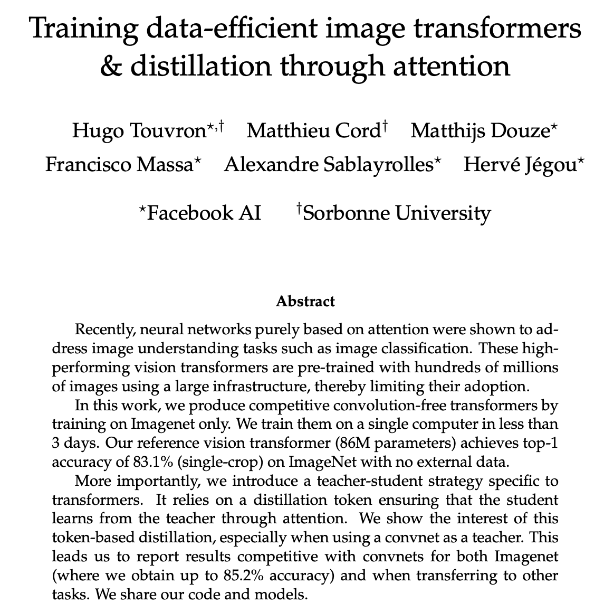

摘要三段话对应三个主张：

| 原文 | 意思 | 本讲哪里展开 |
|---|---|---|
| *These high-performing vision transformers are pre-trained with hundreds of millions of images using a large infrastructure, thereby limiting their adoption.* | 问题：ViT 要几亿张图和大型基础设施，大多数人用不起 | 模块一 |
| *we produce competitive convolution-free transformers by training on Imagenet only. We train them on a single computer in less than 3 days. Our reference vision transformer (86M parameters) achieves top-1 accuracy of 83.1% (single-crop) on ImageNet with no external data.* | 主张一：**只用 ImageNet、一台机器、3 天**，ViT-B 到 83.1%。靠的是训练配方，模型结构一点没改 | 模块四、六 |
| *we introduce a teacher-student strategy specific to transformers. It relies on a distillation token ensuring that the student learns from the teacher through attention. … especially when using a convnet as a teacher. This leads us to report results competitive with convnets for both Imagenet (where we obtain up to 85.2% accuracy)* | 主张二：一种**专为 Transformer 设计的蒸馏**，用一个"蒸馏 token"向 CNN 教师学习，到 85.2% | 模块二、三、五 |

> **💡 先弄清三个词**
>
> - **知识蒸馏（knowledge distillation）**：让一个"学生"模型去模仿一个已经训练好的"教师"模型的输出，而不只是模仿人工标签。模块二从头讲。
> - **数据效率（data-efficient）**：用同样多的（或更少的）**独立图片**达到同样的精度。注意它不等于"训练算力少"：DeiT 把每张图反复增强、训 300 个 epoch，还要跑一个教师。它省的是"要收集多少张图"，不是"要算多少次"。
> - **吞吐量（throughput）**：推理时每秒能处理多少张图。论文用它衡量"速度"，比 FLOPs 更接近真实使用。

#### 图 1　吞吐量 vs 准确率：DeiT 站在了 EfficientNet 的曲线上

*Figure 1: Throughput and accuracy on Imagenet of our methods compared to EfficientNets, trained on Imagenet1k only. The throughput is measured as the number of images processed per second on a V100 GPU. DeiT-B is identical to VIT-B, but the training is more adapted to a data-starving regime. It is learned in a few days on one machine. The symbol ⚗ refers to models trained with our transformer-specific distillation.*

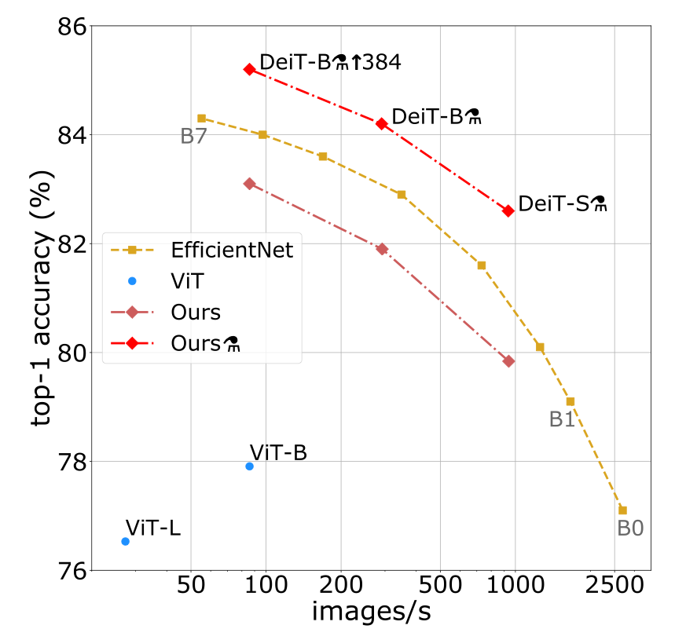

**🖼 逐元素图解**

- **横轴**：每秒处理的图片数（V100 GPU，对数刻度），越靠右越快。**纵轴**：ImageNet Top-1 准确率，越靠上越准。所以**右上角是最好的位置**。
- **黄色方点连成的虚线：EfficientNet B0 到 B7**。这是 2020 年 CNN 里"速度—精度"权衡做得最好的一族模型，经过了多年架构搜索。它是这张图的**基准线**。
- **两个蓝色圆点：ViT-B 和 ViT-L**。按第 12 讲的论文在 ImageNet 上从头训的结果，77.9 和 76.5，远在黄线下面，而且 ViT-L 比 ViT-B 还差（模型越大、数据越不够）。
- **粉红色点线："Ours"，即 DeiT-Ti、S、B**。模型和 ViT 一模一样，只换了训练配方。DeiT-B 从 ViT-B 的 77.9 升到 81.8，**4 个点来自训练方法**。但这条线还在黄线下面。
- **红色点划线："Ours⚗"，即带蒸馏 token 的 DeiT**。DeiT-S⚗ 82.6、DeiT-B⚗ 84.2、DeiT-B⚗↑384 85.2。**这条线压到了 EfficientNet 的黄线上面**。⚗ 是蒸馏（alembic，蒸馏器）的符号，↑384 表示在 384 分辨率上微调过。

**读图顺序：** 先看两个蓝点有多低，再看粉线比蓝点高多少（配方的贡献），最后看红线比粉线高多少（蒸馏的贡献）。这张图就是整篇论文的摘要：**配方 + 蒸馏，两步把 ViT 从远远落后推到略微领先**。

> **⚠️ "只用 ImageNet"不等于"没有额外信息"**
>
> 红线的模型用了一个 CNN 教师（RegNetY-16GF），教师也是在 ImageNet 上训的，所以"没有外部图片"是对的；但教师的预测是一种额外的监督信号，训练时每一步都要多跑一次教师的前向。比较"数据效率"时要说清楚：独立图片数相同，监督信息和算力不同。

### 🖊 本模块练习

1. ★ 图 1 里 ViT-B 和 DeiT-B 是同一个模型，为什么准确率差 4 个点？

解析

结构完全相同（12 层、D=768、12 头、P=16），差别只在训练配方：优化器超参数、数据增强（RandAugment、Mixup、CutMix、随机擦除）、正则（随机深度、标签平滑、repeated augmentation）。模块六的表 8 会把每一项值多少点列出来。

这题考的是**"模型"和"训练方法"是两个独立变量**：第 12 讲说 ViT 在 ImageNet 上差几个点，是在当时的配方下的结论。

2. ★ 图 1 的横轴为什么用"每秒图片数"而不用参数量或 FLOPs？

解析

因为用户真正关心的是速度，而参数量和 FLOPs 都不能直接换算成速度。第 12 讲的账本已经说明：B/32 参数比 B/16 多、计算却少四倍；而 FLOPs 相同的两个模型，一个全是矩阵乘法（GPU 友好）、一个全是深度可分离卷积（访存受限），真实速度可以差好几倍。EfficientNet 就是后者：FLOPs 很低，但吞吐量不如同精度的 DeiT。

3. DeiT 说"不用外部数据"，但它用了一个 CNN 教师。这算不算作弊？

解析

不算，但要说清楚。教师 RegNetY-16GF 也只在 ImageNet 上训练，没有引入新图片；它引入的是**额外的监督信号**（对每张增强图的预测）和**额外的算力**（教师前向）。论文在表 3 里把"不蒸馏 / 普通蒸馏 / 蒸馏 token"分开报告，读者可以看到每一步的贡献。

这题考的是**读"数据效率"主张时要分清三件事：独立图片数、监督信息、训练算力。**

---

`Part 2 · 论文第 6 页`

## 二、蒸馏：教师、学生与两种损失

论文第 4 节的标题是 *Distillation through attention*。要读懂它，先得知道普通的知识蒸馏是怎么回事。这一模块从零讲起，把论文的公式 (2)、(3) 逐符号拆开，并算几个小例子。

#### 零基础先修　什么是知识蒸馏

一个分类模型最后输出 K 个数（K 是类别数），叫 **logits**，记作 $Z\in\mathbb R^K$。它们经过 softmax 变成概率：

$$
\psi(Z)_k=\frac{e^{Z_k}}{\sum_{j=1}^K e^{Z_j}} .
$$

普通训练用交叉熵让 softmax 的输出靠近人工标签 $y$（一个 one-hot 向量）：$\mathcal L_{CE}(\psi(Z),y)=-\log\psi(Z)_y$。

**知识蒸馏**（Hinton 等，2015）的想法是：一个训练好的**教师**模型对每张图的输出不只是"这是猫"，还包含"有 10% 像狗、1% 像狐狸"这样的**相似性信息**（Hinton 叫它 dark knowledge）。让**学生**去拟合教师的整个输出分布，比只拟合 one-hot 标签学到的更多。

三个角色要分清：

| 角色 | 记号 | 来自哪里 | 训练时更新吗 |
|---|---|---|---|
| 真实标签 | $y$ | 人工标注 | 否 |
| 教师 | $Z_t=g_\phi(x)$ | 一个已训练好的模型，DeiT 用 CNN | **否**（冻结） |
| 学生 | $Z_s=f_\theta(x)$ | 正在训练的 ViT | 是 |

#### 公式 (2) 与 (3)　软蒸馏和硬蒸馏

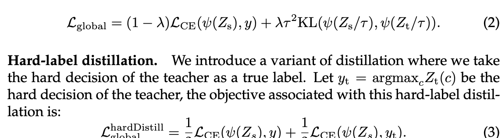

（截图最后一行被页面排版截断，公式 (3) 完整写出来是 $\mathcal L^{\text{hardDistill}}_{\text{global}}=\tfrac12\mathcal L_{CE}(\psi(Z_s),y)+\tfrac12\mathcal L_{CE}(\psi(Z_s),y_t)$。）

**公式 (2)，软蒸馏（soft distillation）：**

$$
\mathcal L_{\text{global}}=(1-\lambda)\,\mathcal L_{CE}\bigl(\psi(Z_s),y\bigr)+\lambda\tau^2\,\mathrm{KL}\bigl(\psi(Z_s/\tau),\psi(Z_t/\tau)\bigr).
$$

| 符号 | 读法 |
|---|---|
| $\mathcal L_{CE}(\psi(Z_s),y)$ | 学生对真实标签的普通交叉熵 |
| $\tau$ | **温度**。logits 先除以 $\tau$ 再做 softmax，$\tau$ 越大分布越"平" |
| $\mathrm{KL}(\cdot,\cdot)$ | KL 散度，衡量两个分布差多远（[第 3 讲](../vision-03-probability/)） |
| $\psi(Z_t/\tau)$ | 教师的高温分布，是**固定目标**，梯度不传回教师 |
| $\lambda$ | 两项的权重，论文取 0.1 |
| $\tau^2$ | 补偿高温让梯度变小的系数，下面解释 |

**公式 (3)，硬蒸馏（hard-label distillation）：** 不要教师的整个分布，只要它的**最大类别** $y_t=\arg\max_c Z_t(c)$，把它当成第二个"真实标签"，两项交叉熵各占一半。没有温度，没有 λ，没有任何超参数。

> **💡 作者的关键观察：硬蒸馏反而更好**
>
> 表 3 会看到：软蒸馏 81.8，硬蒸馏 83.0。这和 NLP 里的经验相反。作者给的解释是：*For a given image, the hard label associated with the teacher may change depending on the specific data augmentation.* DeiT 用的增强非常强（Mixup 把两张图叠在一起、CutMix 把一张图的一块贴到另一张上、RandAugment 大幅改颜色和几何），**增强后的图可能已经不像原标签了**。教师看的是增强后的图，它的硬标签相当于一个"修正过的标签"。软分布在这种情况下反而把教师的犹豫一起传给了学生。

#### 跟着算　温度把分布变平

取一个三类教师，logits 是 $Z_t=(\ln4,\ln2,0)$，这样指数正好是整数：

- $\tau=1$：指数 $(4,2,1)$，概率 $(4/7,2/7,1/7)\approx(0.571,0.286,0.143)$。
- $\tau=2$：logits 变成 $(\ln2,\tfrac12\ln2,0)$，指数 $(2,\sqrt2,1)$，概率 $(2,1.414,1)/4.414\approx(0.453,0.320,0.227)$。

**排序没变，差距变小了。** 第三类从 14% 升到 23%，"这张图有点像第三类"这个信息被放大了。温度不是把概率除以 2，而是把 **logit 之差**除以 2：两类概率之比 $p_1/p_2=\exp((Z_1-Z_2)/\tau)$。

#### 跟着算　KL 的梯度，以及为什么乘 $\tau^2$

把教师分布 $q=\psi(Z_t/\tau)$ 当常数，学生分布 $p=\psi(Z_s/\tau)$。KL 对学生 logit 的梯度是

$$
\frac{\partial\,\mathrm{KL}(q\,\|\,p)}{\partial Z_{s,k}}=\frac{p_k-q_k}{\tau}.
$$

推导：$\mathrm{KL}=\sum_k q_k\log q_k-\sum_k q_k\log p_k$，第一项不含学生，第二项是"以 q 为目标的交叉熵"，它对 $Z_s/\tau$ 的梯度是 $p-q$（[第 3 讲](../vision-03-probability/)的 softmax 交叉熵梯度），再乘链式法则的 $1/\tau$。

**为什么乘 $\tau^2$？** 温度高时 $p$ 和 $q$ 都趋向均匀，$p-q$ 本身也大约按 $1/\tau$ 缩小，所以未缩放的梯度约按 $1/\tau^2$ 缩小。乘 $\tau^2$ 把它拉回原来的量级，这样调 $\tau$ 时不用同时调学习率。

用上面的例子：$\tau=2$，学生 logits 全零（$p=(1/3,1/3,1/3)$），教师 $Z_t=2(\ln4,\ln2,0)$ 使 $q=(4/7,2/7,1/7)$。梯度 $\tau^2\cdot(p-q)/\tau=2(p-q)=(-10/21,\;2/21,\;8/21)$。三项和为 0（softmax 对平移不敏感），第一类 logit 要升、第三类要降。模块七的程序用有限差分核对这组数。

> **⚠️ 两个实现细节会改变教师的实际权重**
>
> 1. **KL 的方向。** 本讲固定用 $\mathrm{KL}(q\|p)=\sum q\log(q/p)$，教师在前。反过来写 $\mathrm{KL}(p\|q)$，权重 $p$ 也随学生变，梯度完全不同。PyTorch 的 `kl_div(input, target)` 第一个参数是 log 概率的**学生**，容易看反。
> 2. **求平均的分母。** 逐样本 KL 对 batch 求平均（分母 B）和对所有元素求平均（分母 B×K）差 K 倍；K=1000 时教师项的有效权重差 1000 倍。作者代码的软蒸馏用的是后者（`numel()`），复现时要照抄或相应调 λ。

#### 跟着算　硬蒸馏就是"一组 logits 面对两个标签"

硬蒸馏的两项交叉熵作用在**同一组**学生 logits 上。利用交叉熵对目标的线性性，可以合成一个目标 $r=\tfrac12e_y+\tfrac12e_{y_t}$，损失 $=-\sum_k r_k\log p_k$，梯度 $=p-r$。

例子：学生 $p=(1/2,1/3,1/6)$，真实标签第 1 类，教师说第 2 类。$r=(1/2,1/2,0)$，梯度 $p-r=(0,-1/6,1/6)$：第 2 类 logit 要升，第 3 类要降，第 1 类此刻恰好不动。损失 $=-\tfrac12\ln\tfrac12-\tfrac12\ln\tfrac13=\tfrac12\ln6\approx0.896$。

教师和标签一致时 $r$ 退化成普通 one-hot，和没有蒸馏一样；**只有两者不一致的样本才让蒸馏起作用**。

> **⚠️ 硬标签会"跳"**
>
> 教师 logits $(0.01,0,-1)$ 的硬标签是第 1 类；输入稍微变一点变成 $(0,0.01,-1)$，硬标签就跳到第 2 类，目标从一个顶点跳到另一个顶点。软蒸馏没有这个问题，但 DeiT 的实验说明在强增强下这不是坏事。另外硬标签丢掉了教师的置信度：$(0.51,0.49)$ 和 $(0.999,0.001)$ 得到同一个目标。

### 🖊 本模块练习

4. ★ 温度 τ=2 时，能不能把 τ=1 的概率直接除以 2 再归一化？

解析

不能。温度作用在 logits 上：$p^\tau_k\propto e^{Z_k/\tau}$，等价于把 τ=1 的概率开 τ 次方再归一化（$p^{\tau}_k\propto (p^1_k)^{1/\tau}$），不是除以 τ。正文例子：$(4/7,2/7,1/7)$ 在 τ=2 下变成 $(0.453,0.320,0.227)$，是开平方后归一化。

5. ★ 教师 $Z_t=(2,1,0)$，学生 $Z_s=(102,101,100)$，软蒸馏的 KL 是多少？如果改用 logits 的均方误差呢？

解析

两组 logits 只差一个常数 100，softmax 后概率完全相同，KL = 0，蒸馏损失不推动学生。均方误差却是 $3\times100^2$，会逼学生去拟合一个对分类毫无意义的整体偏移。

这题考的是**softmax 对平移不敏感，所以蒸馏目标必须定义在概率上（或去均值的 logits 上）**。

6. 硬蒸馏里，教师和真实标签一致的样本对训练有什么贡献？不一致的呢？

解析

一致时合成目标 $r$ 就是普通 one-hot，梯度 $p-e_y$，和不蒸馏完全一样。不一致时 $r$ 在两个类上各 1/2，学生被要求同时给两类较高概率。所以硬蒸馏的"额外信息"全部来自教师和标签不一致的那些样本，在强增强下这类样本不少（Mixup 的图本来就有两个类）。

7. 把逐元素平均（分母 B×K）误当成 batch 平均（分母 B），K=1000，教师项的权重差多少？怎么补？

解析

差 1000 倍，教师项几乎不起作用。补法是乘 K，或者把 λ 放大 1000 倍，但后者同时改变了 $(1-\lambda)$ 这一项，不是等价变换。最稳妥的是照抄作者的实现并记录分母。

---

`Part 3 · 论文第 7—8 页`

## 三、蒸馏 token：让教师的信号从第二个出口进来

普通蒸馏把两个损失都加在同一个输出（CLS）上。DeiT 的新想法是：**给教师的信号单独开一个出口**。

#### 图 2　蒸馏 token

*Figure 2: Our distillation procedure: we simply include a new distillation token. It interacts with the class and patch tokens through the self-attention layers. This distillation token is employed in a similar fashion as the class token, except that on output of the network its objective is to reproduce the (hard) label predicted by the teacher, instead of true label. Both the class and distillation tokens input to the transformers are learned by back-propagation.*

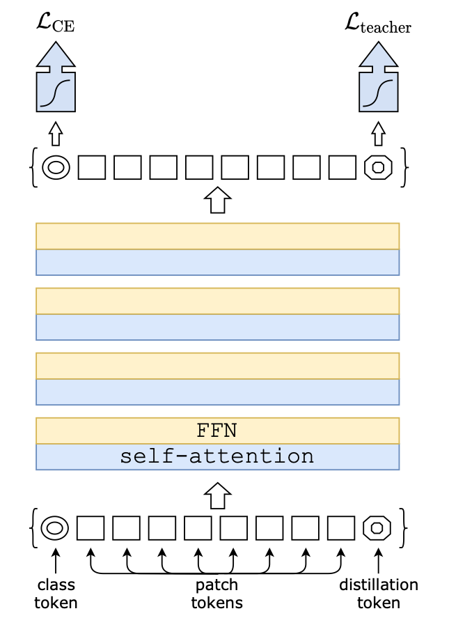

**🖼 逐元素图解**

自下而上读：

| 位置 | 图中元素 | 它是什么 |
|---|---|---|
| 最下一排，左边的双圆 | *class token* | 第 12 讲的 CLS：一个可学习向量，所有图共用 |
| 最下一排，中间 8 个方块 | *patch tokens* | 图像切块投影后的 token，下面的小箭头表示它们来自图片 |
| 最下一排，右边的八边形 | *distillation token* | **新加的**：又一个可学习向量，和 CLS 一样是模型参数，初始时不含任何教师信息 |
| 中间四组蓝黄条 | *self-attention / FFN* | 标准 Transformer 块，画了 4 组示意，真实是 12 组。三种 token **在同一条序列里一起过**这些层，彼此可见 |
| 最上一排 | 输出序列 | 和输入同样长：CLS 输出、8 个 patch 输出、蒸馏 token 输出 |
| 左上 $\mathcal L_{CE}$ | 真实标签的交叉熵 | 只接 CLS 的输出 |
| 右上 $\mathcal L_{teacher}$ | 教师的（硬）标签交叉熵 | 只接蒸馏 token 的输出 |

**关键在两件事。** 第一，蒸馏 token 和 CLS 的地位完全对称：同样是可学习参数，同样过所有注意力层，同样在输出处接一个线性分类头；唯一的区别是**监督信号不同**。第二，两个 token 共用同一个骨干，所以教师的信号通过反向传播会改变所有 patch 的表示，CLS 也能间接受益。论文的标题 *distillation through attention* 说的就是这个：教师的知识通过注意力层流进整个网络。

下面这张手绘图把形状标出来：

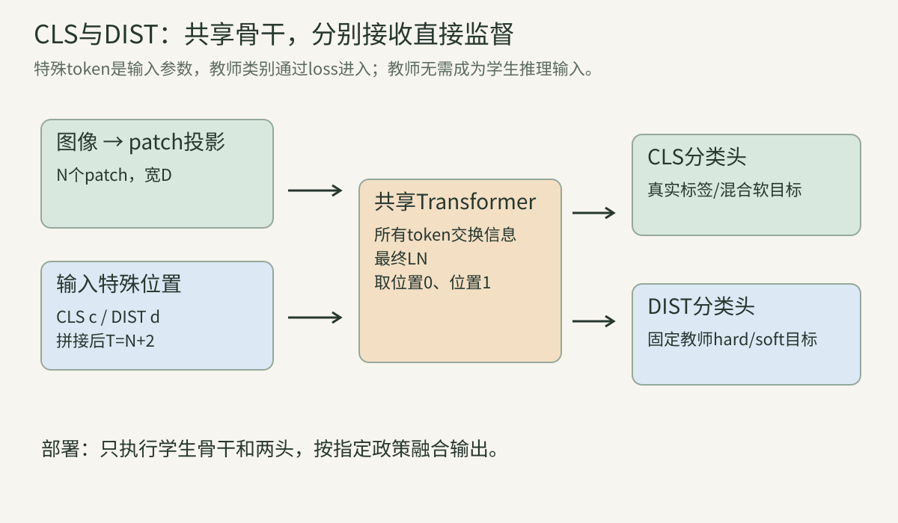

**🖼 逐元素图解**

- **左上绿卡"图像 → patch 投影"**：N 个 patch，宽 D。
- **左下蓝卡"输入特殊位置"**：CLS 向量 c 和 DIST 向量 d，拼在最前面，序列长 T = N + 2（DeiT 的顺序是 CLS、DIST、patch）。
- **中间橙卡"共享 Transformer"**：所有 token 交换信息，最终 LN，取位置 0 和位置 1。
- **右上绿卡"CLS 分类头"**：目标是真实标签（或增强后的软标签）。**右下蓝卡"DIST 分类头"**：目标是教师的硬标签。两个头参数独立。
- **底部**：部署时只跑学生骨干和两个头，不需要教师。

**跟着算：形状链。** batch 2、224 输入、P=16、D=384（DeiT-S）：patch 投影 `2×196×384`；CLS 和 DIST 各广播成 `2×1×384`；拼接 `2×198×384`；位置表 `198×384`；12 层后仍 `2×198×384`；取第 0、1 行各 `2×384`；两个 1000 类头各输出 `2×1000`。训练时保留两组 logits 分别算损失，**不是拼成 2000 类**。

#### 两个头的梯度怎样汇到一个骨干

设最终 LN 后的 CLS 特征 $u_c$、DIST 特征 $u_d$，两头 logits $s_c=u_cW_c+b_c$、$s_d=u_dW_d+b_d$。损失

$$
L=\tfrac12\,\mathrm{CE}(s_c,y)+\tfrac12\,\mathrm{CE}(s_d,y_t).
$$

两头各自的 logit 梯度：$g_c=\tfrac12(p_c-e_y)$，$g_d=\tfrac12(p_d-e_{y_t})$。传回特征：$\nabla_{u_c}=g_cW_c^{\top}$，$\nabla_{u_d}=g_dW_d^{\top}$。**在编码器输出的 T 行里，只有第 0 行和第 1 行收到非零梯度，patch 行是零。** 但往回传过注意力层之后，patch 的表示、投影矩阵 E、像素都会收到梯度，因为 CLS 和 DIST 的输出依赖所有 patch。

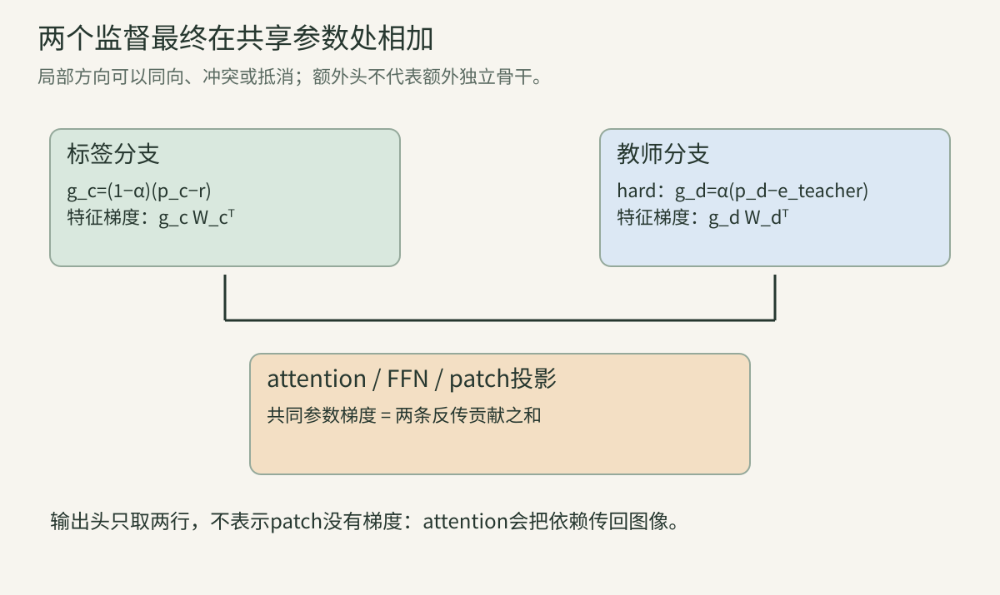

**🖼 逐元素图解**

- **左上绿卡"标签分支"**：$g_c=(1-\alpha)(p_c-r)$，特征梯度 $g_cW_c^{\top}$。**右上蓝卡"教师分支"**：$g_d=\alpha(p_d-e_{teacher})$，特征梯度 $g_dW_d^{\top}$。图里用一般的 α，DeiT 取 1/2。
- **两条线汇到下方橙卡"attention / FFN / patch 投影"**：共享参数的梯度 = 两条反传贡献之**和**。
- **底部那行字**：输出处 patch 梯度为零，不等于 patch 不学习。

**跟着算：两个头的精确梯度。** α=1/2，两头概率恰好都是 $(1/2,1/3,1/6)$，真实类别 1，教师类别 2。$g_c=\tfrac12\bigl((1/2,1/3,1/6)-(1,0,0)\bigr)=(-1/4,1/6,1/12)$；$g_d=\tfrac12\bigl((1/2,1/3,1/6)-(0,1,0)\bigr)=(1/4,-1/3,1/12)$。概率相同，两头受到的推力方向却相反：CLS 头要把第 1 类推高，DIST 头要把第 2 类推高。它们在共享参数上相加，可能部分抵消，也可能互补。模块七的程序在一个微型双 token ViT 上对这条路径做有限差分。

> **💡 论文的两个"顺便观察"**
>
> 1. *the learned class and distillation tokens converge towards different vectors: the average cosine similarity between these tokens equals 0.06.* 两个输入向量几乎正交（cos 0.06）；越往深层越相似，最后一层 cos 0.93，但始终不到 1。这正是设计想要的：**两个出口看的是同一张图，但带着不同的任务。**
> 2. 作者做了一个对照：不要教师，只是再加一个也预测真实标签的"第二个 CLS"。结果两个 token 收敛到几乎同一个向量（cos 0.999），精度毫无提升。**说明带来提升的不是"多一个 token"，而是"多一种监督"。**

#### 推理时怎么用两个头

论文第 8 页：*At test time, both the class or the distillation embeddings produced by the transformer are associated with linear classifiers and able to infer the image label. Yet our referent method is the late fusion of these two separate heads, for which we add the softmax output by the two classifiers to make the prediction.*

三种选择：只用 CLS 头、只用 DIST 头、两头融合。表 3 会看到融合最好。但"融合"有两种做法，结果不同：

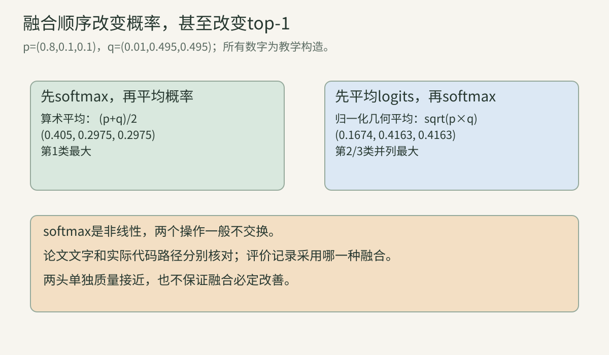

**🖼 逐元素图解**

- **左绿卡"先 softmax，再平均概率"**：$(p+q)/2$，算术平均。例子里得到 $(0.405,0.2975,0.2975)$，第 1 类最大。
- **右蓝卡"先平均 logits，再 softmax"**：等价于归一化的几何平均 $\sqrt{p_kq_k}/\sum_j\sqrt{p_jq_j}$。同一个例子得到 $(0.167,0.416,0.416)$，第 2、3 类并列最大。
- **下方橙框**：softmax 是非线性的，两种顺序一般不交换；论文文字说的是前者，作者代码 `models.py` 的 eval 路径返回 `(x + x_dist) / 2`，x 是 logits，即后者。

**跟着算。** $p=(0.8,0.1,0.1)$，$q=(0.01,0.495,0.495)$。概率平均：$(0.405,0.2975,0.2975)$。几何平均：$\sqrt{0.008}=0.0894$，$\sqrt{0.0495}=0.2225$（两次），归一化后 $(0.167,0.416,0.416)$。**top-1 都变了。** 这是一个构造的极端例子，真实模型两头意见很少差这么远，但它说明复现时必须写清用的是哪一种。

#### 位置表现在有两行特殊位置

换分辨率时（第 12 讲的位置插值），DeiT 的位置表前两行是 CLS 和 DIST，都要单独保留，只对后面 N 行恢复网格插值。

**跟着算。** 2×2 的网格、单通道，完整位置表 $[99,77,0,2,4,6]$：99 是 CLS，77 是 DIST，余下排成 $\begin{bmatrix}0&2\\4&6\end{bmatrix}$。升到 3×3 后是 $[99,77,0,1,2,2,3,4,4,5,6]$，11 行。如果照抄第 12 讲"只留一行"的代码，77 会被混进图像网格，197 行也凑不出 14×14。

### 🖊 本模块练习

8. ★ 蒸馏 token 的输入向量是教师的 logits 吗？推理时需要教师吗？

解析

都不是。DIST 是一个可学习的 D 维参数，和 CLS 一样随机初始化、靠反传学习，初始时不含任何教师信息；教师只在损失里出现。推理时只跑学生骨干和两个头，教师不参与。如果把教师 logits 拼进输入，推理就得永远带着教师，那是另一种（不划算的）算法。

9. ★ 编码器输出处只有 CLS 和 DIST 两行有梯度，patch 投影矩阵 E 还能学吗？

解析

能。CLS 和 DIST 的输出是所有 patch 的函数（通过 12 层注意力），梯度沿注意力的 K、V 路径传回每个 patch 的表示，再传回 E 和像素。"输出处为零"只是最后一层的边界条件。模块七的程序会验证像素和 E 的梯度非零。

10. "再加一个预测真实标签的 CLS"和"加一个预测教师标签的 DIST"，结构一样，为什么效果不同？

解析

结构确实一样，差别只在监督。两个 token 都预测真实标签时，它们收到的梯度来源相同，最后收敛到几乎相同的向量（cos 0.999），第二个 token 没有带来新信息。DIST 接的是教师在增强图上的判断，和真实标签经常不一致（Mixup、CutMix 之后尤其如此），所以两个 token 学到不同的东西（cos 0.06）。

这题考的是**一个消融实验怎样把"多一个接口"和"多一种监督"分开**。

11. 两头 logits 先平均再 softmax，和先 softmax 再平均，什么时候结果相同？

解析

一般不同。两者相同的充分条件是两头 logits 相等（这时两种平均都退化成单头）。几何平均偏向"两头都同意"的类别，算术平均对一头的极端自信更宽容。正文的例子里连 top-1 都不同。

---

`Part 4 · 论文第 9—11 页`

## 四、表 1—4：模型、教师与蒸馏方式

实验部分先回答三个问题：模型有几档（表 1）、什么教师好（表 2）、哪种蒸馏好（表 3），再用表 4 解释为什么。

#### 表 1　三档 DeiT

*Table 1: Variants of our DeiT architecture. The larger model, DeiT-B, has the same architecture as the ViT-B. The only parameters that vary across models are the embedding dimension and the number of heads, and we keep the dimension per head constant (equal to 64).*

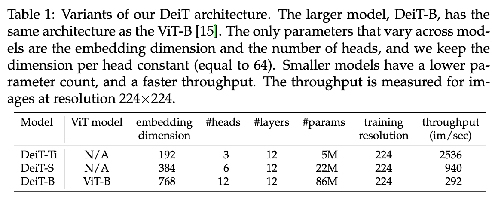

| 模型 | D | 头数 | 层数 | 参数 | 吞吐量 |
|---|---:|---:|---:|---:|---:|
| DeiT-Ti | 192 | 3 | 12 | 5M | 2536 |
| DeiT-S | 384 | 6 | 12 | 22M | 940 |
| DeiT-B | 768 | 12 | 12 | 86M | 292 |

**三档只改宽度 D 和头数，层数都是 12，每头 64 维，patch 都是 16。** 和 ViT 不同，DeiT 不往上加大（没有 L、H），而是往下做小：Ti 和 S 是作者新定义的，后来成了整个领域的标准小模型。

**跟着算：三档的精确参数。** 用第 12 讲的账本公式（RGB、224、P16、1000 类）：$P=769D+D+197D+12(12D^2+13D)+2D+1000(D+1)$。代入 D=192、384、768 得到 5,717,416、22,050,664、86,567,656。带蒸馏 token 的版本多一个 D 维向量、一行位置、一个 $(D+1)\times1000$ 的头，即 $\Delta P=2D+(D+1)K$：Base 多 770,536，成为 87,338,192。**新增参数几乎全在第二个分类头，不是"多了 768 个数"。**

宽度减半时 $D^2$ 项变成四分之一，所以 S 约是 B 的 1/4、Ti 约是 S 的 1/4；吞吐量差不多也是这个比例（292 → 940 → 2536）。

#### 表 2　CNN 教师比 Transformer 教师好

*Table 2: We compare on ImageNet the performance (top-1 acc., %) of the student as a function of the teacher model used for distillation.*

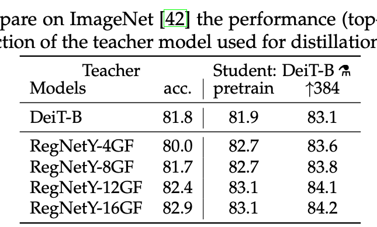

**🖼 逐元素图解**

- **第一列**：教师模型。第一行 DeiT-B 是 Transformer 教师，下面四行 RegNetY 是不同大小的 CNN 教师。**第二列**：教师自己的准确率。
- **第三、四列**：用这个教师蒸馏出来的 DeiT-B⚗ 学生，224 预训练后的精度和 384 微调后的精度。

**读法：** 教师 DeiT-B（81.8）教出的学生 83.1；教师 RegNetY-16GF（82.9）教出的学生 84.2。**CNN 教师好 1 个点以上。** 作者的解释：*the convnet is a better teacher is probably due to the inductive bias inherited by the transformers through distillation.* 回看第 12 讲：ViT 缺的正是 CNN 的局部性和平移等变性，而教师的硬标签把 CNN 的判断方式间接传给了学生。

> **💡 学生超过了教师**
>
> 表 2 最后一行：教师 82.9，学生 84.2，高了 1.3 个点。这不矛盾：学生同时有真实标签和教师两种信息，还有自己的架构；蒸馏传递的是"行为"，不是"上限"。所以"蒸馏只能用大模型教小模型"是误解，DeiT-B（86M）用 RegNetY-16GF（84M）教，两者一样大。

#### 表 3　哪种蒸馏好

*Table 3: Distillation experiments on Imagenet with DeiT, 300 epochs of pre-training. We report the results for our new distillation method in the last three rows. We separately report the performance when classifying with only one of the class or distillation embeddings, and then with a classifier taking both of them as input.*

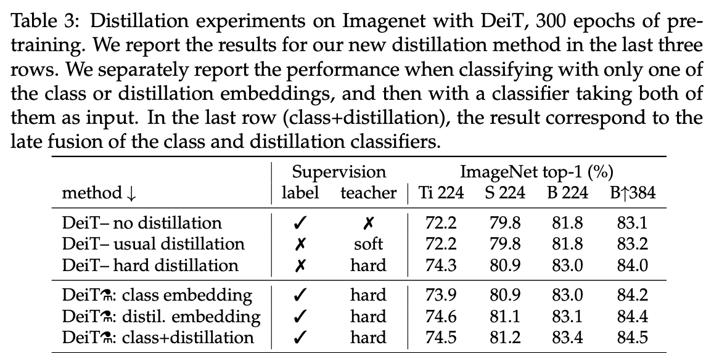

**🖼 逐元素图解**

- **列**："Supervision" 两列是用了什么监督（label 真实标签、teacher 教师）；后四列是 Ti、S、B 三档在 224 下的精度和 B 在 384 微调后的精度。
- **上三行：普通蒸馏**（只有 CLS 一个出口）。不蒸馏 81.8；软蒸馏 81.8（没用！）；硬蒸馏 83.0。
- **下三行：蒸馏 token**（DeiT⚗）。只用 CLS 头 83.0；只用 DIST 头 83.1；两头融合 83.4。

**三个结论，按表格从上往下：**

1. **软蒸馏在这里完全没用**（81.8 = 81.8），硬蒸馏 +1.2。模块二的 💡 解释了原因。
2. **DIST 头单独用比 CLS 头单独用高一点**（83.1 vs 83.0）：它更直接地受教师影响。
3. **两头融合最好**（83.4），说明两个出口的错误不完全重叠，有互补。

#### 表 4　两个头分别像谁

*Table 4: Disagreement analysis between convnet, image transformers and distillated transformers: We report the fraction of sample classified differently for all classifier pairs, i.e., the rate of different decisions.*

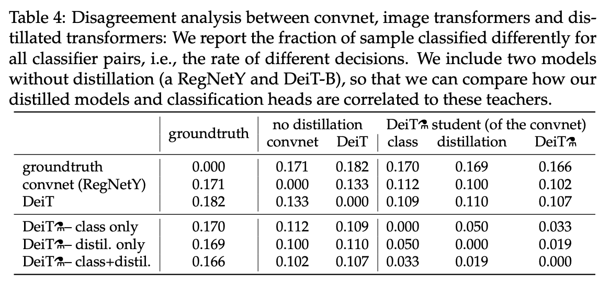

**🖼 逐元素图解**

- 这是一张**对称矩阵**：行列都是分类器（真实标签、CNN 教师 RegNetY、不蒸馏的 DeiT、DeiT⚗ 的 CLS 头、DIST 头、融合），每格是两者**预测不一致的样本比例**，对角线为 0。
- 看第二行（CNN 教师）：和不蒸馏的 DeiT 不一致 0.133；和 DeiT⚗ 的 CLS 头 0.112；和 **DIST 头 0.100**；和融合 0.102。
- 看第三行（不蒸馏的 DeiT）：和 CLS 头 0.109；和 DIST 头 0.110。

**读法：** DIST 头是和 CNN 教师最像的（0.100），CLS 头离不蒸馏的 DeiT 更近（0.109）。两个头确实"分工"了：一个更像教师，一个更像原来的 ViT。融合头在中间。

> **⚠️ 一致率高不等于更准**
>
> 10 张图，教师对 8 张。学生甲完全照抄教师：准确率 80%、一致率 100%。学生乙在教师的 2 张错题里纠正了 1 张，其余相同：准确率 90%、一致率 90%。乙更好却"更不像教师"。表 4 测的是"像不像"，表 3 测的是"准不准"，两张表回答不同的问题，要一起读。

### 🖊 本模块练习

12. ★ DeiT-B⚗ 比 DeiT-B 多多少参数？多在哪里？

解析

$\Delta P=2D+(D+1)K=2\times768+769\times1000=770{,}536$：DIST 向量 768、一行位置 768、第二个分类头 769,000。99.8% 在第二个头。如果任务只有 10 类，新增只有 $1536+7690=9{,}226$。

13. ★ 为什么 CNN 教师比 Transformer 教师教得好？这个解释能被"证明"吗？

解析

作者的假设是教师的归纳偏置（局部性、平移等变）通过硬标签传给了学生，弥补了 ViT 的弱先验。它不能被严格证明，论文用表 4 给出**行为证据**：DIST 头的预测和 CNN 更一致（0.100）。但一致可能来自"都答对了容易的题"，所以这只是相关性证据。

14. 表 3 里软蒸馏对 DeiT-B 一点用都没有，这和 Hinton 的蒸馏论文矛盾吗？

解析

不矛盾，条件不同。Hinton 的设置里学生看到的是正常图片，教师的软分布携带类间相似性。DeiT 的输入经过 Mixup/CutMix，一张图里本来就有两个类，教师的软分布"犹豫"得有道理却难学；硬标签反而给出一个干净的、对当前增强图最合理的目标。这题考的是**蒸馏的效果取决于输入分布**。

15. 表 4 里 DIST 头和教师的不一致率 0.100，比 CLS 头的 0.112 低。能据此说 DIST 头更准吗？

解析

不能。表 4 只说 DIST 头更像教师；准不准要看表 3（DIST 头 83.1、CLS 头 83.0，几乎一样）。像教师和准确是两回事：教师自己也只有 82.9，完全照抄教师反而会比两头都低。

---

`Part 5 · 论文第 11—14、17 页`

## 五、表 5、图 3、表 7、表 10：主结果

#### 表 5　和所有 CNN 放在一张表上

*Table 5: Throughput on and accuracy on Imagenet, Imagenet Real and Imagenet V2 matched frequency of DeiT and of several state-of-the-art convnets, for models trained with no external data. The throughput is measured as the number of images that we can process per second on one 16GB V100 GPU.*

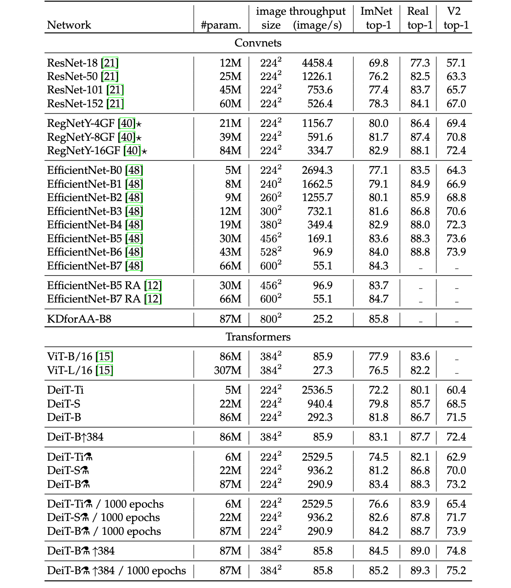

**🖼 逐元素图解**

- **列**：参数量、输入分辨率、吞吐量（图/秒）、ImageNet top-1、ImageNet-Real top-1（重新标注过的验证集）、ImageNet-V2 top-1（新采的测试集，防止在验证集上过拟合）。
- **上半 "Convnets"**：ResNet、RegNetY、EfficientNet 各系列。带 ★ 的 RegNetY 是作者用 DeiT 配方重训的，也是后面的教师。注意 EfficientNet-B7 要 600×600 的输入，吞吐量只有 55。
- **下半 "Transformers"**：先是第 12 讲的 ViT-B/16 和 ViT-L/16（在 ImageNet 上从头训，77.9 和 76.5）；然后 DeiT-Ti/S/B（72.2 / 79.8 / 81.8）；DeiT-B↑384（83.1）；带 ⚗ 的三档（74.5 / 81.2 / 83.4）；再训到 1000 epoch 的版本；最后 DeiT-B⚗↑384 的 300 epoch（85.2）和 1000 epoch（85.2）。

**读法，抓几组对比：**

| 对比 | 数字 | 说明 |
|---|---|---|
| ViT-B/16 vs DeiT-B | 77.9 → 81.8 | 同一个模型，配方的贡献 |
| DeiT-B vs DeiT-B⚗ | 81.8 → 83.4 | 蒸馏 token 的贡献 |
| DeiT-B⚗ vs DeiT-B⚗↑384 | 83.4 → 85.2 | 高分辨率微调的贡献 |
| DeiT-B⚗↑384 vs ViT-B（JFT 预训练，384） | 85.2 vs 84.15 | **只用 ImageNet 超过了用 3 亿张图预训练的 ViT-B** |
| DeiT-S⚗ vs EfficientNet-B4 | 81.2 @ 936 img/s vs 82.9 @ 349 img/s | 同精度档 DeiT 快 2–3 倍 |

> **⚠️ 这张表里的"训练预算"并不相同**
>
> 300 epoch 和 1000 epoch 的行混在一起；带 ↑384 的多了一轮微调；带 ⚗ 的多了教师前向。看到 85.2 时要记得它是 "⚗ + ↑384 + 300 epoch" 的组合，单独一项都到不了。好的做法是像作者这样把每种组合单列一行，让读者自己拆。

#### 图 3　蒸馏让"训练更久"重新有用

*Figure 3: Distillation on ImageNet with DeiT-B: performance as a function of the number of training epochs. We provide the performance without distillation (horizontal dotted line) as it saturates after 400 epochs.*

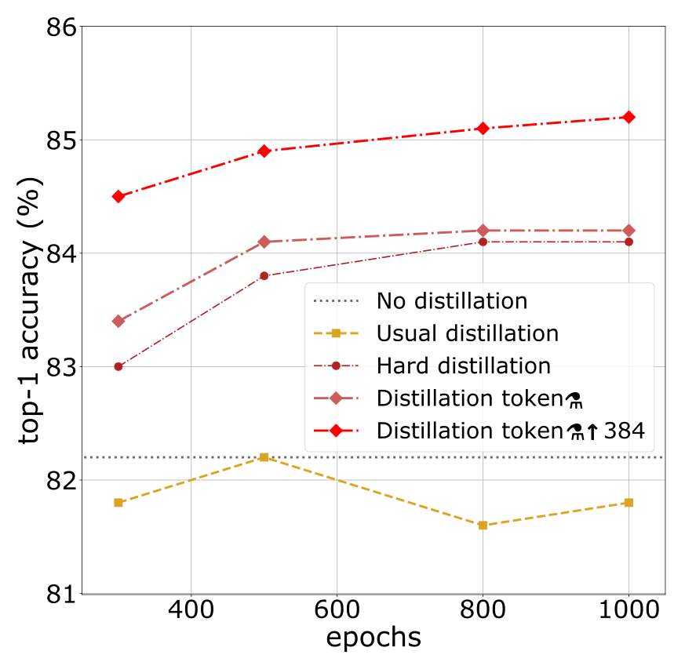

**🖼 逐元素图解**

- **横轴**：训练 epoch，300 到 1000。**纵轴**：top-1。
- **灰色水平虚线：不蒸馏**。作者说它在 400 epoch 后饱和，所以画成一条线（约 82.2）。
- **黄色：普通软蒸馏**。在 82 上下晃，和不蒸馏差不多。
- **深红：硬蒸馏**（单出口）。从 83.0 升到 84.1，500 epoch 后变平。
- **浅红：蒸馏 token**。从 83.4 升到 84.2。
- **亮红：蒸馏 token + ↑384**。从 84.5 升到 85.2，**到 1000 epoch 还在涨**。

**这张图说的是：** 不蒸馏时，再训久一点也没用（数据不够，模型开始记住训练集）；有了教师信号，训练更久持续有收益。教师相当于给每张增强图提供了"新的标签"，变相扩大了数据。

#### 表 7 与表 10　迁移和分辨率

*Table 7: We compare Transformers based models on different transfer learning task with ImageNet pre-training.*

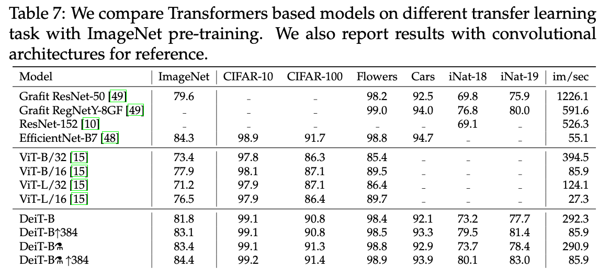

把 ImageNet 预训练的模型微调到 CIFAR、Flowers、Cars、iNaturalist 等小数据集。DeiT-B⚗↑384 在各数据集上和 EfficientNet-B7 相当（CIFAR-10 99.2 vs 98.9，Flowers 98.9 vs 98.8），吞吐量却是它的 1.6 倍。**说明 DeiT 学到的表示可以迁移，不是只在 ImageNet 上过拟合了配方。**

*Table 10: Performance of DeiT trained at size 224² for varying finetuning sizes on ImageNet-1k, ImageNet-Real and ImageNet-v2 matched frequency.*

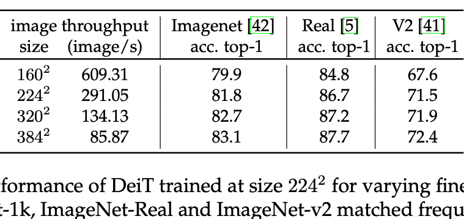

同一个 224 训练的 DeiT-B，微调到不同分辨率：160 → 79.9（609 img/s），224 → 81.8（291），320 → 82.7（134），384 → 83.1（86）。**分辨率每升一档约 +1 点，吞吐量约减半。** 这是第 12 讲"分辨率是一条独立扩展轴"的实测版。

> **💡 作者在位置插值上的一个发现**
>
> 第 17 页：*a bilinear interpolation of a vector from its neighbors reduces its ℓ2-norm compared to its neighbors. These low-norm vectors are not adapted to the pre-trained transformers and we observe a significant drop in accuracy if we employ use directly without any form of fine-tuning. Therefore we adopt a bicubic interpolation that approximately preserves the norm of the vectors.* 双线性插值出来的新位置向量是邻居的加权平均，模长会变小（想想两个方向不同的单位向量的平均，长度小于 1）；预训练模型没见过"短"的位置向量，精度掉得厉害。换成双三次插值能大致保持模长。第 12 讲说"插值是一族函数，选哪个有影响"，这就是一个具体后果。

**另一个小实验：** 完全不用 ImageNet 预训练，直接在 CIFAR-10（5 万张 32×32 的图）上从头训 DeiT，训 7200 个 epoch（对应 ImageNet 300 epoch 的图片数），放大到 224：DeiT-B 97.5，DeiT-B⚗ 98.5，教师 RegNetY 98.0。**5 万张图也能从头训出一个像样的 Transformer**，虽然比 ImageNet 预训练再微调的 99.1 差一些。

### 🖊 本模块练习

16. ★ 从 ViT-B 的 77.9 到 DeiT-B⚗↑384 的 85.2，这 7.3 个点各来自哪里？

解析

按表 5 拆：配方 77.9 → 81.8（+3.9）；蒸馏 token 81.8 → 83.4（+1.6）；384 微调 83.4 → 85.2（+1.8）。注意这三项不严格可加（交互作用），但量级清楚：**训练配方是最大的一项**，而它一行代码的模型改动都没有。

17. ★ 图 3 里为什么不蒸馏的模型 400 epoch 后就饱和，蒸馏的到 1000 epoch 还在涨？

解析

不蒸馏时监督只有 128 万个固定的 one-hot 标签，训久了模型开始记忆训练集，验证精度不再提升。蒸馏时教师对**每一张增强图**都给一个新标签（Mixup、CutMix 后的图标签和原图不同），监督信号的多样性随训练一起增长，所以更长的训练持续有收益。

18. 表 10 里分辨率从 224 升到 384，精度 +1.3，吞吐量从 291 降到 86。按第 12 讲的账本，这个速度下降合理吗？

解析

token 数 197 → 577，约 2.93 倍；总 MAC 约 3.16 倍（注意力项按平方涨）；吞吐量 291/86 = 3.4 倍。实测比理论略差一点（更大的注意力矩阵访存更重），量级一致。

19. DeiT-B⚗↑384 的 85.2 超过了 JFT 预训练的 ViT-B（84.15）。能不能说"训练配方比 3 亿张图更有用"？

解析

不能这么泛化。两者的差别不只是数据：DeiT 有教师、强增强、300 epoch；ViT-B 在 JFT 上只训 7 epoch、弱增强。正确的说法是：**在 ViT-B 这个规模上，好的配方 + 蒸馏可以替代大数据预训练**。到 ViT-H/14 的规模（第 12 讲的 88.55），没有大数据仍然训不出来。

---

`Part 6 · 论文第 15—16 页`

## 六、表 8、表 9：配方里的每一项各值几个点

这是论文最有"实用价值"的部分：作者把训练 ViT 用到的每一样东西列出来（表 9），再一项一项拿掉看掉多少点（表 8）。

#### 表 9　DeiT 配方 vs ViT 配方

*Table 9: Ingredients and hyper-parameters for our method and Vit-B.*

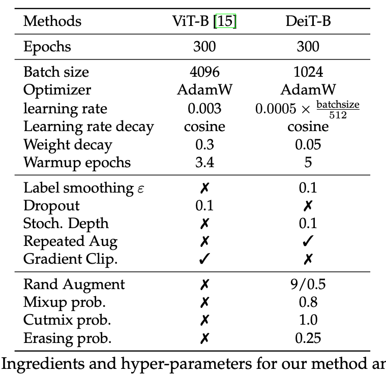

**🖼 逐元素图解**

表分三块，左列 ViT-B（第 12 讲论文在 ImageNet 上的配方），右列 DeiT-B：

| 块 | 项 | ViT-B | DeiT-B | 说明 |
|---|---|---|---|---|
| 优化 | batch | 4096 | 1024 | 一台 8 卡机器放得下 |
| | 学习率 | 0.003 | $0.0005\times\frac{\text{batch}}{512}$ | 按 batch 线性缩放；1024 时是 0.001 |
| | weight decay | 0.3 | **0.05** | 小了 6 倍；作者说 ViT 的 0.3 在他们的设置下伤收敛 |
| | warmup | 3.4 epoch | 5 epoch | |
| 正则 | label smoothing | ✗ | 0.1 | |
| | dropout | 0.1 | **✗** | **DeiT 不用 dropout** |
| | 随机深度 | ✗ | 0.1 | |
| | repeated aug | ✗ | ✓ | |
| 增强 | RandAugment | ✗ | 9/0.5 | 9 是强度，0.5 是每次操作的概率 |
| | Mixup | ✗ | 0.8 | Beta 分布的参数 |
| | CutMix | ✗ | 1.0 | |
| | 随机擦除 | ✗ | 0.25 | 概率 |

**一句话概括差别：ViT-B 几乎不做增强、靠 dropout 和大 weight decay 正则；DeiT 把增强开到最强、换成随机深度和标签平滑，并把 weight decay 调小。** 这些都是在 CNN 社区（尤其 timm 库）已经成熟的技巧，DeiT 的贡献是证明它们对 Transformer 同样有效甚至更关键。

下面把零基础读者可能不熟的几项各用一个小例子说清。

#### 跟着算　标签平滑、Mixup、CutMix 改的是"目标"

**标签平滑（label smoothing）**：把 one-hot 标签 $e_y$ 换成 $r=(1-\varepsilon)e_y+\varepsilon u$，u 是均匀分布。K=3、ε=0.1、真实类 1：$r=(0.9+0.1/3,\;0.1/3,\;0.1/3)=(0.933,0.033,0.033)$。另一种约定把 ε 全分给其他类：$(0.9,0.05,0.05)$。两种都见得到，复现要写清。损失仍是 $-\sum r_k\log p_k$，梯度 $p-r$。

**Mixup**：两张图按比例 λ 像素级叠加，标签也按 λ 混合：$\tilde x=\lambda x_i+(1-\lambda)x_j$，$\tilde r=\lambda r_i+(1-\lambda)r_j$。λ 从 Beta(0.8, 0.8) 采样。两个标签分别是第 1、2 类，λ=0.6，先各自平滑再混合：$\tilde r=(0.573,0.393,0.033)$；先混合 one-hot 得 $(0.6,0.4,0)$ 再平滑，结果相同（两步都是仿射操作，可交换，前提是用同一个 ε）。

**CutMix**：不是叠加，是把 $x_j$ 的一个矩形贴到 $x_i$ 上；标签按**实际贴上的面积**混合。8×8 的图，打算贴的矩形横跨 [−2,4)、纵跨 [1,7)，理论面积 36；越界裁掉后是 [0,4)×[1,7)，实际 24 个像素。第一张图保留 $1-24/64=0.625$，目标 $0.625r_i+0.375r_j$。**用理论面积 36 会算成 0.4375，连哪张图占多数都反了。**

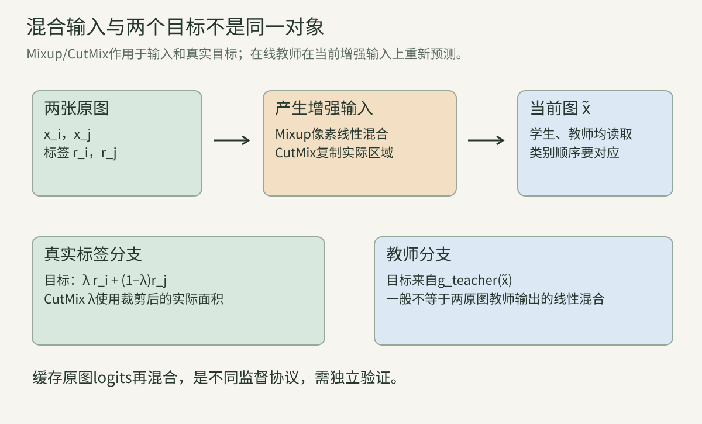

**🖼 逐元素图解**

- **左上绿卡"两张原图"** $x_i,x_j$ 和各自的标签 → **中上橙卡"产生增强输入"**（Mixup 叠加或 CutMix 贴块）→ **右上蓝卡"当前图 $\tilde x$"**：学生和教师**都读这一张**。
- **左下绿卡"真实标签分支"**：目标 $\lambda r_i+(1-\lambda)r_j$，CutMix 用实际面积算 λ。
- **右下蓝卡"教师分支"**：目标是教师在 $\tilde x$ 上的预测 $g(\tilde x)$，**一般不等于** $\lambda g(x_i)+(1-\lambda)g(x_j)$，因为网络不是线性的。作者代码就是先做增强、再把同一批图送给学生和教师。
- **底部**：缓存原图的教师 logits 再混合，是另一种协议。

> **⚠️ 图像级标签不是 patch 级标签**
>
> CutMix 的矩形可以穿过 patch 的边界，一个 16×16 的块可能一半来自 $x_i$、一半来自 $x_j$。混合后的软标签是**整张图**的目标，没有任何一个 patch 带着"我是第 2 类"的标注。把 Mixup/CutMix 的标签拿去做逐 patch 的监督需要另外定义。

#### 跟着算　随机深度、EMA、学习率缩放改的是"训练过程"

**随机深度（stochastic depth / DropPath）**：训练时以概率 p 把整个残差分支丢掉（输出只剩 $x$），保留时除以 $1-p$ 保持期望：$y=x+\frac{m}{1-p}F(x)$，$m\sim\mathrm{Bernoulli}(1-p)$。x=2、F(x)=3、p=0.25：75% 得 $2+3/0.75=6$，25% 得 2，期望 5 = 2+3。但方差是 $0.75\cdot1+0.25\cdot9=3$，不是 0；推理时关掉随机性、直接用 $x+F(x)$。它丢的是一整层的分支，不是某个 patch，也不是 dropout 那样逐元素丢。

**EMA（指数移动平均）权重**：$\theta^{ema}_t=\beta\theta^{ema}_{t-1}+(1-\beta)\theta_t$，用来评估的是平滑后的权重。β=0.9、初值 0，参数依次 10、20：EMA 依次 1、2.9。初值改成 10 的话第二步是 11，所以初始化不是细节。表 8 显示 EMA 只有 +0.1，微调后消失。

**学习率按 batch 线性缩放**：基准 $5\times10^{-4}$ 对应 batch 512；1024 → $10^{-3}$，256 → $2.5\times10^{-4}$。8 卡每卡 128 时全局 batch 是 1024，不是 128。这是经验规则，不是定理，batch 大到一定程度后失效。

**Repeated augmentation**：同一个 batch 里放同一张原图的 3 个不同增强视图。作者的采样器先打乱原图索引、每个重复 3 次、再按 GPU 切分；所以"300 epoch"实际上每张原图只被独立采样了 100 次（论文脚注 3 说明了这一点）。小例子：索引 [2,0,3,1] 各重复 3 次成 12 项，两个 GPU 隔一个取一个，各得 6 项，身份有重叠；再截到每卡 4 项时，身份 1 在这个 epoch 被丢掉了。**比较 epoch 数之前先看采样器。**

#### 表 8　逐项消融

*Table 8: Ablation study on training methods on ImageNet. The top row ("none") corresponds to our default configuration employed for DeiT. The symbols ✓ and ✗ indicates that we use and do not use the corresponding method, respectively. We report the accuracy scores (%) after the initial training at resolution 224×224, and after fine-tuning at resolution 384×384. The hyper-parameters are fixed according to Table 9, and may be suboptimal.*

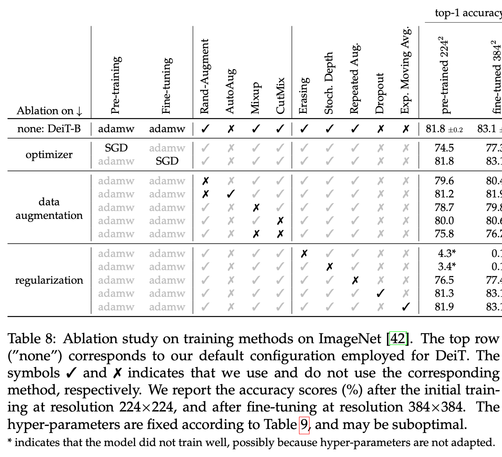

**🖼 逐元素图解**

- **第一行 "none: DeiT-B"**：完整配方，81.8（224）/ 83.1（384）。每一行只改一处（黑色的 ✓/✗ 是改动的那一项，灰色的是沿用默认）。
- **"optimizer" 两行**：预训练换 SGD → 74.5（**−7.3**）；只在微调换 SGD → 83.1（无差别）。
- **"data augmentation" 五行**：去 RandAugment → 79.6（−2.2）；RandAugment 换 AutoAugment → 81.2（−0.6）；去 Mixup → 78.7（−3.1）；去 CutMix → 80.0（−1.8）；Mixup 和 CutMix 都去 → 75.8（**−6.0**）。
- **"regularization" 五行**：去随机擦除 → **4.3\***（训练崩了）；去随机深度 → **3.4\***（崩了）；去 repeated aug → 76.5（−5.3）；加 dropout → 81.3（−0.5）；用 EMA → 81.9（+0.1）。

**三个结论：**

1. **优化器是最大的一项。** Transformer 对优化器敏感，SGD 掉 7 个点；而 CNN 用 SGD 一直很好。
2. **增强几乎每项都重要**，而且**互相不可替代**：Mixup 和 CutMix 各自去掉掉 2–3 点，一起去掉掉 6 点。
3. **两个带星号的"崩了"要小心读。** 去掉随机擦除或随机深度后模型只有 3–4%，这不是说这两项"值 78 个点"，而是说其余超参数（学习率、weight decay）是为完整配方调的，拿掉一项后整套参数不再匹配。作者在 caption 里写了 *may be suboptimal*，脚注写了 *possibly because hyper-parameters are not adapted*。

> **⚠️ 固定超参数的消融只回答一个问题**
>
> "在其他条件固定不变时，去掉这一项掉多少"。它不等于"这一项的绝对价值"（可能重新调参后差距变小），也不能相加（有交互）。构造一个例子：都不用 A/B 得 70，只 A 得 74，只 B 得 75，都用得 81。完整配方去 A 掉 6、去 B 掉 7，相加 13，但完整比基线只高 11，多出的 2 是交互项被算了两次。表 8 的 Mixup/CutMix 三行就是这样：−3.1、−1.8、一起 −6.0。

> **💡 为什么 Transformer 比 CNN 更需要强增强**
>
> 第 12 讲的结论：ViT 缺少 CNN 的归纳偏置，数据少时容易过拟合。强增强是在**用数据的方式注入先验**：翻转和裁剪告诉模型"位置变了类别不变"，Mixup/CutMix 告诉模型"局部证据要能组合"。作者原话：*transformers require a strong data augmentation: almost all the data-augmentation methods that we evaluate prove to be useful.* 唯一的例外是 dropout，它对 Transformer 反而有害（−0.5）。

### 🖊 本模块练习

20. ★ 表 8 里去掉随机擦除后精度只有 4.3%，能说"随机擦除值 77 个点"吗？

解析

不能。4.3% 是训练发散的结果（星号），原因很可能是学习率、weight decay 等是为完整配方调的，去掉一项后不匹配。正确的读法是"在这套固定超参数下，随机擦除是训练稳定所必需的"；它的"绝对价值"需要重新调参后再比。作者自己也在 caption 里写了 *may be suboptimal*。

21. ★ Mixup 单独去掉 −3.1，CutMix 单独去掉 −1.8，一起去掉 −6.0。为什么不是 −4.9？

解析

有交互作用：两者部分互补，一个在时另一个的边际价值小，两个都没有时损失更大。消融的数字只在"其余固定"的条件下成立，不能相加。正文的 70/74/75/81 例子里交互项是 $81-74-75+70=2$。

22. CutMix 的矩形贴到图外一部分，标签比例应该用哪个面积？

解析

裁剪后实际落在图内的面积。8×8 的例子：理论 36 像素、实际 24 像素，第一张图保留 0.625。用理论面积会得到 0.4375，把两张图的主次搞反。timm 的实现就是按裁剪后的矩形重算 λ。

23. 论文说训了"300 epoch"，但脚注说每张图只被看了 100 次。为什么？

解析

Repeated augmentation 在一个 epoch 里把每张原图重复 3 次（3 个不同的增强视图），所以一个"epoch"的样本数是 3 倍，但独立原图只过了 1/3 遍。作者为了和不用 repeated aug 的训练比较"有效训练时间"，仍然叫它 300 epoch。比较不同论文的 epoch 数之前要先看采样器。

24. 表 9 里 DeiT 的 weight decay 是 0.05，ViT 是 0.3。这说明 weight decay 越小越好吗？

解析

不是。ViT 的 0.3 是为"弱增强 + JFT/ImageNet-21k 大数据"调的；DeiT 有强增强和随机深度提供正则，再加大 weight decay 就过度了。正则是一个总量，来源之间可以替换，不能把某一项单独拿出来说"越小越好"。

---

`Part 7`

## 七、三段可运行核查

下面三段程序只用 Python 标准库。它们核对本讲的数学，不训练模型，也不加载任何权重。

### 实验一：目标、温度、KL 和融合

构造固定的教师与学生 logits，对硬交叉熵、软目标交叉熵、温度 KL 以及两种求平均分母做中心差分；验证单头混合目标的等价性、两种融合的 top-1 反例。差分只改学生 logits、固定教师目标，这就是"教师冻结"的含义。

~~~python
import math

def log_softmax(z, tau=1.0):
    a = [x/tau for x in z]
    m = max(a)
    lse = m+math.log(sum(math.exp(x-m) for x in a))
    return [x-lse for x in a]

def prob(z, tau=1.0):
    return [math.exp(x) for x in log_softmax(z, tau)]

def ce(z, target):
    assert abs(sum(target)-1) < 1e-12
    return -sum(q*x for q, x in zip(target, log_softmax(z)))

def scaled_kl(student, teacher, tau, divisor=1):
    lp, lq = log_softmax(student, tau), log_softmax(teacher, tau)
    return tau*tau*sum(math.exp(q)*(q-p) for p, q in zip(lp, lq))/divisor

def finite(fun, z):
    result = []
    for i in range(len(z)):
        a, b = z[:], z[:]
        a[i] += 1e-6
        b[i] -= 1e-6
        result.append((fun(a)-fun(b))/(2e-6))
    return result

def check(analytic, numeric):
    error = max(abs(a-b) for a, b in zip(analytic, numeric))
    assert error < 1e-7, error
    return error

s = [math.log(3), math.log(2), 0.0]
p = prob(s)
label = [1.0, 0.0, 0.0]
hard_teacher = [0.0, 1.0, 0.0]
alpha = 0.5
mixed = [(1-alpha)*a+alpha*b for a, b in zip(label, hard_teacher)]
fun = lambda z: (1-alpha)*ce(z, label)+alpha*ce(z, hard_teacher)
assert abs(fun(s)-ce(s, mixed)) < 1e-12
print('hard mixed CE:', fun(s), 'gradient:', [x-y for x,y in zip(p,mixed)])
errors = [check([x-y for x,y in zip(p,mixed)], finite(fun,s))]

tau = 2.0
teacher = [tau*math.log(4), tau*math.log(2), 0.0]
student = [0.0, 0.0, 0.0]
q, pt = prob(teacher,tau), prob(student,tau)
grad = [tau*(x-y) for x,y in zip(pt,q)]
for divisor in (1,len(student)):
    f = lambda z: scaled_kl(z, teacher, tau, divisor)
    errors.append(check([g/divisor for g in grad],finite(f,student)))
    print('scaled KL divisor',divisor,'loss',f(student),'gradient',[g/divisor for g in grad])
assert abs(scaled_kl(student,teacher,tau)/3-scaled_kl(student,teacher,tau,3)) < 1e-12

soft = [0.6,0.3,0.1]
errors.append(check([x-y for x,y in zip(p,soft)],finite(lambda z:ce(z,soft),s)))
shift = [x+1000 for x in s]
assert max(abs(a-b) for a,b in zip(prob(s),prob(shift))) < 1e-12
assert abs(scaled_kl(s,[x+1000 for x in s],3)) < 1e-10
extreme = log_softmax([1000,0,-1000])
assert all(math.isfinite(x) for x in extreme)

a, b = [0.8,0.1,0.1], [0.01,0.495,0.495]
prob_fused = [(x+y)/2 for x,y in zip(a,b)]
logit_fused = prob([(math.log(x)+math.log(y))/2 for x,y in zip(a,b)])
assert max(range(3),key=prob_fused.__getitem__) == 0
assert max(range(3),key=logit_fused.__getitem__) == 1
geom = [math.sqrt(x*y) for x,y in zip(a,b)]
assert max(abs(x-y/sum(geom)) for x,y in zip(logit_fused,geom)) < 1e-12
print('probability fusion:',prob_fused)
print('logit fusion:',logit_fused)
print('loss finite-difference max error:',max(errors))
~~~

### 实验二：双 token 微型 ViT 的完整输入与双头梯度

4×4 灰度图、P=2、D=4、一个 Pre-LN 块，序列含 CLS、DIST 和 4 个 patch（T=6）。两个头分别接真实标签和教师硬标签，权重各 1/2。有限差分核对像素、patch 投影、两个输入 token、全部位置、两组头和偏置共 94 个标量。它能暴露漏掉 DIST 路径、位置路径或残差的错误。块内线性偏置和 LN 仿射参数省略。

~~~python
import math

# One fixed block, one head; CLS + DIST + four image patches.
# Block linear biases and learned LN affine are omitted in this toy only.
D, M, T, K = 4, 8, 6, 3

def tr(a):
    return [list(row) for row in zip(*a)]

def mm(a, b):
    return [[sum(x*y for x, y in zip(row, col))
             for col in zip(*b)] for row in a]

def add(*arrays):
    return [[sum(a[i][j] for a in arrays) for j in range(len(arrays[0][0]))]
            for i in range(len(arrays[0]))]

def mul(a, scale):
    return [[x*scale for x in row] for row in a]

def weights(rows, cols, phase):
    return [[0.2*math.sin(0.37*(i*cols+j+1)+phase)
             for j in range(cols)] for i in range(rows)]

wq, wk, wv, wo = [weights(D, D, phase) for phase in (0.1, 0.4, 0.8, 1.2)]
w1, w2 = weights(D, M, 0.3), weights(M, D, 0.6)

def ln(a):
    out, sigmas = [], []
    for row in a:
        mu = sum(row)/len(row)
        sig = math.sqrt(sum((x-mu)**2 for x in row)/len(row)+1e-4)
        out.append([(x-mu)/sig for x in row])
        sigmas.append(sig)
    return out, (out, sigmas)

def ln_back(g, cache):
    z, sigmas = cache
    out = []
    for gr, zr, sig in zip(g, z, sigmas):
        avg = sum(gr)/len(gr)
        avg_gz = sum(x*y for x, y in zip(gr, zr))/len(gr)
        out.append([(x-avg-y*avg_gz)/sig for x, y in zip(gr, zr)])
    return out

def gelu(x):
    return 0.5*x*(1+math.erf(x/math.sqrt(2)))

def gelu_deriv(x):
    return 0.5*(1+math.erf(x/math.sqrt(2)))+x*math.exp(-x*x/2)/math.sqrt(2*math.pi)

def softmax(row):
    m = max(row)
    ex = [math.exp(x-m) for x in row]
    return [x/sum(ex) for x in ex]

def patches(pixels):
    return [[pixels[(r*2+a)*4+s*2+b] for a in range(2) for b in range(2)]
            for r in range(2) for s in range(2)]

def put_back(rows):
    result = [0.0]*16
    for r in range(2):
        for s in range(2):
            for a in range(2):
                for b in range(2):
                    result[(r*2+a)*4+s*2+b] = rows[r*2+s][a*2+b]
    return result

def forward(pixels,e,cls,dist,pos,hc,bc,hd,bd,alpha=0.5):
    xp=patches(pixels)
    z0=add([cls[:],dist[:]]+mm(xp,e),pos)
    zin,c0=ln(z0)
    q,k,v=mm(zin,wq),mm(zin,wk),mm(zin,wv)
    a=[softmax(row) for row in mul(mm(q,tr(k)),1/math.sqrt(D))]
    u=add(z0,mm(mm(a,v),wo))
    zu,cu=ln(u)
    hidden=mm(zu,w1)
    act=[[gelu(x) for x in row] for row in hidden]
    z1=add(u,mm(act,w2))
    final,cf=ln(z1)
    fc,fd=final[0],final[1]
    pc=softmax([x+b for x,b in zip(mm([fc],hc)[0],bc)])
    pd=softmax([x+b for x,b in zip(mm([fd],hd)[0],bd)])
    # True class 0 and fixed hard teacher class 1.
    loss=-(1-alpha)*math.log(pc[0])-alpha*math.log(pd[1])
    cache=(xp,zin,c0,q,k,v,a,cu,hidden,cf,fc,fd,pc,pd,hc,hd,alpha)
    return loss,cache

def backward(cache,e):
    xp,zin,c0,q,k,v,a,cu,h,cf,fc,fd,pc,pd,hc,hd,alpha=cache
    gc,gd=pc[:],pd[:]
    gc[0]-=1
    gd[1]-=1
    gc=[(1-alpha)*x for x in gc]
    gd=[alpha*x for x in gd]
    ghc=[[x*y for y in gc] for x in fc]
    ghd=[[x*y for y in gd] for x in fd]
    gfc,gfd=mm([gc],tr(hc))[0],mm([gd],tr(hd))[0]
    gfinal=[gfc,gfd]+[[0.0]*D for _ in range(T-2)]
    gz1=ln_back(gfinal,cf)
    gact=mm(gz1,tr(w2))
    ghid=[[g*gelu_deriv(x) for g,x in zip(gr,hr)]
          for gr,hr in zip(gact,h)]
    gu=add(gz1,ln_back(mm(ghid,tr(w1)),cu))
    go=mm(gu,tr(wo))
    gv=mm(tr(a),go)
    ga=mm(go,tr(v))
    gs=[]
    for ar,gr in zip(a,ga):
        avg=sum(x*y for x,y in zip(ar,gr))
        gs.append([x*(y-avg) for x,y in zip(ar,gr)])
    gq=mul(mm(gs,k),1/math.sqrt(D))
    gk=mul(mm(tr(gs),q),1/math.sqrt(D))
    gzin=add(mm(gq,tr(wq)),mm(gk,tr(wk)),mm(gv,tr(wv)))
    gz0=add(gu,ln_back(gzin,c0))
    ge=mm(tr(xp),gz0[2:])
    gp=put_back(mm(gz0[2:],tr(e)))
    return gp,ge,gz0[0],gz0[1],gz0,ghc,gc,ghd,gd

flat=lambda a:[x for row in a for x in row]
pixels=[0.1*math.sin(i*0.6)+0.03*i for i in range(16)]
e=weights(4,D,0.9)
cls,dist=[0.2,-0.1,0.05,0.3],[-0.1,0.25,0.15,-0.05]
pos=weights(T,D,1.7)
hc,hd=weights(D,K,0.5),weights(D,K,1.3)
bc,bd=[0.0,0.02,-0.01],[0.03,-0.01,0.0]
values=pixels+flat(e)+cls+dist+flat(pos)+flat(hc)+bc+flat(hd)+bd

def unpack(v):
    at=0
    def take(n):
        nonlocal at
        result=v[at:at+n]
        at+=n
        return result
    def matrix(rows,cols):
        a=take(rows*cols)
        return [a[i*cols:(i+1)*cols] for i in range(rows)]
    result=(take(16),matrix(4,D),take(D),take(D),matrix(T,D),
            matrix(D,K),take(K),matrix(D,K),take(K))
    assert at==len(v)
    return result

def flatten_grads(g):
    gp,ge,gc,gd,gpos,ghc,gbc,ghd,gbd=g
    return gp+flat(ge)+gc+gd+flat(gpos)+flat(ghc)+gbc+flat(ghd)+gbd

args=unpack(values)
loss,cache=forward(*args)
grads=flatten_grads(backward(cache,e))
worst=0.0
for i in range(len(values)):
    plus,minus=values[:],values[:]
    plus[i]+=1e-6
    minus[i]-=1e-6
    numeric=(forward(*unpack(plus))[0]-forward(*unpack(minus))[0])/(2e-6)
    worst=max(worst,abs(numeric-grads[i]))
assert len(values)==94 and worst<1e-6
assert max(abs(x) for x in grads[:16])>1e-8
print('dual-token loss:',loss)
print('checked scalar variables:',len(values),'gradient max error:',worst)

# Linearity of the two upstream losses at the same fixed model state.
g0=flatten_grads(backward(forward(*args,alpha=0.0)[1],e))
g1=flatten_grads(backward(forward(*args,alpha=1.0)[1],e))
assert max(abs(g-0.5*(a+b)) for g,a,b in zip(grads,g0,g1))<1e-12
print('shared-gradient decomposition: passed')

# Even label-only supervision can reach the DIST input through attention.
dist_start=16+16+D
assert max(abs(x) for x in g0[dist_start:dist_start+D])>1e-10
assert max(abs(x) for x in g1[32:32+D])>1e-10
print('cross-token gradient paths: passed')

# One small descent step on the checked variables only.
updated=[x-0.001*g for x,g in zip(values,grads)]
new_loss=forward(*unpack(updated))[0]
assert new_loss<loss
print('one illustrative descent step:',loss,'->',new_loss)
~~~

### 实验三：增强、正则、位置与成本账本

核对平滑/Mixup 的交换条件、CutMix 的实际面积、随机深度的期望与方差、EMA 更新、repeated augmentation 的索引例子、双特殊位置的插值，以及 Ti/S/B 普通和蒸馏版本的参数与 MAC。

~~~python
import math

def smooth(target, eps):
    k = len(target)
    return [(1-eps)*x+eps/k for x in target]

def mix(a,b,lam):
    return [lam*x+(1-lam)*y for x,y in zip(a,b)]

a,b = [1,0,0],[0,1,0]
left = mix(smooth(a,0.1),smooth(b,0.1),0.6)
right = smooth(mix(a,b,0.6),0.1)
assert max(abs(x-y) for x,y in zip(left,right)) < 1e-12
assert abs(sum(left)-1) < 1e-12
print('smoothed mixup:',left)

# 8x8 half-open rectangle after boundary clipping.
x0,x1,y0,y1 = -2,4,1,7
area = (min(8,x1)-max(0,x0))*(min(8,y1)-max(0,y0))
lam = 1-area/64
assert area == 24 and lam == 0.625
image_a, image_b = [[0]*8 for _ in range(8)], [[1]*8 for _ in range(8)]
for y in range(max(0,y0),min(8,y1)):
    for x in range(max(0,x0),min(8,x1)):
        image_a[y][x] = image_b[y][x]
assert sum(sum(row) for row in image_a) == 24
print('cutmix actual area and retained fraction:',area,lam)

# A central 2x2 CutMix touches all four 2x2 image patches.
touch = {((y//2),(x//2)) for y in range(1,3) for x in range(1,3)}
assert len(touch) == 4

keep = 0.75
out_kept,out_drop = 2+3/keep,2
mean = keep*out_kept+(1-keep)*out_drop
var = keep*(out_kept-mean)**2+(1-keep)*(out_drop-mean)**2
assert mean == 5 and var == 3
assert keep*out_kept**2+(1-keep)*out_drop**2 == 28
print('droppath mean / variance / squared mean:',mean,var,25)

ema = 0.0
for value in (10,20):
    ema = 0.9*ema+0.1*value
assert abs(ema-2.9) < 1e-12
print('EMA:',ema)
idx = [v for v in [2,0,3,1] for _ in range(3)]
rank0,rank1 = idx[0::2],idx[1::2]
assert rank0 == [2,2,0,3,3,1] and rank1 == [2,0,0,3,1,1]
print('repeated indices:',rank0,rank1)

def ledger(d,k=1000,r=224,distilled=False):
    n = (r//16)**2
    t = n+1+int(distilled)
    special = d*(1+int(distilled))
    heads = (1+int(distilled))*(d+1)*k
    params = 769*d+special+t*d+12*(12*d*d+13*d)+2*d+heads
    mac = n*768*d+12*(12*t*d*d+2*t*t*d)+(1+int(distilled))*d*k
    return params,mac

expected = {192:(5717416,5910800),384:(22050664,22436432),768:(86567656,87338192)}
for d,exp in expected.items():
    plain,dist = ledger(d),ledger(d,distilled=True)
    assert (plain[0],dist[0]) == exp
    assert dist[0]-plain[0] == 2*d+(d+1)*1000
    assert dist[1]-plain[1] == 12*(12*d*d+790*d)+d*1000
    print('D',d,'plain',plain,'distilled',dist,'delta MAC',dist[1]-plain[1])
assert ledger(768,k=10,distilled=True)[0]-ledger(768,k=10)[0] == 9226

# Keep both special rows separate from interpolation.
table = [99,77,0,2,4,6]
special,old = table[:2],[table[2:4],table[4:6]]
resized=[]
for y in range(3):
    fy=y/2
    row=[]
    for x in range(3):
        fx=x/2
        row.append((1-fy)*((1-fx)*old[0][0]+fx*old[0][1])
                   +fy*((1-fx)*old[1][0]+fx*old[1][1]))
    resized.append(row)
result=special+[v for row in resized for v in row]
assert result == [99,77,0,1,2,2,3,4,4,5,6]
print('two-special-token position resize:',result)

# Fixed-budget illustrative ablation, not measured accuracy.
assert 81-74-75+70 == 2
print('illustrative ablation interaction: 2 points')
~~~

三段程序通过之后，**已经核对的**：两种蒸馏损失的梯度、温度和分母的影响、融合顺序、双 token 的完整梯度链、增强和正则的小算例、三档账本。**没有核对的**：任何真实 checkpoint、ImageNet 精度、GPU 吞吐。

---

## 附录 A · 核心概念速查

| 概念 | 一句话 | 出处 |
|---|---|---|
| **数据效率** | 独立图片数相同（ImageNet）达到同样精度；不等于算力少，教师和 300 epoch 都要算 | 摘要 |
| **知识蒸馏** | 学生拟合教师的输出；教师冻结，梯度不传回 | 第 4 节 |
| **软蒸馏** | $(1-\lambda)\mathrm{CE}+\lambda\tau^2\mathrm{KL}(\psi(Z_s/\tau),\psi(Z_t/\tau))$；τ 把分布变平，$\tau^2$ 补偿梯度 | 公式 (2) |
| **硬蒸馏** | 教师的 argmax 当第二个标签，两项各 1/2；无超参数；在强增强下比软蒸馏好 1.2 点 | 公式 (3)、表 3 |
| **蒸馏 token** | 和 CLS 对称的可学习向量，输出接教师损失；两 token 输入 cos 0.06，最后一层 0.93 | 图 2 |
| **对照实验** | 第二个 CLS（同标签）收敛到同一向量（cos 0.999），无提升：提升来自监督不同 | 第 8 页 |
| **融合** | 论文文字：softmax 后平均；代码：logits 平均再 softmax；两者不等价 | 第 8 页 |
| **三档** | Ti/S/B：D=192/384/768，头 3/6/12，层 12，每头 64 | 表 1 |
| **CNN 教师更好** | RegNetY-16GF（82.9）教出 84.2 > DeiT-B（81.8）教出 83.1；学生超过教师 | 表 2 |
| **表 3 三行** | 软 81.8 = 不蒸馏；硬 83.0；蒸馏 token 融合 83.4 | 表 3 |
| **一致率** | DIST 头最像 CNN（0.100）；像不等于准 | 表 4 |
| **主结果** | DeiT-B 81.8 → ⚗ 83.4 → ⚗↑384 85.2 > JFT 预训练的 ViT-B 84.15 | 表 5 |
| **训练更久** | 不蒸馏 400 epoch 饱和；蒸馏到 1000 epoch 还在涨 | 图 3 |
| **双三次插值** | 双线性插值会缩短位置向量模长，精度掉；改用双三次 | 第 17 页 |
| **配方差别** | weight decay 0.3 → 0.05；去 dropout；加随机深度、标签平滑、repeated aug、RandAugment、Mixup、CutMix、擦除 | 表 9 |
| **消融** | SGD −7.3；去 Mixup+CutMix −6.0；去 repeated aug −5.3；去擦除/随机深度训练崩；dropout −0.5；EMA +0.1 | 表 8 |

## 附录 B · 数字速查

| 量 | 数值 |
|---|---:|
| DeiT-Ti / S / B 精确参数（224、1000 类） | 5,717,416 / 22,050,664 / 86,567,656 |
| 带蒸馏 token 的增量 | $2D+(D+1)K$；Base 770,536 → 87,338,192 |
| 吞吐量（V100，224） | Ti 2536 / S 940 / B 292 img/s |
| DeiT-B 各版本 top-1 | 81.8 / ↑384 83.1 / ⚗ 83.4 / ⚗↑384 85.2 |
| 教师 RegNetY-16GF | 84M 参数，82.9% |
| 软蒸馏超参数 | τ = 3.0，λ = 0.1 |
| 学习率 | $0.0005\times\text{batch}/512$，batch 1024，warmup 5 epoch，cosine |
| 训练时间 | DeiT-B 300 epoch：2 节点 37 小时或 1 节点 53 小时；↑384 微调 20 小时 |
| 分辨率 vs 吞吐 | 160: 609 / 224: 291 / 320: 134 / 384: 86 img/s |

## 附录 C · 面试高频问题

1. **DeiT 和 ViT 的模型有什么区别？**
   DeiT-B 和 ViT-B 结构完全相同。差别在训练配方（AdamW + 小 weight decay、强增强、随机深度、标签平滑、repeated augmentation），以及可选的蒸馏 token。Ti 和 S 是新加的小档，只改宽度和头数。

2. **硬蒸馏和软蒸馏哪个好？为什么？**
   DeiT 的实验里硬蒸馏好（83.0 vs 81.8，软蒸馏和不蒸馏一样）。原因是输入经过 Mixup/CutMix 等强增强后，教师的硬标签相当于对增强图的"修正标签"，而软分布把教师的犹豫一起传给学生。

3. **蒸馏 token 是什么？和普通蒸馏差在哪？**
   一个和 CLS 对称的可学习向量，输出接教师损失。普通蒸馏把两个损失都加在 CLS 上；蒸馏 token 给教师信号单独开一个出口，两头通过共享的注意力层互相影响。对照实验证明提升来自"监督不同"而非"多一个 token"。

4. **为什么 CNN 教师比 Transformer 教师好？**
   作者的假设是 CNN 的归纳偏置通过教师的判断传给了 ViT 学生。证据是表 4：蒸馏 token 的头和 CNN 教师的预测最一致。这是行为上的相关性，不是结构证明。

5. **学生能超过教师吗？**
   能。表 2 里教师 82.9，学生 84.2。学生同时有真实标签、教师信号和自己的架构；蒸馏传递的是行为不是上限。

6. **DeiT 配方里最重要的是哪几项？**
   按表 8：优化器（SGD −7.3）、Mixup + CutMix（一起 −6.0）、repeated augmentation（−5.3）；随机擦除和随机深度去掉后训练崩溃（需重新调参才能评估）。Dropout 反而有害。

7. **消融实验的数字能相加吗？**
   不能，有交互：Mixup −3.1、CutMix −1.8、一起 −6.0。固定超参数的消融只回答"其余不变时去掉这一项掉多少"。

8. **为什么 DeiT 换分辨率时用双三次而不是双线性插值位置表？**
   双线性插值出来的向量是邻居的加权平均，模长变小，预训练模型没见过短向量，精度掉。双三次插值大致保持模长。

9. **"300 epoch"和 ViT 的 300 epoch 一样吗？**
   不一样。DeiT 用 repeated augmentation，一个 epoch 里每张图出现 3 次，独立原图只过 100 遍。比较训练预算要看采样器和总步数。

10. **DeiT 证明了什么、没证明什么？**
    证明了：在 ViT-B 的规模上，好配方 + 蒸馏可以只用 ImageNet 达到甚至超过 JFT 预训练的效果。没证明：这能替代更大规模（ViT-H 级别）的大数据预训练，也没证明软蒸馏在弱增强下也没用。

---

## 原始材料

- [Touvron 等：Training data-efficient image transformers & distillation through attention](https://arxiv.org/abs/2012.12877)，ICML 2021。**本讲所有标注"图 N"、"表 N"、"公式"的截图均来自该论文 arXiv v2 版（2021-01-15），版权归原作者；讲解文字为笔记作者补充。** 温度、梯度、融合、CutMix 面积等小例子是本讲构造的，不是论文数据。
- [作者代码仓库](https://github.com/facebookresearch/deit)：[`models.py`](https://github.com/facebookresearch/deit/blob/main/models.py)（双 token 与 eval 融合路径）、[`losses.py`](https://github.com/facebookresearch/deit/blob/main/losses.py)（KL 方向与分母）、[`samplers.py`](https://github.com/facebookresearch/deit/blob/main/samplers.py)（repeated augmentation）、[`engine.py`](https://github.com/facebookresearch/deit/blob/main/engine.py)（先增强再送学生与教师）。
- 配方里各项的来源：[Hinton 等：Distilling the Knowledge](https://arxiv.org/abs/1503.02531)；[Mixup](https://arxiv.org/abs/1710.09412)；[CutMix](https://arxiv.org/abs/1905.04899)；[RandAugment](https://arxiv.org/abs/1909.13719)；[Stochastic Depth](https://arxiv.org/abs/1603.09382)；[timm 库](https://github.com/huggingface/pytorch-image-models)。

*本笔记基于 DeiT 原论文整理，截图来自论文 PDF，讲解为笔记作者补充。资料核对日期 2026-10-19。*
