> Liu 等《Swin Transformer: Hierarchical Vision Transformer using Shifted Windows》（ICCV 2021 最佳论文）、Wang 等《Pyramid Vision Transformer》（ICCV 2021）和 Liu 等《Swin Transformer V2》（CVPR 2022）三篇论文的逐图拆解。**每张关键图表都截自原论文**，图下先给原文要点，再补机制解释、设计动机、小图手算与易错点。关键图附「🖼 逐元素图解」；每个模块末尾有带详解的练习；文末附录是概念速查、数字速查与面试高频问题。

*23 张论文图表 · 6 张手绘图解 · 7 个模块 · 4 段可运行核查 · 28 道带解析的练习*

> **📌 这一讲在课程中的位置**
>
> [第 12 讲](../vision-12-vit/)的 ViT 把图切成 16×16 的块，得到一张 14×14 的、从头到尾不变的特征图。这对分类够用，但[第 10 讲](../vision-10-structured-tasks/)讲过的检测和分割需要的是 **CNN 那样的多尺度金字塔**：浅层分辨率高（看小物体和边界），深层分辨率低、语义强。而且检测分割的输入往往是 800×1333 这种大图，ViT 的全局注意力按 token 数的平方涨，根本算不起。[第 13 讲](../vision-13-deit/)解决的是"数据不够"，这一讲解决的是"结构不适合稠密任务"。
>
> 两篇论文给了两条路：**Swin** 把注意力限制在 7×7 的局部窗口里，用"移位"让窗口之间通信，用"合并"逐级缩小特征图；**PVT** 保留全局注意力，但把 key 和 value 压缩成少量摘要。两者都借用了 CNN 的四级金字塔。**Swin V2** 则回答"这个结构能不能扩到 30 亿参数、1536 分辨率"。主线按 Swin 论文的页码走（图 1—4、公式 1—4、表 1—5），中间插入 PVT 的图 1、3、4 和表 1 作对照，最后看 Swin V2 的图 1、2 和表 1、6。[第 15 讲](../vision-15-position-tokens/)继续讲位置编码和 token 的各种设计。

---

`Part 1 · Swin 论文第 1—2 页`

## 一、问题：ViT 为什么做不了检测和分割

#### 图 1　分层特征图 vs 单一尺度

*Figure 1. (a) The proposed Swin Transformer builds hierarchical feature maps by merging image patches (shown in gray) in deeper layers and has linear computation complexity to input image size due to computation of self-attention only within each local window (shown in red). It can thus serve as a general-purpose backbone for both image classification and dense recognition tasks. (b) In contrast, previous vision Transformers produce feature maps of a single low resolution and have quadratic computation complexity to input image size due to computation of self-attention globally.*

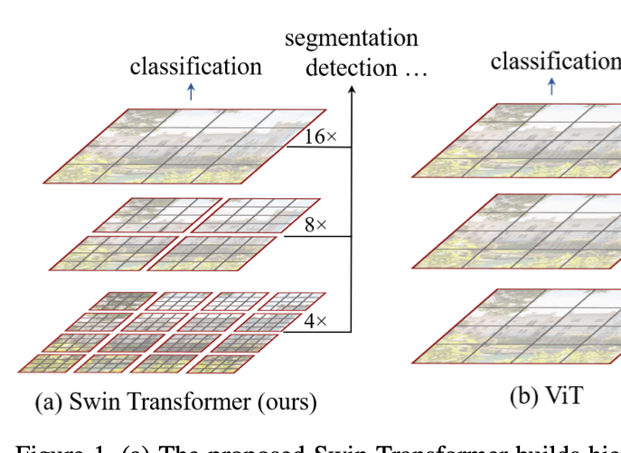

**🖼 逐元素图解**

- **右半 (b) ViT**：三层特征图大小完全一样，每层都是 16× 下采样（224 的图就是 14×14 格）。红框套住了整张图：**每一层的注意力都是全局的**，每个格子看所有格子。上面只有一个箭头：classification。
- **左半 (a) Swin**：三层特征图从下往上越来越小：4×（56×56 格）、8×（28×28）、16×（14×14）。**灰色小格是 patch，红框是窗口**：注意力只在红框内部算，最下面一层有 16 个红框，中间 4 个，最上面 1 个。右边的竖线把三层一起送给 *segmentation, detection…*：稠密任务需要的正是这一组不同尺度的特征图。

**读图时注意两件事。** 第一，Swin 最底层的 patch 是 4×4 像素，比 ViT 的 16×16 细四倍，所以它能看到更小的东西；代价是 token 多了 16 倍（3136 vs 196），全局注意力的分数矩阵会多 256 倍，这就是为什么必须用窗口。第二，每个红框里始终是 7×7 = 49 个 patch（图里示意画成 4×4），**窗口大小不随图像大小变**，所以总计算量和图像面积成正比，而不是平方。

> **💡 零基础先修：金字塔、stride 和 FPN**
>
> CNN（[第 8 讲](../vision-08-resnet-densenet/)的 ResNet）的特征图每过一个 stage 就缩小一半、通道翻倍，得到 stride 4/8/16/32 的四级特征。"stride 8"的意思是特征图上一格对应原图 8×8 像素。检测器的 FPN（[第 10 讲](../vision-10-structured-tasks/)）把这四级特征融合起来，小物体用 stride 4 的那级，大物体用 stride 32 的那级。**一个"通用骨干"必须能产出这样四级特征**，ViT 只有一级（stride 16），所以不行。Swin 和 PVT 的第一目标就是把四级金字塔搬进 Transformer。

#### 引言　语言和视觉的两个差别

论文第 2 页说，把 Transformer 从语言搬到视觉，困难来自两个差别：

| 差别 | 语言 | 视觉 | 后果 |
|---|---|---|---|
| **尺度** | 一个词就是一个 token，大小固定 | 一个物体可以占 10 个像素也可以占 1000 个 | 固定大小的 token（ViT）不合适，需要多尺度 |
| **分辨率** | 一句话几十个词 | 一张检测用的图几十万像素 | 全局注意力按 token 数平方涨，算不起 |

解决方案一句话：*compute self-attention locally within non-overlapping windows … The number of patches in each window is fixed, and thus the complexity becomes linear to image size.* 窗口里的 patch 数固定，复杂度就从平方变成线性。

> **💡 为什么不用"滑动窗口"**
>
> 论文第 2 页有一个重要的工程判断。以前的局部注意力方法（Ramachandran 2019 等）给**每个像素**一个以它为中心的窗口，叫滑动窗口。数学上很自然，但每个 query 的 key 集合都不一样，GPU 上没法批量算，很慢。Swin 用的是**不重叠的固定窗口**：同一个窗口里所有 query 共享同一组 key，49 个 query 对 49 个 key 就是一次标准的矩阵乘法，和普通注意力的实现完全一样。表 5 会看到两者速度差 4 倍。"移位"是为了弥补固定窗口的缺点（窗口之间不通信）而加的。

#### 图 2　移位窗口

*Figure 2. An illustration of the shifted window approach for computing self-attention in the proposed Swin Transformer architecture. In layer l (left), a regular window partitioning scheme is adopted, and self-attention is computed within each window. In the next layer l + 1 (right), the window partitioning is shifted, resulting in new windows. The self-attention computation in the new windows crosses the boundaries of the previous windows in layer l, providing connections among them.*

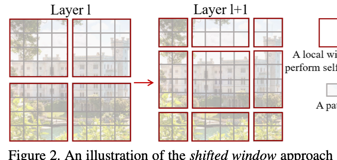

**🖼 逐元素图解**

- **左图 Layer l**：8×8 的 patch 网格（灰色小格），用红线分成 2×2 = 4 个窗口，每个窗口 4×4 个 patch。注意力只在每个红框内算。
- **右图 Layer l+1**：红线往右下各移了 2 格（窗口大小的一半），变成 3×3 = 9 个窗口，大小不等：中间一个 4×4，边上的 2×4 或 4×2，角上的 2×2。
- **关键观察**：右图中间那个 4×4 窗口横跨了左图四个窗口的交界处。左图里被红线隔开、不能互相看的两个相邻 patch，在右图里落进了同一个窗口。**两层一叠，信息就跨过了窗口边界。**

**跟着算：4×4 小图、窗口 2×2、移位 1 格。** 把 patch 按行编号 1 到 16。第 l 层的四个窗口是 {1,2,5,6}、{3,4,7,8}、{9,10,13,14}、{11,12,15,16}。第 l+1 层移位 1 格后，中间那个窗口是 {6,7,10,11}：6 和 7 在上一层分属左上、右上两个窗口，现在能互相看了。但移位后边上会出现 2×1、1×2、1×1 的小窗口（比如右上角只有 {8} 一个 patch 的窗口和 {4} 的窗口）：一共 9 个大小不一的窗口，批量计算很麻烦。图 4 讲怎么解决。

### 🖊 本模块练习

1. ★ 224 的图，ViT 用 16×16 的块、Swin 用 4×4 的块，token 数各是多少？如果都做全局注意力，分数矩阵的元素数差多少倍？

<details><summary>解析</summary>

ViT：14×14 = 196；Swin 第一级：56×56 = 3136，是 16 倍。全局注意力的分数矩阵是 token 数的平方：$3136^2/196^2=256$ 倍。这就是 Swin 不能用全局注意力的原因：第一级一张图一个头的分数矩阵就有 980 万个数。

</details>

2. ★ 为什么说窗口注意力的复杂度"和图像面积成线性"？

<details><summary>解析</summary>

窗口固定 M×M = 49 个 patch。图像面积翻倍，patch 数 N 翻倍，窗口数也翻倍，但每个窗口的计算不变（49×49 的分数矩阵），所以总量翻倍：线性。全局注意力则是 N 翻倍、分数矩阵四倍：平方。论文的公式 (1)、(2) 会精确写出。

</details>

3. 固定窗口和滑动窗口在"每个 query 看谁"上有什么不同？为什么前者在 GPU 上快得多？

<details><summary>解析</summary>

滑动窗口：每个 query 以自己为中心开一个窗口，相邻 query 的 key 集合不同。固定窗口：同一窗口里 49 个 query 共用同一组 49 个 key。后者可以把一个窗口的 Q、K 各排成 49×d 的矩阵，一次矩阵乘法算完，和标准注意力的高效实现完全一样；前者每个 query 要单独取 key，没法批量。表 5 测出 4 倍以上的速度差。

</details>

4. 图 2 右图里，移位后一共有几个窗口？各是什么形状？

<details><summary>解析</summary>

9 个：1 个 4×4（中间）、4 个 4×2 或 2×4（四条边）、4 个 2×2（四角）。窗口数从 4 变 9，而且大小不一，不能直接批量。这就是图 4 "循环移位"要解决的问题。

</details>

---

`Part 2 · Swin 论文第 3—4 页`

## 二、图 3 与公式 (1)–(3)：整体架构

#### 图 3　四个 stage

*Figure 3. (a) The architecture of a Swin Transformer (Swin-T); (b) two successive Swin Transformer Blocks (notation presented with Eq. (3)). W-MSA and SW-MSA are multi-head self attention modules with regular and shifted windowing configurations, respectively.*

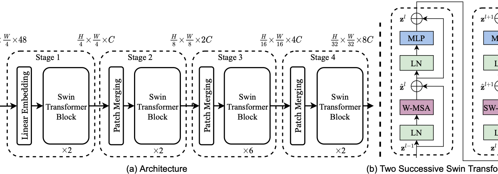

**🖼 逐元素图解**

**(a) 从左到右是数据流，每个箭头上标着张量形状：**

| 模块 | 输出形状 | 它做了什么 |
|---|---|---|
| Images | $H\times W\times3$ | 输入 |
| Patch Partition | $\frac H4\times\frac W4\times48$ | 切成 4×4 的块，每块 4×4×3 = 48 个数拉成一行。和 ViT 一样，只是块小了 |
| Linear Embedding | $\frac H4\times\frac W4\times C$ | 48 → C 的线性投影，Swin-T 的 C = 96 |
| Stage 1：Swin Block ×2 | $\frac H4\times\frac W4\times C$ | 两个块，形状不变 |
| Patch Merging | $\frac H8\times\frac W8\times2C$ | **把 2×2 的四个相邻 patch 合成一个**：空间减半、通道翻倍 |
| Stage 2：×2 | $\frac H8\times\frac W8\times2C$ | |
| Patch Merging + Stage 3：×6 | $\frac H{16}\times\frac W{16}\times4C$ | Swin-T 最深的 stage 在这里 |
| Patch Merging + Stage 4：×2 | $\frac H{32}\times\frac W{32}\times8C$ | |

四个 stage 的输出分辨率正好是 stride 4/8/16/32，通道 C/2C/4C/8C，**和 ResNet 的四个 stage 一一对应**。这就是它能直接替换 ResNet 接 FPN 的原因。

**(b) 两个连续的块**，自下而上：$z^{l-1}$ → LN → **W-MSA** → ⊕ → LN → MLP → ⊕ → $z^l$ → LN → **SW-MSA** → ⊕ → LN → MLP → ⊕ → $z^{l+1}$。和 ViT 的块唯一的区别是把 MSA 换成了 W-MSA（规则窗口）和 SW-MSA（移位窗口），**两种块成对交替出现**，所以每个 stage 的块数都是偶数（2、2、6、2）。

#### 公式 (3)　两个块的数学

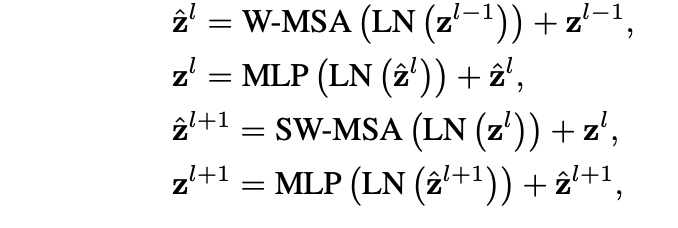

$$
\hat{\mathbf z}^l=\text{W-MSA}(\mathrm{LN}(\mathbf z^{l-1}))+\mathbf z^{l-1},\quad
\mathbf z^l=\mathrm{MLP}(\mathrm{LN}(\hat{\mathbf z}^l))+\hat{\mathbf z}^l,
$$
$$
\hat{\mathbf z}^{l+1}=\text{SW-MSA}(\mathrm{LN}(\mathbf z^l))+\mathbf z^l,\quad
\mathbf z^{l+1}=\mathrm{MLP}(\mathrm{LN}(\hat{\mathbf z}^{l+1}))+\hat{\mathbf z}^{l+1}.
$$

和第 12 讲 ViT 的公式 (2)(3) 逐项对照：Pre-LN、残差、GELU MLP（宽 4C）全部相同；**唯一的改动是注意力的候选集合从"全部 token"变成"同一窗口内的 token"**，并且奇数块用规则窗口、偶数块用移位窗口。

#### 公式 (1)(2)　复杂度为什么从平方变线性

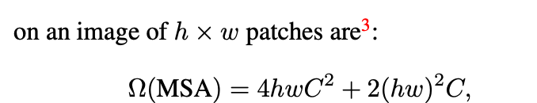

$$
\Omega(\text{MSA})=4hwC^2+2(hw)^2C,\qquad
\Omega(\text{W-MSA})=4hwC^2+2M^2hwC.
$$

| 项 | 来自哪里 | 全局 MSA | 窗口 W-MSA |
|---|---|---|---|
| $4hwC^2$ | Q、K、V、输出四个 $C\times C$ 投影，每个 token 各算一次 | 相同 | 相同 |
| 第二项 | $QK^{\top}$ 和 $AV$ 两次"token 对 token"的乘法 | 每个 token 对全部 $hw$ 个：$2(hw)^2C$ | 每个 token 只对窗内 $M^2$ 个：$2M^2hwC$ |

**跟着算：stage 1 的账本。** Swin-T 第一级 $hw=3136$、$C=96$、$M=7$：

- 投影项：$4\times3136\times96^2=115{,}605{,}504$ MAC。
- 全局交互项：$2\times3136^2\times96=1{,}888{,}223{,}232$。
- 窗口交互项：$2\times49\times3136\times96=29{,}503{,}488$。

窗口把交互项砍掉 64 倍（$3136/49$）。加上 MLP 的 $8hwC^2=231{,}211{,}008$，一个 W-MSA 块约 3.76 亿 MAC，其中注意力交互只占 8%。

> **⚠️ 窗口变大，代价增加在哪里**
>
> 固定 $hw$ 和 $C$，把 M 从 7 变 14：每窗 patch 数四倍、窗口数四分之一，交互项 $2M^2hwC$ 增四倍；投影和 MLP 不变。所以总量不是四倍，是"交互项四倍 + 其余不变"。另外作者脚注说明：$h,w$ 不能被 M 整除时在右下 padding，复杂度要按 padding 后的尺寸算。

#### 跟着算　窗口划分不是 reshape

把 $B\times H\times W\times C$ 的特征图切成窗口，要先拆轴再换轴：

```
(B, H, W, C)
→ (B, H/M, M, W/M, M, C)        拆：行 = 窗口行 × 窗内行；列同理
→ (B, H/M, W/M, M, M, C)        换：把两个"窗口"轴放到前面
→ (B·H/M·W/M, M·M, C)           合：所有窗口排成一个批，每窗 M² 个 token
```

4×4 的图、M = 2，正确的第一个窗口是 {1,2,5,6}。如果直接把 16 个数按顺序每 4 个一组，第一组是 {1,2,3,4}，那是整图第一行，错了。这和第 12 讲 patchify 的错误一模一样。逆操作（window reverse）按同样的轴顺序放回去，`reverse(partition(X)) == X`，没有参数、不丢信息。

**零分数的平均例子。** 让 Q、K 全零（所有分数为 0），注意力就是窗内 4 个值的平均。4×4 编号图的四个窗口平均值是 3.5、5.5、11.5、13.5，每个值填回它那个窗口的 4 个位置。这张"输出图"直接显示了窗口的边界：窗内一样、窗间不同。模块七的程序用它核对分窗索引。

### 🖊 本模块练习

5. ★ Swin-T 四个 stage 的输出形状是什么（224 输入）？和 ResNet-50 的哪几层对应？

<details><summary>解析</summary>

56×56×96 → 28×28×192 → 14×14×384 → 7×7×768，stride 4/8/16/32。对应 ResNet-50 的 C2–C5（256/512/1024/2048 通道）。所以 Swin-T 可以不改检测器代码直接替换 ResNet-50 做骨干，FPN 接这四级输出。

</details>

6. ★ 把 $B\times H\times W\times C$ reshape 成 $(B\cdot HW/M^2)\times M^2\times C$ 得到的是窗口吗？

<details><summary>解析</summary>

不是。reshape 按内存顺序切，一个"窗口"会拿到一整行的连续 M² 个 patch。必须先把 H 拆成 (H/M, M)、W 拆成 (W/M, M)，再把两个窗口轴换到前面。4×4/M2 的例子：正确第一窗 {1,2,5,6}，reshape 得到 {1,2,3,4}。

</details>

7. 一个 stage 里为什么块数总是偶数？

<details><summary>解析</summary>

因为 W-MSA 和 SW-MSA 成对交替。单独一个 W 块，窗口之间完全不通信；必须跟一个 SW 块才能跨窗。Swin-T 的 {2,2,6,2}、Swin-B 的 {2,2,18,2} 全是偶数。

</details>

8. Swin-T stage 1 一个块里，注意力的交互项（$QK^{\top}$ 和 $AV$）占总 MAC 的比例大约是多少？

<details><summary>解析</summary>

交互 29.5M，投影 115.6M，MLP 231.2M，合计约 376M，交互占 8%。所以窗口注意力之后，计算的大头又回到了投影和 MLP，和第 12 讲 ViT 在 224 下的情况一样。

</details>

---

`Part 3 · Swin 论文第 5 页`

## 三、图 4：移位窗口怎样批量计算

模块一留下的问题：移位后有 9 个大小不一的窗口，没法批量算。最笨的办法是把小窗口 padding 成 4×4，但窗口数从 4 变 9，计算量 2.25 倍。Swin 的办法是**循环移位 + mask**。

#### 图 4　循环移位

*Figure 4. Illustration of an efficient batch computation approach for self-attention in shifted window partitioning.*

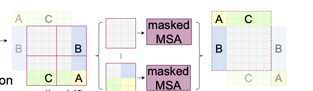

**🖼 逐元素图解**

从左到右四步：

1. **window partition（最左，淡色）**：移位后的 9 个窗口，边上和角上的那些标了 A、B、C：A 是右下角 1 个小块，B 是右边一条，C 是下边一条，中间是 4 个完整窗口的一部分。
2. **cyclic shift（左二）**：把整张特征图**向左上方循环滚动**：从上面和左边滚出去的 A、B、C 从下面和右边补回来。现在特征图又能被规则地切成 4 个 M×M 的窗口了，窗口数不变。
3. **masked MSA（中间）**：右下角那个窗口里同时装着 A、B、C 和一块中间区域，它们在原图上**根本不相邻**（A 原来在左上角，现在被拼到了右下角）。所以对这种"拼凑窗口"做注意力时要加 mask，禁止来自不同原区域的 patch 互相看。
4. **reverse cyclic shift（最右）**：算完以后滚回去，A、B、C 回到原位。

**一句话：循环移位是为了让"计算容器"保持规则（4 个 M×M 窗口，批量算），mask 是为了让"真实的邻居关系"保持正确（拼凑进同一容器的不同区域互不可见）。** 这两层概念分开，移位窗口就不难了。


**🖼 逐元素图解**

- **左格"原始网格"**：4×4 编号图，四种底色是第 l 层的四个规则窗口。
- **中格"特征 roll(−1,−1)"**：向左上滚 1 格后的编号。新的左上 2×2 窗口是 {6,7,10,11}，正是图 2 里"跨过旧窗口边界"的那个中间窗口，四个 patch 在原图上真实相邻，可以互相看。新的右上窗口是 {8,5,12,9}：8 和 5 原来一个在最右、一个在最左，被循环拼到了一起，**不是真邻居**。
- **右格"计算坐标的区域编号"**：给每个位置标它来自原图的哪一块（0 到 8 共 9 个区域）。**这张编号图是按滚动后的坐标直接生成的，不再滚一次。** 同一窗口里编号相同的才能互相看。
- **下方两张卡片**：中心新窗四个编号都是 0，全部互见；右上容器编号是 1/2/1/2，只允许 8↔12、5↔9。
- **底部**：mask 在 softmax **之前**加；算完 reverse 再 roll(+1,+1) 放回。

#### 跟着算　mask 的三个细节

**区域编号怎么来。** 每个轴分三段：$[0,H-M)$、$[H-M,H-s)$、$[H-s,H)$，s 是移位量（$\lfloor M/2\rfloor$），两轴组合成 9 个矩形，各给一个编号。4×4、M=2、s=1 的编号图是

$$
L=\begin{bmatrix}0&0&1&2\\0&0&1&2\\3&3&4&5\\6&6&7&8\end{bmatrix}.
$$

按规则窗口切开得到四个窗口的标签：[0,0,0,0]、[1,2,1,2]、[3,3,6,6]、[4,5,7,8]。第一窗全部互见；第二窗允许矩阵是

$$
E=\begin{bmatrix}1&0&1&0\\0&1&0&1\\1&0&1&0\\0&1&0&1\end{bmatrix};
$$

第三窗两行各自成组；第四窗四个编号都不同，每个 patch 只能看自己。**对角线永远允许**，这样不会出现一行全被 mask 掉的空 softmax。

**mask 加在 softmax 之前。** 标签不同的位置分数加 $-\infty$（代码里是 $-100$），softmax 时指数为 0，权重只在允许的 key 上归一化。如果先 softmax 再把禁止项乘 0，权重之和会小于 1：零分数例子里 4 个 key 各 1/4，删掉两个后只剩 1/2，输出被无故缩小一半。

**零分数的平均例子放回去。** 继续让所有分数为 0。右上容器 {8,5,12,9} 标签 [1,2,1,2]：8 和 12 平均得 10，5 和 9 平均得 7。四个窗口算完、reverse、roll(+1,+1) 放回原坐标，得到

$$
Y_{SW}=\begin{bmatrix}1&2.5&2.5&4\\7&8.5&8.5&10\\7&8.5&8.5&10\\13&14.5&14.5&16\end{bmatrix}.
$$

对照原图：中间 2×2 是 {6,7,10,11} 的平均 8.5（跨了旧窗口边界）；四个角 1、4、13、16 只看自己；边上的 2.5 是 {2,3} 的平均、7 是 {5,9} 的平均。**每个位置的输出只混合了它在原图上的真实邻居**，循环拼接没有泄漏。模块七的程序用"直接在原图坐标按 9 个区域分组"的笨办法独立算一遍，两者逐格相等。

> **⚠️ −100 不是 −∞**
>
> 作者代码用 $-100$ 做 mask。正常尺度下 $e^{-100}\approx3.7\times10^{-44}$，FP32 已经下溢成 0，效果等于 $-\infty$。但如果某个被禁止的位置原分数异常大（比如 200），加 $-100$ 后还是 100，会压过合法的 0 分 key。这在训练稳定时不会发生，调试异常时要记得这个有限值。

> **💡 两层 W + SW 之后，感受野有多大**
>
> 不是"窗口大小加倍"那么简单。第 l 层每个 patch 看到同窗的 M² 个；第 l+1 层它看到移位窗里的 M² 个，而这些 patch 各自在上一层又看过各自的窗。4×4 小图的实验（模块七）：两层之后中心 4 格依赖全部 16 个输入，边上的依赖 8 个，角上只依赖 4 个。更大的图两层之后远未全局；跨 stage 的 patch merging 才让感受野快速扩大。

### 🖊 本模块练习

9. ★ 循环移位之后右上角的窗口里装着原图最左和最右的 patch，为什么不能让它们互相看？mask 怎样防止？

<details><summary>解析</summary>

因为它们在原图上隔着整张图的宽度，不是邻居；让它们互相看等于在图的左右边缘之间"连了一条线"，违背局部性的本意。mask 给每个位置标原区域编号，同一窗口里编号不同的位置对，分数加 −∞，softmax 后权重为 0。4×4 例子：右上容器标签 [1,2,1,2]，只允许 8↔12 和 5↔9。

</details>

10. ★ "mask 只禁止编号不同的位置对"：那上一层不同窗口的两个 patch（比如 6 和 7）会被禁止吗？

<details><summary>解析</summary>

不会，也不应该。6 和 7 在移位后的中心窗口里编号都是 0（它们在原图上真实相邻）。移位窗口的目的就是让上一层被边界隔开的邻居通信；如果拿"旧窗口身份"做 mask，就把要建立的连接又切掉了。mask 判断的是"是不是被循环拼接凑到一起的"，不是"上一层是不是同一窗"。

</details>

11. 先 softmax 再把禁止项乘 0，为什么不对？

<details><summary>解析</summary>

权重之和不再是 1。零分数例子：4 个 key 各 1/4，乘 0 去掉两个后总和 1/2，输出是正确值的一半。正确做法是在 softmax 前加 −∞，或者事后重新归一化。差一个系数会改变残差分支的尺度，训练会受影响。

</details>

12. 4×4 小图、M=2，经过 W 块再 SW 块，角上的 patch 依赖几个输入？中心的呢？

<details><summary>解析</summary>

角上 4 个（它自己的旧窗口），中心 16 个（全部）。中心 patch 在 SW 层看中心窗的 4 个，这 4 个在 W 层各看过自己旧窗的 4 个，并集是 16。角上的 patch 在 SW 层只看自己，只能继承 W 层旧窗的 4 个。所以两层之后远非"全局"。

</details>

---

`Part 4 · Swin 论文第 5 页、第 8 页`

## 四、公式 (4)、Patch Merging 与模型账本

#### 公式 (4)　相对位置偏置

*Relative position bias. In computing self-attention, we follow [49, 1, 32, 33] by including a relative position bias $B\in\mathbb R^{M^2\times M^2}$ to each head in computing similarity:*

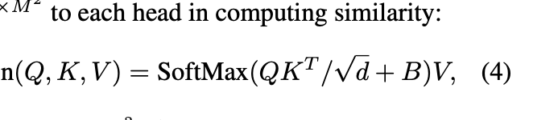

$$
\mathrm{Attention}(Q,K,V)=\mathrm{SoftMax}\bigl(QK^{\top}/\sqrt d+B\bigr)V .
$$

Swin **不用** ViT 那种加在输入上的绝对位置表，而是在注意力分数上加一个偏置 B，B 只取决于 query 和 key 在窗口内的**相对位移**。窗口 M×M，相对位移每轴在 $[-(M-1),M-1]$ 之间，所以只需要一张 $(2M-1)\times(2M-1)$ 的可学习小表 $\hat B$，B 的每个元素从里面查。

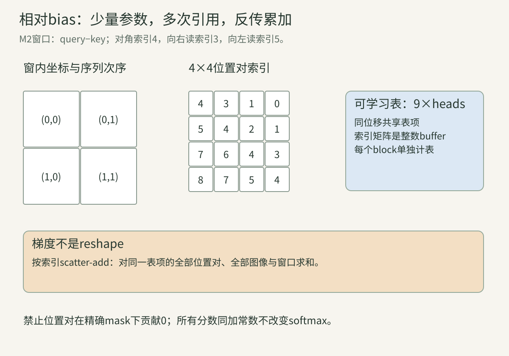

**🖼 逐元素图解**

- **左格"窗内坐标与序列次序"**：M = 2 的窗口，四个位置 (0,0)、(0,1)、(1,0)、(1,1)。
- **中格"4×4 位置对索引"**：第 i 行第 j 列是 query i 对 key j 的位移在小表里的下标。位移 (Δy, Δx) 各加 M−1 变成非负，再按 $(Δy+M-1)(2M-1)+(Δx+M-1)$ 展平成一维。对角线全是 4（位移 (0,0)），往右看一格是 3（Δx = −1），往左看是 5。
- **右蓝卡"可学习表：9×heads"**：M = 2 时 $(2M-1)^2=9$ 项，每头一份。同一位移共用一项；索引矩阵是整数缓冲区，不学。
- **下方橙卡"梯度不是 reshape"**：一个表项被很多位置对引用，它的梯度是所有引用处分数梯度之和（scatter-add）。

**跟着算：M = 7 时各有多少。** 小表 $13^2=169$ 项，3 个头 507 个参数。展开后的 B 是 $49\times49\times3=7203$ 个数，但那是查表结果不是参数。**一个表项的梯度**：窗内所有位移相同的位置对、所有窗口、所有图的分数梯度累加。单行例子：两个可见 key，$V=(2,6)$，分数全 0，$A=(1/2,1/2)$，输出 4；损失 $u^2/2$，$g_u=4$，对两个分数的梯度分别是 $4\cdot\tfrac12\cdot(2-4)=-4$ 和 $4\cdot\tfrac12\cdot(6-4)=4$；这两个梯度分别加到它们各自位移对应的表项上。

#### 表 4　移位和相对偏置各值多少

*Table 4. Ablation study on the shifted windows approach and different position embedding methods on three benchmarks, using the Swin-T architecture. w/o shifting: all self-attention modules adopt regular window partitioning, without shifting; abs. pos.: absolute position embedding term of ViT; rel. pos.: the default settings with an additional relative position bias term.*

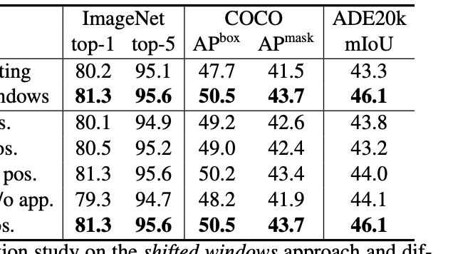

**🖼 逐元素图解**

- **三组列**：ImageNet top-1/top-5、COCO 的 AP box / AP mask、ADE20K 的 mIoU。后两组是稠密任务。
- **上两行：移位**。不移位 80.2 / 47.7 / 43.3；移位 81.3 / 50.5 / 46.1。分类 +1.1，**检测 +2.8，分割 +2.8**。稠密任务受益更大，因为它们更依赖跨窗口的空间关系。
- **下五行：位置编码**。无位置 80.1 / 49.2 / 43.8；绝对位置 80.5 / 49.0 / 43.2；绝对 + 相对 81.3 / 50.2 / 44.0；相对但不带 $QK^{\top}$ 项 79.3；相对（默认）81.3 / 50.5 / 46.1。

**读法：** 相对偏置比无位置高 +1.2 / +1.3 / +2.3；**加上绝对位置反而掉**（COCO −0.3，ADE −2.1）。作者的解释：绝对位置破坏了平移不变性，而检测分割正需要"物体挪到哪都一样"。这和第 12 讲 ViT 表 8 的结论相反：ViT 分类里各种位置编码差不多，Swin 在稠密任务上相对位置明显更好。

#### 跟着算　Patch Merging

每个 stage 结束时，把 2×2 相邻的四个 patch 合成一个：

```
取四组：X00 偶行偶列，X10 奇行偶列，X01 偶行奇列，X11 奇行奇列   各 (H/2, W/2, C)
拼接：  [X00; X10; X01; X11]                                       (H/2, W/2, 4C)
LN(4C) → 无偏置线性层 4C → 2C                                       (H/2, W/2, 2C)
```

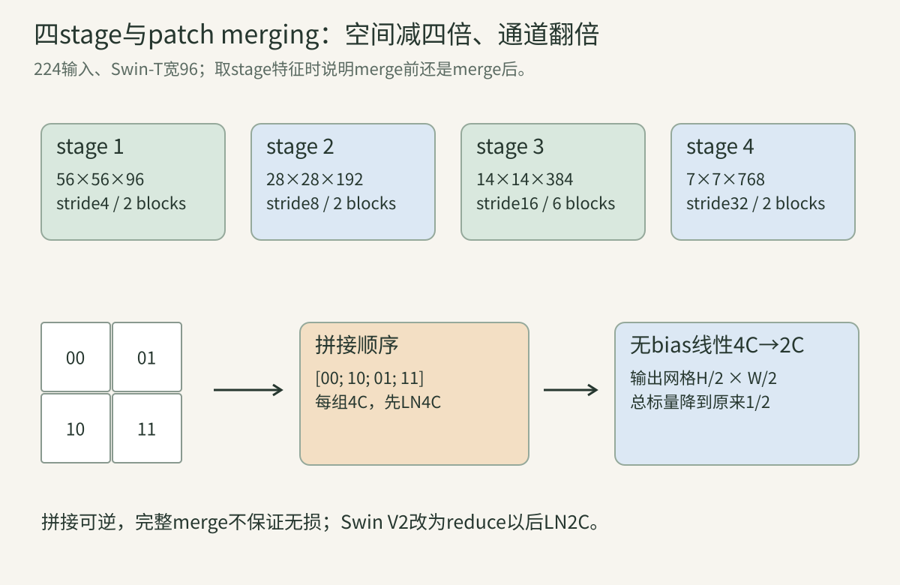

**🖼 逐元素图解**

- **上排四张卡片**：Swin-T 四个 stage 的输出 56×56×96、28×28×192、14×14×384、7×7×768，stride 4/8/16/32，块数 2/2/6/2。
- **下排**：2×2 的格子 00/01/10/11 → 橙卡"拼接顺序 [00;10;01;11]，先 LN 4C" → 蓝卡"无偏置线性 4C→2C，总标量降到一半"。
- **底部**：拼接可逆，完整 merge 不是无损；Swin V2 改成先 reduce 再 LN 2C。

**单通道手算。** 2×2 原值 $\begin{bmatrix}1&2\\3&4\end{bmatrix}$，按 00/10/01/11 拼成 $(1,3,2,4)$。LN（γ=1、β=0、ε=0）：均值 2.5，方差 1.25，输出 $(-1.342,0.447,-0.447,1.342)$。再乘一个 4×2 的矩阵得到 2 个数。**四个位置的 4 个数变成 2 个数，总标量减半**，$4C\to2C$ 的矩阵秩至多 2C，一定有信息丢失；但空间上四格合一、通道翻倍，正是 CNN stage 之间"分辨率减半、通道加倍"的翻版。

> **⚠️ merge 不等于"四个 token 取平均"**
>
> 平均是固定权重、输出 C 维；merge 是先拼成 4C（四个位置的信息各占一段）、LN、再学一个 4C→2C 的矩阵。它能区分"左上亮右下暗"和"左上暗右下亮"（平均分不开），而且输出是 2C 不是 C。第 12 讲"投影不是池化"的道理在这里再次出现。

#### 模型变体与账本

*Swin-T: C = 96, layer numbers = {2, 2, 6, 2}; Swin-S: C = 96, {2, 2, 18, 2}; Swin-B: C = 128, {2, 2, 18, 2}; Swin-L: C = 192, {2, 2, 18, 2}*

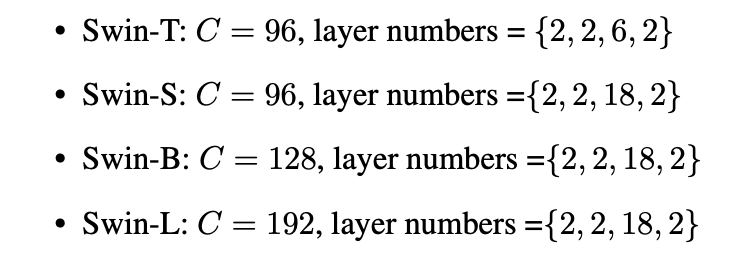

窗口 M = 7，每头 d = 32（所以头数 = C/32：Swin-T 四个 stage 是 3/6/12/24 头），MLP 宽 4C。T 和 S 只差 stage 3 的深度（6 vs 18 块），S 和 B 只差宽度（96 vs 128）。

**跟着算：Swin-T 的精确参数。** 一个块：QKV 权重 $3C^2$ 加偏置 $3C$，输出投影 $C^2+C$，MLP $8C^2+5C$，两个 LN $4C$，相对表 $169h$；合计 $12C^2+13C+169h$。stem：$48C+C$（投影）$+2C$（LN）。merge：$8C^2$（4C→2C 无偏置）$+8C$（LN 4C）。最终 LN $2C_4$，1000 类头 $(C_4+1)\times1000$。

| 组件 | 参数 |
|---|---:|
| stem（C=96） | 4,896 |
| stage 1，2 块 | 224,694 |
| merge 1 | 74,496 |
| stage 2，2 块 | 891,756 |
| merge 2 | 296,448 |
| stage 3，6 块 | 10,658,952 |
| merge 3 | 1,182,720 |
| stage 4，2 块 | 14,183,856 |
| 最终 LN + 1000 类头 | 770,536 |
| **合计** | **28,288,354** |

论文写 29M。同样算法 Swin-S 是 49,606,258（论文 50M），Swin-B 是 87,768,224（88M）。**stage 4 只有 7×7 = 49 个位置，参数却最多**：参数看通道宽度（$12C^2$，C=768），不看位置数。

**MAC 账本。** 一个块 $12NC^2+2NM^2C$，merge $2NC^2$。stage 之间 $N\to N/4$、$C\to2C$，所以 $NC^2$ 不变：**四个 stage 每块的投影和 MLP 计算量相同**（约 3.5 亿），这是 Swin 配置里"每个 stage 预算平衡"的来源。Swin-T 总计 4,490,566,656 MAC ≈ 4.49G（论文 4.5G FLOPs）；S 约 8.74G、B 约 15.43G。T → S 多出的 12 个 stage 3 块正好贡献 $12\times354{,}192{,}384=4.25$G。

### 🖊 本模块练习

13. ★ M = 7、3 个头的相对位置偏置有多少参数？展开后的 B 有多少个数？

<details><summary>解析</summary>

参数 $(2\times7-1)^2\times3=169\times3=507$。展开的 B 是 $49\times49\times3=7203$ 个数，但它们是从 507 个参数查表得来的，不是独立参数。参数量按可训练的独立标量数。

</details>

14. ★ 表 4 里"绝对 + 相对"比"只用相对"在 COCO 和 ADE20K 上更差，为什么？

<details><summary>解析</summary>

绝对位置编码告诉模型"这是图里第 (r, s) 块"，物体平移后编码就变了，破坏了平移不变性；检测分割要求同一物体出现在任何位置都给同样的特征。相对偏置只看两块之间的位移，天然平移不变。分类受影响小（81.3 相同），稠密任务掉 0.3 和 2.1。

</details>

15. patch merging 把四个 C 维向量变成一个 2C 维向量，信息"无损"吗？四个 token 直接取平均和它有什么不同？

<details><summary>解析</summary>

不无损：4C → 2C 的矩阵秩至多 2C，至少 2C 维的零空间。但它和平均不同：平均固定等权、输出 C 维、分不开"左上亮右下暗"和反过来；merge 先把四个位置拼成 4C（各占一段）再学投影，能保留位置之间的差异。

</details>

16. Swin-T stage 4 只有 49 个位置，为什么参数比 stage 1（3136 个位置）多得多？

<details><summary>解析</summary>

参数取决于通道宽度：一个块约 $12C^2$，stage 4 的 C = 768 是 stage 1 的 8 倍，参数 64 倍。位置数只影响计算量（MAC 按 N 走），不影响参数。两个 stage 的每块 MAC 反而差不多（$NC^2$ 不变）。

</details>

---

`Part 5 · PVT 论文第 1、4—7 页`

## 五、PVT：另一条路，压缩 key 和 value

Swin 的办法是"每个 query 只看窗内"。同期的 PVT（Pyramid Vision Transformer）走了另一条路：**每个 query 仍然看整张图，但把 key 和 value 压缩成少量摘要**。两者都搭了四级金字塔，但注意力的省法不同。

#### 图 1　三种架构

*Figure 1: Comparisons of different architectures, where "Conv" and "TF-E" stand for "convolution" and "Transformer encoder", respectively. (a) Many CNN backbones use a pyramid structure for dense prediction tasks such as object detection (DET), instance and semantic segmentation (SEG). (b) The recently proposed Vision Transformer (ViT) is a "columnar" structure specifically designed for image classification (CLS). (c) By incorporating the pyramid structure from CNNs, we present the Pyramid Vision Transformer (PVT)…*

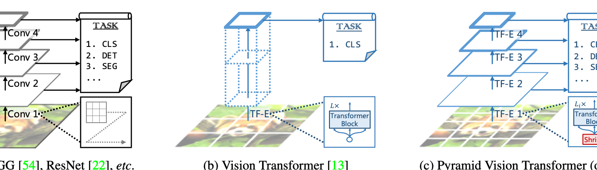

**🖼 逐元素图解**

- **(a) CNN**：Conv 1 到 Conv 4 四层特征图越来越小，右边的 TASK 框列了 CLS、DET、SEG：四级金字塔能喂给所有任务。
- **(b) ViT**：一根"柱子"，所有层特征图同样大（16× 下采样），TASK 框只有 CLS。
- **(c) PVT**：TF-E 1 到 TF-E 4 四级金字塔，每级是 Transformer 编码器，TASK 框又有了 DET、SEG。右下角放大的 Transformer Block 里多了一个 *Shrink* 模块：这就是空间缩减。

和 Swin 的图 1 讲的是同一件事：**要做稠密任务，Transformer 必须有金字塔。**

#### 图 3　PVT 的整体结构

*Figure 3: Overall architecture of Pyramid Vision Transformer (PVT). The entire model is divided into four stages, each of which is comprised of a patch embedding layer and a $L_i$-layer Transformer encoder. Following a pyramid structure, the output resolution of the four stages progressively shrinks from high (4-stride) to low (32-stride).*

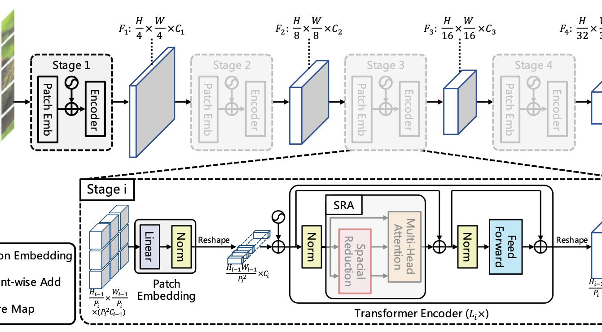

**🖼 逐元素图解**

- **上排**：输入 $H\times W\times3$ → Stage 1 → $F_1$：$\frac H4\times\frac W4\times C_1$ → Stage 2 → $F_2$：$\frac H8\times\frac W8\times C_2$ → … → $F_4$：$\frac H{32}\times\frac W{32}\times C_4$。四级输出 $F_1$ 到 $F_4$ 和 Swin 一样是 stride 4/8/16/32。
- **下排放大的 Stage i**：Patch Embedding（切块 $P_i\times P_i$、线性投影、LN）→ 加位置编码（圆圈 ⊕）→ reshape 成序列 → $L_i$ 个 Transformer 块 → reshape 回特征图。
- **每个块里**：Norm → **SRA**（Spatial Reduction Attention，蓝框里带 *Spatial Reduction* 的注意力）→ 残差 → Norm → Feed Forward → 残差。**和 ViT 的块唯一的区别是 MHA 换成了 SRA。**

和 Swin 的差别：PVT 用"切块"做下采样（每个 stage 开头的 patch embedding 用 $P_i=2$ 的块把分辨率减半），Swin 用 patch merging；PVT 每个 stage 都加位置编码（按分辨率插值），Swin 用相对偏置。

#### 图 4 与公式 (1)–(3)　空间缩减注意力

*Figure 4: Multi-head attention (MHA) vs. spatial-reduction attention (SRA). With the spatial-reduction operation, the computational/memory cost of our SRA is much lower than that of MHA.*

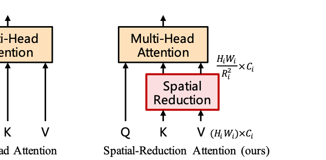

**🖼 逐元素图解**

- **左 MHA**：Q、K、V 三路输入各 $(H_iW_i)\times C_i$，进 Multi-Head Attention。
- **右 SRA**：Q 直接进；**K 和 V 先过一个红框 Spatial Reduction**，从 $(H_iW_i)\times C_i$ 变成 $\frac{H_iW_i}{R_i^2}\times C_i$，再进注意力。$R_i$ 是缩减比例，stage 1 是 8。

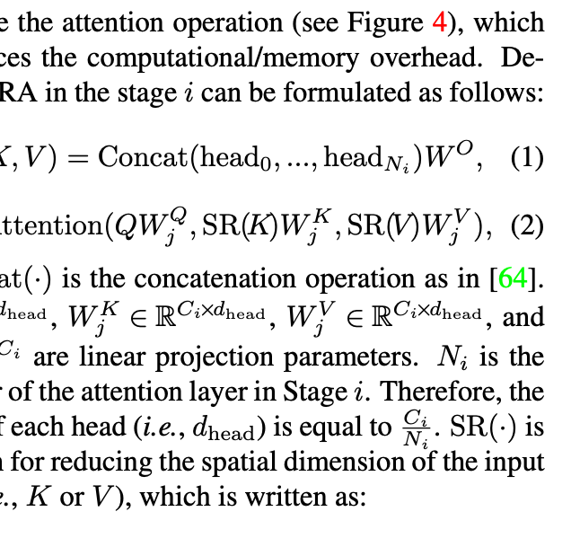

$$
\mathrm{SRA}(Q,K,V)=\mathrm{Concat}(\mathrm{head}_0,\dots,\mathrm{head}_{N_i})W^O,\qquad
\mathrm{head}_j=\mathrm{Attention}\bigl(QW_j^Q,\;\mathrm{SR}(K)W_j^K,\;\mathrm{SR}(V)W_j^V\bigr),
$$
$$
\mathrm{SR}(\mathbf x)=\mathrm{Norm}\bigl(\mathrm{Reshape}(\mathbf x,R_i)\,W^S\bigr).
$$

**逐符号读 SR：** 把 $H_iW_i\times C_i$ 的序列按 $R_i\times R_i$ 的块重排成 $\frac{H_iW_i}{R_i^2}\times(R_i^2C_i)$（每个块的 $R_i^2$ 个位置、各 $C_i$ 通道拼成一行），乘一个 $(R_i^2C_i)\times C_i$ 的矩阵 $W^S$，再 LN。**这和 patch embedding 是同一种操作**：等价于 kernel = stride = $R_i$ 的卷积。所以 SR 是"把 key/value 的特征图再切一次块"。

**跟着算：4×4 到 4 个摘要。** 单通道 4×4 编号图，让 SR 就取每个 2×2 块的平均（教学简化，不加 LN），得到 4 个摘要 $(3.5,5.5,11.5,13.5)$。16 个 query 各自对这 4 个摘要做注意力；让分数全 0，每个 query 输出都是 $(3.5+5.5+11.5+13.5)/4=8.5$。**query 仍有 16 个、输出仍是 16 个位置**，只是每个 query 的候选从 16 个原 token 变成了 4 个摘要。

**跟着算：省了多少。** PVT stage 1：$N=56^2=3136$、$C=64$、$R=8$，摘要数 $N_s=3136/64=49$。交互项从全局的 $2N^2C=1{,}258{,}815{,}488$ 降到 $2NN_sC=19{,}668{,}992$，**64 倍**。完整的 SRA MAC 还包括 Q 和输出投影 $2NC^2$、压缩后的 K/V 投影 $2N_sC^2$、SR 本身 $N_s(R^2C)C=NC^2$。

> **💡 Swin 和 PVT 各限制了什么**
>
> 窗口注意力：每个 query 能**逐个**读取窗内 49 个原始 token，但本层看不到窗外。SRA：每个 query 能读到**整张图**，但看到的是 49 个"粗摘要"，每个摘要混合了 8×8 = 64 个原始位置。前者精细但局部，后者全局但模糊。两者都靠残差保留了 query 自己的高分辨率信息。

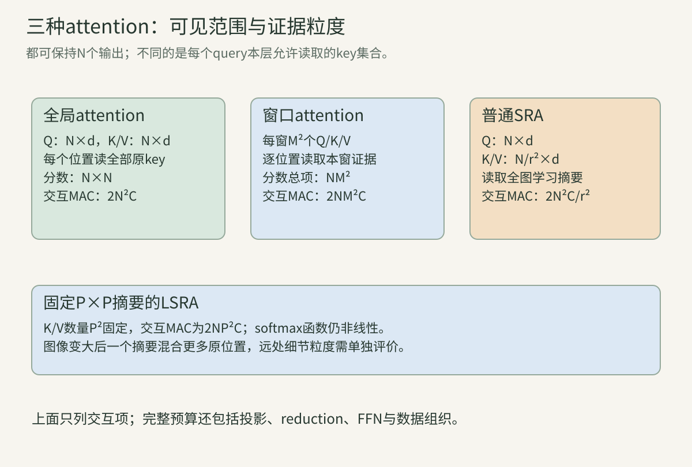

**🖼 逐元素图解**

- **左绿卡"全局注意力"**：Q、K/V 都是 N×d，每个位置读全部原 key，分数 N×N，交互 $2N^2C$。
- **中蓝卡"窗口注意力"**：每窗 M² 个 Q/K/V，逐位置读本窗证据，交互 $2NM^2C$。
- **右橙卡"普通 SRA"**：Q 是 N×d，K/V 是 $N/r^2\times d$，读全图的学习摘要，交互 $2N^2C/r^2$。
- **下方蓝卡"固定 P×P 摘要的 LSRA"**：PVT v2 的线性版本，K/V 固定 P² = 49 个，交互 $2NP^2C$，和图像面积成线性。

#### 表 1 与表 2　PVT 的四档与结果

*Table 1: Detailed settings of PVT series. The design follows the two rules of ResNet: (1) with the growth of network depth, the hidden dimension gradually increases, and the output resolution progressively shrinks; (2) the major computation resource is concentrated in Stage 3.*

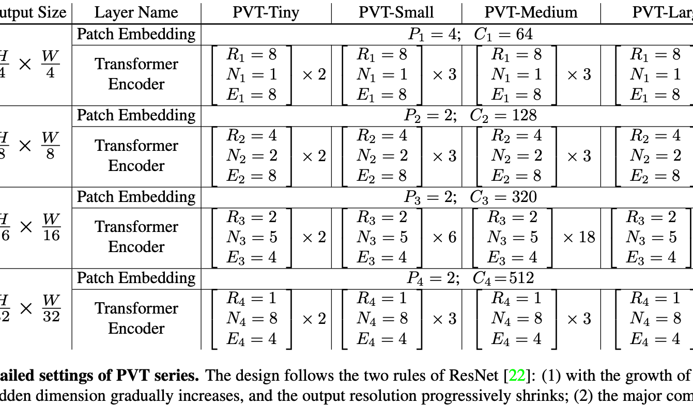

**🖼 逐元素图解**

- **四行是四个 stage**，每行左边是输出尺寸（$\frac H4$ 到 $\frac H{32}$），中间是 Patch Embedding 的 $P_i$ 和 $C_i$（$P_1=4$、$C_1=64$；之后 $P=2$，C = 128/320/512）。
- **每个方括号里三行**：$R_i$ 缩减比例（8/4/2/1）、$N_i$ 头数（1/2/5/8）、$E_i$ MLP 扩张倍数（8/8/4/4）；方括号外的 ×2、×3、×6、×18 是块数。
- **四列是 Tiny/Small/Medium/Large**，只差块数：Tiny {2,2,2,2}、Small {3,4,6,3}、Medium {3,4,18,3}、Large {3,8,27,3}。Small 的 {3,4,6,3} 正是 ResNet-50 的块数。

**跟着算：为什么四个 stage 的 K/V 都是 49 个。** 224 输入，四级网格 56/28/14/7，缩减比例 8/4/2/1，每轴除完都是 7：$56/8=28/4=14/2=7/1=7$。所以前三个 stage 的 K/V 各 49 个摘要，最后一个 stage 不缩减、也恰好 49 个位置。

*Table 2: Image classification performance on the ImageNet validation set.*

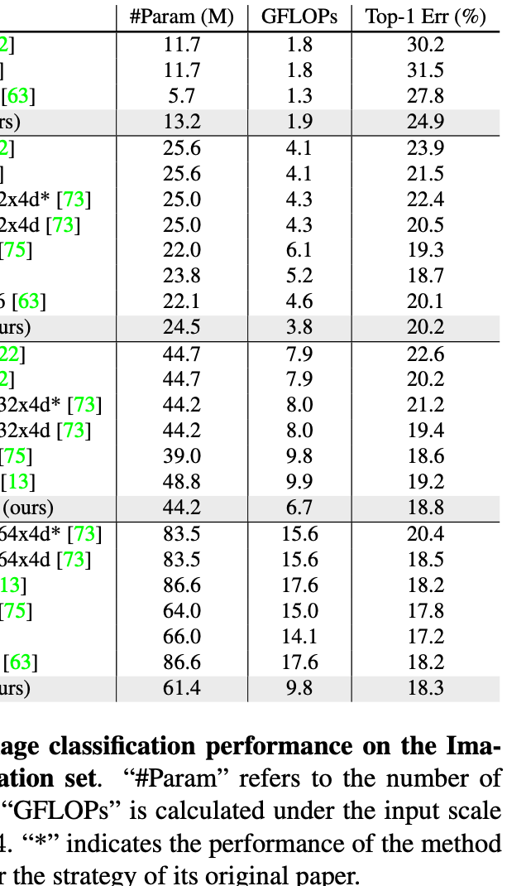

列是参数、GFLOPs、Top-1 **错误率**（注意不是准确率）。PVT-Small 24.5M / 3.8G / 20.2（即 79.8%），对比 ResNet-50 25.6M / 4.1G / 21.5 和 DeiT-S 22.1M / 4.6G / 20.1。**在分类上 PVT 和 DeiT 差不多**（它们的错误率 20.2 vs 20.1），作者自己说 *the pyramid structure is beneficial to dense prediction tasks, but brings little improvements to image classification*。PVT 的价值在检测分割：论文摘要里 PVT + RetinaNet 比 ResNet-50 + RetinaNet 高 4.1 AP。

> **💡 PVT v2 改了三处**
>
> 后续的 PVT v2 做了三个改动，本讲的程序也核对了它们：**重叠 patch embedding**（stem 用 7×7/stride 4/padding 3 的卷积，相邻 token 的输入区域重叠，边界附近的像素参与多个 token）；**卷积 FFN**（在 FFN 的两个线性层之间加一个 3×3 深度卷积，给每个位置一点局部空间交互，并借此去掉了位置编码）；**线性 SRA**（用自适应平均池化把 K/V 固定成 7×7 = 49 个，无论图多大，交互项 $2NP^2C$ 和面积成线性）。

### 🖊 本模块练习

17. ★ SRA 对 56×56、R = 8 的特征图，输出是 7×7 吗？

<details><summary>解析</summary>

不是。输出仍是 56×56：query 有 3136 个，每个 query 产生一个输出。被压成 7×7 = 49 的是 **key 和 value**。初学者常把"K/V 变少"误解成"输出变少"。

</details>

18. ★ 固定 R = 8，图像面积扩大 4 倍，SRA 的交互项扩大多少？PVT v2 的线性 SRA 呢？

<details><summary>解析</summary>

普通 SRA：$2NN_sC$，N 和 $N_s=N/64$ 都变 4 倍，交互项 16 倍，仍是平方。线性 SRA：$N_s$ 固定 49，交互 $2N\cdot49\cdot C$ 只变 4 倍，线性。代价是每个摘要覆盖的原始区域变大 4 倍，更粗。

</details>

19. SR 操作和 ViT 的 patch embedding 是同一种运算吗？

<details><summary>解析</summary>

是。都是"把 R×R 块的所有通道拼成一行，乘一个矩阵"，等价于 kernel = stride = R 的卷积。差别只在输入：patch embedding 作用在像素上，SR 作用在中间特征图上，而且只用于产生 K/V，Q 不经过它。

</details>

20. PVT-Small 分类只比 DeiT-S 好 0.1 个点，为什么作者仍认为金字塔有价值？

<details><summary>解析</summary>

因为价值在稠密任务：分类只需要最后一级的全局表示，金字塔的中间几级没被用上；检测分割需要 stride 4/8/16 的高分辨率特征，ViT/DeiT 根本给不出。PVT + RetinaNet 比 ResNet-50 高 4.1 AP，Swin 表 2 里 Swin-T 比 DeiT-S 高 2.5 AP，都是这个道理。

</details>

---

`Part 6 · Swin 论文第 6—8 页，Swin V2 论文第 1—8 页`

## 六、结果、速度与 Swin V2 的扩展

#### 表 1　ImageNet：Swin vs DeiT vs CNN

*Table 1. Comparison of different backbones on ImageNet-1K classification. Throughput is measured using the GitHub repository of [68] and a V100 GPU, following [63].*

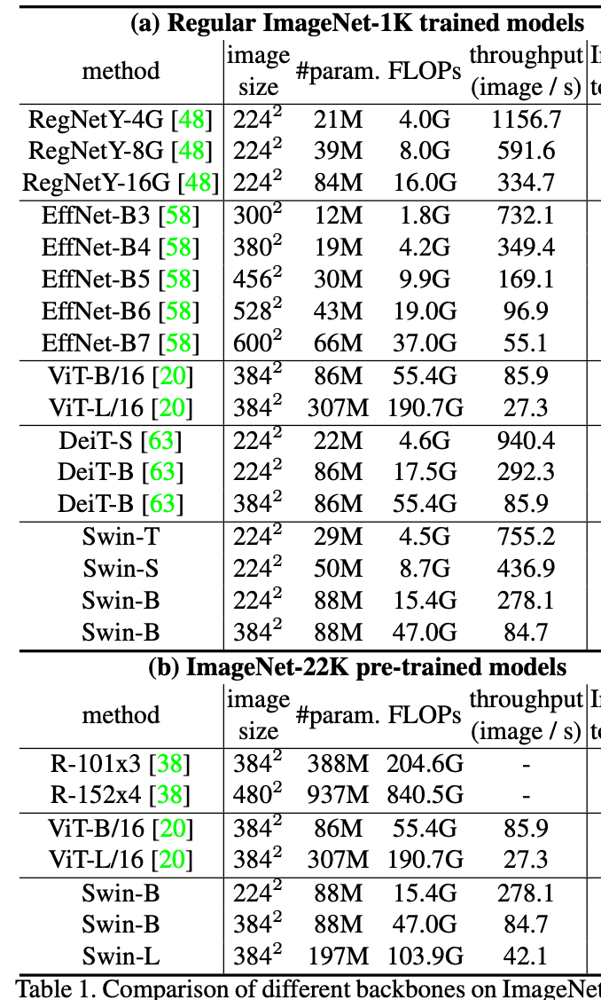

**🖼 逐元素图解**

- **(a) 只用 ImageNet-1K 训练**。列：输入尺寸、参数、FLOPs、吞吐量、top-1。四组模型：RegNetY（CNN）、EfficientNet（CNN）、ViT/DeiT（柱状 Transformer）、Swin。
- **(b) ImageNet-22K 预训练再微调**：ResNet 大模型（R-101x3、R-152x4）、ViT、Swin-B/L。

**读法，抓同算力的对比：**

| 对比 | 数字 | 说明 |
|---|---|---|
| Swin-T vs DeiT-S | 81.3 vs 79.8，4.5G vs 4.6G | 同计算量 **+1.5** |
| Swin-B vs DeiT-B | 83.5 vs 81.8，15.4G vs 17.5G | **+1.7**，还更省 |
| Swin-B↑384 vs DeiT-B↑384 | 84.5 vs 83.1 | +1.4 |
| Swin-B vs RegNetY-16G | 83.5 vs 82.9 | 略好；吞吐 278 vs 335 |
| Swin-B vs EffNet-B7 | 83.5 vs 84.3，吞吐 278 vs 55 | 精度略低但快 5 倍 |
| (b) Swin-L↑384（22K） | 87.3 | 比 ViT-L/16 的 85.2 高 2.1，FLOPs 103.9G vs 190.7G |

Swin 分类上比 DeiT 高 1.5 个点左右，但它真正的优势在下一张表。

#### 表 2　COCO 检测：骨干一换，+4 AP

*Table 2. Results on COCO object detection and instance segmentation. † denotes that additional deconvolution layers are used to produce hierarchical feature maps. ∗ indicates multi-scale testing.*

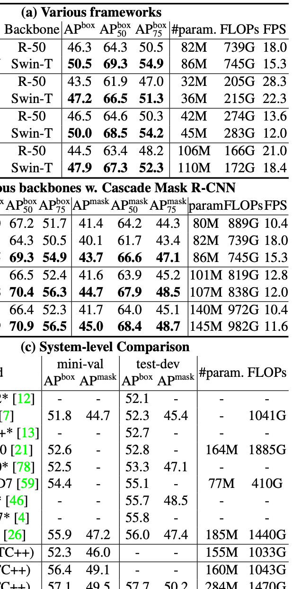

**🖼 逐元素图解**

- **(a) 四种检测框架**（Cascade Mask R-CNN、ATSS、RepPoints v2、Sparse R-CNN），每种都比较 R-50 和 Swin-T 两个骨干。AP box 列：46.3 → 50.5、43.5 → 47.2、46.5 → 50.0、44.5 → 47.9，**每种框架都 +3.4 到 +4.2**，参数和 FLOPs 几乎相同（82M/739G vs 86M/745G）。
- **(b) 同一框架（Cascade Mask R-CNN）换不同骨干**。DeiT-S† 48.0 vs Swin-T 50.5（+2.5），而且 DeiT 要额外加反卷积层才能凑出多尺度特征（†），FPS 10.4 vs 15.3。R50 46.3 vs Swin-T 50.5；X101-32x4d 48.1 vs Swin-S 51.8；X101-64x4d 48.3 vs Swin-B 51.9。
- **(c) 系统级比较**：Swin-L + HTC++ 多尺度测试 58.7 AP box / 51.1 AP mask，比之前最好的 Copy-paste（55.9）高 2.8。

**这张表是 Swin 得最佳论文的理由：** 它第一次证明 Transformer 骨干可以在检测分割上**全面**超过同算力的 CNN。回看图 1：ViT/DeiT 没有金字塔，做检测要人为加反卷积凑尺度，还慢。

#### 表 5　真实速度：为什么选循环移位

*Table 5. Real speed of different self-attention computation methods and implementations on a V100 GPU.*

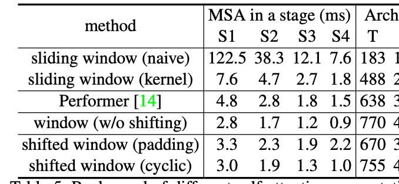

**🖼 逐元素图解**

- **左四列**：一个 stage 里注意力模块的耗时（ms），S1 到 S4。**右三列**：整个网络的 FPS，T/S/B。
- **sliding window (naive)**：每个像素一个窗口，朴素实现，stage 1 要 122.5 ms，整网只有 183 FPS。
- **sliding window (kernel)**：写了专门的 CUDA kernel，7.6 ms，488 FPS。
- **Performer**：一种线性注意力近似，638 FPS。
- **window (w/o shifting)**：固定窗口不移位，770 FPS，最快。
- **shifted window (padding)**：移位后把小窗口 padding 成大窗口，670 FPS，比不移位慢 13%。
- **shifted window (cyclic)**：图 4 的循环移位，**755 FPS**，只比不移位慢 2%。

**读法：** 移位窗口的循环实现几乎免费（T/S/B 分别只慢 2%/1.6%/0.7%），而精度 +1.1/+2.8/+2.8（表 4）。相比之下朴素滑动窗口慢 4 倍，专门写 kernel 也只有 65%。这就是 Swin 选固定窗口 + 循环移位的全部理由。

#### Swin V2 图 1　三处改动

*Figure 1. To better scale up model capacity and window resolution, several adaptions are made on the original Swin Transformer architecture (V1): 1) A res-post-norm to replace the previous pre-norm configuration; 2) A scaled cosine attention to replace the original dot product attention; 3) A log-spaced continuous relative position bias approach to replace the previous parameterized approach.*

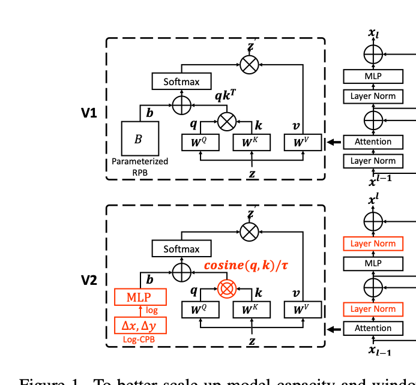

**🖼 逐元素图解**

上下两个虚线框是 V1 和 V2 的一个块，**红色是改动处**：

| 改动 | V1（上） | V2（下，红色） | 要解决什么 |
|---|---|---|---|
| **归一化位置** | Layer Norm 在 Attention 和 MLP **之前**（pre-norm），左边主干直接相加 | Layer Norm 移到 Attention 和 MLP **之后**、相加**之前**（res-post-norm） | 大模型深层激活爆炸（图 2） |
| **相似度** | $qk^{\top}$ 点积，Softmax | $\cos(q,k)/\tau$，Softmax | 少数像素对主导注意力 |
| **位置偏置** | 右边的 *Parameterized RPB*：查表 B | 左边的 *MLP*，输入 $\log(\Delta x),\log(\Delta y)$，输出 B（Log-CPB） | 换窗口大小时偏置表无法迁移 |

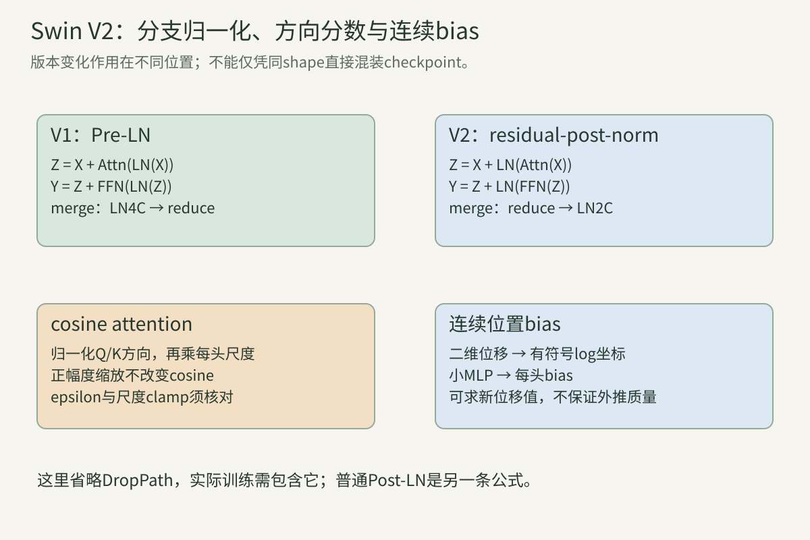

**🖼 逐元素图解**

- **左上绿卡 V1 Pre-LN**：$Z=X+\mathrm{Attn}(\mathrm{LN}(X))$，merge 是 LN 4C → reduce。**右上蓝卡 V2 res-post-norm**：$Z=X+\mathrm{LN}(\mathrm{Attn}(X))$，merge 改成 reduce → LN 2C。注意它**不是**经典的 Post-LN $\mathrm{LN}(X+\mathrm{Attn}(X))$：残差主干仍然不过 LN，只是分支输出先归一化再加回。
- **左下橙卡 cosine attention**：Q、K 归一化方向再乘每头可学习尺度。**右下蓝卡 连续位置偏置**：二维位移 → 有符号对数坐标 → 小 MLP → 每头 bias。
- **底部**：图里省略了 DropPath；普通 Post-LN 是另一条公式。

#### Swin V2 图 2　为什么要改归一化

*Figure 2. The Signal Propagation Plot for various model sizes. H-size models are trained at a self-supervised learning phase, and other sizes are trained by an image classification task. * indicates that we use a 40-epoch model before it crashes.*

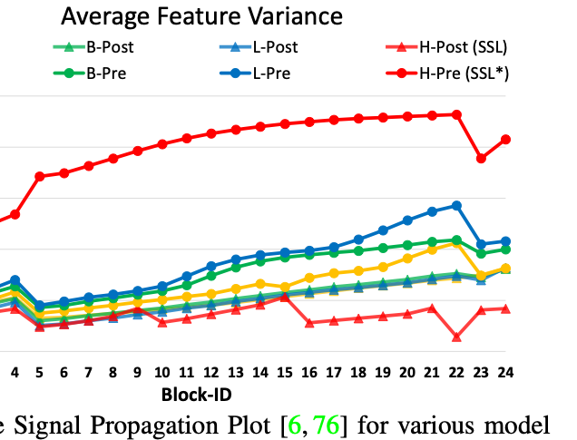

**🖼 逐元素图解**

- **横轴**：块的编号 1 到 24。**纵轴**：该块输出的平均方差，**对数刻度**（$10^{-2}$ 到 $10^{6}$）。
- **三组颜色**：B（绿）、L（蓝）、H（红）三个规模；实心圆是 Pre-norm（V1），三角是 Post-norm（V2）。
- **读法**：所有 Pre 曲线都随深度**单调上升**，H-Pre（红圆）从 $10^2$ 涨到 $10^4$ 以上，然后训练崩溃（星号说明用的是崩溃前 40 epoch 的模型）。Post 曲线（三角）平得多，H-Post 全程在 $10^0$ 附近。

**为什么 Pre-norm 会这样：** $Z=X+\mathrm{Attn}(\mathrm{LN}(X))$ 里，分支的输出没有经过归一化就直接加到主干上，每一层都往主干里加一份未约束的量，24 层累积下来主干的幅度越来越大；而 LN 只作用在分支的输入上，管不了主干。V2 把 LN 放到分支输出上，每次加回主干的量都被归一化过。论文说最大的 30 亿参数模型还要每 6 个块再在主干上加一个 LN 才稳。

**跟着算：cosine 注意力为什么对幅度不敏感。** $q=(3,4)$、$k=(0,2)$：点积 8，头维 2 时点积分数 $8/\sqrt2\approx5.66$；cosine 是 $8/(5\times2)=0.8$，乘尺度 $1/\tau$（τ 可学习，初始化使 $1/\tau=10$）得 8。把 q 放大 10 倍：点积分数变 56.6，softmax 会极端尖锐；cosine 仍是 0.8。**少数幅度很大的 token 不能再独占注意力。**

#### Swin V2 公式 (4) 与表 1　对数坐标让位置偏置可以跨窗口大小

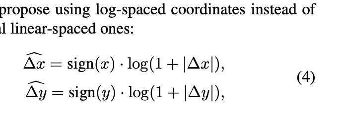

$$
\widehat{\Delta x}=\mathrm{sign}(x)\cdot\log(1+|\Delta x|),\qquad
\widehat{\Delta y}=\mathrm{sign}(y)\cdot\log(1+|\Delta y|).
$$

V1 的偏置是一张 $(2M-1)^2$ 的表，M 从 8 换到 16 时表的大小变了，只能双三次插值，效果差。V2 改成**连续函数**：一个两层 MLP 把相对位移 $(\Delta x,\Delta y)$ 映射成偏置，任意位移都能算。再把位移取对数：论文的例子，从 8×8 窗口迁移到 16×16，线性坐标要从 $[-7,7]$ 外推到 $[-15,15]$，外推了原范围的 1.14 倍；对数坐标从 $[-2.079,2.079]$ 到 $[-2.773,2.773]$，只外推 0.33 倍。**MLP 在没见过的输入上要猜，猜的范围越小越准。**

*Table 1. Comparison of different position bias computation approaches using Swin-T. * indicates the top-1 accuracy on ImageNet-1k trained from scratch. The models in * column will be used for testing on the ImageNet-1K image classification task using larger image/window resolutions, marked by †. For these results, we report both the results w.o./with fine-tuning.*

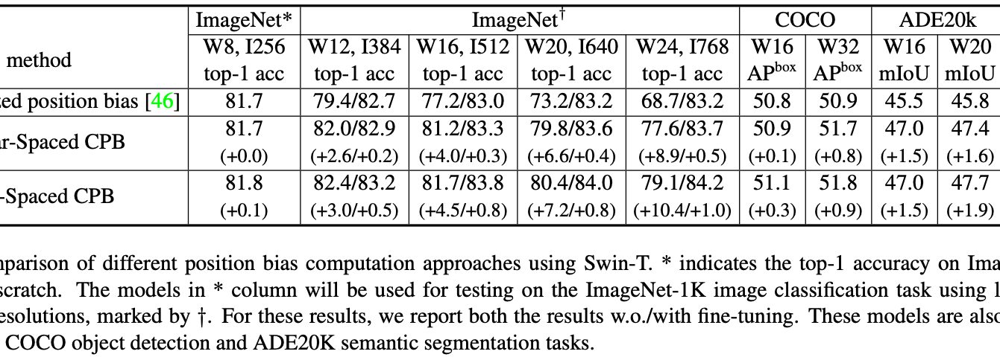

**🖼 逐元素图解**

- **第一列（W8, I256）**：在 8×8 窗口、256 输入上从头训练的精度，三种方法 81.7 / 81.7 / 81.8，几乎一样。
- **后四列**：把这个模型直接拿到更大窗口和输入上（W12/I384 … W24/I768），斜线前是**不微调**直接测，斜线后是微调后。
- **第一行 Parameterized（V1 查表 + 插值）**：不微调从 79.4 一路掉到 68.7；微调后 82.7 → 83.2。
- **第三行 Log-spaced CPB**：不微调 82.4 / 81.7 / 80.4 / 79.1；微调后 83.2 / 83.8 / 84.0 / **84.2**。
- **括号里是相对第一行的增量**：窗口越大增益越大，W24 时不微调 +10.4、微调 +1.0。

**读法：** 窗口从 8 到 24，查表法不微调掉 13 个点，对数 CPB 只掉 2.7；微调后对数 CPB 随窗口增大持续上升到 84.2，查表法在 83.2 饱和。**低分辨率预训练、高分辨率微调**是训练大模型省算力的关键，V2 让这条路走通了。

#### Swin V2 表 6　两项改动各值多少

*Table 6. Ablation on res-post-norm and cosine attention.*

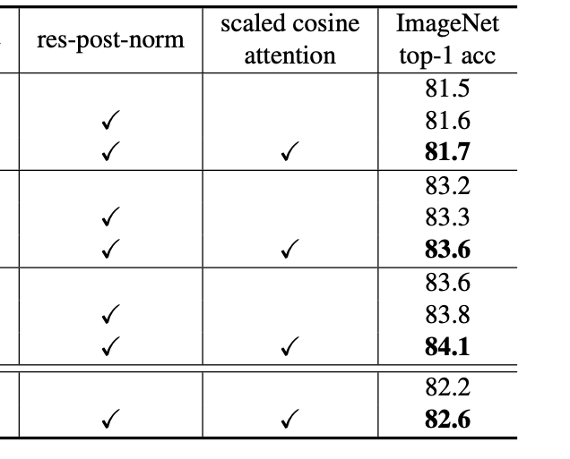

Swin-T 81.5 → +res-post-norm 81.6 → +cosine 81.7；Swin-S 83.2 → 83.3 → 83.6；Swin-B 83.6 → 83.8 → 84.1；ViT-B 82.2 → 82.6。**模型越大收益越大**（T +0.2、S +0.4、B +0.5），和它们的设计目的一致：这两项是为了让更大的模型能训，不是为了让小模型更准。最终 Swin V2-G（30 亿参数、1536 分辨率）在 ImageNet-V2 上 84.0、COCO 63.1 box AP、ADE20K 59.9 mIoU，而且只用了 7000 万张标注图（JFT-3B 的 1/40）。

> **⚠️ V1 和 V2 的权重不能互换**
>
> 两版 LN 的位置、注意力分数的算法、偏置的来源（查表 vs MLP）、merge 里 LN 的宽度（4C vs 2C）都不同。很多矩阵形状相同，`load_state_dict(strict=False)` 能跑通，但函数已经变了。加载前先对架构版本，不要只看 missing keys。

### 🖊 本模块练习

21. ★ 表 2(a) 里四种检测框架换 Swin-T 都比 R-50 高 3–4 AP，参数和 FLOPs 几乎不变。这说明什么？

<details><summary>解析</summary>

增益来自骨干本身，而不是检测框架或模型规模。四种框架的头完全不同（两阶段、单阶段、点表示、稀疏查询），都受益，说明 Swin-T 产出的四级特征普遍比 ResNet-50 的好。同算力下的一致增益是"更好的骨干"最有说服力的证据。

</details>

22. ★ 表 5 里循环移位比 padding 快多少？比不移位慢多少？为什么作者接受这一点点慢？

<details><summary>解析</summary>

Swin-T：循环 755 FPS，padding 670，不移位 770。循环比 padding 快 13%，比不移位只慢 2%。而表 4 显示移位带来 +1.1 分类、+2.8 检测、+2.8 分割。2% 的速度换 2.8 AP，显然值。

</details>

23. 为什么 Pre-norm 在很深的大模型里会让激活方差逐层上升？res-post-norm 怎样解决？

<details><summary>解析</summary>

Pre-norm 的 LN 作用在分支输入上，分支输出未经约束直接加到主干，主干幅度每层累积。24 层后 H 模型的方差涨到 $10^4$ 以上，训练崩溃。res-post-norm 把 LN 移到分支输出上，每次加回主干的量都归一化过，方差平稳（图 2 的三角曲线）。

</details>

24. 从 8×8 窗口迁移到 16×16，为什么对数坐标比线性坐标外推得少？

<details><summary>解析</summary>

线性坐标范围从 $[-7,7]$ 变 $[-15,15]$，新增的 $[8,15]$ 是原范围的 1.14 倍；对数坐标 $\log(1+7)=2.079$ 到 $\log(1+15)=2.773$，新增 0.69 只是原范围的 0.33 倍。MLP 对训练时没见过的输入只能外推，外推越少越可靠。表 1 的 W24 列不微调差 10.4 个点。

</details>

---

`Part 7`

## 七、四段可运行核查

下面四段程序只用 Python 标准库。它们核对本讲的索引、mask、梯度和账本，不训练模型，也不加载权重。

### 实验一：分窗、移位 mask 与依赖支持

用固定的 4×4 单通道图，把图 4 的循环移位 + mask 算一遍，再用"在原图坐标直接按 9 个区域分组"的笨办法独立算一遍，逐格比较；对 16 个基输入检测两层 W+SW 后每个位置依赖哪些输入；最后展示有限 mask（−100）和 padding 零值的反例。

~~~python
import math

H=W=4; M=2; SHIFT=1

def partition(x):
    assert len(x)==H and all(len(row)==W for row in x)
    return [[x[br*M+i][bc*M+j] for i in range(M) for j in range(M)]
            for br in range(H//M) for bc in range(W//M)]

def reverse(windows):
    out=[[None]*W for _ in range(H)]
    for br in range(H//M):
        for bc in range(W//M):
            win=windows[br*(W//M)+bc]
            for i in range(M):
                for j in range(M):
                    out[br*M+i][bc*M+j]=win[i*M+j]
    return out

def roll(x, amount):
    return [[x[(i-amount)%H][(j-amount)%W] for j in range(W)]
            for i in range(H)]

def mask_labels():
    def region(index,size):
        if index<size-M: return 0
        if index<size-SHIFT: return 1
        return 2
    return [[3*region(i,H)+region(j,W) for j in range(W)] for i in range(H)]

def attend_uniform(x, shifted):
    xx=roll(x,-SHIFT) if shifted else x
    labels=partition(mask_labels()) if shifted else [[0]*4 for _ in range(4)]
    out=[]
    for values,labs in zip(partition(xx),labels):
        out.append([sum(values[j] for j in range(4) if labs[j]==labs[i])/
                    sum(labs[j]==labs[i] for j in range(4)) for i in range(4)])
    y=reverse(out)
    return roll(y,SHIFT) if shifted else y

def clipped_shift_reference(x):
    # Independent grouping in original, non-cyclic coordinates.
    y=[]
    for i in range(H):
        row=[]
        for j in range(W):
            group=((i-SHIFT)//M,(j-SHIFT)//M)
            vals=[x[a][b] for a in range(H) for b in range(W)
                  if ((a-SHIFT)//M,(b-SHIFT)//M)==group]
            row.append(sum(vals)/len(vals))
        y.append(row)
    return y

x=[[i*4+j+1 for j in range(4)] for i in range(4)]
assert reverse(partition(x))==x
assert roll(roll(x,-SHIFT),SHIFT)==x
w=attend_uniform(x,False); sw=attend_uniform(x,True)
assert sw==clipped_shift_reference(x)
assert w==[[3.5,3.5,5.5,5.5]]*2+[[11.5,11.5,13.5,13.5]]*2
assert sw==[[1,2.5,2.5,4],[7,8.5,8.5,10],[7,8.5,8.5,10],[13,14.5,14.5,16]]
print('original',x)
print('rolled',roll(x,-SHIFT))
print('mask_regions',mask_labels())
print('mask_window_labels',partition(mask_labels()))
print('W_MSA',w)
print('SW_MSA',sw)
print('W_then_SW',attend_uniform(w,True))
# Dependency support of W then SW, evaluated by basis inputs.
support=[[set() for _ in range(W)] for _ in range(H)]
for source in range(H*W):
    basis=[[float(i*W+j==source) for j in range(W)] for i in range(H)]
    result=attend_uniform(attend_uniform(basis,False),True)
    for i in range(H):
        for j in range(W):
            if result[i][j]>0: support[i][j].add(source)
assert len(support[1][1])==16 and len(support[0][0])==4
print('two_layer_support_size',[[len(s) for s in row] for row in support])
# Finite -100 is not an exact ban; it can fail under huge logits.
def softmax(row):
    m=max(row); ex=[math.exp(v-m) for v in row]
    return [v/sum(ex) for v in ex]
small=softmax([0,-100]); large=softmax([0,200-100])
assert 0<small[1]<1e-40 and large[1]>0.999
# Padding zeros still receive mass if left unmasked.
assert sum([1.,2.,3.,0.])/4==1.5
assert sum([1.,2.,3.])/3==2.
print('finite_mask_mass',small[1],'huge_masked_logit_mass',large[1])
print('partition, inverse, boundary masks and dependency checks passed')
~~~


### 实验二：窗口注意力的完整参数梯度

两个窗口、每窗 4 个位置、宽 2、单头，其中一窗带边界 mask；共用 Q/K/V/输出矩阵和 9 项相对偏置。对所有参数做有限差分，特别核对相对偏置的 scatter-add 梯度。不含 LN/FFN/残差，便于把注意力本体的每条梯度路径单独检查。

~~~python
import math

def tr(a): return [list(row) for row in zip(*a)]
def mm(a,b):
    return [[sum(x*y for x,y in zip(row,col)) for col in zip(*b)] for row in a]
def zeros(rows,cols): return [[0.]*cols for _ in range(rows)]
def add(a,b): return [[x+y for x,y in zip(ar,br)] for ar,br in zip(a,b)]
def scale(a,s): return [[v*s for v in row] for row in a]
def init(rows,cols,phase):
    return [[0.35*math.sin(0.41*(i*cols+j+1)+phase) for j in range(cols)] for i in range(rows)]
def softmax(row):
    top=max(row); ex=[math.exp(v-top) for v in row]; total=sum(ex)
    return [v/total for v in ex]
def max_error(objects, grads, objective):
    error=0.; count=0; step=1e-5
    for array,gradient in zip(objects,grads):
        for i,row in enumerate(array):
            for j,value in enumerate(row):
                array[i][j]=value+step; plus=objective()
                array[i][j]=value-step; minus=objective()
                array[i][j]=value
                error=max(error,abs((plus-minus)/(2*step)-gradient[i][j]))
                count+=1
    return error,count

def attention(q,k,v,bias=None,allowed=None):
    scores=scale(mm(q,tr(k)),1/math.sqrt(len(q[0])))
    if bias is not None: scores=add(scores,bias)
    if allowed is not None:
        scores=[[s if allowed[i][j] else -math.inf for j,s in enumerate(row)]
                for i,row in enumerate(scores)]
    a=[softmax(row) for row in scores]
    return mm(a,v),(q,k,v,a)

def attention_back(g,cache):
    q,k,v,a=cache
    gv=mm(tr(a),g); ga=mm(g,tr(v)); gs=[]
    for ar,gr in zip(a,ga):
        avg=sum(x*y for x,y in zip(ar,gr))
        gs.append([x*(y-avg) for x,y in zip(ar,gr)])
    gq=scale(mm(gs,k),1/math.sqrt(len(q[0])))
    gk=scale(mm(tr(gs),q),1/math.sqrt(len(q[0])))
    return gq,gk,gv,gs

# Two 2x2 windows, one head, width2. Exact ban for the teaching mask.
D=2; N=4
xs=[init(4,2,0.1),init(4,2,0.6)]
wq,wk,wv,wo=[init(D,D,p) for p in (0.2,0.7,1.2,1.7)]
beta=init(9,1,0.4)
coords=[(0,0),(0,1),(1,0),(1,1)]
indices=[[(yi-yj+1)*3+(xi-xj+1) for yj,xj in coords] for yi,xi in coords]
assert indices==[[4,3,1,0],[5,4,2,1],[7,6,4,3],[8,7,5,4]]
labels=[[0,0,0,0],[1,2,1,2]]

def forward():
    loss=0.; caches=[]
    bias=[[beta[indices[i][j]][0] for j in range(N)] for i in range(N)]
    for x,labs in zip(xs,labels):
        allowed=[[a==b for b in labs] for a in labs]
        q,k,v=mm(x,wq),mm(x,wk),mm(x,wv)
        u,ac=attention(q,k,v,bias,allowed)
        y=mm(u,wo)
        loss+=sum(v*v/2 for row in y for v in row)
        caches.append((x,u,y,ac,allowed))
    return loss,caches

def backward(caches):
    gx=[]; gq_w,gk_w,gv_w,go_w=[zeros(D,D) for _ in range(4)]
    gb=zeros(9,1); per_window=[]
    for x,u,y,ac,allowed in caches:
        go_w=add(go_w,mm(tr(u),y))
        gq,gk,gv,gs=attention_back(mm(y,tr(wo)),ac)
        gq_w=add(gq_w,mm(tr(x),gq))
        gk_w=add(gk_w,mm(tr(x),gk))
        gv_w=add(gv_w,mm(tr(x),gv))
        gx.append(add(add(mm(gq,tr(wq)),mm(gk,tr(wk))),mm(gv,tr(wv))))
        local=zeros(9,1)
        for i in range(N):
            for j in range(N):
                if not allowed[i][j]: assert gs[i][j]==0.
                local[indices[i][j]][0]+=gs[i][j]
        gb=add(gb,local); per_window.append(local)
    assert max(abs(gb[i][0]-sum(local[i][0] for local in per_window)) for i in range(9))<1e-14
    # Same scalar added to all score entries is softmax-invariant.
    assert abs(sum(row[0] for row in gb))<1e-12
    return gx+[gq_w,gk_w,gv_w,go_w,gb]

loss,caches=forward(); gradients=backward(caches)
objects=xs+[wq,wk,wv,wo,beta]
error,count=max_error(objects,gradients,lambda:forward()[0])
assert error<1e-7
print('relative_index',indices)
print('loss',loss,'checked_scalars',count,'max_gradient_error',error)
print('shared_bias_gradient',[round(row[0],9) for row in gradients[-1]])
print('masked score gradients and shared relative-bias accumulation passed')
~~~


### 实验三：SRA 双支路与 merge 反传

第一部分：4×4、C=2 的特征图经 2×2 空间缩减投影、LN、4 个 K/V 摘要、16 个 query 的注意力，检查 68 个标量的梯度（query 支路和摘要支路都要回传）。第二部分：2×2、C=2 按 00/10/01/11 拼接、LN 8、8×4 投影的 patch merging，检查 56 个标量。

~~~python
import math

def tr(a): return [list(row) for row in zip(*a)]
def mm(a,b):
    return [[sum(x*y for x,y in zip(row,col)) for col in zip(*b)] for row in a]
def zeros(rows,cols): return [[0.]*cols for _ in range(rows)]
def add(a,b): return [[x+y for x,y in zip(ar,br)] for ar,br in zip(a,b)]
def scale(a,s): return [[v*s for v in row] for row in a]
def init(rows,cols,phase):
    return [[0.35*math.sin(0.41*(i*cols+j+1)+phase) for j in range(cols)] for i in range(rows)]
def softmax(row):
    top=max(row); ex=[math.exp(v-top) for v in row]; total=sum(ex)
    return [v/total for v in ex]
def max_error(objects, grads, objective):
    error=0.; count=0; step=1e-5
    for array,gradient in zip(objects,grads):
        for i,row in enumerate(array):
            for j,value in enumerate(row):
                array[i][j]=value+step; plus=objective()
                array[i][j]=value-step; minus=objective()
                array[i][j]=value
                error=max(error,abs((plus-minus)/(2*step)-gradient[i][j]))
                count+=1
    return error,count

def attention(q,k,v,bias=None,allowed=None):
    scores=scale(mm(q,tr(k)),1/math.sqrt(len(q[0])))
    if bias is not None: scores=add(scores,bias)
    if allowed is not None:
        scores=[[s if allowed[i][j] else -math.inf for j,s in enumerate(row)]
                for i,row in enumerate(scores)]
    a=[softmax(row) for row in scores]
    return mm(a,v),(q,k,v,a)

def attention_back(g,cache):
    q,k,v,a=cache
    gv=mm(tr(a),g); ga=mm(g,tr(v)); gs=[]
    for ar,gr in zip(a,ga):
        avg=sum(x*y for x,y in zip(ar,gr))
        gs.append([x*(y-avg) for x,y in zip(ar,gr)])
    gq=scale(mm(gs,k),1/math.sqrt(len(q[0])))
    gk=scale(mm(tr(gs),q),1/math.sqrt(len(q[0])))
    return gq,gk,gv,gs

def ln_affine(a,gamma,beta):
    z=[]; sigmas=[]
    for row in a:
        mu=sum(row)/len(row)
        sigma=math.sqrt(sum((v-mu)**2 for v in row)/len(row)+1e-4)
        z.append([(v-mu)/sigma for v in row]); sigmas.append(sigma)
    y=[[gamma[0][j]*v+beta[0][j] for j,v in enumerate(row)] for row in z]
    return y,(z,sigmas)

def ln_affine_back(g,cache,gamma):
    z,sigmas=cache; cols=len(z[0])
    gg=[[sum(gr[j]*zr[j] for gr,zr in zip(g,z)) for j in range(cols)]]
    gb=[[sum(gr[j] for gr in g) for j in range(cols)]]
    dx=[]
    for gr,zr,sigma in zip(g,z,sigmas):
        v=[gr[j]*gamma[0][j] for j in range(cols)]
        mean=sum(v)/cols; mean_z=sum(a*b for a,b in zip(v,zr))/cols
        dx.append([(a-mean-b*mean_z)/sigma for a,b in zip(v,zr)])
    return dx,gg,gb

# Spatial reduction: 4x4 width2 -> four width8 groups -> width2 -> LN.
D=2; N=16
x=init(N,D,0.3); ws=init(4*D,D,0.8)
gamma=[[1.1,0.9]]; beta=[[0.03,-0.02]]
wq,wk,wv,wo=[init(D,D,p) for p in (0.2,0.6,1.0,1.4)]
groups=[[((2*br+i)*4+2*bc+j) for i in range(2) for j in range(2)]
        for br in range(2) for bc in range(2)]

def sr_forward():
    grouped=[[value for index in group for value in x[index]] for group in groups]
    reduced,lc=ln_affine(mm(grouped,ws),gamma,beta)
    q,k,v=mm(x,wq),mm(reduced,wk),mm(reduced,wv)
    u,ac=attention(q,k,v)
    y=mm(u,wo)
    return sum(v*v/2 for row in y for v in row),(grouped,reduced,lc,u,y,ac)

def sr_backward(cache):
    grouped,reduced,lc,u,y,ac=cache
    go=mm(tr(u),y)
    gq,gk,gv,_=attention_back(mm(y,tr(wo)),ac)
    gq_w=mm(tr(x),gq); gk_w=mm(tr(reduced),gk); gv_w=mm(tr(reduced),gv)
    gx=mm(gq,tr(wq))
    gr=add(mm(gk,tr(wk)),mm(gv,tr(wv)))
    gproj,gg,gb=ln_affine_back(gr,lc,gamma)
    gs=mm(tr(grouped),gproj); grouped_grad=mm(gproj,tr(ws))
    for group,grad in zip(groups,grouped_grad):
        for offset,index in enumerate(group):
            for channel in range(D): gx[index][channel]+=grad[offset*D+channel]
    return [gx,gs,gg,gb,gq_w,gk_w,gv_w,go]

loss,cache=sr_forward()
objects=[x,ws,gamma,beta,wq,wk,wv,wo]
error,count=max_error(objects,sr_backward(cache),lambda:sr_forward()[0])
assert error<1e-6
print('SRA_loss',loss,'checked_scalars',count,'max_gradient_error',error)
# Patch merging V1: 2x2 width2 -> concat(00,10,01,11) -> LN8 -> linear8x4.
xm=init(4,2,0.5); wm=init(8,4,0.9)
gm=[[1.+0.02*j for j in range(8)]]; bm=[[0.01*j for j in range(8)]]
order=[0,2,1,3]
def merge_forward():
    row=[[v for index in order for v in xm[index]]]
    z,lc=ln_affine(row,gm,bm); y=mm(z,wm)
    return sum(v*v/2 for v in y[0]),(z,lc,y)
def merge_backward(cache):
    z,lc,y=cache
    gw=mm(tr(z),y); gz=mm(y,tr(wm))
    gr,gg,gb=ln_affine_back(gz,lc,gm)
    gx=zeros(4,2)
    for offset,index in enumerate(order): gx[index]=gr[0][offset*2:offset*2+2]
    return [gx,gw,gg,gb]
loss_m,cache_m=merge_forward()
error_m,count_m=max_error([xm,wm,gm,bm],merge_backward(cache_m),lambda:merge_forward()[0])
assert error_m<1e-7
print('merge_loss',loss_m,'checked_scalars',count_m,'max_gradient_error',error_m)
# A concrete many-to-one collision including LN, with selector reduction.
a=[[1.,3.,2.,4.]]; b=[[1.,3.,4.,2.]]
za,_=ln_affine(a,[[1.]*4],[[0.]*4]); zb,_=ln_affine(b,[[1.]*4],[[0.]*4])
selector=[[1.,0.],[0.,1.],[0.,0.],[0.,0.]]
assert mm(za,selector)==mm(zb,selector)
# Reversing normalization/reduction changes the operation and LN parameters.
z,_=ln_affine([[1.,2.,4.,8.]],[[1.]*4],[[0.]*4])
first=mm(z,selector)
second,_=ln_affine(mm([[1.,2.,4.,8.]],selector),[[1.]*2],[[0.]*2])
assert max(abs(a-b) for a,b in zip(first[0],second[0]))>0.1
print('LN_then_reduce',first[0],'reduce_then_LN',second[0])
print('SRA shared-input paths, merging scatter and information-loss checks passed')
~~~


### 实验四：全网参数、MAC 与版本公式

独立核算 Swin T/S/B 的四 stage、stem、merge、末 LN 与 1000 类头的精确参数和 MAC；计算单份 FP16 分数矩阵、SRA 账本、均值摘要例子、cosine 与对数坐标、PVT v2 的 overlap stem 尺寸。

~~~python
import math

def swin(width, depths, heads, image=224, window=7, classes=1000):
    assert image % 32 == 0
    params = 51*width  # 4x4 RGB weight, bias, input LN
    macs = (image//4)**2*48*width
    stages=[]
    for i,(depth,nh) in enumerate(zip(depths,heads)):
        h=image//(4*2**i); n=h*h; c=width*2**i
        assert h % window == 0
        block_p=12*c*c+13*c+(2*window-1)**2*nh
        block_m=12*n*c*c+2*n*window*window*c
        params+=depth*block_p; macs+=depth*block_m
        merge_p=8*c*c+8*c if i<3 else 0
        merge_m=2*n*c*c if i<3 else 0
        params+=merge_p; macs+=merge_m
        stages.append((h,c,depth,depth*block_p,depth*block_m,merge_p,merge_m))
    c=width*8
    params+=2*c+(c+1)*classes; macs+=c*classes
    return params,macs,stages

for name,width,depths,heads,expected in [
 ('T',96,[2,2,6,2],[3,6,12,24],28288354),
 ('S',96,[2,2,18,2],[3,6,12,24],49606258),
 ('B',128,[2,2,18,2],[4,8,16,32],87768224)]:
    p,m,rows=swin(width,depths,heads)
    assert p==expected,(name,p,expected)
    print('Swin',name,'parameters',p,'matrix_MAC',m)
    for row in rows: print('  stage',row)

n,c,m,heads=56**2,96,7,3
pairs_global=n*n; pairs_window=n*m*m
assert pairs_global//pairs_window==64
print('first_stage_global_and_window_pairs',pairs_global,pairs_window)
print('FP16_3head_MiB',pairs_global*heads*2/2**20,pairs_window*heads*2/2**20)
# Fixed r SRA still has a quadratic QK/AV term.
for side,c,r in [(56,64,8),(28,128,4),(14,320,2),(7,512,1)]:
    n=side**2; ns=(side//r)**2
    q_out=2*n*c*c; kv=2*ns*c*c
    reduce=n*c*c if r>1 else 0
    interaction=2*n*ns*c
    print('SRA',side,c,r,'N_KV',ns,'MAC',q_out+kv+reduce+interaction)

# Uniform attention after four region means; an original detail can vanish.
x=list(range(1,17))
means=[sum(x[(2*a+i)*4+2*b+j] for i in range(2) for j in range(2))/4
       for a in range(2) for b in range(2)]
assert means==[3.5,5.5,11.5,13.5]
print('SR_region_means',means,'uniform_SRA',sum(means)/4)
# Cosine scaling and log-coordinate examples are independent calculations.
q,k=[3.,4.],[0.,2.]
dot=sum(a*b for a,b in zip(q,k))/math.sqrt(2)
cos=sum(a*b for a,b in zip(q,k))/(5*2)
assert abs(cos-0.8)<1e-12
print('dot_logit',dot,'cosine_logit_scale10',10*cos)
for delta in [0,1,6,12]:
    z=8*delta/6
    u=math.log2(1+z)/math.log2(8)
    print('log_coord',delta,u)
# Output size formula for overlapping stem, k7/s4/p3.
for side in [224,225,230]:
    out=(side+6-7)//4+1
    assert out==math.ceil(side/4)
    print('overlap_stem_side',side,out)
print('all ledger and formula checks passed')
~~~


四段程序通过之后，**已经核对的**：分窗索引、移位 mask 的正确性、两层依赖集合、相对偏置的梯度累加、SRA 和 merge 的反传、三档精确账本、cosine 和对数坐标的数值。**没有核对的**：任何真实 checkpoint、ImageNet/COCO 的精度、GPU 速度。

---

## 附录 A · 核心概念速查

| 概念 | 一句话 | 出处 |
|---|---|---|
| **为什么要金字塔** | 检测分割需要 stride 4/8/16/32 四级特征，ViT 只有一级 | Swin 图 1、PVT 图 1 |
| **窗口注意力 W-MSA** | 注意力只在 M×M = 49 个 patch 的窗口内算；复杂度 $4hwC^2+2M^2hwC$，与面积线性 | 公式 (2) |
| **固定窗口 vs 滑动窗口** | 固定窗口同窗 query 共用 key，能批量；滑动窗口慢 4 倍 | 第 2 页、表 5 |
| **移位窗口 SW-MSA** | 下一层窗口边界移 M/2，让上一层相邻窗口通信；两种块成对交替 | 图 2、公式 (3) |
| **循环移位 + mask** | 滚动特征图让窗口保持规则；按原区域编号给拼凑窗口加 −∞ mask | 图 4 |
| **相对位置偏置** | $(2M-1)^2$ 的小表按位移查，加在分数上；比绝对位置好，稠密任务 +2.3 mIoU | 公式 (4)、表 4 |
| **Patch merging** | 2×2 四个 patch 拼成 4C、LN、线性到 2C；空间减半通道翻倍 | 图 3 |
| **变体** | T/S/B/L：C = 96/96/128/192，块数 {2,2,6,2} 或 {2,2,18,2}，每头 32 维 | 第 5 页 |
| **SRA（PVT）** | query 全保留，K/V 用 R×R 块缩减成摘要；交互 $2N^2C/R^2$ | PVT 图 4、公式 (1)–(3) |
| **Swin vs PVT** | 窗口：逐个读窗内原 token，局部精细；SRA：读全图粗摘要，全局模糊 | 模块五 |
| **PVT v2** | 重叠 stem、卷积 FFN、固定 49 个 K/V 的线性 SRA | 模块五 💡 |
| **检测增益** | 四种框架换 Swin-T 都 +3.4 到 +4.2 AP，同算力 | Swin 表 2 |
| **res-post-norm** | LN 移到分支输出、相加之前；抑制深层激活爆炸 | V2 图 1、图 2 |
| **scaled cosine attention** | $\cos(q,k)/\tau+B$，对 q/k 幅度不敏感 | V2 图 1 |
| **Log-CPB** | MLP 从对数位移生成偏置，任意窗口可算；W8→W24 不微调只掉 2.7 | V2 公式 (4)、表 1 |

## 附录 B · 数字速查

| 量 | 数值 |
|---|---:|
| Swin-T 四级输出（224） | 56²×96 / 28²×192 / 14²×384 / 7²×768 |
| 窗口 / 移位 / 每头维 | M = 7 / s = 3 / 32 |
| Swin-T/S/B 精确参数 | 28,288,354 / 49,606,258 / 87,768,224（论文 29M/50M/88M） |
| Swin-T MAC | 4,490,566,656（论文 4.5G） |
| stage 1 一个块 | 投影 115.6M + 交互 29.5M + MLP 231.2M ≈ 376M MAC |
| 相对偏置参数（M=7，3 头） | 169×3 = 507 |
| ImageNet top-1 | Swin-T 81.3 / S 83.0 / B 83.5 / B↑384 84.5 / L↑384（22K）87.3 |
| COCO（Cascade Mask R-CNN） | R-50 46.3 → Swin-T 50.5 AP box |
| 速度（V100，Swin-T） | 不移位 770 / 循环移位 755 / padding 670 / 滑窗 kernel 488 / 滑窗朴素 183 FPS |
| PVT stage 1 | N 3136、C 64、R 8 → 49 个 K/V；交互项降 64 倍 |
| Swin V2 对数坐标外推 | 线性 1.14× vs 对数 0.33×（W8 → W16） |
| Swin V2-G | 30 亿参数，1536 分辨率，COCO 63.1 AP，ADE20K 59.9 mIoU |

## 附录 C · 面试高频问题

1. **ViT 为什么不适合做检测分割骨干？Swin 怎么改？**
   ViT 只有 stride 16 一级特征、全局注意力随 token 数平方增长。Swin 用 4×4 的小 patch 起步，每个 stage 用 patch merging 减半分辨率、翻倍通道，得到 stride 4/8/16/32 四级特征；注意力限制在 7×7 窗口内，复杂度与面积线性。

2. **窗口注意力怎样让不同窗口通信？**
   相邻两个块交替使用规则窗口和移位 M/2 的窗口。移位后的窗口横跨上一层的窗口边界，两层叠加信息就跨窗了。表 4：移位带来分类 +1.1、检测 +2.8、分割 +2.8。

3. **循环移位和 mask 是怎么回事？**
   移位后窗口数从 4 变 9 且大小不一，没法批量。把特征图向左上循环滚动 M/2，又能切成规则窗口；但滚动把原图对角的区域拼到了一起，所以按原区域编号给同窗不同区域的位置对加 −∞ mask。算完再滚回去。速度只比不移位慢 2%。

4. **Swin 为什么用相对位置偏置而不是绝对位置编码？**
   相对偏置只看两块之间的位移，平移不变，检测分割需要这个性质。表 4 显示加绝对位置反而在 COCO 掉 0.3、ADE20K 掉 2.1。参数只有 $(2M-1)^2$ 每头。

5. **Swin 和 PVT 省计算的方式有什么不同？**
   Swin 限制每个 query 的候选集合（只看窗内 49 个）；PVT 保留全图候选但把 K/V 压缩成 49 个摘要。前者局部精细，后者全局但粗。两者都用四级金字塔。

6. **patch merging 和平均池化有什么不同？**
   merging 把 2×2 的四个 C 维向量拼成 4C（位置信息各占一段），LN，再学一个 4C→2C 的线性层；池化是固定等权、输出仍 C 维，分不开块内的排列。

7. **Swin V2 改了什么、为什么？**
   res-post-norm（LN 移到分支输出）抑制深层激活爆炸；scaled cosine attention 防止少数大幅度 token 主导注意力；Log-CPB 用 MLP 从对数位移生成偏置，让低分辨率预训练的模型能迁移到大窗口。三者都是为了把模型扩到 30 亿参数、1536 分辨率。

8. **res-post-norm 和经典 Post-LN 一样吗？**
   不一样。Post-LN 是 $\mathrm{LN}(X+\mathrm{Attn}(X))$，残差主干也被归一化；res-post-norm 是 $X+\mathrm{LN}(\mathrm{Attn}(X))$，主干保持恒等路径，只归一化分支输出。

9. **为什么 Swin-T stage 4 参数最多、但每块计算量和 stage 1 差不多？**
   参数按 $12C^2$，C 翻三次倍后是 stage 1 的 64 倍；MAC 按 $12NC^2$，N 每级除 4、C 每级乘 2，$NC^2$ 不变。参数看宽度，计算看宽度×位置数。

10. **Swin 的真实速度和 DeiT 比如何？**
    同精度档更快：Swin-T 81.3 @ 755 FPS vs DeiT-S 79.8 @ 940；Swin-B 83.5 @ 278 vs DeiT-B 81.8 @ 292。检测上 Swin-T 15.3 FPS vs DeiT-S 10.4，因为 DeiT 要额外加反卷积凑多尺度。

---

## 原始材料

- [Liu 等：Swin Transformer: Hierarchical Vision Transformer using Shifted Windows](https://arxiv.org/abs/2103.14030)，ICCV 2021 最佳论文；[官方代码](https://github.com/microsoft/Swin-Transformer)。**本讲标注"Swin 图 N / 表 N / 公式"的截图来自该论文 arXiv v2 版。**
- [Wang 等：Pyramid Vision Transformer](https://arxiv.org/abs/2102.12122)，ICCV 2021；[官方代码](https://github.com/whai362/PVT)；[PVT v2](https://arxiv.org/abs/2106.13797)。**"PVT 图 N / 表 N / 公式"的截图来自 PVT v1 论文 arXiv v2 版。**
- [Liu 等：Swin Transformer V2: Scaling Up Capacity and Resolution](https://arxiv.org/abs/2111.09883)，CVPR 2022。**"Swin V2 图 N / 表 N / 公式"的截图来自该论文 arXiv v2 版。**
- 所有截图版权归原作者，讲解文字为笔记作者补充。4×4 编号图、零分数平均、cosine 与对数坐标的小例子是本讲构造的教学例子，不是论文数据。

*本笔记基于三篇原论文整理，截图来自论文 PDF，讲解为笔记作者补充。资料核对日期 2026-10-19。*
